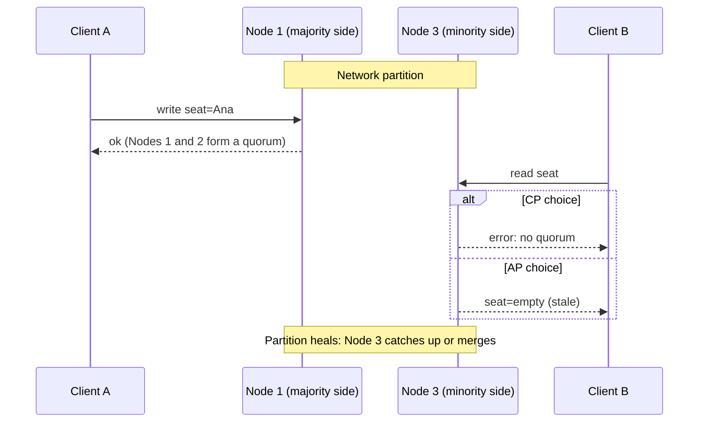

## In one minute
- CAP says that a replicated data store cannot guarantee both linearizable consistency and availability for every request while the network is partitioned. During a partition, each operation must either wait or fail (keep C) or answer from possibly stale data (keep A).
- It is not "pick two of three". Partitions are not optional in a real network, so the actual choice is what to give up *when* one happens.
- The C in CAP is linearizability, and the A is a strict "every non-failed node answers". Most real systems offer neither in pure form, which is why labelling a whole database "CP" or "AP" is usually misleading.
- PACELC adds the other half of the story: even with no partition, you trade latency against consistency, and that trade is the one you pay every day.
- Choose per operation, not per system: a seat booking needs C, a product view count can live with A.

## How it works

### The statement, precisely
Eric Brewer proposed CAP as a conjecture in 2000, and Seth Gilbert and Nancy Lynch proved it in 2002 ([Gilbert and Lynch](https://groups.csail.mit.edu/tds/papers/Gilbert/Brewer2.pdf)). Their model is a read-write register replicated across nodes. **Consistency** means linearizability: every operation appears to take effect at a single instant between its call and its return, so a read after a completed write sees that write or a later one. **Availability** means every request received by a non-failing node eventually gets a non-error response. **Partition tolerance** means the system keeps its guarantees even when the network drops any number of messages between nodes.

The proof is short. Split the nodes into two groups that cannot talk. A client writes on side 1; another then reads on side 2. If side 2 must answer (availability), it can only return what it has, which is the old value, breaking linearizability. If it must be linearizable, it cannot answer until the partition heals, breaking availability.

### Why "pick two" is wrong
"CA" would mean consistent and available as long as there is no partition, which describes every system on a good day. Any network of more than one machine can partition (a switch reboots, a firewall rule changes, a process pauses in garbage collection), so a distributed system cannot opt out. The live question is how it behaves during the partition and how it reconciles afterwards.

Brewer himself wrote in 2012 that the "2 of 3" framing was always misleading, and that CAP's C is a strict subset of the C in ACID: it is about one register's recency, not about preserving every database rule ([Brewer, InfoQ](https://www.infoq.com/articles/cap-twelve-years-later-how-the-rules-have-changed/)). He recommends treating a partition as an explicit mode with three steps: detect that it started, enter a partition mode that limits some operations, and run recovery when communication returns. Recovery is where the work hides, because both sides' writes must be merged and any broken invariants repaired.

### "Effectively CA"
Google describes Spanner as technically CP: during some partitions it chooses consistency and gives up availability. Brewer argues it can still claim to be "effectively CA" because its measured availability is high enough, five nines or better, that users can ignore outages, and because partitions cause few of them. In Spanner's internal incident data, the network category was under 8%, and no Spanner quorum was ever on the minority side of a partition ([Brewer, 2017](https://static.googleusercontent.com/media/research.google.com/en//pubs/archive/45855.pdf)). The lesson for everyone else: CAP's availability is an all-or-nothing property, while the availability users feel is a percentage you can engineer with redundant networks.

### What the two choices look like
A **consistent-under-partition** system, such as etcd, ZooKeeper, or a Raft-replicated database, needs a majority quorum for every write and linearizable read. Minority-side nodes refuse or redirect requests; the majority side keeps working.

An **available-under-partition** system, such as Cassandra at low consistency levels, lets each side keep accepting reads and writes. Both sides may update the same key, so healing needs a merge rule: last-writer-wins, vector clocks with application merge, or CRDTs.

### Per operation, not per database
Most databases let you choose per request: Cassandra's consistency levels (`ONE`, `QUORUM`, `ALL`), MongoDB's read and write concerns, DynamoDB's strongly consistent reads. The choice can also be per table. DynamoDB global tables default to multi-Region eventual consistency, where concurrent writes in two Regions are settled by last writer wins; since 2025 a table can instead be created with multi-Region strong consistency, which must span exactly three Regions (or two plus a witness), replicates each write synchronously to at least one other Region, and rejects a write to an item already being changed elsewhere with `ReplicatedWriteConflictException` ([DynamoDB docs](https://docs.aws.amazon.com/amazondynamodb/latest/developerguide/V2globaltables_HowItWorks.html)). The *contention* shape shows where C is required: the last seat, a bank balance, a unique username. Where staleness is harmless or repairable (view counts, a cart that merges both versions), A is the better choice. In an AI agent system, a task board that assigns work to exactly one agent needs C, while a cache of fetched web pages can be served stale.

### PACELC: the everyday trade
Daniel Abadi's PACELC ([Abadi, 2012](https://www.cs.umd.edu/~abadi/papers/abadi-pacelc.pdf)) extends CAP: if Partition, choose Availability or Consistency; Else, choose Latency or Consistency. A linearizable write across three regions waits for a remote acknowledgement, a 60 to 150 ms round trip on every write. Partitions are rare; latency is constant, so the ELC half often matters more.

## Down the stack

### Layer 1: The contract
A CP system promises: every acknowledged write is visible to every later read that succeeds, and during a partition, requests that cannot reach a quorum return an error or time out rather than a stale answer. An AP system promises: every request to a live node gets a response, and once communication is restored and writes stop, all replicas converge to the same value (eventual consistency), according to a stated merge rule. Jepsen tests both kinds of contract by injecting partitions and checking the recorded history.

### Layer 2: The mechanism
In Raft (used by etcd, Consul and CockroachDB), a leader appends each write to its log and commits it only when a majority has persisted the `AppendEntries` message. A leader on the minority side cannot commit. Plain Raft lets it go on believing it leads until it hears a higher term, so implementations add a quorum check: etcd's raft library steps a leader down automatically when it loses contact with a quorum ([etcd raft](https://github.com/etcd-io/raft/blob/main/README.md)). Linearizable reads go through `ReadIndex`, which confirms leadership with a heartbeat round before answering, or through leases, which skip that round but trust every machine's clock. In Dynamo-style stores, each key has N replicas; a write succeeds when W acknowledge and a read when R respond. With `R + W > N` (for example N=3, W=2, R=2), read and write sets overlap, which gives strong reads only when there are no concurrent writes and no sloppy quorums. Hinted handoff, read repair and Merkle-tree anti-entropy fix divergence later; Cassandra resolves conflicts per cell by write timestamp.

### Layer 3: The machine
A node cannot tell a partition from a slow peer, and TCP gives up slowly: with Linux's default `tcp_retries2 = 15`, an established connection can take around 15 minutes to report failure ([Linux docs](https://docs.kernel.org/networking/ip-sysctl.html)). So systems use their own timeouts: etcd's default heartbeat is 100 ms and its election timeout is 1,000 ms, with the guidance that the election timeout be at least 10 times the round-trip time ([etcd tuning](https://etcd.io/docs/v3.5/tuning/)); Raft's paper suggests 150 to 300 ms election timeouts inside one data centre ([Raft paper](https://raft.github.io/raft.pdf)). Every write that needs a quorum pays at least one network round trip plus an `fsync` on a majority (a few hundred microseconds on NVMe, several milliseconds on cloud network disks). Last-writer-wins depends on wall clocks, and NTP-synced clocks typically drift by single-digit milliseconds, so two writes that close together may be ordered arbitrarily and one silently lost.

### Why it's built this way
1. Messages between machines can be lost or delayed without bound, so no node can know for sure whether its peers saw a write.
2. Waiting for confirmation is the only way to be sure, so consistent systems require quorums and refuse to answer without one.
3. Quorums cost a round trip on every write, and some users cannot afford to wait or to be refused, so other systems accept writes locally and repair divergence later.
4. Repair requires deciding which concurrent write wins, so available systems carry timestamps, version vectors or CRDT metadata.

## Diagram


## Worked example
A concert ticketing service stores seat assignments in a three-node cluster spread over three availability zones, and user profile data (display name, avatar, favourite artists) in the same cluster.

Zone C is cut off from A and B for 4 minutes during an on-sale with 20,000 seat requests per minute, a third of them routed to zone C.

With seats configured CP (quorum writes, linearizable reads), the node in zone C refuses seat writes. The load balancer's health check sees errors from zone C and shifts traffic to A and B within about 30 seconds. For those 30 seconds, roughly 3,300 requests fail and clients retry. No seat is sold twice.

Had seats been AP (local writes, last-writer-wins on heal), zone C would have kept selling for 4 minutes. If 1% of those roughly 26,700 sales collided with sales of the same seat on the other side, about 270 seats would be double-sold, and last-writer-wins would silently drop one buyer of each. Each needs a refund and an apology, far costlier than 30 seconds of retries.

Profiles are the opposite case. If a user edits their display name on both sides, one version wins on heal, which is acceptable, and CP would only add refusals and a quorum round trip to every update. The team sets profiles to consistency level `ONE` and seats to `QUORUM` in the same cluster.

## In the wild
- **GitHub, 2018: 43 seconds of partition, 24 hours of degradation.** Optical maintenance cut the US East hub off from the primary data centre for 43 seconds, and in that window Orchestrator used Raft to promote West Coast MySQL primaries. Writes landed on both coasts, so GitHub chose to keep data consistent over staying fully available: it restored from backups and replayed writes, with service degraded for 24h11m and 954 unreplicated writes to reconcile on one cluster. GitHub planned to stop Orchestrator promoting primaries across regions ([GitHub](https://github.blog/news-insights/company-news/oct21-post-incident-analysis/)).
- **GitHub, 2012: split brain in a Pacemaker cluster.** A Pacemaker segfault partitioned the MySQL cluster and two separate clusters ran master elections at once, the worst case of availability without a quorum. MySQL and Redis IDs drifted apart, and 16 private repositories were visible to non-collaborators for 7 minutes; automatic failover of the active role was then changed to need a human ([GitHub](https://github.blog/news-insights/the-library/github-availability-this-week/)).
- **Google, 2017: how often partitions really matter.** In Spanner's internal incident data, network problems were under 8% of incidents, there was never a large set of clusters partitioned from another, and no Spanner quorum ever ended up on the minority side. The two biggest outages were software bugs that hit every replica at once, which is why Brewer calls Spanner technically CP but "effectively CA" ([Brewer](https://static.googleusercontent.com/media/research.google.com/en//pubs/archive/45855.pdf)).

## Trade-offs
| Choice under partition | Strengths | Weaknesses | Choose when |
|---|---|---|---|
| Consistency (quorum, refuse minority) | No stale reads, no conflicting writes, simple application logic | Minority side errors, higher write latency | Money, inventory, uniqueness, locks, leader election |
| Availability (accept locally, merge later) | Always answers, low latency, survives region isolation | Stale reads, conflicts, merge logic and its bugs | Counters, carts, social data, caches, offline-first apps |
| Tunable per request | Fit each operation to its need | Easy to misconfigure, harder to reason about | Mixed workloads in one store |
| CRDT-based availability | Automatic, deterministic merges | Limited data types, metadata overhead | Collaborative editing, counters, sets |

## Pitfalls in production
- **Trusting the label.** A database marketed as "CP" may allow stale reads from followers by default, and an "AP" store at `QUORUM` may still lose writes with last-writer-wins. Read the docs for the exact read and write settings you use, and check Jepsen reports. Kleppmann argues the labels are so loose that most systems are neither CP nor AP in the theorem's strict sense ([Kleppmann](https://martin.kleppmann.com/2015/05/11/please-stop-calling-databases-cp-or-ap.html)).
- **Last-writer-wins on skewed clocks.** Concurrent writes are ordered by wall clocks that disagree by milliseconds, and one write vanishes. Use version vectors or CRDTs where losing a write matters.
- **Quorum math with sloppy quorums.** Hinted handoff lets writes land on nodes outside the key's replica set, so `R + W > N` no longer guarantees overlap. Know whether your store does this.
- **Retries that turn CP into duplicates.** A client that times out on a CP write and retries may apply it twice if the first attempt actually committed. Use idempotency keys.
- **Forgetting the healing phase.** Teams design the partition behaviour and not the reconciliation. Plan and test what happens to conflicting writes when the network returns.

## Leadership lens
- Ask for each data type: what is the cost of a stale read and of a lost or conflicting write? That answer, not a database brand, decides C or A.
- Push teams to state consistency settings per operation in the design doc, including the read path, which is where stale reads usually hide.
- Remember PACELC when approving multi-region designs: strong consistency across regions adds a round trip to every write, every day.

## Check yourself
1. Why is "CA" not a meaningful option for a system replicated across data centres?
   **Answer:** Partitions will happen whether you choose them or not. Calling a system CA only describes its behaviour when the network is healthy; it says nothing about what it does when a partition arrives.
2. In a 5-node Raft cluster split 2/3, which side can accept writes, and what do clients of the other side see?
   **Answer:** The 3-node side has a majority and keeps committing writes. Clients of the 2-node side get errors, timeouts or redirects until the partition heals.
3. N=3, W=1, R=1. Is this CP or AP during a partition, and what can go wrong?
   **Answer:** It is available, since any single replica can answer. Reads can be stale and concurrent writes on both sides conflict, to be resolved by the store's merge rule.
4. What does PACELC add that CAP leaves out?
   **Answer:** The trade during normal operation: strong consistency requires coordination on every write, which costs latency even when there is no partition.

## Practice
**Task:** Simulate a replicated key-value store in `"CP"` or `"AP"` mode. `Cluster(n, mode)` has nodes `0..n-1`, all connected. `partition(groups)` splits nodes into groups that can only talk internally; `heal()` reconnects everyone. `write(node, key, value)` returns whether the write was accepted; an accepted write gets the next number from a cluster-wide counter (starting at 1) and is copied to every node in the writer's group. `read(node, key)` returns `(ok, value)`, with value `None` if the node has nothing. In CP mode, a node may serve reads and writes only if its group holds a strict majority of all n nodes; otherwise it returns `False` / `(False, None)`. In AP mode, every request succeeds. On `heal()`, every key on every node takes the version with the highest counter.

```python starter
class Cluster:
    def __init__(self, n, mode):
        # TODO
        raise NotImplementedError

    def partition(self, groups):
        raise NotImplementedError

    def heal(self):
        raise NotImplementedError

    def write(self, node, key, value):
        raise NotImplementedError

    def read(self, node, key):
        raise NotImplementedError
```

```python tests
def test_no_partition_reads_everywhere():
    c = Cluster(3, "CP")
    assert c.write(0, "seat", "ana")
    assert c.read(2, "seat") == (True, "ana")

def test_cp_minority_refuses():
    c = Cluster(3, "CP")
    c.partition([[0, 1], [2]])
    assert c.write(2, "seat", "bo") is False
    assert c.read(2, "seat") == (False, None)
    assert c.write(0, "seat", "ana")
    assert c.read(1, "seat") == (True, "ana")

def test_cp_minority_catches_up_on_heal():
    c = Cluster(3, "CP")
    c.partition([[0, 1], [2]])
    c.write(1, "seat", "ana")
    c.heal()
    assert c.read(2, "seat") == (True, "ana")

def test_cp_even_split_has_no_majority():
    c = Cluster(4, "CP")
    c.partition([[0, 1], [2, 3]])
    assert not c.write(0, "k", "x") and not c.write(3, "k", "y")

def test_ap_diverges_then_converges():
    c = Cluster(3, "AP")
    c.partition([[0, 1], [2]])
    assert c.write(0, "name", "a")
    assert c.write(2, "name", "b")
    assert c.read(1, "name") == (True, "a")
    assert c.read(2, "name") == (True, "b")
    c.heal()
    assert [c.read(i, "name") for i in range(3)] == [(True, "b")] * 3

def test_ap_missing_key():
    c = Cluster(2, "AP")
    c.partition([[0], [1]])
    assert c.read(1, "nothing") == (True, None)

def test_ap_stale_read_before_heal():
    c = Cluster(3, "AP")
    c.write(2, "k", "old")
    c.partition([[0], [1, 2]])
    c.write(1, "k", "new")
    assert c.read(0, "k") == (True, "old")
```

```python solution
class Cluster:
    def __init__(self, n, mode):
        self.n = n
        self.mode = mode
        self.data = [dict() for _ in range(n)]  # key -> (version, value)
        self.clock = 0
        self.heal()

    def partition(self, groups):
        self.group_of = {}
        for g in groups:
            for node in g:
                self.group_of[node] = list(g)

    def heal(self):
        everyone = list(range(self.n))
        self.group_of = {i: everyone for i in everyone}
        best = {}
        for store in self.data:
            for key, rec in store.items():
                if key not in best or rec[0] > best[key][0]:
                    best[key] = rec
        for store in self.data:
            store.update(best)

    def _allowed(self, node):
        if self.mode == "AP":
            return True
        return 2 * len(self.group_of[node]) > self.n

    def write(self, node, key, value):
        if not self._allowed(node):
            return False
        self.clock += 1
        for peer in self.group_of[node]:
            self.data[peer][key] = (self.clock, value)
        return True

    def read(self, node, key):
        if not self._allowed(node):
            return (False, None)
        rec = self.data[node].get(key)
        return (True, rec[1] if rec else None)
```

```typescript starter
export interface ReadResult {
  ok: boolean;
  value: string | null;
}

export class Cluster {
  constructor(n: number, mode: "CP" | "AP") {}
  partition(groups: number[][]): void {
    throw new Error("TODO");
  }
  heal(): void {
    throw new Error("TODO");
  }
  write(node: number, key: string, value: string): boolean {
    throw new Error("TODO");
  }
  read(node: number, key: string): ReadResult {
    throw new Error("TODO");
  }
}
```

```typescript tests
test("no partition", () => {
  const c = new Cluster(3, "CP");
  assert(c.write(0, "seat", "ana"), "write ok");
  assertEqual(c.read(2, "seat"), { ok: true, value: "ana" });
});
test("CP minority refuses", () => {
  const c = new Cluster(3, "CP");
  c.partition([[0, 1], [2]]);
  assertEqual(c.write(2, "seat", "bo"), false);
  assertEqual(c.read(2, "seat"), { ok: false, value: null });
  assert(c.write(0, "seat", "ana"), "majority write ok");
  assertEqual(c.read(1, "seat"), { ok: true, value: "ana" });
});
test("CP heal", () => {
  const c = new Cluster(3, "CP");
  c.partition([[0, 1], [2]]);
  c.write(1, "seat", "ana");
  c.heal();
  assertEqual(c.read(2, "seat"), { ok: true, value: "ana" });
});
test("CP even split", () => {
  const c = new Cluster(4, "CP");
  c.partition([[0, 1], [2, 3]]);
  assertEqual([c.write(0, "k", "x"), c.write(3, "k", "y")], [false, false]);
});
test("AP diverges then converges", () => {
  const c = new Cluster(3, "AP");
  c.partition([[0, 1], [2]]);
  assert(c.write(0, "name", "a") && c.write(2, "name", "b"), "both accepted");
  assertEqual(c.read(1, "name"), { ok: true, value: "a" });
  assertEqual(c.read(2, "name"), { ok: true, value: "b" });
  c.heal();
  assertEqual([0, 1, 2].map((i) => c.read(i, "name").value), ["b", "b", "b"]);
});
test("AP missing key", () => {
  const c = new Cluster(2, "AP");
  c.partition([[0], [1]]);
  assertEqual(c.read(1, "nothing"), { ok: true, value: null });
});
test("AP stale read", () => {
  const c = new Cluster(3, "AP");
  c.write(2, "k", "old");
  c.partition([[0], [1, 2]]);
  c.write(1, "k", "new");
  assertEqual(c.read(0, "k"), { ok: true, value: "old" });
});
```

```typescript solution
export interface ReadResult {
  ok: boolean;
  value: string | null;
}

type Rec = { version: number; value: string };

export class Cluster {
  private data: Map<string, Rec>[] = [];
  private groupOf = new Map<number, number[]>();
  private clock = 0;

  constructor(private n: number, private mode: "CP" | "AP") {
    for (let i = 0; i < n; i++) this.data.push(new Map());
    this.heal();
  }

  partition(groups: number[][]): void {
    this.groupOf = new Map();
    for (const g of groups) for (const node of g) this.groupOf.set(node, g.slice());
  }

  heal(): void {
    const everyone: number[] = [];
    for (let i = 0; i < this.n; i++) everyone.push(i);
    this.groupOf = new Map();
    for (const i of everyone) this.groupOf.set(i, everyone);
    const best = new Map<string, Rec>();
    for (const store of this.data) {
      for (const [k, rec] of store) {
        const cur = best.get(k);
        if (!cur || rec.version > cur.version) best.set(k, rec);
      }
    }
    for (const store of this.data) for (const [k, rec] of best) store.set(k, rec);
  }

  private allowed(node: number): boolean {
    if (this.mode === "AP") return true;
    return 2 * (this.groupOf.get(node) as number[]).length > this.n;
  }

  write(node: number, key: string, value: string): boolean {
    if (!this.allowed(node)) return false;
    this.clock += 1;
    for (const peer of this.groupOf.get(node) as number[]) {
      this.data[peer].set(key, { version: this.clock, value });
    }
    return true;
  }

  read(node: number, key: string): ReadResult {
    if (!this.allowed(node)) return { ok: false, value: null };
    const rec = this.data[node].get(key);
    return { ok: true, value: rec ? rec.value : null };
  }
}
```

```go starter
package practice

import "errors"

// ErrUnavailable is returned when a CP node is not in a majority group.
var ErrUnavailable = errors.New("unavailable: no majority")

// Cluster simulates a replicated key-value store in "CP" or "AP" mode.
type Cluster struct{}

func NewCluster(n int, mode string) *Cluster { return &Cluster{} }

func (c *Cluster) Partition(groups [][]int) { panic("TODO") }

func (c *Cluster) Heal() { panic("TODO") }

// Write returns ErrUnavailable if the write is refused.
func (c *Cluster) Write(node int, key, value string) error { panic("TODO") }

// Read returns the value, whether it was found, and ErrUnavailable if refused.
func (c *Cluster) Read(node int, key string) (string, bool, error) { panic("TODO") }
```

```go tests
package practice

import "testing"

func TestNoPartition(t *testing.T) {
	c := NewCluster(3, "CP")
	if err := c.Write(0, "seat", "ana"); err != nil {
		t.Fatal(err)
	}
	if v, ok, err := c.Read(2, "seat"); v != "ana" || !ok || err != nil {
		t.Fatalf("got %q %v %v", v, ok, err)
	}
}

func TestCPMinorityRefuses(t *testing.T) {
	c := NewCluster(3, "CP")
	c.Partition([][]int{{0, 1}, {2}})
	if err := c.Write(2, "seat", "bo"); err != ErrUnavailable {
		t.Fatal("minority write should be refused")
	}
	if _, _, err := c.Read(2, "seat"); err != ErrUnavailable {
		t.Fatal("minority read should be refused")
	}
	if err := c.Write(0, "seat", "ana"); err != nil {
		t.Fatal(err)
	}
	if v, _, _ := c.Read(1, "seat"); v != "ana" {
		t.Fatalf("got %q", v)
	}
}

func TestCPHeal(t *testing.T) {
	c := NewCluster(3, "CP")
	c.Partition([][]int{{0, 1}, {2}})
	c.Write(1, "seat", "ana")
	c.Heal()
	if v, ok, err := c.Read(2, "seat"); v != "ana" || !ok || err != nil {
		t.Fatalf("got %q %v %v", v, ok, err)
	}
}

func TestCPEvenSplit(t *testing.T) {
	c := NewCluster(4, "CP")
	c.Partition([][]int{{0, 1}, {2, 3}})
	if c.Write(0, "k", "x") == nil || c.Write(3, "k", "y") == nil {
		t.Fatal("no side has a majority")
	}
}

func TestAPDivergeConverge(t *testing.T) {
	c := NewCluster(3, "AP")
	c.Partition([][]int{{0, 1}, {2}})
	if c.Write(0, "name", "a") != nil || c.Write(2, "name", "b") != nil {
		t.Fatal("AP accepts both")
	}
	if v, _, _ := c.Read(1, "name"); v != "a" {
		t.Fatalf("side 1 got %q", v)
	}
	if v, _, _ := c.Read(2, "name"); v != "b" {
		t.Fatalf("side 2 got %q", v)
	}
	c.Heal()
	for i := 0; i < 3; i++ {
		if v, _, _ := c.Read(i, "name"); v != "b" {
			t.Fatalf("node %d got %q", i, v)
		}
	}
}

func TestAPMissingKey(t *testing.T) {
	c := NewCluster(2, "AP")
	c.Partition([][]int{{0}, {1}})
	if v, ok, err := c.Read(1, "nothing"); v != "" || ok || err != nil {
		t.Fatalf("got %q %v %v", v, ok, err)
	}
}

func TestAPStaleRead(t *testing.T) {
	c := NewCluster(3, "AP")
	c.Write(2, "k", "old")
	c.Partition([][]int{{0}, {1, 2}})
	c.Write(1, "k", "new")
	if v, _, _ := c.Read(0, "k"); v != "old" {
		t.Fatalf("got %q", v)
	}
}
```

```go solution
package practice

import "errors"

// ErrUnavailable is returned when a CP node is not in a majority group.
var ErrUnavailable = errors.New("unavailable: no majority")

type record struct {
	version int
	value   string
}

// Cluster simulates a replicated key-value store in "CP" or "AP" mode.
type Cluster struct {
	n       int
	mode    string
	data    []map[string]record
	groupOf map[int][]int
	clock   int
}

func NewCluster(n int, mode string) *Cluster {
	c := &Cluster{n: n, mode: mode}
	for i := 0; i < n; i++ {
		c.data = append(c.data, map[string]record{})
	}
	c.Heal()
	return c
}

func (c *Cluster) Partition(groups [][]int) {
	c.groupOf = map[int][]int{}
	for _, g := range groups {
		for _, node := range g {
			c.groupOf[node] = g
		}
	}
}

func (c *Cluster) Heal() {
	everyone := make([]int, c.n)
	for i := range everyone {
		everyone[i] = i
	}
	c.groupOf = map[int][]int{}
	for _, i := range everyone {
		c.groupOf[i] = everyone
	}
	best := map[string]record{}
	for _, store := range c.data {
		for k, rec := range store {
			if cur, ok := best[k]; !ok || rec.version > cur.version {
				best[k] = rec
			}
		}
	}
	for _, store := range c.data {
		for k, rec := range best {
			store[k] = rec
		}
	}
}

func (c *Cluster) allowed(node int) bool {
	return c.mode == "AP" || 2*len(c.groupOf[node]) > c.n
}

// Write returns ErrUnavailable if the write is refused.
func (c *Cluster) Write(node int, key, value string) error {
	if !c.allowed(node) {
		return ErrUnavailable
	}
	c.clock++
	for _, peer := range c.groupOf[node] {
		c.data[peer][key] = record{c.clock, value}
	}
	return nil
}

// Read returns the value, whether it was found, and ErrUnavailable if refused.
func (c *Cluster) Read(node int, key string) (string, bool, error) {
	if !c.allowed(node) {
		return "", false, ErrUnavailable
	}
	rec, ok := c.data[node][key]
	return rec.value, ok, nil
}
```

## Mock interview
**Prompt:** You are designing the data layer for a global marketplace with users in the US, Europe and Asia. It stores product listings (10 million, read 50,000 times per second), shopping carts, and an inventory count per item that must never go negative. The business wants every region to keep working if a transatlantic link fails.

- Follow-up: Which data is CP and which is AP during a region partition, and what does the user see in each case?
- Follow-up: Two regions both add items to the same cart during a partition. How do you merge on heal?
- Follow-up: Strong consistency for inventory adds a cross-region round trip to every purchase. How do you reduce that cost?

**A strong answer covers:**
- A per-data-type decision driven by the cost of staleness and conflicts: listings AP with replicas per region, carts AP with a merge rule, inventory CP.
- Cart merging with a CRDT such as an add-wins set, not last-writer-wins, so no added item is silently lost.
- PACELC reasoning for inventory: per-region stock allocations or reservations so most purchases commit locally, with cross-region coordination only to rebalance.
- What clients see on the minority side (clear errors or read-only mode) and how the system reconciles and is tested with injected partitions.

## Sources and further study
**Primary**
- [Ongaro and Ousterhout, In Search of an Understandable Consensus Algorithm (Raft)](https://raft.github.io/raft.pdf): majority commit, leader election and the timing requirement that makes minority sides stop.
- [Brewer, Spanner, TrueTime and the CAP Theorem (2017)](https://static.googleusercontent.com/media/research.google.com/en//pubs/archive/45855.pdf): technically CP, effectively CA, with incident data on how rare partitions are.

**Systems docs**
- [etcd tuning guide](https://etcd.io/docs/v3.5/tuning/): heartbeat and election timeouts and how to size them from round-trip time.
- [DynamoDB: How global tables work](https://docs.aws.amazon.com/amazondynamodb/latest/developerguide/V2globaltables_HowItWorks.html): the same product offering eventual (last writer wins) and strong multi-Region modes.
- [etcd-io/raft README](https://github.com/etcd-io/raft/blob/main/README.md): quorum-loss step-down, ReadIndex-style reads and lease reads.

**Books**
- *Designing Data-Intensive Applications* (1st edition), Martin Kleppmann, chapter 9 "Consistency and Consensus": linearizability, the cost of it, and why CAP is a narrow theorem.
- *Database Internals*, Alex Petrov, chapter 11 "Replication and Consistency": a section on the "infamous CAP" alongside consistency models.
- *Understanding Distributed Systems* (2nd edition), Roberto Vitillo, chapter 10 "Replication": CAP and PACELC in a practitioner's frame.

**Other curricula**
- [donnemartin/system-design-primer](https://github.com/donnemartin/system-design-primer): states CAP as "only two of three" and then says you must tolerate partitions, so the real choice is CP or AP; it does not cover PACELC or per-operation choices.
- [roadmap.sh System Design](https://roadmap.sh/system-design): lists CAP under availability versus consistency next to weak, eventual and strong consistency patterns.

## Watch
- [L16: The CAP Theorem (Distributed Systems Course)](https://www.youtube.com/watch?v=k-Yaq8AHlFA): a lecture-style walk through the theorem, its proof and its limits.
- [CAP Theorem in 10 Minutes (SCALER)](https://www.youtube.com/watch?v=S-Q44mj3lZY): a short refresher on the three properties and the partition trade.

## Free resources
- [Brewer's Conjecture and the Feasibility of Consistent, Available, Partition-Tolerant Web Services (Gilbert and Lynch)](https://groups.csail.mit.edu/tds/papers/Gilbert/Brewer2.pdf): the formal statement and proof.
- [CAP Twelve Years Later: How the "Rules" Have Changed (Eric Brewer, InfoQ)](https://www.infoq.com/articles/cap-twelve-years-later-how-the-rules-have-changed/): Brewer's own correction of the "pick two" reading.
- [Please stop calling databases CP or AP (Martin Kleppmann)](https://martin.kleppmann.com/2015/05/11/please-stop-calling-databases-cp-or-ap.html): why the labels mislead and what to say instead.
- [Consistency Tradeoffs in Modern Distributed Database System Design (Daniel Abadi)](https://www.cs.umd.edu/~abadi/papers/abadi-pacelc.pdf): the PACELC paper.
- [Consistency models (Jepsen)](https://jepsen.io/consistency): a map of consistency models and which ones remain available under partition.
