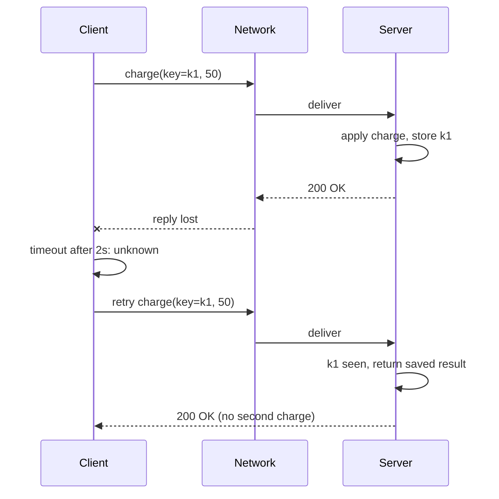

## In one minute
- Splitting work across machines costs three certainties a single process takes for granted: that a call either happened or did not, that time means the same thing everywhere, and that slow is distinguishable from dead.
- The network loses, delays, duplicates and reorders messages. A request that times out may have run zero times, once, or (after a retry) twice.
- Clocks drift and jump, and processes pause. A node can be "dead" to its peers and wake up still believing it is in charge.
- No node knows the global state, only stale messages about it. Truth is whatever a majority agreed to.
- The answer is a small toolkit: timeouts, idempotent retries, sequence numbers, quorums, fencing tokens, and testing under injected faults.

## How it works

### Partial failure is the new normal
In one process, a function call either returns or the whole program dies with it. Across a network, one part can fail while the rest carries on, and the failed part may not even know it failed. This is the **partial failure** problem shape, and it shows up far from databases: an AI agent calls a tool that sends an email, the HTTP request times out after 30 seconds, and the agent has no idea whether the email went out. Retrying might send it twice. Not retrying might send it never.

A request and its reply cross the network twice and change state on two machines. Amazon breaks one round trip into eight steps that can each fail on their own: posting, delivering and validating the request, updating server state, then posting, delivering and validating the reply, and updating client state. When the reply times out, the outcome is simply unknown: the work may or may not have happened ([AWS Builders' Library](https://builder.aws.com/content/3F08f7GPFiZMCgXD8gny6OjxR0Z/challenges-with-distributed-systems)). From the client's side, most failures look identical: silence.

### The eight fallacies
At Sun, L Peter Deutsch listed seven assumptions in 1994, and James Gosling added the eighth around 1997 ([Wikipedia](https://en.wikipedia.org/wiki/Fallacies_of_distributed_computing)). They are the assumptions newcomers make and later regret: the network is reliable, latency is zero, bandwidth is infinite, the network is secure, topology does not change, there is one administrator, transport cost is zero, and the network is homogeneous. Each maps to a class of outage. "Topology does not change" is the DNS record cached for an hour after failover. "Latency is zero" is the page that makes 200 sequential calls to a service 1 ms away.

### What the network actually does
Packets are dropped by full switch buffers, held for seconds in queues, and delivered out of order when routes change. This is not rare: a Microsoft study of its own data centres, summarised by Kingsbury and Bailis, counted an average of 5.2 device failures and 40.8 link failures per day ([aphyr.com](https://aphyr.com/posts/288-the-network-is-reliable)). TCP hides this inside one connection, but not across connections. When a client reconnects and resends, the server sees a duplicate. When two requests travel on two connections, the second can land first. At-least-once queues make duplicates a normal case (see the delivery semantics lesson). Partitions are also often **asymmetric**: A can reach B but B cannot reach A, which defeats any design that assumes "if I can hear you, you can hear me."

### Time is not shared
Every machine has its own quartz oscillator. Most computer clocks are accurate to within about 50 parts per million, and 1 ppm is 86 ms a day, so two unsynchronised servers can drift seconds apart within a day ([Kleppmann's Cambridge notes](https://www.cl.cam.ac.uk/teaching/2122/ConcDisSys/dist-sys-notes.pdf)). NTP corrects drift but can step the clock backwards. So "last write wins by timestamp" can silently discard the newer write, and a lease that "expires at 10:00:05" means different instants on different machines. The clock synchronization and logical clocks lessons cover the alternatives.

### Processes pause
A stop-the-world GC, a VM live migration, a page fault on swapped memory or a stalled `fsync` all stop a thread without telling it. When it resumes, its view of the world is stale and it does not know. The classic failure: a node holds a lease, pauses for 15 seconds, the lease expires, another node takes over, and the first wakes and writes as if it were still leader. That is why the split-brain lesson insists on fencing tokens.

### Truth by majority
Because no node can trust its own view, distributed systems define truth as what a quorum agreed to. A node that thinks it is leader but cannot reach a majority must step down. This is why consensus exists (see the consensus algorithms lesson), and why it is expensive.

## Down the stack

### Layer 1: The contract
What the platform actually promises is weaker than most code assumes. A TCP connection promises in-order, deduplicated bytes only for its own lifetime; once it breaks, neither side knows how many bytes the other processed. An RPC with a timeout promises one of three outcomes: success, a definite error, or "unknown." Formally, most production systems are modelled as **partially synchronous** with **crash-recovery** nodes: messages are eventually delivered and nodes eventually respond within some bound, but you never know when that bound starts holding. The Fischer, Lynch and Paterson (FLP) result of 1985 ([paper](https://groups.csail.mit.edu/tds/papers/Lynch/jacm85.pdf)) shows that in a fully asynchronous model, no deterministic algorithm can guarantee consensus if even one process may crash, which is why every real protocol leans on timeouts.

### Layer 2: The mechanism
Each defensive mechanism attacks one failure. **Timeouts** turn silence into a decision. **Retries with backoff and jitter** recover from transient loss. **Idempotency keys** (Stripe's `Idempotency-Key` header, Kafka's producer id plus sequence number) make retries safe. Stripe stores the status and body of the first response for a key, replays it on retries, rejects a reuse with different parameters, and may prune keys after 24 hours, so a retry window longer than that is no longer protected ([Stripe docs](https://docs.stripe.com/api/idempotent_requests)). **Per-sender sequence numbers** let a receiver drop duplicates and restore order: TCP uses 32-bit byte sequence numbers, Kafka partition offsets, Raft log indexes. **Quorums** make decisions survive any minority failure. **Fencing tokens** (ZooKeeper's `zxid`, etcd's revision, a Raft term) let storage reject stale leaders. **Monotonic clocks** (`CLOCK_MONOTONIC` on Linux, `time.monotonic()` in Python, Go's monotonic reading inside `time.Time`) measure durations without being thrown off by NTP steps.

### Layer 3: The machine
A dropped packet costs time measured in hundreds of milliseconds, not microseconds. Linux's minimum retransmission timeout is 200 ms, and RFC 6298 sets the initial RTO to 1 second ([RFC 6298](https://www.rfc-editor.org/rfc/rfc6298)), so one lost SYN adds a full second to a connect. A 2023 kernel change made the first four SYN retries linear (1 s apart, as macOS does) before exponential backoff starts, and with the default `tcp_syn_retries=6` the kernel documents the final timeout for a connect to a black-holed address as about 131 seconds; older write-ups say 127. With `tcp_retries2=15`, an established connection whose peer vanished takes at least 924.6 seconds, roughly 15 minutes, to error out ([Linux ip-sysctl docs](https://docs.kernel.org/networking/ip-sysctl.html)). So application timeouts must be far shorter than the kernel's. Within a data centre, round trips are 0.1 to 0.5 ms at the median, but tails of 10 to 100 ms come from queueing in shallow switch buffers, incast when many servers reply at once, and busy CPUs. A full GC on a 30 GB JVM heap can take seconds, long enough to miss many heartbeats.

### Why it's built this way
1. A single machine has a hard ceiling on CPU, memory, disk and failure domain, so large systems must span many machines.
2. Machines communicate only by messages over shared, lossy links, so every interaction can fail in the middle and the caller cannot see where.
3. Waiting forever is unacceptable, so callers use timeouts, which means they sometimes declare a live peer dead.
4. Wrongly declaring a peer dead creates duplicates and two leaders, so every action that matters needs idempotency, sequence numbers or fencing to make the mistake harmless.
5. Making mistakes harmless is cheaper than avoiding them, which is why the toolkit is built around tolerating ambiguity rather than eliminating it.

## Diagram


## Worked example
A checkout service calls a payment provider at 400 payments per second at peak, and about 0.05% of calls hit the 3-second client timeout because of a lost reply or a slow provider. That is 0.2 ambiguous payments per second, or about 17,000 per day. If the provider had actually processed 70% of them, a naive retry causes about 12,000 double charges per day. With an idempotency key generated once per checkout attempt and sent on every retry, the provider returns the stored result and the duplicate count drops to zero.

Now add ordering. The same service publishes `payment_captured` and `payment_refunded` events to a queue with at-least-once delivery. A consumer that applies them as they arrive can see the refund before the capture after a redelivery, and mark an order "captured" after it was refunded. Attaching a per-order sequence number and having the consumer keep `next_expected` per order fixes both problems: a duplicate (seq below `next_expected`) is dropped, and an early message is buffered until the gap fills. The cost is a head-of-line wait when one message is lost, so the consumer needs a way to ask for the missing one, which is what the practice task builds. Ordering by producer wall-clock timestamps instead would fail: with 300 ms of skew between two producers, a refund issued 100 ms after a capture appears to come first.

## In the wild
- **AWS, 2011: EBS re-mirroring storm.** A network change sent traffic onto a low-capacity backup network and cut EBS nodes off from their replicas. When connectivity returned, every node searched for space to re-mirror at once, aggressive retries and a race condition kept volumes stuck, and at the peak about 13% of volumes in the zone were affected; the event ran about three days and 0.07% of volumes could not be restored. AWS said retries would back off more and focus on reconnecting to previous replicas ([AWS](https://aws.amazon.com/message/65648/)).
- **Cloudflare, 2020: a switch that was half alive.** A switch kept its control-plane protocols up while dropping data-plane packets, so etcd nodes disagreed about who could reach whom, elections kept tying and the cluster went read-only. The cluster management system depended on etcd and promoted a replica, a rebuild bug followed, and over 6h33m the API success rate fell as low as 75% ([Cloudflare](https://blog.cloudflare.com/a-byzantine-failure-in-the-real-world/)).
- **AWS, 2025: a delayed worker applies a stale plan.** In DynamoDB's DNS automation, one Enactor was slow, and by the time it applied its plan a newer one already existed; another Enactor's cleanup then deleted the old plan and left the regional endpoint with no IP addresses. DynamoDB errors lasted about 2h52m and the whole event, with knock-on effects in other services, ran about 14.5 hours. It is the paused-process failure in automation form: a check made before a delay was trusted after it ([AWS](https://aws.amazon.com/message/101925/)).

## Trade-offs
| Approach | Strengths | Weaknesses | Choose when |
|---|---|---|---|
| Retry with idempotency key | Simple, recovers from loss and timeouts | Server must store keys and results; key scope must be right | Any state-changing call over a network |
| Per-sender sequence numbers | Exact dedup and ordering per stream | Head-of-line blocking on a gap; needs retransmit path | Streams of events per entity |
| Wall-clock timestamps | No coordination | Wrong under drift and steps; silently loses writes | Logging and display only |
| Quorum decisions | Survive any minority failure | Extra round trips; minority side stops serving | Leadership, metadata, money |
| Deterministic simulation testing | Finds rare interleavings reproducibly | Code must route I/O and time through a simulator | Core storage and coordination code |

## Pitfalls in production
- **Treating a timeout as failure.** Code that rolls back local state after a timeout, while the remote side actually committed, creates divergence. Treat timeouts as "unknown" and reconcile by querying status or retrying idempotently.
- **Kernel defaults as timeouts.** Relying on TCP to notice a dead peer can take minutes. Set connect, read and overall deadlines in the application and propagate them across hops.
- **Wall-clock durations.** Measuring a lease or timeout with `time.time()` breaks when NTP steps the clock. Use a monotonic clock for every duration.
- **Never testing faults.** Bugs in recovery paths hide until production. Inject packet loss, latency, clock skew and pauses in staging with tools such as `tc netem`, Toxiproxy or Jepsen.

## Leadership lens
- In design review, ask of every cross-service call: what happens if it times out after the remote side committed? If the answer is "it can't," the design is not finished.
- Budget engineering time for idempotency and reconciliation up front; retrofitting them after a double-charge incident costs far more and comes with customer remediation.
- Standardise timeouts, retry policy and deadline propagation in a shared client library instead of letting each team pick defaults.
- Fund fault-injection testing for the few systems where correctness matters most (payments, coordination, storage). It is cheap compared to one data-loss incident.

## Check yourself
1. A client sends a write, gets no reply after 5 seconds, and the server log later shows the write was applied. Was the network "down"?
   **Answer:** Not necessarily. The reply may have been lost or delayed, or the server may have been paused. The client only knows it did not hear back in time, which is why timeouts must be treated as unknown outcomes.
2. Why does TCP's in-order, deduplicated delivery not remove the need for application-level sequence numbers?
   **Answer:** TCP's guarantees end with the connection. A reconnect and resend, a second connection, or a queue redelivery all create duplicates and reorderings that TCP never sees.
3. A lease holder checks `now < expires_at` and then writes. What can still go wrong?
   **Answer:** The process can pause between the check and the write, the lease can expire and be granted to someone else, and the stale write then lands. Storage must check a fencing token to reject it.

## Practice
**Task:** Build a tiny fault-injecting link and a receiver that restores exactly-once, in-order delivery. `transmit(faults)` simulates sending messages with sequence numbers `0..len(faults)-1`, message `i` sent at time `i`. `faults[i]` is a list of delays, one per copy that arrives: `[]` means dropped, `[0]` normal, `[0, 3]` duplicated, `[5]` delayed. Each copy arrives at `i + delay`; return the sequence numbers in arrival order, breaking ties by lower sequence number and then by position in the delay list. `Receiver` starts expecting sequence 0. `receive(seq)` returns the list of sequence numbers that become deliverable in order (possibly empty), ignoring duplicates and buffering early arrivals. `missing()` returns, in ascending order, the sequence numbers below the highest one seen that have not arrived yet, so the sender knows what to retransmit.

```python starter
def transmit(faults):
    # TODO: return seqs in arrival order
    raise NotImplementedError


class Receiver:
    def __init__(self):
        pass

    def receive(self, seq):
        # TODO
        raise NotImplementedError

    def missing(self):
        # TODO
        raise NotImplementedError
```

```python tests
def test_transmit_reorders_and_duplicates():
    assert transmit([[0], [3], [0], [0, 1]]) == [0, 2, 3, 1, 3]

def test_transmit_drop():
    assert transmit([[0], [], [0]]) == [0, 2]

def test_receiver_in_order():
    r = Receiver()
    assert r.receive(0) == [0]
    assert r.receive(1) == [1]

def test_receiver_buffers_and_releases():
    r = Receiver()
    assert r.receive(1) == []
    assert r.receive(2) == []
    assert r.receive(0) == [0, 1, 2]

def test_receiver_drops_duplicates():
    r = Receiver()
    r.receive(0)
    assert r.receive(0) == [], "already delivered"
    r.receive(2)
    assert r.receive(2) == [], "already buffered"
    assert r.receive(1) == [1, 2]

def test_missing_reports_gaps():
    r = Receiver()
    for s in [0, 3, 5]:
        r.receive(s)
    assert r.missing() == [1, 2, 4]
    r.receive(1)
    assert r.missing() == [2, 4]

def test_end_to_end_with_retransmit():
    r = Receiver()
    delivered = []
    for s in transmit([[0], [], [2], [0, 0], [0]]):
        delivered += r.receive(s)
    assert delivered == [0]
    assert r.missing() == [1]
    delivered += r.receive(1)
    assert delivered == [0, 1, 2, 3, 4]
    assert r.missing() == []
```

```python solution
def transmit(faults):
    arrivals = []
    for seq, delays in enumerate(faults):
        for copy, d in enumerate(delays):
            arrivals.append((seq + d, seq, copy))
    arrivals.sort()
    return [seq for _, seq, _ in arrivals]


class Receiver:
    def __init__(self):
        self.next = 0
        self.buffer = set()
        self.highest = -1

    def receive(self, seq):
        self.highest = max(self.highest, seq)
        if seq < self.next or seq in self.buffer:
            return []
        self.buffer.add(seq)
        out = []
        while self.next in self.buffer:
            self.buffer.remove(self.next)
            out.append(self.next)
            self.next += 1
        return out

    def missing(self):
        return [s for s in range(self.next, self.highest) if s not in self.buffer]
```

```typescript starter
export function transmit(faults: number[][]): number[] {
  throw new Error("TODO");
}

export class Receiver {
  receive(seq: number): number[] {
    throw new Error("TODO");
  }
  missing(): number[] {
    throw new Error("TODO");
  }
}
```

```typescript tests
test("transmit reorders and duplicates", () => {
  assertEqual(transmit([[0], [3], [0], [0, 1]]), [0, 2, 3, 1, 3]);
});
test("transmit drop", () => {
  assertEqual(transmit([[0], [], [0]]), [0, 2]);
});
test("receiver in order", () => {
  const r = new Receiver();
  assertEqual(r.receive(0), [0]);
  assertEqual(r.receive(1), [1]);
});
test("receiver buffers and releases", () => {
  const r = new Receiver();
  assertEqual(r.receive(1), []);
  assertEqual(r.receive(2), []);
  assertEqual(r.receive(0), [0, 1, 2]);
});
test("receiver drops duplicates", () => {
  const r = new Receiver();
  r.receive(0);
  assertEqual(r.receive(0), [], "already delivered");
  r.receive(2);
  assertEqual(r.receive(2), [], "already buffered");
  assertEqual(r.receive(1), [1, 2]);
});
test("missing reports gaps", () => {
  const r = new Receiver();
  for (const s of [0, 3, 5]) r.receive(s);
  assertEqual(r.missing(), [1, 2, 4]);
  r.receive(1);
  assertEqual(r.missing(), [2, 4]);
});
test("end to end with retransmit", () => {
  const r = new Receiver();
  const delivered: number[] = [];
  for (const s of transmit([[0], [], [2], [0, 0], [0]])) delivered.push(...r.receive(s));
  assertEqual(delivered, [0]);
  assertEqual(r.missing(), [1]);
  delivered.push(...r.receive(1));
  assertEqual(delivered, [0, 1, 2, 3, 4]);
  assertEqual(r.missing(), []);
});
```

```typescript solution
export function transmit(faults: number[][]): number[] {
  const arrivals: [number, number, number][] = [];
  faults.forEach((delays, seq) => {
    delays.forEach((d, copy) => arrivals.push([seq + d, seq, copy]));
  });
  arrivals.sort((a, b) => a[0] - b[0] || a[1] - b[1] || a[2] - b[2]);
  return arrivals.map((a) => a[1]);
}

export class Receiver {
  private next = 0;
  private buffer = new Set<number>();
  private highest = -1;

  receive(seq: number): number[] {
    this.highest = Math.max(this.highest, seq);
    if (seq < this.next || this.buffer.has(seq)) return [];
    this.buffer.add(seq);
    const out: number[] = [];
    while (this.buffer.has(this.next)) {
      this.buffer.delete(this.next);
      out.push(this.next);
      this.next++;
    }
    return out;
  }

  missing(): number[] {
    const out: number[] = [];
    for (let s = this.next; s < this.highest; s++) {
      if (!this.buffer.has(s)) out.push(s);
    }
    return out;
  }
}
```

```go starter
package practice

func Transmit(faults [][]int) []int { panic("TODO") }

type Receiver struct{}

func NewReceiver() *Receiver { return &Receiver{} }

func (r *Receiver) Receive(seq int) []int { panic("TODO") }
func (r *Receiver) Missing() []int        { panic("TODO") }
```

```go tests
package practice

import (
	"reflect"
	"testing"
)

func same(t *testing.T, got, want []int) {
	t.Helper()
	if len(got) == 0 && len(want) == 0 {
		return
	}
	if !reflect.DeepEqual(got, want) {
		t.Fatalf("got %v, want %v", got, want)
	}
}

func TestTransmitReordersAndDuplicates(t *testing.T) {
	same(t, Transmit([][]int{{0}, {3}, {0}, {0, 1}}), []int{0, 2, 3, 1, 3})
}

func TestTransmitDrop(t *testing.T) {
	same(t, Transmit([][]int{{0}, {}, {0}}), []int{0, 2})
}

func TestReceiverInOrder(t *testing.T) {
	r := NewReceiver()
	same(t, r.Receive(0), []int{0})
	same(t, r.Receive(1), []int{1})
}

func TestReceiverBuffersAndReleases(t *testing.T) {
	r := NewReceiver()
	same(t, r.Receive(1), nil)
	same(t, r.Receive(2), nil)
	same(t, r.Receive(0), []int{0, 1, 2})
}

func TestReceiverDropsDuplicates(t *testing.T) {
	r := NewReceiver()
	r.Receive(0)
	same(t, r.Receive(0), nil)
	r.Receive(2)
	same(t, r.Receive(2), nil)
	same(t, r.Receive(1), []int{1, 2})
}

func TestMissingReportsGaps(t *testing.T) {
	r := NewReceiver()
	for _, s := range []int{0, 3, 5} {
		r.Receive(s)
	}
	same(t, r.Missing(), []int{1, 2, 4})
	r.Receive(1)
	same(t, r.Missing(), []int{2, 4})
}

func TestEndToEndWithRetransmit(t *testing.T) {
	r := NewReceiver()
	delivered := []int{}
	for _, s := range Transmit([][]int{{0}, {}, {2}, {0, 0}, {0}}) {
		delivered = append(delivered, r.Receive(s)...)
	}
	same(t, delivered, []int{0})
	same(t, r.Missing(), []int{1})
	delivered = append(delivered, r.Receive(1)...)
	same(t, delivered, []int{0, 1, 2, 3, 4})
	same(t, r.Missing(), nil)
}
```

```go solution
package practice

import (
	"sort"
	"sync"
)

type arrival struct{ at, seq, copy int }

func Transmit(faults [][]int) []int {
	var arr []arrival
	for seq, delays := range faults {
		for c, d := range delays {
			arr = append(arr, arrival{seq + d, seq, c})
		}
	}
	sort.Slice(arr, func(i, j int) bool {
		a, b := arr[i], arr[j]
		if a.at != b.at {
			return a.at < b.at
		}
		if a.seq != b.seq {
			return a.seq < b.seq
		}
		return a.copy < b.copy
	})
	out := make([]int, 0, len(arr))
	for _, a := range arr {
		out = append(out, a.seq)
	}
	return out
}

type Receiver struct {
	mu      sync.Mutex
	next    int
	highest int
	buffer  map[int]bool
}

func NewReceiver() *Receiver { return &Receiver{highest: -1, buffer: map[int]bool{}} }

func (r *Receiver) Receive(seq int) []int {
	r.mu.Lock()
	defer r.mu.Unlock()
	if seq > r.highest {
		r.highest = seq
	}
	if seq < r.next || r.buffer[seq] {
		return nil
	}
	r.buffer[seq] = true
	var out []int
	for r.buffer[r.next] {
		delete(r.buffer, r.next)
		out = append(out, r.next)
		r.next++
	}
	return out
}

func (r *Receiver) Missing() []int {
	r.mu.Lock()
	defer r.mu.Unlock()
	var out []int
	for s := r.next; s < r.highest; s++ {
		if !r.buffer[s] {
			out = append(out, s)
		}
	}
	return out
}
```

## Mock interview
**Prompt:** You run an order service that publishes events to three downstream consumers (billing, shipping, email) over a queue with at-least-once delivery. About 2,000 orders per minute, and last week a customer was emailed "refunded" before "shipped" and another was billed twice. Walk me through what went wrong and how you would fix it.

- Follow-up: Your fix uses per-order sequence numbers. One message is lost for good. What happens to that order's later events, and how do you recover?
- Follow-up: Billing calls an external card processor and the call times out. What does billing do next?
- Follow-up: Someone proposes ordering events by the producer's wall-clock timestamp instead. What do you say?

**A strong answer covers:**
- Names the shapes: duplicates from redelivery and retries, reordering, and the ambiguous outcome of a timeout.
- Idempotent consumers keyed by (order id, sequence), with the dedup record written in the same transaction as the effect.
- Per-key ordering by partitioning on order id or by a reorder buffer, with a bounded wait and a retransmit or reconciliation path for gaps.
- Timeouts treated as unknown: retry with the same idempotency key, or query the processor's status.
- Why wall-clock ordering fails, and fault-injection tests that duplicate, reorder and drop events.

## Sources and further study
**Primary**
- [Fischer, Lynch and Paterson, Impossibility of Distributed Consensus with One Faulty Process (1985)](https://groups.csail.mit.edu/tds/papers/Lynch/jacm85.pdf): the FLP result behind every protocol's reliance on timeouts.
- [RFC 6298: Computing TCP's Retransmission Timer](https://www.rfc-editor.org/rfc/rfc6298): the 1-second initial RTO and the backoff rules.

**Systems docs**
- [Linux ip-sysctl documentation](https://docs.kernel.org/networking/ip-sysctl.html): current defaults for SYN retries, linear SYN timeouts, `tcp_retries2` and keepalive.
- [Stripe: Idempotent requests](https://docs.stripe.com/api/idempotent_requests): a production idempotency-key contract, including key retention and parameter checks.

**Books**
- *Designing Data-Intensive Applications* (1st edition), Martin Kleppmann, chapter 8 "The Trouble with Distributed Systems": partial failure, unreliable networks and clocks, process pauses and fencing.
- *Database Internals*, Alex Petrov, chapter 8 "Introduction and Overview": the fallacies, the Two Generals' problem and FLP.
- *Release It!* (2nd edition), Michael Nygard, chapter 5 "Stability Patterns": timeouts, circuit breakers and fail fast as everyday defences.

**Other curricula**
- [donnemartin/system-design-primer](https://github.com/donnemartin/system-design-primer): frames distribution through availability patterns such as fail-over and replication; it does not cover ambiguous timeouts or process pauses.
- [MIT 6.5840 Distributed Systems](https://pdos.csail.mit.edu/6.824/): a lecture-and-lab course where the Raft and key/value labs must survive dropped, delayed and reordered RPCs.

## Watch
- [Distributed Systems 2.3: System models (Martin Kleppmann)](https://www.youtube.com/watch?v=y8f7ZG_UnGI): network, node and timing assumptions, stated precisely.
- [L5: The many types of fail (Distributed Systems Course)](https://www.youtube.com/watch?v=MnYlwjuGcg8): a tour of crash, omission and timing failures.
- [Testing Distributed Systems with Deterministic Simulation (Will Wilson, Strange Loop)](https://www.youtube.com/watch?v=4fFDFbi3toc): how FoundationDB finds rare fault interleavings by simulating the whole cluster.

## Free resources
- [Challenges with distributed systems (AWS Builders' Library)](https://aws.amazon.com/builders-library/challenges-with-distributed-systems/): why a single request-reply has so many ways to fail, from Amazon's experience.
- [The network is reliable (Kingsbury and Bailis)](https://aphyr.com/posts/288-the-network-is-reliable): a catalogue of real partitions and what they broke.
- [Simulation and testing (FoundationDB docs)](https://apple.github.io/foundationdb/testing.html): how a database is built so every fault can be replayed deterministically.
- [Fallacies of distributed computing (Wikipedia)](https://en.wikipedia.org/wiki/Fallacies_of_distributed_computing): the eight assumptions and their history.
- [Concurrent and Distributed Systems lecture notes (Kleppmann, Cambridge)](https://www.cl.cam.ac.uk/teaching/2122/ConcDisSys/dist-sys-notes.pdf): system models, failure detectors and clocks in a free textbook-quality PDF.
- [Jepsen analyses](https://jepsen.io/analyses): what real databases do under partitions, pauses and clock skew.
