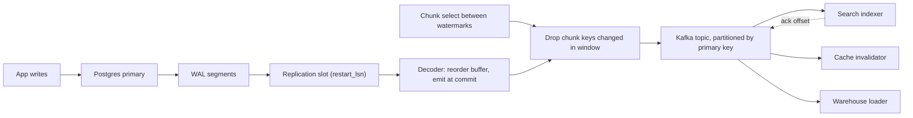

## In one minute
- Change data capture turns every committed change in a database into an ordered stream of events, so other systems (search indexes, caches, warehouses, other services) can follow the database without the application writing to them twice.
- The robust way is log-based: read the database's own replication log (Postgres WAL, MySQL binlog, MongoDB oplog). It sees every insert, update and delete, in commit order, including changes made by scripts and migrations, at almost no cost to the write path.
- The stream carries row images, not intent. A `u` event says `status` went from `pending` to `paid`; it does not say why. Use an outbox table when consumers need business events.
- The hard parts are not reading the log. They are the initial snapshot and its handoff to the stream, keeping per-key order through partitioning, schema changes, and log retention when a consumer stalls.
- Delivery is at least once. Consumers must be idempotent, usually by comparing the log position or a row version.

## How it works

### Three ways to capture changes
**Query-based** CDC polls `SELECT * FROM t WHERE updated_at > :last`. It needs no privileges, but it misses deletes, collapses several updates between polls into one, and skips rows whose transaction committed after the poll with an older timestamp. Shopify ran exactly this for years; to protect the source databases it polled each table at most hourly, so data was always at least an hour old and hard deletes never appeared ([Shopify](https://shopify.engineering/capturing-every-change-shopify-sharded-monolith)).

**Trigger-based** CDC copies each change into a shadow table from a trigger. It catches deletes and intermediate states, but doubles the write work inside every transaction.

**Log-based** CDC reads the log the database already writes for crash recovery and replication. The write path is untouched and the order is the database's own commit order. This is what Debezium, AWS DMS, Google Datastream and Netflix's DBLog do ([DBLog paper](https://arxiv.org/abs/2010.12597)), and what this lesson focuses on.

### Anatomy of a change event
A typical log-based event carries an operation (`c` create, `u` update, `d` delete, `r` read from a snapshot), the row's *before* and *after* images, and source metadata: table, transaction id, commit timestamp and log position (an LSN in Postgres, a binlog file and offset or GTID in MySQL). The event key is the row's primary key. After a delete, Debezium also emits a *tombstone* by default (`tombstones.on.delete`), a record with the key and a null value, so Kafka log compaction can eventually drop every record for that key ([Debezium docs](https://debezium.io/documentation/reference/stable/connectors/postgresql.html)).

### Snapshot, then stream
A new consumer needs the current state, not just future changes, but the log only goes back as far as retention allows. So CDC starts with a snapshot and switches to the stream. The switch is where data is lost or duplicated if done carelessly: rows changed during the snapshot must not be missed, and stale snapshot values must not overwrite newer streamed ones.

The classic method records a log position, takes a consistent snapshot as of that position, emits every row as `r`, then streams from the position. On a 2 TB table that means one transaction open for hours while the log piles up; Shopify found MySQL snapshots held read locks for their whole duration and took hours on large tables ([Shopify](https://shopify.engineering/capturing-every-change-shopify-sharded-monolith)). The *watermark* method from Netflix's DBLog, also used by Debezium's incremental snapshots, instead reads the table in primary-key chunks interleaved with the stream, so it can pause, resume, and re-snapshot one table while the stream keeps flowing ([Debezium blog](https://debezium.io/blog/2021/10/07/incremental-snapshots/)).

### Ordering and partitioning
The log is totally ordered, but nobody consumes it as one sequence at scale. Events are partitioned, usually by primary key, so that all changes to one row land in one partition and stay in order, while different rows are processed in parallel. Order across rows, or across tables, is lost unless you deliberately keep it, for example by routing a whole aggregate (an order and its line items) by the aggregate's id.

This is the ordering and duplicates problem shape, which recurs wherever one ordered source feeds parallel workers, such as an agent's tool-call log replayed into several evaluators: partition by the entity whose order matters, and make workers tolerate redelivery.

## Down the stack

### Layer 1: The contract
A log-based CDC pipeline promises that every committed change appears in the stream, that aborted changes never do, and that changes to one primary key appear in commit order. Delivery is at least once: after a crash, the connector resumes from its last *acknowledged* position and re-emits what follows. It does not promise that a consumer sees a transaction atomically, nor order across keys once events are partitioned. Latency is usually well under a second, with no upper bound when something stalls.

### Layer 2: The mechanism
In PostgreSQL, CDC requires `wal_level = logical`. A *replication slot* records how far the consumer has confirmed (`confirmed_flush_lsn`) and how much WAL must be kept to resume (`restart_lsn`). An *output plugin* (`pgoutput`, built in and used with publications, or `wal2json`) turns WAL into logical changes. WAL records of concurrent transactions are interleaved, so the decoder keeps a *reorder buffer* per transaction and emits a transaction's changes only when its commit record arrives, in commit order; transactions larger than `logical_decoding_work_mem` (64 MB by default) spill to disk under `pg_replslot` ([Postgres docs](https://www.postgresql.org/docs/current/runtime-config-resource.html)). Since Postgres 14 an output plugin that supports streaming can instead send the largest in-progress transaction in blocks before it commits, followed later by a stream commit or a stream abort, so the consumer must buffer per transaction and be ready to discard ([Postgres docs](https://www.postgresql.org/docs/current/logicaldecoding-streaming.html)). `REPLICA IDENTITY` controls the before image: `DEFAULT` logs only the old primary key for updates and deletes, `FULL` logs the whole old row at the cost of larger WAL.

MySQL needs `binlog_format = ROW` and usually `binlog_row_image = FULL`, with the position tracked as a GTID set; MongoDB change streams use a resume token. Debezium commits its source position to Kafka Connect's offsets topic after writing the events, which is exactly why delivery is at least once.

DBLog's watermark algorithm: write a *low watermark* row to a small table, which puts a marker in the log; select the next chunk by primary key; write a *high watermark* row. While consuming the log, collect keys changed between the markers. When the high watermark arrives, drop chunk rows whose key changed in that window (the log event carries a newer state) and emit the rest at that point. No locks, no long transaction, and every row arrives either from the chunk or in a newer log event.

### Layer 3: The machine
A slot holds back WAL removal, and WAL is generated in 16 MB segments regardless of whether anyone reads it. A primary writing 30 MB of WAL per second retains about 2.6 TB per day if the slot's consumer stops, which fills the disk and stops the database. Since Postgres 13, `max_slot_wal_keep_size` caps this by invalidating the slot, which forces a re-snapshot but protects the primary; its default is still -1, unlimited ([Postgres docs](https://www.postgresql.org/docs/current/runtime-config-replication.html)). Postgres 18 adds `idle_replication_slot_timeout` to invalidate slots that no connection has used for a set time, also off by default ([Postgres 18 release](https://www.postgresql.org/about/news/postgresql-18-released-3142/)).

Failover used to be the other silent killer: logical slots lived only on the primary, so after promoting a standby the connector had no slot and had to re-snapshot. Postgres 17 can synchronise failover-enabled logical slots to a standby (`failover` on the slot, `sync_replication_slots` on the standby, plus a physical slot and `hot_standby_feedback`) ([Postgres docs](https://www.postgresql.org/docs/current/logicaldecoding-explanation.html)), and Debezium exposes this as `slot.failover` for Postgres 17 and later ([Debezium docs](https://debezium.io/documentation/reference/stable/connectors/postgresql.html)). Every slot decodes the full WAL stream on its own, so five slots cost five times the decoding CPU on the primary, even if each publication covers one small table.

Decoding costs a few microseconds per change, but without streaming a 10 million row `UPDATE` produces nothing until its commit, then spills gigabytes to `pg_replslot` and arrives downstream as one burst. In a healthy pipeline end-to-end latency is tens to hundreds of milliseconds, dominated by Kafka producer batching (`linger.ms`) and consumer polling rather than by the database.

### Why it's built this way
1. Applications that write to a database and a second system cannot make both writes atomic, so the database's own log becomes the single source of truth for what changed.
2. The log exists for crash recovery and replication anyway, so reading it adds no work to the write path and captures every writer, including ones the application team does not control.
3. Logs are interleaved by time, not grouped by transaction, so decoders buffer per transaction and emit at commit to hide aborted and in-flight work.
4. Logs cannot be kept forever, so new consumers start from a snapshot; long snapshots hold resources, so watermark-based chunking replaces one huge read with many small ones.
5. One ordered log cannot be consumed by one worker at scale, so it is partitioned by key, keeping the only order most consumers need.

## Diagram


## Worked example
An orders database receives 20,000 row changes per second at peak and generates about 25 MB of WAL per second. Three consumers need the data: an Elasticsearch index, a Redis cache invalidator and a warehouse loader.

Event volume: with JSON before and after images, events average about 900 bytes, so the topic receives 18 MB/s. Twelve partitions keyed by `order_id` let each consumer run twelve workers, each handling about 1,700 events per second, comfortably within what a single indexer thread can bulk-load.

Bootstrapping the index: the `orders` table has 400 million rows. A watermark snapshot with 10,000-row chunks reads about 40,000 rows per second without disturbing the primary, so the snapshot takes roughly 2.8 hours. During that time the stream keeps flowing. If a chunk covering orders 1,200,000 to 1,210,000 is selected while order 1,204,511 is updated, the update appears in the log between the watermarks, the chunk's copy of that row is dropped, and the indexer gets the newer version from the log event instead.

The failure: the connector's Kafka credentials expire on a Friday night and nobody notices for 6 hours. The slot holds 25 MB/s times 21,600 seconds, about 540 GB of WAL. The primary's volume has 400 GB free. Without a cap, the database stops accepting writes around hour 4.5. With `max_slot_wal_keep_size = 200GB` the slot is invalidated after about 2.2 hours, the primary stays up, and the team re-snapshots on Monday. Alerting on slot lag at 20 GB would have paged someone after about 13 minutes.

## In the wild
- **Shopify, 2021: from hourly queries to the binlog.** Shopify's query-based tool, Longboat, polled each table at most hourly to protect the source databases, so data was always an hour stale and hard deletes and updates that skipped `updated_at` were lost. The replacement runs about 150 Debezium connectors over more than 100 MySQL shards, averaging 65,000 records a second during Black Friday Cyber Monday 2020 with peaks of 100,000, p99 under 10 seconds from insert to Kafka, and over 400 TB of CDC data. The open problems were snapshots that held read locks for hours, schema changes breaking consumers, and records tens of MB in size ([Shopify](https://shopify.engineering/capturing-every-change-shopify-sharded-monolith)).
- **Zalando, 2025: WAL growth on quiet databases at scale.** Zalando runs hundreds of Postgres logical replication streams with embedded Debezium across more than 100 Kubernetes clusters. Their biggest operational problem was WAL piling up on low-activity databases whose slots only advance when watched tables change, even with heartbeats. The fix let the JDBC driver confirm progress on keepalives, and they upstreamed `lsn.flush.mode` and `offset.mismatch.strategy` into Debezium 3.4 so a restart after the slot moves ahead of the stored offset no longer refuses to start ([Zalando](https://engineering.zalando.com/posts/2025/12/contributing-to-debezium.html)).

## Trade-offs
| Option | Strengths | Weaknesses | Choose when |
|---|---|---|---|
| Log-based CDC | Every change and delete, commit order, no write-path cost | Needs log access, slot and retention operations, row-level events | Feeding indexes, caches and warehouses from an existing database |
| Trigger-based | Works without log access, captures deletes | Extra write in every transaction, triggers to maintain | Small tables on databases without logical decoding |
| Query polling | No privileges, trivial to start | Misses deletes and intermediate states, timestamp races | Low-stakes batch sync, append-only tables |
| Outbox plus CDC | Business-level events with atomic write | Application must write outbox rows | Other services need intent, not row diffs |
| Dual write in app | No extra infrastructure | Diverges on any partial failure | Never for data that must stay consistent |

## Pitfalls in production
- **Slots that stop advancing.** A slot left by a decommissioned consumer retains WAL until the disk fills. So can a healthy connector on a quiet database: WAL is shared by every database on the server, but a slot only advances when its captured tables change. Alert on slot lag in bytes, set `max_slot_wal_keep_size`, enable connector heartbeats (`heartbeat.interval.ms`), and drop slots as part of decommissioning.
- **Exposing the schema as an API.** Consumers depend on column names, so a rename breaks three teams. Use a schema registry with compatibility rules, or publish curated events through an outbox.
- **Missing before images.** With `REPLICA IDENTITY DEFAULT`, a delete carries only the primary key, so a consumer cannot tell which tenant the row belonged to. Set `FULL` where the old row matters.
- **Partitioning by the wrong key.** Keying order line items by `line_id` lets an item's update overtake its parent order's insert. Key by the aggregate id when cross-row order matters.
- **Assuming exactly once.** After a connector restart, events since the last committed offset are replayed. Make consumers apply events conditionally on LSN or version.
- **Giant transactions.** A backfill updating 50 million rows in one transaction arrives as one burst at commit. Batch backfills into small transactions.

## Leadership lens
- Decide who owns the CDC platform (connectors, slots, schemas) and who owns each topic's contract. Without that, the database team cannot change a column without a cross-team incident.
- Ask which consumers need row changes and which need business events. Pushing raw table changes across team boundaries couples everyone to one schema.
- Put slot lag, connector lag and snapshot progress on the same dashboard as primary disk usage, and have a runbook for invalidating a slot and re-snapshotting.
- Budget for snapshots: every new consumer, schema change or slot loss means re-reading large tables, so test how long a full snapshot takes before you need it.

## Check yourself
1. Why can't `SELECT ... WHERE updated_at > :last` reliably capture all changes even if every writer sets `updated_at`?
   **Answer:** Deletes leave no row to find, several updates between polls collapse into one, and a long transaction can commit after the poll with an `updated_at` older than the high-water mark, so it is skipped forever.
2. In the watermark snapshot, why is it safe to drop a chunk row whose key changed between the low and high watermarks?
   **Answer:** That change appears as a log event, which carries a state at least as new as anything the chunk could have read, so the consumer still ends with the latest value.
3. A consumer applies events from 12 partitions in parallel. What ordering does it still have?
   **Answer:** Order per partition, so per primary key if events are keyed by it. It has no order across keys or tables, and it may see part of a multi-row transaction before the rest.
4. Why does a stopped consumer threaten the source database in Postgres?
   **Answer:** Its replication slot prevents WAL removal past `restart_lsn`, so WAL accumulates on the primary's disk until the consumer resumes, the slot is dropped, or `max_slot_wal_keep_size` invalidates it.

## Practice
**Task:** Build the core of a log-based CDC connector. `decode(wal)` takes records `(lsn, xid, kind, key, value)` where `kind` is `begin`, `insert`, `update`, `delete`, `commit` or `abort`; it buffers each transaction's changes and, at its commit, emits them in log order as `(commit_lsn, op, key, value)` with op `c`, `u` or `d`. Aborted and still-open transactions emit nothing; a change, commit or abort for a transaction that has not begun, a duplicate begin, or an unknown kind raises an error. `merge_chunk(events, chunk, low, high)` applies the watermark rule: drop chunk rows `(key, value)` whose key appears in an event with `low < lsn <= high`, and insert the rest as `(high, "r", key, value)` right after the last event with `lsn <= high` (an error if `low > high`). `materialize(events)` returns the final key to value map (deletes remove the key). `route(events, n)` splits events into `n` lists by `fnv1a(key) % n` (given), preserving order.

```python starter
def fnv1a(s):
    h = 2166136261
    for b in s.encode("utf-8"):
        h ^= b
        h = (h * 16777619) & 0xFFFFFFFF
    return h

def decode(wal):
    # TODO
    raise NotImplementedError

def merge_chunk(events, chunk, low, high):
    # TODO
    raise NotImplementedError

def materialize(events):
    # TODO
    raise NotImplementedError

def route(events, n):
    # TODO
    raise NotImplementedError
```

```python tests
WAL = [
    (1, 10, "begin", "", ""),
    (2, 10, "insert", "a", "1"),
    (3, 11, "begin", "", ""),
    (4, 11, "update", "b", "x"),
    (5, 10, "update", "a", "2"),
    (6, 11, "commit", "", ""),
    (7, 10, "commit", "", ""),
    (8, 12, "begin", "", ""),
    (9, 12, "delete", "a", ""),
    (10, 12, "abort", "", ""),
    (11, 13, "begin", "", ""),
    (12, 13, "insert", "c", "9"),
]

STREAM = [(5, "u", "a", "2"), (8, "c", "d", "4"), (9, "d", "e", ""), (12, "u", "b", "7"), (15, "d", "c", "")]
CHUNK = [("a", "2"), ("b", "5"), ("c", "3"), ("d", "4"), ("e", "old")]

def test_decode_emits_in_commit_order():
    assert decode(WAL) == [(6, "u", "b", "x"), (7, "c", "a", "1"), (7, "u", "a", "2")]

def test_decode_rejects_bad_records():
    for wal in [[(1, 5, "insert", "a", "1")], [(1, 5, "begin", "", ""), (2, 5, "begin", "", "")],
                [(1, 5, "commit", "", "")], [(1, 5, "begin", "", ""), (2, 5, "upsert", "a", "1")]]:
        try:
            decode(wal)
            assert False, "expected ValueError"
        except ValueError:
            pass

def test_merge_drops_keys_changed_in_window():
    assert merge_chunk(STREAM, CHUNK, 6, 10) == [
        (5, "u", "a", "2"), (8, "c", "d", "4"), (9, "d", "e", ""),
        (10, "r", "a", "2"), (10, "r", "b", "5"), (10, "r", "c", "3"),
        (12, "u", "b", "7"), (15, "d", "c", ""),
    ]

def test_merged_stream_materializes_correctly():
    assert materialize(merge_chunk(STREAM, CHUNK, 6, 10)) == {"a": "2", "b": "7", "d": "4"}

def test_merge_rejects_inverted_watermarks():
    try:
        merge_chunk(STREAM, CHUNK, 10, 6)
        assert False, "expected ValueError"
    except ValueError:
        pass

def test_route_keeps_per_key_order():
    events = [(1, "c", "a", "1"), (2, "c", "c", "5"), (3, "u", "a", "2"), (4, "c", "b", "7"), (5, "d", "c", "")]
    assert route(events, 3) == [
        [],
        [(1, "c", "a", "1"), (3, "u", "a", "2"), (4, "c", "b", "7")],
        [(2, "c", "c", "5"), (5, "d", "c", "")],
    ]

def test_empty_inputs():
    assert decode([]) == []
    assert merge_chunk([], [("k", "v")], 0, 0) == [(0, "r", "k", "v")]
    assert route([], 2) == [[], []]
```

```python solution
def fnv1a(s):
    h = 2166136261
    for b in s.encode("utf-8"):
        h ^= b
        h = (h * 16777619) & 0xFFFFFFFF
    return h

OPS = {"insert": "c", "update": "u", "delete": "d"}

def decode(wal):
    open_tx = {}
    out = []
    for lsn, xid, kind, key, value in wal:
        if kind == "begin":
            if xid in open_tx:
                raise ValueError("duplicate begin for xid %d" % xid)
            open_tx[xid] = []
            continue
        if kind not in OPS and kind not in ("commit", "abort"):
            raise ValueError("unknown record kind " + kind)
        if xid not in open_tx:
            raise ValueError("xid %d has not begun" % xid)
        if kind in OPS:
            open_tx[xid].append((OPS[kind], key, value))
        elif kind == "commit":
            for op, k, v in open_tx.pop(xid):
                out.append((lsn, op, k, v))
        else:
            del open_tx[xid]
    return out

def merge_chunk(events, chunk, low, high):
    if low > high:
        raise ValueError("low watermark after high watermark")
    touched = {key for lsn, _op, key, _v in events if low < lsn <= high}
    reads = [(high, "r", key, value) for key, value in chunk if key not in touched]
    pos = 0
    while pos < len(events) and events[pos][0] <= high:
        pos += 1
    return list(events[:pos]) + reads + list(events[pos:])

def materialize(events):
    state = {}
    for _lsn, op, key, value in events:
        if op == "d":
            state.pop(key, None)
        else:
            state[key] = value
    return state

def route(events, n):
    parts = [[] for _ in range(n)]
    for e in events:
        parts[fnv1a(e[2]) % n].append(e)
    return parts
```

```typescript starter
export type WalRecord = [number, number, string, string, string];
export type ChangeEvent = [number, string, string, string];

export function fnv1a(s: string): number {
  let h = 2166136261;
  for (let i = 0; i < s.length; i++) {
    h ^= s.charCodeAt(i);
    h = Math.imul(h, 16777619) >>> 0;
  }
  return h >>> 0;
}

export function decode(wal: WalRecord[]): ChangeEvent[] {
  throw new Error("TODO");
}

export function mergeChunk(events: ChangeEvent[], chunk: [string, string][], low: number, high: number): ChangeEvent[] {
  throw new Error("TODO");
}

export function materialize(events: ChangeEvent[]): Record<string, string> {
  throw new Error("TODO");
}

export function route(events: ChangeEvent[], n: number): ChangeEvent[][] {
  throw new Error("TODO");
}
```

```typescript tests
const WAL: WalRecord[] = [
  [1, 10, "begin", "", ""],
  [2, 10, "insert", "a", "1"],
  [3, 11, "begin", "", ""],
  [4, 11, "update", "b", "x"],
  [5, 10, "update", "a", "2"],
  [6, 11, "commit", "", ""],
  [7, 10, "commit", "", ""],
  [8, 12, "begin", "", ""],
  [9, 12, "delete", "a", ""],
  [10, 12, "abort", "", ""],
  [11, 13, "begin", "", ""],
  [12, 13, "insert", "c", "9"],
];
const STREAM: ChangeEvent[] = [[5, "u", "a", "2"], [8, "c", "d", "4"], [9, "d", "e", ""], [12, "u", "b", "7"], [15, "d", "c", ""]];
const CHUNK: [string, string][] = [["a", "2"], ["b", "5"], ["c", "3"], ["d", "4"], ["e", "old"]];

function raises(fn: () => void): boolean {
  try {
    fn();
    return false;
  } catch (e) {
    return true;
  }
}

test("decode emits in commit order", () => {
  assertEqual(decode(WAL), [[6, "u", "b", "x"], [7, "c", "a", "1"], [7, "u", "a", "2"]]);
});
test("decode rejects bad records", () => {
  const bad: WalRecord[][] = [
    [[1, 5, "insert", "a", "1"]],
    [[1, 5, "begin", "", ""], [2, 5, "begin", "", ""]],
    [[1, 5, "commit", "", ""]],
    [[1, 5, "begin", "", ""], [2, 5, "upsert", "a", "1"]],
  ];
  for (const wal of bad) assert(raises(() => decode(wal)), JSON.stringify(wal));
});
test("merge drops keys changed in window", () => {
  assertEqual(mergeChunk(STREAM, CHUNK, 6, 10), [
    [5, "u", "a", "2"], [8, "c", "d", "4"], [9, "d", "e", ""],
    [10, "r", "a", "2"], [10, "r", "b", "5"], [10, "r", "c", "3"],
    [12, "u", "b", "7"], [15, "d", "c", ""],
  ]);
});
test("merged stream materializes correctly", () => {
  const state = materialize(mergeChunk(STREAM, CHUNK, 6, 10));
  const entries = Object.keys(state).sort().map((k) => [k, state[k]]);
  assertEqual(entries, [["a", "2"], ["b", "7"], ["d", "4"]]);
});
test("merge rejects inverted watermarks", () => {
  assert(raises(() => mergeChunk(STREAM, CHUNK, 10, 6)), "low > high");
});
test("route keeps per-key order", () => {
  const events: ChangeEvent[] = [[1, "c", "a", "1"], [2, "c", "c", "5"], [3, "u", "a", "2"], [4, "c", "b", "7"], [5, "d", "c", ""]];
  assertEqual(route(events, 3), [
    [],
    [[1, "c", "a", "1"], [3, "u", "a", "2"], [4, "c", "b", "7"]],
    [[2, "c", "c", "5"], [5, "d", "c", ""]],
  ]);
});
test("empty inputs", () => {
  assertEqual(decode([]), []);
  assertEqual(mergeChunk([], [["k", "v"]], 0, 0), [[0, "r", "k", "v"]]);
  assertEqual(route([], 2), [[], []]);
});
```

```typescript solution
export type WalRecord = [number, number, string, string, string];
export type ChangeEvent = [number, string, string, string];

export function fnv1a(s: string): number {
  let h = 2166136261;
  for (let i = 0; i < s.length; i++) {
    h ^= s.charCodeAt(i);
    h = Math.imul(h, 16777619) >>> 0;
  }
  return h >>> 0;
}

const OPS: Record<string, string> = { insert: "c", update: "u", delete: "d" };

export function decode(wal: WalRecord[]): ChangeEvent[] {
  const open = new Map<number, [string, string, string][]>();
  const out: ChangeEvent[] = [];
  for (const [lsn, xid, kind, key, value] of wal) {
    if (kind === "begin") {
      if (open.has(xid)) throw new Error("duplicate begin for xid " + xid);
      open.set(xid, []);
      continue;
    }
    if (!(kind in OPS) && kind !== "commit" && kind !== "abort") throw new Error("unknown kind " + kind);
    const buf = open.get(xid);
    if (buf === undefined) throw new Error("xid " + xid + " has not begun");
    if (kind in OPS) {
      buf.push([OPS[kind], key, value]);
    } else {
      if (kind === "commit") for (const [op, k, v] of buf) out.push([lsn, op, k, v]);
      open.delete(xid);
    }
  }
  return out;
}

export function mergeChunk(events: ChangeEvent[], chunk: [string, string][], low: number, high: number): ChangeEvent[] {
  if (low > high) throw new Error("low watermark after high watermark");
  const touched = new Set<string>();
  for (const [lsn, , key] of events) if (lsn > low && lsn <= high) touched.add(key);
  const reads: ChangeEvent[] = chunk.filter(([k]) => !touched.has(k)).map(([k, v]) => [high, "r", k, v]);
  let pos = 0;
  while (pos < events.length && events[pos][0] <= high) pos++;
  return [...events.slice(0, pos), ...reads, ...events.slice(pos)];
}

export function materialize(events: ChangeEvent[]): Record<string, string> {
  const state: Record<string, string> = {};
  for (const [, op, key, value] of events) {
    if (op === "d") delete state[key];
    else state[key] = value;
  }
  return state;
}

export function route(events: ChangeEvent[], n: number): ChangeEvent[][] {
  const parts: ChangeEvent[][] = [];
  for (let i = 0; i < n; i++) parts.push([]);
  for (const e of events) parts[fnv1a(e[2]) % n].push(e);
  return parts;
}
```

```go starter
package practice

type WalRecord struct {
	LSN, XID         int
	Kind, Key, Value string
}

type Event struct {
	LSN            int
	Op, Key, Value string
}

type Row struct {
	Key, Value string
}

func Fnv1a(s string) uint32 {
	h := uint32(2166136261)
	for i := 0; i < len(s); i++ {
		h ^= uint32(s[i])
		h *= 16777619
	}
	return h
}

func Decode(wal []WalRecord) ([]Event, error) { panic("TODO") }

func MergeChunk(events []Event, chunk []Row, low, high int) ([]Event, error) { panic("TODO") }

func Materialize(events []Event) map[string]string { panic("TODO") }

func Route(events []Event, n int) [][]Event { panic("TODO") }
```

```go tests
package practice

import (
	"reflect"
	"testing"
)

var wal = []WalRecord{
	{1, 10, "begin", "", ""},
	{2, 10, "insert", "a", "1"},
	{3, 11, "begin", "", ""},
	{4, 11, "update", "b", "x"},
	{5, 10, "update", "a", "2"},
	{6, 11, "commit", "", ""},
	{7, 10, "commit", "", ""},
	{8, 12, "begin", "", ""},
	{9, 12, "delete", "a", ""},
	{10, 12, "abort", "", ""},
	{11, 13, "begin", "", ""},
	{12, 13, "insert", "c", "9"},
}

var stream = []Event{{5, "u", "a", "2"}, {8, "c", "d", "4"}, {9, "d", "e", ""}, {12, "u", "b", "7"}, {15, "d", "c", ""}}
var chunk = []Row{{"a", "2"}, {"b", "5"}, {"c", "3"}, {"d", "4"}, {"e", "old"}}

func TestDecodeCommitOrder(t *testing.T) {
	got, err := Decode(wal)
	want := []Event{{6, "u", "b", "x"}, {7, "c", "a", "1"}, {7, "u", "a", "2"}}
	if err != nil || !reflect.DeepEqual(got, want) {
		t.Fatalf("got %v, %v", got, err)
	}
}

func TestDecodeRejectsBadRecords(t *testing.T) {
	bad := [][]WalRecord{
		{{1, 5, "insert", "a", "1"}},
		{{1, 5, "begin", "", ""}, {2, 5, "begin", "", ""}},
		{{1, 5, "commit", "", ""}},
		{{1, 5, "begin", "", ""}, {2, 5, "upsert", "a", "1"}},
	}
	for _, w := range bad {
		if _, err := Decode(w); err == nil {
			t.Fatalf("expected error for %v", w)
		}
	}
}

func TestMergeDropsKeysChangedInWindow(t *testing.T) {
	got, err := MergeChunk(stream, chunk, 6, 10)
	want := []Event{
		{5, "u", "a", "2"}, {8, "c", "d", "4"}, {9, "d", "e", ""},
		{10, "r", "a", "2"}, {10, "r", "b", "5"}, {10, "r", "c", "3"},
		{12, "u", "b", "7"}, {15, "d", "c", ""},
	}
	if err != nil || !reflect.DeepEqual(got, want) {
		t.Fatalf("got %v, %v", got, err)
	}
}

func TestMaterializeMerged(t *testing.T) {
	merged, _ := MergeChunk(stream, chunk, 6, 10)
	want := map[string]string{"a": "2", "b": "7", "d": "4"}
	if got := Materialize(merged); !reflect.DeepEqual(got, want) {
		t.Fatalf("got %v", got)
	}
}

func TestMergeRejectsInvertedWatermarks(t *testing.T) {
	if _, err := MergeChunk(stream, chunk, 10, 6); err == nil {
		t.Fatal("expected error")
	}
}

func TestRouteKeepsPerKeyOrder(t *testing.T) {
	events := []Event{{1, "c", "a", "1"}, {2, "c", "c", "5"}, {3, "u", "a", "2"}, {4, "c", "b", "7"}, {5, "d", "c", ""}}
	want := [][]Event{
		{},
		{{1, "c", "a", "1"}, {3, "u", "a", "2"}, {4, "c", "b", "7"}},
		{{2, "c", "c", "5"}, {5, "d", "c", ""}},
	}
	if got := Route(events, 3); !reflect.DeepEqual(got, want) {
		t.Fatalf("got %v", got)
	}
}

func TestEmptyInputs(t *testing.T) {
	got, err := Decode(nil)
	if err != nil || len(got) != 0 {
		t.Fatalf("decode: %v %v", got, err)
	}
	merged, err := MergeChunk(nil, []Row{{"k", "v"}}, 0, 0)
	if err != nil || !reflect.DeepEqual(merged, []Event{{0, "r", "k", "v"}}) {
		t.Fatalf("merge: %v %v", merged, err)
	}
	if parts := Route(nil, 2); len(parts) != 2 || len(parts[0]) != 0 || len(parts[1]) != 0 {
		t.Fatalf("route: %v", parts)
	}
}
```

```go solution
package practice

import "fmt"

type WalRecord struct {
	LSN, XID         int
	Kind, Key, Value string
}

type Event struct {
	LSN            int
	Op, Key, Value string
}

type Row struct {
	Key, Value string
}

func Fnv1a(s string) uint32 {
	h := uint32(2166136261)
	for i := 0; i < len(s); i++ {
		h ^= uint32(s[i])
		h *= 16777619
	}
	return h
}

var ops = map[string]string{"insert": "c", "update": "u", "delete": "d"}

type change struct{ op, key, value string }

func Decode(wal []WalRecord) ([]Event, error) {
	open := map[int][]change{}
	out := []Event{}
	for _, r := range wal {
		if r.Kind == "begin" {
			if _, ok := open[r.XID]; ok {
				return nil, fmt.Errorf("duplicate begin for xid %d", r.XID)
			}
			open[r.XID] = []change{}
			continue
		}
		op, isChange := ops[r.Kind]
		if !isChange && r.Kind != "commit" && r.Kind != "abort" {
			return nil, fmt.Errorf("unknown record kind %q", r.Kind)
		}
		buf, ok := open[r.XID]
		if !ok {
			return nil, fmt.Errorf("xid %d has not begun", r.XID)
		}
		switch {
		case isChange:
			open[r.XID] = append(buf, change{op, r.Key, r.Value})
		case r.Kind == "commit":
			for _, c := range buf {
				out = append(out, Event{r.LSN, c.op, c.key, c.value})
			}
			delete(open, r.XID)
		default:
			delete(open, r.XID)
		}
	}
	return out, nil
}

func MergeChunk(events []Event, chunk []Row, low, high int) ([]Event, error) {
	if low > high {
		return nil, fmt.Errorf("low watermark %d after high watermark %d", low, high)
	}
	touched := map[string]bool{}
	for _, e := range events {
		if e.LSN > low && e.LSN <= high {
			touched[e.Key] = true
		}
	}
	pos := 0
	for pos < len(events) && events[pos].LSN <= high {
		pos++
	}
	out := append([]Event{}, events[:pos]...)
	for _, r := range chunk {
		if !touched[r.Key] {
			out = append(out, Event{high, "r", r.Key, r.Value})
		}
	}
	return append(out, events[pos:]...), nil
}

func Materialize(events []Event) map[string]string {
	state := map[string]string{}
	for _, e := range events {
		if e.Op == "d" {
			delete(state, e.Key)
		} else {
			state[e.Key] = e.Value
		}
	}
	return state
}

func Route(events []Event, n int) [][]Event {
	parts := make([][]Event, n)
	for i := range parts {
		parts[i] = []Event{}
	}
	for _, e := range events {
		i := Fnv1a(e.Key) % uint32(n)
		parts[i] = append(parts[i], e)
	}
	return parts
}
```

## Mock interview
**Prompt:** Product search is powered by Elasticsearch and must reflect changes to a 300 million row `products` table in Postgres within five seconds. Today the application writes to both, and the index drifts. Design a CDC-based pipeline, including how you build a fresh index without downtime.

- Follow-up: How do you build the initial index while writes keep happening, and how do you prove no update is lost or reverted?
- Follow-up: The indexer is down for a weekend. What happens to the primary, and how do you protect it?
- Follow-up: The catalog team wants to split `products` into two tables. What breaks downstream, and how would you have designed to avoid it?

**A strong answer covers:**
- Log-based capture through a replication slot and `pgoutput`, events keyed by product id into a partitioned topic, and an indexer that applies events conditionally on LSN or version.
- A snapshot-plus-stream bootstrap, ideally watermark-chunked, into a new index with an alias swap once caught up.
- Slot lag alerting, `max_slot_wal_keep_size`, and the re-snapshot path when a slot is invalidated.
- Delivery as at least once, idempotent writes, and tombstones for deletes so compacted topics stay small.
- Decoupling consumers from the table schema with a curated event contract or an outbox for business events.

## Sources and further study
**Primary**
- [Kleppmann, Getting data out of databases: a surprisingly tricky problem (2015)](https://martin.kleppmann.com/2015/11/13/change-data-capture-at-all-your-base.html): the argument for treating the database's change stream, not snapshots or dual writes, as the integration point.

**Systems docs**
- [PostgreSQL: Logical Decoding Streaming of Large Transactions](https://www.postgresql.org/docs/current/logicaldecoding-streaming.html): the streaming callbacks and what consumers must do on a stream abort.
- [PostgreSQL 17 release announcement](https://www.postgresql.org/about/news/postgresql-17-released-2936/): failover control for logical replication and slots that survive major upgrades.
- [AWS DMS: ongoing replication (CDC)](https://docs.aws.amazon.com/dms/latest/userguide/CHAP_Task.CDC.html): how a managed service reads redo logs, binlogs and Postgres slots, and why it gives no latency SLA.
- [Google Cloud Datastream overview](https://cloud.google.com/datastream/docs/overview): a serverless CDC and replication service aimed mainly at replicating operational databases into BigQuery.

**Books**
- *Designing Data-Intensive Applications* (1st edition), Martin Kleppmann, chapter 11 "Stream Processing", section "Databases and Streams": CDC, initial snapshots, log compaction and event sourcing.
- *Designing Data-Intensive Applications* (2nd edition), Martin Kleppmann and Chris Riccomini, chapter 12 "Stream Processing", section "Databases and Streams": the updated treatment of the same material.

**Other curricula**
- [Azure Architecture Center: Transactional Outbox with Azure Cosmos DB](https://learn.microsoft.com/en-us/azure/architecture/databases/guide/transactional-out-box-cosmos): uses the Cosmos DB change feed, with per-partition ordering and leases, as the CDC half of an outbox.

## Watch
- [Change Data Capture and Debezium with Gunnar Morling (The Geek Narrator)](https://www.youtube.com/watch?v=VGH6TlhEJpM): the former Debezium lead on log-based CDC, snapshots and failure modes.
- [Apache Kafka and Debezium (Red Hat Developer, DevNation Tech Talk)](https://www.youtube.com/watch?v=QYbXDp4Vu-8): a live demo of streaming database changes into Kafka.

## Free resources
- [DBLog: A Watermark Based Change-Data-Capture Framework (Netflix, arXiv)](https://arxiv.org/abs/2010.12597): the watermark snapshot algorithm in full.
- [Incremental Snapshots in Debezium (Debezium blog)](https://debezium.io/blog/2021/10/07/incremental-snapshots/): how the DBLog idea was implemented in a widely used connector.
- [Debezium connector for PostgreSQL (Debezium docs)](https://debezium.io/documentation/reference/stable/connectors/postgresql.html): event structure, snapshot modes, replica identity and slot handling.
- [Logical Decoding Concepts (PostgreSQL docs)](https://www.postgresql.org/docs/current/logicaldecoding-explanation.html): slots, output plugins and exported snapshots.
- [Replication settings (PostgreSQL docs)](https://www.postgresql.org/docs/current/runtime-config-replication.html): `max_slot_wal_keep_size` and the other knobs that protect the primary.
- [Change Streams (MongoDB docs)](https://www.mongodb.com/docs/manual/changeStreams/): the same idea over the oplog, with resume tokens.
