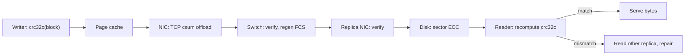

## In one minute
- A checksum is a short value computed from a block of data and stored or sent with it, so a reader can recompute it and notice that the bytes changed.
- Algorithms trade speed for detection power: additive sums (the internet checksum), position-weighted sums (Fletcher, Adler-32), polynomial codes (CRC-32, CRC-32C, CRC-64), and cryptographic hashes (SHA-256).
- A checksum detects accidents, not attackers: anyone who can change the data can recompute a CRC. Tampering needs a MAC or signature.
- Every layer that copies data has its own checksum, and corruption still slips through the gaps between them. Only a checksum computed by the writer and verified by the final reader covers the whole path.
- Detection is half the job; you also need a second copy to repair from and a scrubber for cold data.

## How it works

### The basic loop
The writer computes `c = f(data)` and stores or transmits `(data, c)`. The reader recomputes `f(data')` and compares it with `c'`. A mismatch means reject, retry or repair. A match means *probably* intact: for an `n`-bit checksum and random corruption, a damaged block still matches with probability about `2^-n`, one in 4.3 billion for 32 bits. For the error patterns hardware actually produces, good codes do far better than that and weak ones far worse.

### The families
**Additive sums.** The internet checksum used by IPv4, TCP and UDP is the ones' complement of the ones' complement sum of 16-bit words ([RFC 1071](https://www.rfc-editor.org/rfc/rfc1071)). Routers can update it incrementally when they decrement the TTL, but it cannot see two words swapped, because addition ignores order.

**Position-weighted sums.** Fletcher keeps two running sums: `a` adds each byte, `b` adds each new value of `a`, so position matters. Adler-32, used in the zlib format, is Fletcher with modulus 65,521 (the largest prime below 2^16) and `a` starting at 1.

**Cyclic redundancy checks.** A CRC treats the message as a polynomial over GF(2), where addition is XOR, and keeps the remainder after dividing by a fixed generator polynomial. The algebra gives guarantees, not just odds: a degree-`n` generator catches every burst of `n` or fewer flipped bits, and every pattern of scattered flips up to a limit that shrinks as messages grow. The IEEE 802.3 CRC-32 catches any 3 flipped bits in messages up to 91,607 bits (about 11 KB) but any 4 only up to 2,974 bits, while better 32-bit polynomials catch any 5 flips at Ethernet frame sizes ([Koopman, DSN 2002](https://users.ece.cmu.edu/~koopman/networks/dsn02/dsn02_koopman.pdf)). Ethernet, gzip, PNG and zip use CRC-32 (the IEEE 802.3 polynomial); iSCSI, SCTP, ext4, Btrfs, HDFS and Kafka use CRC-32C (the Castagnoli polynomial), which has better distance properties and dedicated CPU instructions.

**Cryptographic hashes.** SHA-256 is designed so that nobody can find two inputs with the same digest, even on purpose, which suits content addressing (Git objects, image digests, deduplication). It costs far more CPU than a hardware CRC, so storage engines use CRCs per block and reserve hashes for identity.

### Where checksums live
A disk sector carries its own error-correcting code. An Ethernet frame carries a 4-byte CRC-32, checked and stripped at every hop. TCP adds its 16-bit checksum. A storage engine adds a CRC per page or block: RocksDB per block, Kafka per record batch, Postgres a 16-bit checksum per 8 KB page (on by default for new clusters since PostgreSQL 18, released September 2025; `initdb --no-data-checksums` turns it off) ([PostgreSQL 18 release notes](https://www.postgresql.org/docs/18/release-18.html)), HDFS a CRC-32C for every 512 bytes (`dfs.bytes-per-checksum`, `dfs.checksum.type`) ([HDFS defaults](https://hadoop.apache.org/docs/stable/hadoop-project-dist/hadoop-hdfs/hdfs-default.xml)). Kafka's record batch CRC is CRC-32C over every byte after the CRC field, placed so brokers can rewrite the offset without recomputing it ([Kafka message format](https://kafka.apache.org/41/implementation/message-format/)). Object stores add a whole-object checksum. S3 accepts about ten algorithms, from CRC-32C and CRC-64/NVME to SHA-256 and XXHash; AWS clients now compute a checksum on every upload by default, CRC-64/NVME unless told otherwise, and S3 recomputes it before storing ([AWS](https://docs.aws.amazon.com/AmazonS3/latest/userguide/checking-object-integrity.html)).

The [durability lesson](how-databases-guarantee-durability.md) uses a CRC to find the torn tail of a write-ahead log, and the [key-value store lesson](key-value-stores.md) uses one per Bitcask record. This lesson is about which checksum to pick and where to put it.

### The end-to-end argument
Saltzer, Reed and Clark argued in 1984 that a lower layer's check cannot stand in for the application's, because data can be damaged between layers. Ethernet's CRC is regenerated on every hop, so a switch with a bad memory cell forwards a corrupted payload under a fresh, valid CRC. Only TCP's weak 16-bit sum is left to catch it. Stone and Partridge measured real traffic in 2000 and found about 1 packet in 30,000 failing the TCP checksum on links whose CRCs should let through only 1 error in 4 billion: the damage happened inside routers and hosts ([SIGCOMM 2000](https://conferences2.sigcomm.org/sigcomm/2000/conf/abstract/9-1.htm)).

This is the trust-but-verify problem shape. It recurs in ML pipelines: a model file copied from training storage through caches to every inference node should carry the trainer's digest, verified at load time.

## Down the stack

### Layer 1: The contract
A checksum promises one thing: if data and checksum disagree, something was damaged. A match only means no damage this code can detect, and that is spelled out per algorithm: CRC-32 detects all bursts up to 32 bits and all odd numbers of bit flips (its generator has `x + 1` as a factor); Fletcher-16 cannot tell a byte of `0x00` from `0xFF` because both are 0 mod 255; the internet checksum misses any reordering of 16-bit words. Nor does a checksum say *which* version is current. A lost write leaves an old block with a valid old checksum, so serious formats fold the block number and a generation counter into the checked bytes.

### Layer 2: The mechanism
Reflected CRC-32, as in zlib, starts with `crc = 0xFFFFFFFF`. For each byte it XORs the byte into the low 8 bits, then eight times shifts right and, if the bit shifted out was 1, XORs in `0xEDB88320` (the 802.3 polynomial bit-reversed). At the end it inverts all bits. The inversions make leading zero bytes change the result and make the empty string's CRC equal to zero. The standard check value is `crc32("123456789") = 0xCBF43926`; CRC-32C gives `0xE3069283` for the same input.

Implementations precompute a 256-entry table holding the effect of each byte, turning eight shift-and-XOR steps into one lookup: `crc = table[(crc ^ b) & 0xFF] ^ (crc >> 8)`. "Slicing-by-8" uses eight tables to consume 8 bytes per step. The CRC after chunk `a` can seed the computation over chunk `b`, so a stream is checksummed as it flows, and zlib's `crc32_combine` joins CRCs computed in parallel.

Adler-32 is weak on short messages: under about 257 bytes, `a` never wraps the modulus, so the output uses only a fraction of its 32 bits. RFC 3309 replaced it with CRC-32C in SCTP for that reason.

### Layer 3: The machine
x86 CPUs since SSE4.2 have a `crc32` instruction that consumes 8 bytes of CRC-32C with a 3-cycle latency and one-per-cycle throughput. Interleaving three streams reaches well over 10 GB/s per core, faster than an NVMe drive. It only knows the Castagnoli polynomial, a big reason new formats chose it; other polynomials use `PCLMULQDQ` (carry-less multiply) folding. ARMv8 has instructions for both CRC-32 and CRC-32C.

Corruption has physical sources. DRAM without ECC flips bits. NICs with checksum offload compute TCP checksums *after* data leaves host memory, so a bit flipped in a kernel buffer gets a valid checksum. Disks return the wrong sector, tear 4 KB writes on power loss, or acknowledge writes they never perform. SCSI T10 Protection Information adds 8 bytes per 512-byte sector: a 2-byte CRC guard, a 2-byte application tag and a 4-byte reference tag holding the expected sector number, catching misdirected I/O in hardware. Large operators also report CPU cores that silently compute wrong answers: Google sees a few such "mercurial" cores per several thousand machines ([Hochschild et al., HotOS 2021](https://sigops.org/s/conferences/hotos/2021/papers/hotos21-s01-hochschild.pdf)), so verify on a different machine where it matters. A checksum computed on the faulty core over already-wrong data will match, which is why the check must be made by a different machine or at the far end.

### Why it's built this way
1. Every component that stores or moves bits flips a few, so data carries a short fingerprint that is cheap to recheck.
2. Checks run on every read at line rate, so the fingerprint must cost about a memory copy, which favours CRCs over cryptographic hashes.
3. Real faults come as bursts and a few scattered bits, so polynomial codes with proven burst and distance guarantees beat sums of the same width.
4. CPUs gained an instruction for one polynomial, so storage built after 2008 standardised on CRC-32C.
5. Per-layer checks leave gaps between layers, so the end that cares adds its own check over the full path.

## Diagram


## Worked example
A blob store holds 2 PB of user data in 4 MB chunks, about 500 million chunks, with three copies of each. Each chunk carries one CRC-32C per 64 KB sub-block (64 per chunk) plus a SHA-256 of the whole chunk recorded in metadata.

Why sub-blocks? With one CRC per 4 MB chunk, a 100 KB ranged read would have to fetch and check all 4 MB, a 40x amplification. With 64 KB sub-blocks it touches at most three, about 192 KB, for an overhead of 4 bytes per 64 KB.

CPU cost: at 50 GB/s of reads and 10 GB/s per core for hardware CRC-32C, verification needs about 5 cores fleet-wide. Software SHA-256 at around 500 MB/s per core would need 100, so SHA-256 runs only on writes and scrubs.

Detection odds: if hardware silently corrupts 1 chunk copy in 10 million per year, that is 150 a year across 1.5 billion copies. Each slips past a 32-bit CRC with odds of about 1 in 4.3 billion, so expected undetected corruptions are about 3.5 x 10^-8 a year. The checksum is not the weak spot.

Cold data is. A chunk nobody reads for years can quietly lose copies until none is good. Scrubbing all 6 PB every 14 days takes about 5 GB/s fleet-wide, a tenth of serving bandwidth, and each bad copy is repaired from a replica that matches the SHA-256 in metadata.

## In the wild
- **Amazon S3, 2008: one flipped bit in gossip takes S3 down for hours.** On 20 July a handful of internal state messages had a single bit corrupted, still parseable but wrong. S3 protected customer objects with MD5 but not this gossip traffic, so the bad state spread until servers spent nearly all their time gossiping. Errors started at 8:40 PDT; engineers had to stop all server-to-server traffic and clear system state, and US requests were normal again only at 16:58. AWS added checksums to reject corrupted state messages ([AWS postmortem](https://web.archive.org/web/2008/http://status.aws.amazon.com/s3-20080720.html)).
- **Meta, 2021: a CPU core that computed the wrong file size.** In a Spark decompression pipeline, a size computation via Scala's `pow` returned 0 for a file known to be non-empty, so the file was skipped and the database silently lost it. Kernel and hardware logs were clean; the team narrowed it to `Int(1.1^53) = 0` on core 59 of one CPU. Fleet testing across hundreds of thousands of machines found hundreds of CPUs with such errors ([Dixit et al.](https://arxiv.org/abs/2102.11245)).
- **Google, 2021: cores that don't count.** Google reported mercurial cores at a rate of a few per several thousand machines, with symptoms including a self-inverting AES bug (data encrypted on one core decrypted only on that core), garbage collection losing live data, and index corruption that depended on which core served a query. End-to-end checksums in Colossus and Spanner were among the checks that caught them ([Hochschild et al.](https://sigops.org/s/conferences/hotos/2021/papers/hotos21-s01-hochschild.pdf)).

## Trade-offs
| Option | Strengths | Weaknesses | Choose when |
|---|---|---|---|
| Internet checksum (16-bit) | Trivial, updatable in place | Misses reordering, weak overall | Packet headers that change per hop |
| Fletcher / Adler-32 | Very fast in software, order-sensitive | Weak on short messages, blind spots | Legacy formats, no CRC hardware |
| CRC-32C | Proven burst and distance guarantees, hardware speed | 32 bits only, no tamper resistance | Per-block storage and log records |
| CRC-64 | Lower false match rate for huge objects | Slower without carry-less multiply | Whole-object checks on multi-GB files |
| SHA-256 | Collision resistant, content identity | Several times the CPU of hardware CRC | Content addressing, downloads, dedup |
| HMAC or signature | Detects deliberate tampering | Needs key management | Data crosses a trust boundary |

## Pitfalls in production
- **Verifying only on write.** Data checked once on ingest rots unnoticed. Verify on every read and scrub on a fixed cycle.
- **Checksum stored next to the data it protects.** A misdirected write replaces both the block and its checksum with another valid pair. Store the expected checksum in parent metadata (as ZFS does with block pointers) or include the block address in the checked bytes.
- **Trusting the transport.** TCP's checksum with NIC offload lets in-memory corruption through. Add an application checksum to replication and RPC payloads.
- **Mismatched variants.** CRC-32 and CRC-32C, reflected or not, initial value 0 or `0xFFFFFFFF`: all get called "CRC32". Pin the parameters and test the check value of `"123456789"` in every language that touches the format.
- **Using a checksum as an identity or a seal.** Two different files collide on a 32-bit CRC after about 77,000 random files. Use SHA-256 for deduplication keys and a MAC when an attacker could be involved.

## Leadership lens
- Ask where the end-to-end check is created and verified. If the answer is only TCP or the disk, there is a gap.
- Treat a checksum mismatch as a paging signal, not a log line. Mismatch rates per host, drive model and firmware find bad hardware batches early.
- Budget scrub bandwidth explicitly; an unscrubbed cold tier is where data loss hides until a restore fails.
- Standardise one checksum per layer and publish its exact parameters; mismatched CRC variants between teams cause more incidents than the algorithm choice.

## Check yourself
1. A switch with faulty buffer memory corrupts frames, yet no Ethernet CRC errors are reported. Why?
   **Answer:** The switch verifies the incoming CRC, corrupts the frame in memory, then computes a fresh CRC over the bad bytes when sending. Each link's CRC only covers its own wire.
2. Why can't Fletcher-16 or the internet checksum distinguish certain corruptions that CRC-32 catches easily?
   **Answer:** Fletcher-16 works mod 255, so bytes `0x00` and `0xFF` are equal to it, and the internet checksum is a commutative sum, so swapped words leave it unchanged. A CRC's polynomial division depends on every bit's position.
3. A disk silently drops a write, leaving the previous version of the block in place. Will a per-block CRC stored in the block catch it?
   **Answer:** No. The old block and its old CRC are consistent. Catching lost writes needs the expected checksum or a generation number kept somewhere else, such as the parent pointer or an index.
4. Why do new storage formats favour CRC-32C over the CRC-32 used by gzip?
   **Answer:** CRC-32C has better error detection for typical block sizes and has a dedicated x86 instruction (and an ARM one), so it runs at memory speed without lookup tables.

## Practice
**Task:** Implement four checksums over byte arrays and a comparison helper. `sum8(data)` is the sum of bytes mod 256. `fletcher16(data)` keeps `a` and `b` mod 255 (for each byte `a = (a + byte) % 255`, then `b = (b + a) % 255`) and returns `(b << 8) | a`. `adler32(data)` is the same shape with `a` starting at 1, modulus 65,521, and result `(b << 16) | a`. `crc32(data, prev)` is the table-driven, reflected CRC-32 used by zlib (polynomial `0xEDB88320`, start from the bitwise inverse of `prev`, invert at the end); `prev` defaults to 0 and lets a stream be checksummed in chunks. `undetected(original, corrupted)` returns, in the order `sum8`, `fletcher16`, `adler32`, `crc32`, the names of the algorithms whose checksum is the same for both inputs.

```python starter
def sum8(data):
    # TODO
    raise NotImplementedError

def fletcher16(data):
    # TODO
    raise NotImplementedError

def adler32(data):
    # TODO
    raise NotImplementedError

def crc32(data, prev=0):
    # TODO
    raise NotImplementedError

def undetected(original, corrupted):
    # TODO
    raise NotImplementedError
```

```python tests
def test_crc32_check_values():
    assert crc32(b"") == 0
    assert crc32(b"123456789") == 0xCBF43926
    assert crc32(b"The quick brown fox jumps over the lazy dog") == 0x414FA339

def test_crc32_streaming():
    assert crc32(b"456789", crc32(b"123")) == 0xCBF43926, "chained chunks equal one pass"

def test_adler32_vectors():
    assert adler32(b"") == 1
    assert adler32(b"Wikipedia") == 0x11E60398
    assert adler32(bytes([255]) * 10000) == 0xB623EB2B, "sums must wrap mod 65521"

def test_fletcher16_and_sum8():
    assert fletcher16(b"abcde") == 0xC8F0
    assert fletcher16(b"abcdef") == 0x2057
    assert sum8(b"abc") == (97 + 98 + 99) % 256

def test_swap_fools_only_plain_sum():
    assert undetected(b"abcdef", b"abdcef") == ["sum8"]

def test_fletcher_blind_to_00_vs_ff():
    assert undetected(b"\x10\x00\x20", b"\x10\xff\x20") == ["fletcher16"]

def test_identical_input_matches_everything():
    assert undetected(b"same", b"same") == ["sum8", "fletcher16", "adler32", "crc32"]

def test_compensating_bytes_fool_sum8():
    assert undetected(b"\x05\x05", b"\x04\x06") == ["sum8"]
```

```python solution
def _make_table():
    table = []
    for n in range(256):
        c = n
        for _ in range(8):
            if c & 1:
                c = (c >> 1) ^ 0xEDB88320
            else:
                c >>= 1
        table.append(c)
    return table

_TABLE = _make_table()

def sum8(data):
    return sum(data) % 256

def fletcher16(data):
    a = b = 0
    for x in data:
        a = (a + x) % 255
        b = (b + a) % 255
    return (b << 8) | a

def adler32(data):
    a, b = 1, 0
    for x in data:
        a = (a + x) % 65521
        b = (b + a) % 65521
    return (b << 16) | a

def crc32(data, prev=0):
    c = prev ^ 0xFFFFFFFF
    for x in data:
        c = _TABLE[(c ^ x) & 0xFF] ^ (c >> 8)
    return c ^ 0xFFFFFFFF

def undetected(original, corrupted):
    algos = [("sum8", sum8), ("fletcher16", fletcher16), ("adler32", adler32), ("crc32", crc32)]
    return [name for name, f in algos if f(original) == f(corrupted)]
```

```typescript starter
export function sum8(data: number[]): number {
  throw new Error("TODO");
}
export function fletcher16(data: number[]): number {
  throw new Error("TODO");
}
export function adler32(data: number[]): number {
  throw new Error("TODO");
}
export function crc32(data: number[], prev: number = 0): number {
  throw new Error("TODO");
}
export function undetected(original: number[], corrupted: number[]): string[] {
  throw new Error("TODO");
}
```

```typescript tests
function bytesOf(s: string): number[] {
  const out: number[] = [];
  for (let i = 0; i < s.length; i++) out.push(s.charCodeAt(i));
  return out;
}

test("crc32 check values", () => {
  assertEqual(crc32([]), 0);
  assertEqual(crc32(bytesOf("123456789")), 0xcbf43926);
  assertEqual(crc32(bytesOf("The quick brown fox jumps over the lazy dog")), 0x414fa339);
});
test("crc32 streaming", () => {
  assertEqual(crc32(bytesOf("456789"), crc32(bytesOf("123"))), 0xcbf43926, "chained chunks equal one pass");
});
test("adler32 vectors", () => {
  assertEqual(adler32([]), 1);
  assertEqual(adler32(bytesOf("Wikipedia")), 0x11e60398);
  assertEqual(adler32(new Array(10000).fill(255)), 0xb623eb2b, "sums must wrap mod 65521");
});
test("fletcher16 and sum8", () => {
  assertEqual(fletcher16(bytesOf("abcde")), 0xc8f0);
  assertEqual(fletcher16(bytesOf("abcdef")), 0x2057);
  assertEqual(sum8(bytesOf("abc")), (97 + 98 + 99) % 256);
});
test("swap fools only plain sum", () => {
  assertEqual(undetected(bytesOf("abcdef"), bytesOf("abdcef")), ["sum8"]);
});
test("fletcher blind to 00 vs ff", () => {
  assertEqual(undetected([0x10, 0x00, 0x20], [0x10, 0xff, 0x20]), ["fletcher16"]);
});
test("identical input matches everything", () => {
  assertEqual(undetected(bytesOf("same"), bytesOf("same")), ["sum8", "fletcher16", "adler32", "crc32"]);
});
test("compensating bytes fool sum8", () => {
  assertEqual(undetected([5, 5], [4, 6]), ["sum8"]);
});
```

```typescript solution
const CRC_TABLE: number[] = (() => {
  const t: number[] = [];
  for (let n = 0; n < 256; n++) {
    let c = n;
    for (let k = 0; k < 8; k++) c = c & 1 ? (c >>> 1) ^ 0xedb88320 : c >>> 1;
    t.push(c >>> 0);
  }
  return t;
})();

export function sum8(data: number[]): number {
  let s = 0;
  for (const x of data) s = (s + x) % 256;
  return s;
}

export function fletcher16(data: number[]): number {
  let a = 0;
  let b = 0;
  for (const x of data) {
    a = (a + x) % 255;
    b = (b + a) % 255;
  }
  return (b << 8) | a;
}

export function adler32(data: number[]): number {
  let a = 1;
  let b = 0;
  for (const x of data) {
    a = (a + x) % 65521;
    b = (b + a) % 65521;
  }
  return (b * 65536 + a) >>> 0;
}

export function crc32(data: number[], prev: number = 0): number {
  let c = (prev ^ 0xffffffff) >>> 0;
  for (const x of data) c = (CRC_TABLE[(c ^ x) & 0xff] ^ (c >>> 8)) >>> 0;
  return (c ^ 0xffffffff) >>> 0;
}

export function undetected(original: number[], corrupted: number[]): string[] {
  const algos: [string, (d: number[]) => number][] = [
    ["sum8", sum8],
    ["fletcher16", fletcher16],
    ["adler32", adler32],
    ["crc32", (d) => crc32(d)],
  ];
  return algos.filter(([, f]) => f(original) === f(corrupted)).map(([name]) => name);
}
```

```go starter
package practice

func Sum8(data []byte) uint32       { panic("TODO") }
func Fletcher16(data []byte) uint32 { panic("TODO") }
func Adler32(data []byte) uint32    { panic("TODO") }

func CRC32(data []byte, prev uint32) uint32 { panic("TODO") }

func Undetected(original, corrupted []byte) []string { panic("TODO") }
```

```go tests
package practice

import (
	"bytes"
	"reflect"
	"testing"
)

func sameNames(t *testing.T, got, want []string) {
	t.Helper()
	if !reflect.DeepEqual(got, want) {
		t.Fatalf("got %v, want %v", got, want)
	}
}

func TestCRC32CheckValues(t *testing.T) {
	if CRC32(nil, 0) != 0 {
		t.Fatal("empty input should be 0")
	}
	if got := CRC32([]byte("123456789"), 0); got != 0xCBF43926 {
		t.Fatalf("got %#x", got)
	}
	if got := CRC32([]byte("The quick brown fox jumps over the lazy dog"), 0); got != 0x414FA339 {
		t.Fatalf("got %#x", got)
	}
}

func TestCRC32Streaming(t *testing.T) {
	if got := CRC32([]byte("456789"), CRC32([]byte("123"), 0)); got != 0xCBF43926 {
		t.Fatalf("chained chunks should equal one pass, got %#x", got)
	}
}

func TestAdler32Vectors(t *testing.T) {
	if Adler32(nil) != 1 {
		t.Fatal("empty input should be 1")
	}
	if got := Adler32([]byte("Wikipedia")); got != 0x11E60398 {
		t.Fatalf("got %#x", got)
	}
	if got := Adler32(bytes.Repeat([]byte{255}, 10000)); got != 0xB623EB2B {
		t.Fatalf("sums must wrap mod 65521, got %#x", got)
	}
}

func TestFletcher16AndSum8(t *testing.T) {
	if Fletcher16([]byte("abcde")) != 0xC8F0 || Fletcher16([]byte("abcdef")) != 0x2057 {
		t.Fatal("fletcher16 vectors")
	}
	if Sum8([]byte("abc")) != (97+98+99)%256 {
		t.Fatal("sum8")
	}
}

func TestSwapFoolsOnlyPlainSum(t *testing.T) {
	sameNames(t, Undetected([]byte("abcdef"), []byte("abdcef")), []string{"sum8"})
}

func TestFletcherBlindTo00VsFF(t *testing.T) {
	sameNames(t, Undetected([]byte{0x10, 0x00, 0x20}, []byte{0x10, 0xff, 0x20}), []string{"fletcher16"})
}

func TestIdenticalInputMatchesEverything(t *testing.T) {
	sameNames(t, Undetected([]byte("same"), []byte("same")), []string{"sum8", "fletcher16", "adler32", "crc32"})
}

func TestCompensatingBytesFoolSum8(t *testing.T) {
	sameNames(t, Undetected([]byte{5, 5}, []byte{4, 6}), []string{"sum8"})
}
```

```go solution
package practice

var crcTable = func() [256]uint32 {
	var t [256]uint32
	for n := 0; n < 256; n++ {
		c := uint32(n)
		for k := 0; k < 8; k++ {
			if c&1 == 1 {
				c = (c >> 1) ^ 0xEDB88320
			} else {
				c >>= 1
			}
		}
		t[n] = c
	}
	return t
}()

func Sum8(data []byte) uint32 {
	var s uint32
	for _, x := range data {
		s = (s + uint32(x)) % 256
	}
	return s
}

func Fletcher16(data []byte) uint32 {
	var a, b uint32
	for _, x := range data {
		a = (a + uint32(x)) % 255
		b = (b + a) % 255
	}
	return b<<8 | a
}

func Adler32(data []byte) uint32 {
	var a, b uint32 = 1, 0
	for _, x := range data {
		a = (a + uint32(x)) % 65521
		b = (b + a) % 65521
	}
	return b<<16 | a
}

func CRC32(data []byte, prev uint32) uint32 {
	c := ^prev
	for _, x := range data {
		c = crcTable[byte(c)^x] ^ (c >> 8)
	}
	return ^c
}

func Undetected(original, corrupted []byte) []string {
	type algo struct {
		name string
		f    func([]byte) uint32
	}
	algos := []algo{
		{"sum8", Sum8},
		{"fletcher16", Fletcher16},
		{"adler32", Adler32},
		{"crc32", func(d []byte) uint32 { return CRC32(d, 0) }},
	}
	out := []string{}
	for _, a := range algos {
		if a.f(original) == a.f(corrupted) {
			out = append(out, a.name)
		}
	}
	return out
}
```

## Mock interview
**Prompt:** Your replicated object store holds 5 PB and serves 40 GB/s of reads. A customer's download does not match the SHA-256 they computed on upload, and no log shows an error. Design the integrity scheme that would have caught this, and say where the corruption probably happened.

- Follow-up: Your per-block CRCs all pass on every replica, yet the bytes differ from what the customer uploaded. How is that possible?
- Follow-up: Scrubbing finds a chunk whose three replicas each have valid but different checksums. What do you do?
- Follow-up: Would you switch per-block checks from CRC-32C to SHA-256? What would it cost?

**A strong answer covers:**
- An end-to-end checksum from the client, carried unchanged through every hop, verified before acknowledging the upload and before serving.
- Per-block CRC-32C for cheap checks on every read, plus a whole-object hash in metadata.
- Likely culprits: a proxy that recomputed checksums from corrupted memory, or a lost or misdirected write leaving a self-consistent stale block.
- Scrubbing, repair from a replica that matches the metadata hash, and quarantine of the host that produced the bad copy.
- Mismatch metrics by host, drive model and firmware, and cross-machine verification to rule out a faulty CPU.

## Sources and further study
**Primary**
- [Stone and Partridge, When the CRC and TCP Checksum Disagree (SIGCOMM 2000)](https://conferences2.sigcomm.org/sigcomm/2000/conf/abstract/9-1.htm): the measurement that showed how much damage happens inside hosts and routers.
- [Koopman, 32-Bit Cyclic Redundancy Codes for Internet Applications (DSN 2002)](https://users.ece.cmu.edu/~koopman/networks/dsn02/dsn02_koopman.pdf): an exhaustive search of 32-bit CRCs, with the Hamming distance of 802.3 and Castagnoli polynomials by message length.
- [Hochschild et al., Cores That Don't Count (HotOS 2021)](https://sigops.org/s/conferences/hotos/2021/papers/hotos21-s01-hochschild.pdf): silent CPU errors at fleet scale and why applications need their own checks.
- [Dixit et al., Silent Data Corruptions at Scale (2021)](https://arxiv.org/abs/2102.11245): a full debugging story of one corrupting core, from missing files to a single instruction.

**Systems docs**
- [Kafka: message format](https://kafka.apache.org/41/implementation/message-format/): exactly which bytes the record batch CRC-32C covers, and why.
- [HDFS default configuration](https://hadoop.apache.org/docs/stable/hadoop-project-dist/hadoop-hdfs/hdfs-default.xml): per-chunk checksum size and type for a real distributed file system.
- [PostgreSQL 18 release notes](https://www.postgresql.org/docs/18/release-18.html): page checksums becoming the default, and the upgrade catch.

**Books**
- *Site Reliability Engineering*, Beyer et al., chapter 26 "Data Integrity: What You Read Is What You Wrote": integrity as an end-to-end property, with Google case studies of silent loss.
- *Computer Networking: A Top-Down Approach* (8th ed.), Kurose and Ross, chapter 6 "The Link Layer and LANs": parity, the internet checksum and CRCs side by side.
- *Database Internals*, Alex Petrov, chapter 3 "File Formats": page layout for on-disk structures, where per-page checksums sit.

**Other curricula**
- [donnemartin/system-design-primer](https://github.com/donnemartin/system-design-primer): mentions checksums only as a TCP header field; integrity beyond the transport is left out.

## Watch
- [How do CRCs work? (Ben Eater)](https://www.youtube.com/watch?v=izG7qT0EpBw): from parity and simple sums to polynomial division, and why CRCs catch burst errors.
- [Hardware build: CRC calculation (Ben Eater)](https://www.youtube.com/watch?v=sNkERQlK8j8): a CRC built from shift registers and XOR gates, the circuit the table-driven code imitates.

## Free resources
- [End-to-End Arguments in System Design (Saltzer, Reed, Clark)](https://web.mit.edu/Saltzer/www/publications/endtoend/endtoend.pdf): the original case for checking at the endpoints, with file transfer as the example.
- [RFC 1071: Computing the Internet Checksum](https://www.rfc-editor.org/rfc/rfc1071): the ones' complement sum, its incremental update, and its limits.
- [RFC 3309: SCTP Checksum Change](https://www.rfc-editor.org/rfc/rfc3309): why SCTP dropped Adler-32 for CRC-32C, with the analysis of short-message weakness.
- [Philip Koopman's CRC polynomial zoo](https://users.ece.cmu.edu/~koopman/crc/): Hamming distance tables for real polynomials at real message lengths.
- [A Painless Guide to CRC Error Detection Algorithms (Ross Williams)](https://zlib.net/crc_v3.txt): the classic derivation of table-driven and reflected CRCs.
- [Checking S3 object integrity (AWS)](https://docs.aws.amazon.com/AmazonS3/latest/userguide/checking-object-integrity.html): how a real object store exposes end-to-end checksums to clients.
