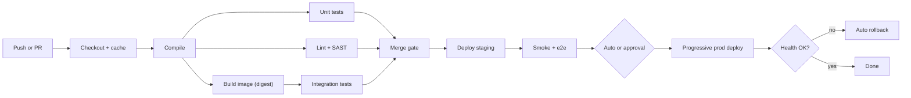

## In one minute
- Continuous integration means every change merges to a shared mainline often and is verified by an automated build and test run within minutes.
- Continuous delivery keeps mainline always releasable; continuous deployment goes one step further and ships every green commit to production without a human gate.
- A pipeline is a DAG of stages: build once, produce an immutable artifact, then promote that same artifact through test, staging, and production.
- The two numbers that matter most are lead time (commit to production) and change failure rate. Fast feedback and small batches improve both.
- The pipeline holds deploy credentials and decides what runs in prod, so treat it as production infrastructure.

## How it works

### Integration
Developers push small changes to a short-lived branch or to trunk. A webhook triggers CI, which checks out the exact commit, restores caches, compiles, runs unit tests and static checks, and reports status to the pull request. Branch protection blocks the merge until required checks pass. Aim for a verdict in under ten minutes, the old Extreme Programming guideline that Martin Fowler's 2024 revision of his CI article still calls reasonable for most projects ([Fowler](https://martinfowler.com/articles/continuousIntegration.html)). The same article is strict about what counts: everyone integrates into mainline at least daily, and running CI on long-lived feature branches is only semi-integration, because the branches still diverge from each other.

### Build once, promote many
The build stage produces one artifact, usually a container image addressed by its content digest. Later stages pull that digest and never rebuild. Rebuilding per environment means testing one binary and shipping another, since a floating base image or dependency can change in between. Google goes further and makes builds hermetic: pinned tool and library versions, so two people building the same revision on different machines expect identical output ([Google SRE book, ch. 8](https://sre.google/sre-book/release-engineering/)).

### Stages as a DAG
Pipelines are graphs. Lint, unit tests, and scans run in parallel after compile; staging deploy waits for all of them. Jobs run on ephemeral runners and pass state only as declared artifacts, which makes them cacheable and retryable.

### Delivery and deployment
After staging, the pipeline waits for approval (delivery) or proceeds automatically (deployment). The production deploy itself should be progressive and gated by health checks that can roll back without a human.

### Supply chain
Record provenance: which commit, builder, and inputs produced this digest. Signing the artifact and verifying at deploy time stops an attacker who can push to the registry but cannot run the trusted builder. SLSA is the common yardstick for this; the current version is 1.2, released in November 2025, which added a Source Track for how code is written and reviewed alongside the Build Track ([SLSA](https://slsa.dev/blog/2025/11/announce-slsa-v1.2)). Runners building fork PRs must never see production secrets, and GitHub warns that workflows triggered by `pull_request_target` can see secrets, so they must never check out the fork's code ([GitHub docs](https://docs.github.com/en/actions/reference/security/secure-use)).

Third-party CI steps are dependencies too. A tag like `v4` can be moved to point at new code, so pin actions to a full commit SHA; GitHub's newer workflow dependency lockfile (`.github/workflows/actions.lock`, in public preview) records the exact commit of every action, including transitive ones ([GitHub docs](https://docs.github.com/en/actions/concepts/security/workflow-dependency-lockfiles)).

## Down the stack
### Layer 1: The contract
A CI system promises a verdict per required check for an exact commit SHA, not for a branch name. A merge queue strengthens that: every commit that lands on trunk has passed checks on exactly the tree that landed, including other PRs merged ahead of it. GitHub's queue does this by building temporary `gh-readonly-queue/<base>` branches that stack each PR on the ones ahead; if one fails, it is removed and the later groups are rebuilt without it ([GitHub docs](https://docs.github.com/en/repositories/configuring-branches-and-merges-in-your-repository/configuring-pull-request-merges/managing-a-merge-queue)). The build stage promises an artifact identified by a content digest, so two people asking for "release 412" get identical bytes. The deploy stage promises at most one rollout per environment at a time, and that a newer commit is never overwritten by an older one.

### Layer 2: The mechanism
A push produces a webhook event carrying the head SHA. The scheduler expands the pipeline file into jobs, and runners long-poll a queue to claim them. Caches are keyed by a hash of the inputs, for example `deps-` plus the SHA-256 of the lockfile, with prefix fallbacks when the exact key misses. Build tools such as Bazel go further: every action declares its inputs, command line and allowed environment variables, the action cache maps a hash of that definition to its results, and outputs live in a content-addressable store, so an unchanged library is never rebuilt anywhere in the company ([Bazel docs](https://bazel.build/remote/caching)). A container image is a JSON manifest that lists layer digests and a config digest ([OCI image spec](https://github.com/opencontainers/image-spec/blob/main/manifest.md)). Its own digest is the SHA-256 of that manifest, so changing any layer changes the identity. Deploy credentials come from OIDC: each job gets its own signed JWT with claims such as `sub`, `repository`, `ref` and `job_workflow_ref`, the cloud checks those claims against the role's trust policy, and returns an access token valid only for that job ([GitHub docs](https://docs.github.com/en/actions/concepts/security/openid-connect)).

### Layer 3: The machine
A fresh runner VM boots in 10 to 40 seconds. Restoring a 1 GB dependency cache from object storage at about 200 MB/s takes 5 seconds; installing the same packages from a registry means tens of thousands of small file writes and metadata operations, which is often slower than the download itself. Image layers are usually gzip tarballs, so a 300 MB layer costs both network time and single-threaded decompression on pull; the OCI spec also defines zstd-compressed layers, which decompress faster where registries and runtimes support them ([OCI image spec](https://github.com/opencontainers/image-spec/blob/main/manifest.md)). Integration tests that start PostgreSQL in a container spend much of their time in `fsync`; putting test databases on tmpfs or disabling fsync for throwaway instances can halve suite time.

### Why it's built this way
Engineer waiting time costs far more than runner minutes, so pipelines trade compute for latency through parallel jobs. Most job time goes to moving bytes, so everything is cached by content hash. Content hashes give artifacts an identity, so promotion by digest becomes possible. Long-lived deploy keys stored in CI get leaked, so credentials are minted per job from a signed identity and expire quickly.

## Diagram


## Worked example
A team of 40 engineers merges about 120 changes a day into a monorepo. The naive pipeline runs every test on every commit: 25 minutes on one runner. At 120 runs a day that is 50 runner-hours, and a developer waits 25 minutes per change.

Three changes fix this. Caching keyed on the lockfile hash removes about 6 minutes. Sharding tests across 8 runners turns 15 minutes into about 3.5 including startup. Affected-target analysis runs only tests downstream of changed packages, about 30 percent of the suite on a typical change.

The verdict now arrives in about 6 minutes. At 0.008 USD per runner-minute the old pipeline cost 120 x 25 x 0.008 = 24 USD a day; the new one is roughly 15 USD, because most commits run a fraction of the tests. The bigger win is human: 120 changes x 19 saved minutes is 38 engineer-hours of waiting per day.

## In the wild
- **tj-actions/changed-files, 2025: a retargeted tag leaks CI secrets.** On 14 and 15 March an attacker pointed several version tags of this popular GitHub Action, used by over 23,000 repositories, at a malicious commit. The code read secrets from the runner's memory and printed them, base64-encoded, into workflow logs that were public for public repositories. It was tracked as CVE-2025-30066, and users had to rotate every secret the action could have seen ([GitHub advisory](https://github.com/advisories/GHSA-mrrh-fwg8-r2c3)).
- **Codecov, 2021: a CI script that exported its environment.** From 31 January, an attacker who had extracted a credential through a flaw in Codecov's Docker image build periodically modified the Bash Uploader that many pipelines downloaded and ran. The change sent the output of `env` and `git remote -v` to an outside server. A customer caught it on 1 April by noticing the script's checksum did not match the published one, and every user who ran it without checking had to re-roll all CI credentials ([Codecov](https://about.codecov.io/security-update/)).
- **Knight Capital, 2012: a manual deploy that missed one server.** A technician copied new order-routing code to seven of eight servers. The eighth still had retired code that the new release's reused flag switched back on, and in about 45 minutes Knight sent millions of unintended orders and lost more than $460 million. The SEC noted there was no second-person review of the deploy and no written procedure ([SEC order](https://www.sec.gov/litigation/admin/2013/34-70694.pdf)).

## Trade-offs
| Option | Strengths | Weaknesses | Choose when |
| --- | --- | --- | --- |
| Continuous delivery (manual prod gate) | Human checkpoint, easy fit for regulated change control | Batches pile up behind the gate, larger risky releases | Audit rules need named approvers, or monitoring is immature |
| Continuous deployment | Smallest batches, fastest feedback, no release toil | Needs strong tests, automated rollback, feature flags | Mature observability and a culture of small changes |
| Monorepo with affected-target builds | One pipeline, atomic cross-service changes | Needs a build graph tool, cache infrastructure | Many services share libraries |
| Per-service pipelines | Simple, isolated ownership | Drift between pipelines, cross-service changes are hard | Independent teams with few shared libraries |

## Pitfalls in production
- Flaky tests train people to hit retry. Quarantine a test automatically after repeated nondeterministic failures and track the quarantine list as debt with an owner.
- Rebuilding per environment ships an untested binary. Build once, tag by digest, and promote the digest.
- Secrets in CI logs or exposed to fork PRs leak quickly. Use short-lived OIDC credentials scoped per job and keep deploy jobs on protected branches only.
- Third-party actions referenced by a mutable tag can change under you. Pin by commit SHA or lockfile, and give each job only the token permissions it needs.
- A slow mainline build blocks everyone. Use a merge queue that tests the merged result in batches so trunk stays green without serialising every PR.
- Deploy jobs without concurrency control can race and roll an older commit over a newer one. Serialise deploys per environment and refuse to deploy a commit older than what is live.

## Leadership lens
- Track the DORA metrics, which are no longer the original four keys. Since the 2023 report, mean time to restore is replaced by failed deployment recovery time, and the 2024 report added deployment rework rate, giving five: change lead time, deployment frequency, failed deployment recovery time, change fail rate and deployment rework rate ([DORA](https://dora.dev/guides/dora-metrics/), [history](https://dora.dev/insights/dora-metrics-history/)). Ask which one the current pipeline is hurting most before buying tooling.
- Set a budget for the merge verdict, for example 10 minutes at p90, and treat breaches as incidents for the platform team.
- Shared pipeline templates owned by a platform team, with per-service overrides, avoid both drift and a bottleneck.

## Check yourself
1. Why should staging and production deploy the same image digest instead of each rebuilding from the same commit?
   **Answer:** A rebuild can pull different base images or dependency versions, so the tested artifact and the shipped artifact differ. Promoting one digest guarantees what passed tests is byte-identical to what runs in prod.
2. A merge queue batches 5 PRs and the batch fails. What does the queue do next, and why is that better than testing each PR alone?
   **Answer:** It isolates the failing PR (by bisecting the batch, or as GitHub does, from the stacked per-PR builds), ejects it, and merges the rest. In the common all-green case it pays for one test run instead of five, while still keeping trunk green.
3. What separates continuous delivery from continuous deployment, and what prerequisite does the second need?
   **Answer:** Delivery keeps every commit releasable but a human triggers production; deployment ships automatically. It needs automated health gates and rollback, because no human is watching each release.
4. Why must jobs for pull requests from forks never receive production secrets?
   **Answer:** The fork author controls the code the job runs, so any secret in scope can be exfiltrated by a malicious test or build script.

## Practice
**Task:** Implement `plan_waves(jobs)`, which turns a pipeline definition into parallel execution waves. `jobs` maps a job name to the list of job names it needs. Return a list of waves, where each wave is a sorted list of jobs whose needs are all in earlier waves, and each job appears in the earliest wave possible. Raise `ValueError` if a job needs an unknown job or if the graph has a cycle. An empty dict returns an empty list.

```python starter
def plan_waves(jobs):
    # TODO: return a list of sorted lists of job names
    raise NotImplementedError
```

```python tests
def test_linear():
    assert plan_waves({"build": [], "test": ["build"], "deploy": ["test"]}) == [["build"], ["test"], ["deploy"]]

def test_parallel_fan_out():
    jobs = {"compile": [], "lint": ["compile"], "unit": ["compile"], "deploy": ["lint", "unit"]}
    assert plan_waves(jobs) == [["compile"], ["lint", "unit"], ["deploy"]]

def test_earliest_wave():
    jobs = {"a": [], "b": ["a"], "c": ["b"], "scan": []}
    assert plan_waves(jobs)[0] == ["a", "scan"]

def test_empty():
    assert plan_waves({}) == []

def test_unknown_dependency():
    try:
        plan_waves({"deploy": ["build"]})
        assert False, "expected ValueError"
    except ValueError:
        pass

def test_cycle():
    try:
        plan_waves({"a": ["b"], "b": ["a"], "c": []})
        assert False, "expected ValueError"
    except ValueError:
        pass
```

```python solution
def plan_waves(jobs):
    for name, needs in jobs.items():
        for n in needs:
            if n not in jobs:
                raise ValueError("unknown dependency " + n + " of " + name)
    done = set()
    waves = []
    remaining = set(jobs)
    while remaining:
        wave = sorted(j for j in remaining if all(n in done for n in jobs[j]))
        if not wave:
            raise ValueError("cycle among " + ", ".join(sorted(remaining)))
        waves.append(wave)
        done.update(wave)
        remaining.difference_update(wave)
    return waves
```

```typescript starter
export function planWaves(jobs: Record<string, string[]>): string[][] {
  throw new Error("TODO");
}
```

```typescript tests
test("linear", () => {
  assertEqual(planWaves({ build: [], test: ["build"], deploy: ["test"] }), [["build"], ["test"], ["deploy"]]);
});

test("parallel fan out", () => {
  const jobs = { compile: [], lint: ["compile"], unit: ["compile"], deploy: ["lint", "unit"] };
  assertEqual(planWaves(jobs), [["compile"], ["lint", "unit"], ["deploy"]]);
});

test("earliest wave", () => {
  assertEqual(planWaves({ a: [], b: ["a"], c: ["b"], scan: [] })[0], ["a", "scan"]);
});

test("empty", () => {
  assertEqual(planWaves({}), []);
});

test("unknown dependency throws", () => {
  let threw = false;
  try { planWaves({ deploy: ["build"] }); } catch (e) { threw = true; }
  assert(threw, "expected error");
});

test("cycle throws", () => {
  let threw = false;
  try { planWaves({ a: ["b"], b: ["a"], c: [] }); } catch (e) { threw = true; }
  assert(threw, "expected error");
});
```

```typescript solution
export function planWaves(jobs: Record<string, string[]>): string[][] {
  for (const name of Object.keys(jobs)) {
    for (const n of jobs[name]) {
      if (!(n in jobs)) throw new Error("unknown dependency " + n + " of " + name);
    }
  }
  const done = new Set<string>();
  const remaining = new Set<string>(Object.keys(jobs));
  const waves: string[][] = [];
  while (remaining.size > 0) {
    const wave = [...remaining].filter((j) => jobs[j].every((n) => done.has(n))).sort();
    if (wave.length === 0) throw new Error("cycle");
    waves.push(wave);
    for (const j of wave) { done.add(j); remaining.delete(j); }
  }
  return waves;
}
```

```go starter
package practice

func PlanWaves(jobs map[string][]string) ([][]string, error) {
	panic("TODO")
}
```

```go tests
package practice

import (
	"reflect"
	"testing"
)

func TestLinear(t *testing.T) {
	got, err := PlanWaves(map[string][]string{"build": {}, "test": {"build"}, "deploy": {"test"}})
	want := [][]string{{"build"}, {"test"}, {"deploy"}}
	if err != nil || !reflect.DeepEqual(got, want) {
		t.Fatalf("got %v %v", got, err)
	}
}

func TestFanOut(t *testing.T) {
	got, _ := PlanWaves(map[string][]string{"compile": {}, "lint": {"compile"}, "unit": {"compile"}, "deploy": {"lint", "unit"}})
	want := [][]string{{"compile"}, {"lint", "unit"}, {"deploy"}}
	if !reflect.DeepEqual(got, want) {
		t.Fatalf("got %v", got)
	}
}

func TestEarliestWave(t *testing.T) {
	got, _ := PlanWaves(map[string][]string{"a": {}, "b": {"a"}, "c": {"b"}, "scan": {}})
	if len(got) == 0 || !reflect.DeepEqual(got[0], []string{"a", "scan"}) {
		t.Fatalf("got %v", got)
	}
}

func TestEmpty(t *testing.T) {
	got, err := PlanWaves(map[string][]string{})
	if err != nil || len(got) != 0 {
		t.Fatalf("got %v %v", got, err)
	}
}

func TestUnknownDependency(t *testing.T) {
	if _, err := PlanWaves(map[string][]string{"deploy": {"build"}}); err == nil {
		t.Fatal("expected error")
	}
}

func TestCycle(t *testing.T) {
	if _, err := PlanWaves(map[string][]string{"a": {"b"}, "b": {"a"}, "c": {}}); err == nil {
		t.Fatal("expected error")
	}
}
```

```go solution
package practice

import (
	"fmt"
	"sort"
)

func PlanWaves(jobs map[string][]string) ([][]string, error) {
	for name, needs := range jobs {
		for _, n := range needs {
			if _, ok := jobs[n]; !ok {
				return nil, fmt.Errorf("unknown dependency %s of %s", n, name)
			}
		}
	}
	done := map[string]bool{}
	waves := [][]string{}
	for len(done) < len(jobs) {
		wave := []string{}
		for name, needs := range jobs {
			if done[name] {
				continue
			}
			ready := true
			for _, n := range needs {
				if !done[n] {
					ready = false
				}
			}
			if ready {
				wave = append(wave, name)
			}
		}
		if len(wave) == 0 {
			return nil, fmt.Errorf("cycle detected")
		}
		sort.Strings(wave)
		for _, j := range wave {
			done[j] = true
		}
		waves = append(waves, wave)
	}
	return waves, nil
}
```

## Mock interview
**Prompt:** You lead a platform team for 300 engineers and 150 services. Median time from merge to production is 3 hours and the main branch is red about 20 percent of the time. Design the CI/CD system you would move them to.

- Follow-up: How do you keep trunk green when 400 PRs merge per day?
- Follow-up: A compromised third-party GitHub Action is discovered in your pipelines. What limits the blast radius?
- Follow-up: Would you allow some services to keep a manual production gate, and how would you decide?

**A strong answer covers:**
- Measuring first: lead time, change failure rate, flaky test rate, queue time versus run time.
- Build once and promote by digest, with provenance and signature checks at deploy time.
- A merge queue with batching and bisection, plus automatic flaky-test quarantine.
- Caching, sharding, and affected-target analysis to keep the verdict under about 10 minutes.
- Short-lived OIDC credentials per job, pinned third-party actions by commit SHA, no secrets on fork builds.
- Progressive production rollout with automated health gates, and a policy for exceptions owned by service teams.

## Sources and further study
**Primary**
- [SLSA specification v1.2](https://slsa.dev/spec/v1.2/): Build and Source Track levels for provenance and supply-chain integrity.
- [DORA: a history of the software delivery metrics](https://dora.dev/insights/dora-metrics-history/): why MTTR became failed deployment recovery time and rework rate was added.

**Systems docs**
- [GitHub Actions: secure use reference](https://docs.github.com/en/actions/reference/security/secure-use): pinning, lockfiles, token permissions and risky triggers.
- [GitHub: managing a merge queue](https://docs.github.com/en/repositories/configuring-branches-and-merges-in-your-repository/configuring-pull-request-merges/managing-a-merge-queue): temporary queue branches, build concurrency and group sizes.
- [Bazel: remote caching](https://bazel.build/remote/caching): action cache and content-addressable store.

**Books**
- *Site Reliability Engineering*, Beyer et al., chapter 8 "Release Engineering": hermetic builds, branching and Google's Rapid release system.
- *Building Microservices* (2nd edition), Sam Newman, chapter 7 "Build": CI, build pipelines and mapping source to builds.
- *Building Secure and Reliable Systems*, Adkins et al., chapter 14 "Deploying Code": threat model and best practices for the build and deploy path.

**Other curricula**
- [Azure Well-Architected: continuous integration](https://learn.microsoft.com/en-us/azure/well-architected/design-guides/release-engineering-continuous-integration): frames CI as a pipeline run on every pull request, with slow integration and UI suites moved to nightly or release builds; closer to what Fowler calls semi-integration.
- [donnemartin/system-design-primer](https://github.com/donnemartin/system-design-primer): does not cover CI/CD; it only notes that microservices add deployment complexity.

## Watch
- [CI/CD In 5 Minutes (ByteByteGo)](https://www.youtube.com/watch?v=42UP1fxi2SY): quick map of the stages and why each exists.
- [DevOps CI/CD Explained in 100 Seconds (Fireship)](https://www.youtube.com/watch?v=scEDHsr3APg): a fast refresher on the vocabulary.

## Free resources
- [Continuous Integration (Martin Fowler)](https://martinfowler.com/articles/continuousIntegration.html): the long-form explanation of the practices behind CI, updated for modern tooling.
- [Deployment Pipeline (Martin Fowler)](https://martinfowler.com/bliki/DeploymentPipeline.html): short definition of the build-once, promote-through-stages model.
- [Release Engineering (Google SRE book)](https://sre.google/sre-book/release-engineering/): how Google treats hermetic builds, branching, and release automation.
- [Automating safe, hands-off deployments (AWS Builders' Library)](https://aws.amazon.com/builders-library/automating-safe-hands-off-deployments/): how Amazon structures pipelines with automated gates and waves.
