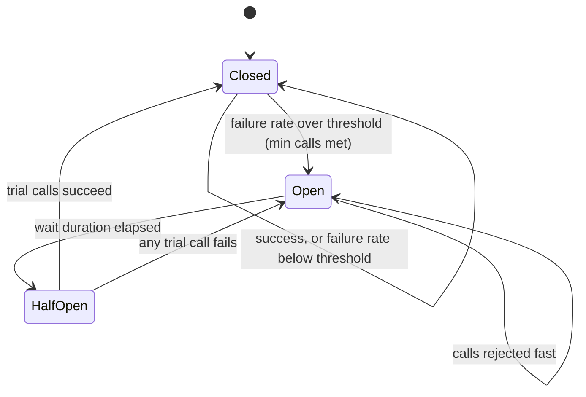

## In one minute
- A circuit breaker wraps calls to a dependency and stops calling it when it is clearly failing, returning an error or fallback immediately instead of waiting on timeouts.
- It has three states: **closed** (calls flow, failures are counted), **open** (calls are rejected fast for a cool-down period), and **half-open** (a few trial calls test whether the dependency has recovered).
- It protects the caller's threads, connections, and latency budget, and gives the struggling dependency room to recover instead of being hammered by retries.
- Tuning matters: thresholds too tight cause flapping on normal noise; too loose and the breaker trips only after the damage is done.

## How it works

### Why timeouts alone are not enough
Suppose a dependency starts hanging and your client timeout is 2 seconds. At 500 requests per second, about 1,000 requests are in flight waiting on it at any moment. That exhausts thread pools and connection pools, so requests that do not even need that dependency start queueing. Retries make it worse. The caller fails slowly and expensively, which is how one sick service takes down its callers.

### The state machine
In **closed** state, every call goes through and its outcome is recorded in a sliding window, either the last N calls or the last T seconds. When the window holds at least a minimum number of calls and the failure rate (errors plus timeouts, sometimes plus slow calls above a latency threshold) crosses a threshold such as 50%, the breaker **opens**.

In **open** state, calls fail immediately with a specific error, typically in microseconds. The caller uses a fallback: cached data, a default, a degraded feature, or a clear error to the user. After a wait duration, for example 30 seconds, the breaker moves to **half-open**.

In **half-open** state, a small number of trial calls are let through. Libraries differ on how they judge them. The classic description, which Azure follows, closes after a set number of consecutive successes and reopens on the first failure ([Azure Architecture Center](https://learn.microsoft.com/en-us/azure/architecture/patterns/circuit-breaker)). Resilience4j waits for all permitted trial calls (10 by default), then compares their failure rate with the threshold, so one unlucky timeout does not reopen it ([Resilience4j docs](https://resilience4j.readme.io/docs/circuitbreaker)). Some implementations grow the wait exponentially on repeated failures.

Check library defaults before trusting them. Resilience4j ships with a 100-call window, a minimum of 100 calls, a 50% threshold, a 60-second open period and a 60-second slow-call threshold, which suits a busy service but reacts slowly on a quiet one. Netflix's Hystrix, which popularised the pattern, has been in maintenance mode since 2018; Netflix pointed new projects to Resilience4j and moved toward adaptive concurrency limits that react to measured latency instead of fixed thresholds ([Hystrix README](https://github.com/Netflix/Hystrix)).

### What counts as failure
Count timeouts, connection errors, and 5xx responses. Do not count 4xx client errors such as validation failures or 404s, since they say nothing about the dependency's health. A breaker that trips because users typed bad input is a self-inflicted outage.

### Granularity
Use one breaker per dependency, and often per endpoint or per host. A single breaker for "the payments API" will open for every endpoint when one slow endpoint fails. Per-host breakers (outlier detection in proxies) eject one bad instance while healthy ones keep serving.

### Alternatives to a binary breaker
A breaker is modal: it flips between "send everything" and "send almost nothing", and the open mode is rarely exercised. AWS avoids that by capping retries with a token bucket instead ([AWS Builders' Library](https://aws.amazon.com/builders-library/timeouts-retries-and-backoff-with-jitter/)). Google uses client-side adaptive throttling: each client compares requests sent with requests the backend accepted over the last two minutes, and once requests exceed K times accepts (K = 2 is the suggested value) it rejects a growing fraction of new requests locally ([Google SRE book](https://sre.google/sre-book/handling-overload/)). Both degrade smoothly in proportion to the failure rate.

## Down the stack

### Layer 1: The contract
When closed, the breaker adds negligible overhead and passes every call through. When open, it rejects calls in microseconds with a distinguishable error and performs no network I/O. In half-open, it admits at most a configured number of trial calls. State transitions are driven only by observed outcomes and elapsed time, and are observable through metrics or events. It does not promise that a call allowed through will succeed, only that the caller will not keep spending resources on a dependency that is clearly failing.

### Layer 2: The mechanism
Resilience4j keeps outcomes in a sliding window, either `COUNT_BASED` (a ring of the last N results) or `TIME_BASED` (N one-second buckets of partial aggregates, so evaluating the failure rate is O(1) rather than a scan). Each record updates counters for failures and slow calls (above `slowCallDurationThreshold`). The state lives in an `AtomicReference`, and transitions use compare-and-set so concurrent threads agree on a single transition. Half-open is controlled by `permittedNumberOfCallsInHalfOpenState`. Resilience4j also offers `FORCED_OPEN` and `DISABLED` states for the manual override that operators need during an incident. Envoy expresses circuit breaking differently: per-cluster thresholds such as `max_connections`, `max_pending_requests` and `max_requests` (1,024 each by default) and `max_retries` (3) ([Envoy docs](https://www.envoyproxy.io/docs/envoy/latest/api-v3/config/cluster/v3/circuit_breaker.proto)), plus outlier detection that ejects individual hosts after 5 consecutive 5xx responses by default ([Envoy docs](https://www.envoyproxy.io/docs/envoy/latest/api-v3/config/cluster/v3/outlier_detection.proto)).

### Layer 3: The machine
What a hung call holds is concrete. A Java platform thread reserves 1 MB of stack by default; 1,000 stuck threads tie up a gigabyte of address space plus scheduler work. Each call holds a socket, a file descriptor, and a connection-pool slot. Without an application timeout, a connect to an unresponsive host keeps retransmitting SYNs per `tcp_syn_retries` (6 by default on Linux, about 131 seconds in total on current kernels) ([kernel docs](https://docs.kernel.org/networking/ip-sysctl.html)), and a stalled established connection can wait on retransmission timers for many minutes. In contrast, the breaker's open-state check is an atomic read and a clock comparison, a few nanoseconds, and a CAS on transition costs tens of nanoseconds.

### Why it's built this way
1. Threads, sockets, and pool slots are finite, and a hung dependency consumes them at the request rate, so the caller must stop sending.
2. A single failure says little about health, so decisions use a statistical window with a minimum sample size.
3. Recovery time is unknown, so the breaker probes with a few trial calls instead of guessing.
4. Many threads observe outcomes concurrently, so state changes use lock-free atomic transitions.

## Diagram


## Worked example
A checkout service calls a fraud-scoring service at 800 requests per second with a 1-second timeout. Normally fraud scoring answers in 40 ms, so about 32 calls are in flight. Checkout has a pool of 200 worker threads.

One afternoon fraud scoring starts timing out. Without a breaker, in-flight calls climb to 800 (800 per second times 1 second), the thread pool is exhausted within a quarter of a second, and checkout's own p99 jumps to 10 seconds as requests queue. Checkout is effectively down even though it could approve low-risk orders without a score.

With a breaker configured as a 100-call window, 50% failure threshold, minimum 20 calls, 30-second open period, and 5 trial calls: the first timeouts are recorded one second into the incident, and at 800 calls per second the window collects its 50th failure about 60 ms later, so the breaker opens. Checkout suffers one to two seconds of queueing instead of the whole incident. From then on, fraud calls fail in microseconds and the fallback applies a rule: approve orders under $100 from customers with prior purchases, and hold the rest for asynchronous review. Thread usage stays near normal. Every 30 seconds, 5 trial calls test fraud scoring; 12 minutes later it recovers, trials succeed, and normal scoring resumes. Checkout lost no availability, and only 6% of orders were held.

## In the wild
- **Stripe, 2019: one shard takes down the API.** On 10 July a latent bug from a database upgrade stopped one shard electing a primary. Many applications, the API included, depended on that shard, so API compute starved and most requests failed for 27 minutes; a rollback later caused a second, 93-minute window. Stripe's fixes included more circuit-breaking on failed operations to particular clusters, limits on resources consumed by clients retrying failed requests, and more fault isolation between shards ([Stripe](https://stripe.com/rcas/2019-07-10)).
- **Shopify, 2020: a misconfigured breaker barely helps.** Shopify modelled a worker talking to 42 Redis instances, each behind its own Semian breaker with a 0.25 s timeout, with every instance down. With a 2 s open period and half-open probes using the full timeout, workers needed 263% extra capacity to keep up. Raising the open period to 30 s and cutting the half-open probe timeout to 50 ms (above p99 for their Redis calls) cut that to 4% ([Shopify Engineering](https://shopify.engineering/circuit-breaker-misconfigured)).
- **Netflix, 2018: Hystrix goes into maintenance mode.** The library that popularised breakers in microservices shipped its last release, 1.5.18, in November 2018. Netflix said its focus had shifted to adaptive approaches such as concurrency limits that react to measured latency, and recommended Resilience4j for new work ([Hystrix README](https://github.com/Netflix/Hystrix)).

## Trade-offs
| Option | Strengths | Weaknesses | Choose when |
|---|---|---|---|
| Timeouts only | Simple, always needed | Still waits full timeout per call, pools fill | Low-volume or non-critical calls |
| Retries with backoff | Recovers from transient blips | Adds load to a failing dependency | Brief, independent failures |
| Circuit breaker | Fails fast, protects resources, enables fallback | Tuning effort, possible flapping, false trips | High-volume calls to dependencies that can fail persistently |
| Load shedding at the callee | Protects the dependency itself | Callers still wait for rejections | Combine with breakers on the caller side |

## Pitfalls in production
- **Counting client errors.** A wave of 400s from bad input opens the breaker. Count only timeouts, connection failures, and 5xx.
- **One breaker for many endpoints.** A slow report endpoint blocks fast lookups. Scope breakers per endpoint or per host.
- **Low-traffic flapping.** Two failures out of three calls trips the breaker. Set a minimum call count and use time-based windows for low-volume paths.
- **No fallback.** The breaker opens and users just see a different error. Design the degraded behaviour per call: cached value, default, or queued work.
- **Thundering recovery.** All instances move to half-open at the same moment and flood the recovering service. Allow few trial calls and add jitter to the wait duration.
- **Invisible state.** Nobody knows breakers are open. Export state changes as metrics and alert on breakers stuck open.

## Leadership lens
- Ask, for every remote call on a critical path: what is the timeout, is there a breaker, and what is the fallback?
- Standardise breaker settings in the service template or mesh, with overrides reviewed rather than ad hoc.
- Make the business decide fallbacks: approving unscored orders is a risk decision, not an engineering one.
- Test breakers in game days and chaos experiments; untested fallbacks usually fail when first needed.

## Check yourself
1. Why does a breaker need a minimum number of calls before it can trip?
   **Answer:** With few calls, one or two failures produce a high failure rate by chance, so the breaker would flap open on noise.
2. Why should 4xx responses usually not count as failures?
   **Answer:** They indicate a problem with the request, not with the dependency's health, so counting them can open the breaker while the dependency is fine.
3. What problem does the half-open state solve?
   **Answer:** It lets the caller test recovery with a few requests instead of either staying open forever or sending full traffic to a dependency that may still be failing.

## Practice
**Task:** Implement `CircuitBreaker(window, threshold, min_calls, open_ms, trial_calls)` with an injected clock. `allow(now)` returns whether a call may proceed, and `record(ok, now)` reports its outcome; `state` is `"closed"`, `"open"`, or `"half_open"`. In closed state, keep the outcomes of the last `window` calls and open when at least `min_calls` are recorded and the failure fraction is at least `threshold`. When open, reject until `open_ms` has elapsed since opening, then move to half-open on the next `allow`. Half-open admits at most `trial_calls` calls; if that many succeed, close and clear the window; any failure reopens at that time.

```python starter
class CircuitBreaker:
    def __init__(self, window, threshold, min_calls, open_ms, trial_calls):
        self.state = "closed"
        # TODO

    def allow(self, now):
        raise NotImplementedError

    def record(self, ok, now):
        raise NotImplementedError
```

```python tests
def make():
    return CircuitBreaker(window=4, threshold=0.5, min_calls=4, open_ms=1000, trial_calls=2)

def fail(cb, now, n):
    for _ in range(n):
        assert cb.allow(now)
        cb.record(False, now)

def test_stays_closed_below_min_calls():
    cb = make()
    fail(cb, 0, 3)
    assert cb.state == "closed"

def test_opens_at_threshold():
    cb = make()
    cb.allow(0); cb.record(True, 0)
    cb.allow(0); cb.record(True, 0)
    fail(cb, 0, 2)
    assert cb.state == "open" and not cb.allow(10)

def test_half_open_after_wait():
    cb = make()
    fail(cb, 0, 4)
    assert not cb.allow(999)
    assert cb.allow(1000) and cb.state == "half_open"

def test_half_open_limits_trials_and_closes():
    cb = make()
    fail(cb, 0, 4)
    assert cb.allow(1000) and cb.allow(1000) and not cb.allow(1000)
    cb.record(True, 1001)
    cb.record(True, 1002)
    assert cb.state == "closed" and cb.allow(1003)

def test_trial_failure_reopens():
    cb = make()
    fail(cb, 0, 4)
    cb.allow(1000)
    cb.record(False, 1500)
    assert cb.state == "open" and not cb.allow(2400) and cb.allow(2500)

def test_window_slides():
    cb = make()
    fail(cb, 0, 1)
    for _ in range(4):
        cb.allow(0); cb.record(True, 0)
    fail(cb, 0, 1)
    assert cb.state == "closed"
```

```python solution
from collections import deque

class CircuitBreaker:
    def __init__(self, window, threshold, min_calls, open_ms, trial_calls):
        self.state = "closed"
        self.outcomes = deque(maxlen=window)
        self.threshold = threshold
        self.min_calls = min_calls
        self.open_ms = open_ms
        self.trial_calls = trial_calls
        self.opened_at = 0
        self.trials = 0
        self.successes = 0

    def _open(self, now):
        self.state = "open"
        self.opened_at = now

    def allow(self, now):
        if self.state == "open" and now - self.opened_at >= self.open_ms:
            self.state = "half_open"
            self.trials = 0
            self.successes = 0
        if self.state == "closed":
            return True
        if self.state == "half_open" and self.trials < self.trial_calls:
            self.trials += 1
            return True
        return False

    def record(self, ok, now):
        if self.state == "half_open":
            if not ok:
                self._open(now)
            else:
                self.successes += 1
                if self.successes >= self.trial_calls:
                    self.state = "closed"
                    self.outcomes.clear()
        elif self.state == "closed":
            self.outcomes.append(ok)
            failures = sum(1 for o in self.outcomes if not o)
            if len(self.outcomes) >= self.min_calls and failures >= self.threshold * len(self.outcomes):
                self._open(now)
```

```typescript starter
export type State = "closed" | "open" | "half_open";

export class CircuitBreaker {
  state: State = "closed";
  constructor(window: number, threshold: number, minCalls: number, openMs: number, trialCalls: number) {}
  allow(now: number): boolean {
    throw new Error("TODO");
  }
  record(ok: boolean, now: number): void {
    throw new Error("TODO");
  }
}
```

```typescript tests
const make = () => new CircuitBreaker(4, 0.5, 4, 1000, 2);
function fail(cb: CircuitBreaker, now: number, n: number): void {
  for (let i = 0; i < n; i++) {
    assert(cb.allow(now), "should allow");
    cb.record(false, now);
  }
}
test("stays closed below min calls", () => {
  const cb = make();
  fail(cb, 0, 3);
  assertEqual(cb.state, "closed");
});
test("opens at threshold", () => {
  const cb = make();
  cb.allow(0); cb.record(true, 0);
  cb.allow(0); cb.record(true, 0);
  fail(cb, 0, 2);
  assert(cb.state === "open" && !cb.allow(10), "should be open");
});
test("half-open after wait", () => {
  const cb = make();
  fail(cb, 0, 4);
  assert(!cb.allow(999), "still open");
  assert(cb.allow(1000) && cb.state === "half_open", "half-open");
});
test("half-open limits trials and closes", () => {
  const cb = make();
  fail(cb, 0, 4);
  assert(cb.allow(1000) && cb.allow(1000) && !cb.allow(1000), "two trials only");
  cb.record(true, 1001);
  cb.record(true, 1002);
  assert(cb.state === "closed" && cb.allow(1003), "closed again");
});
test("trial failure reopens", () => {
  const cb = make();
  fail(cb, 0, 4);
  cb.allow(1000);
  cb.record(false, 1500);
  assert(cb.state === "open" && !cb.allow(2400) && cb.allow(2500), "reopened at 1500");
});
test("window slides", () => {
  const cb = make();
  fail(cb, 0, 1);
  for (let i = 0; i < 4; i++) { cb.allow(0); cb.record(true, 0); }
  fail(cb, 0, 1);
  assertEqual(cb.state, "closed");
});
```

```typescript solution
export type State = "closed" | "open" | "half_open";

export class CircuitBreaker {
  state: State = "closed";
  private outcomes: boolean[] = [];
  private openedAt = 0;
  private trials = 0;
  private successes = 0;
  constructor(private window: number, private threshold: number, private minCalls: number,
              private openMs: number, private trialCalls: number) {}
  private open(now: number): void {
    this.state = "open";
    this.openedAt = now;
  }
  allow(now: number): boolean {
    if (this.state === "open" && now - this.openedAt >= this.openMs) {
      this.state = "half_open";
      this.trials = 0;
      this.successes = 0;
    }
    if (this.state === "closed") return true;
    if (this.state === "half_open" && this.trials < this.trialCalls) {
      this.trials++;
      return true;
    }
    return false;
  }
  record(ok: boolean, now: number): void {
    if (this.state === "half_open") {
      if (!ok) this.open(now);
      else if (++this.successes >= this.trialCalls) {
        this.state = "closed";
        this.outcomes = [];
      }
    } else if (this.state === "closed") {
      this.outcomes.push(ok);
      if (this.outcomes.length > this.window) this.outcomes.shift();
      const failures = this.outcomes.filter((o) => !o).length;
      if (this.outcomes.length >= this.minCalls && failures >= this.threshold * this.outcomes.length) {
        this.open(now);
      }
    }
  }
}
```

```go starter
package practice

type CircuitBreaker struct {
	State string // "closed", "open" or "half_open"
}

func NewCircuitBreaker(window int, threshold float64, minCalls int, openMs int64, trialCalls int) *CircuitBreaker {
	return &CircuitBreaker{State: "closed"}
}

func (cb *CircuitBreaker) Allow(now int64) bool { panic("TODO") }

func (cb *CircuitBreaker) Record(ok bool, now int64) { panic("TODO") }
```

```go tests
package practice

import "testing"

func mk() *CircuitBreaker { return NewCircuitBreaker(4, 0.5, 4, 1000, 2) }

func fail(t *testing.T, cb *CircuitBreaker, now int64, n int) {
	t.Helper()
	for i := 0; i < n; i++ {
		if !cb.Allow(now) {
			t.Fatal("should allow")
		}
		cb.Record(false, now)
	}
}

func TestBelowMinCalls(t *testing.T) {
	cb := mk()
	fail(t, cb, 0, 3)
	if cb.State != "closed" {
		t.Fatal(cb.State)
	}
}

func TestOpensAtThreshold(t *testing.T) {
	cb := mk()
	cb.Allow(0)
	cb.Record(true, 0)
	cb.Allow(0)
	cb.Record(true, 0)
	fail(t, cb, 0, 2)
	if cb.State != "open" || cb.Allow(10) {
		t.Fatal("should be open")
	}
}

func TestHalfOpenLimitsAndCloses(t *testing.T) {
	cb := mk()
	fail(t, cb, 0, 4)
	if cb.Allow(999) {
		t.Fatal("still open")
	}
	if !cb.Allow(1000) || cb.State != "half_open" || !cb.Allow(1000) || cb.Allow(1000) {
		t.Fatal("expected exactly two trials")
	}
	cb.Record(true, 1001)
	cb.Record(true, 1002)
	if cb.State != "closed" || !cb.Allow(1003) {
		t.Fatal("should close")
	}
}

func TestTrialFailureReopens(t *testing.T) {
	cb := mk()
	fail(t, cb, 0, 4)
	cb.Allow(1000)
	cb.Record(false, 1500)
	if cb.State != "open" || cb.Allow(2400) || !cb.Allow(2500) {
		t.Fatal("should reopen at 1500")
	}
}

func TestWindowSlides(t *testing.T) {
	cb := mk()
	fail(t, cb, 0, 1)
	for i := 0; i < 4; i++ {
		cb.Allow(0)
		cb.Record(true, 0)
	}
	fail(t, cb, 0, 1)
	if cb.State != "closed" {
		t.Fatal(cb.State)
	}
}
```

```go solution
package practice

type CircuitBreaker struct {
	State      string // "closed", "open" or "half_open"
	window     int
	threshold  float64
	minCalls   int
	openMs     int64
	trialCalls int
	outcomes   []bool
	openedAt   int64
	trials     int
	successes  int
}

func NewCircuitBreaker(window int, threshold float64, minCalls int, openMs int64, trialCalls int) *CircuitBreaker {
	return &CircuitBreaker{State: "closed", window: window, threshold: threshold,
		minCalls: minCalls, openMs: openMs, trialCalls: trialCalls}
}

func (cb *CircuitBreaker) open(now int64) {
	cb.State = "open"
	cb.openedAt = now
}

func (cb *CircuitBreaker) Allow(now int64) bool {
	if cb.State == "open" && now-cb.openedAt >= cb.openMs {
		cb.State, cb.trials, cb.successes = "half_open", 0, 0
	}
	if cb.State == "closed" {
		return true
	}
	if cb.State == "half_open" && cb.trials < cb.trialCalls {
		cb.trials++
		return true
	}
	return false
}

func (cb *CircuitBreaker) Record(ok bool, now int64) {
	switch cb.State {
	case "half_open":
		if !ok {
			cb.open(now)
			return
		}
		cb.successes++
		if cb.successes >= cb.trialCalls {
			cb.State = "closed"
			cb.outcomes = nil
		}
	case "closed":
		cb.outcomes = append(cb.outcomes, ok)
		if len(cb.outcomes) > cb.window {
			cb.outcomes = cb.outcomes[1:]
		}
		failures := 0
		for _, o := range cb.outcomes {
			if !o {
				failures++
			}
		}
		if len(cb.outcomes) >= cb.minCalls && float64(failures) >= cb.threshold*float64(len(cb.outcomes)) {
			cb.open(now)
		}
	}
}
```

## Mock interview
**Prompt:** Your order service calls inventory, pricing, fraud, and shipping-quote services, at 2,000 requests per second peak. Last month, a slow shipping-quote service took down ordering for 40 minutes. Design the resilience layer.

- Follow-up: How do you pick the window, threshold, and wait duration for each breaker?
- Follow-up: After the dependency recovers, all 60 order-service pods hit it at once and it falls over again. Why, and how do you fix it?
- Follow-up: What should the user see when the fraud breaker is open?

**A strong answer covers:**
- Timeouts derived from the latency budget, plus a breaker per dependency or endpoint.
- Failure classification: timeouts and 5xx count, client errors do not.
- Thresholds based on observed error rates and traffic volume, with minimum calls and time windows for low-traffic paths.
- Limited half-open trials with jittered wait to avoid synchronised recovery.
- Business-approved fallbacks per dependency and metrics plus alerts on breaker state.
- Complementary bulkheads and retry budgets.

## Sources and further study
**Primary**
- [Netflix concurrency-limits](https://github.com/Netflix/concurrency-limits): the adaptive, latency-driven limiter Netflix moved to after Hystrix.

**Systems docs**
- [Envoy: circuit breaker thresholds](https://www.envoyproxy.io/docs/envoy/latest/api-v3/config/cluster/v3/circuit_breaker.proto): per-cluster limits, retry budgets and their defaults.
- [Envoy: outlier detection](https://www.envoyproxy.io/docs/envoy/latest/intro/arch_overview/upstream/outlier): per-host ejection, the proxy's version of a per-instance breaker.
- [AWS SDKs: retry behavior](https://docs.aws.amazon.com/sdkref/latest/guide/feature-retry-behavior.html): a retry quota that fails fast during outages without a separate breaker.

**Books**
- *Release It!* (2nd ed.), Michael T. Nygard, Ch 5 "Stability Patterns": Timeouts, Circuit Breaker, Bulkheads and Fail Fast as one toolkit.
- *Site Reliability Engineering*, Beyer et al. (eds.), Ch 21 "Handling Overload": client-side adaptive throttling, the smooth alternative to an on/off breaker.
- *Understanding Distributed Systems* (2nd ed.), Roberto Vitillo, chapter "Downstream resiliency": timeouts, retries and circuit breakers from the caller's side.

**Other curricula**
- [roadmap.sh: System Design](https://roadmap.sh/system-design): a one-paragraph Circuit Breaker node in its reliability patterns, describing the three states and failing fast.
- [AWS Builders' Library: Avoiding fallback in distributed systems](https://aws.amazon.com/builders-library/avoiding-fallback-in-distributed-systems/): argues that what you do when the breaker opens is the risky part, and favours failover you exercise every day.

## Watch
- [The Circuit Breaker Pattern, Resilient Microservices (Nick Chapsas)](https://www.youtube.com/watch?v=5_Bt_OEg0no): the state machine with a working implementation.
- [Mastering Chaos: A Netflix Guide to Microservices (InfoQ)](https://www.youtube.com/watch?v=CZ3wIuvmHeM): how Netflix used breakers and fallbacks to contain failures.

## Free resources
- [CircuitBreaker (martinfowler.com)](https://martinfowler.com/bliki/CircuitBreaker.html): the classic description with a sketch implementation.
- [Circuit Breaker pattern (Azure Architecture Center)](https://learn.microsoft.com/en-us/azure/architecture/patterns/circuit-breaker): design issues such as exception types, logging, and recovery testing.
- [Resilience4j CircuitBreaker](https://resilience4j.readme.io/docs/circuitbreaker): concrete configuration of count- and time-based windows and slow-call thresholds.
- [Envoy circuit breaking](https://www.envoyproxy.io/docs/envoy/latest/intro/arch_overview/upstream/circuit_breaking): how a proxy implements breakers as connection and request limits.
- [Addressing Cascading Failures (Google SRE book)](https://sre.google/sre-book/addressing-cascading-failures/): the failure modes breakers exist to prevent.
