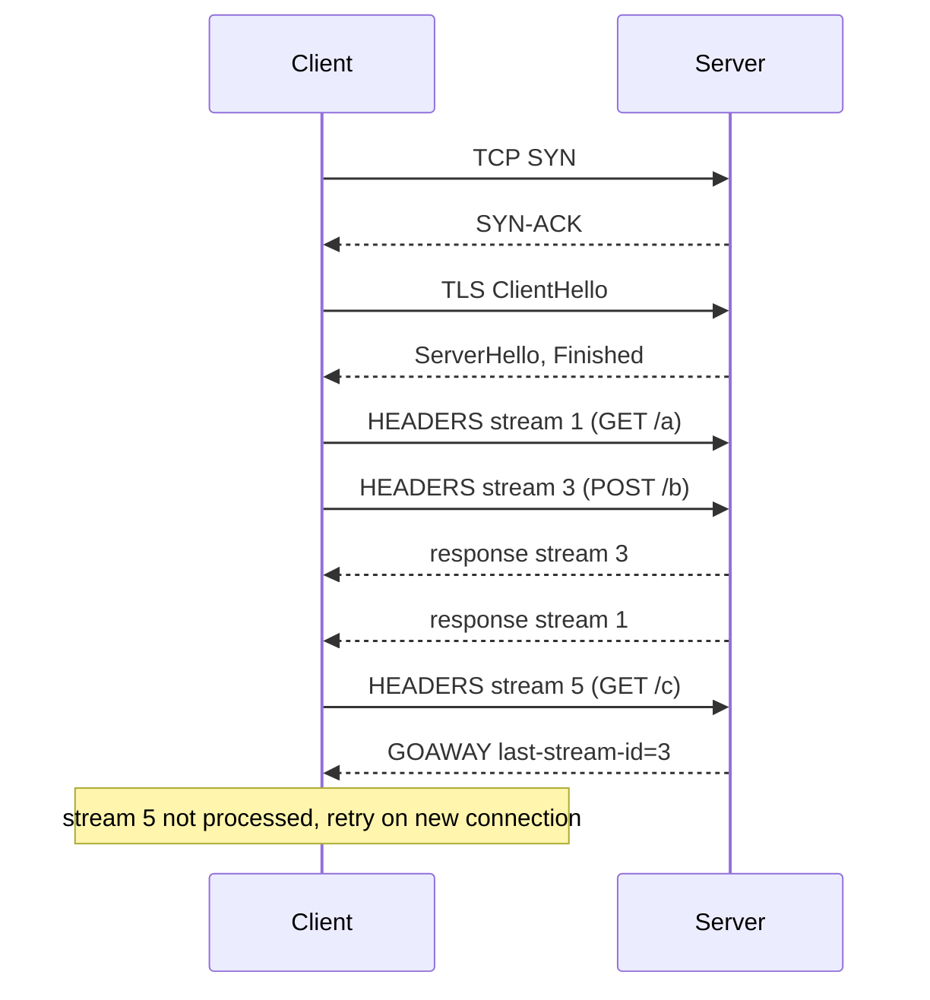

## In one minute
- In client-server architecture one side (the server) owns data and rules and waits for requests; the other side (the client) starts every conversation, asks, and decides what to do with the answer.
- The split is about authority, not machines: the server is the single place where a balance is debited or a permission is checked, so it must never trust the client.
- Almost every hard question in the model is about the connection between them: how it is opened, reused, multiplexed, timed out and shut down cleanly.
- The client cannot tell "the server never got it" from "the server did it and the reply was lost". Deadlines and retry safety follow from that ambiguity.
- Servers scale by being stateless between requests and keeping state in a shared store, so any instance can answer any client.

## How it works

### Two roles, one direction of initiative
A client initiates; a server listens. A browser fetching `/orders`, a mobile app posting a payment, a Go service calling Postgres, and an AI agent calling a model API are all clients. The server publishes an address and a contract (HTTP routes, gRPC methods, the Postgres wire protocol) and answers whoever connects. The asymmetry matters more than the hardware: the same process can be a server to its callers and a client to its database.

This is the **trust but verify** problem shape. Anything the client sends, including prices and role flags, is a claim the server re-derives from its own state. Games show it in a second domain: a client reporting "I hit the target" invites cheating, so authoritative game servers simulate the shot themselves.

### Thin and thick clients, two and three tiers
A thin client (a server-rendered page) mostly displays; a thick client (a mobile app, a single-page app) caches data, works offline and syncs later. Two-tier systems had desktop clients talking straight to a database; three-tier systems put an application server in between so business rules live in one place. Modern systems are N-tier, and each tier is a client of the next.

### Stateless servers
If a server keeps a user's session in its own memory, that user is stuck to that instance, and a restart logs them out. If the request carries everything needed (a token, the resource ID) and durable state lives in a database or cache, any instance can serve any request. That is what lets a load balancer spread traffic freely and lets you deploy by replacing instances. "Stateless" means no conversation state between requests, not no state at all. Fielding's REST dissertation states the strict version: each request carries everything needed to understand it, and session state lives on the client, which buys visibility, easier recovery from partial failure and scalability ([Fielding, section 5.1.3](https://ics.uci.edu/~fielding/pubs/dissertation/rest_arch_style.htm)). Most production systems relax this by keeping sessions in a shared store, which keeps the instances interchangeable but makes that store a dependency of every request.

### The connection is the hard part
Requests ride a TCP (or QUIC) connection wrapped in TLS, and opening one costs round trips, so clients reuse connections. HTTP/1.1 allowed *pipelining* several requests back to back, but responses had to return in order, so one slow response blocked the rest and no modern browser turns it on by default; they open about six connections per host instead ([MDN](https://developer.mozilla.org/en-US/docs/Web/HTTP/Guides/Connection_management_in_HTTP_1.x)). HTTP/2 tags each request with a *stream ID* so many requests share one connection and responses return in any order. gRPC runs on that. TCP still delivers bytes in order, so one lost packet stalls every stream on the connection. HTTP/3 moves the streams onto QUIC, where a stream that loses a packet does not block the others ([RFC 9114](https://www.rfc-editor.org/rfc/rfc9114.html)), and QUIC combines the transport and cryptographic handshakes to cut connection setup ([RFC 9000](https://www.rfc-editor.org/rfc/rfc9000.html)).

### When things go wrong
A waiting client gets a response, an error, or silence. Silence is the dangerous one: every request needs a deadline, and when it passes the client does not know whether the server acted. That is why idempotency keys exist (see the Idempotency lesson), and why HTTP defines `GET`, `PUT` and `DELETE` as idempotent and `POST` as not: they tell a client which requests it may resend blindly ([RFC 9110](https://www.rfc-editor.org/rfc/rfc9110.html)). Amazon sets client timeouts from the server's measured latency, for example its p99.9 if a 0.1% false-timeout rate is acceptable, and retries at one layer only ([AWS Builders' Library](https://aws.amazon.com/builders-library/timeouts-retries-and-backoff-with-jitter/)).

## Down the stack

### Layer 1: The contract
The server promises at most one of three outcomes per request: a response that reflects a committed effect, an error that means no effect (a `4xx`, or a `503` sent before work began), or nothing. The client promises to give up at its deadline and to resend only requests that are idempotent or carry an idempotency key. On HTTP/2 there is one extra, precise guarantee: when a server sends `GOAWAY` with a last-stream-ID, every stream with a higher ID was not processed and can be retried safely on a new connection, even a `POST`. Streams at or below that ID may or may not have been processed ([RFC 9113, section 6.8](https://www.rfc-editor.org/rfc/rfc9113.html#section-6.8)). A new TLS 1.3 connection costs two round trips (TCP, then TLS) before the first request byte leaves.

### Layer 2: The mechanism
The server calls `socket`, `bind` and `listen`, then accepts connections as `epoll` reports the listening socket readable; each connection becomes a file descriptor in the event loop. HTTP/2 (RFC 9113) frames everything: a `HEADERS` frame opens a stream, `DATA` frames carry the body, `RST_STREAM` cancels one stream without touching the others, and `SETTINGS_MAX_CONCURRENT_STREAMS` caps how many streams a client may have open at once; the RFC recommends no less than 100. Clients use odd stream IDs (1, 3, 5) and servers even ones, so both can open streams without clashing ([RFC 9113](https://www.rfc-editor.org/rfc/rfc9113.html#section-5.1.1)). The cap counts only open streams, which the 2023 Rapid Reset attack exploited: the client sends `HEADERS` and then `RST_STREAM` straight away, so it never hits the limit while the server keeps starting work. Servers now count cancellations per connection and close abusive connections outright ([Google Cloud](https://cloud.google.com/blog/products/identity-security/how-it-works-the-novel-http2-rapid-reset-ddos-attack)). When the cap is reached, a well-behaved client queues further requests locally or opens another connection. gRPC adds a `grpc-timeout` header (for example `grpc-timeout: 1S`) that carries the remaining deadline to the server ([gRPC over HTTP/2](https://github.com/grpc/grpc/blob/master/doc/PROTOCOL-HTTP2.md)), which can propagate it to its own downstream calls so work stops everywhere once nobody is waiting.

### Layer 3: The machine
When a SYN arrives, the kernel puts the half-open connection in the SYN queue; once the handshake completes, it moves to the accept queue, whose length is capped by the `backlog` argument to `listen` and by `net.core.somaxconn` (4096 by default since Linux 5.4, 128 before) ([Linux ip-sysctl docs](https://docs.kernel.org/networking/ip-sysctl.html)). If the application is too slow to call `accept`, the queue fills and new connections are dropped, which clients see as connect timeouts of 1 second or more as the SYN is retransmitted. The side that closes first enters `TIME_WAIT` for 60 seconds on Linux, holding its 4-tuple, so a client that opens and closes connections to one server address at high rates runs out of its roughly 28,000 ephemeral ports (32768 to 60999). A new TCP connection also starts with a congestion window of 10 segments (about 14 KB) ([RFC 6928](https://www.rfc-editor.org/rfc/rfc6928.html)), so the first large response takes extra round trips. Reused connections skip all of that.

### Why it's built this way
1. Data and rules must have one authoritative home, so a server owns them and clients ask.
2. Round trips cost tens to hundreds of milliseconds across the internet, so clients reuse connections instead of paying the handshake every time.
3. Reusing one connection for many requests causes head-of-line blocking if responses must be in order, so HTTP/2 tags requests with stream IDs and caps concurrency per connection.
4. The network can lose a reply after the server acted, so clients need deadlines, and protocols need a way (`GOAWAY`, idempotency) to say which requests are safe to repeat.

## Diagram


## Worked example
A mobile banking app sees a 120 ms median round trip. A cold start needs DNS (40 ms), TCP (120 ms) and TLS 1.3 (120 ms), then the request itself (120 ms plus 30 ms of server time): 430 ms before the first screen has data. The next request on the same connection costs 150 ms. Keeping connections warm, plus TLS resumption, beats any server-side tuning here.

Now the failure case. The app sets a 3-second deadline on "transfer money". The server commits the transfer at 2.9 seconds, but the response is delayed in a congested cell network and arrives at 3.4 seconds. The client has already given up. If it blindly resends, the user pays twice. The fix is an idempotency key generated on the phone and stored with the transfer, so the resend returns the original result. Had the server instead sent `GOAWAY` with last-stream-ID 7 while the transfer was on stream 9, the client would know it was never processed.

On the server side, 400,000 idle keep-alive connections at roughly 10 KB each cost about 4 GB across the fleet, cheap for the latency saved. The risk is a deploy: if 50,000 phones reconnect within a second against a backlog of 128, most SYNs are dropped and retried a second later, so raise `somaxconn` and add jitter to reconnects.

## In the wild
- **Google Cloud, 2023: HTTP/2 Rapid Reset.** Attackers opened streams and reset them at once, staying under the concurrent-stream limit while servers did the work; the largest attack Google saw passed 398 million requests per second. It became CVE-2023-44487, and servers added per-connection cancellation limits and immediate `GOAWAY` on abuse ([Google Cloud](https://cloud.google.com/blog/products/identity-security/how-it-works-the-novel-http2-rapid-reset-ddos-attack)).
- **Datadog, 2021: an aggressive gRPC reconnect setting.** During rollouts about 900 clients retried a deleted pod's IP roughly every 300 ms, up to 30,000 SYNs per second, which filled the VPC connection-tracking table and looked like a DNS failure. Going back to gRPC's default reconnect backoff stopped it ([Datadog](https://datadoghq.com/blog/engineering/grpc-dns-and-load-balancing-incident)).
- **Discord, 2026: scale-down sets off a reconnect storm.** A config change halved session pods in one zone without draining them, so 17% of sessions ended ungracefully, reconnects hit an untuned rate limit and gateways ran out of memory. Voice and video were mostly down for about 3 hours 17 minutes; Discord now blocks scale-down until pods drain ([Discord](https://discord.com/blog/behind-the-scenes-of-the-3-25-26-voice-outage)).

## Trade-offs
| Option | Strengths | Weaknesses | Choose when |
|---|---|---|---|
| Thin client | One place to change logic, little to secure on the device | Every interaction is a round trip, no offline use | Internal tools, content sites, low-powered devices |
| Thick client | Fast UI, offline work, less server load | Logic duplicated, old versions in the wild for years | Mobile apps, editors, collaborative tools |
| Stateful server (sticky sessions) | Fast access to in-memory state | Uneven load, lost state on restart, harder deploys | Game sessions, WebSocket rooms with a clear owner |
| Stateless server | Any instance serves any request, easy scaling and deploys | Every request reads shared state | Default for APIs |
| HTTP/2 multiplexed connection | One connection, many concurrent requests | TCP-level head-of-line blocking on loss, stream caps | Browsers and service-to-service calls |

## Pitfalls in production
- **No deadline on the client.** A request with no timeout ties up a thread or goroutine forever when the server hangs, and the client's own callers pile up behind it. Set a deadline on every call and propagate the remaining budget downstream.
- **Retrying non-idempotent requests.** A timeout followed by an automatic retry of `POST /payments` charges twice. Retry only idempotent methods, or attach an idempotency key that the server dedupes.
- **Trusting the client.** Prices, quantities and roles sent by the client are treated as truth, and someone edits them. Recompute everything authoritative on the server.
- **Reconnect storms.** A restart drops 100,000 connections and all reconnect in the same second, overflowing the accept queue. Reconnect with jittered backoff and drain with `GOAWAY` before stopping servers.
- **Ignoring stream limits.** Opening a new connection whenever `MAX_CONCURRENT_STREAMS` is hit leads to thousands of connections. Queue locally up to a bound, then fail fast.
- **Trusting the stream cap on the server.** The cap limits open streams, not how fast a client opens and cancels them. Keep the HTTP/2 stack patched for Rapid Reset and close connections whose cancellation rate is abnormal.

## Leadership lens
- In design review, ask for each user-facing call's end-to-end timeout budget and how it is split across hops.
- Ask which operations are unsafe to retry and how the system makes them safe. That one answer predicts most double-charge and duplicate-order incidents.
- Thick clients are a long-term commitment: mobile versions stay in the field for years, so every server API change must stay compatible with them. Budget for versioning and for a forced-upgrade path.

## Check yourself
1. Why did HTTP/1.1 pipelining fail in practice while HTTP/2 multiplexing succeeded?
   **Answer:** Pipelined responses must return in request order, so one slow response blocks all those behind it on that connection. HTTP/2 tags each request with a stream ID, so responses can be interleaved and returned in any order.
2. A client's `POST` times out. Under what conditions can it resend safely?
   **Answer:** If the request carries an idempotency key the server dedupes on, or if the server's `GOAWAY` shows the stream was above the last processed stream ID. Otherwise the server may already have acted.
3. Clients see 1-second connect delays during a traffic spike, but server CPU is at 40%. What is a likely cause?
   **Answer:** The accept queue is full because the application calls `accept` too slowly or the backlog is small, so the kernel drops SYNs and clients wait for the 1-second SYN retransmit.
4. What does "stateless server" actually require?
   **Answer:** That no conversation state lives only in one instance's memory between requests. Durable and session state lives in a shared store or in a signed token the client sends back.

## Practice
**Task:** Build the client side of a multiplexed connection, like an HTTP/2 or gRPC channel. `Channel(max_inflight)` assigns client stream IDs 1, 3, 5 and so on. `send(req, now, timeout)` records a deadline of `now + timeout`; if fewer than `max_inflight` streams are open, it opens the next stream for the request and returns its ID; otherwise it queues the request (FIFO) and returns 0; after `goaway`, it returns -1 and does nothing. `on_response(stream)` completes an open stream and returns its request, then promotes queued requests into free slots in order (each getting the next stream ID); an unknown, finished or timed-out stream returns nothing (None, null, or `ok == false` in Go). `tick(now)` removes and returns every request whose deadline is `<= now`: open streams in ascending stream order, then queued requests in queue order, and then promotes queued requests. `goaway(last_stream)` closes the channel and removes and returns the requests that are safe to retry: open streams with an ID above `last_stream` (ascending), then all queued requests; streams at or below `last_stream` stay open. `in_flight()` returns open requests in ascending stream order.

```python starter
class Channel:
    def __init__(self, max_inflight):
        self.max_inflight = max_inflight

    def send(self, req, now, timeout):
        # TODO
        raise NotImplementedError

    def on_response(self, stream):
        # TODO
        raise NotImplementedError

    def tick(self, now):
        # TODO
        raise NotImplementedError

    def goaway(self, last_stream):
        # TODO
        raise NotImplementedError

    def in_flight(self):
        # TODO
        raise NotImplementedError
```

```python tests
def test_streams_are_odd_and_capped():
    c = Channel(2)
    assert c.send("a", 0, 10) == 1
    assert c.send("b", 0, 10) == 3
    assert c.send("c", 0, 10) == 0
    assert c.in_flight() == ["a", "b"]

def test_response_frees_slot_and_promotes():
    c = Channel(2)
    c.send("a", 0, 10)
    c.send("b", 0, 10)
    c.send("c", 0, 10)
    assert c.on_response(3) == "b"
    assert c.in_flight() == ["a", "c"]
    assert c.on_response(5) == "c", "promoted request got stream 5"

def test_unknown_or_duplicate_response():
    c = Channel(1)
    c.send("a", 0, 10)
    assert c.on_response(7) is None
    assert c.on_response(1) == "a"
    assert c.on_response(1) is None

def test_tick_expires_open_then_queued():
    c = Channel(1)
    c.send("a", 0, 5)
    c.send("b", 0, 3)
    c.send("c", 0, 50)
    assert c.tick(4) == ["b"]
    assert c.in_flight() == ["a"]
    assert c.tick(5) == ["a"]
    assert c.in_flight() == ["c"]

def test_late_response_is_dropped():
    c = Channel(1)
    c.send("a", 0, 5)
    assert c.tick(5) == ["a"]
    assert c.on_response(1) is None

def test_goaway_returns_safe_retries():
    c = Channel(3)
    for r in ["a", "b", "c", "d"]:
        c.send(r, 0, 100)
    assert c.goaway(3) == ["c", "d"]
    assert c.in_flight() == ["a", "b"]
    assert c.send("e", 1, 100) == -1
    assert c.on_response(1) == "a"
    assert c.in_flight() == ["b"], "no promotion after goaway"
```

```python solution
class Channel:
    def __init__(self, max_inflight):
        self.max_inflight = max_inflight
        self.open = {}
        self.queue = []
        self.next_stream = 1
        self.closed = False

    def _open(self, req, deadline):
        sid = self.next_stream
        self.next_stream += 2
        self.open[sid] = (req, deadline)
        return sid

    def _promote(self):
        while self.queue and len(self.open) < self.max_inflight:
            req, deadline = self.queue.pop(0)
            self._open(req, deadline)

    def send(self, req, now, timeout):
        if self.closed:
            return -1
        if len(self.open) < self.max_inflight:
            return self._open(req, now + timeout)
        self.queue.append((req, now + timeout))
        return 0

    def on_response(self, stream):
        if stream not in self.open:
            return None
        req, _ = self.open.pop(stream)
        if not self.closed:
            self._promote()
        return req

    def tick(self, now):
        expired = []
        for sid in sorted(self.open):
            if self.open[sid][1] <= now:
                expired.append(self.open.pop(sid)[0])
        keep = []
        for req, deadline in self.queue:
            if deadline <= now:
                expired.append(req)
            else:
                keep.append((req, deadline))
        self.queue = keep
        if not self.closed:
            self._promote()
        return expired

    def goaway(self, last_stream):
        self.closed = True
        retry = []
        for sid in sorted(self.open):
            if sid > last_stream:
                retry.append(self.open.pop(sid)[0])
        retry.extend(req for req, _ in self.queue)
        self.queue = []
        return retry

    def in_flight(self):
        return [self.open[sid][0] for sid in sorted(self.open)]
```

```typescript starter
export class Channel {
  constructor(public maxInflight: number) {}
  send(req: string, now: number, timeout: number): number {
    throw new Error("TODO");
  }
  onResponse(stream: number): string | null {
    throw new Error("TODO");
  }
  tick(now: number): string[] {
    throw new Error("TODO");
  }
  goaway(lastStream: number): string[] {
    throw new Error("TODO");
  }
  inFlight(): string[] {
    throw new Error("TODO");
  }
}
```

```typescript tests
test("streams are odd and capped", () => {
  const c = new Channel(2);
  assertEqual(c.send("a", 0, 10), 1);
  assertEqual(c.send("b", 0, 10), 3);
  assertEqual(c.send("c", 0, 10), 0);
  assertEqual(c.inFlight(), ["a", "b"]);
});
test("response frees slot and promotes", () => {
  const c = new Channel(2);
  c.send("a", 0, 10);
  c.send("b", 0, 10);
  c.send("c", 0, 10);
  assertEqual(c.onResponse(3), "b");
  assertEqual(c.inFlight(), ["a", "c"]);
  assertEqual(c.onResponse(5), "c", "promoted request got stream 5");
});
test("unknown or duplicate response", () => {
  const c = new Channel(1);
  c.send("a", 0, 10);
  assertEqual(c.onResponse(7), null);
  assertEqual(c.onResponse(1), "a");
  assertEqual(c.onResponse(1), null);
});
test("tick expires open then queued", () => {
  const c = new Channel(1);
  c.send("a", 0, 5);
  c.send("b", 0, 3);
  c.send("c", 0, 50);
  assertEqual(c.tick(4), ["b"]);
  assertEqual(c.inFlight(), ["a"]);
  assertEqual(c.tick(5), ["a"]);
  assertEqual(c.inFlight(), ["c"]);
});
test("late response is dropped", () => {
  const c = new Channel(1);
  c.send("a", 0, 5);
  assertEqual(c.tick(5), ["a"]);
  assertEqual(c.onResponse(1), null);
});
test("goaway returns safe retries", () => {
  const c = new Channel(3);
  for (const r of ["a", "b", "c", "d"]) c.send(r, 0, 100);
  assertEqual(c.goaway(3), ["c", "d"]);
  assertEqual(c.inFlight(), ["a", "b"]);
  assertEqual(c.send("e", 1, 100), -1);
  assertEqual(c.onResponse(1), "a");
  assertEqual(c.inFlight(), ["b"], "no promotion after goaway");
});
```

```typescript solution
export class Channel {
  private open = new Map<number, [string, number]>();
  private queue: [string, number][] = [];
  private nextStream = 1;
  private closed = false;

  constructor(public maxInflight: number) {}

  private ids(): number[] {
    return Array.from(this.open.keys()).sort((a, b) => a - b);
  }

  private openStream(req: string, deadline: number): number {
    const sid = this.nextStream;
    this.nextStream += 2;
    this.open.set(sid, [req, deadline]);
    return sid;
  }

  private promote(): void {
    while (this.queue.length > 0 && this.open.size < this.maxInflight) {
      const [req, deadline] = this.queue.shift()!;
      this.openStream(req, deadline);
    }
  }

  send(req: string, now: number, timeout: number): number {
    if (this.closed) return -1;
    if (this.open.size < this.maxInflight) return this.openStream(req, now + timeout);
    this.queue.push([req, now + timeout]);
    return 0;
  }

  onResponse(stream: number): string | null {
    const entry = this.open.get(stream);
    if (!entry) return null;
    this.open.delete(stream);
    if (!this.closed) this.promote();
    return entry[0];
  }

  tick(now: number): string[] {
    const expired: string[] = [];
    for (const sid of this.ids()) {
      const [req, deadline] = this.open.get(sid)!;
      if (deadline <= now) {
        expired.push(req);
        this.open.delete(sid);
      }
    }
    const keep: [string, number][] = [];
    for (const item of this.queue) {
      if (item[1] <= now) expired.push(item[0]);
      else keep.push(item);
    }
    this.queue = keep;
    if (!this.closed) this.promote();
    return expired;
  }

  goaway(lastStream: number): string[] {
    this.closed = true;
    const retry: string[] = [];
    for (const sid of this.ids()) {
      if (sid > lastStream) {
        retry.push(this.open.get(sid)![0]);
        this.open.delete(sid);
      }
    }
    for (const [req] of this.queue) retry.push(req);
    this.queue = [];
    return retry;
  }

  inFlight(): string[] {
    return this.ids().map((sid) => this.open.get(sid)![0]);
  }
}
```

```go starter
package practice

type Channel struct {
	maxInflight int
}

func NewChannel(maxInflight int) *Channel { return &Channel{maxInflight: maxInflight} }

func (c *Channel) Send(req string, now, timeout int) int    { panic("TODO") }
func (c *Channel) OnResponse(stream int) (string, bool)     { panic("TODO") }
func (c *Channel) Tick(now int) []string                    { panic("TODO") }
func (c *Channel) Goaway(lastStream int) []string           { panic("TODO") }
func (c *Channel) InFlight() []string                       { panic("TODO") }
```

```go tests
package practice

import (
	"reflect"
	"testing"
)

func same(t *testing.T, got, want []string) {
	t.Helper()
	if len(got) == 0 && len(want) == 0 {
		return
	}
	if !reflect.DeepEqual(got, want) {
		t.Fatalf("got %v, want %v", got, want)
	}
}

func TestStreamsAreOddAndCapped(t *testing.T) {
	c := NewChannel(2)
	if c.Send("a", 0, 10) != 1 || c.Send("b", 0, 10) != 3 || c.Send("c", 0, 10) != 0 {
		t.Fatal("wrong stream ids")
	}
	same(t, c.InFlight(), []string{"a", "b"})
}

func TestResponseFreesSlotAndPromotes(t *testing.T) {
	c := NewChannel(2)
	c.Send("a", 0, 10)
	c.Send("b", 0, 10)
	c.Send("c", 0, 10)
	if r, ok := c.OnResponse(3); !ok || r != "b" {
		t.Fatal("expected b")
	}
	same(t, c.InFlight(), []string{"a", "c"})
	if r, ok := c.OnResponse(5); !ok || r != "c" {
		t.Fatal("promoted request should get stream 5")
	}
}

func TestUnknownOrDuplicateResponse(t *testing.T) {
	c := NewChannel(1)
	c.Send("a", 0, 10)
	if _, ok := c.OnResponse(7); ok {
		t.Fatal("unknown stream")
	}
	if r, ok := c.OnResponse(1); !ok || r != "a" {
		t.Fatal("expected a")
	}
	if _, ok := c.OnResponse(1); ok {
		t.Fatal("duplicate response")
	}
}

func TestTickExpiresOpenThenQueued(t *testing.T) {
	c := NewChannel(1)
	c.Send("a", 0, 5)
	c.Send("b", 0, 3)
	c.Send("c", 0, 50)
	same(t, c.Tick(4), []string{"b"})
	same(t, c.InFlight(), []string{"a"})
	same(t, c.Tick(5), []string{"a"})
	same(t, c.InFlight(), []string{"c"})
}

func TestLateResponseIsDropped(t *testing.T) {
	c := NewChannel(1)
	c.Send("a", 0, 5)
	same(t, c.Tick(5), []string{"a"})
	if _, ok := c.OnResponse(1); ok {
		t.Fatal("late response should be dropped")
	}
}

func TestGoawayReturnsSafeRetries(t *testing.T) {
	c := NewChannel(3)
	for _, r := range []string{"a", "b", "c", "d"} {
		c.Send(r, 0, 100)
	}
	same(t, c.Goaway(3), []string{"c", "d"})
	same(t, c.InFlight(), []string{"a", "b"})
	if c.Send("e", 1, 100) != -1 {
		t.Fatal("closed channel should refuse")
	}
	c.OnResponse(1)
	same(t, c.InFlight(), []string{"b"})
}
```

```go solution
package practice

import (
	"sort"
	"sync"
)

type pending struct {
	req      string
	deadline int
}

type Channel struct {
	mu          sync.Mutex
	maxInflight int
	open        map[int]pending
	queue       []pending
	nextStream  int
	closed      bool
}

func NewChannel(maxInflight int) *Channel {
	return &Channel{maxInflight: maxInflight, open: map[int]pending{}, nextStream: 1}
}

func (c *Channel) ids() []int {
	out := make([]int, 0, len(c.open))
	for id := range c.open {
		out = append(out, id)
	}
	sort.Ints(out)
	return out
}

func (c *Channel) openStream(p pending) int {
	sid := c.nextStream
	c.nextStream += 2
	c.open[sid] = p
	return sid
}

func (c *Channel) promote() {
	for len(c.queue) > 0 && len(c.open) < c.maxInflight {
		c.openStream(c.queue[0])
		c.queue = c.queue[1:]
	}
}

func (c *Channel) Send(req string, now, timeout int) int {
	c.mu.Lock()
	defer c.mu.Unlock()
	if c.closed {
		return -1
	}
	p := pending{req, now + timeout}
	if len(c.open) < c.maxInflight {
		return c.openStream(p)
	}
	c.queue = append(c.queue, p)
	return 0
}

func (c *Channel) OnResponse(stream int) (string, bool) {
	c.mu.Lock()
	defer c.mu.Unlock()
	p, ok := c.open[stream]
	if !ok {
		return "", false
	}
	delete(c.open, stream)
	if !c.closed {
		c.promote()
	}
	return p.req, true
}

func (c *Channel) Tick(now int) []string {
	c.mu.Lock()
	defer c.mu.Unlock()
	expired := []string{}
	for _, sid := range c.ids() {
		if c.open[sid].deadline <= now {
			expired = append(expired, c.open[sid].req)
			delete(c.open, sid)
		}
	}
	keep := []pending{}
	for _, p := range c.queue {
		if p.deadline <= now {
			expired = append(expired, p.req)
		} else {
			keep = append(keep, p)
		}
	}
	c.queue = keep
	if !c.closed {
		c.promote()
	}
	return expired
}

func (c *Channel) Goaway(lastStream int) []string {
	c.mu.Lock()
	defer c.mu.Unlock()
	c.closed = true
	retry := []string{}
	for _, sid := range c.ids() {
		if sid > lastStream {
			retry = append(retry, c.open[sid].req)
			delete(c.open, sid)
		}
	}
	for _, p := range c.queue {
		retry = append(retry, p.req)
	}
	c.queue = nil
	return retry
}

func (c *Channel) InFlight() []string {
	c.mu.Lock()
	defer c.mu.Unlock()
	out := []string{}
	for _, sid := range c.ids() {
		out = append(out, c.open[sid].req)
	}
	return out
}
```

## Mock interview
**Prompt:** You own the client SDK that 3 million mobile devices and 40 internal services use to call your payments API. Calls must feel instant, never double-charge, and survive server deploys several times a day. Describe how the client and server should manage connections and requests.

- Follow-up: A deploy restarts 30% of servers at once. Walk through what every connected client sees and does.
- Follow-up: A `POST /payments` times out after 3 seconds. What does the SDK do, and what does the server need to support it?
- Follow-up: Would you use HTTP/1.1 with a pool, HTTP/2, or HTTP/3 for the mobile clients, and why?

**A strong answer covers:**
- Connection reuse and keep-alive, with numbers for handshake cost per round trip, and TLS session resumption.
- Per-call deadlines propagated to the server, plus a bounded local queue when stream limits are reached.
- Idempotency keys generated on the client for every mutating call, with the server storing the result to replay it.
- Graceful shutdown with `GOAWAY` and draining, and client reconnects with jittered backoff to avoid a storm.
- Stateless servers so any instance can serve any device, with session state in a shared store or signed tokens.

## Sources and further study
**Primary**
- [Fielding, Architectural Styles and the Design of Network-based Software Architectures, chapter 5 (2000)](https://ics.uci.edu/~fielding/pubs/dissertation/rest_arch_style.htm): the client-server and stateless constraints and what each one buys.
- [RFC 9114: HTTP/3](https://www.rfc-editor.org/rfc/rfc9114.html): why HTTP/2 over TCP still stalls on loss and how QUIC streams avoid it.
- [RFC 6928: Increasing TCP's Initial Window](https://www.rfc-editor.org/rfc/rfc6928.html): the 10-segment initial window and its measured effect on short connections.

**Systems docs**
- [Linux kernel: IP sysctl](https://docs.kernel.org/networking/ip-sysctl.html): `somaxconn`, `ip_local_port_range` and the other queue and port knobs, with their defaults.
- [gRPC over HTTP/2](https://github.com/grpc/grpc/blob/master/doc/PROTOCOL-HTTP2.md): the exact request, framing, `grpc-timeout` and trailer format.

**Books**
- *High Performance Browser Networking*, Ilya Grigorik, chapter 4 "Transport Layer Security (TLS)": handshake round trips and session resumption ([read free](https://hpbn.co/transport-layer-security-tls/)).
- *Computer Networking: A Top-Down Approach* (8th edition), Kurose and Ross, chapter 2 "Application Layer": client-server and peer-to-peer side by side, plus socket programming.
- *Understanding Distributed Systems* (2nd edition), Roberto Vitillo, chapter "Reliable links": the TCP handshake, flow control and congestion control that every client pays for.

**Other curricula**
- [donnemartin/system-design-primer](https://github.com/donnemartin/system-design-primer): never names client-server as a style; it covers the same ground through reverse proxies, load balancers and the web/application layer split.
- [Azure Architecture Center: architecture styles](https://learn.microsoft.com/en-us/azure/architecture/guide/architecture-styles/): frames client-server as the N-tier style, layers that only call the layer beneath, suited to traditional low-change domains.

## Watch
- [Frontend and Backends Timeouts (Hussein Nasser)](https://www.youtube.com/watch?v=2GAQVXGT_Zw): the different timeouts on each side of a client-server exchange and what goes wrong when they disagree.

## Free resources
- [RFC 9113: HTTP/2](https://www.rfc-editor.org/rfc/rfc9113.html): streams, stream IDs, `SETTINGS_MAX_CONCURRENT_STREAMS` and the exact `GOAWAY` retry semantics.
- [RFC 9110: HTTP Semantics](https://www.rfc-editor.org/rfc/rfc9110.html): the definitions of safe and idempotent methods that decide what a client may retry.
- [Connection management in HTTP/1.x (MDN)](https://developer.mozilla.org/en-US/docs/Web/HTTP/Connection_management_in_HTTP_1.x): short-lived, persistent and pipelined connections compared.
- [Building Blocks of TCP (High Performance Browser Networking)](https://hpbn.co/building-blocks-of-tcp/): handshake cost, slow start and why connection reuse matters so much.
- [SYN packet handling in the wild (Cloudflare)](https://blog.cloudflare.com/syn-packet-handling-in-the-wild/): the SYN and accept queues, backlog and what happens when they overflow.
- [Timeouts, retries and backoff with jitter (AWS Builders' Library)](https://aws.amazon.com/builders-library/timeouts-retries-and-backoff-with-jitter/): how Amazon picks client timeouts and makes retries safe.
