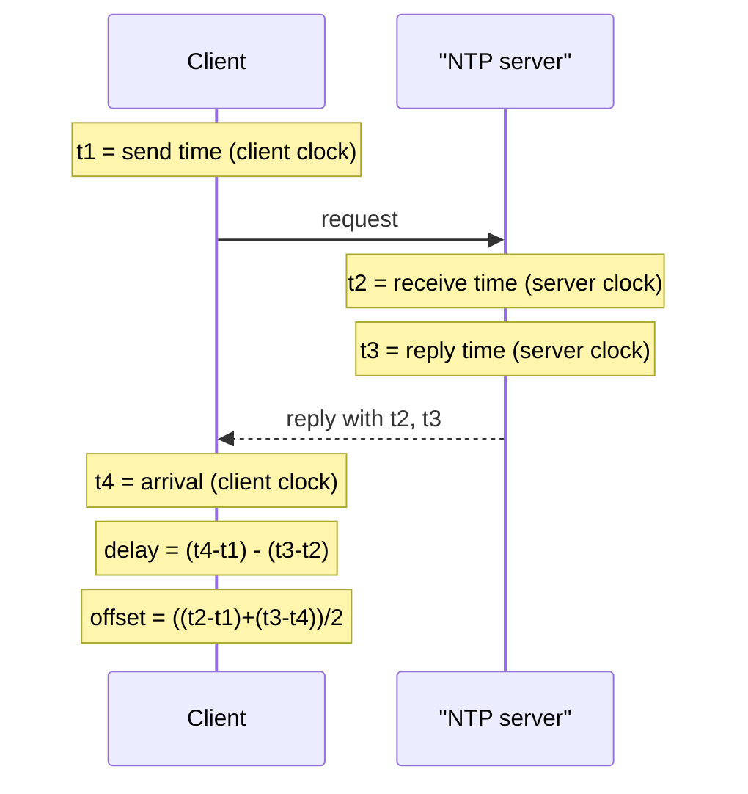

## In one minute
- Every machine has its own quartz clock, and quartz drifts, typically 10 to 100 parts per million. Unsynchronised clocks diverge by seconds per day.
- Protocols like NTP and PTP estimate the offset to a reference clock by timing a round trip, and correct the local clock gradually.
- The uncertainty never reaches zero. Expect single-digit milliseconds over a WAN with NTP, tens to hundreds of microseconds in a good datacentre, and sub-microsecond only with hardware timestamping.
- Wall clocks can jump backwards. Use monotonic clocks for durations and never use wall time alone to order events across machines.

## How it works

### Two clocks in every machine
A *time-of-day* clock returns the current date and time. NTP may step it, so it can jump forward or backward. A *monotonic* clock only moves forward and measures elapsed time; its absolute value is meaningless across machines. Timeouts, leases and latency measurements must use the monotonic clock. Timestamps that leave the machine use time-of-day.

### Drift and skew
A crystal at 50 ppm drift gains or loses 50 microseconds per second, which is 4.3 seconds per day. Temperature changes drift further. *Skew* is the difference between two clocks at one instant. Synchronisation keeps skew bounded by measuring and correcting drift continuously.

### How NTP estimates offset
The client records `t1` and sends a request. The server records receive time `t2` and send time `t3`. The client records arrival `t4`. Then round-trip delay is `(t4 - t1) - (t3 - t2)` and estimated offset is `((t2 - t1) + (t3 - t4)) / 2`. The formula assumes the outbound and return paths take equal time. If one direction takes 30 ms and the other 10 ms, the estimate is off by 10 ms, and the client cannot detect it. The error is at most half the round-trip delay, so clients sample several servers repeatedly and trust the samples with the lowest delay ([RFC 5905](https://www.rfc-editor.org/rfc/rfc5905)).

NTP servers form strata. Stratum 0 is an atomic or GPS reference, stratum 1 servers are attached to it, and each hop adds a stratum and some error. Daemons then *slew* the clock, running it slightly fast or slow until the offset closes, rather than stepping it. That only holds for small offsets. Classic ntpd slews offsets under 128 ms and steps anything larger, and because the Unix kernel slews at most 0.5 ms per second, each second of error takes about 2,000 s to remove ([ntpd docs](https://www.ntp.org/documentation/4.2.8-series/ntpd/)). chrony does its own slewing at up to 83,333 ppm by default ([chrony.conf](https://chrony-project.org/doc/4.6/chrony.conf.html)). So time is monotonic in practice only while offsets stay small; a badly wrong clock at boot, or after a long VM pause, still gets stepped.

Plain NTP packets are unauthenticated, so anyone on the path can shift a client's clock. Network Time Security adds a TLS key exchange and authenticated time packets ([RFC 8915](https://www.rfc-editor.org/rfc/rfc8915), 2020), and chrony enables it per server with the `nts` option.

### Better precision
PTP (IEEE 1588) timestamps packets in the NIC hardware and lets switches correct for their own queueing delay, reaching sub-microsecond skew on a LAN. Meta moved its fleet from NTP to PTP after finding that commit-wait reads ran about 100 times better on PTP-backed clusters; in one 24-hour sample its NTP clocks stayed within about 8 microseconds and PTP within about 100 nanoseconds ([Meta](https://engineering.fb.com/2022/11/21/production-engineering/precision-time-protocol-at-meta/)). Cloud providers now expose this too. Since November 2023, the Amazon Time Sync Service gives typical error bounds under 100 microseconds over NTP and under 40 microseconds from the PTP hardware clock on supported Nitro instances ([AWS](https://aws.amazon.com/blogs/compute/its-about-time-microsecond-accurate-clocks-on-amazon-ec2-instances/)).

### Leap seconds and smearing
UTC has occasionally inserted a leap second, 23:59:60, most recently at the end of 2016. Software that assumes every minute has 60 seconds has crashed or spun CPU on these days. Large operators instead *smear* the extra second, but not identically. Google runs a linear smear over 24 hours, noon to noon UTC, making each second about 11.6 ppm long ([Google](https://developers.google.com/time/smear)). Meta uses a quadratic smear over 17 hours starting at midnight UTC ([Meta](https://engineering.fb.com/2022/07/25/production-engineering/its-time-to-leave-the-leap-second-in-the-past/)). Mixing smeared and non-smeared sources, or two different smears, gives up to about half a second of disagreement.

Leap seconds are now ending. In 2026 the General Conference on Weights and Measures (CGPM) resolved that UTC becomes continuous from 20 May 2027, with no further leap seconds and the UT1-UTC gap allowed to grow to one hour ([BIPM, CGPM 2026 Resolution 5](https://www.bipm.org/en/cgpm-2026/resolution-5)). Old timestamps still contain 23:59:60, so parsers must keep handling it, but new systems no longer need a smear plan.

### Using clocks safely
Google's Spanner exposes time as an interval `[earliest, latest]` with a known error bound, typically a few milliseconds (a sawtooth from about 1 to 7 ms in the published design), and waits out that uncertainty before committing so timestamps respect real-time order ([Spanner paper](https://static.googleusercontent.com/media/research.google.com/en//archive/spanner-osdi2012.pdf)). Without such a bound, treat wall-clock timestamps from different machines as approximate.

## Down the stack

### Layer 1: The contract
Linux exposes several clocks through `clock_gettime`, each with a different promise. `CLOCK_REALTIME` is UTC-ish wall time and can be stepped in either direction. `CLOCK_MONOTONIC` never goes backwards but is still slewed by NTP, so its rate tracks true seconds. `CLOCK_MONOTONIC_RAW` is the uncorrected hardware rate. `CLOCK_BOOTTIME` also counts time spent suspended, and `CLOCK_TAI` counts leap seconds instead of repeating one ([clock_gettime(2)](https://man7.org/linux/man-pages/man2/clock_gettime.2.html)). Each call fills a 16-byte `struct timespec` of seconds and nanoseconds.

A sync daemon promises a bound, not an exact time. `chronyc tracking` reports the current offset, root delay and root dispersion, and chrony documents the absolute bound as the offset plus root dispersion plus half the root delay ([chronyc docs](https://chrony-project.org/doc/4.6/chronyc.html)). TrueTime makes the bound the API: `TT.now()` returns an interval `[earliest, latest]` guaranteed to contain true time, plus `TT.after(t)` and `TT.before(t)`. AWS publishes a similar daemon, ClockBound, that hands applications the current error bound.

### Layer 2: The mechanism
An NTP packet is a 48-byte UDP datagram on port 123. It carries a 2-bit leap indicator, version, mode, stratum, poll exponent, precision, root delay, root dispersion, a reference ID, and four 64-bit timestamps: 32 bits of seconds since 1900 and 32 bits of fraction, a resolution of about 233 picoseconds. The 32-bit seconds field wraps in 2036, which the protocol handles with era numbers.

Clients poll every 2^poll seconds, by default somewhere between 64 s and 1024 s. Each source's recent samples (eight in classic ntpd) go through a clock filter that prefers the minimum-delay sample, because low delay means little room for asymmetric queueing. An intersection algorithm in the spirit of Marzullo's then compares the sources' confidence intervals and discards *falsetickers* whose intervals do not overlap the majority, which is why you configure at least four servers. The survivors feed a control loop that adjusts the local frequency and phase.

The daemon applies corrections through `adjtimex(2)`: `ADJ_FREQUENCY` changes the rate in scaled parts per million and `ADJ_OFFSET` asks the kernel to slew away an offset. The kernel's own discipline caps slewing at 500 ppm, so a 1 s error takes over half an hour to remove. chrony bypasses that loop and can slew much faster and uses `makestep` (for example `makestep 1.0 3`) to permit a step only during the first few updates after boot.

PTP replaces software guesses with hardware: `Sync` and `Follow_Up` carry the master's send time, `Delay_Req` and `Delay_Resp` measure the return path, and transparent-clock switches add their residence time into a `correctionField`.

### Layer 3: The machine
On x86 the kernel usually reads time from the invariant TSC, a per-core counter running at a constant rate. Timekeeping converts cycles to nanoseconds as `(cycles * mult) >> shift`, and NTP corrections work by nudging `mult`. Through the vDSO, `clock_gettime` reads that counter without entering the kernel and costs on the order of 20 ns. If the clocksource falls back to HPET or ACPI PM, common in some VMs and visible in `/sys/devices/system/clocksource/clocksource0/current_clocksource`, every call becomes a real syscall plus slow I/O and can cost a microsecond or more.

Software timestamps are taken after the NIC raises an interrupt, and interrupt coalescing alone can add tens of microseconds of jitter. That is the floor for software NTP inside a datacentre. Hardware timestamping (`SO_TIMESTAMPING`) stamps packets in the NIC's PTP hardware clock, exposed as `/dev/ptp0`, and `phc2sys` then disciplines the system clock from it, which is how sub-microsecond skew is reached.

Spanner's published design polls GPS and atomic time masters every 30 s and assumes a worst-case local drift of 200 us per second between polls, so uncertainty grows in a sawtooth from about 1 ms to about 7 ms and resets after each poll. The two reference types are deliberate: GPS fails through antennas, interference and spoofing, atomic clocks through slow drift, and the failures rarely coincide.

### Why it's built this way
1. Quartz frequency depends on cut and temperature, so every clock drifts and must be measured against a reference continuously.
2. Measurement crosses a network whose two directions are not guaranteed symmetric, so offset can only be estimated within half the round trip, and low-delay samples are worth the most.
3. Time going backwards breaks software, so corrections are slewed rather than stepped, which makes convergence slow.
4. Since error never reaches zero, the honest interface is an interval, and systems that need ordering either wait out the interval or stop depending on physical time.

## Diagram


## Worked example
Client sends at `t1 = 100.000`. Server receives at `t2 = 100.120` and replies at `t3 = 100.121`. Client receives at `t4 = 100.041`, all in seconds.

Delay is `(100.041 - 100.000) - (100.121 - 100.120) = 0.041 - 0.001 = 0.040`, so 40 ms on the wire. Offset is `((0.120) + (0.080)) / 2 = 0.100`. The client is 100 ms behind the server, with uncertainty up to plus or minus 20 ms if the paths were asymmetric.

Now the consequence. A system uses last-write-wins with wall-clock timestamps. Node A is 100 ms behind. A user writes `status=away` on node B at true time 12:00:00.050 (stamped .050), then `status=online` on node A at true time 12:00:00.120 (stamped .020). LWW keeps `away`, the older write, and silently drops the newer one. With 3 replicas and 2,000 writes per second to hot keys, any skew larger than the gap between conflicting writes loses data.

## In the wild
- **Linux fleets, 2012: the leap second livelocks futex users.** After the 30 June 2012 leap second, many Linux machines hit load spikes in MySQL, Java, Firefox and Thunderbird. The kernel applied the extra second without telling the high-resolution timer subsystem, so `CLOCK_REALTIME` timers fired a second early and sub-second timeouts fired immediately, in a tight loop. The workaround was to set the clock to itself (`date -s "$(date)"`), and John Stultz's patches made leap-second handling call `clock_was_set()` ([LKML](https://lkml.iu.edu/hypermail/linux/kernel/1207.0/02318.html)).
- **Cloudflare, 2017: time goes backwards in RRDNS.** At midnight UTC on 1 January the leap second stepped the wall clock back, Go's then wall-clock `time.Now()` produced negative round-trip times, and a negative value reaching `rand.Int63n()` panicked the DNS proxy. At peak about 0.2% of DNS queries failed. Cloudflare discarded negative intervals and audited other duration code; Go 1.9 later added monotonic readings to `time.Time` ([Cloudflare](https://blog.cloudflare.com/how-and-why-the-leap-second-affected-cloudflare-dns/), [Go 1.9 notes](https://go.dev/doc/go1.9)).

## Trade-offs
| Approach | Strengths | Weaknesses | Choose when |
|---|---|---|---|
| NTP over internet | Free, universal | Milliseconds of error; asymmetric paths | General servers, logging |
| NTP or chrony to local stratum 1 | Sub-millisecond in datacentre | Needs internal time infrastructure | Most production fleets |
| PTP with hardware timestamps | Sub-microsecond | Special NICs and switches | Trading, telecoms, tight ordering |
| Bounded-uncertainty time (TrueTime-style) | Safe real-time ordering | Commit wait; custom infrastructure | Externally consistent databases |
| Logical clocks | No physical sync needed | No relation to real time | Causal ordering of events |

## Pitfalls in production
- Measuring durations with the wall clock, which goes negative when NTP steps backwards. Fix: use monotonic clock APIs for every timeout and latency measurement.
- Last-write-wins on wall time across nodes. Fix: use hybrid logical clocks or version vectors, or accept and document the loss window.
- A VM pause or live migration causing a jump of several seconds. Fix: alert on clock offset, and design leases with margin for pauses.
- No monitoring of offset. Fix: export chrony or NTP offset as a metric and alert above a threshold such as 50 ms, and fence nodes far out of sync.

## Leadership lens
- Ask which correctness properties depend on clocks, and what skew bound they assume. If nobody knows the bound, the design is not safe.
- Treat time infrastructure as a production dependency with owners, monitoring and runbooks.
- Prefer designs that need only monotonic local time plus logical ordering. Use synchronised physical time for humans and for bounded-error tricks you can prove.

## Check yourself
1. Why can NTP not measure a one-way network delay?
   **Answer:** It only sees four timestamps from two different clocks. Offset and path asymmetry are indistinguishable, so it assumes symmetric paths and bounds the error by half the round trip.
2. Why should a lease timer use the monotonic clock?
   **Answer:** The wall clock can be stepped forward or backward by synchronisation, which would make a lease appear to expire early or last too long.
3. What does slewing do that stepping does not?
   **Answer:** It corrects the offset by running the clock slightly fast or slow, so time never jumps and never goes backwards.

## Practice
**Task:** Implement `ntp_sample(t1, t2, t3, t4)` returning a tuple `(offset, delay)` using the NTP formulas, where t1 and t4 are client times and t2 and t3 are server times. Then implement `best_offset(samples)`, which takes a list of `(t1, t2, t3, t4)` tuples and returns `(offset, error_bound)` from the sample with the smallest delay, where `error_bound` is half that delay. Return None for an empty list. Ignore samples with negative delay, which indicate bad data.

```python starter
def ntp_sample(t1, t2, t3, t4):
    # TODO
    raise NotImplementedError

def best_offset(samples):
    # TODO
    raise NotImplementedError
```

```python tests
def close(a, b):
    return abs(a - b) < 1e-9

def test_sample_formula():
    off, d = ntp_sample(100.0, 100.12, 100.121, 100.041)
    assert close(off, 0.1) and close(d, 0.04)

def test_in_sync_symmetric():
    off, d = ntp_sample(0.0, 0.01, 0.01, 0.02)
    assert close(off, 0.0) and close(d, 0.02)

def test_best_picks_lowest_delay():
    samples = [(0.0, 5.05, 5.05, 0.2), (1.0, 6.01, 6.01, 1.02)]
    off, err = best_offset(samples)
    assert close(off, 5.0) and close(err, 0.01)

def test_empty():
    assert best_offset([]) is None

def test_negative_delay_ignored():
    bad = (0.0, 1.0, 5.0, 1.0)
    good = (0.0, 2.05, 2.05, 0.1)
    off, err = best_offset([bad, good])
    assert close(off, 2.0) and close(err, 0.05)
```

```python solution
def ntp_sample(t1, t2, t3, t4):
    delay = (t4 - t1) - (t3 - t2)
    offset = ((t2 - t1) + (t3 - t4)) / 2
    return offset, delay

def best_offset(samples):
    best = None
    for s in samples:
        off, d = ntp_sample(*s)
        if d < 0:
            continue
        if best is None or d < best[1]:
            best = (off, d)
    if best is None:
        return None
    return best[0], best[1] / 2
```

```typescript starter
export function ntpSample(t1: number, t2: number, t3: number, t4: number): [number, number] {
  // TODO
  throw new Error("TODO");
}

export function bestOffset(samples: [number, number, number, number][]): [number, number] | null {
  // TODO
  throw new Error("TODO");
}
```

```typescript tests
const close = (a: number, b: number): boolean => Math.abs(a - b) < 1e-9;

test("sample formula", () => {
  const [off, d] = ntpSample(100.0, 100.12, 100.121, 100.041);
  assert(close(off, 0.1) && close(d, 0.04), "offset 0.1, delay 0.04");
});

test("in sync symmetric", () => {
  const [off, d] = ntpSample(0.0, 0.01, 0.01, 0.02);
  assert(close(off, 0.0) && close(d, 0.02), "offset 0, delay 0.02");
});

test("best picks lowest delay", () => {
  const r = bestOffset([[0.0, 5.05, 5.05, 0.2], [1.0, 6.01, 6.01, 1.02]]);
  assert(r !== null && close(r[0], 5.0) && close(r[1], 0.01), "lowest-delay sample wins");
});

test("empty", () => {
  assertEqual(bestOffset([]), null);
});

test("negative delay ignored", () => {
  const r = bestOffset([[0.0, 1.0, 5.0, 1.0], [0.0, 2.05, 2.05, 0.1]]);
  assert(r !== null && close(r[0], 2.0) && close(r[1], 0.05), "bad sample skipped");
});
```

```typescript solution
export function ntpSample(t1: number, t2: number, t3: number, t4: number): [number, number] {
  const delay = (t4 - t1) - (t3 - t2);
  const offset = ((t2 - t1) + (t3 - t4)) / 2;
  return [offset, delay];
}

export function bestOffset(samples: [number, number, number, number][]): [number, number] | null {
  let best: [number, number] | null = null;
  for (const [t1, t2, t3, t4] of samples) {
    const [off, d] = ntpSample(t1, t2, t3, t4);
    if (d < 0) continue;
    if (best === null || d < best[1]) best = [off, d];
  }
  return best === null ? null : [best[0], best[1] / 2];
}
```

```go starter
package practice

// NtpSample returns the clock offset and round-trip delay for one exchange.
func NtpSample(t1, t2, t3, t4 float64) (offset, delay float64) {
	// TODO
	panic("TODO")
}

// BestOffset returns the offset and error bound of the lowest-delay valid sample.
func BestOffset(samples [][4]float64) (offset, errBound float64, ok bool) {
	// TODO
	panic("TODO")
}
```

```go tests
package practice

import (
	"math"
	"testing"
)

func near(a, b float64) bool { return math.Abs(a-b) < 1e-9 }

func TestSampleFormula(t *testing.T) {
	off, d := NtpSample(100.0, 100.12, 100.121, 100.041)
	if !near(off, 0.1) || !near(d, 0.04) {
		t.Fatalf("got %v %v", off, d)
	}
}

func TestInSyncSymmetric(t *testing.T) {
	off, d := NtpSample(0.0, 0.01, 0.01, 0.02)
	if !near(off, 0) || !near(d, 0.02) {
		t.Fatalf("got %v %v", off, d)
	}
}

func TestBestPicksLowestDelay(t *testing.T) {
	off, e, ok := BestOffset([][4]float64{{0.0, 5.05, 5.05, 0.2}, {1.0, 6.01, 6.01, 1.02}})
	if !ok || !near(off, 5.0) || !near(e, 0.01) {
		t.Fatalf("got %v %v %v", off, e, ok)
	}
}

func TestEmpty(t *testing.T) {
	if _, _, ok := BestOffset(nil); ok {
		t.Fatal("empty input should report ok=false")
	}
}

func TestNegativeDelayIgnored(t *testing.T) {
	off, e, ok := BestOffset([][4]float64{{0.0, 1.0, 5.0, 1.0}, {0.0, 2.05, 2.05, 0.1}})
	if !ok || !near(off, 2.0) || !near(e, 0.05) {
		t.Fatalf("got %v %v %v", off, e, ok)
	}
}
```

```go solution
package practice

// NtpSample returns the clock offset and round-trip delay for one exchange.
func NtpSample(t1, t2, t3, t4 float64) (offset, delay float64) {
	delay = (t4 - t1) - (t3 - t2)
	offset = ((t2 - t1) + (t3 - t4)) / 2
	return offset, delay
}

// BestOffset returns the offset and error bound of the lowest-delay valid sample.
func BestOffset(samples [][4]float64) (offset, errBound float64, ok bool) {
	bestDelay := 0.0
	for _, s := range samples {
		off, d := NtpSample(s[0], s[1], s[2], s[3])
		if d < 0 {
			continue
		}
		if !ok || d < bestDelay {
			offset, bestDelay, ok = off, d, true
		}
	}
	if !ok {
		return 0, 0, false
	}
	return offset, bestDelay / 2, true
}
```

## Mock interview
**Prompt:** You are building an audit log for a payment platform with 30 services across 2 regions. Auditors need events ordered correctly and timestamped to within 10 ms of true time. Design the time handling.

- Follow-up: A host's offset jumps to 2 seconds after a VM migration. What happens to its events?
- Follow-up: How would you order two events from different services stamped 1 ms apart?
- Follow-up: What does a leap second do to your design?

**A strong answer covers:**
- Local stratum-1 or PTP time sources, chrony slewing, and offset metrics with alerting.
- Recording an error bound with each timestamp and treating close events as concurrent.
- Logical or hybrid clocks for causal ordering, physical time for human-readable stamps.
- Fencing or flagging hosts whose offset exceeds the bound.
- A fleet-wide leap smear policy.

## Sources and further study
**Primary**
- [RFC 5905: Network Time Protocol Version 4](https://www.rfc-editor.org/rfc/rfc5905): the packet format, clock filter, selection and discipline algorithms.
- [RFC 8915: Network Time Security for NTP](https://www.rfc-editor.org/rfc/rfc8915): authenticated NTP with TLS key establishment.
- [Corbett et al., Spanner (OSDI 2012)](https://static.googleusercontent.com/media/research.google.com/en//archive/spanner-osdi2012.pdf): TrueTime, its error bound and commit wait.
- [BIPM, CGPM 2026 Resolution 5](https://www.bipm.org/en/cgpm-2026/resolution-5): the decision to stop leap seconds from 20 May 2027.

**Systems docs**
- [chrony.conf reference](https://chrony-project.org/doc/4.6/chrony.conf.html): `makestep`, `maxslewrate`, poll intervals and NTS options.
- [Linux clock_gettime(2)](https://man7.org/linux/man-pages/man2/clock_gettime.2.html): what each kernel clock promises.
- [Amazon Time Sync Service and the PTP hardware clock (AWS)](https://aws.amazon.com/blogs/compute/its-about-time-microsecond-accurate-clocks-on-amazon-ec2-instances/): microsecond bounds on EC2 and ClockBound.
- [Precision Time Protocol at Meta](https://engineering.fb.com/2022/11/21/production-engineering/precision-time-protocol-at-meta/): why a large fleet moved from NTP to PTP.

**Books**
- *Designing Data-Intensive Applications*, Martin Kleppmann, chapter 8 "The Trouble with Distributed Systems" (1st edition), section "Unreliable Clocks": monotonic versus time-of-day clocks, LWW data loss and confidence intervals.
- *Understanding Distributed Systems*, Roberto Vitillo, chapter "Time": physical clocks, NTP and why they cannot order events.

**Other curricula**
- [Kleppmann, Distributed Systems lecture notes (Cambridge)](https://www.cl.cam.ac.uk/teaching/2122/ConcDisSys/dist-sys-notes.pdf): sections 3.1 and 3.2 cover quartz drift, leap seconds and NTP's slew, step and panic thresholds.
- [donnemartin/system-design-primer](https://github.com/donnemartin/system-design-primer): does not cover clocks or time synchronisation at all, which is why it pairs poorly with this topic.

## Watch
- [Distributed Systems 3.1: Physical time (Martin Kleppmann)](https://www.youtube.com/watch?v=FQ_2N3AQu0M): quartz drift, UTC, leap seconds and clock types.
- [Distributed Systems 3.2: Clock synchronisation (Martin Kleppmann)](https://www.youtube.com/watch?v=mAyW-4LeXZo): how NTP estimates offset and corrects clocks.

## Free resources
- [Network Time Protocol (Wikipedia)](https://en.wikipedia.org/wiki/Network_Time_Protocol): strata, the offset formula and protocol history.
- [Building a more accurate time service at Facebook scale (Meta Engineering)](https://engineering.fb.com/2020/03/18/production-engineering/ntp-service/): moving a large fleet to chrony and measuring accuracy.
- [Leap smear (Google Public NTP)](https://developers.google.com/time/smear): how and why Google smears leap seconds.
- [Spanner: TrueTime and external consistency (Google Cloud)](https://cloud.google.com/spanner/docs/true-time-external-consistency): using bounded clock uncertainty for ordering.
- [How and why the leap second affected Cloudflare DNS (Cloudflare)](https://blog.cloudflare.com/how-and-why-the-leap-second-affected-cloudflare-dns/): a real outage caused by time going backwards.
