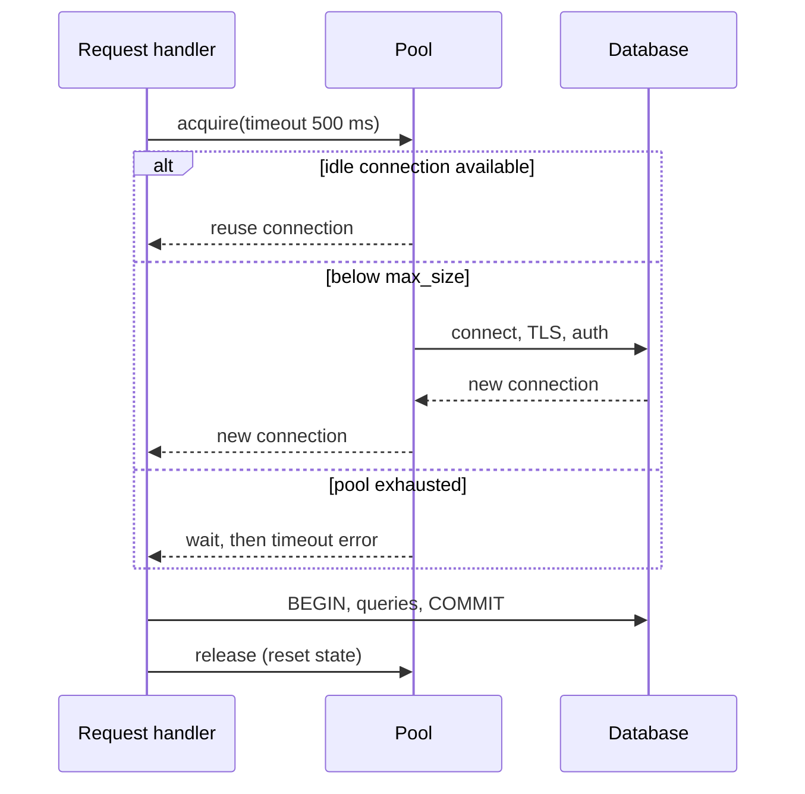

## In one minute
- Opening a database connection is expensive (network round trips, TLS, authentication, and server-side memory), so applications keep a pool of open connections and lend them out per request or transaction.
- The pool size is a capacity limit for the database, not a performance knob to turn up. Small pools usually beat large ones.
- Pools exist at two layers: in-process (HikariCP, database/sql, SQLAlchemy) and external proxies (PgBouncer, RDS Proxy, ProxySQL) that multiplex many clients onto few server connections.
- Most incidents come from multiplication (pods times pool size), leaks, and missing timeouts.

## How it works

### What a connection costs
A new PostgreSQL connection needs a TCP handshake, often a TLS handshake, authentication (SCRAM is several round trips), and a fork of a backend process. That is 5 to 30 ms before the first query, and real memory on the server. Be careful how you measure it: `top` counts shared buffers and copy-on-write pages in every backend, so it overstates the cost. Measured properly, one connection's private overhead was about 7.6 MiB with huge pages off and 1.3 MiB with them on, and it grows as the backend fills caches and sorts ([Freund](https://blog.anarazel.de/2020/10/07/measuring-the-memory-overhead-of-a-postgres-connection/)). MySQL uses threads instead of processes, which is cheaper but still bounded. Doing this per request turns a 2 ms query into a 20 ms one and caps throughput on connection setup.

### The pool lifecycle
A pool holds idle connections. `acquire` hands out an idle one, opens a new one if under `max_size`, or waits up to `acquire_timeout` and fails. `release` returns the connection, usually after resetting session state. Background housekeeping closes connections idle longer than `idle_timeout` (while keeping `min_idle`), retires connections older than `max_lifetime` so failovers and DNS changes are picked up, and validates connections that may have been cut by a firewall or load balancer.

### Sizing with Little's law
Connections in use equal arrival rate times hold time. At 3,000 queries per second with 4 ms average hold, you need about 12 connections busy on average; 20 gives headroom for bursts. Beyond that, extra connections do not add throughput because the database has a fixed number of cores and disks. A 16-core database with 500 active connections spends its time context switching and fighting over locks. A common starting point is a small multiple of database cores across *all* clients combined. HikariCP's guide suggests `(cores x 2) + effective spindles` and cites an Oracle test where cutting the pool from 2,048 to 96 connections took response times from about 100 ms to 2 ms ([HikariCP wiki](https://github.com/brettwooldridge/HikariCP/wiki/About-Pool-Sizing)). Treat the formula as a first guess and tune it against measured waits.

### External poolers and modes
In-process pools cannot share across processes. With 300 pods each holding 20 connections, the database sees 6,000. An external pooler such as PgBouncer accepts thousands of client connections and maps them onto a small server pool. Its modes decide when a server connection is returned ([PgBouncer features](https://www.pgbouncer.org/features.html)). The default is session mode, so you get little multiplexing until you change it:

1. **Session mode:** held for the client's whole session. Safe, but little multiplexing.
2. **Transaction mode:** held only for one transaction. Very high multiplexing, but session features (session-level prepared statements, advisory locks, `SET`, temporary tables, `LISTEN`) break or leak across clients.
3. **Statement mode:** returned after every statement. Multi-statement transactions are impossible.

## Down the stack

### Layer 1: The contract
A pool promises: `acquire` returns a usable connection, held exclusively by the caller, within `acquire_timeout`, or fails with an error; on `release` the connection's session state is reset so the next borrower does not inherit it; and the pool never holds more than `max_size` server connections. An external pooler in transaction mode narrows the promise further: you own a server connection only between `BEGIN` and `COMMIT`, so anything that lives in the session is outside the contract.

### Layer 2: The mechanism
PostgreSQL's postmaster forks one backend process per connection. The client sends a `StartupMessage`, completes authentication (SCRAM-SHA-256 is a SASL exchange of two round trips), receives `ParameterStatus` and `BackendKeyData` messages, and waits for `ReadyForQuery`. That last message carries a transaction status byte: `I` idle, `T` in a transaction, `E` in a failed transaction. PgBouncer reads this byte to know when a transaction ended, and in transaction mode hands the server connection back to its pool at that moment; in session mode it runs `server_reset_query` (by default `DISCARD ALL`) on release. Its other defaults are small on purpose: `default_pool_size` 20 server connections per database and user pair, and `max_client_conn` 100 ([PgBouncer config](https://www.pgbouncer.org/config.html)). Protocol-level prepared statements work in transaction mode only since PgBouncer 1.21 (October 2023), which tracks them per client; 1.24 (January 2025) turned this on by default with `max_prepared_statements = 200` ([PgBouncer changelog](https://www.pgbouncer.org/changelog.html)). In-process pools differ in defaults that bite: HikariCP's `connectionTimeout` is 30 seconds, `maxLifetime` 30 minutes and `maximumPoolSize` 10 ([HikariCP](https://github.com/brettwooldridge/HikariCP)), while Go's `database/sql` keeps only 2 idle connections by default ([Go docs](https://pkg.go.dev/database/sql#DB.SetMaxIdleConns)), so bursty services churn connections unless it is raised.

### Layer 3: The machine
A fresh connection costs a TCP handshake (1 round trip), a TLS 1.3 handshake (1 more), and SCRAM's 2 round trips, during which the server computes 4,096 iterations of PBKDF2 with SHA-256 (the `scram_iterations` default, tunable since Postgres 16) ([Postgres docs](https://www.postgresql.org/docs/current/runtime-config-connection.html)). Then `fork()` creates a process with copy-on-write pages; as the backend fills catalog caches and allocates `work_mem` it grows to several MB of private memory. Each connection is also a file descriptor plus kernel socket buffers. With thousands of backends, the kernel spends real time context switching (a few microseconds each), and the database pays for bookkeeping proportional to connection count, such as building snapshots over the process array. Before Postgres 14, every snapshot scanned all backends, so 10,000 *idle* connections halved the throughput of one active one; the Postgres 14 rewrite of `GetSnapshotData()` roughly doubled it in that test (16,034 to 33,140 TPS), but idle connections are still not free ([Citus](https://www.citusdata.com/blog/2020/10/25/improving-postgres-connection-scalability-snapshots/)). Idle connections also die silently: an AWS NAT gateway, for example, drops a flow idle for 350 seconds and answers the next packet with a RST ([AWS docs](https://docs.aws.amazon.com/vpc/latest/userguide/nat-gateway-troubleshooting.html)), while Linux's default `tcp_keepalive_time` is 7,200 seconds, so the pool's own keepalive or `max_lifetime` must be shorter than the middlebox timeout.

### Why it's built this way
1. Connection setup costs several round trips, a key derivation, and a process fork, so connections are reused rather than created per request.
2. Every connection costs server memory and scheduling work, so the total must be capped.
3. Each application process caps only its own pool, so large fleets add a shared proxy that caps the total.
4. A proxy can only reassign a server connection at a safe boundary, so it watches transaction status and gives up session features.
5. Long-lived TCP connections get cut by middleboxes and outlive failovers, so pools retire and validate them on a schedule.

## Diagram


## Worked example
A checkout service runs 120 pods, each with a pool of 25. That is 3,000 potential connections against a Postgres primary with `max_connections = 1,000` and 32 cores. During a deploy, new pods warm their pools before old ones drain, briefly doubling demand. Connections are refused and checkout fails.

The fix has three parts. First, measure: peak load is 8,000 queries per second at 3 ms hold time, so only about 24 connections are busy across the fleet. Second, put PgBouncer in transaction mode in front of the database with a server pool of 64. Third, shrink each pod pool to 10 with `acquire_timeout` of 500 ms so overload fails fast instead of queueing forever. Clients now hold 1,200 cheap connections to PgBouncer, the database sees at most 64, and P99 drops because the database stops thrashing. The team switches the driver to protocol-level prepared statements, which PgBouncer 1.21 and later track in transaction mode.

## In the wild
- **GitHub, 2022: the proxy runs out of connections four times in a week.** On 16, 17, 22 and 23 March, peak-hour load on the shared `mysql1` primary plus one badly performing query pushed GitHub's database proxy to its maximum connection count. Writes failed across git operations, webhooks, pull requests and Actions, and each recovery was a primary failover. Fixes were an index for the query and webhook throttling at peak ([GitHub](https://github.blog/2022-03-23-an-update-on-recent-service-disruptions/)).
- **GitHub, 2023: inconsistent pool settings on the proxy layer.** On 4 May, degraded git, API, Actions and Copilot traffic traced back to connection pool exhaustion in the database proxy, because earlier pool configuration changes had been rolled out unevenly. GitHub audited the pool settings and changed its automation to apply them dynamically and consistently ([GitHub](https://github.blog/2023-06-14-github-availability-report-may-2023/)).
- **Val Town, 2024: deadlocked queries keep their slots.** A burst of parallel edits deadlocked several queries. The pool had no query timeout, so those connections never came back, one host's pool drained, and requests routed there stalled for almost seven hours because health checks did not test the database. The fixes were query timeouts and pool health in health checks, with a review planned so that servers at capacity reject requests instead of queueing them ([Val Town](https://blog.val.town/blog/post-mortem-exhausted-host-connection-pool)).

## Trade-offs
| Option | Strengths | Weaknesses | Choose when |
|---|---|---|---|
| No pool | Simplest | Setup cost per request, connection storms | Batch jobs, very low traffic |
| In-process pool | No extra hop, full session features | Multiplies with instance count | Few app instances |
| Proxy, session mode | Centralised limits, drop-in | Little multiplexing | Many clients need session state |
| Proxy, transaction mode | Thousands of clients on few connections | Breaks session-level features | Large fleets, serverless functions |
| Managed proxy (RDS Proxy) | Handles failover, IAM auth | Cost, added latency, pinning rules | Managed databases with Lambda clients |

## Pitfalls in production
- **Pool multiplication.** Autoscaling adds pods and silently adds connections until `max_connections` is hit. Budget connections per service and use a proxy for large fleets.
- **Leaks.** A code path forgets to release on an error, and the pool drains over hours. Use scoped acquisition (`with`, `defer`, try-with-resources) and enable leak detection that logs the acquiring stack.
- **No acquire timeout.** Requests queue indefinitely for a connection, hiding overload and exhausting threads. Set a short timeout and shed load.
- **Stale connections after failover.** The pool keeps sockets to the old primary. Set `max_lifetime` with jitter and validate on borrow after errors.
- **Session state bleeding through transaction pooling.** A `SET search_path` from one client affects another. Avoid session state or use session mode for those clients.
- **Long transactions holding connections.** A slow external call inside a transaction pins a connection. Never do network calls while holding a transaction open, and set statement and lock timeouts so a deadlocked query cannot hold its slot forever.
- **Locked out at the limit.** When every slot is taken, operators cannot connect to kill the offending queries. Postgres keeps 3 slots for superusers by default, and Postgres 16 added `reserved_connections` for a `pg_use_reserved_connections` role; use them for admin and monitoring access.

## Leadership lens
- Treat database connections as a shared, budgeted resource. Each service gets an allocation, reviewed like any quota.
- Ask for pool metrics on every service: active, idle, waiting, acquire latency, and timeouts. Waiting greater than zero is an early overload signal.
- Decide on a proxy before the fleet grows, since retrofitting transaction mode surfaces hidden session-state dependencies.
- Make deploy surges part of capacity planning: during a rolling deploy, old and new pods both hold pools.

## Check yourself
1. Why can raising pool size from 20 to 200 per instance make latency worse?
   **Answer:** The database has fixed cores and lock capacity, so more concurrent queries add contention and context switching, and every instance multiplies the total.
2. What breaks when moving from session to transaction pooling?
   **Answer:** Anything that assumes the same server connection across transactions: session-level `SET`, temporary tables, advisory locks, `LISTEN`, and session-level prepared statements.
3. Why set `max_lifetime` even if connections look healthy?
   **Answer:** It forces periodic reconnection, so pools pick up failovers, DNS changes, and credential rotation, and it avoids long-lived connections being cut silently by middleboxes.

## Practice
**Task:** Implement a connection pool with an injected clock. `Pool(max_size, min_idle, idle_timeout, max_lifetime)` opens connections with ids 1, 2, 3 and so on. `acquire(now)` reuses the most recently released idle connection (LIFO), closing any idle connection it finds past `max_lifetime`; otherwise opens a new one if the total is below `max_size`; otherwise returns `None`. `release(conn, now)` makes the connection idle, or closes it if it is past `max_lifetime`. `evict(now)` closes idle connections idle for at least `idle_timeout`, oldest-idle first, never dropping below `min_idle` idle connections, and returns how many it closed. Expose `total()` and `idle_count()`.

```python starter
class Pool:
    def __init__(self, max_size, min_idle, idle_timeout, max_lifetime):
        raise NotImplementedError

    def acquire(self, now): raise NotImplementedError
    def release(self, conn, now): raise NotImplementedError
    def evict(self, now): raise NotImplementedError
    def total(self): raise NotImplementedError
    def idle_count(self): raise NotImplementedError
```

```python tests
def test_opens_up_to_max_then_none():
    p = Pool(2, 0, 100, 1000)
    assert p.acquire(0) == 1
    assert p.acquire(0) == 2
    assert p.acquire(0) is None
    assert p.total() == 2

def test_reuses_most_recent_idle():
    p = Pool(3, 0, 100, 1000)
    a, b = p.acquire(0), p.acquire(0)
    p.release(a, 1)
    p.release(b, 2)
    assert p.acquire(3) == b
    assert p.total() == 2

def test_evict_respects_min_idle():
    p = Pool(3, 1, 10, 1000)
    conns = [p.acquire(0) for _ in range(3)]
    for i, c in enumerate(conns):
        p.release(c, i)
    assert p.evict(50) == 2
    assert p.idle_count() == 1 and p.total() == 1

def test_evict_skips_recently_used():
    p = Pool(2, 0, 10, 1000)
    c = p.acquire(0)
    p.release(c, 5)
    assert p.evict(14) == 0
    assert p.evict(15) == 1

def test_max_lifetime_retires_connections():
    p = Pool(2, 0, 100, 50)
    c = p.acquire(0)
    p.release(c, 60)
    assert p.total() == 0
    assert p.acquire(61) == 2

def test_expired_idle_closed_on_acquire():
    p = Pool(1, 0, 100, 50)
    c = p.acquire(0)
    p.release(c, 10)
    assert p.acquire(70) == 2
    assert p.total() == 1
```

```python solution
class Pool:
    def __init__(self, max_size, min_idle, idle_timeout, max_lifetime):
        self.max_size, self.min_idle = max_size, min_idle
        self.idle_timeout, self.max_lifetime = idle_timeout, max_lifetime
        self.created = {}   # conn -> open time
        self.idle = []      # (conn, idle_since), most recent last
        self.next_id = 1

    def _expired(self, conn, now):
        return now - self.created[conn] >= self.max_lifetime

    def acquire(self, now):
        while self.idle:
            conn, _ = self.idle.pop()
            if not self._expired(conn, now):
                return conn
            del self.created[conn]
        if len(self.created) >= self.max_size:
            return None
        conn, self.next_id = self.next_id, self.next_id + 1
        self.created[conn] = now
        return conn

    def release(self, conn, now):
        if self._expired(conn, now):
            del self.created[conn]
        else:
            self.idle.append((conn, now))

    def evict(self, now):
        closed = 0
        for conn, since in sorted(self.idle, key=lambda x: x[1]):
            if len(self.idle) <= self.min_idle or now - since < self.idle_timeout:
                break
            self.idle.remove((conn, since))
            del self.created[conn]
            closed += 1
        return closed

    def total(self):
        return len(self.created)

    def idle_count(self):
        return len(self.idle)
```

```typescript starter
export class Pool {
  constructor(maxSize: number, minIdle: number, idleTimeout: number, maxLifetime: number) {}
  acquire(now: number): number | null { throw new Error("TODO"); }
  release(conn: number, now: number): void { throw new Error("TODO"); }
  evict(now: number): number { throw new Error("TODO"); }
  total(): number { throw new Error("TODO"); }
  idleCount(): number { throw new Error("TODO"); }
}
```

```typescript tests
test("opens up to max then null", () => {
  const p = new Pool(2, 0, 100, 1000);
  assertEqual([p.acquire(0), p.acquire(0), p.acquire(0)], [1, 2, null]);
  assertEqual(p.total(), 2);
});
test("reuses most recent idle", () => {
  const p = new Pool(3, 0, 100, 1000);
  const a = p.acquire(0)!, b = p.acquire(0)!;
  p.release(a, 1);
  p.release(b, 2);
  assertEqual(p.acquire(3), b);
  assertEqual(p.total(), 2);
});
test("evict respects minIdle", () => {
  const p = new Pool(3, 1, 10, 1000);
  const conns = [p.acquire(0)!, p.acquire(0)!, p.acquire(0)!];
  conns.forEach((c, i) => p.release(c, i));
  assertEqual(p.evict(50), 2);
  assertEqual([p.idleCount(), p.total()], [1, 1]);
});
test("evict skips recently used", () => {
  const p = new Pool(2, 0, 10, 1000);
  p.release(p.acquire(0)!, 5);
  assertEqual(p.evict(14), 0);
  assertEqual(p.evict(15), 1);
});
test("max lifetime retires connections", () => {
  const p = new Pool(2, 0, 100, 50);
  p.release(p.acquire(0)!, 60);
  assertEqual(p.total(), 0);
  assertEqual(p.acquire(61), 2);
});
test("expired idle closed on acquire", () => {
  const p = new Pool(1, 0, 100, 50);
  p.release(p.acquire(0)!, 10);
  assertEqual(p.acquire(70), 2);
  assertEqual(p.total(), 1);
});
```

```typescript solution
export class Pool {
  private created = new Map<number, number>();
  private idle: [number, number][] = [];
  private nextId = 1;
  constructor(private maxSize: number, private minIdle: number,
              private idleTimeout: number, private maxLifetime: number) {}
  private expired(conn: number, now: number): boolean {
    return now - this.created.get(conn)! >= this.maxLifetime;
  }
  acquire(now: number): number | null {
    while (this.idle.length > 0) {
      const [conn] = this.idle.pop()!;
      if (!this.expired(conn, now)) return conn;
      this.created.delete(conn);
    }
    if (this.created.size >= this.maxSize) return null;
    const conn = this.nextId++;
    this.created.set(conn, now);
    return conn;
  }
  release(conn: number, now: number): void {
    if (this.expired(conn, now)) this.created.delete(conn);
    else this.idle.push([conn, now]);
  }
  evict(now: number): number {
    let closed = 0;
    for (const entry of [...this.idle].sort((a, b) => a[1] - b[1])) {
      if (this.idle.length <= this.minIdle || now - entry[1] < this.idleTimeout) break;
      this.idle.splice(this.idle.indexOf(entry), 1);
      this.created.delete(entry[0]);
      closed++;
    }
    return closed;
  }
  total(): number { return this.created.size; }
  idleCount(): number { return this.idle.length; }
}
```

```go starter
package practice

type Pool struct{}

func NewPool(maxSize, minIdle, idleTimeout, maxLifetime int) *Pool { return &Pool{} }

// Acquire returns a connection id, or false if the pool is exhausted.
func (p *Pool) Acquire(now int) (int, bool) { panic("TODO") }
func (p *Pool) Release(conn, now int)       { panic("TODO") }
func (p *Pool) Evict(now int) int           { panic("TODO") }
func (p *Pool) Total() int                  { panic("TODO") }
func (p *Pool) IdleCount() int              { panic("TODO") }
```

```go tests
package practice

import "testing"

func mustAcquire(t *testing.T, p *Pool, now int) int {
	t.Helper()
	c, ok := p.Acquire(now)
	if !ok {
		t.Fatal("pool unexpectedly exhausted")
	}
	return c
}

func TestOpensUpToMax(t *testing.T) {
	p := NewPool(2, 0, 100, 1000)
	a, b := mustAcquire(t, p, 0), mustAcquire(t, p, 0)
	if _, ok := p.Acquire(0); ok || a != 1 || b != 2 || p.Total() != 2 {
		t.Fatal("wrong limit behaviour")
	}
}

func TestReusesMostRecentIdle(t *testing.T) {
	p := NewPool(3, 0, 100, 1000)
	a, b := mustAcquire(t, p, 0), mustAcquire(t, p, 0)
	p.Release(a, 1)
	p.Release(b, 2)
	if c := mustAcquire(t, p, 3); c != b || p.Total() != 2 {
		t.Fatalf("got %d", c)
	}
}

func TestEvictRespectsMinIdle(t *testing.T) {
	p := NewPool(3, 1, 10, 1000)
	conns := []int{mustAcquire(t, p, 0), mustAcquire(t, p, 0), mustAcquire(t, p, 0)}
	for i, c := range conns {
		p.Release(c, i)
	}
	if n := p.Evict(50); n != 2 || p.IdleCount() != 1 || p.Total() != 1 {
		t.Fatalf("evicted %d", n)
	}
}

func TestEvictSkipsRecent(t *testing.T) {
	p := NewPool(2, 0, 10, 1000)
	p.Release(mustAcquire(t, p, 0), 5)
	if p.Evict(14) != 0 || p.Evict(15) != 1 {
		t.Fatal("idle timeout boundary wrong")
	}
}

func TestMaxLifetimeOnRelease(t *testing.T) {
	p := NewPool(2, 0, 100, 50)
	p.Release(mustAcquire(t, p, 0), 60)
	if p.Total() != 0 || mustAcquire(t, p, 61) != 2 {
		t.Fatal("expired connection kept")
	}
}

func TestExpiredIdleClosedOnAcquire(t *testing.T) {
	p := NewPool(1, 0, 100, 50)
	p.Release(mustAcquire(t, p, 0), 10)
	if mustAcquire(t, p, 70) != 2 || p.Total() != 1 {
		t.Fatal("expired idle reused")
	}
}
```

```go solution
package practice

import "sort"

type idleConn struct{ id, since int }

type Pool struct {
	maxSize, minIdle, idleTimeout, maxLifetime int
	created                                    map[int]int
	idle                                       []idleConn
	nextID                                     int
}

func NewPool(maxSize, minIdle, idleTimeout, maxLifetime int) *Pool {
	return &Pool{maxSize: maxSize, minIdle: minIdle, idleTimeout: idleTimeout,
		maxLifetime: maxLifetime, created: map[int]int{}, nextID: 1}
}

func (p *Pool) expired(conn, now int) bool { return now-p.created[conn] >= p.maxLifetime }

// Acquire returns a connection id, or false if the pool is exhausted.
func (p *Pool) Acquire(now int) (int, bool) {
	for len(p.idle) > 0 {
		c := p.idle[len(p.idle)-1]
		p.idle = p.idle[:len(p.idle)-1]
		if !p.expired(c.id, now) {
			return c.id, true
		}
		delete(p.created, c.id)
	}
	if len(p.created) >= p.maxSize {
		return 0, false
	}
	id := p.nextID
	p.nextID++
	p.created[id] = now
	return id, true
}

func (p *Pool) Release(conn, now int) {
	if p.expired(conn, now) {
		delete(p.created, conn)
		return
	}
	p.idle = append(p.idle, idleConn{conn, now})
}

func (p *Pool) Evict(now int) int {
	byAge := append([]idleConn(nil), p.idle...)
	sort.SliceStable(byAge, func(i, j int) bool { return byAge[i].since < byAge[j].since })
	closed := map[int]bool{}
	for _, c := range byAge {
		if len(p.idle)-len(closed) <= p.minIdle || now-c.since < p.idleTimeout {
			break
		}
		closed[c.id] = true
		delete(p.created, c.id)
	}
	kept := p.idle[:0]
	for _, c := range p.idle {
		if !closed[c.id] {
			kept = append(kept, c)
		}
	}
	p.idle = kept
	return len(closed)
}

func (p *Pool) Total() int     { return len(p.created) }
func (p *Pool) IdleCount() int { return len(p.idle) }
```

## Mock interview
**Prompt:** Your company runs 400 Kubernetes pods across 12 services against one Postgres cluster (64 cores, `max_connections` 2,000). Twice a month, deploys trigger "too many connections" errors and a cascade of timeouts. Design the connection management strategy.

- Follow-up: How do you size the per-pod pool and the server-side pool? Show the arithmetic.
- Follow-up: You move to transaction pooling and one service starts returning rows from the wrong schema. What happened?
- Follow-up: After a primary failover, some pods keep erroring for 20 minutes. Why, and what do you change?

**A strong answer covers:**
- Little's law sizing from measured QPS and hold time, plus headroom, compared with database cores.
- Per-service connection budgets that include deploy surges.
- An external pooler in transaction mode, and the session features it breaks.
- Short acquire timeouts, leak detection, and pool metrics with alerts on waiters.
- `max_lifetime` with jitter and validation to recover from failover and middlebox cuts.

## Sources and further study
**Primary**
- [PostgreSQL: Message Flow](https://www.postgresql.org/docs/current/protocol-flow.html): the startup, authentication and `ReadyForQuery` exchange that every pooler parses.
- [Andres Freund, Measuring the memory overhead of a Postgres connection](https://blog.anarazel.de/2020/10/07/measuring-the-memory-overhead-of-a-postgres-connection/): how to measure per-backend memory without being fooled by RSS.
- [Andres Freund, Improving Postgres connection scalability: snapshots](https://www.citusdata.com/blog/2020/10/25/improving-postgres-connection-scalability-snapshots/): why idle connections cost throughput and what Postgres 14 changed.

**Systems docs**
- [PgBouncer changelog](https://www.pgbouncer.org/changelog.html): when prepared statements in transaction mode arrived and when they became the default.
- [HikariCP: About Pool Sizing](https://github.com/brettwooldridge/HikariCP/wiki/About-Pool-Sizing): the case for small pools, with the core-count formula.
- [Go: Managing connections](https://go.dev/doc/database/manage-connections): `SetMaxOpenConns`, `SetMaxIdleConns` and `SetConnMaxLifetime` in practice.

**Books**
- *Release It!* (2nd edition), Michael T. Nygard, chapter 2 "Case Study: The Exception That Grounded an Airline" and chapter 4 "Stability Antipatterns" (Blocked Threads): a leaked pool connection taking down a whole system.
- *Site Reliability Engineering*, Beyer et al., chapter 22 "Addressing Cascading Failures": how resource exhaustion spreads and why queues need limits.

**Other curricula**
- [Azure Architecture Center: Improper Instantiation antipattern](https://learn.microsoft.com/en-us/azure/architecture/antipatterns/improper-instantiation/): frames pooling as "create once, share", and warns that database connections are scarce and should not be held idle.

## Watch
- [Connection pooling, routing, and queuing with PgBouncer (Postgres Conference)](https://www.youtube.com/watch?v=CAKI_eZiRAU): what PgBouncer does beyond basic pooling.
- [Webinar: Postgres Connection Pooling (EDB)](https://www.youtube.com/watch?v=UkFEbiNXBrg): PgBouncer and Pgpool compared, with a demo.

## Free resources
- [PgBouncer: Features](https://www.pgbouncer.org/features.html): pooling modes and exactly which SQL features each mode supports.
- [PgBouncer: Configuration](https://www.pgbouncer.org/config.html): every pool size and timeout setting, with defaults.
- [PostgreSQL Wiki: Number Of Database Connections](https://wiki.postgresql.org/wiki/Number_Of_Database_Connections): why fewer active connections usually means more throughput.
- [Amazon RDS Proxy](https://docs.aws.amazon.com/AmazonRDS/latest/UserGuide/rds-proxy.html): a managed pooler, including connection pinning rules.
