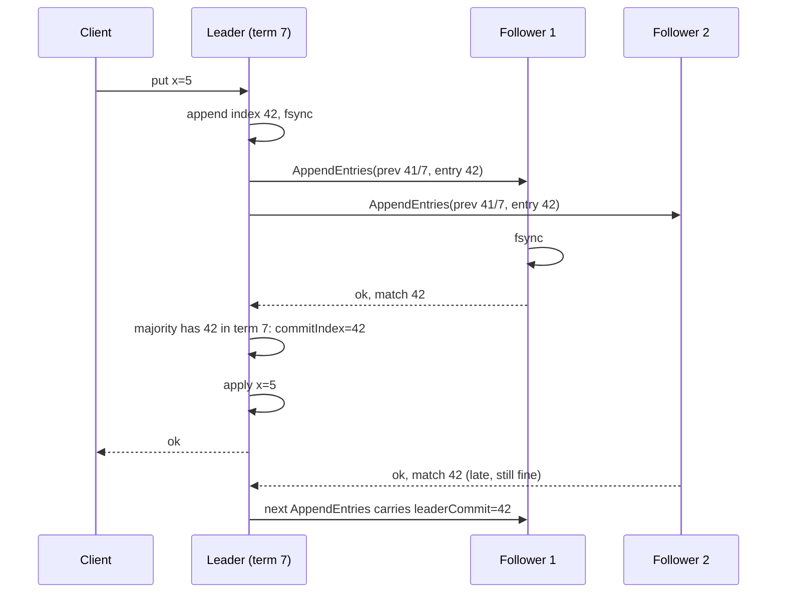

## In one minute
- Consensus lets machines agree on a value, or an ordered log of values, so the decision survives crashes and message loss and is never contradicted.
- Replicating a log this way turns many unreliable machines into one reliable state machine.
- Crash-tolerant protocols (Paxos, Raft, ZAB, Viewstamped Replication) need 2f + 1 nodes to survive f failures; Byzantine-tolerant ones (PBFT, HotStuff) need 3f + 1.
- All rest on overlapping quorums plus an increasing epoch number (ballot, term, view) that lets newer leaders override older ones.
- Consensus is slow by design. Use it for small, critical state, usually via etcd, ZooKeeper or a Raft library, not your own implementation.

## How it works

### The problem, stated precisely
Each node may propose a value, and the protocol must guarantee **agreement** (no two correct nodes decide differently), **validity** (the decided value was proposed by someone), and **termination** (every correct node eventually decides). Fischer, Lynch and Paterson proved in 1985 that no deterministic protocol can guarantee all three in a fully asynchronous network if even one node may crash ([FLP, JACM 1985](https://groups.csail.mit.edu/tds/papers/Lynch/jacm85.pdf)). Practical protocols keep agreement and validity always, and get termination only when the network is calm enough for timeouts to work. That is the right trade: a stalled cluster can be fixed, a contradicted decision cannot.

This is the multi-step consistency problem shape at its most fundamental. A payments ledger, a ride-hailing system deciding which driver owns a trip, and an agent orchestrator deciding which worker owns a task all need "exactly one answer, agreed by everyone, forever." Consensus is the general solution; most systems borrow it through a lock service or database instead of running it themselves.

### Quorums that overlap
With five nodes, any two groups of three share at least one member. If a value was accepted by three nodes, any later leader that consults three nodes is guaranteed to hear about it. That intersection property is the whole safety argument. Flexible Paxos (2016) showed that only the election quorum and the replication quorum must intersect, so a 10-node cluster could replicate to 3 nodes and elect with 8, trading slower elections for faster writes ([Howard et al.](https://arxiv.org/abs/1608.06696)).

### Epochs that fence the past
Leaders change. A deposed leader may not know it yet, because it was paused or partitioned. Every protocol numbers leadership periods (Paxos ballots, Raft terms, ZAB epochs, VR view numbers) and has acceptors refuse anything from an older number once they have seen a newer one. This is the same idea as a fencing token in the leader election lesson, built into the protocol.

### The family
Single-decree Paxos (see the Paxos lesson) decides one value in two phases. **Multi-Paxos** runs phase 1 once per leader and then streams phase 2 for each log slot, as in Chubby and Spanner; with a stable leader a commit costs one round trip from the proposer to a quorum ([Google SRE book](https://sre.google/sre-book/managing-critical-state/)). **Viewstamped Replication** (Oki and Liskov, 1988) reached a similar design independently, and **ZAB** powers ZooKeeper. **Raft** (2014, see the Raft lesson) restricts Multi-Paxos so the leader always has the most complete log, which makes it easier to implement correctly; etcd, Consul, CockroachDB, TiKV and Kafka KRaft use it. Kafka 4.0 (March 2025) is the first release to run entirely without ZooKeeper, so Kafka's own metadata now lives in a Raft-style quorum ([Apache Kafka](https://kafka.apache.org/blog/2025/03/18/apache-kafka-4.0.0-release-announcement/)). **EPaxos** removes the leader so non-conflicting commands commit in one round trip, at the cost of a much harder recovery. **PBFT** and **HotStuff** tolerate nodes that lie, at the cost of 3f + 1 replicas and heavier messaging.

### State machine replication
A replicated log plus deterministic apply gives every replica the same state. The leader assigns each client command a log index, replicates it, and once a quorum has it durably the entry is **committed** and can be applied and acknowledged. Reads need care: a leader that was deposed a moment ago may serve stale data, so linearizable reads either go through the log, confirm leadership with a heartbeat round (Raft's ReadIndex), or rely on a time-bounded leader lease ([Ongaro's dissertation](https://web.stanford.edu/~ouster/cgi-bin/papers/OngaroPhD.pdf), section 6.4).

## Down the stack

### Layer 1: The contract
A consensus-backed store promises that once a write is acknowledged it is durable on a quorum, will appear in the same position in every replica's log, and will never be rolled back, as long as no more than f of 2f + 1 nodes fail simultaneously. It promises nothing about availability under a minority: a partitioned leader without a quorum must stop accepting writes. Latency is at least one round trip from the leader to the fastest quorum plus a durable disk write on each. Linearizable reads cost at least one more round trip unless the system trusts bounded clock drift for leases.

### Layer 2: The mechanism
In Raft, the leader tracks two numbers per follower. `nextIndex` is the next log entry to send; `matchIndex` is the highest index known to be replicated there. When a follower rejects an `AppendEntries` because the previous entry's term does not match, the leader lowers `nextIndex` and retries. A common optimisation has the follower return the conflicting term and the first index it holds for that term, so the leader can skip a whole term at once instead of backing up one entry per round trip. The leader advances `commitIndex` to the highest N where a majority have `matchIndex >= N` **and** the entry at N carries the leader's current term. The term check is subtle: an entry from an older term may sit on a majority and still be overwritten by a later leader, so it is only committed indirectly, when a current-term entry above it commits (Figure 8 of the [Raft paper](https://raft.github.io/raft.pdf) walks through the failure). The practice task builds both of these leader-side rules. Membership changes use joint consensus or one-server-at-a-time changes so that old and new configurations can never form disjoint majorities.

### Layer 3: The machine
Commit latency is dominated by the network round trip and `fsync`. Inside one zone, round trips are 0.1 to 0.5 ms; across zones in a region, 1 to 2 ms; across continents, 60 to 150 ms. An `fsync` on a local NVMe drive with a power-loss-protected cache takes tens of microseconds, but on many cloud block volumes it takes 1 to 10 ms, which is why etcd's documentation says the 99th percentile of `wal_fsync_duration_seconds` should stay under 10 ms, and of `backend_commit_duration_seconds` under 25 ms ([etcd FAQ](https://etcd.io/docs/v3.6/faq/)). The leader writes its own WAL in parallel with sending, so the critical path is roughly one RTT plus one follower fsync. Batching many proposals into one WAL write and one `AppendEntries` pays the fsync once. The leader sends every write N - 1 times, so one Raft group tops out at tens of thousands of small writes per second; CockroachDB and TiKV scale by running thousands of independent Raft groups, one per data range.

### Why it's built this way
1. Machines crash and networks drop messages, so a decision must live on several machines.
2. Any group could be cut off, so a decision must be visible to every possible future group, which forces overlapping quorums and therefore 2f + 1 nodes.
3. Leaders fail and old ones come back, so authority is numbered and newer numbers win.
4. Running two phases per value is slow, so a stable leader runs election once and then streams entries, which makes the leader the throughput bottleneck.
5. One leader per group limits throughput, so large databases shard their data into many groups.

## Diagram


## Worked example
A platform team runs a 5-node etcd cluster for Kubernetes across three zones in one region. Cross-zone RTT is 1.5 ms and fsync p99 is 4 ms, so a write takes about 1.5 + 4 = 5.5 ms at p99 (the second-fastest follower's round trip and fsync). At 2,000 writes per second batched 50 to an fsync, the WAL sees only 40 fsyncs per second. The cluster survives two node failures, or one whole zone holding at most two members.

Now a product team asks to spread the same cluster across three regions for "global consistency": two nodes in Virginia, two in Oregon, one in Frankfurt. With the leader in Virginia, its quorum needs two acknowledgements beyond itself: the other Virginia node at 1 ms and an Oregon node at about 65 ms. Every write now takes at least 65 ms plus fsync, and a linearizable read through ReadIndex costs another 65 ms. If Virginia goes dark, Oregon plus Frankfurt hold 3 of 5 and can elect, but every write then waits on the 140 ms Oregon to Frankfurt round trip. The honest answer is usually one consensus group per region for local metadata, with a separate, smaller global group only for the few decisions that truly must be global.

## In the wild
- **Google Cloud, 2020: a Paxos leader with no write quota.** During a migration to a new quota system, legacy components reported the User ID Service's usage as zero; when a grace period ran out, automation cut the quota of its account database. The Paxos leader could no longer write, reads went stale, and for about 47 minutes nearly all authenticated Google traffic failed with 5xx errors. Consensus kept its safety promise and gave up availability, as designed; the fix was to stop quota changes from going global quickly and to make the identity database more resilient to write failures ([Google Cloud](https://status.cloud.google.com/incident/zall/20013)).
- **GitHub, 2018: correct consensus, wrong scope.** A 43-second network cut between US East sites let Orchestrator, which uses Raft among its own nodes, promote West Coast MySQL primaries. Writes then landed on both coasts and could not be cleanly merged, so GitHub restored from backup and replayed data; service was degraded for 24 hours 11 minutes and one cluster had 954 writes to reconcile. GitHub's follow-up plan included configuring Orchestrator so it cannot promote primaries across regional boundaries ([GitHub](https://github.blog/news-insights/company-news/oct21-post-incident-analysis/)).

## Trade-offs
| Option | Strengths | Weaknesses | Choose when |
|---|---|---|---|
| Raft (etcd, Consul, a library) | Well understood, many mature implementations, clear leader | Leader bottleneck; one round trip to majority per write | Default for metadata, config, coordination |
| Multi-Paxos | Flexible, decades of production use (Chubby, Spanner) | Many unspecified details; harder to implement and reason about | You already have a proven implementation |
| EPaxos and leaderless variants | No leader hop; good for geo-distributed, low-conflict writes | Complex recovery; few production implementations | Research-grade needs with strong in-house expertise |
| PBFT or HotStuff | Tolerates malicious or buggy-lying nodes | 3f + 1 nodes, heavy messaging, signatures | Mutually distrusting parties, blockchains |
| No consensus (leaderless quorums, CRDTs) | Available under partition, low latency | No single agreed order; conflicts to resolve | Shopping carts, counters, collaborative edits |

## Pitfalls in production
- **Even-sized clusters.** Four nodes tolerate one failure, exactly like three, but need three acknowledgements per write. Use 3 or 5 nodes; go to 7 only with a clear reason. Google's SRE book argues for five, so a failure during planned maintenance does not take the group down, and etcd advises no more than seven ([etcd FAQ](https://etcd.io/docs/v3.6/faq/)).
- **Slow disks masquerading as network problems.** A noisy-neighbour volume with 200 ms fsync stalls heartbeats, triggers elections and looks like a flaky network. Alert on WAL fsync and commit latency percentiles and put consensus logs on dedicated, low-latency storage.
- **Using the consensus store as a database.** Pushing large values or high write rates into etcd or ZooKeeper (etcd's default request limit is 1.5 MiB, its default backend quota 2 GiB, and 8 GiB the suggested maximum ([etcd docs](https://etcd.io/docs/v3.6/dev-guide/limit/))) causes long snapshots, slow followers and outages. Keep it to small, critical metadata.
- **Stale reads from the leader.** Serving reads from local state without ReadIndex or a valid lease lets a deposed leader return old values. Know which read mode your client library uses.
- **Membership changes by hand.** Replacing two nodes at once can create disjoint majorities. Change one member at a time with the tool's own reconfiguration commands.

## Leadership lens
- In design review, ask "what state truly needs consensus?" Most systems need it for a few kilobytes of leadership and membership, not for business data.
- Buy rather than build. A correct consensus implementation takes years of testing; adopt etcd, ZooKeeper, a cloud lock service or a database that embeds Raft, and spend your effort on using it correctly.
- Put the failure budget in writing: how many nodes or zones can fail, the write latency it costs, and what happens to clients during an election (typically one to a few seconds of unavailability).
- Staff the operations: backups of the consensus store, disk latency alerts, upgrade runbooks and practised member replacement are what keep a control plane alive.

## Check yourself
1. Why does a 5-node cluster tolerate 2 failures but a 6-node cluster still only tolerates 2?
   **Answer:** A majority of 6 is 4, so the cluster stops when 3 are gone, the same tolerance as 5 nodes. The extra node adds write cost without adding fault tolerance.
2. A Raft leader in term 5 sees that an entry from term 3 is stored on a majority. Why must it not mark that entry committed yet?
   **Answer:** A different node could still win an election with a log that lacks the entry and overwrite it. Only once an entry from the leader's own term commits above it is the older entry safe, because any future leader must then contain both.
3. Why do practical consensus protocols not contradict the FLP impossibility result?
   **Answer:** FLP rules out guaranteed termination in a fully asynchronous model. Real protocols keep safety unconditionally and use timeouts and randomisation to make progress only when the network is well behaved for long enough.

## Practice
**Task:** Implement two leader-side Raft rules. `advance_commit(match_index, log_terms, current_term, commit_index)` takes the match index of every server in the cluster (including the leader, whose value is its last log index), the leader's log as a list of entry terms (index i, 1-based, is `log_terms[i-1]`), the leader's term and its current commit index. Return the highest N greater than `commit_index` such that a strict majority of servers have match index at least N and `log_terms[N-1] == current_term`; if none exists, return `commit_index` unchanged. `next_index_after_reject(log_terms, conflict_term, conflict_index)` handles a rejected `AppendEntries`: if `conflict_term` is 0 (the follower's log was too short) return `conflict_index`; otherwise, if the leader has entries of `conflict_term`, return one past the last such index, else return `conflict_index`.

```python starter
def advance_commit(match_index, log_terms, current_term, commit_index):
    # TODO
    raise NotImplementedError


def next_index_after_reject(log_terms, conflict_term, conflict_index):
    # TODO
    raise NotImplementedError
```

```python tests
def test_commits_majority_in_current_term():
    assert advance_commit([4, 4, 3, 1, 0], [1, 1, 2, 2], 2, 0) == 3

def test_old_term_entry_not_committed_directly():
    assert advance_commit([4, 4, 2, 1, 0], [1, 1, 2, 2], 2, 0) == 0

def test_old_entries_commit_with_current_term_entry():
    assert advance_commit([3, 3, 0], [1, 1, 2], 2, 0) == 3

def test_even_cluster_needs_strict_majority():
    assert advance_commit([2, 2, 0, 0], [3, 3], 3, 0) == 0
    assert advance_commit([2, 2, 2, 0], [3, 3], 3, 0) == 2

def test_commit_never_moves_backwards():
    assert advance_commit([5, 2, 2], [1, 1, 1, 1, 1], 1, 4) == 4

def test_next_index_short_follower_log():
    assert next_index_after_reject([1, 1, 2], 0, 2) == 2

def test_next_index_skips_whole_term():
    assert next_index_after_reject([1, 1, 2, 2, 3], 2, 2) == 5

def test_next_index_unknown_term():
    assert next_index_after_reject([1, 1, 3, 3], 2, 3) == 3
```

```python solution
def advance_commit(match_index, log_terms, current_term, commit_index):
    n = len(match_index)
    for idx in range(len(log_terms), commit_index, -1):
        if log_terms[idx - 1] != current_term:
            continue
        count = sum(1 for m in match_index if m >= idx)
        if count * 2 > n:
            return idx
    return commit_index


def next_index_after_reject(log_terms, conflict_term, conflict_index):
    if conflict_term == 0:
        return conflict_index
    for idx in range(len(log_terms), 0, -1):
        if log_terms[idx - 1] == conflict_term:
            return idx + 1
    return conflict_index
```

```typescript starter
export function advanceCommit(matchIndex: number[], logTerms: number[], currentTerm: number, commitIndex: number): number {
  throw new Error("TODO");
}

export function nextIndexAfterReject(logTerms: number[], conflictTerm: number, conflictIndex: number): number {
  throw new Error("TODO");
}
```

```typescript tests
test("commits majority in current term", () => {
  assertEqual(advanceCommit([4, 4, 3, 1, 0], [1, 1, 2, 2], 2, 0), 3);
});
test("old term entry not committed directly", () => {
  assertEqual(advanceCommit([4, 4, 2, 1, 0], [1, 1, 2, 2], 2, 0), 0);
});
test("old entries commit with current term entry", () => {
  assertEqual(advanceCommit([3, 3, 0], [1, 1, 2], 2, 0), 3);
});
test("even cluster needs strict majority", () => {
  assertEqual(advanceCommit([2, 2, 0, 0], [3, 3], 3, 0), 0);
  assertEqual(advanceCommit([2, 2, 2, 0], [3, 3], 3, 0), 2);
});
test("commit never moves backwards", () => {
  assertEqual(advanceCommit([5, 2, 2], [1, 1, 1, 1, 1], 1, 4), 4);
});
test("next index short follower log", () => {
  assertEqual(nextIndexAfterReject([1, 1, 2], 0, 2), 2);
});
test("next index skips whole term", () => {
  assertEqual(nextIndexAfterReject([1, 1, 2, 2, 3], 2, 2), 5);
});
test("next index unknown term", () => {
  assertEqual(nextIndexAfterReject([1, 1, 3, 3], 2, 3), 3);
});
```

```typescript solution
export function advanceCommit(matchIndex: number[], logTerms: number[], currentTerm: number, commitIndex: number): number {
  const n = matchIndex.length;
  for (let idx = logTerms.length; idx > commitIndex; idx--) {
    if (logTerms[idx - 1] !== currentTerm) continue;
    const count = matchIndex.filter((m) => m >= idx).length;
    if (count * 2 > n) return idx;
  }
  return commitIndex;
}

export function nextIndexAfterReject(logTerms: number[], conflictTerm: number, conflictIndex: number): number {
  if (conflictTerm === 0) return conflictIndex;
  for (let idx = logTerms.length; idx > 0; idx--) {
    if (logTerms[idx - 1] === conflictTerm) return idx + 1;
  }
  return conflictIndex;
}
```

```go starter
package practice

func AdvanceCommit(matchIndex, logTerms []int, currentTerm, commitIndex int) int {
	panic("TODO")
}

func NextIndexAfterReject(logTerms []int, conflictTerm, conflictIndex int) int {
	panic("TODO")
}
```

```go tests
package practice

import "testing"

func check(t *testing.T, got, want int) {
	t.Helper()
	if got != want {
		t.Fatalf("got %d, want %d", got, want)
	}
}

func TestCommitsMajorityInCurrentTerm(t *testing.T) {
	check(t, AdvanceCommit([]int{4, 4, 3, 1, 0}, []int{1, 1, 2, 2}, 2, 0), 3)
}

func TestOldTermEntryNotCommittedDirectly(t *testing.T) {
	check(t, AdvanceCommit([]int{4, 4, 2, 1, 0}, []int{1, 1, 2, 2}, 2, 0), 0)
}

func TestOldEntriesCommitWithCurrentTermEntry(t *testing.T) {
	check(t, AdvanceCommit([]int{3, 3, 0}, []int{1, 1, 2}, 2, 0), 3)
}

func TestEvenClusterNeedsStrictMajority(t *testing.T) {
	check(t, AdvanceCommit([]int{2, 2, 0, 0}, []int{3, 3}, 3, 0), 0)
	check(t, AdvanceCommit([]int{2, 2, 2, 0}, []int{3, 3}, 3, 0), 2)
}

func TestCommitNeverMovesBackwards(t *testing.T) {
	check(t, AdvanceCommit([]int{5, 2, 2}, []int{1, 1, 1, 1, 1}, 1, 4), 4)
}

func TestNextIndexShortFollowerLog(t *testing.T) {
	check(t, NextIndexAfterReject([]int{1, 1, 2}, 0, 2), 2)
}

func TestNextIndexSkipsWholeTerm(t *testing.T) {
	check(t, NextIndexAfterReject([]int{1, 1, 2, 2, 3}, 2, 2), 5)
}

func TestNextIndexUnknownTerm(t *testing.T) {
	check(t, NextIndexAfterReject([]int{1, 1, 3, 3}, 2, 3), 3)
}
```

```go solution
package practice

func AdvanceCommit(matchIndex, logTerms []int, currentTerm, commitIndex int) int {
	n := len(matchIndex)
	for idx := len(logTerms); idx > commitIndex; idx-- {
		if logTerms[idx-1] != currentTerm {
			continue
		}
		count := 0
		for _, m := range matchIndex {
			if m >= idx {
				count++
			}
		}
		if count*2 > n {
			return idx
		}
	}
	return commitIndex
}

func NextIndexAfterReject(logTerms []int, conflictTerm, conflictIndex int) int {
	if conflictTerm == 0 {
		return conflictIndex
	}
	for idx := len(logTerms); idx > 0; idx-- {
		if logTerms[idx-1] == conflictTerm {
			return idx + 1
		}
	}
	return conflictIndex
}
```

## Mock interview
**Prompt:** Your company runs a job scheduler where exactly one scheduler instance must own each of 10,000 job queues at any time, across three availability zones. Today ownership is decided by a Redis key with a TTL, and twice last quarter two schedulers ran the same jobs. Redesign ownership.

- Follow-up: How many replicas does your coordination store need, and where do you place them?
- Follow-up: A scheduler holds ownership, pauses for 20 seconds in GC, and resumes. What stops it from running jobs another owner has taken?
- Follow-up: Would you put the job payloads and their status in the same consensus store? Why or why not?

**A strong answer covers:**
- Why a single Redis with TTLs is not consensus: failover can lose the key, and expiry relies on timing alone.
- A consensus store (etcd, ZooKeeper, or a Raft-based database) with 3 or 5 members spread over zones, with estimates of write latency and election time.
- Leases with fencing: each grant carries the store's revision or term, and downstream work with an older token is rejected.
- Consensus for ownership only, with payloads in a regular database, and what clients see during an election or zone loss.

## Sources and further study
**Primary**
- [Fischer, Lynch and Paterson, Impossibility of Distributed Consensus with One Faulty Process (JACM 1985)](https://groups.csail.mit.edu/tds/papers/Lynch/jacm85.pdf): the FLP result every practical protocol works around.
- [Ongaro, Consensus: Bridging Theory and Practice (PhD thesis, 2014)](https://web.stanford.edu/~ouster/cgi-bin/papers/OngaroPhD.pdf): Raft in full, with ReadIndex, lease reads and membership changes.
- [Moraru, Andersen and Kaminsky, There Is More Consensus in Egalitarian Parliaments (SOSP 2013)](https://www.cs.cmu.edu/~dga/papers/epaxos-sosp2013.pdf): the EPaxos paper on leaderless, one-round-trip commits for non-conflicting commands.

**Systems docs**
- [etcd FAQ](https://etcd.io/docs/v3.6/faq/): cluster sizing, disk latency thresholds and why even sizes add nothing.
- [etcd system limits](https://etcd.io/docs/v3.6/dev-guide/limit/): request size and storage quota for a production Raft store.
- [ZooKeeper internals](https://zookeeper.apache.org/doc/current/zookeeperInternals.html): Zab's guarantees, zxid epochs and leader activation.

**Books**
- *Designing Data-Intensive Applications* (1st edition), Martin Kleppmann, chapter 9 "Consistency and Consensus": linearizability, total order broadcast and why they are equivalent to consensus.
- *Database Internals*, Alex Petrov, chapter 14 "Consensus": broadcast, Paxos and its variants, Raft and Byzantine consensus.
- *Site Reliability Engineering*, Beyer et al. (eds.), chapter 23 "Managing Critical State": consensus performance, replica placement and the failures of timeout-based coordination ([read free](https://sre.google/sre-book/managing-critical-state/)).

**Other curricula**
- [MIT 6.5840 Distributed Systems](https://pdos.csail.mit.edu/6.824/): frames consensus through fault-tolerant replicated state machines, with Raft built and tested in the labs.
- [donnemartin/system-design-primer](https://github.com/donnemartin/system-design-primer): covers master-slave and master-master failover but not consensus; ZooKeeper and etcd appear only as service-discovery tools.

## Watch
- [Distributed Systems 6.1: Consensus (Martin Kleppmann)](https://www.youtube.com/watch?v=rN6ma561tak): the consensus problem, FLP, and why leaders and quorums are needed.
- [Paxos lecture (Diego Ongaro)](https://www.youtube.com/watch?v=JEpsBg0AO6o): Paxos and Multi-Paxos taught side by side with Raft.
- [Lecture 6: Fault Tolerance: Raft (MIT 6.824)](https://www.youtube.com/watch?v=64Zp3tzNbpE): Raft elections, logs and the commit rule from a systems course.

## Free resources
- [In Search of an Understandable Consensus Algorithm (Ongaro and Ousterhout)](https://raft.github.io/raft.pdf): the Raft paper, including the commit rule for entries from earlier terms.
- [Paxos Made Simple (Lamport)](https://lamport.azurewebsites.net/pubs/paxos-simple.pdf): the classic short explanation of single-decree Paxos.
- [Flexible Paxos: Quorum intersection revisited (Howard, Malkhi, Spiegelman)](https://arxiv.org/abs/1608.06696): why only election and replication quorums need to overlap.
- [etcd hardware recommendations](https://etcd.io/docs/v3.5/op-guide/hardware/): how disk and network latency shape a real consensus cluster.
- [Raft visualization and resources](https://raft.github.io/): an interactive simulation and a list of production implementations.
