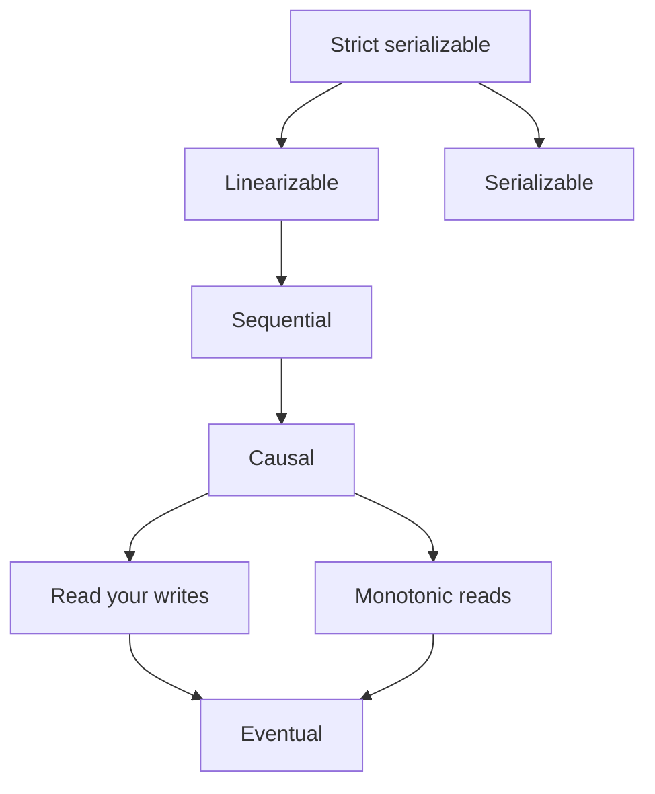

## In one minute
- A consistency model is a contract: which values a read may return given the writes that happened before and concurrently with it.
- Models form a ladder. From strong to weak: linearizable, sequential, causal, session guarantees (read-your-writes, monotonic reads), and eventual.
- Stronger models are easier to program against and cost latency and availability, because they need coordination across replicas.
- Most real systems mix models: linearizable for a few critical keys, causal or session guarantees for user-facing data, eventual for caches and counters.

## How it works

### Linearizability
Every operation appears to take effect at a single instant between its start and its end, and all clients agree on that order. If write A finishes before read B starts, B must see A or something newer. This is the "behaves like one copy" model. It needs a leader with a valid lease, or a quorum round trip, per operation. Under a partition, the minority side cannot serve linearizable reads.

### Sequential consistency
All clients see the same total order of operations, and each client's own operations appear in program order. Unlike linearizability, the order need not match real time. A read can return a value that is a few seconds stale, as long as everyone agrees on the sequence. ZooKeeper offers this for reads from followers, combined with linearizable writes: a client never sees an older view even after failing over to another server, its view is promised fresh only within a time bound of the order of tens of seconds, and a client that needs the latest value calls `sync` first ([ZooKeeper guarantees](https://zookeeper.apache.org/doc/current/zookeeperProgrammers.html#ch_zkGuarantees)).

### Causal consistency
If operation A could have influenced B (same client did A then B, or B read A's result), every replica shows A before B. Unrelated operations may appear in different orders on different replicas. Causal consistency can stay available during a partition, but only *sticky* available: each client must keep talking to the same replica, because a client that fails over to a replica missing its earlier writes would see time run backwards. A slightly stronger variant, real-time causal, is the strongest model known for an always-available system ([Jepsen](https://jepsen.io/consistency/models/causal)). That makes causal attractive for geo-replicated systems that route each user to one region. It is implemented by tracking dependencies with vector clocks or dependency lists.

### Session guarantees
These are client-centric promises that are cheap and cover most user complaints. *Read-your-writes*: after you write, your own reads see it. *Monotonic reads*: you never see older data after seeing newer data. *Monotonic writes* and *writes-follow-reads* keep a session's writes ordered. A common implementation is a session token holding the last-seen log position; replicas that are behind either wait or forward the read. Cosmos DB's session tokens work this way, and they are per partition: a client that never wrote to a partition, or was just restarted and lost its token cache, gets eventual consistency on reads there ([Cosmos DB docs](https://learn.microsoft.com/en-us/azure/cosmos-db/consistency-levels)).

### Eventual consistency
If writes stop, all replicas converge to the same value eventually. It says nothing about what you read meanwhile and nothing about how conflicts resolve, so it must be paired with a merge rule. Most systems also say how stale reads can get, for example a replication lag p99 of 200 ms.

### Isolation is a separate axis
Consistency models describe single-object operations across replicas. Transaction isolation (serializable, snapshot, read committed) describes multi-object transactions. *Strict serializability* combines both: serializable transactions in real-time order, as Spanner provides.

## Down the stack

### Layer 1: The contract
Real products expose the ladder as switches, and the switch names tell you the contract. DynamoDB reads are eventually consistent unless the request sets `ConsistentRead=true`, which costs twice the read capacity: a strongly consistent read of up to 4 KB takes one read unit, an eventually consistent one half, a transactional one two ([DynamoDB docs](https://docs.aws.amazon.com/amazondynamodb/latest/developerguide/read-write-operations.html)). The switch is also narrower than its name on global tables: in the default multi-Region eventual mode, a "strongly consistent" read only sees the latest write if that write was made in the same Region; reading the latest version anywhere needs a table created in multi-Region strong consistency mode ([global tables](https://docs.aws.amazon.com/amazondynamodb/latest/developerguide/V2globaltables_HowItWorks.html)). etcd serves linearizable reads by default and offers serializable reads, which any member answers from local state and which may be stale. MongoDB combines `readConcern` (`local`, `majority`, `linearizable`) with `writeConcern` and causally consistent sessions. Current versions default to `w: "majority"` writes in most replica sets but still read at `local`, which can return data that is later rolled back ([MongoDB docs](https://www.mongodb.com/docs/manual/reference/write-concern/)), and causal sessions only keep their promises when both read and write concerns are `majority` ([Jepsen](https://jepsen.io/analyses/mongodb-3-6-4)). Cosmos DB offers five named levels: strong, bounded staleness, session, consistent prefix and eventual. Strong and bounded-staleness reads touch two replicas and so cost twice the request units, bounded staleness in a multi-region account cannot be set tighter than 100,000 writes or 300 seconds, and strong consistency across regions more than 5,000 miles apart is blocked by default because of write latency ([Cosmos DB consistency levels](https://learn.microsoft.com/en-us/azure/cosmos-db/consistency-levels)). Cassandra lets you pick replica counts per request: with N=3, writing at QUORUM and reading at QUORUM means every read set overlaps every write set, but concurrent operations are still not linearizable unless you use lightweight transactions, which run Paxos and cost several extra round trips.

A testable statement of a model is a rule over a history of `(invoke, complete)` events. Jepsen's checkers, Knossos and Elle, take recorded histories and search for a legal order, which is exactly the Practice problem below.

### Layer 2: The mechanism
Linearizable reads in Raft use *ReadIndex*: the leader records its current commit index, confirms it is still leader with one heartbeat round to a majority, waits until its state machine has applied up to that index, then answers. *Lease reads* skip the heartbeat round by trusting that no new leader can exist before the lease ends, which is safe only if clock drift is bounded.

Session guarantees ride on a log position. In PostgreSQL the primary's `pg_current_wal_lsn()` returns a 64-bit byte offset into the WAL; a replica compares it against `pg_last_wal_replay_lsn()` and waits until it catches up. Applications have had to poll for that; PostgreSQL 19, in pre-release as of late 2026, adds a `WAIT FOR LSN` command with a timeout that blocks on the standby until the position is replayed ([PostgreSQL 19 docs](https://www.postgresql.org/docs/19/sql-wait.html)). MongoDB returns an `operationTime` and the client sends it back as `afterClusterTime`.

Causal systems track dependencies explicitly, with vector clocks or, as in the COPS research system, a list of `(key, version)` dependencies checked before a write becomes visible. Eventual systems in the Dynamo family attach a write timestamp to each value (Cassandra stores a microsecond timestamp per cell) and resolve conflicts by last-writer-wins, with read repair and Merkle-tree anti-entropy for convergence.

Spanner gets strict serializability with TrueTime: a transaction picks commit timestamp `s` no earlier than `TT.now().latest` and then *commit waits* until `TT.now().earliest > s` before releasing locks, so real-time order matches timestamp order. The wait is the clock uncertainty, which the Spanner paper reports as a sawtooth between about 1 and 7 ms, 4 ms most of the time ([Spanner paper](https://static.googleusercontent.com/media/research.google.com/en//archive/spanner-osdi2012.pdf)).

### Layer 3: The machine
The same ladder exists inside one server. Lamport defined sequential consistency in 1979 for multiprocessors, and real CPUs do not provide it by default. x86 uses total store order: each core has a store buffer, so a later load can complete before an earlier store becomes visible to other cores. ARM is weaker still. Programs that need stronger ordering pay for fences (`MFENCE`, or the barriers emitted for C++ `seq_cst` atomics), which drain the store buffer. Cache coherence moves 64-byte lines between cores using protocols in the MESI family, and a cross-core transfer costs tens of nanoseconds.

Across machines the same coordination costs a network round trip plus a durable write: roughly 0.5 ms inside a zone, 1 to 2 ms across zones, and 70 to 150 ms across continents, plus an `fsync` on each acknowledging replica. A local stale read from memory costs well under a microsecond. That gap of three to six orders of magnitude is why weak models exist.

### Why it's built this way
1. Replicas sit apart, and information cannot cross the gap faster than light, so a replica cannot know about a remote write instantly.
2. A strong model must therefore wait for coordination on every operation, which costs a round trip and makes the minority side of a partition unavailable.
3. Most data does not need that, so systems offer a menu and let the caller pay only where an anomaly would matter.
4. Research has shown that no model much stronger than causal consistency can stay available under partitions, and even causal needs clients to stick to one replica, so causal and session guarantees are the practical ceiling for always-on, geo-replicated reads.

## Diagram


## Worked example
A social app stores posts in a primary in us-east with read replicas in eu-west and ap-south. Replication lag is 80 ms p50 and 1.5 s p99. The app serves 40,000 reads per second and 600 writes per second.

A user in Paris posts a comment, gets a 200, and the page refreshes from the eu-west replica 300 ms later. In 5 to 10% of refreshes the comment is missing, because lag exceeded 300 ms. Users report "my comment disappeared". That is a read-your-writes violation.

Fix one: route the author's reads to the primary for 5 s after any write. That adds about 90 ms per read from Paris, but only for recent writers, a small fraction of traffic. Fix two: return the commit log position with the write, store it in the session, and have the replica wait until it has applied that position, up to a 500 ms limit, before answering. Fix two keeps reads local and costs only occasional waiting.

Neither fix makes the system linearizable. A different user in Tokyo may still not see the comment for 1.5 s, which the product accepts.

## In the wild
- **Facebook, 2015: measuring what eventual consistency actually costs.** Researchers logged every request to one in a million objects in TAO for 12 days in August 2015, over 2.7 billion requests, and checked them against stronger models. Only about 0.0004% of reads to vertices would have returned a different result under linearizability, but the same monitoring turned up real bugs and the anti-patterns Facebook now teaches developers to avoid ([paper](https://www.cs.princeton.edu/~wlloyd/papers/existential-sosp15.pdf)).
- **Jepsen, 2018: MongoDB causal sessions with default settings.** MongoDB documents read-your-writes, monotonic reads, monotonic writes and writes-follow-reads for causal sessions. With the then-default `w: 1` writes and `local` reads, Jepsen saw acknowledged writes vanish after a partition healed and reads of values that were later rolled back. MongoDB closed the ticket as working as designed and documented that the guarantees need `majority` reads and writes ([Jepsen](https://jepsen.io/analyses/mongodb-3-6-4)).
- **Jepsen, 2020: MongoDB 4.2.6 transactions.** Under partitions, transactions lost acknowledged writes and showed read skew and cyclic information flow even at `snapshot` read concern with `majority` writes. Transactions also ignored database-level concerns and fell back to `local` and `w: 1` unless each transaction set them; MongoDB said it believed a retry bug caused the anomalies and scheduled a fix for 4.2.8 ([Jepsen](https://jepsen.io/analyses/mongodb-4.2.6)).

## Trade-offs
| Model | Strengths | Weaknesses | Choose when |
|---|---|---|---|
| Linearizable | Simplest to reason about | Quorum latency; minority unavailable | Locks, unique constraints, balances |
| Sequential | Global order, cheaper reads | Reads can be stale | Config and coordination metadata |
| Causal | Available under partition, intuitive | Dependency tracking overhead | Geo-replicated collaboration, feeds |
| Session guarantees | Cheap, fixes most user-visible bugs | Only per client | User profiles, comments, settings |
| Eventual | Lowest latency, always writable | Conflicts, anomalies | Counters, caches, analytics |

## Pitfalls in production
- Reading from replicas behind a load balancer with no session stickiness, so a user flips between fresh and stale data. Fix: monotonic reads through sticky routing or log-position tokens.
- Assuming a database is linearizable because the docs say "strongly consistent". Fix: check exactly which operations and configurations are covered, and look for a Jepsen report.
- Check-then-act on eventually consistent data, like checking a username is free on a replica. Fix: enforce uniqueness with a linearizable write or a conditional insert on the primary.
- Caches in front of a strongly consistent store silently downgrading the model. Fix: document the effective model at the API, not at the database.

## Leadership lens
- For each entity, name the required model and the reason. Most need only session guarantees; a few need linearizability. This keeps cost focused.
- Ask in review: which user-visible anomalies are acceptable, and what is the p99 staleness bound we promise?
- Strong consistency across regions costs a cross-region round trip, 70 to 150 ms per write. Make that cost explicit to product owners.

## Check yourself
1. How does sequential consistency differ from linearizability?
   **Answer:** Both require a single total order respecting each client's program order, but only linearizability requires that order to match real time. A sequentially consistent read can be stale.
2. Why is causal consistency attractive for multi-region systems?
   **Answer:** It is among the strongest models that can remain available during a partition (as long as each client sticks to one replica), yet it prevents the anomalies users notice most, like seeing a reply before its parent.
3. A user updates their avatar and sees the old one on refresh. Which guarantee is broken, and what is a cheap fix?
   **Answer:** Read-your-writes. Pass the write's log position in the session and make replicas wait for it, or route that user's reads to the primary briefly.

## Practice
**Task:** Write `is_linearizable(history)` for a single register whose initial value is None. Each operation is a tuple `(kind, value, start, end)` where kind is "w" or "r", and start and end are real-time instants. Return True if some total order of the operations respects real time (if `a.end < b.start`, a comes first) and every read returns the most recent write before it in that order. Histories have at most 7 operations, so a search over orderings is fine.

```python starter
def is_linearizable(history):
    # TODO
    raise NotImplementedError
```

```python tests
def test_empty():
    assert is_linearizable([]) is True

def test_read_after_write():
    assert is_linearizable([("w", 1, 0, 1), ("r", 1, 2, 3)]) is True

def test_stale_read_after_write_finished():
    assert is_linearizable([("w", 1, 0, 1), ("r", None, 2, 3)]) is False

def test_concurrent_read_may_see_either():
    assert is_linearizable([("w", 1, 0, 5), ("r", None, 1, 2)]) is True
    assert is_linearizable([("w", 1, 0, 5), ("r", 1, 1, 2)]) is True

def test_reads_cannot_go_backwards():
    h = [("w", 1, 0, 10), ("r", 1, 1, 2), ("r", None, 3, 4)]
    assert is_linearizable(h) is False

def test_two_writes_order():
    h = [("w", 1, 0, 1), ("w", 2, 2, 3), ("r", 1, 4, 5)]
    assert is_linearizable(h) is False
```

```python solution
from itertools import permutations

def is_linearizable(history):
    for order in permutations(range(len(history))):
        pos = {op: i for i, op in enumerate(order)}
        ok = all(pos[a] < pos[b] for a in range(len(history))
                 for b in range(len(history))
                 if history[a][3] < history[b][2])
        value = None
        for i in order:
            kind, v, s, e = history[i]
            if kind == "w":
                value = v
            elif v != value:
                ok = False
        if ok:
            return True
    return False
```

```typescript starter
export type Op = [kind: "w" | "r", value: number | null, start: number, end: number];

export function isLinearizable(history: Op[]): boolean {
  // TODO
  throw new Error("TODO");
}
```

```typescript tests
test("empty", () => {
  assertEqual(isLinearizable([]), true);
});

test("read after write", () => {
  assertEqual(isLinearizable([["w", 1, 0, 1], ["r", 1, 2, 3]]), true);
});

test("stale read after write finished", () => {
  assertEqual(isLinearizable([["w", 1, 0, 1], ["r", null, 2, 3]]), false);
});

test("concurrent read may see either", () => {
  assertEqual(isLinearizable([["w", 1, 0, 5], ["r", null, 1, 2]]), true);
  assertEqual(isLinearizable([["w", 1, 0, 5], ["r", 1, 1, 2]]), true);
});

test("reads cannot go backwards", () => {
  assertEqual(isLinearizable([["w", 1, 0, 10], ["r", 1, 1, 2], ["r", null, 3, 4]]), false);
});

test("two writes order", () => {
  assertEqual(isLinearizable([["w", 1, 0, 1], ["w", 2, 2, 3], ["r", 1, 4, 5]]), false);
});
```

```typescript solution
export type Op = [kind: "w" | "r", value: number | null, start: number, end: number];

export function isLinearizable(history: Op[]): boolean {
  const used: boolean[] = history.map(() => false);
  const search = (placed: number, value: number | null): boolean => {
    if (placed === history.length) return true;
    for (let i = 0; i < history.length; i++) {
      if (used[i]) continue;
      // i may go next only if no unplaced op finished before i started.
      let ready = true;
      for (let j = 0; j < history.length; j++) {
        if (!used[j] && j !== i && history[j][3] < history[i][2]) ready = false;
      }
      if (!ready) continue;
      const [kind, v] = history[i];
      if (kind === "r" && v !== value) continue;
      used[i] = true;
      const ok = search(placed + 1, kind === "w" ? v : value);
      used[i] = false;
      if (ok) return true;
    }
    return false;
  };
  return search(0, null);
}
```

```go starter
package practice

// Op is one register operation. Value nil means "no value" (the initial state).
type Op struct {
	Kind       string // "w" or "r"
	Value      *int
	Start, End int
}

// IsLinearizable reports whether the history has a legal real-time order.
func IsLinearizable(history []Op) bool {
	// TODO
	panic("TODO")
}
```

```go tests
package practice

import "testing"

func iv(x int) *int { return &x }

func TestEmpty(t *testing.T) {
	if !IsLinearizable(nil) {
		t.Fatal("empty history is linearizable")
	}
}

func TestReadAfterWrite(t *testing.T) {
	h := []Op{{"w", iv(1), 0, 1}, {"r", iv(1), 2, 3}}
	if !IsLinearizable(h) {
		t.Fatal("want true")
	}
}

func TestStaleReadAfterWriteFinished(t *testing.T) {
	h := []Op{{"w", iv(1), 0, 1}, {"r", nil, 2, 3}}
	if IsLinearizable(h) {
		t.Fatal("want false")
	}
}

func TestConcurrentReadMaySeeEither(t *testing.T) {
	if !IsLinearizable([]Op{{"w", iv(1), 0, 5}, {"r", nil, 1, 2}}) {
		t.Fatal("read of initial value should be allowed")
	}
	if !IsLinearizable([]Op{{"w", iv(1), 0, 5}, {"r", iv(1), 1, 2}}) {
		t.Fatal("read of new value should be allowed")
	}
}

func TestReadsCannotGoBackwards(t *testing.T) {
	h := []Op{{"w", iv(1), 0, 10}, {"r", iv(1), 1, 2}, {"r", nil, 3, 4}}
	if IsLinearizable(h) {
		t.Fatal("want false")
	}
}

func TestTwoWritesOrder(t *testing.T) {
	h := []Op{{"w", iv(1), 0, 1}, {"w", iv(2), 2, 3}, {"r", iv(1), 4, 5}}
	if IsLinearizable(h) {
		t.Fatal("want false")
	}
}
```

```go solution
package practice

// Op is one register operation. Value nil means "no value" (the initial state).
type Op struct {
	Kind       string // "w" or "r"
	Value      *int
	Start, End int
}

func sameValue(a, b *int) bool {
	if a == nil || b == nil {
		return a == nil && b == nil
	}
	return *a == *b
}

// IsLinearizable reports whether the history has a legal real-time order.
func IsLinearizable(history []Op) bool {
	used := make([]bool, len(history))
	var search func(placed int, value *int) bool
	search = func(placed int, value *int) bool {
		if placed == len(history) {
			return true
		}
		for i, op := range history {
			if used[i] {
				continue
			}
			ready := true
			for j, other := range history {
				if !used[j] && j != i && other.End < op.Start {
					ready = false
				}
			}
			if !ready {
				continue
			}
			if op.Kind == "r" && !sameValue(op.Value, value) {
				continue
			}
			next := value
			if op.Kind == "w" {
				next = op.Value
			}
			used[i] = true
			ok := search(placed+1, next)
			used[i] = false
			if ok {
				return true
			}
		}
		return false
	}
	return search(0, nil)
}
```

## Mock interview
**Prompt:** Design the storage consistency for a multi-region collaborative document product with 5 million daily users, edits in three regions, and a requirement that a user never sees their own edit disappear.

- Follow-up: Two users in different regions edit the same paragraph at once. What does each see?
- Follow-up: Document sharing permissions change. Does that data need a stronger model than document text?
- Follow-up: What does a region outage do to each model you chose?

**A strong answer covers:**
- Different models per data type: permissions and billing linearizable, document content causal with merge via CRDT or operational transform.
- Session guarantees through log-position tokens or sticky routing.
- The latency cost of cross-region consensus and where it is worth paying.
- Behaviour under partition: which operations stop and which continue.
- Testing consistency claims, for example with a history checker.

## Sources and further study
**Primary**
- [Lu et al., Existential Consistency: Measuring and Understanding Consistency at Facebook (SOSP 2015)](https://www.cs.princeton.edu/~wlloyd/papers/existential-sosp15.pdf): how often weak consistency actually produces anomalies in production.
- [Corbett et al., Spanner (OSDI 2012)](https://static.googleusercontent.com/media/research.google.com/en//archive/spanner-osdi2012.pdf): TrueTime and commit wait as the price of external consistency.
- [Jepsen: Causal consistency](https://jepsen.io/consistency/models/causal): the definition, sticky availability and real-time causal.

**Systems docs**
- [DynamoDB: How global tables work](https://docs.aws.amazon.com/amazondynamodb/latest/developerguide/V2globaltables_HowItWorks.html): what `ConsistentRead` means across Regions in each mode.
- [ZooKeeper guarantees](https://zookeeper.apache.org/doc/current/zookeeperProgrammers.html#ch_zkGuarantees): sequential consistency, single system image and the `sync` escape hatch.
- [PostgreSQL 19: WAIT FOR](https://www.postgresql.org/docs/19/sql-wait.html): read-your-writes on a standby by waiting for an LSN.

**Books**
- *Designing Data-Intensive Applications* (1st edition), Martin Kleppmann, chapter 5 "Replication" (problems with replication lag, session guarantees) and chapter 9 "Consistency and Consensus" (linearizability and ordering).
- *Database Internals*, Alex Petrov, chapter 11 "Replication and Consistency": the consistency model ladder from the storage engineer's side.

**Other curricula**
- [donnemartin/system-design-primer](https://github.com/donnemartin/system-design-primer): reduces the topic to three patterns, weak, eventual and strong, with no causal or session guarantees.
- [MIT 6.5840 Distributed Systems](https://pdos.csail.mit.edu/6.824/schedule.html): a full lecture on consistency and linearizability, with labs that build a linearizable key/value service.

## Watch
- [Distributed Systems 7.2: Linearizability (Martin Kleppmann)](https://www.youtube.com/watch?v=noUNH3jDLC0): a precise definition with timing diagrams.
- [Distributed Systems 7.3: Eventual consistency (Martin Kleppmann)](https://www.youtube.com/watch?v=9uCP3qHNbWw): convergence, session guarantees and the trade-offs.
- [Sequential Consistency versus Linearizability (Martin Kleppmann at PwL London)](https://www.youtube.com/watch?v=D5iCl12MuRw): a paper talk on where these two models differ.

## Free resources
- [Consistency Models (Jepsen)](https://jepsen.io/consistency): a clickable map of models and how they relate.
- [Replicated Data Consistency Explained Through Baseball (Terry)](https://www.microsoft.com/en-us/research/wp-content/uploads/2011/10/ConsistencyAndBaseballReport.pdf): session guarantees made concrete with one example.
- [Eventually Consistent (Werner Vogels)](https://www.allthingsdistributed.com/2008/12/eventually_consistent.html): the classic practitioner view of weak models.
- [Consistency levels in Azure Cosmos DB](https://learn.microsoft.com/en-us/azure/cosmos-db/consistency-levels): a production system offering five selectable models.
- [Causal consistency and read and write concerns (MongoDB)](https://www.mongodb.com/docs/manual/core/causal-consistency-read-write-concerns/): how sessions provide causal guarantees in practice.
