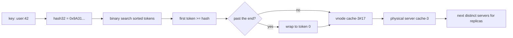

## In one minute
- Consistent hashing maps keys and servers onto the same circular hash space; a key belongs to the first server clockwise from its position.
- When a server joins or leaves, only the keys in its arc move, about 1/N of the total, instead of nearly all keys as with `hash(key) mod N`.
- Each physical server is placed many times on the ring (virtual nodes) so load evens out and a departing server's keys spread across all survivors.
- Variants trade memory, speed and flexibility: ring hashing, rendezvous hashing, jump hash and Maglev all keep movement minimal.
- It answers the problem shape "finding things fast" under churn, and it is a tool against "hot spots" only when combined with replication or bounded loads.

## How it works

### The problem with mod N
The obvious shard choice is `hash(key) mod N`: fast and even, until N changes. Going from 9 to 10 servers, a key stays put only when `h mod 9 == h mod 10`, about 1 key in 10. The other 90% move: a miss storm for a cache, or a 90% data copy for a store.

### The ring
Consistent hashing hashes servers and keys into the same space, say 0 to 2^32 - 1, and treats that space as a circle. To find a key's owner, hash the key and walk clockwise until you hit a server's position. Each server owns the arc between its predecessor and itself.

Add a server and it takes over part of one arc; every other key keeps its owner. Remove one and its arc merges into its successor's. Movement is local by construction. Karger and colleagues introduced the idea in 1997 for web caches, defining the properties this lesson relies on: balance, monotonicity and spread ([Karger et al.](https://www.cs.princeton.edu/courses/archive/fall09/cos518/papers/chash.pdf)).

### Virtual nodes
With one position per server the arcs are uneven: with 4 servers, one can own 40% of the ring and another 4%. When a server dies, its whole arc lands on one neighbour.

The fix is to place each server many times, as `cache-3#0`, `cache-3#1`, and so on. With 100 to 200 virtual nodes per server, each share is the sum of many small arcs and stays within roughly 10% of the mean. A failed server's arcs are scattered, so its load spreads across every survivor. Virtual nodes also give weighting: a machine with twice the memory gets twice the virtual nodes.

### Replication on the ring
Dynamo, Cassandra and Riak also use the ring to choose replicas. A key's *preference list* is the first R distinct physical servers found walking clockwise; skipping virtual nodes of already-chosen servers (and zones) keeps two replicas off one machine. Dynamo's paper also reports that purely random tokens hurt in operation: bootstrapping a new node took almost a day in peak season, Merkle trees had to be rebuilt for changed ranges, and archiving was awkward. Amazon moved to equal-sized fixed partitions handed out to nodes, the same idea as logical shards ([DeCandia et al.](https://www.allthingsdistributed.com/files/amazon-dynamo-sosp2007.pdf)).

### Other members of the family
- **Rendezvous hashing:** score every server with `hash(key, server)` and pick the highest. No ring, minimal movement, O(N) per lookup. GitHub's GLB load balancer precomputes it into a table of about 65,000 rows, each holding the top two servers, so a draining server can hand unknown flows to its second choice ([GitHub](https://github.blog/engineering/infrastructure/glb-director-open-source-load-balancer/)).
- **Jump consistent hash:** a few lines of arithmetic map a key to a bucket in `[0, N)` with no memory, but buckets can only be added or removed at the end ([Lamping and Veach](https://arxiv.org/abs/1406.2294)).
- **Maglev hashing:** a fixed lookup table built from per-server permutations, whose size must be prime (65,537 entries by default in Envoy); lookup is one array index ([Eisenbud et al.](https://www.usenix.org/system/files/conference/nsdi16/nsdi16-paper-eisenbud.pdf)).
- **Bounded loads:** cap each server at, say, 1.25 times the average; a key whose owner is full moves to the next server clockwise ([Mirrokni et al.](https://arxiv.org/abs/1608.01350)). HAProxy ships this as `hash-balance-factor`, off by default, with 125 to 200 suggested as reasonable values ([HAProxy docs](https://docs.haproxy.org/3.0/configuration.html#4.2-hash-balance-factor)).

## Down the stack

### Layer 1: The contract
Given a membership set M and a key k, `owner(k, M)` is a pure function: every client holding the same M and the same hash function computes the same owner with no coordination. Monotonicity: if M' = M plus one server s, then for every key either `owner(k, M') == owner(k, M)` or `owner(k, M') == s`. Removal is symmetric. Expected movement on one change is K/N keys. Balance is probabilistic: with V virtual nodes per server, the largest share exceeds the mean by roughly a factor of 1 + O(sqrt(log N / V)). The contract says nothing about agreement. Two clients with different views of M will route the same key to different servers, and nothing in the algorithm detects that.

### Layer 2: The mechanism
A ring is a sorted array of `(token, server)` pairs. Lookup hashes the key and binary-searches for the first token greater than or equal to it, wrapping to index 0 past the end. Cassandra's Murmur3Partitioner uses signed 64-bit tokens from -2^63 to 2^63 - 1, and the `num_tokens` setting picks virtual nodes per node (256 in older releases, 16 by default since 4.0, paired with `allocate_tokens_for_local_replication_factor: 3` so the allocator places tokens deliberately rather than randomly) ([Cassandra NEWS](https://github.com/apache/cassandra/blob/trunk/NEWS.txt)). A node that joins with a different `num_tokens` from the rest of its datacenter owns a different share of data, so treat the value as fixed for the cluster's life. Membership travels by gossip, so ring views converge over seconds. Envoy's `RING_HASH` policy builds a ring of at least `minimum_ring_size` (1,024) and at most 8M entries, hashing with xxHash by default ([Envoy docs](https://www.envoyproxy.io/docs/envoy/latest/api-v3/config/cluster/v3/cluster.proto)). Memcached's libketama places servers 160 times each on average, taking four 32-bit chunks from each of 40 MD5 digests and scaling the count by each server's share of total memory ([libketama](https://github.com/RJ/ketama/blob/master/libketama/ketama.c)).

### Layer 3: The machine
A ring with 50 servers and 160 virtual nodes each holds 8,000 entries. At 8 bytes of token plus an 8-byte pointer that is 128 KB, which fits in a typical 1 to 2 MB L2 cache. A binary search touches about 13 entries; when the ring is warm in cache that is well under 100 ns, and hashing a 40-byte key with xxHash or Murmur3 adds about 10 ns. Maglev's single array index is a few nanoseconds, which is why it fits packet-rate load balancers that handle millions of packets per second per core. The real cost is data movement: rebalancing 1/10 of a 20 TB cluster is 2 TB, about 27 minutes at a full 10 Gbps, and hours once streaming is throttled to protect foreground I/O.

### Why it's built this way
1. Networks and disks are the scarce resource, so the algorithm minimises the data that has to move when membership changes.
2. Coordinating every routing decision through a central directory adds a round trip and a single point of failure, so ownership is computed locally from a shared hash function and membership list.
3. Random placement of a few points is uneven, so each server gets many points, trading memory for balance.
4. Big rings and per-lookup searches cost CPU at packet rates, so load balancers moved to fixed tables (Maglev) that trade a little extra movement for constant-time lookups.

## Diagram


## Worked example
A product catalogue cache runs on 9 Memcached nodes at 200,000 reads per second with a 95% hit rate, so the database sees 10,000 reads per second and is sized for about 25,000.

The team adds a tenth node before Black Friday. With `mod N`, about 90% of keys change owner, the hit rate drops toward 10%, and the database sees up to 180,000 reads per second. It falls over, and the cache never warms because the warming requests time out.

With a ring of 160 virtual nodes per server, the new node takes about 1/10 of the keyspace from all nine existing nodes evenly. The hit rate dips from 95% to about 85% and recovers as the new node fills. The database sees roughly 30,000 reads per second at the peak of the dip. That still exceeds its budget, so the team adds the node in a quiet hour or pre-warms it by mirroring reads for its arc.

If one node dies at peak, its 1/9 share, spread over 160 arcs, falls to the other eight, each picking up about 1/72 of the keyspace. Without virtual nodes, one neighbour would absorb the whole 1/9 and double its load.

## In the wild
- **Monzo, 2019: new ring members answer before they have data.** Monzo added 6 nodes to a 21-node Cassandra cluster with `auto_bootstrap` off, expecting them to sit idle until data was streamed. Instead they took ownership of their token ranges at once and answered reads with "not found", so balances and transactions looked wrong and payments failed for about two hours; full reconciliation took until 23:00. A single-node test had not shown the quorum effect of adding six ([Monzo](https://monzo.com/blog/2019/09/08/why-monzo-wasnt-working-on-july-29th)).
- **Vimeo, 2016: bounded loads for a video cache tier.** Plain consistent hashing balances keys, not requests, so some cache servers ran far hotter than others. Vimeo's Andrew Rodland implemented Google's bounded-load variant in HAProxy (now the `hash-balance-factor` option), which cut cache bandwidth by a factor of almost 8 and removed a scaling bottleneck ([Google Research](https://research.google/blog/consistent-hashing-with-bounded-loads/)).
- **GitHub, 2018: rendezvous hashing in the load balancer.** GLB Director keeps a table of about 65,000 rows, each holding a primary and secondary proxy chosen by rendezvous hashing. Adding a proxy moves about 1/N of flows, and draining swaps primary and secondary so in-flight connections finish on the old server while new ones move ([GitHub](https://github.blog/engineering/infrastructure/glb-director-open-source-load-balancer/)).

## Trade-offs
| Option | Strengths | Weaknesses | Choose when |
|---|---|---|---|
| `hash mod N` | Trivial, perfectly even, O(1) | Nearly all keys move when N changes | N never changes, or a full reshuffle is cheap |
| Ring with virtual nodes | Named servers, weights, replicas by walking clockwise | Memory per vnode; balance only statistical | Caches and storage with arbitrary membership |
| Rendezvous hashing | No ring state, exact minimal movement, easy weights | O(N) hashes per lookup | Tens of servers, or choosing top-k replicas |
| Jump hash | Zero memory, very even, fast | Only add or remove the last bucket | Numbered shards that grow append-only |
| Maglev table | O(1) lookup, small fixed table | Slightly more than minimal movement; rebuild on change | L4 load balancers at packet rate |
| Directory (lookup service) | Any placement, moves one range at a time | Extra hop, a service to run and keep consistent | Range scans, manual hot-spot splitting |

## Pitfalls in production
- **Inconsistent membership views.** Clients that learn of a new server at different times write one key to two places. Distribute versioned membership from one source.
- **Too few virtual nodes.** Ten vnodes per server leaves some servers with twice the load of others. Measure the actual share per server and raise vnodes, or use an allocator that places tokens deliberately.
- **Weak or unstable hash functions.** Using a language's built-in string hash, which may be seeded per process, gives every client a different ring. Pin a named hash such as Murmur3, xxHash or MD5 and document it as part of the protocol.
- **Hot keys.** Consistent hashing balances key counts, not traffic. One celebrity key still lands on one server. Add replicas for reads, a local cache in front, or bounded-load hashing.
- **Replicas on the same machine or zone.** Walking vnodes without skipping duplicates puts two copies on one box. Skip already-chosen physical servers and zones when building preference lists.

## Leadership lens
- Ask in design review what happens to hit rate and backend load in the first five minutes after adding or losing a node, with numbers.
- Treat the hash function, vnode count and membership source as a versioned protocol; changing any of them is a migration, not a config tweak.
- Budget for rebalancing time and bandwidth in capacity plans. Adding capacity to a stateful cluster takes hours, so it must happen before the peak, not during it.

## Check yourself
1. A cluster grows from 4 to 5 servers. Roughly what fraction of keys move under `mod N`, and under a ring?
   **Answer:** Under `mod N`, about 4/5 of keys move, because only keys where `h mod 4 == h mod 5` stay. Under a ring, about 1/5 move, all of them to the new server.
2. Why do virtual nodes help when a server fails, not just in steady state?
   **Answer:** The failed server's arcs are scattered around the ring, so each arc's keys go to a different successor. The extra load spreads over all survivors instead of doubling one neighbour.
3. Two clients use the same ring code but route the same key to different servers. Name two likely causes.
   **Answer:** They hold different membership lists, for example one has not yet seen a join, or they use a hash that differs between processes, such as a per-process seeded string hash.
4. When would jump hash be a poor choice?
   **Answer:** When servers are named and can fail in any order. Jump hash only supports removing the highest-numbered bucket, so losing bucket 3 of 10 forces an extra remapping layer.

## Practice
**Task:** Build a consistent-hash ring with virtual nodes. `HashRing(vnodes)` starts empty. `add(node)` places the node at the positions `hash32(node + "#" + i)` for `i` in `0..vnodes-1`; adding an existing node does nothing. `remove(node)` deletes all its positions; removing an unknown node does nothing. `get(key)` returns the owner of `hash32(key)`: the node at the first position greater than or equal to the key's hash, ordering positions by `(hash, node name)` and wrapping around past the end; it returns `None` (TypeScript `null`, Go `""`) on an empty ring. `get_n(key, n)` walks clockwise from the same start and returns up to `n` distinct nodes, first one equal to `get(key)`. The `hash32` helper (FNV-1a with a final mix) is given.

```python starter
def hash32(s):
    h = 0x811C9DC5
    for b in s.encode("utf-8"):
        h ^= b
        h = (h * 0x01000193) & 0xFFFFFFFF
    h ^= h >> 16
    h = (h * 0x85EBCA6B) & 0xFFFFFFFF
    h ^= h >> 13
    h = (h * 0xC2B2AE35) & 0xFFFFFFFF
    h ^= h >> 16
    return h

class HashRing:
    def __init__(self, vnodes):
        self.vnodes = vnodes

    def add(self, node):
        # TODO
        raise NotImplementedError

    def remove(self, node):
        # TODO
        raise NotImplementedError

    def get(self, key):
        # TODO
        raise NotImplementedError

    def get_n(self, key, n):
        # TODO
        raise NotImplementedError
```

```python tests
KEYS = ["key-" + str(i) for i in range(1000)]

def build(names, v=50):
    r = HashRing(v)
    for n in names:
        r.add(n)
    return r

def test_empty_ring():
    r = HashRing(10)
    assert r.get("x") is None
    assert r.get_n("x", 3) == []

def test_single_node_owns_everything():
    r = build(["a"])
    assert all(r.get(k) == "a" for k in KEYS)

def test_remove_moves_only_removed_nodes_keys():
    r = build(["a", "b", "c"])
    before = {k: r.get(k) for k in KEYS}
    r.remove("b")
    for k in KEYS:
        if before[k] != "b":
            assert r.get(k) == before[k], "key " + k + " moved needlessly"
        else:
            assert r.get(k) in ("a", "c")

def test_add_moves_keys_only_to_new_node():
    r = build(["a", "b", "c"])
    before = {k: r.get(k) for k in KEYS}
    r.add("d")
    moved = [k for k in KEYS if r.get(k) != before[k]]
    assert all(r.get(k) == "d" for k in moved)
    assert 150 <= len(moved) <= 350, "about a quarter should move"

def test_balance_with_vnodes():
    r = build(["a", "b", "c", "d"], 100)
    counts = {}
    for i in range(4000):
        o = r.get("item-" + str(i))
        counts[o] = counts.get(o, 0) + 1
    assert sorted(counts) == ["a", "b", "c", "d"]
    assert all(800 <= c <= 1200 for c in counts.values()), str(counts)

def test_get_n_distinct_and_capped():
    r = build(["a", "b", "c"])
    for k in KEYS[:50]:
        two = r.get_n(k, 2)
        assert len(two) == 2 and two[0] != two[1]
        assert two[0] == r.get(k)
        assert sorted(r.get_n(k, 5)) == ["a", "b", "c"]

def test_idempotent_add_and_unknown_remove():
    r = build(["a", "b"])
    before = [r.get(k) for k in KEYS]
    r.add("a")
    r.remove("zzz")
    assert [r.get(k) for k in KEYS] == before
```

```python solution
import bisect

def hash32(s):
    h = 0x811C9DC5
    for b in s.encode("utf-8"):
        h ^= b
        h = (h * 0x01000193) & 0xFFFFFFFF
    h ^= h >> 16
    h = (h * 0x85EBCA6B) & 0xFFFFFFFF
    h ^= h >> 13
    h = (h * 0xC2B2AE35) & 0xFFFFFFFF
    h ^= h >> 16
    return h

class HashRing:
    def __init__(self, vnodes):
        self.vnodes = vnodes
        self.nodes = set()
        self.points = []

    def add(self, node):
        if node in self.nodes:
            return
        self.nodes.add(node)
        for i in range(self.vnodes):
            self.points.append((hash32(node + "#" + str(i)), node))
        self.points.sort()

    def remove(self, node):
        if node not in self.nodes:
            return
        self.nodes.discard(node)
        self.points = [p for p in self.points if p[1] != node]

    def get(self, key):
        found = self.get_n(key, 1)
        return found[0] if found else None

    def get_n(self, key, n):
        if not self.points:
            return []
        start = bisect.bisect_left(self.points, (hash32(key), ""))
        out = []
        for step in range(len(self.points)):
            node = self.points[(start + step) % len(self.points)][1]
            if node not in out:
                out.append(node)
                if len(out) == n:
                    break
        return out
```

```typescript starter
export function hash32(s: string): number {
  let h = 0x811c9dc5;
  for (let i = 0; i < s.length; i++) {
    h ^= s.charCodeAt(i) & 0xff; // keys and node names are ASCII
    h = Math.imul(h, 0x01000193) >>> 0;
  }
  h ^= h >>> 16;
  h = Math.imul(h, 0x85ebca6b) >>> 0;
  h ^= h >>> 13;
  h = Math.imul(h, 0xc2b2ae35) >>> 0;
  h ^= h >>> 16;
  return h >>> 0;
}

export class HashRing {
  constructor(public vnodes: number) {}
  add(node: string): void {
    throw new Error("TODO");
  }
  remove(node: string): void {
    throw new Error("TODO");
  }
  get(key: string): string | null {
    throw new Error("TODO");
  }
  getN(key: string, n: number): string[] {
    throw new Error("TODO");
  }
}
```

```typescript tests
const KEYS: string[] = [];
for (let i = 0; i < 1000; i++) KEYS.push("key-" + i);

function build(names: string[], v = 50): HashRing {
  const r = new HashRing(v);
  for (const n of names) r.add(n);
  return r;
}

test("empty ring", () => {
  const r = new HashRing(10);
  assertEqual(r.get("x"), null);
  assertEqual(r.getN("x", 3), []);
});
test("single node owns everything", () => {
  const r = build(["a"]);
  assert(KEYS.every((k) => r.get(k) === "a"));
});
test("remove moves only removed node's keys", () => {
  const r = build(["a", "b", "c"]);
  const before = KEYS.map((k) => r.get(k));
  r.remove("b");
  KEYS.forEach((k, i) => {
    if (before[i] !== "b") assertEqual(r.get(k), before[i], "key " + k + " moved needlessly");
    else assert(r.get(k) === "a" || r.get(k) === "c");
  });
});
test("add moves keys only to new node", () => {
  const r = build(["a", "b", "c"]);
  const before = KEYS.map((k) => r.get(k));
  r.add("d");
  const moved = KEYS.filter((k, i) => r.get(k) !== before[i]);
  assert(moved.every((k) => r.get(k) === "d"));
  assert(moved.length >= 150 && moved.length <= 350, "about a quarter should move");
});
test("balance with vnodes", () => {
  const r = build(["a", "b", "c", "d"], 100);
  const counts: Record<string, number> = {};
  for (let i = 0; i < 4000; i++) {
    const o = r.get("item-" + i) as string;
    counts[o] = (counts[o] || 0) + 1;
  }
  assertEqual(Object.keys(counts).sort(), ["a", "b", "c", "d"]);
  assert(Object.values(counts).every((c) => c >= 800 && c <= 1200), JSON.stringify(counts));
});
test("getN distinct and capped", () => {
  const r = build(["a", "b", "c"]);
  for (const k of KEYS.slice(0, 50)) {
    const two = r.getN(k, 2);
    assert(two.length === 2 && two[0] !== two[1]);
    assertEqual(two[0], r.get(k));
    assertEqual(r.getN(k, 5).sort(), ["a", "b", "c"]);
  }
});
test("idempotent add and unknown remove", () => {
  const r = build(["a", "b"]);
  const before = KEYS.map((k) => r.get(k));
  r.add("a");
  r.remove("zzz");
  assertEqual(KEYS.map((k) => r.get(k)), before);
});
```

```typescript solution
export function hash32(s: string): number {
  let h = 0x811c9dc5;
  for (let i = 0; i < s.length; i++) {
    h ^= s.charCodeAt(i) & 0xff; // keys and node names are ASCII
    h = Math.imul(h, 0x01000193) >>> 0;
  }
  h ^= h >>> 16;
  h = Math.imul(h, 0x85ebca6b) >>> 0;
  h ^= h >>> 13;
  h = Math.imul(h, 0xc2b2ae35) >>> 0;
  h ^= h >>> 16;
  return h >>> 0;
}

type Point = [number, string];

export class HashRing {
  private nodes = new Set<string>();
  private points: Point[] = [];
  constructor(public vnodes: number) {}

  add(node: string): void {
    if (this.nodes.has(node)) return;
    this.nodes.add(node);
    for (let i = 0; i < this.vnodes; i++) this.points.push([hash32(node + "#" + i), node]);
    this.points.sort((x, y) => (x[0] !== y[0] ? x[0] - y[0] : x[1] < y[1] ? -1 : x[1] > y[1] ? 1 : 0));
  }

  remove(node: string): void {
    if (!this.nodes.delete(node)) return;
    this.points = this.points.filter((p) => p[1] !== node);
  }

  get(key: string): string | null {
    const found = this.getN(key, 1);
    return found.length > 0 ? found[0] : null;
  }

  getN(key: string, n: number): string[] {
    const len = this.points.length;
    if (len === 0) return [];
    const h = hash32(key);
    let lo = 0;
    let hi = len;
    while (lo < hi) {
      const mid = (lo + hi) >> 1;
      if (this.points[mid][0] < h) lo = mid + 1;
      else hi = mid;
    }
    const out: string[] = [];
    for (let step = 0; step < len && out.length < n; step++) {
      const node = this.points[(lo + step) % len][1];
      if (!out.includes(node)) out.push(node);
    }
    return out;
  }
}
```

```go starter
package practice

func Hash32(s string) uint32 {
	h := uint32(0x811c9dc5)
	for _, b := range []byte(s) {
		h ^= uint32(b)
		h *= 0x01000193
	}
	h ^= h >> 16
	h *= 0x85ebca6b
	h ^= h >> 13
	h *= 0xc2b2ae35
	h ^= h >> 16
	return h
}

type HashRing struct {
	vnodes int
}

func NewHashRing(vnodes int) *HashRing { return &HashRing{vnodes: vnodes} }

func (r *HashRing) Add(node string)    { panic("TODO") }
func (r *HashRing) Remove(node string) { panic("TODO") }

// Get returns "" on an empty ring.
func (r *HashRing) Get(key string) string { panic("TODO") }

func (r *HashRing) GetN(key string, n int) []string { panic("TODO") }
```

```go tests
package practice

import (
	"fmt"
	"reflect"
	"sort"
	"testing"
)

func keys() []string {
	out := make([]string, 1000)
	for i := range out {
		out[i] = fmt.Sprintf("key-%d", i)
	}
	return out
}

func build(names []string, v int) *HashRing {
	r := NewHashRing(v)
	for _, n := range names {
		r.Add(n)
	}
	return r
}

func TestEmptyRing(t *testing.T) {
	r := NewHashRing(10)
	if r.Get("x") != "" || len(r.GetN("x", 3)) != 0 {
		t.Fatal("empty ring should return nothing")
	}
}

func TestSingleNodeOwnsEverything(t *testing.T) {
	r := build([]string{"a"}, 50)
	for _, k := range keys() {
		if r.Get(k) != "a" {
			t.Fatalf("%s -> %s", k, r.Get(k))
		}
	}
}

func TestRemoveMovesOnlyRemovedNodesKeys(t *testing.T) {
	r := build([]string{"a", "b", "c"}, 50)
	before := map[string]string{}
	for _, k := range keys() {
		before[k] = r.Get(k)
	}
	r.Remove("b")
	for _, k := range keys() {
		got := r.Get(k)
		if before[k] != "b" && got != before[k] {
			t.Fatalf("key %s moved needlessly", k)
		}
		if before[k] == "b" && got != "a" && got != "c" {
			t.Fatalf("key %s went to %q", k, got)
		}
	}
}

func TestAddMovesKeysOnlyToNewNode(t *testing.T) {
	r := build([]string{"a", "b", "c"}, 50)
	before := map[string]string{}
	for _, k := range keys() {
		before[k] = r.Get(k)
	}
	r.Add("d")
	moved := 0
	for _, k := range keys() {
		if got := r.Get(k); got != before[k] {
			moved++
			if got != "d" {
				t.Fatalf("key %s moved to %s", k, got)
			}
		}
	}
	if moved < 150 || moved > 350 {
		t.Fatalf("about a quarter should move, got %d", moved)
	}
}

func TestBalanceWithVnodes(t *testing.T) {
	r := build([]string{"a", "b", "c", "d"}, 100)
	counts := map[string]int{}
	for i := 0; i < 4000; i++ {
		counts[r.Get(fmt.Sprintf("item-%d", i))]++
	}
	if len(counts) != 4 {
		t.Fatalf("counts %v", counts)
	}
	for n, c := range counts {
		if c < 800 || c > 1200 {
			t.Fatalf("node %s has %d keys: %v", n, c, counts)
		}
	}
}

func TestGetNDistinctAndCapped(t *testing.T) {
	r := build([]string{"a", "b", "c"}, 50)
	for _, k := range keys()[:50] {
		two := r.GetN(k, 2)
		if len(two) != 2 || two[0] == two[1] || two[0] != r.Get(k) {
			t.Fatalf("bad replicas %v for %s", two, k)
		}
		all := r.GetN(k, 5)
		sort.Strings(all)
		if !reflect.DeepEqual(all, []string{"a", "b", "c"}) {
			t.Fatalf("cap failed: %v", all)
		}
	}
}

func TestIdempotentAddAndUnknownRemove(t *testing.T) {
	r := build([]string{"a", "b"}, 50)
	before := map[string]string{}
	for _, k := range keys() {
		before[k] = r.Get(k)
	}
	r.Add("a")
	r.Remove("zzz")
	for _, k := range keys() {
		if r.Get(k) != before[k] {
			t.Fatalf("key %s changed", k)
		}
	}
}
```

```go solution
package practice

import (
	"sort"
	"strconv"
)

func Hash32(s string) uint32 {
	h := uint32(0x811c9dc5)
	for _, b := range []byte(s) {
		h ^= uint32(b)
		h *= 0x01000193
	}
	h ^= h >> 16
	h *= 0x85ebca6b
	h ^= h >> 13
	h *= 0xc2b2ae35
	h ^= h >> 16
	return h
}

type point struct {
	hash uint32
	node string
}

type HashRing struct {
	vnodes int
	nodes  map[string]bool
	points []point
}

func NewHashRing(vnodes int) *HashRing {
	return &HashRing{vnodes: vnodes, nodes: map[string]bool{}}
}

func (r *HashRing) Add(node string) {
	if r.nodes[node] {
		return
	}
	r.nodes[node] = true
	for i := 0; i < r.vnodes; i++ {
		r.points = append(r.points, point{Hash32(node + "#" + strconv.Itoa(i)), node})
	}
	sort.Slice(r.points, func(i, j int) bool {
		if r.points[i].hash != r.points[j].hash {
			return r.points[i].hash < r.points[j].hash
		}
		return r.points[i].node < r.points[j].node
	})
}

func (r *HashRing) Remove(node string) {
	if !r.nodes[node] {
		return
	}
	delete(r.nodes, node)
	kept := r.points[:0]
	for _, p := range r.points {
		if p.node != node {
			kept = append(kept, p)
		}
	}
	r.points = kept
}

func (r *HashRing) Get(key string) string {
	found := r.GetN(key, 1)
	if len(found) == 0 {
		return ""
	}
	return found[0]
}

func (r *HashRing) GetN(key string, n int) []string {
	size := len(r.points)
	out := []string{}
	if size == 0 {
		return out
	}
	h := Hash32(key)
	start := sort.Search(size, func(i int) bool { return r.points[i].hash >= h })
	seen := map[string]bool{}
	for step := 0; step < size && len(out) < n; step++ {
		node := r.points[(start+step)%size].node
		if !seen[node] {
			seen[node] = true
			out = append(out, node)
		}
	}
	return out
}
```

## Mock interview
**Prompt:** You are designing the cache tier for a social feed service: 2 TB of hot data across 40 cache nodes, 1.5 million reads per second, and a database that tolerates at most 100,000 reads per second. Nodes fail weekly and the fleet grows 30% a year. How do clients decide which node holds a key?

- Follow-up: Walk through exactly which keys move when node 17 dies, and what the database sees in the next 60 seconds.
- Follow-up: One key, a celebrity's profile, receives 200,000 reads per second. What breaks and what do you change?
- Follow-up: Why might you choose rendezvous hashing or a Maglev table instead of a ring?

**A strong answer covers:**
- Why `mod N` fails, with the 1/(N+1) survival arithmetic.
- A ring with 100 to 200 virtual nodes per node, a pinned hash function, and the memory cost.
- Membership distribution: a versioned list from a config service or gossip, and what happens during disagreement.
- Database protection during churn: grace periods, gradual ownership transfer, request coalescing.
- Hot keys handled separately: replicated reads, client-side caching, or bounded loads.
- Comparison with rendezvous, jump hash and Maglev on lookup cost and flexibility.

## Sources and further study
**Primary**
- [Stoica et al., Chord (SIGCOMM 2001)](https://pdos.csail.mit.edu/papers/chord:sigcomm01/chord_sigcomm.pdf): consistent hashing in a peer-to-peer lookup service, with O(log N) routing and virtual nodes for balance.
- [Mirrokni, Thorup and Zadimoghaddam, Consistent Hashing with Bounded Loads (2016)](https://arxiv.org/abs/1608.01350): the capacity cap and its guarantees on movement.

**Systems docs**
- [Apache Cassandra NEWS: num_tokens default change](https://github.com/apache/cassandra/blob/trunk/NEWS.txt): why 4.0 moved from 256 to 16 tokens and the token allocator.
- [Envoy: Cluster configuration](https://www.envoyproxy.io/docs/envoy/latest/api-v3/config/cluster/v3/cluster.proto): ring size bounds, hash function and Maglev table size.
- [HAProxy: hash-balance-factor](https://docs.haproxy.org/3.0/configuration.html#4.2-hash-balance-factor): bounded-load consistent hashing in a production proxy.
- [libketama source](https://github.com/RJ/ketama/blob/master/libketama/ketama.c): the memcached continuum, with weighting by memory.

**Books**
- *System Design Interview, Volume 1*, Alex Xu, chapter 5 "Design Consistent Hashing": the ring, virtual nodes and affected-key arithmetic.
- *Designing Data-Intensive Applications*, Martin Kleppmann, chapter 6 "Partitioning" (1st edition), section "Rebalancing Partitions": argues for fixed partitions over `mod N` and notes how loosely "consistent hashing" is used.

**Other curricula**
- [Azure Architecture Center: Sharding pattern](https://learn.microsoft.com/en-us/azure/architecture/patterns/sharding): treats consistent hashing as the fix for `hash mod N` resharding, next to virtual shards in a lookup map.

## Watch
- [Consistent Hashing | Algorithms You Should Know #1 (ByteByteGo)](https://www.youtube.com/watch?v=UF9Iqmg94tk): animated walkthrough of the ring, virtual nodes and data movement.
- [What is CONSISTENT HASHING and Where is it used? (Gaurav Sen)](https://www.youtube.com/watch?v=zaRkONvyGr8): whiteboard explanation starting from the mod N problem.

## Free resources
- [Consistent Hashing and Random Trees (Karger et al., 1997)](https://www.cs.princeton.edu/courses/archive/fall09/cos518/papers/chash.pdf): the original paper defining balance, monotonicity and spread.
- [Dynamo: Amazon's Highly Available Key-value Store](https://www.allthingsdistributed.com/files/amazon-dynamo-sosp2007.pdf): virtual nodes, preference lists and partitioning strategies in a production store.
- [A Fast, Minimal Memory, Consistent Hash Algorithm (Lamping and Veach)](https://arxiv.org/abs/1406.2294): jump consistent hash in a few lines, with its limits.
- [Maglev: A Fast and Reliable Software Network Load Balancer](https://www.usenix.org/system/files/conference/nsdi16/nsdi16-paper-eisenbud.pdf): the lookup-table variant built for packet-rate balancing.
- [Consistent Hashing with Bounded Loads (Google Research)](https://research.google/blog/consistent-hashing-with-bounded-loads/): capping per-server load while keeping keys mostly stable.
- [Envoy load balancers](https://www.envoyproxy.io/docs/envoy/latest/intro/arch_overview/upstream/load_balancing/load_balancers): ring hash and Maglev as configurable policies in a real proxy.
