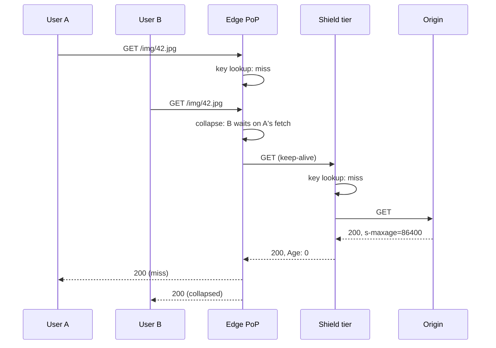

## In one minute
- A CDN is a fleet of HTTP caches and reverse proxies placed close to users, so most requests are answered from a nearby point of presence (PoP) instead of crossing the world to your origin.
- It wins on two axes: latency (short round trips for TCP, TLS and the request itself) and offload (the origin serves a small fraction of the bytes users download).
- Whether a response can be reused is decided by two things you control: the cache key (which requests count as "the same") and the freshness headers (`Cache-Control`, `Age`, validators).
- Tiered caching puts a regional "shield" between the edge and the origin, so a miss in 200 PoPs becomes at most a handful of origin fetches.
- Most CDN incidents are self-inflicted: a cache key that is too narrow (low hit ratio), too wide (one user's page served to another), or a purge strategy that cannot remove what it needs to.

## How it works

### Edges, routing and the round-trip tax
A user in Jakarta fetching from an origin in Virginia pays roughly 230 ms per round trip. A new HTTPS connection needs one round trip for TCP and one for TLS 1.3, and a third for the response: about 700 ms before the first byte. Put a PoP 10 ms away and those three round trips cost 30 ms. On a miss the edge reaches the origin over an already open, warmed-up connection, so the user pays one long round trip instead of three. HTTP/3 shortens the setup further, because QUIC folds the transport and TLS 1.3 handshakes into one exchange ([RFC 9000](https://www.rfc-editor.org/rfc/rfc9000.html)); that saves one round trip, but distance still multiplies every round trip that remains.

Users reach a PoP in one of two ways. **DNS-based routing** answers the CDN hostname with the address of a PoP chosen from the resolver's location (or the client subnet if the resolver sends EDNS Client Subnet). **Anycast** announces one IP prefix from every PoP and lets BGP deliver each packet to the nearest one; the anycast lesson covers why that converges in seconds and where "nearest" goes wrong. Many CDNs use anycast for the address and DNS steering on top for load.

### What a CDN caches
Static assets (images, scripts, fonts, video segments) are the easy case. HTML and API responses can be cached if you say who may share them. Even uncacheable pages benefit, because TLS terminates near the user and the edge forwards over warm connections.

Most CDNs are **pull** caches: the edge fetches from the origin on the first miss. **Push** places content before anyone asks; Netflix's Open Connect appliances inside ISP networks are filled off-peak with what is predicted to be watched. Netflix describes this as proactive, directed caching: it predicts what members will watch and downloads most new content to its appliances during configurable off-peak fill windows ([Netflix Open Connect overview](https://openconnect.netflix.com/Open-Connect-Overview.pdf)). Push fits huge objects with predictable demand.

### Cache keys
A cache key is the string the proxy hashes to find a stored response. The default is roughly scheme, host and the full path with query string. That default is almost always wrong for real traffic: `?utm_source=newsletter` and `?w=200&h=100` versus `?h=100&w=200` each create separate entries for the same bytes. Normalising the key (lowercase the host, drop tracking parameters, sort the rest) can move a hit ratio from 70% to 95% with no other change.

The `Vary` response header adds request headers to the key. `Vary: Accept-Encoding` is fine once the CDN normalises it to `br`, `gzip` or `identity`; `Vary: User-Agent` or `Vary: Cookie` effectively disables caching. The same problem shape, deciding when two requests are "the same", appears in payment idempotency keys and LLM prompt caching: too little in the key returns wrong answers, too much never reuses anything.

### Freshness, staleness and validation
HTTP caching ([RFC 9111](https://www.rfc-editor.org/rfc/rfc9111.html)) says a stored response is fresh while its age is below its freshness lifetime. Shared caches take the lifetime from `s-maxage`, falling back to `max-age`, then `Expires`. When a response goes stale, the cache can revalidate with a conditional request (`If-None-Match` with the stored `ETag`, or `If-Modified-Since`); a `304 Not Modified` costs a round trip but no body. If the origin sends no explicit lifetime at all, a cache may invent one: RFC 9111 suggests about 10% of the time since `Last-Modified` as a typical heuristic, so a file last changed 30 days ago may be cached for about 3 days without anyone asking for it. Send explicit `Cache-Control` on every response.

[RFC 5861](https://www.rfc-editor.org/rfc/rfc5861.html) adds two extensions that matter most for CDNs. `stale-while-revalidate=N` lets the cache serve a stale copy for up to N seconds past expiry while it refreshes in the background, so no user waits on the origin. `stale-if-error=N` lets it serve a stale copy for up to N seconds when the origin returns errors or is unreachable. Together they turn origin latency spikes and short outages into non-events. [RFC 9213](https://www.rfc-editor.org/rfc/rfc9213.html) adds `CDN-Cache-Control`, a header that only CDNs read, so you can tell the CDN "cache for a day" while telling browsers "cache for a minute".

### Purging
Sometimes content must go now: a price error, a takedown. Purge by URL works for single objects. For "every page that shows product 42", tag responses with `Surrogate-Key` (Fastly) or `Cache-Tag` (Cloudflare) and purge by tag. Purges are now fast on large CDNs; Cloudflare reported a global median under 150 ms for purge by tag, hostname and prefix in 2024 ([Cloudflare](https://blog.cloudflare.com/instant-purge/)). Versioned asset URLs (`app.3f9c2a.js`) never need purging: new content gets a new name.

## Down the stack

### Layer 1: The contract
A CDN promises that a response served from cache was stored from an origin response that allowed sharing (`public`, or `s-maxage`, and not `private` or `no-store`), and that its `Age` header plus the stored lifetime say how stale it may be. Within the freshness lifetime it serves without contacting the origin. Past it, the response is served only if a `stale-*` directive permits it, otherwise it is revalidated or refetched. Requests whose cache keys match are interchangeable; that is the whole correctness boundary. A purge is eventually consistent: the API returns before every PoP has dropped the object, typically within a fraction of a second to a few seconds depending on the provider, so the contract is "soon everywhere", never "now".

### Layer 2: The mechanism
Inside a PoP, a request first hits a load balancer, then a cache server chosen by consistent hashing on the cache key, so each object lives on one or two machines per PoP rather than all of them. NGINX's default key is `$scheme$proxy_host$request_uri`; it stores the MD5 of the key in a shared-memory `keys_zone` index and the body in a file named by that hash. Varnish builds the key in `vcl_hash` from the URL and the `Host` header. On a miss, **request collapsing** makes concurrent requests for the same key wait for the single in-flight fetch: NGINX's `proxy_cache_lock` (off by default; once on, waiters give up and go to the origin themselves after a default 5 seconds) ([NGINX docs](https://nginx.org/en/docs/http/ngx_http_proxy_module.html#proxy_cache_lock)), or Varnish's waiting list. That timeout matters: a collapse with no timeout turns one stuck fetch into thousands of stuck users.

Stale serving maps onto NGINX's `proxy_cache_use_stale updating error timeout` plus `proxy_cache_background_update on`. Tiering is another hop: an edge miss goes to an upper-tier PoP (Cloudflare Tiered Cache, CloudFront Origin Shield, Fastly shielding) running the same logic. CloudFront already has regional edge caches as a middle tier; Origin Shield adds a third tier in one region and consolidates concurrent misses, so the origin can see as few as one request per object ([CloudFront docs](https://docs.aws.amazon.com/AmazonCloudFront/latest/DeveloperGuide/origin-shield.html)). Purge by tag is a reverse index from tag to keys, fanned out over the control plane.

### Layer 3: The machine
A cache hit should never copy the body through user space. Serving from disk uses `sendfile` so the kernel moves pages from the page cache to the socket; with kernel TLS (kTLS) the encryption also happens in the kernel or on the NIC, which is how video CDNs push hundreds of Gbit/s from one box; Netflix's FreeBSD work targeted 400 Gbit/s of TLS video per server and listed memory bandwidth as a limit for software kTLS ([Gallatin, EuroBSDCon 2021](https://papers.freebsd.org/2021/eurobsdcon/gallatin-netflix-freebsd-400gbps/)). Storage is tiered by heat: the hottest objects sit in RAM, the rest on NVMe drives that deliver hundreds of thousands of random reads per second.

On the wire, TCP's initial congestion window is 10 segments ([RFC 6928](https://www.rfc-editor.org/rfc/rfc6928.html)), about 14 KB, so the first round trip can carry a small image in full but a 200 KB script needs several more round trips while the window grows. Short edge RTTs make those round trips cheap, and warm origin connections skip slow start.

### Why it's built this way
1. Light in fibre covers about 200 km per millisecond, and handshakes multiply RTT, so the only way to cut latency is to move the server closer.
2. Storage at the edge is finite and spread across hundreds of sites, so only reusable responses are kept, and the cache key defines reuse.
3. Each PoP misses independently, so origin load grows with the number of PoPs; a shield tier collapses those misses back to a few.
4. Purging hundreds of sites synchronously is slow and fragile, so the design prefers bounded staleness (TTLs plus stale windows) and immutable URLs, with purge as the exception.

## Diagram


## Worked example
A product catalogue serves 30,000 image requests per second at peak, averaging 200 KB, so users download 6 GB/s, about 48 Gbit/s. There are 2 million images and 150 PoPs.

With the default cache key, marketing parameters and unordered resize parameters split each image into many entries. The measured edge hit ratio is 72%, so the origin sees 8,400 requests per second and 1.68 GB/s. At an illustrative cloud egress price of $0.05 per GB, that is about $7,300 per day in origin egress, and the origin fleet is sized for 8,400 requests per second of image resizing.

Normalising the key (drop `utm_*`, sort `w` and `h`, normalise `Accept-Encoding`) raises the edge hit ratio to 92%: 2,400 requests per second reach the next tier. Adding a shield in three regions, which itself hits 80% of the time because it pools misses from 50 PoPs each, cuts origin traffic to about 480 requests per second and 96 MB/s, about $415 per day. The origin shrinks by a factor of 17.

Add `stale-if-error=86400` and a 20-minute origin outage only fails first-ever requests for cold images.

## In the wild
- **Canva, 2024: request collapsing hides a stalled fetch, then releases a herd.** On 12 November a deploy coincided with packet loss on Cloudflare's Singapore to Ashburn path, and one JavaScript chunk took about 20 minutes to fetch. Cloudflare merged over 270,000 waiting requests onto that one fetch; nothing errored, so the canary did not abort. When it completed, every client hit the API at once, about 1.5 million requests per second or 3x peak, and canva.com was down for about 52 minutes. Canva added asset fetch timeouts, load shedding and page-load events as a canary signal ([Canva](https://www.canva.dev/blog/engineering/canva-incident-report-api-gateway-outage/)).
- **Fastly, 2021: one customer config trips a latent bug everywhere.** A bug deployed on 12 May lay dormant until a valid customer configuration change on 8 June met its conditions, and about 85% of Fastly's network returned errors. Monitoring caught it within a minute and 95% of the network was back within 49 minutes once the configuration was disabled ([Fastly](https://www.fastly.com/blog/summary-of-june-8-outage)).
- **Steam, 2015: a cache config serves logged-in pages to strangers.** On 25 December, during a DoS that pushed store traffic 2,000% above sale levels, a second caching configuration wrongly cached pages for authenticated users. For about 90 minutes, store pages for about 34,000 users could be shown to others, with billing addresses, purchase history and partial card digits. Valve shut the store, deployed a new configuration and purged edge caches before reopening ([Valve](https://store.steampowered.com/oldnews/19852)).

## Trade-offs
| Option | Strengths | Weaknesses | Choose when |
|---|---|---|---|
| Pull CDN, single tier | Zero setup, origin unchanged | Every PoP misses on its own, long-tail origin load | Small catalogues, few PoPs in use |
| Pull with shield tier | Origin sees a handful of misses per object | Extra hop on misses, shield region is a dependency | Large catalogues, expensive origins |
| Push / pre-positioning | Predictable fills off-peak, no first-user miss | Must predict demand, storage planning | Video, game patches, software releases |
| Long TTL plus versioned URLs | Never purge, maximal hit ratio | Needs build tooling, HTML must stay short-lived | Static assets |
| Short TTL plus stale-while-revalidate | Fresh within seconds, no user waits | More origin revalidations | HTML, API responses shared by many users |
| Tag-based purge | Precise invalidation across many URLs | Index cost, vendor-specific | Catalogues, CMS pages |

## Pitfalls in production
- **Unkeyed inputs that change the response.** If the origin builds links from `X-Forwarded-Host` or picks a language from a cookie but neither is in the key, one attacker's or user's variant is served to everyone (web cache poisoning). Kettle's 2018 research used unkeyed headers such as `X-Forwarded-Host` to poison caches at Red Hat and Mozilla, among others ([PortSwigger](https://portswigger.net/research/practical-web-cache-poisoning)). Either add the input to the key or strip it at the edge before it reaches the origin.
- **Caching personalised responses.** A `Set-Cookie` or account page cached by mistake leaks data. Mark these `private, no-store` at the origin and add an edge rule that never caches responses with `Set-Cookie` or `Authorization`. RFC 9111 already forbids a shared cache from reusing a response to an `Authorization` request, unless the response says `public`, `s-maxage` or `must-revalidate` ([RFC 9111, section 3.5](https://www.rfc-editor.org/rfc/rfc9111.html#section-3.5)), so adding `s-maxage` to an authenticated API turns that protection off.
- **Cache key explosion.** `Vary: User-Agent`, random query parameters or session IDs in URLs drop the hit ratio silently. Watch hit ratio per path prefix, not just globally, and normalise keys.
- **Purge-all on deploy.** It sends a herd of misses to the origin. Use versioned asset URLs and purge only what changed.
- **No origin protection.** If the origin is reachable directly, attackers bypass the CDN and its DDoS protection. Allow only CDN address ranges or require a signed header at the origin.

## Leadership lens
- Treat the cache key and `Cache-Control` policy as reviewed code with an owner, not a console setting; most CDN incidents are changes to these that nobody reviewed.
- Ask for hit ratio, origin requests per second and origin egress cost per path prefix. Those three numbers decide whether to invest in key normalisation, a shield tier or neither.
- Decide the stale policy with product: how stale may a price, an article or a feed be, and for how long during an origin outage? Encode the answer in `stale-if-error`.

## Check yourself
1. Your edge hit ratio is 95% but the origin still sees heavy load from cache misses after you add 100 new PoPs. Why, and what fixes it?
   **Answer:** Each PoP misses independently, so origin load scales with the number of PoPs for long-tail objects. A shield (upper) tier pools those misses so each object is fetched from the origin roughly once per shield region.
2. Why is `Vary: Accept-Encoding` safe on most CDNs but `Vary: User-Agent` is not?
   **Answer:** CDNs normalise `Accept-Encoding` to a few values, so it adds at most three variants. User-Agent strings have thousands of distinct values, so every variant is nearly unique and the hit ratio collapses.
3. A response has `Cache-Control: max-age=60, s-maxage=600, stale-while-revalidate=30`. At age 620 seconds, what does a shared cache do?
   **Answer:** Its lifetime is 600 (from `s-maxage`), so it is 20 seconds stale and inside the 30-second window. It serves the stale copy and refreshes in the background.

## Practice
**Task:** Build the two decisions an edge cache makes on every request. `cache_key(url, headers, keep_params, vary)` drops any `#fragment`, lowercases the scheme and host, removes a default port (`:443` for https, `:80` for http), uses `/` for an empty path, keeps only query parameters whose name is in `keep_params` (a parameter without `=` has an empty value), sorts them by name then value, and omits `?` when none remain. Then, for each header name in `vary` (lowercased, deduplicated, sorted), it appends `|name=value`, looking the header up case-insensitively (missing is the empty string); `accept-encoding` is normalised to `br` if any comma-separated token (ignoring `;q=...`) is `br`, else `gzip` if one is `gzip`, else `identity`, and other values are trimmed and lowercased. `decide(cache_control, stored_at, now, origin_up)` parses directives case-insensitively and returns `"bypass"` for `no-store` or `private`; otherwise the lifetime is `s-maxage`, else `max-age`, else 0, and `no-cache` forces lifetime 0 and disables `stale-while-revalidate`. With `age = now - stored_at` and `stale = age - lifetime`, return `"fresh"` if `age < lifetime`, `"stale-while-revalidate"` if `stale < swr`, `"revalidate"` if the origin is up, `"stale-if-error"` if `stale < sie`, else `"error"`.

```python starter
def cache_key(url, headers, keep_params, vary):
    # TODO
    raise NotImplementedError

def decide(cache_control, stored_at, now, origin_up):
    # TODO
    raise NotImplementedError
```

```python tests
def test_key_normalises_url():
    k = cache_key("HTTPS://Img.Example.com:443/a/b.jpg?w=200&utm_source=x&h=100#top", {}, ["w", "h"], [])
    assert k == "https://img.example.com/a/b.jpg?h=100&w=200"

def test_key_empty_path_and_no_params():
    assert cache_key("http://example.com:80?utm=1", {}, ["w"], []) == "http://example.com/"
    assert cache_key("http://example.com:8080/x?flag&w=1", {}, ["flag"], []) == "http://example.com:8080/x?flag="

def test_key_accept_encoding_normalised():
    base = "https://a.com/app.js"
    assert cache_key(base, {"Accept-Encoding": "gzip, deflate, br"}, [], ["Accept-Encoding"]) == base + "|accept-encoding=br"
    assert cache_key(base, {"accept-encoding": "gzip;q=1.0, identity"}, [], ["accept-encoding"]) == base + "|accept-encoding=gzip"
    assert cache_key(base, {}, [], ["Accept-Encoding"]) == base + "|accept-encoding=identity"

def test_key_vary_sorted_and_lowercased():
    k = cache_key("https://a.com/p", {"X-Country": " ID ", "Accept-Language": "EN"}, [], ["x-country", "Accept-Language", "X-Country"])
    assert k == "https://a.com/p|accept-language=en|x-country=id"

def test_decide_fresh_prefers_s_maxage():
    cc = "max-age=60, S-MAXAGE=600"
    assert decide(cc, 1000, 1599, True) == "fresh"
    assert decide(cc, 1000, 1600, True) == "revalidate"

def test_decide_stale_while_revalidate_window():
    cc = "max-age=100, stale-while-revalidate=30"
    assert decide(cc, 0, 129, True) == "stale-while-revalidate"
    assert decide(cc, 0, 129, False) == "stale-while-revalidate"
    assert decide(cc, 0, 130, True) == "revalidate"

def test_decide_stale_if_error_only_when_origin_down():
    cc = "max-age=10, stale-if-error=3600"
    assert decide(cc, 0, 500, True) == "revalidate"
    assert decide(cc, 0, 500, False) == "stale-if-error"
    assert decide(cc, 0, 3610, False) == "error"

def test_decide_bypass_and_no_cache():
    assert decide("private, max-age=600", 0, 1, True) == "bypass"
    assert decide("no-store", 0, 0, True) == "bypass"
    assert decide("no-cache, max-age=600, stale-while-revalidate=60", 0, 1, True) == "revalidate"
    assert decide("no-cache, stale-if-error=60", 0, 1, False) == "stale-if-error"
```

```python solution
def _encoding(value):
    tokens = [t.split(";")[0].strip().lower() for t in value.split(",")]
    if "br" in tokens:
        return "br"
    if "gzip" in tokens:
        return "gzip"
    return "identity"

def cache_key(url, headers, keep_params, vary):
    url = url.split("#", 1)[0]
    scheme, rest = url.split("://", 1)
    scheme = scheme.lower()
    end = len(rest)
    for ch in "/?":
        j = rest.find(ch)
        if j != -1 and j < end:
            end = j
    host, rest = rest[:end].lower(), rest[end:]
    if (scheme == "https" and host.endswith(":443")) or (scheme == "http" and host.endswith(":80")):
        host = host.rsplit(":", 1)[0]
    path, _, query = rest.partition("?")
    if path == "":
        path = "/"
    keep = set(keep_params)
    pairs = []
    for part in query.split("&"):
        if not part:
            continue
        name, _, value = part.partition("=")
        if name in keep:
            pairs.append((name, value))
    pairs.sort()
    key = scheme + "://" + host + path
    if pairs:
        key += "?" + "&".join(n + "=" + v for n, v in pairs)
    lower = {k.lower(): v for k, v in headers.items()}
    for name in sorted(set(h.lower() for h in vary)):
        value = lower.get(name, "")
        if name == "accept-encoding":
            value = _encoding(value)
        else:
            value = value.strip().lower()
        key += "|" + name + "=" + value
    return key

def decide(cache_control, stored_at, now, origin_up):
    d = {}
    for part in cache_control.split(","):
        part = part.strip().lower()
        if not part:
            continue
        name, eq, value = part.partition("=")
        d[name.strip()] = int(value.strip().strip('"')) if eq else True
    if "no-store" in d or "private" in d:
        return "bypass"
    if "s-maxage" in d:
        lifetime = d["s-maxage"]
    else:
        lifetime = d.get("max-age", 0)
    swr = d.get("stale-while-revalidate", 0)
    sie = d.get("stale-if-error", 0)
    if "no-cache" in d:
        lifetime, swr = 0, 0
    age = now - stored_at
    if age < lifetime:
        return "fresh"
    stale = age - lifetime
    if stale < swr:
        return "stale-while-revalidate"
    if origin_up:
        return "revalidate"
    if stale < sie:
        return "stale-if-error"
    return "error"
```

```typescript starter
export function cacheKey(url: string, headers: Record<string, string>, keepParams: string[], vary: string[]): string {
  throw new Error("TODO");
}

export function decide(cacheControl: string, storedAt: number, now: number, originUp: boolean): string {
  throw new Error("TODO");
}
```

```typescript tests
test("key normalises url", () => {
  const k = cacheKey("HTTPS://Img.Example.com:443/a/b.jpg?w=200&utm_source=x&h=100#top", {}, ["w", "h"], []);
  assertEqual(k, "https://img.example.com/a/b.jpg?h=100&w=200");
});
test("key empty path and no params", () => {
  assertEqual(cacheKey("http://example.com:80?utm=1", {}, ["w"], []), "http://example.com/");
  assertEqual(cacheKey("http://example.com:8080/x?flag&w=1", {}, ["flag"], []), "http://example.com:8080/x?flag=");
});
test("key accept-encoding normalised", () => {
  const base = "https://a.com/app.js";
  assertEqual(cacheKey(base, { "Accept-Encoding": "gzip, deflate, br" }, [], ["Accept-Encoding"]), base + "|accept-encoding=br");
  assertEqual(cacheKey(base, { "accept-encoding": "gzip;q=1.0, identity" }, [], ["accept-encoding"]), base + "|accept-encoding=gzip");
  assertEqual(cacheKey(base, {}, [], ["Accept-Encoding"]), base + "|accept-encoding=identity");
});
test("key vary sorted and lowercased", () => {
  const k = cacheKey("https://a.com/p", { "X-Country": " ID ", "Accept-Language": "EN" }, [], ["x-country", "Accept-Language", "X-Country"]);
  assertEqual(k, "https://a.com/p|accept-language=en|x-country=id");
});
test("decide fresh prefers s-maxage", () => {
  const cc = "max-age=60, S-MAXAGE=600";
  assertEqual(decide(cc, 1000, 1599, true), "fresh");
  assertEqual(decide(cc, 1000, 1600, true), "revalidate");
});
test("decide stale-while-revalidate window", () => {
  const cc = "max-age=100, stale-while-revalidate=30";
  assertEqual(decide(cc, 0, 129, true), "stale-while-revalidate");
  assertEqual(decide(cc, 0, 129, false), "stale-while-revalidate");
  assertEqual(decide(cc, 0, 130, true), "revalidate");
});
test("decide stale-if-error only when origin down", () => {
  const cc = "max-age=10, stale-if-error=3600";
  assertEqual(decide(cc, 0, 500, true), "revalidate");
  assertEqual(decide(cc, 0, 500, false), "stale-if-error");
  assertEqual(decide(cc, 0, 3610, false), "error");
});
test("decide bypass and no-cache", () => {
  assertEqual(decide("private, max-age=600", 0, 1, true), "bypass");
  assertEqual(decide("no-store", 0, 0, true), "bypass");
  assertEqual(decide("no-cache, max-age=600, stale-while-revalidate=60", 0, 1, true), "revalidate");
  assertEqual(decide("no-cache, stale-if-error=60", 0, 1, false), "stale-if-error");
});
```

```typescript solution
function normEncoding(value: string): string {
  const tokens = value.split(",").map((t) => t.split(";")[0].trim().toLowerCase());
  if (tokens.includes("br")) return "br";
  if (tokens.includes("gzip")) return "gzip";
  return "identity";
}

export function cacheKey(url: string, headers: Record<string, string>, keepParams: string[], vary: string[]): string {
  url = url.split("#")[0];
  const sep = url.indexOf("://");
  const scheme = url.slice(0, sep).toLowerCase();
  let rest = url.slice(sep + 3);
  let end = rest.length;
  for (const ch of ["/", "?"]) {
    const j = rest.indexOf(ch);
    if (j !== -1 && j < end) end = j;
  }
  let host = rest.slice(0, end).toLowerCase();
  rest = rest.slice(end);
  if ((scheme === "https" && host.endsWith(":443")) || (scheme === "http" && host.endsWith(":80"))) {
    host = host.slice(0, host.lastIndexOf(":"));
  }
  const q = rest.indexOf("?");
  let path = q === -1 ? rest : rest.slice(0, q);
  const query = q === -1 ? "" : rest.slice(q + 1);
  if (path === "") path = "/";
  const keep = new Set(keepParams);
  const pairs: [string, string][] = [];
  for (const part of query.split("&")) {
    if (!part) continue;
    const eq = part.indexOf("=");
    const name = eq === -1 ? part : part.slice(0, eq);
    const value = eq === -1 ? "" : part.slice(eq + 1);
    if (keep.has(name)) pairs.push([name, value]);
  }
  pairs.sort((a, b) => (a[0] < b[0] ? -1 : a[0] > b[0] ? 1 : a[1] < b[1] ? -1 : a[1] > b[1] ? 1 : 0));
  let key = scheme + "://" + host + path;
  if (pairs.length) key += "?" + pairs.map((p) => p[0] + "=" + p[1]).join("&");
  const lower: Record<string, string> = {};
  for (const k of Object.keys(headers)) lower[k.toLowerCase()] = headers[k];
  const names = Array.from(new Set(vary.map((h) => h.toLowerCase()))).sort();
  for (const name of names) {
    let value = lower[name] ?? "";
    value = name === "accept-encoding" ? normEncoding(value) : value.trim().toLowerCase();
    key += "|" + name + "=" + value;
  }
  return key;
}

export function decide(cacheControl: string, storedAt: number, now: number, originUp: boolean): string {
  const d = new Map<string, number | true>();
  for (let part of cacheControl.split(",")) {
    part = part.trim().toLowerCase();
    if (!part) continue;
    const eq = part.indexOf("=");
    if (eq === -1) d.set(part, true);
    else d.set(part.slice(0, eq).trim(), parseInt(part.slice(eq + 1).trim().replace(/"/g, ""), 10));
  }
  const num = (k: string): number => {
    const v = d.get(k);
    return typeof v === "number" ? v : 0;
  };
  if (d.has("no-store") || d.has("private")) return "bypass";
  let lifetime = d.has("s-maxage") ? num("s-maxage") : num("max-age");
  let swr = num("stale-while-revalidate");
  const sie = num("stale-if-error");
  if (d.has("no-cache")) {
    lifetime = 0;
    swr = 0;
  }
  const age = now - storedAt;
  if (age < lifetime) return "fresh";
  const stale = age - lifetime;
  if (stale < swr) return "stale-while-revalidate";
  if (originUp) return "revalidate";
  if (stale < sie) return "stale-if-error";
  return "error";
}
```

```go starter
package practice

func CacheKey(url string, headers map[string]string, keepParams []string, vary []string) string {
	panic("TODO")
}

func Decide(cacheControl string, storedAt, now int, originUp bool) string {
	panic("TODO")
}
```

```go tests
package practice

import "testing"

func eqStr(t *testing.T, got, want string) {
	t.Helper()
	if got != want {
		t.Fatalf("got %q, want %q", got, want)
	}
}

func TestKeyNormalisesURL(t *testing.T) {
	k := CacheKey("HTTPS://Img.Example.com:443/a/b.jpg?w=200&utm_source=x&h=100#top", map[string]string{}, []string{"w", "h"}, nil)
	eqStr(t, k, "https://img.example.com/a/b.jpg?h=100&w=200")
}

func TestKeyEmptyPathAndNoParams(t *testing.T) {
	eqStr(t, CacheKey("http://example.com:80?utm=1", nil, []string{"w"}, nil), "http://example.com/")
	eqStr(t, CacheKey("http://example.com:8080/x?flag&w=1", nil, []string{"flag"}, nil), "http://example.com:8080/x?flag=")
}

func TestKeyAcceptEncodingNormalised(t *testing.T) {
	base := "https://a.com/app.js"
	eqStr(t, CacheKey(base, map[string]string{"Accept-Encoding": "gzip, deflate, br"}, nil, []string{"Accept-Encoding"}), base+"|accept-encoding=br")
	eqStr(t, CacheKey(base, map[string]string{"accept-encoding": "gzip;q=1.0, identity"}, nil, []string{"accept-encoding"}), base+"|accept-encoding=gzip")
	eqStr(t, CacheKey(base, nil, nil, []string{"Accept-Encoding"}), base+"|accept-encoding=identity")
}

func TestKeyVarySortedAndLowercased(t *testing.T) {
	k := CacheKey("https://a.com/p", map[string]string{"X-Country": " ID ", "Accept-Language": "EN"}, nil, []string{"x-country", "Accept-Language", "X-Country"})
	eqStr(t, k, "https://a.com/p|accept-language=en|x-country=id")
}

func TestDecideFreshPrefersSMaxage(t *testing.T) {
	cc := "max-age=60, S-MAXAGE=600"
	eqStr(t, Decide(cc, 1000, 1599, true), "fresh")
	eqStr(t, Decide(cc, 1000, 1600, true), "revalidate")
}

func TestDecideStaleWhileRevalidateWindow(t *testing.T) {
	cc := "max-age=100, stale-while-revalidate=30"
	eqStr(t, Decide(cc, 0, 129, true), "stale-while-revalidate")
	eqStr(t, Decide(cc, 0, 129, false), "stale-while-revalidate")
	eqStr(t, Decide(cc, 0, 130, true), "revalidate")
}

func TestDecideStaleIfErrorOnlyWhenOriginDown(t *testing.T) {
	cc := "max-age=10, stale-if-error=3600"
	eqStr(t, Decide(cc, 0, 500, true), "revalidate")
	eqStr(t, Decide(cc, 0, 500, false), "stale-if-error")
	eqStr(t, Decide(cc, 0, 3610, false), "error")
}

func TestDecideBypassAndNoCache(t *testing.T) {
	eqStr(t, Decide("private, max-age=600", 0, 1, true), "bypass")
	eqStr(t, Decide("no-store", 0, 0, true), "bypass")
	eqStr(t, Decide("no-cache, max-age=600, stale-while-revalidate=60", 0, 1, true), "revalidate")
	eqStr(t, Decide("no-cache, stale-if-error=60", 0, 1, false), "stale-if-error")
}
```

```go solution
package practice

import (
	"sort"
	"strconv"
	"strings"
)

func normEncoding(value string) string {
	has := map[string]bool{}
	for _, t := range strings.Split(value, ",") {
		has[strings.ToLower(strings.TrimSpace(strings.Split(t, ";")[0]))] = true
	}
	if has["br"] {
		return "br"
	}
	if has["gzip"] {
		return "gzip"
	}
	return "identity"
}

func CacheKey(url string, headers map[string]string, keepParams []string, vary []string) string {
	url = strings.SplitN(url, "#", 2)[0]
	sep := strings.Index(url, "://")
	scheme := strings.ToLower(url[:sep])
	rest := url[sep+3:]
	end := len(rest)
	if j := strings.IndexAny(rest, "/?"); j != -1 {
		end = j
	}
	host := strings.ToLower(rest[:end])
	rest = rest[end:]
	if (scheme == "https" && strings.HasSuffix(host, ":443")) || (scheme == "http" && strings.HasSuffix(host, ":80")) {
		host = host[:strings.LastIndex(host, ":")]
	}
	path, query := rest, ""
	if q := strings.Index(rest, "?"); q != -1 {
		path, query = rest[:q], rest[q+1:]
	}
	if path == "" {
		path = "/"
	}
	keep := map[string]bool{}
	for _, p := range keepParams {
		keep[p] = true
	}
	var pairs [][2]string
	for _, part := range strings.Split(query, "&") {
		if part == "" {
			continue
		}
		name, value := part, ""
		if eq := strings.Index(part, "="); eq != -1 {
			name, value = part[:eq], part[eq+1:]
		}
		if keep[name] {
			pairs = append(pairs, [2]string{name, value})
		}
	}
	sort.Slice(pairs, func(i, j int) bool {
		if pairs[i][0] != pairs[j][0] {
			return pairs[i][0] < pairs[j][0]
		}
		return pairs[i][1] < pairs[j][1]
	})
	var b strings.Builder
	b.WriteString(scheme + "://" + host + path)
	for i, p := range pairs {
		if i == 0 {
			b.WriteString("?")
		} else {
			b.WriteString("&")
		}
		b.WriteString(p[0] + "=" + p[1])
	}
	lower := map[string]string{}
	for k, v := range headers {
		lower[strings.ToLower(k)] = v
	}
	seen := map[string]bool{}
	var names []string
	for _, h := range vary {
		n := strings.ToLower(h)
		if !seen[n] {
			seen[n] = true
			names = append(names, n)
		}
	}
	sort.Strings(names)
	for _, n := range names {
		v := lower[n]
		if n == "accept-encoding" {
			v = normEncoding(v)
		} else {
			v = strings.ToLower(strings.TrimSpace(v))
		}
		b.WriteString("|" + n + "=" + v)
	}
	return b.String()
}

func Decide(cacheControl string, storedAt, now int, originUp bool) string {
	flags := map[string]bool{}
	nums := map[string]int{}
	for _, part := range strings.Split(cacheControl, ",") {
		part = strings.ToLower(strings.TrimSpace(part))
		if part == "" {
			continue
		}
		if eq := strings.Index(part, "="); eq != -1 {
			name := strings.TrimSpace(part[:eq])
			n, err := strconv.Atoi(strings.Trim(strings.TrimSpace(part[eq+1:]), `"`))
			if err == nil {
				nums[name] = n
				flags[name] = true
			}
		} else {
			flags[part] = true
		}
	}
	if flags["no-store"] || flags["private"] {
		return "bypass"
	}
	lifetime := nums["max-age"]
	if flags["s-maxage"] {
		lifetime = nums["s-maxage"]
	}
	swr := nums["stale-while-revalidate"]
	sie := nums["stale-if-error"]
	if flags["no-cache"] {
		lifetime, swr = 0, 0
	}
	age := now - storedAt
	if age < lifetime {
		return "fresh"
	}
	stale := age - lifetime
	if stale < swr {
		return "stale-while-revalidate"
	}
	if originUp {
		return "revalidate"
	}
	if stale < sie {
		return "stale-if-error"
	}
	return "error"
}
```

## Mock interview
**Prompt:** You run a news site with 40 million daily readers across Asia and Europe. Article pages change when editors publish corrections, images never change once uploaded, and the origin in Singapore can handle 2,000 requests per second. Design the CDN setup.

- Follow-up: An editor fixes a wrong headline. How long until every reader sees the fix, and how do you make that faster?
- Follow-up: The origin is down for 15 minutes during a breaking story. What do readers see?
- Follow-up: Would you cache the HTML for logged-in subscribers, and how?

**A strong answer covers:**
- Separate policies: immutable images with versioned URLs and year-long TTLs, HTML with short `s-maxage` plus `stale-while-revalidate`, and `CDN-Cache-Control` so browsers keep a shorter lifetime.
- Cache key normalisation (tracking parameters, `Accept-Encoding`), and what must never be in or out of the key.
- Tag-based purge for articles (by article ID and section) with its propagation time, rather than global purges.
- A shield tier near the origin and request collapsing so a breaking story's first seconds do not overrun 2,000 requests per second.
- `stale-if-error` sized to the longest outage you want to survive, and personalised parts served separately (edge includes or client-side fetch) with `private`.

## Sources and further study
**Primary**
- [RFC 9213: Targeted HTTP Cache Control](https://www.rfc-editor.org/rfc/rfc9213.html): `CDN-Cache-Control` and how targeted fields override `Cache-Control`.
- [RFC 9000: QUIC](https://www.rfc-editor.org/rfc/rfc9000.html): the combined transport and crypto handshake behind HTTP/3.
- [James Kettle, Practical Web Cache Poisoning (PortSwigger, 2018)](https://portswigger.net/research/practical-web-cache-poisoning): unkeyed inputs as an attack class, with real targets.

**Systems docs**
- [CloudFront Origin Shield](https://docs.aws.amazon.com/AmazonCloudFront/latest/DeveloperGuide/origin-shield.html): a three-tier cache and request consolidation explained with cost formulas.
- [Cloudflare: Instant Purge](https://blog.cloudflare.com/instant-purge/): how a large CDN redesigned purge to reach a sub-150 ms median.
- [Netflix Open Connect overview](https://openconnect.netflix.com/Open-Connect-Overview.pdf): embedded appliances in ISPs and proactive off-peak fill.
- [Gallatin, Serving Netflix Video at 400Gb/s on FreeBSD (EuroBSDCon 2021)](https://papers.freebsd.org/2021/eurobsdcon/gallatin-netflix-freebsd-400gbps/): kTLS, NIC offload and NUMA limits on one cache server.

**Books**
- *Understanding Distributed Systems*, Roberto Vitillo, chapters "HTTP caching" and "Content delivery networks": the HTTP caching rules first, then the CDN built on top of them.
- *Computer Networking: A Top-Down Approach* (8th ed.), Kurose and Ross, chapter 2 "Application Layer": DNS, then video streaming and CDNs as an application of it.

**Other curricula**
- [donnemartin/system-design-primer](https://github.com/donnemartin/system-design-primer): frames CDNs as push versus pull with a TTL, and does not cover cache keys, `Vary`, stale serving or tiering.

## Watch
- [What Is A CDN? How Does It Work? (ByteByteGo)](https://www.youtube.com/watch?v=RI9np1LWzqw): a short tour of PoPs, routing and caching.
- [Cache Systems Every Developer Should Know (ByteByteGo)](https://www.youtube.com/watch?v=dGAgxozNWFE): where the CDN sits among the other cache layers in a stack.

## Free resources
- [RFC 9111: HTTP Caching](https://www.rfc-editor.org/rfc/rfc9111.html): the authoritative rules for freshness, age and shared caches.
- [RFC 5861: stale-while-revalidate and stale-if-error](https://www.rfc-editor.org/rfc/rfc5861.html): two short pages that change how CDNs behave during origin trouble.
- [Cache-Control (MDN)](https://developer.mozilla.org/en-US/docs/Web/HTTP/Headers/Cache-Control): every directive with examples for browsers and shared caches.
- [Working with surrogate keys (Fastly)](https://www.fastly.com/documentation/guides/full-site-delivery/purging/working-with-surrogate-keys/): tag-based purging in practice.
- [Tiered Cache (Cloudflare)](https://developers.cloudflare.com/cache/how-to/tiered-cache/): how upper and lower tiers reduce origin load.
- [NGINX proxy module](https://nginx.org/en/docs/http/ngx_http_proxy_module.html): `proxy_cache_key`, `proxy_cache_lock` and `proxy_cache_use_stale` as real knobs.
