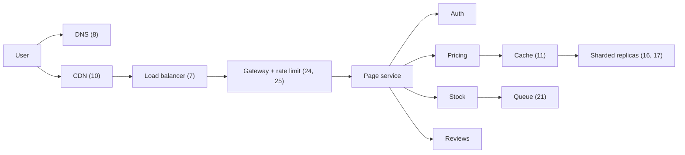

## In one minute
- Thirty concepts cover most of what comes up when designing or reviewing a large system. Each has its own lesson in this course; this page is the map.
- They fall into five families: moving traffic, storing data, communicating between services, surviving failure, and coordinating machines.
- The concepts are not independent. A single user request passes through a dozen of them, and each adds latency, a failure mode and a cost.
- The habit to build is composition: knowing that a page with 30 parallel backend calls is only as fast as the slowest one, and that availability multiplies down a chain of dependencies.

## How it works

### The map
| # | Concept | The idea in one line | Go deeper |
|---|---|---|---|
| 1 | Client-server | Clients ask, servers own the data and answer | Client-Server Architecture |
| 2 | Scalability | Grow capacity by bigger machines (vertical) or more machines (horizontal) | Scalability |
| 3 | Availability | The fraction of time the system answers correctly; nines multiply down a chain | Availability |
| 4 | Reliability | Doing the right thing consistently, measured as failure rate and time between failures | Reliability |
| 5 | Single point of failure | Any component whose loss stops the whole system | Single Point of Failure (SPOF) |
| 6 | Latency, throughput, bandwidth | Time per request, requests per second, and the size of the pipe | Latency vs Throughput vs Bandwidth |
| 7 | Load balancing | One address in front of a pool, routing around dead backends | What are Load Balancers?, Load Balancing Algorithms |
| 8 | DNS | Names to addresses, cached at every layer by TTL | Domain Name System (DNS), DNS Load Balancing |
| 9 | Proxies | Forward proxies act for clients; reverse proxies act for servers | Proxy vs Reverse Proxy |
| 10 | CDN | Serve bytes from a point of presence near the user | Content Delivery Network (CDN) |
| 11 | Caching | Keep repeated answers in fast memory | What is Caching?, Caching Strategies |
| 12 | Eviction and invalidation | Decide what leaves the cache and when cached data is wrong | Cache Eviction Policies, Cache Invalidation, Cache Stampede |
| 13 | Database types | Pick the store by access pattern: relational, document, key-value, wide column, graph | Common Database Types, SQL vs NoSQL |
| 14 | ACID transactions | All-or-nothing, isolated, durable changes to several rows | ACID Transactions |
| 15 | Indexing | Extra structures that turn scans into lookups at a write cost | Indexing, B-Trees and B+ Trees, LSM Trees |
| 16 | Replication | Copies of data for read scale and survival | Database Replication |
| 17 | Partitioning and sharding | Split data so no machine holds all of it | Database Partitioning, Sharding |
| 18 | Consistent hashing | Place keys on a ring so adding a node moves few keys | Consistent Hashing |
| 19 | CAP theorem | During a partition, choose consistency or availability | CAP Theorem |
| 20 | Consistency models | What a reader may see: linearizable, causal, eventual and others | Consistency Models |
| 21 | Message queues | Buffer work so producers and consumers run at their own pace | Message Queues, Dead Letter Queues |
| 22 | Pub/sub and events | Publish once, many independent subscribers react | Pub/Sub, Event-Driven Architecture |
| 23 | API styles | REST, gRPC, GraphQL and when each fits | API Styles, REST API Design, gRPC Deep Dive |
| 24 | API gateway | One front door for auth, routing and quotas | API Gateways, API Gateway Pattern |
| 25 | Rate limiting | Cap how fast a client may call, to protect capacity and fairness | Rate Limiting |
| 26 | Idempotency | Repeating a request has the same effect as doing it once | Idempotency, Delivery Semantics |
| 27 | Monolith vs microservices | One deployable versus many independently owned services | Monolithic Architecture, Microservices Architecture |
| 28 | Resilience patterns | Timeouts, retries, circuit breakers and bulkheads stop failures spreading | Circuit Breaker Pattern, Bulkhead Pattern, Handling Failures in Distributed Systems |
| 29 | Consensus and leader election | Machines agree on one value or one leader despite failures | Consensus Algorithms, Raft Algorithm, Leader Election |
| 30 | Observability | Logs, metrics and traces that let you explain behaviour from outside | Three Pillars of Observability, Distributed Tracing |

### Five families
**Moving traffic** (1, 2, 6 to 10, 24, 25) is about getting a request from a user to a machine that can answer it, quickly and without overloading anyone. **Storing data** (11 to 18) is about where bytes live, how many copies exist and how to find them fast. **Communicating** (21 to 23, 26, 27) is about how services talk: synchronously when the caller needs the answer now, asynchronously when it can wait. **Surviving failure** (3 to 5, 28, 30) is about the assumption that something is always broken. **Coordinating** (19, 20, 29) is about what happens when several machines must agree.

The families map onto recurring problem shapes: overload (load balancing, rate limiting, queues), hot spots (caching, CDNs, partition keys), partial failure (replication, timeouts, circuit breakers), duplicates (idempotency) and finding things fast (indexes). Name the shape and the table tells you which rows to read.

### How the concepts interact
Each concept obliges you to handle another. Caching (11) forces invalidation (12) and consistency (20). Sharding (17) makes cross-shard transactions (14) expensive, pushing you to sagas and idempotent steps (26). Replication (16) helps availability (3) but CAP (19) then forces a choice during partitions. Retries (28) become a retry storm without rate limits (25). In a review, name the concept each box embodies and the one it now obliges you to handle.

## Down the stack

### Layer 1: The contract
The concepts compose into the two numbers users feel: end-to-end latency and availability. For calls made one after another, latencies add. For calls made in parallel, the slowest one decides. For dependencies that must all work, availabilities multiply: five services at 99.9% each give about 99.5% ([System Design Primer](https://github.com/donnemartin/system-design-primer)). For a request that fans out to `n` backends, if each is slow with probability `p`, the chance that at least one is slow is `1 - (1 - p)^n`. At `p = 1%` and `n = 100`, that is 63%: a rare tail on one server becomes the common case for the page. This is the example Dean and Barroso use to open their paper on tail latency ([summary of The Tail at Scale](https://blog.acolyer.org/2015/01/15/the-tail-at-scale/)).

### Layer 2: The mechanism
Follow one request to a product page. DNS (8) resolves the name from a cache. The CDN (10) serves static assets. A load balancer (7) picks a gateway instance (24), which checks a token, applies a rate limit (25) and routes to the page service. That service calls auth, then fans out in parallel to pricing, stock and reviews, each reading through a cache (11) in front of a replicated, sharded database (16, 17). Every call carries a deadline and a trace ID (30).

gRPC makes the budget concrete. The client's deadline travels as a `grpc-timeout` header, a number of at most 8 digits plus a unit such as `m` for milliseconds ([gRPC HTTP/2 protocol](https://github.com/grpc/grpc/blob/master/doc/PROTOCOL-HTTP2.md)). When a server makes its own outgoing call, gRPC can pass on the deadline minus the time already spent, so downstream services stop working on requests whose caller has given up. Two details catch teams out: gRPC sets no deadline by default, so a call can wait forever, and propagation is on by default in Java and Go but must be turned on in C++ ([gRPC deadlines guide](https://grpc.io/docs/guides/deadlines/)).

### Layer 3: The machine
Each hop has a hardware floor. A cached DNS answer takes under 1 ms; a full recursive lookup 20 to 100 ms. A new TLS 1.3 connection costs one extra round trip on top of the TCP handshake, about 1 ms in a region and 50 to 150 ms across continents, which is why connection pooling matters. TLS 1.3 also allows a zero round-trip resumption mode, but data sent that way can be replayed, so it suits only idempotent requests ([RFC 8446](https://www.rfc-editor.org/rfc/rfc8446.html)). A Redis `GET` across the data centre takes 0.2 to 0.5 ms, mostly network, `epoll_wait` and socket copies rather than Redis. A Postgres page miss to NVMe adds about 100 us, to a network block device 0.5 to 1 ms. A 10 to 50 ms garbage-collection pause shows up as tail latency on every caller.

### Why it's built this way
1. **Users notice latency above roughly 100 ms, lose their flow of thought after about 1 second and their attention after about 10** ([Nielsen Norman Group](https://www.nngroup.com/articles/response-times-3-important-limits/)). So each request gets a budget, split across hops.
2. **Hops are expensive and the network is unreliable.** So systems cache near the user, pool connections and fan out in parallel instead of in series.
3. **Parallel fan-out makes tail latency dominant.** So services set per-call timeouts, hedge slow requests, and treat p99 rather than the average as the target.
4. **Every added component multiplies failure probability.** So each must earn its place, and the critical path is kept as short as the requirements allow.

## Diagram


## Worked example
A product page has a 300 ms p99 target at the load balancer. The team draws the call tree and assigns budgets.

The gateway spends 5 ms on token checks and routing. The page service calls auth (p99 20 ms), then calls pricing (p99 60 ms), stock (p99 35 ms) and reviews (p99 120 ms) in parallel, then spends 25 ms rendering. The critical path is gateway, auth, reviews, render: 5 + 20 + 120 + 25 = 170 ms. That fits, with 130 ms of headroom.

Then reviews adds a recommendation call at p99 150 ms, in series after its 120 ms read. Reviews becomes 270 ms and the page 320 ms. Tuning pricing or stock cannot help: they are off the critical path. Options: run the two reviews calls in parallel (page 200 ms), load recommendations asynchronously, or cap reviews at 100 ms with an empty fallback.

The tail compounds too. Reviews reads 10 shards in parallel; if each is slow 1% of the time, `1 - 0.99^10` is about 9.6% of pages waiting on a slow shard. Hedged requests, a second copy to another replica once the first has been outstanding longer than the p95 latency, cut that for about 5% extra load, because by definition only one request in twenty waits that long ([summary of The Tail at Scale](https://blog.acolyer.org/2015/01/15/the-tail-at-scale/)). The practice task builds this calculator.

## In the wild
- **Slack, 2022: a cache miss becomes a fan-out to every shard.** A Consul agent upgrade rolled to 25% of the fleet, and restarting agents deregistered memcached nodes, which came back empty. On a cache miss, client boot ran a query across every database shard, so database load grew faster than the miss rate. Timeouts stopped the cache from refilling and client retries held the cascade in place. Slack throttled boot requests, then raised limits step by step, and moved the query to a table sharded by channel ([Slack](https://slack.engineering/slacks-incident-on-2-22-22/)).
- **Google Cloud, 2025: retries without jitter slow the recovery.** A quota policy row with blank fields replicated worldwide within seconds and hit a new Service Control code path that had no error handling and no feature flag, so API frontends crash-looped everywhere. A kill switch went out in about 40 minutes, but in us-central1 restarting tasks with no randomized backoff overloaded the Spanner table behind them. Google committed to failing open, rolling out global data incrementally and auditing backoff ([Google Cloud](https://status.cloud.google.com/incidents/ow5i3PPK96RduMcb1SsW)).
- **Canva, 2024: CDN, gateway and thundering herd in one chain.** After a deploy, one JavaScript chunk stalled on a lossy network path, and CDN request coalescing held more than 270,000 requests on the same fetch. When it finally loaded, every waiting client hit the API at once, about 1.5 million requests per second or 3 times peak, and gateway tasks ran out of memory faster than autoscaling could replace them. canva.com was down for about 52 minutes. Canva blocked traffic at the CDN, then let it back gradually, starting with Australian users under strict rate limits, and listed extra load shedding as a follow-up ([Canva](https://www.canva.dev/blog/engineering/canva-incident-report-api-gateway-outage/)).

## Trade-offs
| Option | Strengths | Weaknesses | Choose when |
|---|---|---|---|
| Sequential calls | Simple, each call can use the last one's result | Latencies add; one slow call delays everything | Calls genuinely depend on each other |
| Parallel fan-out | Total latency is the slowest call, not the sum | Tail latency dominates; more load per request | Independent data for one page |
| Async via queue | Removes the work from the user's path | Result is not ready immediately; needs status handling | Work the user does not need to wait for |
| Degrade with a timeout | Bounded latency, page still renders | Partial results, more client logic | Optional parts of a response |

## Pitfalls in production
- **Using the 30 as a checklist.** Adding every concept to every design makes it fragile and expensive. Each component should answer a stated requirement.
- **Ignoring composition.** Teams set each service to 99.9% and are surprised the product is at 99.5%. Compute end-to-end availability and latency from the call graph.
- **Timeouts that do not shrink.** Every hop uses a fixed 5-second timeout, so a request the user abandoned keeps consuming capacity three services deep. Propagate deadlines.
- **Retries at every layer.** Three layers making three attempts each turns one failure into 27 calls; AWS's example of five such layers reaches 243 times the load on the database. Retry at one layer, with jitter and a token-bucket retry budget ([AWS Builders' Library](https://aws.amazon.com/builders-library/timeouts-retries-and-backoff-with-jitter/)).
- **Averages in dashboards.** The mean hides the tail that users actually feel on fan-out pages. Track p99 and p99.9 per dependency ([SRE book, Ch 4](https://sre.google/sre-book/service-level-objectives/)).

## Leadership lens
- In design reviews, ask for the call graph with a latency and availability number on each edge, and the computed end-to-end result.
- Have owners of critical-path dependencies publish SLOs, and plan for them like features.
- Budget complexity explicitly: every new box adds on-call load, upgrades and cost, so ask which requirement it serves.

## Check yourself
1. Why does a page that fans out to 100 backends see tail latency far more often than any single backend?
   **Answer:** The page waits for the slowest call. If each backend is slow 1% of the time, the chance that at least one of 100 is slow is `1 - 0.99^100`, about 63%.
2. A service is on the page's critical path at 120 ms; another runs in parallel at 60 ms. Which one should you optimise first?
   **Answer:** The 120 ms one. Speeding up the parallel 60 ms call changes nothing until it becomes the slowest branch.
3. Why do sharding and idempotency often appear together in a design?
   **Answer:** Sharding makes multi-row transactions span machines, so designs use sagas or retried steps instead, and retried steps are only safe when each one is idempotent.
4. Why propagate deadlines rather than set a fixed timeout at each hop?
   **Answer:** A shrinking deadline lets downstream services stop work the caller has already abandoned, which saves capacity during overload and keeps the total within the user's budget.

## Practice
**Task:** Build a latency budget calculator over a call tree. Each call has a `name`, `self_ms` (its own work, done before it calls any children), a `parallel` flag, and `children`. `latency(call)` is `self_ms` plus the sum of the children's latencies if sequential, or the maximum if parallel (zero with no children). `critical_path(call)` returns the names that determine latency: the call's own name, then for sequential children each child's critical path in order, and for parallel children only the slowest child's (the first one on ties). `late_calls(call, budget_ms)` starts the root at 0, starts children at `start + self_ms`, runs sequential children one after another and parallel children together, and returns, sorted alphabetically, the names of calls whose finish time is greater than `budget_ms`. `p_any_slow(p, n)` returns the probability that at least one of `n` independent calls is slow when each is slow with probability `p`.

```python starter
def latency(call):
    # TODO
    raise NotImplementedError

def critical_path(call):
    # TODO
    raise NotImplementedError

def late_calls(call, budget_ms):
    # TODO
    raise NotImplementedError

def p_any_slow(p, n):
    # TODO
    raise NotImplementedError
```

```python tests
def leaf(name, ms):
    return {"name": name, "self_ms": ms, "parallel": False, "children": []}

def page():
    fan = {"name": "fanout", "self_ms": 0, "parallel": True,
           "children": [leaf("prices", 40), leaf("stock", 25), leaf("reviews", 60)]}
    return {"name": "page", "self_ms": 5, "parallel": False,
            "children": [leaf("auth", 10), fan, leaf("render", 15)]}

def test_latency():
    assert latency(page()) == 90
    assert latency(leaf("x", 7)) == 7

def test_critical_path():
    assert critical_path(page()) == ["page", "auth", "fanout", "reviews", "render"]

def test_parallel_tie_takes_first():
    t = {"name": "p", "self_ms": 1, "parallel": True, "children": [leaf("a", 5), leaf("b", 5)]}
    assert critical_path(t) == ["p", "a"]
    assert latency(t) == 6

def test_late_calls():
    assert late_calls(page(), 80) == ["page", "render"]
    assert late_calls(page(), 70) == ["fanout", "page", "render", "reviews"]
    assert late_calls(page(), 90) == []

def test_empty_parallel_node():
    t = {"name": "p", "self_ms": 3, "parallel": True, "children": []}
    assert latency(t) == 3 and critical_path(t) == ["p"]

def test_p_any_slow():
    assert abs(p_any_slow(0.01, 100) - 0.6339676587) < 1e-9
    assert abs(p_any_slow(0.01, 1) - 0.01) < 1e-12
    assert p_any_slow(0.0, 50) == 0.0
    assert p_any_slow(0.3, 0) == 0.0
```

```python solution
def latency(call):
    kids = [latency(c) for c in call["children"]]
    if not kids:
        return call["self_ms"]
    return call["self_ms"] + (max(kids) if call["parallel"] else sum(kids))

def critical_path(call):
    path = [call["name"]]
    kids = call["children"]
    if not kids:
        return path
    if call["parallel"]:
        best = kids[0]
        for c in kids[1:]:
            if latency(c) > latency(best):
                best = c
        return path + critical_path(best)
    for c in kids:
        path += critical_path(c)
    return path

def late_calls(call, budget_ms):
    late = []

    def walk(c, start):
        t = start + c["self_ms"]
        for child in c["children"]:
            walk(child, t)
            if not c["parallel"]:
                t += latency(child)
        if start + latency(c) > budget_ms:
            late.append(c["name"])

    walk(call, 0)
    return sorted(late)

def p_any_slow(p, n):
    return 1.0 - (1.0 - p) ** n
```

```typescript starter
export interface Call { name: string; selfMs: number; parallel: boolean; children: Call[]; }

export function latency(call: Call): number {
  throw new Error("TODO");
}

export function criticalPath(call: Call): string[] {
  throw new Error("TODO");
}

export function lateCalls(call: Call, budgetMs: number): string[] {
  throw new Error("TODO");
}

export function pAnySlow(p: number, n: number): number {
  throw new Error("TODO");
}
```

```typescript tests
function leafCall(name: string, ms: number): Call {
  return { name, selfMs: ms, parallel: false, children: [] };
}

function pageTree(): Call {
  const fan: Call = { name: "fanout", selfMs: 0, parallel: true,
    children: [leafCall("prices", 40), leafCall("stock", 25), leafCall("reviews", 60)] };
  return { name: "page", selfMs: 5, parallel: false, children: [leafCall("auth", 10), fan, leafCall("render", 15)] };
}

test("latency", () => {
  assertEqual(latency(pageTree()), 90);
  assertEqual(latency(leafCall("x", 7)), 7);
});
test("critical path", () => {
  assertEqual(criticalPath(pageTree()), ["page", "auth", "fanout", "reviews", "render"]);
});
test("parallel tie takes first", () => {
  const t: Call = { name: "p", selfMs: 1, parallel: true, children: [leafCall("a", 5), leafCall("b", 5)] };
  assertEqual(criticalPath(t), ["p", "a"]);
  assertEqual(latency(t), 6);
});
test("late calls", () => {
  assertEqual(lateCalls(pageTree(), 80), ["page", "render"]);
  assertEqual(lateCalls(pageTree(), 70), ["fanout", "page", "render", "reviews"]);
  assertEqual(lateCalls(pageTree(), 90), []);
});
test("empty parallel node", () => {
  const t: Call = { name: "p", selfMs: 3, parallel: true, children: [] };
  assertEqual(latency(t), 3);
  assertEqual(criticalPath(t), ["p"]);
});
test("p any slow", () => {
  assert(Math.abs(pAnySlow(0.01, 100) - 0.6339676587) < 1e-9, "fan-out of 100");
  assert(Math.abs(pAnySlow(0.01, 1) - 0.01) < 1e-12, "single call");
  assertEqual(pAnySlow(0, 50), 0);
  assertEqual(pAnySlow(0.3, 0), 0);
});
```

```typescript solution
export interface Call { name: string; selfMs: number; parallel: boolean; children: Call[]; }

export function latency(call: Call): number {
  if (call.children.length === 0) return call.selfMs;
  const kids = call.children.map(latency);
  return call.selfMs + (call.parallel ? Math.max(...kids) : kids.reduce((a, b) => a + b, 0));
}

export function criticalPath(call: Call): string[] {
  const path = [call.name];
  const kids = call.children;
  if (kids.length === 0) return path;
  if (call.parallel) {
    let best = kids[0];
    for (const c of kids.slice(1)) if (latency(c) > latency(best)) best = c;
    return path.concat(criticalPath(best));
  }
  let out = path;
  for (const c of kids) out = out.concat(criticalPath(c));
  return out;
}

export function lateCalls(call: Call, budgetMs: number): string[] {
  const late: string[] = [];
  const walk = (c: Call, start: number): void => {
    let t = start + c.selfMs;
    for (const child of c.children) {
      walk(child, t);
      if (!c.parallel) t += latency(child);
    }
    if (start + latency(c) > budgetMs) late.push(c.name);
  };
  walk(call, 0);
  return late.sort();
}

export function pAnySlow(p: number, n: number): number {
  return 1 - Math.pow(1 - p, n);
}
```

```go starter
package practice

type Call struct {
	Name     string
	SelfMs   int
	Parallel bool
	Children []*Call
}

func Latency(c *Call) int {
	panic("TODO")
}

func CriticalPath(c *Call) []string {
	panic("TODO")
}

func LateCalls(c *Call, budgetMs int) []string {
	panic("TODO")
}

func PAnySlow(p float64, n int) float64 {
	panic("TODO")
}
```

```go tests
package practice

import (
	"math"
	"reflect"
	"testing"
)

func leaf(name string, ms int) *Call { return &Call{Name: name, SelfMs: ms} }

func pageTree() *Call {
	fan := &Call{Name: "fanout", Parallel: true, Children: []*Call{leaf("prices", 40), leaf("stock", 25), leaf("reviews", 60)}}
	return &Call{Name: "page", SelfMs: 5, Children: []*Call{leaf("auth", 10), fan, leaf("render", 15)}}
}

func TestLatency(t *testing.T) {
	if got := Latency(pageTree()); got != 90 {
		t.Fatalf("got %d", got)
	}
	if got := Latency(leaf("x", 7)); got != 7 {
		t.Fatalf("leaf got %d", got)
	}
}

func TestCriticalPath(t *testing.T) {
	want := []string{"page", "auth", "fanout", "reviews", "render"}
	if got := CriticalPath(pageTree()); !reflect.DeepEqual(got, want) {
		t.Fatalf("got %v", got)
	}
}

func TestParallelTieTakesFirst(t *testing.T) {
	c := &Call{Name: "p", SelfMs: 1, Parallel: true, Children: []*Call{leaf("a", 5), leaf("b", 5)}}
	if got := CriticalPath(c); !reflect.DeepEqual(got, []string{"p", "a"}) {
		t.Fatalf("got %v", got)
	}
	if Latency(c) != 6 {
		t.Fatal("latency should be 6")
	}
}

func TestLateCalls(t *testing.T) {
	if got := LateCalls(pageTree(), 80); !reflect.DeepEqual(got, []string{"page", "render"}) {
		t.Fatalf("budget 80: got %v", got)
	}
	want := []string{"fanout", "page", "render", "reviews"}
	if got := LateCalls(pageTree(), 70); !reflect.DeepEqual(got, want) {
		t.Fatalf("budget 70: got %v", got)
	}
	if got := LateCalls(pageTree(), 90); len(got) != 0 {
		t.Fatalf("budget 90: got %v", got)
	}
}

func TestEmptyParallelNode(t *testing.T) {
	c := &Call{Name: "p", SelfMs: 3, Parallel: true}
	if Latency(c) != 3 || !reflect.DeepEqual(CriticalPath(c), []string{"p"}) {
		t.Fatal("empty parallel node")
	}
}

func TestPAnySlow(t *testing.T) {
	if math.Abs(PAnySlow(0.01, 100)-0.6339676587) > 1e-9 {
		t.Fatal("fan-out of 100")
	}
	if math.Abs(PAnySlow(0.01, 1)-0.01) > 1e-12 {
		t.Fatal("single call")
	}
	if PAnySlow(0, 50) != 0 || PAnySlow(0.3, 0) != 0 {
		t.Fatal("zero cases")
	}
}
```

```go solution
package practice

import (
	"math"
	"sort"
)

type Call struct {
	Name     string
	SelfMs   int
	Parallel bool
	Children []*Call
}

func Latency(c *Call) int {
	total := 0
	for _, k := range c.Children {
		l := Latency(k)
		if c.Parallel {
			if l > total {
				total = l
			}
		} else {
			total += l
		}
	}
	return c.SelfMs + total
}

func CriticalPath(c *Call) []string {
	path := []string{c.Name}
	if len(c.Children) == 0 {
		return path
	}
	if c.Parallel {
		best := c.Children[0]
		for _, k := range c.Children[1:] {
			if Latency(k) > Latency(best) {
				best = k
			}
		}
		return append(path, CriticalPath(best)...)
	}
	for _, k := range c.Children {
		path = append(path, CriticalPath(k)...)
	}
	return path
}

func LateCalls(c *Call, budgetMs int) []string {
	late := []string{}
	var walk func(n *Call, start int)
	walk = func(n *Call, start int) {
		t := start + n.SelfMs
		for _, k := range n.Children {
			walk(k, t)
			if !n.Parallel {
				t += Latency(k)
			}
		}
		if start+Latency(n) > budgetMs {
			late = append(late, n.Name)
		}
	}
	walk(c, 0)
	sort.Strings(late)
	return late
}

func PAnySlow(p float64, n int) float64 {
	return 1 - math.Pow(1-p, float64(n))
}
```

## Mock interview
**Prompt:** You join a team whose product page has a p99 of 1.4 seconds against a 400 ms target. The page service calls 12 backends, some in series and some in parallel, at about 8,000 requests per second. How do you find and fix the problem?

- Follow-up: One backend reads from 20 shards in parallel and each shard has a p99 of 80 ms. What does the backend's p99 look like, and how would you cut it?
- Follow-up: A teammate proposes adding retries on every backend call. What could go wrong at 8,000 requests per second during a partial outage?
- Follow-up: Speed up a slow dependency, call it asynchronously, or drop it? How do you decide?

**A strong answer covers:**
- Drawing the call graph from traces and computing the critical path before optimising anything.
- Recognising fan-out tail amplification and using hedged requests, fewer shards per request, or caching to cut it.
- Propagated deadlines and per-call timeouts with graceful degradation for optional sections.
- Retry budgets, jitter and idempotency so retries do not become a retry storm.
- Tracking p99 per dependency and assigning SLOs to the owners of critical-path services.

## Sources and further study
**Primary**
- [RFC 8446: TLS 1.3](https://www.rfc-editor.org/rfc/rfc8446.html): the one round-trip handshake and the replay limits of zero round-trip data.
- [gRPC over HTTP/2 protocol](https://github.com/grpc/grpc/blob/master/doc/PROTOCOL-HTTP2.md): the wire format of `grpc-timeout` and what a server does when it is missing.

**Systems docs**
- [Envoy: outlier detection](https://www.envoyproxy.io/docs/envoy/latest/intro/arch_overview/upstream/outlier): how a proxy ejects failing hosts and caps how many it ejects.
- [Redis: key eviction](https://redis.io/docs/latest/develop/reference/eviction/): the eviction policies behind row 12, and why Redis approximates LRU.

**Books**
- *Site Reliability Engineering* (2016), Beyer et al., Ch 22 "Addressing Cascading Failures": how overload, retries and cold caches chain together, with the fixes ([read free](https://sre.google/sre-book/addressing-cascading-failures/)).
- *Release It!* (2nd ed., 2018), Michael Nygard, Ch 4 "Stability Antipatterns" and Ch 5 "Stability Patterns": integration points, chain reactions, timeouts, circuit breakers and bulkheads.
- *Designing Data-Intensive Applications* (2nd ed., 2026), Kleppmann and Riccomini, Ch 2 "Defining Nonfunctional Requirements": percentiles and how tail latency compounds across calls.

**Other curricula**
- [Azure Architecture Center: Cloud design patterns](https://learn.microsoft.com/en-us/azure/architecture/patterns/): a catalog of about 45 patterns, each tagged with the quality it serves, and advice on pairing them, such as Retry with Circuit Breaker.
- [roadmap.sh: System Design](https://roadmap.sh/system-design): the same concepts laid out as a learning path rather than a single map.

## Watch
- [20 System Design Concepts Explained in 10 Minutes (NeetCode)](https://www.youtube.com/watch?v=i53Gi_K3o7I): a quick visual pass over many of the concepts on this page.
- [Achieving Rapid Response Times in Large Online Services (Jeff Dean, Velocity 2014)](https://www.youtube.com/watch?v=1-3Ahy7Fxsc): tail latency under fan-out and the techniques Google uses to tame it.
- [How to start with distributed systems? (Gaurav Sen)](https://www.youtube.com/watch?v=SqcXvc3ZmRU): how the building blocks fit together as a system grows.

## Free resources
- [The Tail at Scale (Dean and Barroso)](https://research.google/pubs/the-tail-at-scale/): the paper behind fan-out tail amplification and hedged requests.
- [Timeouts, retries and backoff with jitter (AWS Builders' Library)](https://aws.amazon.com/builders-library/timeouts-retries-and-backoff-with-jitter/): how to set timeouts and retries without causing overload.
- [Deadlines (gRPC docs)](https://grpc.io/docs/guides/deadlines/): how deadlines propagate across service hops.
- [Fallacies of distributed computing (Wikipedia)](https://en.wikipedia.org/wiki/Fallacies_of_distributed_computing): the eight false assumptions that most of these concepts exist to handle.
- [The System Design Primer (Donne Martin)](https://github.com/donnemartin/system-design-primer): a broad index of the same concepts with further links.
