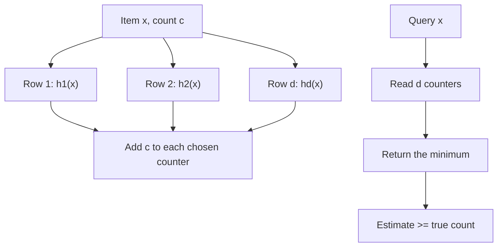

## In one minute
- A count-min sketch estimates how often each item appears in a stream, using a small fixed grid of counters instead of one counter per distinct item.
- Each item increments one counter in each of `d` rows, chosen by `d` independent hashes. The estimate is the **minimum** of those `d` counters.
- Collisions only ever add to a counter, so the sketch **never underestimates**. The overestimate is bounded by a small fraction of the total stream volume, with high probability.
- It is ideal for heavy hitters, rate limiting across millions of keys, and cache admission. It is poor at estimating rare items, because their true counts are smaller than the error.

## How it works

### Structure and update
The sketch is a `d` by `w` array of integer counters, all starting at zero, plus `d` hash functions, one per row, each mapping an item to a column in `[0, w)`. To record `c` occurrences of item `x`, add `c` to `counter[i][h_i(x)]` for every row `i`. That is `d` memory writes per update, independent of how many distinct items exist.

### Query
To estimate `x`, read its counter in every row and return the smallest. Each counter holds all of `x`'s occurrences plus colliding items, so the minimum is the tightest upper bound.

### Error guarantee
Let `N` be the total of all updates. Choose `w = ceil(e / epsilon)` and `d = ceil(ln(1 / delta))`. Then for any item, the estimate exceeds the true count by more than `epsilon * N` with probability at most `delta` ([Cormode and Muthukrishnan](https://dsf.berkeley.edu/cs286/papers/countmin-latin2004.pdf)).

Why: in one row the expected collision mass on `x`'s column is `N / w`, so by Markov's inequality it exceeds `e * N / w` with probability at most `1/e`, and all `d` independent rows are that bad with probability `e^-d`.

For example, `epsilon = 0.001` and `delta = 0.001` give `w = 2,719` and `d = 7`: 76 KB of 4-byte counters. With 100 million events, any estimate is within 100,000 of the truth with 99.9 percent probability: excellent for an item seen 5 million times, useless for one seen 50 times.

### Conservative update
When adding `x`, compute the current estimate `m` and raise each of `x`'s counters only up to `m + c`, so counters already inflated by collisions stop growing. This often cuts error several-fold on skewed data, but the sketch loses decrements and exact merging. The idea predates the count-min name: Estan and Varghese proposed it for counting large network flows in router memory ([SIGCOMM 2002](https://conferences.sigcomm.org/sigcomm/2002/papers/traffmeas.pdf)).

### Merging and decrementing
Two sketches with the same dimensions and hash seeds merge by adding counters cell by cell, so per-shard or per-minute sketches roll up exactly. Without conservative update, decrements are allowed as long as no true count goes negative. Some systems need **aging**: Caffeine's TinyLFU halves every counter periodically so old popularity fades.

### Finding heavy hitters
The sketch answers "how often is X?" but cannot list items. To track the top `k`, pair it with a min-heap of size `k`: after each update, if the item's estimate exceeds the heap minimum, insert or update it in the heap. The heap holds candidate keys; the sketch supplies their counts. Redis's Top-K structure packages this pattern, using the HeavyKeeper algorithm: counters decay exponentially when a different item collides with them, which pushes small flows out and keeps elephants accurate ([Redis docs](https://redis.io/docs/latest/develop/data-types/probabilistic/top-k/), [USENIX ATC 2018](https://www.usenix.org/conference/atc18/presentation/gong)).

## Down the stack

### Layer 1: The contract
With non-negative updates, every estimate is at least the true count. With probability at least `1 - delta`, it exceeds the true count by at most `epsilon * N`, where `N` is the total weight added. Two sketches with identical width, depth, and hash seeds can be merged by adding counters, and the result is exactly the sketch of the combined stream. The sketch cannot enumerate keys or report which items are frequent without a separate candidate list.

### Layer 2: The mechanism
Redis offers `CMS.INITBYDIM` (width and depth) and `CMS.INITBYPROB` (error and probability), `CMS.INCRBY` for updates (increments may be negative), `CMS.QUERY` for estimates, and `CMS.MERGE` with optional weights. These were the RedisBloom module until Redis 8 built them into the server ([RedisBloom](https://github.com/RedisBloom/RedisBloom)). Redis does not use the textbook sizing: `CMS.INITBYPROB key 0.001 0.002` creates a 2,000 by 9 sketch, so width is `2 / error` and depth is `log2(1 / probability)`, where the paper's formulas give 2,719 by 7. Redis also tells you to treat estimates below `error * total_count` as noise ([Redis docs](https://redis.io/docs/latest/develop/data-types/probabilistic/count-min-sketch/)). Compare dimensions, not parameters, when moving sketches between libraries.

Caffeine's TinyLFU admission policy is the best-known production use ([Einziger, Friedman and Manes](https://arxiv.org/abs/1512.00727)). Its `FrequencySketch` uses 4-bit counters, 16 packed into each 64-bit `long`, with 4 counters per item. The table is sized from the cache's maximum size, at about 8 bytes per cache entry ([Caffeine wiki](https://github.com/ben-manes/caffeine/wiki/Efficiency)). After a sample of additions 10 times the cache size, every counter is halved with a shift and mask over each word, so popularity decays. Recent versions place all of an item's counters in one 64-byte block so that an update costs a single cache miss ([Caffeine source](https://github.com/ben-manes/caffeine/blob/master/caffeine/src/main/java/com/github/benmanes/caffeine/cache/FrequencySketch.java)). Many implementations derive the `d` row hashes from two base hashes as `h1 + i * h2`.

### Layer 3: The machine
A textbook sketch with `d` separate rows costs `d` independent memory accesses per update. Small sketches (76 KB, 544 KB) live in L2 or L3 cache and cost a few nanoseconds per access; larger ones pay 80 to 100 ns per row on a miss, though the CPU can overlap independent misses. Packing an item's counters into one cache line turns that into one miss.

Concurrency is the second machine cost. If many threads increment the same hot item's counters, the cache line holding them bounces between cores, at around 100 ns per transfer, and atomic increments serialise. High-throughput systems keep per-thread or per-core sketches and merge them periodically, which works because plain sketches merge by addition. Counter width is a memory trade: 4-bit counters saturate at 15, which is fine for admission decisions but useless for rate limits; rate limiters use 32-bit counters.

### Why it's built this way
1. One counter per key costs memory proportional to the number of keys, so keys share a fixed array of counters.
2. Sharing causes collisions, so several rows with independent hashes are kept and the least-collided row, the minimum, is reported.
3. Collisions only add, so the error is one-sided, which suits threshold decisions such as throttling or admission.
4. Memory access dominates cost, so production versions shrink counters and co-locate an item's counters in one cache line.

## Diagram


## Worked example
An API gateway wants to throttle any API key that exceeds 1,000 requests per minute. There are 30 million keys, most idle, and 400,000 requests per second across the fleet.

An exact per-key map would cost hundreds of MB per node with churn every minute. Instead each node keeps a count-min sketch per minute window.

Each node sees about 25,000 requests per second, so 1.5 million per minute. The threshold that matters is 1,000. Pick `epsilon` so `epsilon * N` is well under that: `epsilon = 0.0001` gives a maximum overcount of 150 with high probability. That needs `w = 27,183`. With `d = 5` (`delta` about 0.7 percent), the sketch is 136,000 counters, 544 KB at 4 bytes. Five hash computations and five increments per request cost well under a microsecond.

The error is one-sided: a key at 900 requests might read as 1,040 and be throttled early. So when an estimate crosses the threshold, start an exact counter for that key only; few keys come near the limit, so that map stays tiny.

For a global limit, nodes ship their per-minute sketches to an aggregator every few seconds and the aggregator sums them, which is valid because plain sketches merge by addition.

## In the wild
- **Report URI, 2021: frequency analysis over hundreds of billions of reports.** The browser-report service had processed about 669 billion reports and wanted to know, without a database query, whether a report was new, rare, or seen tens of millions of times. Its sizing table shows the cost of precision: error 0.001 at confidence 0.999 is 20,000 counters, about 160 KB with 64-bit counters, while error 0.00001 at 0.9999 is 60.4 million counters, 483 MB. Switching to 32-bit counters halves the largest option from 4.8 GB to 2.4 GB. The team planned to run it on existing Redis servers and to add a Top-K structure, because the sketch alone cannot list the most frequent reports ([Scott Helme](https://scotthelme.co.uk/frequency-analysis-hundreds-billions-reports-report-uri-count-min-sketch/)).
- **Shareaholic, 2012: heavy-hitter pages from a pageview firehose.** Counting views for millions of URLs arriving at thousands per second was too costly exactly, so the team used a count-min sketch with epsilon 0.005 and delta 10^-7 in production. On 10 million views a day that bounds the overcount at 50,000, and they warn that a two-view page colliding with popular ones can read as 200: fine for surfacing the top pages, useless for the long tail ([Shareaholic](http://tech.shareaholic.com/2012/12/03/the-count-min-sketch-how-to-count-over-large-keyspaces-when-about-right-is-good-enough/)).
- **Caffeine: W-TinyLFU as the default policy of a widely used Java cache.** Caffeine puts a 4-bit count-min sketch, about 8 bytes per cache entry, in front of a segmented LRU, and admits a new entry only if its estimated frequency beats the eviction victim's. A small LRU window absorbs bursts the sketch would reject. Across the project's Wikipedia, database, search and OLTP traces it reports hit rates near the optimal policy and well above LRU, without remembering evicted keys as ARC and LIRS do ([Caffeine wiki](https://github.com/ben-manes/caffeine/wiki/Efficiency)).

## Trade-offs
| Option | Strengths | Weaknesses | Choose when |
|---|---|---|---|
| Count-min sketch | Fixed memory, fast, mergeable, one-sided error | Error scales with total volume, cannot list keys | Frequencies of heavy items in huge key spaces |
| CMS with conservative update | Much lower overestimation on skewed data | No decrements, merge is no longer exact | Single-node counting, cache admission |
| Count sketch (signed) | Unbiased, better for moderately frequent items | Can underestimate, needs median of rows | You need unbiased estimates, not upper bounds |
| Exact hash map | Exact counts and listing | Memory proportional to distinct keys | Key space is small or bounded |

## Pitfalls in production
- **Expecting accuracy on rare items.** With 1 billion events and `epsilon = 0.0001`, the error is 100,000. Rare items read as noise. Only trust estimates well above `epsilon * N`.
- **Correlated hash functions.** Rows that use the same hash with trivially different seeds collide together and the minimum stops helping. Use independent seeds of a good hash, or the two-hash trick `h1 + i * h2`.
- **Unbounded windows.** A sketch that is never reset accumulates `N` forever, and error grows with it. Use tumbling windows, rotating sketches, or periodic halving.
- **Merging incompatible sketches.** Different widths, depths, or seeds cannot be added. Version the sketch configuration with the data.

## Leadership lens
- State the guarantee in product terms: "counts above X are within Y of the truth". If the business needs accuracy on small counts, a sketch is the wrong tool.
- Decide what a false positive costs. For throttling, an overestimate blocks a good customer; add a margin or an exact check near the threshold.
- Choose the windowing strategy up front: tumbling minute sketches, sliding windows from several sub-sketches, or decay. It drives memory and correctness.

## Check yourself
1. Why does a count-min sketch never underestimate, and when does that stop being true?
   **Answer:** Every counter for an item includes all of that item's increments plus collisions, which only add. It stops being true if negative updates push other items' contributions down, as in a stream with deletions that are not matched by earlier inserts.
2. Doubling `w` and adding one row: which improves the error bound and which improves the confidence?
   **Answer:** Doubling `w` halves `epsilon`, the size of the error relative to `N`; adding a row reduces `delta`, the probability of exceeding that error, by a factor of about `e`.
3. Why can't conservative-update sketches be merged by addition?
   **Answer:** Conservative update skips increments on counters that were already high, so a counter no longer equals the sum of its items' contributions, and adding two such counters does not equal the counter the combined stream would have produced.

## Practice
**Task:** Implement `CountMinSketch(width, depth, conservative=False)`. Row `i` maps item `x` to column `fnv1a(str(i) + ":" + x) % width` using 32-bit FNV-1a (given). `add(x, c=1)` increments one counter per row, or with `conservative=True` raises each of `x`'s counters to at most `estimate(x) + c`. `estimate(x)` returns the minimum of `x`'s counters. `merge(other)` adds counters cell by cell (only for non-conservative sketches with the same shape). TypeScript: `CountMinSketch` with `add`, `estimate`, `merge`; Go: `New`, `Add`, `Estimate`, `Merge`.

```python starter
def fnv1a(s):
    h = 2166136261
    for c in s.encode():
        h = ((h ^ c) * 16777619) & 0xFFFFFFFF
    return h

class CountMinSketch:
    def __init__(self, width, depth, conservative=False):
        pass

    def add(self, x, c=1):
        raise NotImplementedError

    def estimate(self, x):
        raise NotImplementedError

    def merge(self, other):
        raise NotImplementedError
```

```python tests
def zipf():
    return [("item%d" % i, 1000 // (i + 1)) for i in range(500)]

def build(width, depth, conservative=False):
    s = CountMinSketch(width, depth, conservative)
    for k, c in zipf():
        s.add(k, c)
    return s

def test_exact_without_collisions():
    s = CountMinSketch(100000, 4)
    s.add("a", 3)
    s.add("b")
    assert (s.estimate("a"), s.estimate("b"), s.estimate("zzz")) == (3, 1, 0)

def test_never_underestimates():
    s = build(64, 4)
    assert all(s.estimate(k) >= c for k, c in zipf())

def test_error_bound_holds_for_most_items():
    s = build(272, 5)
    n = sum(c for _, c in zipf())
    bad = sum(1 for k, c in zipf() if s.estimate(k) - c > 0.01 * n)
    assert bad <= 5

def test_conservative_is_tighter_and_still_safe():
    plain, cons = build(64, 4), build(64, 4, True)
    for k, c in zipf():
        assert c <= cons.estimate(k) <= plain.estimate(k)
    assert sum(cons.estimate(k) for k, _ in zipf()) < sum(plain.estimate(k) for k, _ in zipf())

def test_merge_equals_combined_stream():
    a, b, both = CountMinSketch(50, 3), CountMinSketch(50, 3), CountMinSketch(50, 3)
    for i, (k, c) in enumerate(zipf()):
        (a if i % 2 else b).add(k, c)
        both.add(k, c)
    a.merge(b)
    assert all(a.estimate(k) == both.estimate(k) for k, _ in zipf())
```

```python solution
def fnv1a(s):
    h = 2166136261
    for c in s.encode():
        h = ((h ^ c) * 16777619) & 0xFFFFFFFF
    return h

class CountMinSketch:
    def __init__(self, width, depth, conservative=False):
        self.w, self.d, self.conservative = width, depth, conservative
        self.rows = [[0] * width for _ in range(depth)]

    def _cols(self, x):
        return [fnv1a(str(i) + ":" + x) % self.w for i in range(self.d)]

    def add(self, x, c=1):
        cols = self._cols(x)
        if self.conservative:
            target = min(self.rows[i][j] for i, j in enumerate(cols)) + c
            for i, j in enumerate(cols):
                self.rows[i][j] = max(self.rows[i][j], target)
        else:
            for i, j in enumerate(cols):
                self.rows[i][j] += c

    def estimate(self, x):
        return min(self.rows[i][j] for i, j in enumerate(self._cols(x)))

    def merge(self, other):
        for i in range(self.d):
            for j in range(self.w):
                self.rows[i][j] += other.rows[i][j]
```

```typescript starter
export function fnv1a(s: string): number {
  let h = 2166136261;
  for (let i = 0; i < s.length; i++) h = Math.imul(h ^ s.charCodeAt(i), 16777619) >>> 0;
  return h;
}
export class CountMinSketch {
  constructor(width: number, depth: number, conservative = false) {}
  add(x: string, c = 1): void { throw new Error("TODO"); }
  estimate(x: string): number { throw new Error("TODO"); }
  merge(other: CountMinSketch): void { throw new Error("TODO"); }
}
```

```typescript tests
const zipf = (): [string, number][] => Array.from({ length: 500 }, (_, i) => ["item" + i, Math.floor(1000 / (i + 1))]);
function build(w: number, d: number, cons = false): CountMinSketch {
  const s = new CountMinSketch(w, d, cons);
  for (const [k, c] of zipf()) s.add(k, c);
  return s;
}
test("exact without collisions", () => {
  const s = new CountMinSketch(100000, 4);
  s.add("a", 3); s.add("b");
  assertEqual([s.estimate("a"), s.estimate("b"), s.estimate("zzz")], [3, 1, 0]);
});
test("never underestimates", () => {
  const s = build(64, 4);
  assert(zipf().every(([k, c]) => s.estimate(k) >= c), "upper bound");
});
test("error bound holds for most items", () => {
  const s = build(272, 5), n = zipf().reduce((a, [, c]) => a + c, 0);
  assert(zipf().filter(([k, c]) => s.estimate(k) - c > 0.01 * n).length <= 5, "few violations");
});
test("conservative is tighter and still safe", () => {
  const p = build(64, 4), q = build(64, 4, true);
  let sp = 0, sq = 0;
  for (const [k, c] of zipf()) {
    assert(c <= q.estimate(k) && q.estimate(k) <= p.estimate(k), k);
    sp += p.estimate(k); sq += q.estimate(k);
  }
  assert(sq < sp, "tighter overall");
});
test("merge equals combined stream", () => {
  const a = new CountMinSketch(50, 3), b = new CountMinSketch(50, 3), both = new CountMinSketch(50, 3);
  zipf().forEach(([k, c], i) => { (i % 2 ? a : b).add(k, c); both.add(k, c); });
  a.merge(b);
  assert(zipf().every(([k]) => a.estimate(k) === both.estimate(k)), "equal");
});
```

```typescript solution
export function fnv1a(s: string): number {
  let h = 2166136261;
  for (let i = 0; i < s.length; i++) h = Math.imul(h ^ s.charCodeAt(i), 16777619) >>> 0;
  return h;
}
export class CountMinSketch {
  private rows: number[][];
  constructor(private w: number, private d: number, private conservative = false) {
    this.rows = Array.from({ length: d }, () => new Array(w).fill(0));
  }
  private cols(x: string): number[] {
    return Array.from({ length: this.d }, (_, i) => fnv1a(i + ":" + x) % this.w);
  }
  add(x: string, c = 1): void {
    const cols = this.cols(x);
    if (this.conservative) {
      const target = Math.min(...cols.map((j, i) => this.rows[i][j])) + c;
      cols.forEach((j, i) => { this.rows[i][j] = Math.max(this.rows[i][j], target); });
    } else {
      cols.forEach((j, i) => { this.rows[i][j] += c; });
    }
  }
  estimate(x: string): number {
    return Math.min(...this.cols(x).map((j, i) => this.rows[i][j]));
  }
  merge(other: CountMinSketch): void {
    this.rows.forEach((r, i) => r.forEach((_, j) => { r[j] += other.rows[i][j]; }));
  }
}
```

```go starter
package practice

// FNV1a is 32-bit FNV-1a.
func FNV1a(s string) uint32 {
	h := uint32(2166136261)
	for i := 0; i < len(s); i++ {
		h = (h ^ uint32(s[i])) * 16777619
	}
	return h
}

// CMS is a count-min sketch.
type CMS struct{}

// New creates a width x depth sketch.
func New(width, depth int, conservative bool) *CMS { return &CMS{} }

func (s *CMS) Add(x string, c int)     { panic("TODO") }
func (s *CMS) Estimate(x string) int  { panic("TODO") }
func (s *CMS) Merge(other *CMS)       { panic("TODO") }
```

```go tests
package practice

import (
	"fmt"
	"testing"
)

type kc struct {
	k string
	c int
}

func zipf() []kc {
	var out []kc
	for i := 0; i < 500; i++ {
		out = append(out, kc{fmt.Sprint("item", i), 1000 / (i + 1)})
	}
	return out
}

func build(w, d int, cons bool) *CMS {
	s := New(w, d, cons)
	for _, e := range zipf() {
		s.Add(e.k, e.c)
	}
	return s
}

func TestExactWithoutCollisions(t *testing.T) {
	s := New(100000, 4, false)
	s.Add("a", 3)
	s.Add("b", 1)
	if s.Estimate("a") != 3 || s.Estimate("b") != 1 || s.Estimate("zzz") != 0 {
		t.Fatal("not exact")
	}
}

func TestNeverUnderestimates(t *testing.T) {
	s := build(64, 4, false)
	for _, e := range zipf() {
		if s.Estimate(e.k) < e.c {
			t.Fatal(e.k)
		}
	}
}

func TestErrorBound(t *testing.T) {
	s, n, bad := build(272, 5, false), 0, 0
	for _, e := range zipf() {
		n += e.c
	}
	for _, e := range zipf() {
		if float64(s.Estimate(e.k)-e.c) > 0.01*float64(n) {
			bad++
		}
	}
	if bad > 5 {
		t.Fatal(bad)
	}
}

func TestConservative(t *testing.T) {
	p, q := build(64, 4, false), build(64, 4, true)
	sp, sq := 0, 0
	for _, e := range zipf() {
		if q.Estimate(e.k) < e.c || q.Estimate(e.k) > p.Estimate(e.k) {
			t.Fatal(e.k)
		}
		sp += p.Estimate(e.k)
		sq += q.Estimate(e.k)
	}
	if sq >= sp {
		t.Fatal("not tighter")
	}
}

func TestMerge(t *testing.T) {
	a, b, both := New(50, 3, false), New(50, 3, false), New(50, 3, false)
	for i, e := range zipf() {
		if i%2 == 1 {
			a.Add(e.k, e.c)
		} else {
			b.Add(e.k, e.c)
		}
		both.Add(e.k, e.c)
	}
	a.Merge(b)
	for _, e := range zipf() {
		if a.Estimate(e.k) != both.Estimate(e.k) {
			t.Fatal(e.k)
		}
	}
}
```

```go solution
package practice

import "strconv"

// FNV1a is 32-bit FNV-1a.
func FNV1a(s string) uint32 {
	h := uint32(2166136261)
	for i := 0; i < len(s); i++ {
		h = (h ^ uint32(s[i])) * 16777619
	}
	return h
}

// CMS is a count-min sketch.
type CMS struct {
	w, d         int
	conservative bool
	rows         [][]int
}

// New creates a width x depth sketch.
func New(width, depth int, conservative bool) *CMS {
	rows := make([][]int, depth)
	for i := range rows {
		rows[i] = make([]int, width)
	}
	return &CMS{w: width, d: depth, conservative: conservative, rows: rows}
}

func (s *CMS) cols(x string) []int {
	out := make([]int, s.d)
	for i := range out {
		out[i] = int(FNV1a(strconv.Itoa(i)+":"+x) % uint32(s.w))
	}
	return out
}

func (s *CMS) Add(x string, c int) {
	cols := s.cols(x)
	if !s.conservative {
		for i, j := range cols {
			s.rows[i][j] += c
		}
		return
	}
	target := s.Estimate(x) + c
	for i, j := range cols {
		if s.rows[i][j] < target {
			s.rows[i][j] = target
		}
	}
}

func (s *CMS) Estimate(x string) int {
	best := -1
	for i, j := range s.cols(x) {
		if best < 0 || s.rows[i][j] < best {
			best = s.rows[i][j]
		}
	}
	return best
}

func (s *CMS) Merge(other *CMS) {
	for i := range s.rows {
		for j := range s.rows[i] {
			s.rows[i][j] += other.rows[i][j]
		}
	}
}
```

## Mock interview
**Prompt:** Build "trending hashtags" for a social network: every minute, show the 50 hashtags whose usage in the last 15 minutes grew most compared with the previous hour. The firehose is 300,000 posts per second, with hundreds of millions of distinct hashtags.

- Follow-up: How do you compute the 15-minute and 60-minute counts without storing per-hashtag counters?
- Follow-up: A hashtag with 40 uses keeps appearing in the top 50. Why, and how do you stop it?
- Follow-up: How do you combine counts from 200 ingestion nodes?

**A strong answer covers:**
- Per-node count-min sketches per minute plus a top-k heap of candidates, merged centrally by summing sketches.
- A sliding window built from 15 and 60 one-minute sketches, with memory and error sized from `epsilon * N`.
- Low-volume items are dominated by sketch error, so require a minimum absolute count before ranking by growth.
- Why conservative update helps per node but breaks exact merging, and the choice made.
- Spam and bot filtering before counting, since the sketch faithfully counts abuse too.

## Sources and further study
**Primary**
- [Cormode and Muthukrishnan: An Improved Data Stream Summary, the Count-Min Sketch (LATIN 2004)](https://dsf.berkeley.edu/cs286/papers/countmin-latin2004.pdf): the structure, the bounds and its uses for quantiles and heavy hitters.
- [Estan and Varghese: New Directions in Traffic Measurement and Accounting (SIGCOMM 2002)](https://conferences.sigcomm.org/sigcomm/2002/papers/traffmeas.pdf): multistage filters and conservative update.
- [Einziger, Friedman and Manes: TinyLFU, a Highly Efficient Cache Admission Policy](https://arxiv.org/abs/1512.00727): sketches as cache admission filters.
- [Gong et al.: HeavyKeeper (USENIX ATC 2018)](https://www.usenix.org/conference/atc18/presentation/gong): the top-k algorithm behind Redis Top-K.

**Systems docs**
- [Apache Spark CountMinSketch](https://spark.apache.org/docs/latest/api/scala/org/apache/spark/util/sketch/CountMinSketch.html): a mergeable sketch API built into Spark.
- [Caffeine FrequencySketch source](https://github.com/ben-manes/caffeine/blob/master/caffeine/src/main/java/com/github/benmanes/caffeine/cache/FrequencySketch.java): 4-bit counters, cache-line blocking and periodic halving in one readable class.

**Books**
- *Designing Data-Intensive Applications* (1st ed.), Martin Kleppmann, Ch 11: Stream Processing, on windowed aggregation, the setting where frequency sketches live.
- *System Design Interview Vol. 2*, Alex Xu and Sahn Lam, Ch 6: Ad Click Event Aggregation, top-N counting over a click stream.

**Other curricula**
- [Stanford CS166, Lecture 4: Hashing and Sketching](https://web.stanford.edu/class/archive/cs/cs166/cs166.1266/lectures/04/): introduces sketching through frequency estimation, with the count-min paper as reading.

## Watch
- [CountMin sketch, part 1 (Ben Langmead)](https://www.youtube.com/watch?v=hJitoHv4rAU): a clear lecture on the structure and the error analysis.
- [Data Structures for Big Data in Interviews (Hello Interview)](https://www.youtube.com/watch?v=IgyU0iFIoqM): where count-min fits next to Bloom filters and HyperLogLog in system design.

## Free resources
- [Wikipedia: Count-min sketch](https://en.wikipedia.org/wiki/Count%E2%80%93min_sketch): definitions, bounds, and the conservative update variant.
- [Florian Hartmann: Count-Min Sketch](https://florian.github.io/count-min-sketch/): a short interactive explanation with a worked error derivation.
- [Redis: Count-min sketch](https://redis.io/docs/latest/develop/data-types/probabilistic/count-min-sketch/): a production API and how to size width and depth.
- [Redis: Top-K](https://redis.io/docs/latest/develop/data-types/probabilistic/top-k/): a heavy-hitters structure built on the same counting ideas.
- [Apache DataSketches](https://datasketches.apache.org/): a library of mergeable sketches, including frequency sketches, with accuracy documentation.
