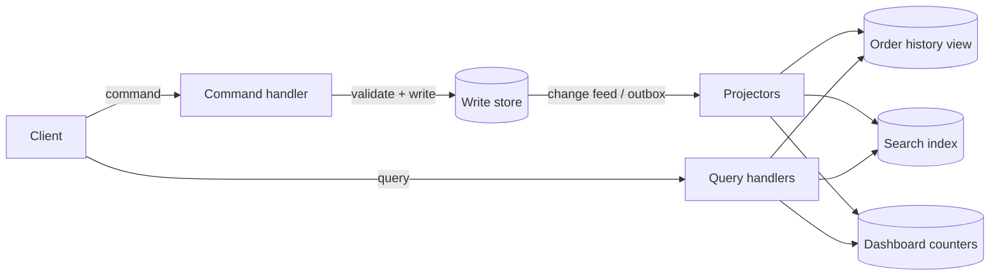

## In one minute
- Command Query Responsibility Segregation splits the model that changes state (commands) from the model that answers questions (queries).
- The write side enforces invariants on a normalised model. The read side keeps one or more denormalised views shaped for specific screens or APIs, updated from changes on the write side.
- When the two sides use separate stores, reads become eventually consistent. Designing for that lag, in the UI and in the API contract, is most of the real work.
- CQRS pays off when read and write workloads differ sharply in shape or scale. For simple CRUD it doubles the code for little benefit.

## How it works

### Two models, one source of truth
A command such as `PlaceOrder` or `CancelOrder` goes to a handler that loads the aggregate, checks rules ("cannot cancel a shipped order"), and writes the new state. It returns success or failure, not data for display. Name commands after business tasks ("Book room"), not field updates ("Set status to Reserved"), so the handler sees the user's intent and can check the rules that go with it ([Azure Architecture Center](https://learn.microsoft.com/en-us/azure/architecture/patterns/cqrs)). Queries never touch that model. They read from views built for them: an order history table keyed by customer, a search index, a counter in a cache. The write store remains the source of truth; every view can be rebuilt from it.

### Keeping views up to date
Three common ways, in order of coupling:

- **Same database, same transaction.** The command handler updates the view tables too. Views are always consistent, but write latency grows with each view.
- **Change feed.** The write side publishes events through an outbox or change data capture, and projectors consume them and update views. Views lag by milliseconds to seconds. You cannot put the database and the broker in one transaction, which is why the outbox exists, and the consumer must still tolerate duplicates ([Azure Architecture Center](https://learn.microsoft.com/en-us/azure/architecture/patterns/cqrs)).
- **Event sourcing.** The events are the write model, and views are projections of the event stream.

### Projections
A projector is a consumer that maps each change to view updates, for example `OrderPlaced` increments `customer_summary.order_count` and adds to `total_spent`. It must be idempotent (store the last processed position or event ID in the same transaction as the view update) and ordered per aggregate. Rebuilding a view means resetting it and replaying from the beginning, which you will do whenever a view's shape changes. If the projector polls a table by an auto-increment ID instead of consuming a log, beware: IDs are assigned before commit, so a reader can pass an ID whose transaction commits a moment later and never see it ([Dudycz](https://event-driven.io/en/ordering_in_postgres_outbox/)).

### Living with lag
After a user places an order, the order list might not show it for 300 ms. Options: return the new state in the command response and let the client merge it, have the client wait until the view's position passes the command's position ("read your writes" via a version token), or route that one user's next read to the write store. Pick per screen; most views tolerate seconds of lag.

## Down the stack

### Layer 1: The contract
Commands are processed against the write store with its normal guarantees: serialisable or at least per-row atomic updates, constraint checks, and a commit point. Queries against a projected view see a prefix of the committed history: every change up to some position, nothing after it, in order. The gap between the write store's head and the view's position is the lag, and the contract for each view is a lag budget plus monotonic progress (a view never goes backwards). Read-your-writes is not provided unless the client waits for a position.

### Layer 2: The mechanism
With Postgres as the write store, change data capture uses logical decoding. A logical replication slot decodes WAL records into row-level changes through an output plugin such as `pgoutput`; Debezium reads the slot and emits change events tagged with their LSN (log sequence number). Each projector applies events and stores the last applied LSN or broker offset in the same transaction as the view update, so restart resumes exactly. The slot tracks `confirmed_flush_lsn`; Postgres retains all WAL after that point until the consumer confirms it. A slot's position is persisted only at checkpoints, so after a crash it can go back and resend recent changes; Postgres leaves avoiding double effects to the client, which is one more reason projectors must be idempotent ([Postgres docs](https://www.postgresql.org/docs/current/logicaldecoding-explanation.html)). Until Postgres 17, logical slots also lived only on the primary, so a failover lost the CDC position; 17 added failover slots that are synchronised to a standby ([Postgres 17 release notes](https://www.postgresql.org/docs/release/17.0/)). A version token returned to the client is just a commit LSN that a query can wait for.

### Layer 3: The machine
Every commit appends WAL records sequentially and calls `fsync` (batched across concurrent commits by group commit), into 16 MB WAL segment files. Logical decoding reads that same WAL, so CDC adds sequential read I/O and CPU for decoding, not extra writes on the hot path. A stalled consumer is dangerous: retained WAL grows at the write rate, for example 20 MB per second becomes 1.7 TB per day, until the disk fills and the primary stops. The default is to keep WAL for a slot without limit. Set `max_slot_wal_keep_size` (Postgres 13 and later), which invalidates a slot that falls too far behind instead of filling the disk ([Postgres docs](https://www.postgresql.org/docs/current/runtime-config-replication.html)); Postgres 18 also adds `idle_replication_slot_timeout` to drop slots nobody has used for a while ([Postgres 18 release notes](https://www.postgresql.org/docs/release/18.0/)). An invalidated slot means the projector must be re-snapshotted, which is far cheaper than a primary outage. On the read side, a denormalised row keyed for the query is found with a B-tree descent of 3 or 4 levels of 8 KB pages, usually all in the buffer cache, a few microseconds. The normalised join it replaces may touch hundreds of pages across five tables and spill sorts to disk.

### Why it's built this way
1. Writes want normalised data to keep invariants cheap to check; reads want data pre-joined in the shape of the screen.
2. One physical layout cannot be optimal for both, so the data is stored twice in different layouts.
3. Keeping the second copy synchronously would put every view on the write path, so it is updated asynchronously and lags.
4. The database already writes an ordered change log for crash recovery, so CDC reuses the WAL instead of inventing a new feed.

## Diagram


## Worked example
A food-delivery platform stores orders in Postgres: 400 writes per second at peak. Reads are 25,000 per second: customers checking order history, restaurants polling their live queue, and a support dashboard searching by phone number or address. The history query joins five tables and costs 30 ms; the support search uses `LIKE` across joined columns and costs up to 2 seconds.

With CQRS, the order service writes only to normalised tables and an outbox. A projector consumes the change stream and maintains three views: a `customer_orders` table keyed by `(customer_id, placed_at)` holding a pre-rendered summary row (2 ms reads), a per-restaurant live queue in Redis, and a search index for support. Projector lag p99 is 400 ms.

The restaurant queue cannot be stale by much, so its projector runs with its own consumer group and alerts at 2 seconds of lag. For customers, the API returns the created order in the `PlaceOrder` response so the app shows it immediately. Primary database CPU falls from 70% to 25% because read traffic moved to stores that are cheap to scale horizontally.

## In the wild
- **Precision Nutrition, 2020: a projector that skipped events.** Their coaching platform was event sourced on Postgres, and subscribers polled `WHERE id > last_seen ORDER BY id`. After a few weeks in production, processors started failing because events had been applied to an invalid state. The log showed IDs 185, 186 and 189: the transactions holding 187 and 188 began earlier but committed after 189, so they were invisible when the reader passed them. About 0.6% of IDs in the table were permanent gaps from rollbacks, so "wait for the next ID" was not an option either ([Precision Nutrition](https://tech.precisionnutrition.com/postgres/databases/2020/03/06/fun-with-mvcc)).
- **Debezium on RDS, 2022: an idle slot fills a disk.** Gunnar Morling described a stopped CDC connector whose replication slot kept every WAL segment. Nobody wrote to the database, but RDS wrote a heartbeat every five minutes and each one forced a new 64 MB segment, so a 200 GiB volume filled in under two weeks. The fixes: alert on retained WAL per slot, drop slots that are no longer used, and for quiet databases emit periodic `pg_logical_emit_message()` heartbeats so active slots can advance ([morling.dev](https://morling.dev/blog/insatiable-postgres-replication-slot)).

## Trade-offs
| Option | Strengths | Weaknesses | Choose when |
|---|---|---|---|
| Single model (CRUD) | Simple, strongly consistent reads | Reads and writes compete, queries get complex | Balanced, modest workloads |
| CQRS with shared database | Separate code paths, consistent views | Write cost grows with views, one store to scale | You want clean separation without lag |
| CQRS with separate read stores | Independent scaling, best-fit stores per query | Eventual consistency, projector operations | Heavy, varied read patterns |
| CQRS with event sourcing | Full history, any view rebuildable | Highest complexity, schema evolution of events | Audit-heavy domains needing temporal queries |

## Pitfalls in production
- **Read-your-writes surprises.** Users submit a form and do not see the change. Return the result in the command response or wait on a version token for that screen.
- **Non-idempotent projectors.** A replayed event double-counts a total. Store the processed position in the same transaction as the view update.
- **Rebuilds that take days.** Replaying 3 billion events at 5,000 per second takes a week. Build new views in parallel with the old one, use snapshots, and partition replays.
- **Commands returning query data.** Handlers grow into query services and the separation erodes. Keep command responses to IDs, versions, and validation errors.
- **CQRS everywhere.** Applying it to every bounded context multiplies infrastructure. Use it only where read and write needs truly diverge. Fowler, who popularised Greg Young's term, warns that for most systems it adds risky complexity and belongs only in specific bounded contexts ([Fowler](https://martinfowler.com/bliki/CQRS.html)).

## Leadership lens
- Ask for the lag budget per view and how each screen behaves when the budget is exceeded.
- Require that every view can be rebuilt, and that someone has timed the rebuild.
- Weigh operational cost: projectors, consumer groups, extra stores, and on-call ownership for each.
- Scope it narrowly: one bounded context with clear read pressure is a good first candidate.

## Check yourself
1. Why should a projector record its last processed position in the same transaction as the view update?
   **Answer:** So a crash cannot leave the view updated but the position not advanced, which would apply the event twice on restart, or the reverse, which would skip it.
2. A user creates an item and the list page does not show it. Name two fixes.
   **Answer:** Return the created item from the command and merge it client-side, or pass a version token so the query waits until the view has caught up to that version.
3. When is a single shared database still a reasonable CQRS implementation?
   **Answer:** When the main goal is separating code paths and query shapes, the write rate is modest, and consistent reads matter more than independent scaling.

## Practice
**Task:** Build a minimal CQRS order system. Commands `place_order(order_id, customer, amount)` and `cancel_order(order_id)` validate against the write model and append an event to a pending list; placing a duplicate ID or cancelling an unknown or already cancelled order raises `ValueError`. `project(limit)` applies up to `limit` pending events (all if `limit` is `None`) to the read model and returns how many it applied. The query `customer_summary(customer)` reads only the read model and returns `{"orders": n, "total": t}` for non-cancelled orders, and `lag()` returns the number of unprojected events.

```python starter
class OrderSystem:
    def __init__(self):
        # TODO
        raise NotImplementedError

    def place_order(self, order_id, customer, amount):
        raise NotImplementedError

    def cancel_order(self, order_id):
        raise NotImplementedError

    def project(self, limit=None):
        raise NotImplementedError

    def customer_summary(self, customer):
        raise NotImplementedError

    def lag(self):
        raise NotImplementedError
```

```python tests
def test_read_model_is_stale_until_projected():
    s = OrderSystem()
    s.place_order("o1", "ann", 30)
    assert s.customer_summary("ann") == {"orders": 0, "total": 0}
    assert s.lag() == 1
    assert s.project() == 1
    assert s.customer_summary("ann") == {"orders": 1, "total": 30}

def test_cancel_removes_from_summary():
    s = OrderSystem()
    s.place_order("o1", "ann", 30)
    s.place_order("o2", "ann", 20)
    s.cancel_order("o1")
    s.project()
    assert s.customer_summary("ann") == {"orders": 1, "total": 20}

def test_partial_projection():
    s = OrderSystem()
    for i in range(5):
        s.place_order("o%d" % i, "bob", 10)
    assert s.project(2) == 2 and s.lag() == 3
    assert s.customer_summary("bob") == {"orders": 2, "total": 20}

def test_duplicate_order_rejected():
    s = OrderSystem()
    s.place_order("o1", "ann", 30)
    try:
        s.place_order("o1", "ann", 30)
        assert False, "expected ValueError"
    except ValueError:
        pass

def test_double_cancel_rejected_before_projection():
    s = OrderSystem()
    s.place_order("o1", "ann", 30)
    s.cancel_order("o1")
    try:
        s.cancel_order("o1")
        assert False, "expected ValueError"
    except ValueError:
        pass

def test_unknown_customer():
    assert OrderSystem().customer_summary("nobody") == {"orders": 0, "total": 0}
```

```python solution
class OrderSystem:
    def __init__(self):
        self.orders = {}    # write model: id -> [customer, amount, cancelled]
        self.pending = []   # events not yet projected
        self.view = {}      # read model: customer -> {"orders", "total"}
        self.view_orders = {}

    def place_order(self, order_id, customer, amount):
        if order_id in self.orders:
            raise ValueError("duplicate order")
        self.orders[order_id] = [customer, amount, False]
        self.pending.append(("placed", order_id, customer, amount))

    def cancel_order(self, order_id):
        o = self.orders.get(order_id)
        if o is None or o[2]:
            raise ValueError("cannot cancel")
        o[2] = True
        self.pending.append(("cancelled", order_id, o[0], o[1]))

    def project(self, limit=None):
        n = len(self.pending) if limit is None else min(limit, len(self.pending))
        for kind, oid, customer, amount in self.pending[:n]:
            row = self.view.setdefault(customer, {"orders": 0, "total": 0})
            sign = 1 if kind == "placed" else -1
            row["orders"] += sign
            row["total"] += sign * amount
        self.pending = self.pending[n:]
        return n

    def customer_summary(self, customer):
        return dict(self.view.get(customer, {"orders": 0, "total": 0}))

    def lag(self):
        return len(self.pending)
```

```typescript starter
export type Summary = { orders: number; total: number };

export class OrderSystem {
  placeOrder(orderId: string, customer: string, amount: number): void {
    throw new Error("TODO");
  }
  cancelOrder(orderId: string): void {
    throw new Error("TODO");
  }
  project(limit?: number): number {
    throw new Error("TODO");
  }
  customerSummary(customer: string): Summary {
    throw new Error("TODO");
  }
  lag(): number {
    throw new Error("TODO");
  }
}
```

```typescript tests
function throws(fn: () => void): boolean {
  try { fn(); return false; } catch (e) { return true; }
}
test("read model stale until projected", () => {
  const s = new OrderSystem();
  s.placeOrder("o1", "ann", 30);
  assertEqual(s.customerSummary("ann"), { orders: 0, total: 0 });
  assertEqual(s.lag(), 1);
  assertEqual(s.project(), 1);
  assertEqual(s.customerSummary("ann"), { orders: 1, total: 30 });
});
test("cancel removes from summary", () => {
  const s = new OrderSystem();
  s.placeOrder("o1", "ann", 30);
  s.placeOrder("o2", "ann", 20);
  s.cancelOrder("o1");
  s.project();
  assertEqual(s.customerSummary("ann"), { orders: 1, total: 20 });
});
test("partial projection", () => {
  const s = new OrderSystem();
  for (let i = 0; i < 5; i++) s.placeOrder("o" + i, "bob", 10);
  assertEqual(s.project(2), 2);
  assertEqual(s.lag(), 3);
  assertEqual(s.customerSummary("bob"), { orders: 2, total: 20 });
});
test("duplicate order rejected", () => {
  const s = new OrderSystem();
  s.placeOrder("o1", "ann", 30);
  assert(throws(() => s.placeOrder("o1", "ann", 30)), "expected error");
});
test("double cancel rejected", () => {
  const s = new OrderSystem();
  s.placeOrder("o1", "ann", 30);
  s.cancelOrder("o1");
  assert(throws(() => s.cancelOrder("o1")), "expected error");
});
test("unknown customer", () => {
  assertEqual(new OrderSystem().customerSummary("nobody"), { orders: 0, total: 0 });
});
```

```typescript solution
export type Summary = { orders: number; total: number };
type Ev = { kind: "placed" | "cancelled"; customer: string; amount: number };

export class OrderSystem {
  private orders = new Map<string, { customer: string; amount: number; cancelled: boolean }>();
  private pending: Ev[] = [];
  private view = new Map<string, Summary>();

  placeOrder(orderId: string, customer: string, amount: number): void {
    if (this.orders.has(orderId)) throw new Error("duplicate order");
    this.orders.set(orderId, { customer, amount, cancelled: false });
    this.pending.push({ kind: "placed", customer, amount });
  }
  cancelOrder(orderId: string): void {
    const o = this.orders.get(orderId);
    if (!o || o.cancelled) throw new Error("cannot cancel");
    o.cancelled = true;
    this.pending.push({ kind: "cancelled", customer: o.customer, amount: o.amount });
  }
  project(limit?: number): number {
    const n = limit === undefined ? this.pending.length : Math.min(limit, this.pending.length);
    for (const ev of this.pending.slice(0, n)) {
      const row = this.view.get(ev.customer) ?? { orders: 0, total: 0 };
      const sign = ev.kind === "placed" ? 1 : -1;
      row.orders += sign;
      row.total += sign * ev.amount;
      this.view.set(ev.customer, row);
    }
    this.pending = this.pending.slice(n);
    return n;
  }
  customerSummary(customer: string): Summary {
    const r = this.view.get(customer);
    return r ? { ...r } : { orders: 0, total: 0 };
  }
  lag(): number {
    return this.pending.length;
  }
}
```

```go starter
package practice

// Summary is a read-model row.
type Summary struct {
	Orders int
	Total  int
}

type OrderSystem struct{}

func NewOrderSystem() *OrderSystem { return &OrderSystem{} }

func (s *OrderSystem) PlaceOrder(orderID, customer string, amount int) error { panic("TODO") }

func (s *OrderSystem) CancelOrder(orderID string) error { panic("TODO") }

// Project applies up to limit pending events; limit < 0 means all.
func (s *OrderSystem) Project(limit int) int { panic("TODO") }

func (s *OrderSystem) CustomerSummary(customer string) Summary { panic("TODO") }

func (s *OrderSystem) Lag() int { panic("TODO") }
```

```go tests
package practice

import (
	"fmt"
	"testing"
)

func TestStaleUntilProjected(t *testing.T) {
	s := NewOrderSystem()
	s.PlaceOrder("o1", "ann", 30)
	if s.CustomerSummary("ann") != (Summary{}) || s.Lag() != 1 {
		t.Fatal("read model should be stale")
	}
	if s.Project(-1) != 1 || s.CustomerSummary("ann") != (Summary{1, 30}) {
		t.Fatalf("got %v", s.CustomerSummary("ann"))
	}
}

func TestCancel(t *testing.T) {
	s := NewOrderSystem()
	s.PlaceOrder("o1", "ann", 30)
	s.PlaceOrder("o2", "ann", 20)
	s.CancelOrder("o1")
	s.Project(-1)
	if got := s.CustomerSummary("ann"); got != (Summary{1, 20}) {
		t.Fatalf("got %v", got)
	}
}

func TestPartialProjection(t *testing.T) {
	s := NewOrderSystem()
	for i := 0; i < 5; i++ {
		s.PlaceOrder(fmt.Sprintf("o%d", i), "bob", 10)
	}
	if s.Project(2) != 2 || s.Lag() != 3 || s.CustomerSummary("bob") != (Summary{2, 20}) {
		t.Fatal("partial projection wrong")
	}
}

func TestDuplicate(t *testing.T) {
	s := NewOrderSystem()
	s.PlaceOrder("o1", "ann", 30)
	if s.PlaceOrder("o1", "ann", 30) == nil {
		t.Fatal("expected error")
	}
}

func TestDoubleCancel(t *testing.T) {
	s := NewOrderSystem()
	s.PlaceOrder("o1", "ann", 30)
	s.CancelOrder("o1")
	if s.CancelOrder("o1") == nil || s.CancelOrder("nope") == nil {
		t.Fatal("expected error")
	}
}
```

```go solution
package practice

import "errors"

// Summary is a read-model row.
type Summary struct {
	Orders int
	Total  int
}

type order struct {
	customer  string
	amount    int
	cancelled bool
}

type event struct {
	sign     int
	customer string
	amount   int
}

type OrderSystem struct {
	orders  map[string]*order
	pending []event
	view    map[string]Summary
}

func NewOrderSystem() *OrderSystem {
	return &OrderSystem{orders: map[string]*order{}, view: map[string]Summary{}}
}

func (s *OrderSystem) PlaceOrder(orderID, customer string, amount int) error {
	if _, ok := s.orders[orderID]; ok {
		return errors.New("duplicate order")
	}
	s.orders[orderID] = &order{customer: customer, amount: amount}
	s.pending = append(s.pending, event{1, customer, amount})
	return nil
}

func (s *OrderSystem) CancelOrder(orderID string) error {
	o, ok := s.orders[orderID]
	if !ok || o.cancelled {
		return errors.New("cannot cancel")
	}
	o.cancelled = true
	s.pending = append(s.pending, event{-1, o.customer, o.amount})
	return nil
}

// Project applies up to limit pending events; limit < 0 means all.
func (s *OrderSystem) Project(limit int) int {
	n := len(s.pending)
	if limit >= 0 && limit < n {
		n = limit
	}
	for _, ev := range s.pending[:n] {
		row := s.view[ev.customer]
		row.Orders += ev.sign
		row.Total += ev.sign * ev.amount
		s.view[ev.customer] = row
	}
	s.pending = s.pending[n:]
	return n
}

func (s *OrderSystem) CustomerSummary(customer string) Summary { return s.view[customer] }

func (s *OrderSystem) Lag() int { return len(s.pending) }
```

## Mock interview
**Prompt:** A B2B invoicing product has 300 writes per second and 20,000 reads per second across dashboards, exports, and full-text search, all on one Postgres primary that is at 85% CPU. Propose a CQRS design and migration path.

- Follow-up: A customer edits an invoice and the dashboard shows the old total for 4 seconds. Is that a bug, and what do you do?
- Follow-up: You need a new view that aggregates two years of history. How do you build it without downtime?
- Follow-up: Why not just add read replicas?

**A strong answer covers:**
- Commands on the normalised write store, with an outbox or CDC feeding projectors.
- Purpose-built read stores per query family, each with an explicit lag budget.
- Read-your-writes strategies per screen: command responses, version tokens, or targeted reads from the primary.
- Idempotent projectors that store their position transactionally, and timed rebuilds.
- Comparison with read replicas, which help scale identical queries but do not change query shape.

## Sources and further study
**Primary**
- [Greg Young, CQRS Documents (2010)](https://cqrs.files.wordpress.com/2010/11/cqrs_documents.pdf): the originator's long-form write-up of task-based commands, separate read models and event sourcing.
- [Precision Nutrition, Fun with MVCC (2020)](https://tech.precisionnutrition.com/postgres/databases/2020/03/06/fun-with-mvcc): a real projector bug from polling by sequence ID.
- [Gunnar Morling, The insatiable Postgres replication slot (2022)](https://morling.dev/blog/insatiable-postgres-replication-slot): why idle CDC slots retain WAL and how heartbeats fix it.

**Systems docs**
- [PostgreSQL: logical decoding concepts](https://www.postgresql.org/docs/current/logicaldecoding-explanation.html): slots, crash replay and failover slot synchronisation.
- [PostgreSQL: replication settings](https://www.postgresql.org/docs/current/runtime-config-replication.html): `max_slot_wal_keep_size` and `idle_replication_slot_timeout`.
- [Debezium PostgreSQL connector](https://debezium.io/documentation/reference/stable/connectors/postgresql.html): `heartbeat.interval.ms` and `heartbeat.action.query` for keeping slots moving on quiet databases.

**Books**
- *Fundamentals of Software Architecture* (2nd ed.), Mark Richards and Neal Ford, Ch 20 "Architectural Patterns", section "CQRS".
- *Designing Data-Intensive Applications* (2nd ed.), Martin Kleppmann and Chris Riccomini, Ch 3, section "Event Sourcing and CQRS"; and Ch 12 "Stream Processing", section "Databases and Streams" on change data capture.

**Other curricula**
- [roadmap.sh: System Design](https://roadmap.sh/system-design): a one-paragraph CQRS node that points to the Azure pattern page; it says nothing about lag budgets or read-your-writes.
- [donnemartin/system-design-primer](https://github.com/donnemartin/system-design-primer): does not name CQRS; its closest material is denormalization and read replicas under the database section.

## Watch
- [Greg Young: CQRS and Event Sourcing (Code on the Beach 2014)](https://www.youtube.com/watch?v=JHGkaShoyNs): the originator of the term explains the separation and why it helps.
- [The Many Meanings of Event-Driven Architecture, Martin Fowler (GOTO 2017)](https://www.youtube.com/watch?v=STKCRSUsyP0): places CQRS among related event patterns and warns about misuse.

## Free resources
- [CQRS (martinfowler.com)](https://martinfowler.com/bliki/CQRS.html): a short definition with a clear warning about when not to use it.
- [CQRS pattern (Azure Architecture Center)](https://learn.microsoft.com/en-us/azure/architecture/patterns/cqrs): implementation considerations, including separate stores and eventual consistency.
- [CQRS (microservices.io)](https://microservices.io/patterns/data/cqrs.html): CQRS as a way to query across services' data.
- [Transactional outbox (microservices.io)](https://microservices.io/patterns/data/transactional-outbox.html): reliable change feeds for projectors.
