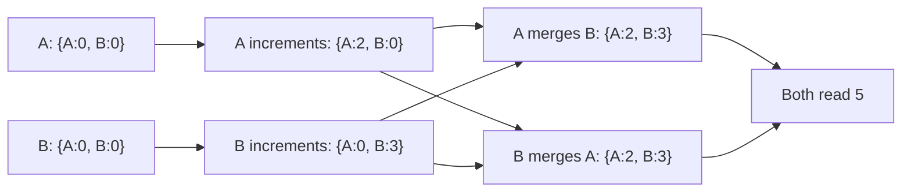

## In one minute
- A CRDT (conflict-free replicated data type) is a data structure that replicas can update independently, offline, with no coordination, and still converge to the same value once they have seen the same updates.
- Convergence is guaranteed by math, not by a leader: merges are commutative, associative, and idempotent, so order and duplication of delivery do not matter.
- You pick a CRDT per data shape: counters, registers, sets, maps, sequences for text. Each one bakes in a conflict policy such as add-wins or last-writer-wins.
- The costs are metadata growth (tombstones, version vectors, unique IDs) and semantics that may not match the business rule, such as an inventory count going negative.

## How it works

### State-based CRDTs
Each replica holds a state, and a `merge` function computes the least upper bound of two states. Replicas periodically ship full state (or deltas) to each other. Because merge is idempotent and commutative, gossip, retries, and reordering are harmless. The classic **G-Counter** stores a map from replica ID to count; a replica increments only its own entry; merge takes the per-entry max; the value is the sum. A **PN-Counter** is two G-Counters, one for increments and one for decrements. Shapiro and colleagues' catalogue defines these and proves each one converges ([Shapiro et al.](https://inria.hal.science/inria-00555588/document)).

### Operation-based CRDTs
Replicas broadcast operations instead of state. Operations that may run concurrently must commute, and the delivery layer must deliver each operation exactly once and usually in causal order. Messages are small, but the transport is more demanding. **Delta-state** CRDTs sit in between: a *delta mutator* returns a small state fragment that merges like a full state, so they get small messages and keep the forgiving transport of state-based designs ([Almeida, Shoker and Baquero](https://arxiv.org/abs/1603.01529)).

### Registers and sets
A **LWW-Register** keeps the value with the highest `(timestamp, replicaId)`. It is simple and lossy: concurrent writes silently drop all but one. A **multi-value register** keeps all concurrent values, tracked with version vectors, and lets the application resolve them, as Riak's siblings did.

Sets need a policy for concurrent add and remove of the same element. An **OR-Set** (observed-remove) tags every add with a unique ID. A remove deletes only the tags it has observed. A concurrent add carries a tag the remove never saw, so the element survives: *add wins*.

### Sequences for collaborative text
Text editing needs a list CRDT such as RGA, YATA (used by Yjs), or Fugue, which was designed so that two users typing at the same spot do not get their passages interleaved ([Weidner and Kleppmann](https://arxiv.org/abs/2305.00583)). Each character gets a unique, ordered identifier, for example `(lamportClock, replicaId)`, and insertions reference the identifier of the character to their left. Deletes leave tombstones so later inserts can still find their anchor. Modern implementations compress runs of characters typed in sequence, which cuts metadata from dozens of bytes per character to a few bytes per run.

### Why it converges
For state-based CRDTs, states form a join-semilattice: there is a partial order, and merge returns the smallest state at least as large as both inputs. Every update moves the state upward. Any two replicas that have received the same set of updates have the same least upper bound, regardless of path.

## Down the stack

### Layer 1: The contract
CRDTs promise *strong eventual consistency*: any two replicas that have received the same set of updates are in the same state, in any delivery order, with duplicates, and without any coordination. Every replica accepts writes locally while partitioned, so local latency is a memory write. What you do not get is just as precise. There is no global invariant across replicas (two replicas can each spend the last unit of a budget), no guarantee that the merged result matches what either user intended, and no bound on staleness beyond "when the updates arrive". Operation-based CRDTs additionally require the transport to deliver every operation exactly once in causal order; state-based ones only need eventual delivery.

### Layer 2: The mechanism
Yjs, one of the most widely used text CRDTs, stores a document as a linked list of *items*. Each item has an ID `(clientID, clock)`, the IDs of its left and right neighbours at insertion time (`origin` and `rightOrigin`), and its content. The YATA rules use those origins to place concurrent inserts deterministically. Consecutive characters typed by one client merge into a single item, so a paragraph typed in one go is one struct. A replica summarises what it has as a *state vector*, a map from clientID to the next expected clock. Sync is two steps: send your state vector, receive exactly the items you lack. Deletions are kept as a compact *delete set* of `(clientID, clock, length)` ranges, and deleted content can be garbage collected while the item's ID and length stay as an anchor ([Yjs internals](https://github.com/yjs/yjs/blob/main/INTERNALS.md)). Deletes usually come in runs, so the delete set stays tiny: for a benchmark trace with 182,000 inserts and 77,000 deleted characters it is about 4.5 KB.

Automerge takes a different shape: every change is hashed and lists the hashes of the changes it depends on, forming a DAG like a git history. Since version 2 the core is written in Rust, and documents are saved in a columnar binary format where each property of the operations (actor, counter, insert position, value) is a separate column compressed with run-length and delta encoding, and each change is identified by the SHA-256 hash of its bytes ([Automerge binary format](https://automerge.org/automerge-binary-format-spec/)). Automerge 3.0 (July 2025) keeps that compressed form in memory too instead of expanding it on load: pasting *Moby Dick* into a document took about 700 MB in Automerge 2 and about 1.3 MB in Automerge 3 ([Automerge 3.0](https://automerge.org/blog/automerge-3/)).

On the server side, Redis Software's Active-Active databases (formerly called CRDB) accept writes in every participating cluster and resolve conflicts only with CRDT types, using vector clocks for strong eventual consistency ([Redis docs](https://redis.io/docs/latest/operate/rs/databases/active-active/)). Riak shipped counters, sets, maps, registers and flags as built-in types; since Basho went into receivership in 2017 Riak has been maintained by its open-source community ([Wikipedia](https://en.wikipedia.org/wiki/Riak)), so weigh that before adopting it.

### Layer 3: The machine
Metadata cost is the engineering problem. A naive design that gives each character a JavaScript object with an ID, two origin pointers and a deleted flag spends well over 50 bytes of heap per character before counting the character itself, and a linked list of objects scattered across the heap misses CPU cache on nearly every step, at roughly 100 ns per miss to DRAM. Run-length merging fixes both: one item for a run of typed text, and integer fields encoded as variable-length integers that take 1 to 3 bytes for typical values. Real editing traces compress to close to the size of the text itself: a trace of about 260,000 operations whose final text is 107,121 bytes saves as 129,062 bytes in Automerge 2.0, full history included ([Automerge 2.0](https://automerge.org/blog/automerge-2/)).

On disk the usual pattern is an append-only log of small binary updates, often a few dozen bytes each, written as users type, then periodically merged into one compacted snapshot so load time stays bounded. Tombstones and per-client entries in state vectors never fully disappear, so a long-lived document with thousands of short-lived client IDs grows its version metadata even when the visible text does not.

### Why it's built this way
1. Coordination costs a round trip that offline and high-latency clients cannot pay, so every replica must accept writes alone and fix conflicts by math, not by asking.
2. Merge must give the same result regardless of order or duplication, so it is defined as a join over a semilattice: commutative, associative and idempotent.
3. That requires never forgetting what was seen, so IDs, tombstones and version vectors accumulate.
4. Accumulated metadata would dwarf the data, so implementations compress runs, encode integers compactly, and garbage collect deleted content while keeping its anchors.

## Diagram


## Worked example
A shopping cart service runs in 3 regions with active-active writes and 100 ms cross-region latency. Each cart is an OR-Map from product ID to a PN-Counter for quantity.

A user adds 2 mugs on a phone routed to region A. At the same moment their laptop, served by region B, removes the mug line that it saw from yesterday. After replication, A's add carries a fresh tag that B's remove did not observe, so the mug line survives with quantity 2. With last-writer-wins instead, whichever request had the later timestamp would win, and a 50 ms clock skew could decide it. The OR-Set result matches what users expect from a cart.

Metadata cost: each add tag is about 16 bytes (replica ID plus counter). A cart with 20 lines and a history of 200 adds and removes holds tags only for live adds, about 320 bytes, if removes discard observed tags. Tombstones are where costs grow, which is why systems either garbage-collect them once all replicas have acknowledged (requiring known membership) or use designs that avoid them.

For a collaborative document of 100,000 characters, a naive sequence CRDT with 32 bytes per character costs 3.2 MB of metadata. Run-length and columnar encoding in Yjs or Automerge bring the saved form close to the text size, and Automerge 3 keeps it compact in memory as well.

## In the wild
- **Riak, 2013: last-writer-wins drops most concurrent writes.** Jepsen ran Riak with `allow_mult=false`, which resolves conflicts by timestamp. During a partition it lost 1,815 of 1,985 acknowledged writes, and 1,434 of 2,000 even on a healthy cluster; stricter read and write quorums did not help. With `allow_mult=true` and siblings merged by set union, no writes were lost. The advice was to merge with an associative, commutative, idempotent function, which is a CRDT ([Jepsen](https://aphyr.com/posts/285-call-me-maybe-riak)).
- **Riot Games, 2016: friend lists as application-level CRDTs.** League of Legends chat stored rosters in Riak with siblings enabled and a replication factor of 3 to 5. When two players sent Alice a friend invite at the same moment from different chat servers, Riak kept both versions, and the next read merged the operation logs so both invites survived. Each roster is encoded as a CRDT, then JSON, then compressed ([Riot Games](https://technology.riotgames.com/news/chat-service-architecture-persistence)).
- **Notion, 2025: CRDTs arrive with offline mode.** Offline editing had been Notion's most requested feature for years. Pages a user marks for offline use are migrated on demand to a new CRDT data model for conflict resolution, and the local SQLite cache was turned from best effort into persistent storage that holds everything those pages depend on ([Notion](https://www.notion.com/blog/how-we-made-notion-available-offline)).

## Trade-offs
| Option | Strengths | Weaknesses | Choose when |
|---|---|---|---|
| State-based CRDT | Tolerates loss, duplication, reorder | Shipping large states | Gossip replication between servers |
| Op-based CRDT | Small messages | Needs exactly-once causal delivery | Reliable ordered pipe already exists |
| LWW-Register | Tiny, simple | Silently loses concurrent writes | Values where any recent write is fine |
| Multi-value register | Nothing lost | App must resolve siblings | Data where losing writes is unacceptable |
| Consensus or single leader | Arbitrary invariants, exact semantics | Coordination latency, no offline writes | Balances, uniqueness, inventory limits |

## Pitfalls in production
- Invariants that CRDTs cannot keep, such as "stock never below zero" or "usernames unique". Use coordination (escrow, reservations, or consensus) for those.
- Tombstones grow without bound in long-lived documents. Plan garbage collection with causal stability or periodic snapshots that rebase history.
- LWW with wall clocks drops writes under skew. Use hybrid logical clocks, or a multi-value register where losses matter.
- Replica IDs reused after a device reinstall break uniqueness of tags. Generate fresh random IDs per install or session.
- Interleaving anomalies in text: two users typing at the same spot can have characters interleaved, a problem that affects both CRDTs and OT and went unnoticed for decades. Use algorithms designed against it, such as Fugue ([Weidner and Kleppmann](https://arxiv.org/abs/2305.00583)).

## Leadership lens
- CRDTs are worth it when offline or multi-region active-active writes are a requirement, not a nice-to-have. Otherwise a single leader is simpler to reason about.
- Ask what conflict policy each field gets, and have product sign off on it; "add wins" is a product decision.
- Prefer a mature, maintained library (Automerge, Yjs, or Redis Software's Active-Active types) over hand-rolled merges, and fuzz merge order in tests.
- Budget for storage growth and compaction from day one, and measure document load time at the 99th percentile size.

## Check yourself
1. Why must a state-based merge be idempotent?
   **Answer:** Gossip and retries deliver the same state more than once; idempotence ensures re-merging changes nothing.
2. In an OR-Set, why does a concurrent add survive a remove?
   **Answer:** The remove deletes only the tags it observed, and the concurrent add created a new tag the remover never saw.
3. Why can a PN-Counter not enforce "never below zero"?
   **Answer:** Two replicas can each decrement the last unit concurrently without coordination; the invariant needs agreement before the decrement.
4. What is the main extra requirement of operation-based CRDTs?
   **Answer:** A delivery layer that delivers every operation exactly once and in causal order.

## Practice
**Task:** Implement three state-based CRDTs with a `merge(other)` that mutates `self`. `GCounter(rid)` has `inc(n=1)` and `value()`. `PNCounter(rid)` has `inc(n=1)`, `dec(n=1)`, and `value()`. `ORSet()` has `add(elem, tag)` (the caller supplies a unique tag), `remove(elem)` which removes every tag currently observed for `elem`, `contains(elem)`, and `merge(other)`. Track removed tags so merge does not resurrect them. Merges must be commutative and idempotent.

```python starter
class GCounter:
    def __init__(self, rid):
        self.rid = rid

    def inc(self, n=1):
        pass  # TODO

    def value(self):
        return 0  # TODO

    def merge(self, other):
        pass  # TODO


class PNCounter:
    def __init__(self, rid):
        self.rid = rid

    def inc(self, n=1):
        pass  # TODO

    def dec(self, n=1):
        pass  # TODO

    def value(self):
        return 0  # TODO

    def merge(self, other):
        pass  # TODO


class ORSet:
    def add(self, elem, tag):
        pass  # TODO

    def remove(self, elem):
        pass  # TODO

    def contains(self, elem):
        return False  # TODO

    def merge(self, other):
        pass  # TODO
```

```python tests
def test_gcounter_converges():
    a, b = GCounter("a"), GCounter("b")
    a.inc(2)
    b.inc(3)
    a.merge(b)
    b.merge(a)
    assert a.value() == b.value() == 5

def test_gcounter_merge_idempotent():
    a, b = GCounter("a"), GCounter("b")
    b.inc(4)
    a.merge(b)
    a.merge(b)
    assert a.value() == 4

def test_pncounter():
    a, b = PNCounter("a"), PNCounter("b")
    a.inc(5)
    b.dec(2)
    a.merge(b)
    assert a.value() == 3

def test_orset_add_wins_over_concurrent_remove():
    a, b = ORSet(), ORSet()
    a.add("mug", "t1")
    b.merge(a)
    b.remove("mug")
    a.add("mug", "t2")
    a.merge(b)
    b.merge(a)
    assert a.contains("mug") and b.contains("mug")

def test_orset_remove_is_not_resurrected():
    a, b = ORSet(), ORSet()
    a.add("x", "t1")
    b.merge(a)
    b.remove("x")
    a.merge(b)
    assert not a.contains("x")
```

```python solution
class GCounter:
    def __init__(self, rid):
        self.rid = rid
        self.counts = {}

    def inc(self, n=1):
        self.counts[self.rid] = self.counts.get(self.rid, 0) + n

    def value(self):
        return sum(self.counts.values())

    def merge(self, other):
        for r, c in other.counts.items():
            self.counts[r] = max(self.counts.get(r, 0), c)


class PNCounter:
    def __init__(self, rid):
        self.p, self.n = GCounter(rid), GCounter(rid)

    def inc(self, n=1):
        self.p.inc(n)

    def dec(self, n=1):
        self.n.inc(n)

    def value(self):
        return self.p.value() - self.n.value()

    def merge(self, other):
        self.p.merge(other.p)
        self.n.merge(other.n)


class ORSet:
    def __init__(self):
        self.adds, self.removed = set(), set()

    def add(self, elem, tag):
        self.adds.add((elem, tag))

    def remove(self, elem):
        self.removed |= {p for p in self.adds if p[0] == elem}

    def contains(self, elem):
        return any(p[0] == elem for p in self.adds - self.removed)

    def merge(self, other):
        self.adds |= other.adds
        self.removed |= other.removed
```

```typescript starter
export class GCounter {
  constructor(public rid: string) {}

  inc(n = 1): void {
    throw new Error("TODO");
  }

  value(): number {
    throw new Error("TODO");
  }

  merge(other: GCounter): void {
    throw new Error("TODO");
  }
}

export class PNCounter {
  constructor(public rid: string) {}

  inc(n = 1): void {
    throw new Error("TODO");
  }

  dec(n = 1): void {
    throw new Error("TODO");
  }

  value(): number {
    throw new Error("TODO");
  }

  merge(other: PNCounter): void {
    throw new Error("TODO");
  }
}

export class ORSet {
  add(elem: string, tag: string): void {
    throw new Error("TODO");
  }

  remove(elem: string): void {
    throw new Error("TODO");
  }

  contains(elem: string): boolean {
    throw new Error("TODO");
  }

  merge(other: ORSet): void {
    throw new Error("TODO");
  }
}
```

```typescript tests
test("gcounter converges", () => {
  const a = new GCounter("a");
  const b = new GCounter("b");
  a.inc(2);
  b.inc(3);
  a.merge(b);
  b.merge(a);
  assertEqual([a.value(), b.value()], [5, 5]);
});

test("gcounter merge idempotent", () => {
  const a = new GCounter("a");
  const b = new GCounter("b");
  b.inc(4);
  a.merge(b);
  a.merge(b);
  assertEqual(a.value(), 4);
});

test("pncounter", () => {
  const a = new PNCounter("a");
  const b = new PNCounter("b");
  a.inc(5);
  b.dec(2);
  a.merge(b);
  assertEqual(a.value(), 3);
});

test("orset add wins over concurrent remove", () => {
  const a = new ORSet();
  const b = new ORSet();
  a.add("mug", "t1");
  b.merge(a);
  b.remove("mug");
  a.add("mug", "t2");
  a.merge(b);
  b.merge(a);
  assert(a.contains("mug") && b.contains("mug"), "both replicas keep mug");
});

test("orset remove is not resurrected", () => {
  const a = new ORSet();
  const b = new ORSet();
  a.add("x", "t1");
  b.merge(a);
  b.remove("x");
  a.merge(b);
  assert(!a.contains("x"), "removed element stays removed");
});
```

```typescript solution
export class GCounter {
  counts = new Map<string, number>();

  constructor(public rid: string) {}

  inc(n = 1): void {
    this.counts.set(this.rid, (this.counts.get(this.rid) ?? 0) + n);
  }

  value(): number {
    let s = 0;
    for (const c of this.counts.values()) s += c;
    return s;
  }

  merge(other: GCounter): void {
    for (const [r, c] of other.counts) {
      this.counts.set(r, Math.max(this.counts.get(r) ?? 0, c));
    }
  }
}

export class PNCounter {
  p: GCounter;
  n: GCounter;

  constructor(public rid: string) {
    this.p = new GCounter(rid);
    this.n = new GCounter(rid);
  }

  inc(n = 1): void {
    this.p.inc(n);
  }

  dec(n = 1): void {
    this.n.inc(n);
  }

  value(): number {
    return this.p.value() - this.n.value();
  }

  merge(other: PNCounter): void {
    this.p.merge(other.p);
    this.n.merge(other.n);
  }
}

export class ORSet {
  // Each pair is stored as JSON.stringify([elem, tag]).
  adds = new Set<string>();
  removed = new Set<string>();

  add(elem: string, tag: string): void {
    this.adds.add(JSON.stringify([elem, tag]));
  }

  remove(elem: string): void {
    for (const k of this.adds) if (JSON.parse(k)[0] === elem) this.removed.add(k);
  }

  contains(elem: string): boolean {
    for (const k of this.adds) {
      if (!this.removed.has(k) && JSON.parse(k)[0] === elem) return true;
    }
    return false;
  }

  merge(other: ORSet): void {
    for (const k of other.adds) this.adds.add(k);
    for (const k of other.removed) this.removed.add(k);
  }
}
```

```go starter
package practice

type GCounter struct {
	RID string
}

func NewGCounter(rid string) *GCounter { return &GCounter{RID: rid} }

func (g *GCounter) Inc(n int)             { panic("TODO") }
func (g *GCounter) Value() int            { panic("TODO") }
func (g *GCounter) Merge(other *GCounter) { panic("TODO") }

type PNCounter struct {
	RID string
}

func NewPNCounter(rid string) *PNCounter { return &PNCounter{RID: rid} }

func (c *PNCounter) Inc(n int)              { panic("TODO") }
func (c *PNCounter) Dec(n int)              { panic("TODO") }
func (c *PNCounter) Value() int             { panic("TODO") }
func (c *PNCounter) Merge(other *PNCounter) { panic("TODO") }

type ORSet struct{}

func NewORSet() *ORSet { return &ORSet{} }

func (s *ORSet) Add(elem, tag string)      { panic("TODO") }
func (s *ORSet) Remove(elem string)        { panic("TODO") }
func (s *ORSet) Contains(elem string) bool { panic("TODO") }
func (s *ORSet) Merge(other *ORSet)        { panic("TODO") }
```

```go tests
package practice

import "testing"

func TestGCounterConverges(t *testing.T) {
	a, b := NewGCounter("a"), NewGCounter("b")
	a.Inc(2)
	b.Inc(3)
	a.Merge(b)
	b.Merge(a)
	if a.Value() != 5 || b.Value() != 5 {
		t.Fatalf("got %d %d", a.Value(), b.Value())
	}
}

func TestGCounterMergeIdempotent(t *testing.T) {
	a, b := NewGCounter("a"), NewGCounter("b")
	b.Inc(4)
	a.Merge(b)
	a.Merge(b)
	if a.Value() != 4 {
		t.Fatalf("got %d", a.Value())
	}
}

func TestPNCounter(t *testing.T) {
	a, b := NewPNCounter("a"), NewPNCounter("b")
	a.Inc(5)
	b.Dec(2)
	a.Merge(b)
	if a.Value() != 3 {
		t.Fatalf("got %d", a.Value())
	}
}

func TestORSetAddWinsOverConcurrentRemove(t *testing.T) {
	a, b := NewORSet(), NewORSet()
	a.Add("mug", "t1")
	b.Merge(a)
	b.Remove("mug")
	a.Add("mug", "t2")
	a.Merge(b)
	b.Merge(a)
	if !a.Contains("mug") || !b.Contains("mug") {
		t.Fatal("concurrent add should win")
	}
}

func TestORSetRemoveIsNotResurrected(t *testing.T) {
	a, b := NewORSet(), NewORSet()
	a.Add("x", "t1")
	b.Merge(a)
	b.Remove("x")
	a.Merge(b)
	if a.Contains("x") {
		t.Fatal("removed element came back")
	}
}
```

```go solution
package practice

type GCounter struct {
	RID    string
	counts map[string]int
}

func NewGCounter(rid string) *GCounter {
	return &GCounter{RID: rid, counts: map[string]int{}}
}

func (g *GCounter) Inc(n int) { g.counts[g.RID] += n }

func (g *GCounter) Value() int {
	s := 0
	for _, c := range g.counts {
		s += c
	}
	return s
}

func (g *GCounter) Merge(other *GCounter) {
	for r, c := range other.counts {
		if c > g.counts[r] {
			g.counts[r] = c
		}
	}
}

type PNCounter struct {
	RID  string
	p, n *GCounter
}

func NewPNCounter(rid string) *PNCounter {
	return &PNCounter{RID: rid, p: NewGCounter(rid), n: NewGCounter(rid)}
}

func (c *PNCounter) Inc(n int)  { c.p.Inc(n) }
func (c *PNCounter) Dec(n int)  { c.n.Inc(n) }
func (c *PNCounter) Value() int { return c.p.Value() - c.n.Value() }

func (c *PNCounter) Merge(other *PNCounter) {
	c.p.Merge(other.p)
	c.n.Merge(other.n)
}

type pair struct{ elem, tag string }

type ORSet struct {
	adds, removed map[pair]bool
}

func NewORSet() *ORSet {
	return &ORSet{adds: map[pair]bool{}, removed: map[pair]bool{}}
}

func (s *ORSet) Add(elem, tag string) { s.adds[pair{elem, tag}] = true }

func (s *ORSet) Remove(elem string) {
	for p := range s.adds {
		if p.elem == elem {
			s.removed[p] = true
		}
	}
}

func (s *ORSet) Contains(elem string) bool {
	for p := range s.adds {
		if p.elem == elem && !s.removed[p] {
			return true
		}
	}
	return false
}

func (s *ORSet) Merge(other *ORSet) {
	for p := range other.adds {
		s.adds[p] = true
	}
	for p := range other.removed {
		s.removed[p] = true
	}
}
```

## Mock interview
**Prompt:** Design the data layer for a note-taking app with 10 million users who edit on phone, tablet, and laptop, often offline for hours, with sync through servers in 3 regions. Notes contain rich text, checklists, and tags.

- Follow-up: two devices edit the same paragraph offline for a day; what does the user see after sync?
- Follow-up: how do you keep document size and load time under control after two years of edits?
- Follow-up: which parts of the product should not use CRDTs?

**A strong answer covers:**
- A sequence CRDT for text, OR-Set for tags, and per-field registers for checklist state.
- Servers as relays and storage, not arbiters, with delta sync and compact binary encoding.
- Interleaving behaviour and how the chosen algorithm minimises it.
- Tombstone garbage collection or snapshot compaction, and tested load time at p99 document size.
- Sharing permissions, billing, and quotas handled by a coordinated backend, not CRDTs.
- Clock choice for LWW fields and unique replica IDs per device install.

## Sources and further study
**Primary**
- [Almeida, Shoker and Baquero, Delta State Replicated Data Types](https://arxiv.org/abs/1603.01529): delta mutators that give state-based CRDTs small messages without losing tolerance of unreliable channels.
- [Weidner and Kleppmann, The Art of the Fugue](https://arxiv.org/abs/2305.00583): defines maximal non-interleaving for text and the Fugue algorithms that achieve it.

**Systems docs**
- [Yjs INTERNALS.md](https://github.com/yjs/yjs/blob/main/INTERNALS.md): items, origins, run merging, state vectors, delete sets and garbage collection.
- [Automerge binary format specification](https://automerge.org/automerge-binary-format-spec/): the columnar, run-length and delta-encoded layout and the change hash graph.
- [Redis Software: Active-Active geo-distributed Redis](https://redis.io/docs/latest/operate/rs/databases/active-active/): CRDT-only conflict resolution across clusters, with optional causal consistency.
- [Riak KV: Data Types](https://docs.riak.com/riak/kv/latest/developing/data-types/index.html): counters, sets, maps, registers and flags, and why removes need a causal context.

**Books**
- *Designing Data-Intensive Applications* (1st ed.), Martin Kleppmann, Ch 5 "Replication": multi-leader and leaderless replication, concurrent writes and automatic conflict resolution.
- *Understanding Distributed Systems* (2nd ed.), Roberto Vitillo, chapter "Coordination avoidance": broadcast, CRDTs and Dynamo-style stores.

**Other curricula**
- [Kleppmann, Concurrent and Distributed Systems lecture notes (Cambridge)](https://www.cl.cam.ac.uk/teaching/2122/ConcDisSys/dist-sys-notes.pdf): builds operation-based and state-based CRDTs from causal broadcast, then contrasts them with OT.
- [donnemartin/system-design-primer](https://github.com/donnemartin/system-design-primer): mentions only that conflict resolution gets harder as master-master write nodes are added; it does not cover CRDTs.

## Watch
- [CRDTs: The Hard Parts (Martin Kleppmann)](https://www.youtube.com/watch?v=x7drE24geUw): interleaving, moves, and the edge cases in text and tree CRDTs.
- [CRDTs and the Quest for Distributed Consistency (InfoQ)](https://www.youtube.com/watch?v=B5NULPSiOGw): Kleppmann's introduction to how CRDTs work and why.

## Free resources
- [A comprehensive study of CRDTs](https://inria.hal.science/inria-00555588/document): Shapiro et al.'s catalogue of counters, registers, sets, and graphs with proofs.
- [crdt.tech](https://crdt.tech/): community hub of papers, talks, and implementations.
- [Local-first software (Ink & Switch)](https://www.inkandswitch.com/local-first/): why CRDTs matter for offline-capable apps, with practical lessons.
- [A Conflict-Free Replicated JSON Datatype](https://arxiv.org/abs/1608.03960): how nested maps and lists compose into a JSON CRDT.
- [5000x faster CRDTs (Joseph Gentle)](https://josephg.com/blog/crdts-go-brrr/): how real implementations make sequence CRDTs fast and compact.
