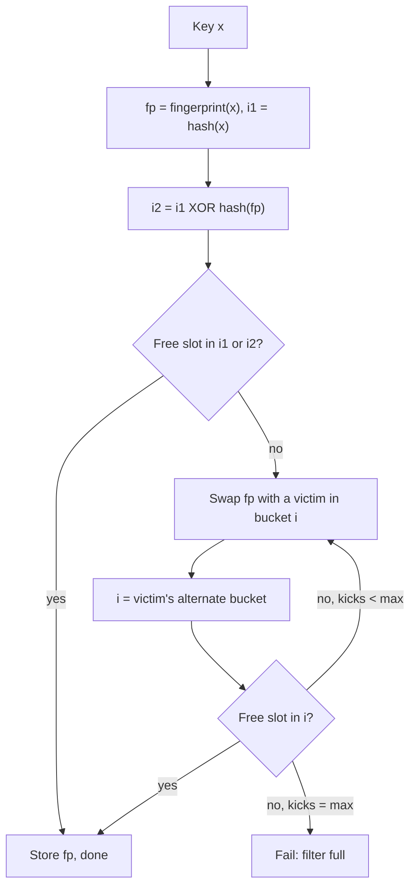

## In one minute
- A cuckoo filter answers "have I seen this key?" with no false negatives and a tunable false-positive rate, like a Bloom filter, but it also supports **deletion**.
- It stores a short fingerprint of each key (8 to 16 bits) in a table of small buckets. Each key has exactly two candidate buckets, and the second is computed from the first and the fingerprint alone.
- When both buckets are full, an existing fingerprint is evicted to its alternate bucket, which may evict another, cuckoo style. Tables reach about 95 percent occupancy with 4-slot buckets.
- For false-positive rates below about 3 percent it uses less memory than a Bloom filter, and lookups touch at most two cache lines. The price is that inserts can fail when the table is nearly full.

## How it works

### Layout
The filter is an array of `m` buckets, each holding `b` fingerprint slots (b = 4 is the common choice). A fingerprint is `f` bits derived from a hash of the key, with zero reserved to mean "empty slot". Nothing else is stored: no key, no value.

### Partial-key cuckoo hashing
Classic cuckoo hashing needs the original key to relocate an evicted item, but a filter only has the fingerprint. So the two indices are tied together through it:

- `i1 = hash(key) mod m`
- `i2 = i1 XOR (hash(fingerprint) mod m)`

XOR is its own inverse, so from either bucket and the fingerprint you can compute the other. The fingerprint is hashed before the XOR; with a raw 8-bit fingerprint, evicted items would land at most 256 buckets away and crowd one region of the table ([Fan et al.](https://www.cs.cmu.edu/~dga/papers/cuckoo-conext2014.pdf)). `m` must be a power of two so the XOR stays in range.

### Insert, lookup, delete
To insert, write the fingerprint into either bucket if one has a free slot. Otherwise swap it with a victim in one bucket and move the victim to its alternate bucket, repeating up to a limit such as 500 kicks, after which the table is considered full. Bucket size sets how full the table can get before that happens: about 50% with one slot per bucket, 84% with two, 95% with four and 98% with eight, given long enough fingerprints ([Fan et al.](https://www.cs.cmu.edu/~dga/papers/cuckoo-conext2014.pdf)). Plain cuckoo hashing with one slot and two choices stalls near the same 50% mark ([Wikipedia](https://en.wikipedia.org/wiki/Cuckoo_hashing)).

Lookup checks both buckets: at most 8 comparisons in two memory locations. Delete clears one matching copy.

### False positives and space
A lookup for an absent key compares against up to `2b` stored fingerprints, each matching with probability `1 / 2^f`. So the false-positive rate is about `2b / 2^f`. With b = 4 and f = 12, that is 8 / 4096, roughly 0.2 percent. The space per item is about `f / load` bits; at 95 percent load and f = 12, that is 12.6 bits per item.

A Bloom filter needs about `1.44 * log2(1/rate)` bits per item: 12.9 bits for 0.2 percent. Below that rate the cuckoo filter wins; above roughly 3 percent its fixed overhead makes Bloom smaller. That crossover assumes the table is sized exactly. Real implementations round `m` up to a power of two, which can nearly double the memory for an unlucky capacity, and a Boston University study found Bitcoin Core's Bloom filters smaller than the reference cuckoo filter at most capacities for rates of 3% and below ([Boskov et al.](https://people.bu.edu/staro/cuckoo_filter_workshop_paper.pdf)).

There is a subtler cost. To keep high occupancy, the fingerprint must grow with the logarithm of the table size divided by the bucket size. In practice the bucket size rescues it: with b = 4, about 6-bit fingerprints already reach near-optimal load at a billion buckets, so this lower bound rarely bites before the false-positive target does (Fan et al., Section 4).

### Caveats built into the design
Deleting a never-inserted key can remove another key's identical fingerprint. Inserting one key `2b` times fills both its buckets. And the filter cannot be resized in place, because the hash bits needed for a larger table were thrown away. If the set is built once and never changes, a static filter is the better tool: xor filters are smaller and faster to query than both Bloom and cuckoo filters, but cannot add or delete after construction ([Graf and Lemire](https://arxiv.org/abs/1912.08258)).

## Down the stack

### Layer 1: The contract
Any item inserted and not deleted is always reported present. An absent item is reported present with probability at most about `2b / 2^f`. Inserts can fail when the table is too full, and the caller must handle that failure. Deletes are safe only for items that were actually inserted. Lookups take a bounded amount of work: two buckets, never more.

### Layer 2: The mechanism
The reference implementation from the paper's authors packs each bucket's four fingerprints into one word and adds **semi-sorting**: fingerprints within a bucket are sorted, and the four 4-bit prefixes are encoded as one of 3,876 possible sorted combinations in 12 bits instead of 16, saving one bit per item. Insertion picks a random victim slot on each kick and gives up after 500 kicks. The bucket count also has to stay a power of two for the XOR step; implementations that relax this to save memory break its symmetry, and evictions can then land in a bucket that is neither of an item's two candidates, a true false negative ([Boskov et al.](https://people.bu.edu/staro/cuckoo_filter_workshop_paper.pdf)).

Redis exposes the filter through `CF.RESERVE` with capacity, bucket size, maximum iterations, and an expansion factor; it was the RedisBloom module until Redis 8 made it part of the server. Its defaults differ from the paper: two slots per bucket, 20 maximum iterations, an expansion factor of 1 and at most 32 expansions ([Redis config](https://redis.io/docs/latest/develop/data-types/probabilistic/configuration/)). Fingerprints are fixed at 8 bits, so the rate is `2b / 256`: 0.78% with one slot per bucket at 55% fill, 3.12% with four slots at 95% fill ([Redis docs](https://redis.io/docs/latest/develop/data-types/probabilistic/cuckoo-filter/)). A 0.1% target is out of reach there and needs a custom implementation. When a filter fills, Redis chains a new sub-filter rather than resizing, so later lookups must check every sub-filter and the error rates of the sub-filters add up. `CF.ADD` allows duplicates; `CF.ADDNX` checks first.

### Layer 3: The machine
A bucket of four 12-bit fingerprints is 48 bits and fits in one 64-bit word. Checking it is a single load followed by bit tricks: broadcast the query fingerprint into every field, XOR, and test whether any field became zero. That is a few nanoseconds once the word is in cache.

The real cost is memory latency. A table larger than the last-level cache costs about 80 to 100 ns per random access. Both bucket addresses are known up front, so the CPU can fetch them in parallel, and a lookup costs about one memory latency in total. A standard Bloom filter with `k = 10` hash functions touches up to 10 cache lines. Inserts near full load are the slow path: each kick is another dependent random access, so a chain of 100 kicks takes around 10 us and tail latency climbs sharply above 90 percent occupancy.

### Why it's built this way
1. Storing whole keys is too expensive, so the filter stores short fingerprints and accepts false positives.
2. Deleting requires finding the exact copy to remove, so each item must have a small, fixed set of possible locations.
3. During eviction the key is gone, so the alternate location is derived from the fingerprint by XOR.
4. Memory latency dominates, so items get two candidate buckets, each sized to fit in one word or cache line, and four slots per bucket let the table reach about 95 percent load.

## Diagram


## Worked example
A CDN edge node has a 20 TB disk cache holding about 200 million objects. Before going to disk, it wants a cheap in-memory test of "is this object on disk at all?" so misses skip the disk lookup. Evictions require deletes.

Target a false-positive rate of 0.1 percent. With 4-slot buckets that needs `8 / 2^f <= 0.001`, so f = 13 bits. Sizing for 95 percent load, 200 million items need about 210 million slots, or 52.6 million buckets; rounded up to the next power of two that is 2^26, about 67 million buckets and 268 million slots. Memory is 268 million times 13 bits, about 436 MB, and the table will run at about 75 percent load, which leaves headroom for growth and keeps eviction chains short.

A standard Bloom filter at 0.1 percent needs 360 MB but cannot delete, so it would need periodic rebuilds. A counting Bloom filter with 4-bit counters supports deletes but needs about 1.4 GB.

Lookups are two random memory reads, negligible at 200,000 requests per second, and each false positive costs only one wasted disk index probe.

## In the wild
- **Boston University, 2020: false negatives from a "space-saving" tweak.** Boskov, Trachtenberg and Starobinski modified the CMU reference cuckoo filter to allow any bucket count, not just powers of two, to avoid the memory lost to rounding. With b = 4 and 8-bit fingerprints, filters under 80% load showed false negatives close to 1%, and filters 95% full up to 10%, higher than the 3% false-positive target. The cause is the partial-key XOR sending evicted fingerprints to buckets outside their candidate pair. In packet filtering, a false negative lets a malicious packet through ([CoNEXT 2020 workshop](https://people.bu.edu/staro/cuckoo_filter_workshop_paper.pdf)).
- **Universidad Carlos III de Madrid, 2020: denial of service by insertion failure.** Reviriego and Larrabeiti showed that cuckoo filters in networking systems can be driven into insertion failures by chosen inputs until the filter collapses and stops doing its job, and that the attack works as a black box. Earlier attacks on Bloom filters could only inflate their false-positive rate; here the structure stops working, which is why capacity planning and keyed hashing matter more for cuckoo filters ([IEEE Communications Letters](https://researchportal.uc3m.es/display/act529195)).

## Trade-offs
| Option | Strengths | Weaknesses | Choose when |
|---|---|---|---|
| Cuckoo filter | Deletes, compact at low error rates, two memory reads per lookup | Inserts can fail near full, no resize, duplicate inserts break it | Set membership with removals and error rate under about 3 percent |
| Bloom filter | Simple, inserts never fail, easy to merge (bitwise OR) | No deletion, k memory reads per lookup | Append-only sets, higher error rates, mergeable filters |
| Quotient filter | Deletes, resizable, merges, cache friendly | More complex, slower when nearly full | You need resizing or merging with deletes |
| Exact hash set | No false positives | Stores full keys, often 10x the memory | The set is small or errors are unacceptable |

## Pitfalls in production
- **Deleting non-members.** A delete for a key that was never added can silently remove someone else's fingerprint. Only delete after a confirmed insert, or track membership elsewhere.
- **Duplicate inserts.** Retries and replays insert the same key many times, filling both buckets. Check `contains` first, or accept that the filter counts copies and design deletes accordingly.
- **Running too full.** Insert latency and failure probability rise sharply above 90 percent load. Size for 70 to 85 percent and alert on load factor.
- **Hostile input.** An attacker who can choose keys can force insertion failures and collapse the filter without knowing implementation details ([Reviriego and Larrabeiti](https://researchportal.uc3m.es/display/act529195)). Use a keyed hash for untrusted keys and rate-limit inserts per client.
- **Losing an item on failed insert.** A naive implementation that gives up after max kicks drops the last evicted fingerprint, which belonged to an earlier key. Keep a one-slot victim stash or roll the kicks back.

## Leadership lens
- Ask whether deletes are truly needed. If the set only grows, a Bloom filter is simpler and has no failure mode on insert.
- Treat capacity as a hard limit. Plan a rebuild path from the source of truth, because a full cuckoo filter cannot simply grow.
- Make the error rate a product decision: state what a false positive costs downstream and size f accordingly.

## Check yourself
1. Why must the alternate bucket be computed from the fingerprint and not from the original key?
   **Answer:** During eviction the filter only has the fingerprint stored in a slot, not the key, so the alternate location must be derivable from the current bucket index and the fingerprint alone.
2. Where does the false-positive rate of roughly `2b / 2^f` come from?
   **Answer:** A lookup compares the query's fingerprint with up to b entries in each of two buckets, and each comparison matches by chance with probability `1 / 2^f`.
3. Why can't you double a cuckoo filter's size the way you resize a hash table?
   **Answer:** Bucket indices in a larger table need hash bits that were discarded when only the fingerprint was kept, so existing entries cannot be relocated without the original keys.

## Practice
**Task:** Implement a cuckoo filter with `num_buckets` (a power of two), `bucket_size` slots per bucket, `fp_bits`-bit fingerprints, and `max_kicks`. Use 32-bit FNV-1a (`fnv1a(s)`) for hashing: `h = fnv1a(key)`, `i1 = h & (num_buckets - 1)`, `fp = (h >> 20) & (2^fp_bits - 1)`, replaced by 1 if zero, and `alt_index(i, fp) = (i XOR fnv1a(str(fp))) & (num_buckets - 1)`. On eviction, kick slot `k % bucket_size` on the k-th kick. If `max_kicks` is reached, undo the kicks so no earlier item is lost and return false. Provide `insert`, `contains`, `delete`, `size`, and `alt_index` (TypeScript: `altIndex`; Go: `Insert`, `Contains`, `Delete`, `Size`, `AltIndex`).

```python starter
def fnv1a(s):
    h = 2166136261
    for c in s.encode():
        h = ((h ^ c) * 16777619) & 0xFFFFFFFF
    return h

class CuckooFilter:
    def __init__(self, num_buckets, bucket_size=4, fp_bits=12, max_kicks=500):
        pass

    def alt_index(self, i, fp):
        raise NotImplementedError

    def insert(self, key):
        raise NotImplementedError

    def contains(self, key):
        raise NotImplementedError

    def delete(self, key):
        raise NotImplementedError

    def size(self):
        raise NotImplementedError
```

```python tests
def test_no_false_negatives():
    f = CuckooFilter(128)
    keys = ["k%d" % i for i in range(200)]
    assert all(f.insert(k) for k in keys)
    assert all(f.contains(k) for k in keys)
    assert f.size() == 200

def test_delete():
    f = CuckooFilter(16)
    f.insert("apple")
    assert f.delete("apple")
    assert not f.contains("apple")
    assert not f.delete("apple")

def test_alt_index_is_involution():
    f = CuckooFilter(64)
    for i in range(64):
        for fp in (1, 77, 4095):
            assert f.alt_index(f.alt_index(i, fp), fp) == i

def test_full_filter_rejects_without_losing_items():
    f = CuckooFilter(4, bucket_size=2, max_kicks=50)
    stored = [k for k in ("item%d" % i for i in range(40)) if f.insert(k)]
    assert f.size() == len(stored) <= 8
    assert len(stored) < 40
    assert all(f.contains(k) for k in stored)

def test_low_false_positive_rate():
    f = CuckooFilter(512)
    for i in range(1500):
        f.insert("in%d" % i)
    fps = sum(f.contains("out%d" % i) for i in range(10000))
    assert fps < 100
```

```python solution
def fnv1a(s):
    h = 2166136261
    for c in s.encode():
        h = ((h ^ c) * 16777619) & 0xFFFFFFFF
    return h

class CuckooFilter:
    def __init__(self, num_buckets, bucket_size=4, fp_bits=12, max_kicks=500):
        self.nb, self.bs, self.max_kicks = num_buckets, bucket_size, max_kicks
        self.mask = (1 << fp_bits) - 1
        self.buckets = [[] for _ in range(num_buckets)]
        self.n = 0

    def _fp_i1(self, key):
        h = fnv1a(key)
        return ((h >> 20) & self.mask) or 1, h & (self.nb - 1)

    def alt_index(self, i, fp):
        return (i ^ fnv1a(str(fp))) & (self.nb - 1)

    def insert(self, key):
        fp, i1 = self._fp_i1(key)
        for i in (i1, self.alt_index(i1, fp)):
            if len(self.buckets[i]) < self.bs:
                self.buckets[i].append(fp)
                self.n += 1
                return True
        i, log = i1, []
        for k in range(self.max_kicks):
            b, slot = self.buckets[i], k % self.bs
            fp, b[slot] = b[slot], fp
            log.append((i, slot))
            i = self.alt_index(i, fp)
            if len(self.buckets[i]) < self.bs:
                self.buckets[i].append(fp)
                self.n += 1
                return True
        for i, slot in reversed(log):
            b = self.buckets[i]
            fp, b[slot] = b[slot], fp
        return False

    def contains(self, key):
        fp, i1 = self._fp_i1(key)
        return fp in self.buckets[i1] or fp in self.buckets[self.alt_index(i1, fp)]

    def delete(self, key):
        fp, i1 = self._fp_i1(key)
        for i in (i1, self.alt_index(i1, fp)):
            if fp in self.buckets[i]:
                self.buckets[i].remove(fp)
                self.n -= 1
                return True
        return False

    def size(self):
        return self.n
```

```typescript starter
export function fnv1a(s: string): number {
  let h = 2166136261;
  for (let i = 0; i < s.length; i++) h = Math.imul(h ^ s.charCodeAt(i), 16777619) >>> 0;
  return h;
}
export class CuckooFilter {
  constructor(numBuckets: number, bucketSize = 4, fpBits = 12, maxKicks = 500) {}
  altIndex(i: number, fp: number): number { throw new Error("TODO"); }
  insert(key: string): boolean { throw new Error("TODO"); }
  contains(key: string): boolean { throw new Error("TODO"); }
  delete(key: string): boolean { throw new Error("TODO"); }
  size(): number { throw new Error("TODO"); }
}
```

```typescript tests
test("no false negatives", () => {
  const f = new CuckooFilter(128);
  const keys = Array.from({ length: 200 }, (_, i) => "k" + i);
  assert(keys.every(k => f.insert(k)), "all inserted");
  assert(keys.every(k => f.contains(k)), "all found");
  assertEqual(f.size(), 200);
});
test("delete", () => {
  const f = new CuckooFilter(16);
  f.insert("apple");
  assert(f.delete("apple"), "deleted");
  assert(!f.contains("apple"), "gone");
  assert(!f.delete("apple"), "second delete fails");
});
test("alt index is an involution", () => {
  const f = new CuckooFilter(64);
  for (let i = 0; i < 64; i++) for (const fp of [1, 77, 4095]) assertEqual(f.altIndex(f.altIndex(i, fp), fp), i);
});
test("full filter rejects without losing items", () => {
  const f = new CuckooFilter(4, 2, 12, 50);
  const stored = Array.from({ length: 40 }, (_, i) => "item" + i).filter(k => f.insert(k));
  assert(f.size() === stored.length && stored.length <= 8 && stored.length < 40, "bounded");
  assert(stored.every(k => f.contains(k)), "no item lost");
});
test("low false positive rate", () => {
  const f = new CuckooFilter(512);
  for (let i = 0; i < 1500; i++) f.insert("in" + i);
  let fps = 0;
  for (let i = 0; i < 10000; i++) if (f.contains("out" + i)) fps++;
  assert(fps < 100, "fps " + fps);
});
```

```typescript solution
export function fnv1a(s: string): number {
  let h = 2166136261;
  for (let i = 0; i < s.length; i++) h = Math.imul(h ^ s.charCodeAt(i), 16777619) >>> 0;
  return h;
}
export class CuckooFilter {
  private buckets: number[][];
  private mask: number;
  private n = 0;
  constructor(private nb: number, private bs = 4, fpBits = 12, private maxKicks = 500) {
    this.mask = (1 << fpBits) - 1;
    this.buckets = Array.from({ length: nb }, () => []);
  }
  private fpI1(key: string): [number, number] {
    const h = fnv1a(key);
    return [((h >>> 20) & this.mask) || 1, h & (this.nb - 1)];
  }
  altIndex(i: number, fp: number): number { return (i ^ fnv1a(String(fp))) & (this.nb - 1); }
  insert(key: string): boolean {
    let [fp, i] = this.fpI1(key);
    for (const j of [i, this.altIndex(i, fp)]) {
      if (this.buckets[j].length < this.bs) { this.buckets[j].push(fp); this.n++; return true; }
    }
    const log: [number, number][] = [];
    for (let k = 0; k < this.maxKicks; k++) {
      const b = this.buckets[i], slot = k % this.bs;
      [fp, b[slot]] = [b[slot], fp];
      log.push([i, slot]);
      i = this.altIndex(i, fp);
      if (this.buckets[i].length < this.bs) { this.buckets[i].push(fp); this.n++; return true; }
    }
    for (const [j, slot] of log.reverse()) { const b = this.buckets[j]; [fp, b[slot]] = [b[slot], fp]; }
    return false;
  }
  contains(key: string): boolean {
    const [fp, i] = this.fpI1(key);
    return this.buckets[i].includes(fp) || this.buckets[this.altIndex(i, fp)].includes(fp);
  }
  delete(key: string): boolean {
    const [fp, i] = this.fpI1(key);
    for (const j of [i, this.altIndex(i, fp)]) {
      const p = this.buckets[j].indexOf(fp);
      if (p >= 0) { this.buckets[j].splice(p, 1); this.n--; return true; }
    }
    return false;
  }
  size(): number { return this.n; }
}
```

```go starter
package practice

// FNV1a is 32-bit FNV-1a.
func FNV1a(s string) uint32 {
	h := uint32(2166136261)
	for i := 0; i < len(s); i++ {
		h = (h ^ uint32(s[i])) * 16777619
	}
	return h
}

// CuckooFilter is an approximate set with deletion.
type CuckooFilter struct{}

// New creates a filter; numBuckets must be a power of two.
func New(numBuckets, bucketSize, fpBits, maxKicks int) *CuckooFilter { return &CuckooFilter{} }

func (f *CuckooFilter) AltIndex(i int, fp uint32) int { panic("TODO") }
func (f *CuckooFilter) Insert(key string) bool       { panic("TODO") }
func (f *CuckooFilter) Contains(key string) bool     { panic("TODO") }
func (f *CuckooFilter) Delete(key string) bool       { panic("TODO") }
func (f *CuckooFilter) Size() int                    { panic("TODO") }
```

```go tests
package practice

import (
	"fmt"
	"testing"
)

func TestNoFalseNegatives(t *testing.T) {
	f := New(128, 4, 12, 500)
	for i := 0; i < 200; i++ {
		if !f.Insert(fmt.Sprint("k", i)) {
			t.Fatal("insert failed")
		}
	}
	for i := 0; i < 200; i++ {
		if !f.Contains(fmt.Sprint("k", i)) {
			t.Fatal("false negative")
		}
	}
	if f.Size() != 200 {
		t.Fatal("size")
	}
}

func TestDelete(t *testing.T) {
	f := New(16, 4, 12, 500)
	f.Insert("apple")
	if !f.Delete("apple") || f.Contains("apple") || f.Delete("apple") {
		t.Fatal("delete semantics")
	}
}

func TestAltIndexInvolution(t *testing.T) {
	f := New(64, 4, 12, 500)
	for i := 0; i < 64; i++ {
		for _, fp := range []uint32{1, 77, 4095} {
			if f.AltIndex(f.AltIndex(i, fp), fp) != i {
				t.Fatal("not an involution")
			}
		}
	}
}

func TestFullFilterKeepsItems(t *testing.T) {
	f := New(4, 2, 12, 50)
	var stored []string
	for i := 0; i < 40; i++ {
		if k := fmt.Sprint("item", i); f.Insert(k) {
			stored = append(stored, k)
		}
	}
	if f.Size() != len(stored) || len(stored) > 8 || len(stored) == 40 {
		t.Fatalf("stored %d", len(stored))
	}
	for _, k := range stored {
		if !f.Contains(k) {
			t.Fatal("lost item " + k)
		}
	}
}

func TestLowFalsePositiveRate(t *testing.T) {
	f := New(512, 4, 12, 500)
	for i := 0; i < 1500; i++ {
		f.Insert(fmt.Sprint("in", i))
	}
	fps := 0
	for i := 0; i < 10000; i++ {
		if f.Contains(fmt.Sprint("out", i)) {
			fps++
		}
	}
	if fps >= 100 {
		t.Fatalf("fps %d", fps)
	}
}
```

```go solution
package practice

import "strconv"

// FNV1a is 32-bit FNV-1a.
func FNV1a(s string) uint32 {
	h := uint32(2166136261)
	for i := 0; i < len(s); i++ {
		h = (h ^ uint32(s[i])) * 16777619
	}
	return h
}

// CuckooFilter is an approximate set with deletion.
type CuckooFilter struct {
	buckets            [][]uint32
	bs, maxKicks, n    int
	mask               uint32
}

// New creates a filter; numBuckets must be a power of two.
func New(numBuckets, bucketSize, fpBits, maxKicks int) *CuckooFilter {
	return &CuckooFilter{buckets: make([][]uint32, numBuckets), bs: bucketSize, maxKicks: maxKicks, mask: 1<<fpBits - 1}
}

func (f *CuckooFilter) fpI1(key string) (uint32, int) {
	h := FNV1a(key)
	fp := (h >> 20) & f.mask
	if fp == 0 {
		fp = 1
	}
	return fp, int(h & uint32(len(f.buckets)-1))
}

func (f *CuckooFilter) AltIndex(i int, fp uint32) int {
	return (i ^ int(FNV1a(strconv.Itoa(int(fp))))) & (len(f.buckets) - 1)
}

func (f *CuckooFilter) place(i int, fp uint32) bool {
	if len(f.buckets[i]) < f.bs {
		f.buckets[i] = append(f.buckets[i], fp)
		f.n++
		return true
	}
	return false
}

func (f *CuckooFilter) Insert(key string) bool {
	fp, i := f.fpI1(key)
	if f.place(i, fp) || f.place(f.AltIndex(i, fp), fp) {
		return true
	}
	type kick struct{ i, slot int }
	var log []kick
	for k := 0; k < f.maxKicks; k++ {
		slot := k % f.bs
		fp, f.buckets[i][slot] = f.buckets[i][slot], fp
		log = append(log, kick{i, slot})
		i = f.AltIndex(i, fp)
		if f.place(i, fp) {
			return true
		}
	}
	for j := len(log) - 1; j >= 0; j-- {
		b := f.buckets[log[j].i]
		fp, b[log[j].slot] = b[log[j].slot], fp
	}
	return false
}

func (f *CuckooFilter) find(i int, fp uint32) int {
	for p, v := range f.buckets[i] {
		if v == fp {
			return p
		}
	}
	return -1
}

func (f *CuckooFilter) Contains(key string) bool {
	fp, i := f.fpI1(key)
	return f.find(i, fp) >= 0 || f.find(f.AltIndex(i, fp), fp) >= 0
}

func (f *CuckooFilter) Delete(key string) bool {
	fp, i := f.fpI1(key)
	for _, j := range []int{i, f.AltIndex(i, fp)} {
		if p := f.find(j, fp); p >= 0 {
			f.buckets[j] = append(f.buckets[j][:p], f.buckets[j][p+1:]...)
			f.n--
			return true
		}
	}
	return false
}

func (f *CuckooFilter) Size() int { return f.n }
```

## Mock interview
**Prompt:** A messaging service must block re-delivery of messages that users have deleted. There are 3 billion deleted message IDs, growing by 40 million a day, and IDs older than 90 days are purged from the source of truth. Every delivery (500,000 per second) must check the set. Design the check.

- Follow-up: Why not a Bloom filter, and what false-positive rate would you choose?
- Follow-up: The filter reports full at 3 a.m. What happened, and what do you do?
- Follow-up: How do you shard or replicate the filter across delivery servers?

**A strong answer covers:**
- The cost of a false positive (a message wrongly suppressed) versus memory, leading to a chosen fingerprint size and a bits-per-item estimate.
- Deletes are needed because old IDs are purged, which rules out a plain Bloom filter or forces time-sliced Bloom filters.
- Sizing for 70 to 85 percent load with headroom for daily growth, alerting on load factor, and a rebuild path from the source of truth.
- Partitioning by a hash of the ID so each shard's filter fits in memory, with replicas for read throughput.
- Guarding against duplicate inserts and deletes of non-members, which silently corrupt the filter.

## Sources and further study
**Primary**
- [Pagh and Rodler: Cuckoo Hashing (2004 journal version)](https://doi.org/10.1016/j.jalgor.2003.12.002): the two-choice hash table that the filter builds on.
- [Boskov, Trachtenberg and Starobinski: Birdwatching, False Negatives in Cuckoo Filters (2020)](https://people.bu.edu/staro/cuckoo_filter_workshop_paper.pdf): where the no-false-negative promise breaks.
- [Graf and Lemire: Xor Filters (JEA, 2020)](https://arxiv.org/abs/1912.08258): the static alternative when deletes are not needed.

**Systems docs**
- [Redis probabilistic configuration](https://redis.io/docs/latest/develop/data-types/probabilistic/configuration/): Redis 8 defaults for bucket size, iterations and expansions.
- [CMU reference implementation (efficient/cuckoofilter)](https://github.com/efficient/cuckoofilter): the authors' C++ code with semi-sorted buckets.

**Books**
- *Database Internals* (1st ed.), Alex Petrov, Ch 7: Log-Structured Storage, on the per-file filters a cuckoo filter competes with.

**Other curricula**
- [Stanford CS166, Lecture 15: Cuckoo Filters](https://web.stanford.edu/class/archive/cs/cs166/cs166.1266/lectures/15/): taught right after cuckoo hashing, as a hashing analysis problem.
- [Stanford CS166: Data Structures](https://web.stanford.edu/class/cs166/): the full course, with sketches and cuckoo hashing in the same arc.

## Watch
- [Cuckoo Filter: As Small as a Bloom Filter, and It Can Delete (VividCode)](https://www.youtube.com/watch?v=fDYXrvUo4-E): an animated walk through partial-key cuckoo hashing and eviction.
- [Cuckoo Filter Explained (ICONIC RP)](https://www.youtube.com/watch?v=HbqEqzJFLNQ): a review of the CoNEXT 2014 paper with the space comparison against Bloom filters.

## Free resources
- [Fan et al.: Cuckoo Filter, Practically Better Than Bloom (CoNEXT 2014)](https://www.cs.cmu.edu/~dga/papers/cuckoo-conext2014.pdf): the original paper with the space analysis and benchmarks.
- [Wikipedia: Cuckoo filter](https://en.wikipedia.org/wiki/Cuckoo_filter): concise summary of the algorithm and its limitations.
- [Wikipedia: Cuckoo hashing](https://en.wikipedia.org/wiki/Cuckoo_hashing): the underlying hash table scheme and its load-factor behaviour.
- [Redis: Cuckoo filter](https://redis.io/docs/latest/develop/data-types/probabilistic/cuckoo-filter/): a production implementation with sizing parameters and command semantics.
