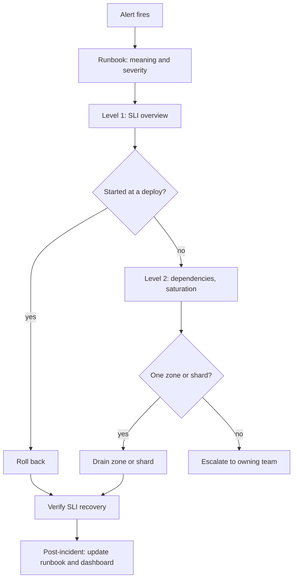

## In one minute
- Dashboards and runbooks are the interface between your telemetry and a tired human during an incident. Their job is to shorten time to diagnosis and time to mitigation.
- Good dashboards are **layered**: a service overview that answers "is it broken and how badly" in 10 seconds, then drill-downs for dependencies, resources, and individual components.
- A runbook is a **decision procedure** for a specific alert: what it means, how to confirm it, how to mitigate safely, and when to escalate.
- Both decay. Dashboards and runbooks must be versioned as code, reviewed after incidents, and owned like any other production artifact.
- Repeated runbook steps should become automation, with the runbook documenting the override.

## How it works

### Dashboard layering
**Level 1, service overview.** One per service, built around the user-facing SLIs: request rate, error ratio, latency percentiles, and remaining error budget, with deploy markers overlaid. These are close to Google's four golden signals of latency, traffic, errors and saturation, and to the RED method (rate, errors, duration) that Grafana recommends for services ([Google SRE book, ch. 6](https://sre.google/sre-book/monitoring-distributed-systems/), [Grafana](https://grafana.com/docs/grafana/latest/dashboards/build-dashboards/best-practices/)). Measure the latency of failed requests separately, since a slow error is worse than a fast one. Someone paged at 3 a.m. should know within seconds whether users are hurting and since when.

**Level 2, dependencies and saturation.** Per-dependency call rate, errors, and latency (database, cache, downstream services), plus saturation signals: thread pools, connection pools, queue depth, CPU throttling, memory. For resources, the USE method (utilisation, saturation, errors) is the usual checklist.

**Level 3, component detail.** Per-instance or per-partition views for finding a single bad host, shard, or availability zone.

Put the most important panels top-left, keep units consistent, draw SLO thresholds on graphs, and use template variables (region, cluster) instead of copied dashboards. Amazon's guidance adds a few practical rules: default to UTC when responders sit in several time zones, give graphs in a section the same time range and width, and split availability, latency percentiles and extreme latencies into adjacent graphs ([AWS Builders' Library](https://builder.aws.com/content/3Ev2iw3R3ahQOM8BT4OUR0WP51z/building-dashboards-for-operational-visibility)). If nobody can say what decision a panel informs, delete it.

### Runbook anatomy
A useful runbook, linked directly from the alert, contains:

1. **What this alert means** in user terms, and its severity.
2. **Triage**: the dashboard link and two or three checks that confirm or rule out common causes, each with the exact query or command.
3. **Mitigation**: safe, reversible actions in order of preference, such as roll back the last deploy, shift traffic away from a zone, enable a feature-flag kill switch, scale out.
4. **Escalation**: who to call and when, for example if not mitigated in 30 minutes or if data loss is suspected.
5. **Background**: architecture notes and links to past incidents.

Write for a responder who has never seen the system: copy-pasteable commands, and dangerous steps marked in bold. Google reports that writing best practices down ahead of time in a playbook gives roughly a 3x improvement in mean time to repair over improvising ([Google SRE book, ch. 1](https://sre.google/sre-book/introduction/)). The alert itself must earn the runbook: every page should be actionable, and a page that only needs a robotic response should be automated instead ([Google SRE book, ch. 6](https://sre.google/sre-book/monitoring-distributed-systems/)).

### Keeping them alive
Store dashboards as code in git and runbooks next to the service code. At Amazon, reviewers ask during code review whether a change needs a dashboard update, and their weekly operations reviews use a wheel of fortune to choose which audit dashboard to examine ([AWS Builders' Library](https://builder.aws.com/content/3Ev2iw3R3ahQOM8BT4OUR0WP51z/building-dashboards-for-operational-visibility)). Each incident review asks whether the dashboard showed the problem and whether the runbook helped; fixes become action items.

### Don't let the dashboard share fate with the service
A dashboard is useless if it fails with the thing it watches. In the 2017 S3 outage, AWS could not update its own status dashboard for about two hours because the admin console depended on S3 ([AWS](https://aws.amazon.com/message/41926/)). Host monitoring, dashboards and runbooks on infrastructure with different failure domains, and keep a fallback such as direct queries against the metrics store written into the runbook.

## Down the stack

### Layer 1: The contract
A Level 1 dashboard promises that, within its refresh interval, it shows whether each SLI is within objective, how much error budget remains, and when the last change happened, and that it loads in a few seconds even during an incident. A runbook promises that each listed step is safe for any on-call engineer to run under its stated preconditions, that it either improves the symptom or can be reverted, and that it says when to stop and escalate. Both promise to be current as of a stated review date.

### Layer 2: The mechanism
A Grafana dashboard is a JSON document: a list of panels, each with a data source, one or more queries, a visualisation type, thresholds, and links. **Template variables** such as `$cluster` are defined once and substituted into every query, so one dashboard serves all regions. **Annotations** overlay events, such as deploys pulled from CI or feature-flag changes, as vertical markers. When stored as code, the JSON is generated by a library and provisioned from git, so a pull request reviews a change to a panel like any code change. Grafonnet (Jsonnet) was the long-time choice, but Grafana now marks it as not officially supported; Grafana 12 added versioned dashboard APIs, the official Foundation SDK (Go, TypeScript, Python, Java and PHP) and Git Sync, which ties dashboards and folders to a GitHub repository ([Grafana docs](https://grafana.com/docs/grafana/latest/as-code/observability-as-code/)). Alert rules carry a `runbook_url` annotation and a `dashboard` link, which the paging tool renders in the notification; in Prometheus, annotations are the free-form fields meant for exactly this ([Prometheus docs](https://prometheus.io/docs/prometheus/latest/configuration/alerting_rules/)). Runbooks increasingly live as executable notebooks or scripts where each step runs a query or command and shows output inline, with dangerous steps gated behind a confirmation.

### Layer 3: The machine
Every panel is at least one query per refresh. A 40-panel dashboard refreshing every 10 seconds, open on 30 screens during an incident, issues 7,200 queries per minute against the metrics backend, at exactly the moment that backend may be under stress. Range queries over 7 days at 15-second resolution touch 40,320 samples per series; the backend caps points per query and the dashboard should set a step so a panel returns at most a few thousand points, since browsers render SVG or canvas charts slowly beyond tens of thousands of points. Amazon's own example of a sensible density is a three-hour window at one-minute resolution, about 180 points per line ([AWS Builders' Library](https://builder.aws.com/content/3Ev2iw3R3ahQOM8BT4OUR0WP51z/building-dashboards-for-operational-visibility)). Query caching in front of the backend (results cached by aligned time step) and longer refresh intervals keep incident dashboards fast; if the data changes hourly, a 30-second refresh only adds load ([Grafana](https://grafana.com/docs/grafana/latest/dashboards/build-dashboards/best-practices/)). Runbook commands touch real systems: a `kubectl drain` evicts pods respecting disruption budgets and can take minutes; a rollback replaces pods at the rollout's surge rate. Runbooks should state those expected durations so responders do not assume failure and act twice.

### Why it's built this way
1. Incidents happen under stress and often to people new to the system, so knowledge must be written down and one click away.
2. Raw telemetry is too large to read during an incident, so dashboards summarise it in layers from symptom to cause.
3. Hand-edited dashboards and wiki pages drift, so both are stored as code and reviewed.
4. Repeating manual steps is slow and error-prone, so frequent safe steps become automation, with the runbook documenting the manual fallback.

## Diagram


## Worked example
A search service has a p99 latency SLO of 400 ms. An alert fires at 02:10: burn rate 16 over 1 hour, above the 14.4 that Google's SRE Workbook suggests for a paging alert on a one-hour window, which corresponds to spending 2% of a 30-day error budget in that hour ([SRE Workbook, ch. 5](https://sre.google/workbook/alerting-on-slos/)).

The on-call opens the runbook from the page. Step 1 links to the Level 1 dashboard: error ratio is normal, p99 is 1.3 s, p50 is unchanged at 60 ms, and there was no deploy in 6 hours. Tail-only latency with stable median points to a subset of requests or instances, which the runbook says to check next.

Step 2: the Level 2 panel shows that calls to the index shard service have p99 1.2 s. The Level 3 panel, templated by shard, shows that shard 17 of 64 is slow, and its node shows a disk at 100 percent utilisation from a compaction that started at 02:02.

Step 3, mitigation: the runbook lists "mark shard replica unhealthy so queries use the other replica" with the exact command and a note that it is safe while at least one replica is healthy. The on-call runs it at 02:24; p99 recovers to 280 ms by 02:27.

Time to mitigate: 14 minutes. A similar incident before the layered dashboards took 70, mostly spent finding the slow shard. The review adds a compaction panel per shard and a ticket to automate the replica switch.

## In the wild
- **AWS, 2017: a playbook command with one wrong input.** At 9:37 a.m. PST on 28 February an engineer followed an established S3 playbook to remove a few servers, but mistyped an input and removed far more, including servers behind the index and placement subsystems. Both needed full restarts, and S3 in us-east-1 took about four hours to recover. The status dashboard could not be updated until 11:37 because its console depended on S3. AWS changed the tool to remove capacity slowly and refuse to go below a subsystem's minimum, and audited other tools for the same safeguard ([AWS](https://aws.amazon.com/message/41926/)).
- **Slack, 2021: debugging without dashboards.** Packet loss in an overloaded AWS Transit Gateway took Slack down around 7:00 a.m. PST on 4 January. The dashboarding and alerting service failed early because it reached its database through the same gateways, so responders queried metrics backends directly and SSHed into hosts, some of which autoscaling then removed mid-session. Slack moved the dashboard and alerting instances into the same VPC as their databases ([Slack](https://slack.engineering/slacks-outage-on-january-4th-2021/)).
- **GitLab, 2017: a runbook step run on the wrong host.** An engineer meant to wipe the PostgreSQL data directory on the secondary but ran it on the primary, deleting about 300 GB. None of the backup methods worked as expected, the restore took about 18 hours, and roughly six hours of data was lost. Follow-ups included documented replication runbooks, automated restore testing and a named owner for data durability, because nobody had been responsible for testing the procedure ([GitLab](https://about.gitlab.com/blog/postmortem-of-database-outage-of-january-31/)).

## Trade-offs

| Option | Strengths | Weaknesses | Choose when |
|---|---|---|---|
| Hand-built dashboards in the UI | Fast to create, flexible | Drift, duplication, no review | Exploration and one-off investigations |
| Dashboards as code with templates | Consistent, reviewable, reusable | Upfront effort, tooling | Every production service |
| Runbooks in the repo, linked from alerts | Versioned with the code, reviewed in PRs | Engineers must maintain them | Services with on-call rotations |
| Automated remediation | Fast, consistent, no human at 3 a.m. | Can amplify failures; needs guardrails | Well-understood, frequent, reversible fixes |

## Pitfalls in production
- **Dashboard sprawl.** Hundreds of dashboards, half broken, and nobody knows which is canonical. Mark official dashboards, template them, and delete unused ones on a schedule.
- **Wall of graphs.** A 60-panel dashboard where the key signal is on page three. Lead with SLIs and keep Level 1 to roughly ten panels.
- **Averages hiding problems.** Fleet-average latency looks fine while one zone is failing. Show percentiles and break down by zone or shard.
- **Stale runbooks.** Commands reference a cluster decommissioned last year. Review runbooks after every use and at least annually, and test them in game days.
- **Missing alert-to-runbook link.** The page arrives without context and the on-call searches the wiki. Make the runbook URL a required field on every alert rule.
- **Monitoring that shares fate with production.** Slack's dashboards failed during its January 2021 outage because they sat behind the same failing network path ([Slack](https://slack.engineering/slacks-outage-on-january-4th-2021/)). Run monitoring in a separate failure domain.

## Leadership lens
- Treat time to mitigate as the metric that dashboards and runbooks exist to improve, and review it after incidents.
- Require a runbook and a Level 1 dashboard as part of a service's production-readiness review.
- Run game days where someone unfamiliar with the service follows the runbook. The gaps they hit are the gaps a new on-call will hit.
- Prefer turning repeated runbook steps into safe automation, and keep the manual path documented for when automation fails.

## Check yourself
1. Why should a Level 1 dashboard lead with SLIs rather than resource metrics?
   **Answer:** SLIs show immediately whether users are affected and how badly, which decides urgency; resource metrics explain causes and belong lower in the drill-down.
2. What makes a mitigation step suitable for a runbook used by any on-call engineer?
   **Answer:** It is safe, reversible, precisely specified with copy-pasteable commands, and states its preconditions and risks.
3. Why store dashboards and runbooks as code?
   **Answer:** Versioning and review prevent drift, templates keep services consistent, and changes can be tied to incidents and code changes.

## Practice
**Task:** Implement a runbook decision-tree walker. `walk(runbook, start, observations)` follows steps from `start`. Each step is either a check, `{"check": name, "yes": next_id, "no": next_id}`, or a terminal action, `{"action": text}`. For a check, look up `observations[name]` (a bool) and follow `yes` or `no`. Return `(path, result)` where `path` is the list of visited step ids and `result` is the action text. If an observation is missing, stop with result `"escalate: missing "` plus the check name. If a step id is revisited, raise `ValueError`.

```python starter
def walk(runbook, start, observations):
    # TODO
    raise NotImplementedError
```

```python tests
RB = {
    "s1": {"check": "recent_deploy", "yes": "rollback", "no": "s2"},
    "s2": {"check": "single_zone", "yes": "drain", "no": "esc"},
    "rollback": {"action": "roll back last deploy"},
    "drain": {"action": "drain affected zone"},
    "esc": {"action": "page owning team"},
}

def test_deploy_path():
    assert walk(RB, "s1", {"recent_deploy": True}) == (["s1", "rollback"], "roll back last deploy")

def test_zone_path():
    obs = {"recent_deploy": False, "single_zone": True}
    assert walk(RB, "s1", obs) == (["s1", "s2", "drain"], "drain affected zone")

def test_missing_observation_escalates():
    path, result = walk(RB, "s1", {"recent_deploy": False})
    assert path == ["s1", "s2"] and result == "escalate: missing single_zone"

def test_cycle_detected():
    rb = {"a": {"check": "x", "yes": "b", "no": "b"}, "b": {"check": "y", "yes": "a", "no": "a"}}
    try:
        walk(rb, "a", {"x": True, "y": True})
        assert False, "expected ValueError"
    except ValueError:
        pass

def test_start_at_action():
    assert walk(RB, "esc", {}) == (["esc"], "page owning team")
```

```python solution
def walk(runbook, start, observations):
    path, seen, cur = [], set(), start
    while True:
        if cur in seen:
            raise ValueError("cycle at " + cur)
        seen.add(cur)
        path.append(cur)
        step = runbook[cur]
        if "action" in step:
            return path, step["action"]
        name = step["check"]
        if name not in observations:
            return path, "escalate: missing " + name
        cur = step["yes"] if observations[name] else step["no"]
```

```typescript starter
export type Step = { check: string; yes: string; no: string } | { action: string };
export function walk(runbook: Record<string, Step>, start: string,
    observations: Record<string, boolean>): [string[], string] {
  throw new Error("TODO");
}
```

```typescript tests
const RB: Record<string, Step> = {
  s1: { check: "recent_deploy", yes: "rollback", no: "s2" },
  s2: { check: "single_zone", yes: "drain", no: "esc" },
  rollback: { action: "roll back last deploy" },
  drain: { action: "drain affected zone" },
  esc: { action: "page owning team" },
};
test("deploy path", () =>
  assertEqual(walk(RB, "s1", { recent_deploy: true }), [["s1", "rollback"], "roll back last deploy"]));
test("zone path", () => assertEqual(walk(RB, "s1", { recent_deploy: false, single_zone: true }),
  [["s1", "s2", "drain"], "drain affected zone"]));
test("missing observation escalates", () => assertEqual(walk(RB, "s1", { recent_deploy: false }),
  [["s1", "s2"], "escalate: missing single_zone"]));
test("cycle detected", () => {
  const rb: Record<string, Step> = { a: { check: "x", yes: "b", no: "b" }, b: { check: "y", yes: "a", no: "a" } };
  let threw = false;
  try { walk(rb, "a", { x: true, y: true }); } catch { threw = true; }
  assert(threw, "expected an error");
});
test("start at action", () => assertEqual(walk(RB, "esc", {}), [["esc"], "page owning team"]));
```

```typescript solution
export type Step = { check: string; yes: string; no: string } | { action: string };
export function walk(runbook: Record<string, Step>, start: string,
    observations: Record<string, boolean>): [string[], string] {
  const path: string[] = [];
  const seen = new Set<string>();
  let cur = start;
  for (;;) {
    if (seen.has(cur)) throw new Error("cycle at " + cur);
    seen.add(cur);
    path.push(cur);
    const step = runbook[cur];
    if ("action" in step) return [path, step.action];
    if (!(step.check in observations)) return [path, "escalate: missing " + step.check];
    cur = observations[step.check] ? step.yes : step.no;
  }
}
```

```go starter
package practice

// Step is a check (Check, Yes, No set) or a terminal action (Action set).
type Step struct {
	Check, Yes, No string
	Action         string
}

func Walk(runbook map[string]Step, start string, obs map[string]bool) ([]string, string, error) {
	panic("TODO")
}
```

```go tests
package practice

import (
	"reflect"
	"testing"
)

var rb = map[string]Step{
	"s1":       {Check: "recent_deploy", Yes: "rollback", No: "s2"},
	"s2":       {Check: "single_zone", Yes: "drain", No: "esc"},
	"rollback": {Action: "roll back last deploy"},
	"drain":    {Action: "drain affected zone"},
	"esc":      {Action: "page owning team"},
}

func expectWalk(t *testing.T, obs map[string]bool, start string, path []string, result string) {
	t.Helper()
	p, r, err := Walk(rb, start, obs)
	if err != nil || !reflect.DeepEqual(p, path) || r != result {
		t.Fatalf("got %v %q %v", p, r, err)
	}
}

func TestDeployPath(t *testing.T) {
	expectWalk(t, map[string]bool{"recent_deploy": true}, "s1", []string{"s1", "rollback"}, "roll back last deploy")
}

func TestZonePath(t *testing.T) {
	expectWalk(t, map[string]bool{"recent_deploy": false, "single_zone": true}, "s1",
		[]string{"s1", "s2", "drain"}, "drain affected zone")
}

func TestMissingObservation(t *testing.T) {
	expectWalk(t, map[string]bool{"recent_deploy": false}, "s1", []string{"s1", "s2"}, "escalate: missing single_zone")
}

func TestCycle(t *testing.T) {
	loop := map[string]Step{"a": {Check: "x", Yes: "b", No: "b"}, "b": {Check: "y", Yes: "a", No: "a"}}
	if _, _, err := Walk(loop, "a", map[string]bool{"x": true, "y": true}); err == nil {
		t.Fatal("expected error")
	}
}

func TestStartAtAction(t *testing.T) {
	expectWalk(t, nil, "esc", []string{"esc"}, "page owning team")
}
```

```go solution
package practice

import "fmt"

type Step struct {
	Check, Yes, No string
	Action         string
}

func Walk(runbook map[string]Step, start string, obs map[string]bool) ([]string, string, error) {
	path := []string{}
	seen := map[string]bool{}
	cur := start
	for {
		if seen[cur] {
			return path, "", fmt.Errorf("cycle at %s", cur)
		}
		seen[cur] = true
		path = append(path, cur)
		step := runbook[cur]
		if step.Action != "" {
			return path, step.Action, nil
		}
		v, ok := obs[step.Check]
		if !ok {
			return path, "escalate: missing " + step.Check, nil
		}
		if v {
			cur = step.Yes
		} else {
			cur = step.No
		}
	}
}
```

## Mock interview
**Prompt:** You are taking over on-call for 25 services after a reorganisation. Incidents take a median of 55 minutes to mitigate and most responders say they "didn't know where to look". Lay out a plan for dashboards and runbooks over the next quarter.

- Follow-up: What exactly is on the first dashboard a paged engineer opens?
- Follow-up: How do you stop runbooks going stale after you have written them?
- Follow-up: When would you replace a runbook step with automation, and what could go wrong?

**A strong answer covers:**
- Templated Level 1 SLI dashboards for every service, with deploy markers and drill-down links.
- Runbooks per alert with triage checks, reversible mitigations, and escalation criteria, linked from the alert.
- Measurement: time to mitigate, runbook usage, and post-incident action items.
- Game days and post-incident reviews as the mechanism for keeping content current.
- Criteria for automation (frequent, well-understood, reversible) and guardrails such as rate limits and kill switches.

## Sources and further study
**Primary**
- [Google SRE Workbook, ch. 5: Alerting on SLOs](https://sre.google/workbook/alerting-on-slos/): multiwindow burn-rate alerts and the thresholds behind them.
- [AWS: Summary of the Amazon S3 service disruption (2017)](https://aws.amazon.com/message/41926/): a playbook command gone wrong and a status page that shared fate with S3.

**Systems docs**
- [Grafana: observability as code](https://grafana.com/docs/grafana/latest/as-code/observability-as-code/): Foundation SDK, Git Sync, Terraform and the other ways to keep dashboards in git.
- [Prometheus: alerting rules](https://prometheus.io/docs/prometheus/latest/configuration/alerting_rules/): annotations for descriptions and runbook links, plus `for` and `keep_firing_for` to stop flapping pages.

**Books**
- *Site Reliability Engineering*, Beyer et al., chapter 6 "Monitoring Distributed Systems" and chapter 11 "Being On-Call": golden signals, actionable pages and on-call load.
- *The Site Reliability Workbook*, Beyer et al., chapter 4 "Monitoring" and chapter 9 "Incident Response".
- *Observability Engineering*, Majors, Fong-Jones and Miranda, chapter 12 "Using Service-Level Objectives for Reliability": why SLO-based alerts beat threshold dashboards.

**Other curricula**
- [Azure Well-Architected: incident management](https://learn.microsoft.com/en-us/azure/well-architected/operational-excellence/incident-response): frames runbooks as documented procedures inside an incident plan, with one shared incident dashboard and regular drills.
- [roadmap.sh System Design](https://roadmap.sh/system-design): lists Monitoring, Health Monitoring and Availability Monitoring as cloud design patterns; it does not cover runbooks.
- [donnemartin/system-design-primer](https://github.com/donnemartin/system-design-primer): does not cover dashboards or runbooks; operations appear only as a note that microservices add operational complexity.

## Watch
- [Dashboards and Runbooks: Scrapbooking for Engineers (SREcon22 Asia/Pacific)](https://www.youtube.com/watch?v=llDMcZLTPSc): practical guidance on building both as operational tools.
- [Observability: it's not just an ops thing (Charity Majors, NDC)](https://www.youtube.com/watch?v=ACHr-qwHS8Y): why static dashboards are not enough and how to explore unknown failures.

## Free resources
- [Building dashboards for operational visibility (AWS Builders' Library)](https://aws.amazon.com/builders-library/building-dashboards-for-operational-visibility/): how Amazon layers and reviews its dashboards.
- [Grafana dashboard best practices](https://grafana.com/docs/grafana/latest/dashboards/build-dashboards/best-practices/): maturity levels, templating, and reducing sprawl.
- [Use playbooks to investigate issues (AWS Well-Architected)](https://docs.aws.amazon.com/wellarchitected/latest/operational-excellence-pillar/ops_ready_to_support_use_playbooks.html): structure for playbooks and runbooks.
- [PagerDuty Incident Response](https://response.pagerduty.com/): an open incident response guide with on-call practices.
