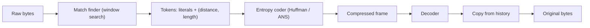

## In one minute
- Compression trades CPU time for fewer bytes on disk, on the network, and in memory. Whether it pays depends on which of those is your bottleneck.
- General-purpose lossless codecs combine two ideas: replacing repeats with back-references (LZ77 family) and encoding frequent symbols with fewer bits (Huffman or ANS).
- Codec choice is a speed versus ratio dial: LZ4 and Snappy are fast with modest ratios, zstd covers a wide range, gzip is the compatible default, Brotli wins for static web assets.
- Data layout matters more than codec: columnar formats with dictionary, run-length, and delta encoding compress far better than row-by-row JSON.

## How it works

### Back-references
An LZ77-style compressor slides a window over recent input. At each position it searches the window for the longest earlier match and emits a token "go back *d* bytes and copy *n*" instead of the bytes themselves. Repetitive data (logs, JSON keys, HTML tags) shrinks dramatically. Larger windows find more matches but need more memory on both sides; gzip's window is 32 KB ([RFC 1951](https://www.rfc-editor.org/rfc/rfc1951.html)), while zstd can use windows of many megabytes.

### Entropy coding
After matching, the remaining literals and token fields are encoded by frequency. Huffman coding assigns shorter bit strings to common symbols. Newer codecs such as zstd use asymmetric numeral systems (ANS), which approach the theoretical limit with fast table-driven decoding. Entropy coding is why already-random data (encrypted bytes, JPEG, video) does not compress: there is no skew left to exploit.

### Levels and asymmetry
Higher levels search harder for matches. Compression slows sharply while decompression speed stays roughly constant, which is why "compress once, read many" data (static assets, archived logs, data lake files) can use high levels cheaply. As a rough single-core guide: LZ4 compresses at several hundred MB/s and decompresses at multiple GB/s; zstd at low levels compresses at a few hundred MB/s with ratios close to gzip's; gzip at its default level manages tens of MB/s. The zstd project's own lzbench run on the Silesia corpus shows the shape: zstd level 1 reaches ratio 2.90 at 510 MB/s compress and 1,550 MB/s decompress, zlib level 1 reaches 2.74 at 105 and 390 MB/s, and LZ4 reaches 2.10 at 675 MB/s and 3,850 MB/s ([zstd README](https://github.com/facebook/zstd/blob/dev/README.md)). Benchmark on your own data before trusting any table.

### Encodings that exploit structure
Columnar formats (Parquet, ORC, ClickHouse) store each column together, so values are similar and small. They apply **dictionary encoding** (replace a repeated string with a small integer), **run-length encoding** (store "US" x 4,000 once), **delta encoding** (store differences between sorted timestamps), and **bit packing** (store values 0 to 15 in 4 bits). A general codec then runs on top. Ratios of 10x or more on event data are common.

### Small messages and dictionaries
A 300-byte JSON message barely compresses alone because the window is empty at the start. Trained dictionaries (zstd supports these) pre-load common substrings, so small payloads compress well. Both sides must agree on the dictionary version. The web now has a standard way to do this: RFC 9842 (September 2025) lets a server mark a response with `Use-As-Dictionary`, and later requests that send its hash in `Available-Dictionary` can receive `dcb` (Brotli) or `dcz` (zstd) responses compressed against it, so a new version of a JavaScript bundle ships as a small delta ([RFC 9842](https://www.rfc-editor.org/rfc/rfc9842.html)).

## Down the stack

### Layer 1: The contract
A lossless codec promises exact round trips: decompressing the output yields the input byte for byte. It promises nothing about ratio, and random input can grow slightly. Container formats add integrity checks: gzip ends with a CRC32 and the uncompressed length modulo 2^32 ([RFC 1952](https://www.rfc-editor.org/rfc/rfc1952.html)), and zstd frames can carry a content checksum, the low 4 bytes of an XXH64 hash ([RFC 8878](https://www.rfc-editor.org/rfc/rfc8878.html)). A frame header also declares the window size, which bounds how much memory a decoder needs; a decoder that honours a configured maximum can refuse frames that would need more.

### Layer 2: The mechanism
DEFLATE (used by gzip and zlib) finds LZ77 matches of 3 to 258 bytes at distances up to 32,768, then Huffman-codes literals, lengths and distances per block, with either fixed or block-specific code tables. LZ4 skips entropy coding: each sequence starts with a token byte holding a 4-bit literal length and a 4-bit match length, followed by the literals and a 2-byte offset into a 64 KB window, which is why it decodes so fast ([LZ4 block format](https://github.com/lz4/lz4/blob/dev/doc/lz4_Block_format.md)). zstd splits input into blocks of up to 128 KB, Huffman-codes the literals, and codes each sequence (literal length, match length, offset) with Finite State Entropy, a table-driven ANS coder. It also keeps recent offsets as "repeat codes", supports levels from negative (faster) up to 22, with 3 as the default, and can use trained dictionaries. The format is RFC 8878 (2021), which replaced RFC 8478. On HTTP, clients advertise `Accept-Encoding: gzip, br, zstd` and servers reply with `Content-Encoding`. Chrome 123 turned on `zstd` in March 2024 ([zstd v1.5.6 release](https://github.com/facebook/zstd/releases/tag/v1.5.6)), and RFC 9659 (September 2024) then required that a `zstd` response never need a window above 8 MB, because browsers that capped memory were failing to decode larger ones ([RFC 9659](https://www.rfc-editor.org/rfc/rfc9659.html)). A server that compresses at high zstd levels for HTTP must cap the window, or some clients will fail.

### Layer 3: The machine
Match finders hash the next 4 to 8 bytes into a table of recent positions; keeping that table within L2 cache (a few hundred KB) is what separates hundreds of MB/s from tens. Decoders avoid bit-by-bit tree walks by using lookup tables indexed by the next 8 to 12 bits, so decoding is mostly sequential memory copies. Memory is per stream: a compressor at a mid level can use several MB, and a server holding 10,000 concurrent compressed streams can spend gigabytes on codec state. Throughput must be compared with the link: a 10 Gbps NIC carries about 1.25 GB/s, so a single-core gzip at 50 MB/s becomes the bottleneck long before the network does. Storage engines compress per block (a 16 KB database page, a 128 KB filesystem record), and each block restarts the window, so small blocks compress worse.

### Why it's built this way
1. Real data repeats itself, so back-references to earlier bytes remove most redundancy.
2. Searching for matches is the expensive part, so levels trade search effort for ratio, and decoding stays cheap.
3. What remains after matching is skewed, so entropy coding spends fewer bits on common symbols.
4. Memory and caches are finite, so windows and hash tables are bounded, which limits how far back a match can reach.
5. Random access needs independent blocks, so storage compresses per block and accepts a lower ratio.

## Diagram


## Worked example
A logging pipeline ships 2 TB per day of JSON logs from 500 hosts to object storage, then queries them with a warehouse. Raw, that is about 185 Mbps sustained across the fleet, and storage at roughly 0.02 dollars per GB-month costs about 1,200 dollars per month for every month retained.

- **gzip level 6 on the agents:** about 8x smaller, but the agents spend noticeable CPU per host at peak, and gzip decompresses slowly at query time.
- **zstd level 3 on the agents:** about 9x smaller at several times the speed, cutting egress to roughly 21 Mbps and storage to about 135 dollars per month per retained month.
- **Convert to Parquet with zstd in a batch job:** dictionary and delta encoding take the ratio to around 20x, and queries read only the needed columns, so a query touching 3 of 40 fields scans about 7% of the bytes.

The decision: zstd on the wire, Parquet at rest, and keep raw text only for the last 24 hours.

## In the wild
- **TLS, 2012 to 2013: CRIME and BREACH turn compression into a side channel.** CRIME (CVE-2012-4929) let an active attacker recover cookies from TLS connections that used TLS-level compression, by injecting guesses and watching ciphertext length shrink when a guess matched the secret. BREACH (2013) did the same against HTTP-level compression of response bodies, for which no TLS-level fix exists, so applications must randomize secrets such as CSRF tokens ([RFC 7457](https://www.rfc-editor.org/rfc/rfc7457.html)). TLS 1.3 dropped compression from the protocol ([RFC 8446](https://www.rfc-editor.org/rfc/rfc8446.html)).
- **xz Utils, 2024: a backdoor hidden in a compression library.** Andres Freund noticed sshd logins taking about 0.5 seconds of CPU instead of 0.01 and traced it to liblzma 5.6.0 and 5.6.1. Obfuscated payloads sat in test files and were pulled in by a build script line present only in release tarballs. The code redirected `RSA_public_decrypt` in sshd, reachable because distribution patches linked sshd to liblzma. It became CVE-2024-3094 and was caught before most stable distributions shipped it ([oss-security](https://www.openwall.com/lists/oss-security/2024/03/29/4)).
- **Cloudflare, 2024: switching web compression to zstd.** After Chromium browsers and Firefox added zstd in March 2024, Cloudflare ran a 24-hour test with zstd as the default for Free plan traffic. At level 3, zstd averaged a 2.86 ratio against 3.08 for Brotli and 2.56 for gzip, and compressed in 0.848 ms against 1.544 ms for Brotli and 0.872 ms for gzip. The main engineering problem was backpressure: the compressor produced output faster than slow clients could take it ([Cloudflare](https://blog.cloudflare.com/new-standards/)).

## Trade-offs
| Option | Strengths | Weaknesses | Choose when |
|---|---|---|---|
| LZ4 / Snappy | Very fast both ways, low CPU | Modest ratio | Hot paths, RPC, database pages, caches |
| zstd | Wide level range, dictionaries | Not universal in old clients | Default for new systems and storage |
| gzip / deflate | Supported everywhere | Slow, mediocre ratio | Compatibility with any client |
| Brotli | Best ratio for web text at high levels | Slow compression at high levels | Static assets compressed at build time |
| Columnar encodings | 10x or more on structured data | Batch-oriented, not for point writes | Analytics and data lakes |

## Pitfalls in production
- **Compressing incompressible data.** Gzipping images or encrypted blobs burns CPU for nothing. Skip compression by content type or when a sample ratio is near 1.
- **Compression bombs.** A tiny payload expands to gigabytes and exhausts memory. Enforce a maximum decompressed size and stream with limits.
- **Secrets leaking through compression.** Compressing attacker-influenced input together with secrets lets size reveal the secret (the CRIME and BREACH class). TLS 1.3 removed TLS-level compression outright ([RFC 8446](https://www.rfc-editor.org/rfc/rfc8446.html)), but HTTP-level compression is still yours to manage. Do not compress responses that mix secrets with reflected input, or mask secrets such as CSRF tokens per response.
- **Wrong place in the pipeline.** Encrypting before compressing makes compression useless. Compress first, then encrypt.
- **Level chosen once, never revisited.** Max levels on a hot write path can triple CPU for a few percent gain. Benchmark on real data and record the choice.

## Leadership lens
- Ask what the bottleneck is: network egress, storage cost, disk I/O, or CPU. Pick the codec to relieve that one.
- Standardise on a small set of codecs (for example LZ4 for hot paths, zstd elsewhere) to avoid a zoo of formats and libraries.
- Put decompression limits and content-type rules in shared libraries, not in each service.
- Quantify savings in money: egress and storage often justify a migration to zstd or columnar storage on their own.

## Check yourself
1. Why does a bigger compression level barely slow decompression?
   **Answer:** Extra effort goes into searching for better matches; the decoder just follows the chosen tokens, so its work stays about the same.
2. Why do 300-byte messages compress poorly, and what helps?
   **Answer:** The match window starts empty, so there is little history to reference; a shared trained dictionary supplies that history.
3. Why must you compress before encrypting?
   **Answer:** Good encryption output looks random, and random data has no repeats or skew for a compressor to exploit.

## Practice
**Task:** Implement an LZ77 compressor and decompressor over strings. `compress(data, window)` scans left to right; at each position it finds the longest match starting within the previous `window` characters (matches may overlap the current position), preferring the smallest offset on ties. It emits `(offset, length, next_char)`, where `next_char` is the character after the match or `""` at the end of input, and `(0, 0, c)` when there is no match. `decompress(tokens)` rebuilds the string. Both must handle the empty string.

```python starter
def compress(data, window):
    # TODO
    raise NotImplementedError

def decompress(tokens):
    # TODO
    raise NotImplementedError
```

```python tests
def test_empty():
    assert compress("", 8) == []
    assert decompress([]) == ""

def test_overlapping_run():
    assert compress("aaaa", 8) == [(0, 0, "a"), (1, 3, "")]

def test_repeat_with_trailing_literal():
    assert compress("abcabcabcx", 16) == [
        (0, 0, "a"), (0, 0, "b"), (0, 0, "c"), (3, 6, "x")]

def test_window_limits_matches():
    assert compress("abcdab", 3)[-2:] == [(0, 0, "a"), (0, 0, "b")]
    assert compress("abcdab", 4)[-1] == (4, 2, "")

def test_round_trip():
    text = "to be or not to be, that is the question; to be is to do"
    for w in (1, 4, 64):
        assert decompress(compress(text, w)) == text

def test_compresses_repetitive_input():
    assert len(compress("ab" * 50, 32)) <= 3
```

```python solution
def compress(data, window):
    tokens, i, n = [], 0, len(data)
    while i < n:
        best_len, best_off = 0, 0
        for off in range(1, min(window, i) + 1):
            length = 0
            while i + length < n and data[i - off + length] == data[i + length]:
                length += 1
            if length > best_len:
                best_len, best_off = length, off
        nxt = data[i + best_len] if i + best_len < n else ""
        tokens.append((best_off, best_len, nxt))
        i += best_len + 1
    return tokens

def decompress(tokens):
    out = []
    for off, length, ch in tokens:
        for _ in range(length):
            out.append(out[-off])
        if ch:
            out.append(ch)
    return "".join(out)
```

```typescript starter
export type Token = [number, number, string];
export function compress(data: string, window: number): Token[] {
  throw new Error("TODO");
}
export function decompress(tokens: Token[]): string {
  throw new Error("TODO");
}
```

```typescript tests
test("empty", () => {
  assertEqual(compress("", 8), []);
  assertEqual(decompress([]), "");
});
test("overlapping run", () => {
  assertEqual(compress("aaaa", 8), [[0, 0, "a"], [1, 3, ""]]);
});
test("repeat with trailing literal", () => {
  assertEqual(compress("abcabcabcx", 16), [[0, 0, "a"], [0, 0, "b"], [0, 0, "c"], [3, 6, "x"]]);
});
test("window limits matches", () => {
  assertEqual(compress("abcdab", 3).slice(-2), [[0, 0, "a"], [0, 0, "b"]]);
  assertEqual(compress("abcdab", 4).slice(-1), [[4, 2, ""]]);
});
test("round trip", () => {
  const text = "to be or not to be, that is the question; to be is to do";
  for (const w of [1, 4, 64]) assertEqual(decompress(compress(text, w)), text);
});
test("compresses repetitive input", () => {
  assert(compress("ab".repeat(50), 32).length <= 3, "expected at most 3 tokens");
});
```

```typescript solution
export type Token = [number, number, string];
export function compress(data: string, window: number): Token[] {
  const tokens: Token[] = [];
  const n = data.length;
  let i = 0;
  while (i < n) {
    let bestLen = 0, bestOff = 0;
    for (let off = 1; off <= Math.min(window, i); off++) {
      let len = 0;
      while (i + len < n && data[i - off + len] === data[i + len]) len++;
      if (len > bestLen) { bestLen = len; bestOff = off; }
    }
    tokens.push([bestOff, bestLen, i + bestLen < n ? data[i + bestLen] : ""]);
    i += bestLen + 1;
  }
  return tokens;
}
export function decompress(tokens: Token[]): string {
  const out: string[] = [];
  for (const [off, len, ch] of tokens) {
    for (let k = 0; k < len; k++) out.push(out[out.length - off]);
    if (ch) out.push(ch);
  }
  return out.join("");
}
```

```go starter
package practice

// Token is (Offset, Length, Next); Next is "" at the end of input.
type Token struct {
	Offset, Length int
	Next           string
}

func Compress(data string, window int) []Token { panic("TODO") }

func Decompress(tokens []Token) string { panic("TODO") }
```

```go tests
package practice

import (
	"reflect"
	"strings"
	"testing"
)

func TestEmpty(t *testing.T) {
	if len(Compress("", 8)) != 0 || Decompress(nil) != "" {
		t.Fatal("empty input mishandled")
	}
}

func TestOverlappingRun(t *testing.T) {
	want := []Token{{0, 0, "a"}, {1, 3, ""}}
	if got := Compress("aaaa", 8); !reflect.DeepEqual(got, want) {
		t.Fatalf("got %v", got)
	}
}

func TestRepeatWithTrailingLiteral(t *testing.T) {
	want := []Token{{0, 0, "a"}, {0, 0, "b"}, {0, 0, "c"}, {3, 6, "x"}}
	if got := Compress("abcabcabcx", 16); !reflect.DeepEqual(got, want) {
		t.Fatalf("got %v", got)
	}
}

func TestWindowLimitsMatches(t *testing.T) {
	small := Compress("abcdab", 3)
	if small[len(small)-1] != (Token{0, 0, "b"}) {
		t.Fatalf("got %v", small)
	}
	big := Compress("abcdab", 4)
	if big[len(big)-1] != (Token{4, 2, ""}) {
		t.Fatalf("got %v", big)
	}
}

func TestRoundTrip(t *testing.T) {
	text := "to be or not to be, that is the question; to be is to do"
	for _, w := range []int{1, 4, 64} {
		if got := Decompress(Compress(text, w)); got != text {
			t.Fatalf("window %d: got %q", w, got)
		}
	}
}

func TestCompressesRepetitiveInput(t *testing.T) {
	if n := len(Compress(strings.Repeat("ab", 50), 32)); n > 3 {
		t.Fatalf("got %d tokens", n)
	}
}
```

```go solution
package practice

import "strings"

// Token is (Offset, Length, Next); Next is "" at the end of input.
type Token struct {
	Offset, Length int
	Next           string
}

func Compress(data string, window int) []Token {
	var tokens []Token
	n := len(data)
	for i := 0; i < n; {
		bestLen, bestOff := 0, 0
		for off := 1; off <= window && off <= i; off++ {
			l := 0
			for i+l < n && data[i-off+l] == data[i+l] {
				l++
			}
			if l > bestLen {
				bestLen, bestOff = l, off
			}
		}
		next := ""
		if i+bestLen < n {
			next = string(data[i+bestLen])
		}
		tokens = append(tokens, Token{bestOff, bestLen, next})
		i += bestLen + 1
	}
	return tokens
}

func Decompress(tokens []Token) string {
	var out []byte
	for _, t := range tokens {
		for k := 0; k < t.Length; k++ {
			out = append(out, out[len(out)-t.Offset])
		}
		out = append(out, t.Next...)
	}
	var b strings.Builder
	b.Write(out)
	return b.String()
}
```

## Mock interview
**Prompt:** Your platform stores 5 PB of event data in object storage and serves 2,000 queries per hour against it. Storage and egress are now the second largest line in the cloud bill. Propose a compression strategy.

- Follow-up: The ingestion agents run on customer hosts with tight CPU limits. What do you compress there, and how?
- Follow-up: A partner sends a 2 KB gzip payload that expands to 10 GB. What protections should exist?
- Follow-up: When would you pay for a high compression level, and when not?

**A strong answer covers:**
- Identifying the bottleneck (storage, egress, scan I/O, CPU) and quantifying savings.
- Fast codecs at the edge, columnar encodings plus zstd at rest, and pruning by column and partition.
- Asymmetry of levels: expensive compression is fine for write-once, read-many data.
- Decompression limits, streaming, and content-type checks against bombs and wasted CPU.
- Benchmarking codecs and levels on real samples rather than published numbers.

## Sources and further study
**Primary**
- [RFC 8878: Zstandard Compression and the application/zstd Media Type](https://www.rfc-editor.org/rfc/rfc8878.html): the zstd frame and block format, window sizes and checksums.
- [RFC 9842: Compression Dictionary Transport](https://www.rfc-editor.org/rfc/rfc9842.html): shared dictionaries over HTTP with the `dcb` and `dcz` encodings.
- [Duda, Asymmetric numeral systems (2009)](https://arxiv.org/abs/0902.0271): the entropy coding family behind zstd's Finite State Entropy.

**Systems docs**
- [Apache Parquet: Encodings](https://parquet.apache.org/docs/file-format/data-pages/encodings/): dictionary, RLE and bit-packing hybrid, and delta encodings as specified.
- [RocksDB wiki: Compression](https://github.com/facebook/rocksdb/wiki/Compression): per-level codec choice, dictionary compression and the CPU trade-off inside a storage engine.
- [LZ4 block format](https://github.com/lz4/lz4/blob/dev/doc/lz4_Block_format.md): the token, literal and offset layout that makes LZ4 decode so fast.

**Books**
- *High Performance Browser Networking* (1st ed.), Ilya Grigorik, chapter 13 "Optimizing Application Delivery" ([read free](https://hpbn.co/optimizing-application-delivery/)): compressing assets in transfer as an evergreen web performance practice.
- *Designing Data-Intensive Applications* (1st ed.), Martin Kleppmann, chapter 3 "Storage and Retrieval": the "Column-Oriented Storage" section on column compression and bitmap encoding.

**Other curricula**
- [CMU 15-445 lecture notes: Storage Models and Compression (Fall 2024)](https://15445.courses.cs.cmu.edu/fall2024/notes/05-storage3.pdf): contrasts naive block compression with columnar schemes such as run-length, delta and dictionary encoding.
- [donnemartin/system-design-primer](https://github.com/donnemartin/system-design-primer): lists compressing server responses as a one-line performance tip and gives latency numbers for compressing 1 KB, without discussing codecs.

## Watch
- [Impact of zstd (All Systems Go!)](https://www.youtube.com/watch?v=v4Y1le3M9EQ): how zstd works and where it changed real systems.
- [Implementing ZSTD in OpenZFS on FreeBSD (BSDCan)](https://www.youtube.com/watch?v=7N6lMi6g5UU): codec choice and levels in a filesystem.

## Free resources
- [Zstandard](https://facebook.github.io/zstd/): the reference site, with benchmark tables and dictionary training.
- [LZ4](https://lz4.github.io/lz4/): the fast codec's design and speed figures.
- [RFC 7932: Brotli](https://datatracker.ietf.org/doc/html/rfc7932): the Brotli format, including its static dictionary.
- [Cloudflare: Results of experimenting with Brotli](https://blog.cloudflare.com/results-experimenting-brotli/): real-world ratio and speed trade-offs for web content.
- [Apache Parquet documentation](https://parquet.apache.org/docs/): columnar encodings and compression in practice.
- [Wikipedia: LZ77 and LZ78](https://en.wikipedia.org/wiki/LZ77_and_LZ78): background on the dictionary-coding algorithms behind most codecs.
