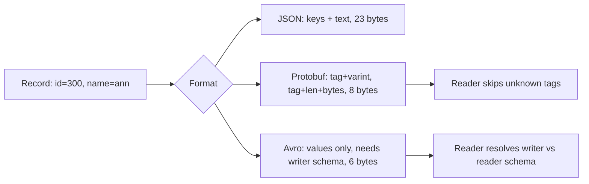

## In one minute
- A data format decides size on the wire, CPU to encode and decode, human readability, and, most importantly, how safely schemas can evolve.
- Text formats (JSON, XML, CSV) are self-describing and debuggable but verbose and loosely typed.
- Binary schema formats (Protocol Buffers, Avro, Thrift) are 3 to 10 times smaller and faster, and enforce compatibility rules.
- Columnar formats (Parquet, ORC) are a different category, optimised for scanning a few columns across billions of rows.
- The long-term cost is not bytes; it is breaking a consumer you forgot existed when a field changes.

## How it works

### Text formats
JSON encodes every record with its field names, numbers as decimal text, and strings with escaping. A record like `{"user_id":123456789,"active":true}` spends most of its bytes on keys and punctuation. Numbers have no fixed type: many parsers read them as 64-bit floats, so integers above 2^53 silently lose precision. The JSON standard itself only promises that integers between -(2^53)+1 and 2^53-1 travel safely between implementations ([RFC 8259](https://www.rfc-editor.org/rfc/rfc8259)). Parsing is branchy byte-by-byte work, typically 200 to 1,000 MB/s with a good library. In return you get universal tooling, readability in logs, and no shared schema needed to decode.

### Binary schema formats
Protocol Buffers writes each field as a *tag* (field number plus wire type) followed by the value. Integers use *varints*: 7 bits per byte, high bit set when more bytes follow, so 300 takes 2 bytes instead of 8. A negative plain `int32` or `int64` always takes ten bytes, so the `sint32` and `sint64` types use zigzag encoding instead, which turns -1 into 1 and keeps small negatives small ([Protobuf encoding](https://protobuf.dev/programming-guides/encoding/)). Field names never appear on the wire, only numbers, which is why you must never reuse a field number.

Avro takes a different approach: no tags at all. Values are written in schema order, and the reader needs the *writer's* schema to decode, then resolves it against its own *reader's* schema by field name. Fields are matched by name, and a reader field the writer lacks must have a default or decoding fails ([Avro spec](https://avro.apache.org/docs/1.12.0/specification/)). That makes Avro compact and well suited to files and Kafka topics with a schema registry, but useless without the writer's schema at hand.

### Schema evolution
Compatibility is the real design axis. *Backward compatible* means new readers can read old data; *forward compatible* means old readers can read new data. Rolling deployments need both, because old and new versions run side by side. With Protobuf: add fields with new numbers, never change a field's type or number, and treat removal as "reserve the number" ([Protobuf dos and don'ts](https://protobuf.dev/best-practices/dos-donts/)). With Avro: new fields need defaults. With JSON there is no enforcement, so compatibility lives in code reviews and contract tests.

The Protobuf language itself has moved on. *Editions* replace the `proto2` and `proto3` syntax lines: a file declares `edition = "2023"` or `"2024"`, and behaviour such as field presence becomes a feature with a default you can override per file or field. In editions, fields track presence by default, as proto2 optional fields did, and the wire format does not change, so old and new files interoperate ([Protobuf Editions](https://protobuf.dev/editions/overview/)).

### Columnar formats
Parquet stores each column contiguously in row groups, with dictionary and run-length encoding, plus min/max statistics per chunk. A query that reads 3 of 200 columns reads roughly 1.5% of the bytes and can skip row groups whose statistics exclude the filter. Writes are batch-oriented, so it is for analytics, not for RPC.

## Down the stack

### Layer 1: The contract
A format promises round-tripping: decode(encode(x)) equals x for every value the schema allows. Schema formats add a compatibility contract: under stated rules (only add fields with new numbers, give new Avro fields defaults), a reader built against schema version N can read data written with version N-1 or N+1, skipping or defaulting what it does not know. JSON promises much less: RFC 8259 leaves number precision to the implementation and says only that names SHOULD be unique, so a receiver's behaviour on duplicate keys is unpredictable and two conforming parsers can disagree on the same bytes ([RFC 8259](https://www.rfc-editor.org/rfc/rfc8259)).

### Layer 2: The mechanism
Protobuf writes each field as a key varint, `(field_number << 3) | wire_type`, followed by the payload. Wire type 0 is a varint, 1 is 8 fixed bytes, 2 is length-delimited (strings, bytes, nested messages, packed repeated numbers) and 5 is 4 fixed bytes. A parser that meets an unknown field number still knows how to skip it from the wire type, and modern runtimes keep those bytes so a proxy can pass them through. Avro container files start with the magic bytes `Obj` plus 0x01, store the writer schema as JSON in the header metadata, and separate compressed blocks with a 16-byte sync marker so files can be split. With a schema registry, each Kafka message is classically prefixed with a magic byte 0 and a 4-byte big-endian schema id; since Confluent Platform 8.1.1 a producer can instead put a 16-byte schema GUID in a record header and leave the payload unprefixed ([Confluent docs](https://docs.confluent.io/platform/current/schema-registry/fundamentals/serdes-develop/index.html)). Parquet files hold row groups (128 MB is a common writer default, while the Parquet docs recommend 512 MB to 1 GB for large sequential reads), each with one column chunk per column, divided into pages ([Parquet configurations](https://parquet.apache.org/docs/file-format/configurations/)), and a footer with schema and per-chunk min/max statistics, bracketed by the magic `PAR1`.

### Layer 3: The machine
Text parsing is a branch-heavy, byte-at-a-time loop, and branch mispredictions cost 15 to 20 cycles each. SIMD parsers such as simdjson classify 64 bytes per instruction batch to find quotes and braces, reaching gigabytes per second on one core with a quarter or fewer of the instructions of RapidJSON ([Langdale and Lemire](https://arxiv.org/abs/1902.08318)), but still pay to convert decimal text to floats, which is surprisingly costly in both directions. A DOM-style JSON parser allocates per node, so garbage collection follows throughput. Protobuf varints are also branchy, while fixed-width fields decode with one little-endian load. Columnar layouts put the same field's values in contiguous memory, so a scan touches only the needed bytes, uses all of every 64-byte cache line, and lets the CPU apply SIMD comparisons to many values at once; similar values side by side also compress far better.

### Why it's built this way
1. Bytes cost network, storage and cache space, so high-volume formats drop field names and text numbers.
2. Producers and consumers deploy independently, so formats need a way to evolve without lockstep releases.
3. Tags make each record self-delimiting at a byte or two per field; Avro instead moves the schema out of band to save those bytes.
4. Analytical queries read few columns over many rows, and disks and CPUs reward sequential access, so warehouses store columns, not rows.
5. Humans still debug at system boundaries, so readable JSON survives at the edges.

## Diagram



## Worked example
An event pipeline ingests 200,000 events per second. Each event has 12 fields: two 64-bit IDs, a timestamp, an enum, four small integers, and four short strings averaging 10 characters.

- JSON with 10-character keys: roughly 12 x 14 bytes of keys and punctuation plus about 110 bytes of values, around 280 bytes per event.
- Protobuf: one tag byte per field, varints for the numbers, length-prefixed strings, around 85 bytes.
- Avro: no tags, around 73 bytes.

At 200,000 events per second, JSON produces 56 MB/s (4.8 TB/day) versus about 17 MB/s (1.5 TB/day) for Protobuf. Compressed with zstd, the gap narrows to perhaps 2x, because compression removes repeated keys. CPU does not narrow: parsing 56 MB/s of JSON at 400 MB/s per core costs about 0.14 cores per consumer group, several times the binary cost, and 50 consumer groups spend 7 cores just parsing. Retained for 7 days with replication factor 3, the raw difference is about 70 TB of Kafka storage.

The decision is not "binary always". The public API keeps JSON for client ergonomics; the internal event bus uses Protobuf with a schema registry enforcing backward and forward compatibility checks in CI.

## In the wild
- **Twitter, 2010: tweet IDs outgrow JavaScript numbers.** Moving to Snowflake, time-based 64-bit IDs meant status IDs would pass 53 bits on 26 November 2010 and stop being usable as integers in JavaScript. A month earlier Twitter announced that every ID in its JSON responses would also be sent as a string (`id_str`) and told developers to read that field instead ([Twitter developer announcement](https://groups.google.com/g/twitter-development-talk/c/ahbvo3VTIYI/m/0eMJbIpAC8MJ)).
- **CrowdStrike, 2024: a producer and consumer disagree on field count.** A new template type defined 21 input fields, but the sensor code that read it supplied only 20. Earlier content used a wildcard for field 21, so the mismatch stayed hidden until a channel file on 19 July matched on it, the interpreter read past the end of its array, and Windows hosts crashed worldwide. Fixes included a compile-time check on input count, runtime bounds checks and staged rollout of content ([CrowdStrike RCA](https://www.crowdstrike.com/wp-content/uploads/2024/08/Channel-File-291-Incident-Root-Cause-Analysis-08.06.2024.pdf)).
- **Cloudflare, 2025: a generated data file breaks its reader's size assumption.** A database permissions change made the query behind the Bot Management feature file return duplicate rows, so the file roughly doubled and passed the proxy's preallocated limit of 200 features. The proxy panicked on the oversized input, and core traffic returned 5xx errors for about three hours. Cloudflare now treats internally generated files with the same validation as user input ([Cloudflare](https://blog.cloudflare.com/18-november-2025-outage/)).

## Trade-offs

| Option | Strengths | Weaknesses | Choose when |
| --- | --- | --- | --- |
| JSON | Universal, readable, no schema needed | Large, slow, weak numeric types | Public APIs, configs, low volume |
| Protocol Buffers | Compact, fast, tagged evolution, codegen | Needs .proto files and tooling | RPC, internal events, mobile clients |
| Avro | Smallest rows, schema resolution by name | Needs writer schema at read time | Kafka with registry, Hadoop files |
| MessagePack/CBOR | Binary JSON, no schema | Field names still on the wire | Drop-in speedup for JSON payloads |
| Parquet | Columnar scans, great compression | Batch writes, no point lookups | Analytics and data lakes |

## Pitfalls in production
- **Reusing a Protobuf field number.** Old data decodes into the new field with the wrong meaning. Mark removed numbers `reserved` and lint for it.
- **Large integers in JSON.** IDs above 2^53 get rounded in JavaScript. Send 64-bit IDs as strings, as Twitter did with `id_str` when its IDs crossed 53 bits in 2010 ([Twitter developer announcement](https://groups.google.com/g/twitter-development-talk/c/ahbvo3VTIYI/m/0eMJbIpAC8MJ)).
- **Changing types "compatibly".** Switching `int32` to `string` breaks every old reader. Add a new field and migrate.
- **Required fields.** A field that can never be dropped becomes a permanent constraint. Proto3 removed `required` for this reason, Editions keep it only as `LEGACY_REQUIRED`, and Google's guidance is never to add one ([Protobuf dos and don'ts](https://protobuf.dev/best-practices/dos-donts/)).
- **Schema registry outages.** Avro consumers that cannot fetch a writer schema stop. Cache schemas locally and treat the registry as tier-zero.

## Leadership lens
- Pick one internal format and one external format and write down the evolution rules; the choice matters less than consistency.
- Enforce compatibility in CI with a breaking-change checker against the last released schema.
- Ask in review: who consumes this, and what happens to a consumer that is three versions behind?
- Measure encode and decode cost at your volume before arguing about bytes.

## Check yourself
1. Why does Protobuf let old readers ignore new fields while Avro needs the writer's schema?
   **Answer:** Protobuf tags each value with its number and wire type, so a reader can skip unknown tags. Avro writes no tags, so the reader cannot even find field boundaries without the writer's schema.
2. Why does compression narrow the size gap between JSON and Protobuf but not the CPU gap?
   **Answer:** Compression removes repeated key names, but you still pay to compress, decompress and then parse text.
3. What makes adding a field to an Avro schema backward compatible?
   **Answer:** Giving it a default, so a new reader can fill it in when reading old data that lacks it.

## Practice
**Task:** Implement Protobuf-style varints. `encode_varint(n)` turns a non-negative integer into bytes, 7 bits per byte, least significant group first, with the high bit set on every byte except the last. `decode_varint(buf, pos)` reads one varint starting at `pos` and returns `(value, next_pos)`, raising `ValueError` if the buffer ends mid-value. Also implement `zigzag(n)` and `unzigzag(z)` for 64-bit signed integers so small negatives encode small.

```python starter
def encode_varint(n):
    raise NotImplementedError

def decode_varint(buf, pos):
    raise NotImplementedError

def zigzag(n):
    raise NotImplementedError

def unzigzag(z):
    raise NotImplementedError
```

```python tests
def test_small_values():
    assert encode_varint(0) == bytes([0])
    assert encode_varint(1) == bytes([1])

def test_multi_byte():
    assert encode_varint(300) == bytes([0xAC, 0x02])

def test_round_trip_sequence():
    buf = encode_varint(300) + encode_varint(2**40) + encode_varint(7)
    v1, p = decode_varint(buf, 0)
    v2, p = decode_varint(buf, p)
    v3, p = decode_varint(buf, p)
    assert (v1, v2, v3, p) == (300, 2**40, 7, len(buf))

def test_truncated_raises():
    try:
        decode_varint(bytes([0x80]), 0)
        assert False, "expected ValueError"
    except ValueError:
        pass

def test_zigzag():
    assert [zigzag(x) for x in (0, -1, 1, -2)] == [0, 1, 2, 3]
    assert unzigzag(zigzag(-123456789)) == -123456789
```

```python solution
def encode_varint(n):
    out = bytearray()
    while True:
        b = n & 0x7F
        n >>= 7
        if n:
            out.append(b | 0x80)
        else:
            out.append(b)
            return bytes(out)

def decode_varint(buf, pos):
    result, shift = 0, 0
    while pos < len(buf):
        b = buf[pos]
        pos += 1
        result |= (b & 0x7F) << shift
        if not b & 0x80:
            return result, pos
        shift += 7
    raise ValueError("truncated varint")

def zigzag(n):
    return (n << 1) ^ (n >> 63)

def unzigzag(z):
    return (z >> 1) ^ -(z & 1)
```

```typescript starter
export function encodeVarint(n: number): number[] {
  throw new Error("TODO");
}
export function decodeVarint(buf: number[], pos: number): [number, number] {
  throw new Error("TODO");
}
export function zigzag(n: number): number {
  throw new Error("TODO");
}
export function unzigzag(z: number): number {
  throw new Error("TODO");
}
```

```typescript tests
test("small values", () => {
  assertEqual(encodeVarint(0), [0]);
  assertEqual(encodeVarint(1), [1]);
});
test("multi byte", () => {
  assertEqual(encodeVarint(300), [0xac, 0x02]);
});
test("round trip sequence", () => {
  const buf = [...encodeVarint(300), ...encodeVarint(2 ** 40), ...encodeVarint(7)];
  const [v1, p1] = decodeVarint(buf, 0);
  const [v2, p2] = decodeVarint(buf, p1);
  const [v3, p3] = decodeVarint(buf, p2);
  assertEqual([v1, v2, v3, p3], [300, 2 ** 40, 7, buf.length]);
});
test("truncated throws", () => {
  let threw = false;
  try { decodeVarint([0x80], 0); } catch (e) { threw = true; }
  assert(threw, "expected an error");
});
test("zigzag", () => {
  assertEqual([0, -1, 1, -2].map(zigzag), [0, 1, 2, 3]);
  assertEqual(unzigzag(zigzag(-123456789)), -123456789);
});
```

```typescript solution
// Arithmetic instead of bitwise operators: JS bitwise ops truncate to 32 bits.
export function encodeVarint(n: number): number[] {
  const out: number[] = [];
  for (;;) {
    const b = n % 128;
    n = Math.floor(n / 128);
    if (n > 0) out.push(b + 128);
    else { out.push(b); return out; }
  }
}
export function decodeVarint(buf: number[], pos: number): [number, number] {
  let result = 0, mul = 1;
  while (pos < buf.length) {
    const b = buf[pos++];
    result += (b % 128) * mul;
    if (b < 128) return [result, pos];
    mul *= 128;
  }
  throw new Error("truncated varint");
}
export function zigzag(n: number): number {
  return n >= 0 ? 2 * n : -2 * n - 1;
}
export function unzigzag(z: number): number {
  return z % 2 === 0 ? z / 2 : -(z + 1) / 2;
}
```

```go starter
package practice

func EncodeVarint(n uint64) []byte {
	panic("TODO")
}

func DecodeVarint(buf []byte, pos int) (uint64, int, error) {
	panic("TODO")
}

func Zigzag(n int64) uint64 {
	panic("TODO")
}

func Unzigzag(z uint64) int64 {
	panic("TODO")
}
```

```go tests
package practice

import (
	"bytes"
	"testing"
)

func TestSmallValues(t *testing.T) {
	if !bytes.Equal(EncodeVarint(0), []byte{0}) || !bytes.Equal(EncodeVarint(1), []byte{1}) {
		t.Fatal("small values wrong")
	}
}

func TestMultiByte(t *testing.T) {
	if got := EncodeVarint(300); !bytes.Equal(got, []byte{0xAC, 0x02}) {
		t.Fatalf("got %x", got)
	}
}

func TestRoundTrip(t *testing.T) {
	buf := append(append(EncodeVarint(300), EncodeVarint(1<<40)...), EncodeVarint(7)...)
	v1, p, _ := DecodeVarint(buf, 0)
	v2, p, _ := DecodeVarint(buf, p)
	v3, p, err := DecodeVarint(buf, p)
	if err != nil || v1 != 300 || v2 != 1<<40 || v3 != 7 || p != len(buf) {
		t.Fatalf("got %d %d %d %d %v", v1, v2, v3, p, err)
	}
}

func TestTruncated(t *testing.T) {
	if _, _, err := DecodeVarint([]byte{0x80}, 0); err == nil {
		t.Fatal("expected error")
	}
}

func TestZigzag(t *testing.T) {
	for i, n := range []int64{0, -1, 1, -2} {
		if Zigzag(n) != uint64(i) {
			t.Fatalf("zigzag(%d) = %d", n, Zigzag(n))
		}
	}
	if Unzigzag(Zigzag(-123456789)) != -123456789 {
		t.Fatal("round trip failed")
	}
}
```

```go solution
package practice

import "errors"

func EncodeVarint(n uint64) []byte {
	var out []byte
	for n >= 0x80 {
		out = append(out, byte(n)|0x80)
		n >>= 7
	}
	return append(out, byte(n))
}

func DecodeVarint(buf []byte, pos int) (uint64, int, error) {
	var result uint64
	var shift uint
	for pos < len(buf) {
		b := buf[pos]
		pos++
		result |= uint64(b&0x7F) << shift
		if b&0x80 == 0 {
			return result, pos, nil
		}
		shift += 7
	}
	return 0, pos, errors.New("truncated varint")
}

func Zigzag(n int64) uint64 {
	return uint64((n << 1) ^ (n >> 63))
}

func Unzigzag(z uint64) int64 {
	return int64(z>>1) ^ -int64(z&1)
}
```

## Mock interview
**Prompt:** Your company publishes 200,000 events per second to Kafka in JSON, read by 40 teams. Storage and consumer CPU costs are rising and a field rename broke three consumers last quarter. Propose a format strategy.

- Follow-up: How do you migrate without a flag day for 40 consumers?
- Follow-up: A producer deploys a schema that removes a field a consumer depends on. What should catch it?
- Follow-up: Why not just compress the JSON?

**A strong answer covers:**
- Moving the internal bus to Protobuf or Avro with a schema registry.
- Explicit compatibility mode (backward, forward, or full) checked in CI.
- Dual-publishing or a new topic during migration, with consumer-by-consumer cutover.
- Numbers on bytes, storage and CPU, including what compression does and does not fix.
- Keeping JSON at public edges where tooling and readability matter.

## Sources and further study
**Primary**
- [Langdale and Lemire, Parsing Gigabytes of JSON per Second (VLDB Journal 2019)](https://arxiv.org/abs/1902.08318): the simdjson design and why text parsing is branch-bound.
- [Twitter: Snowflake and string IDs (2010)](https://groups.google.com/g/twitter-development-talk/c/ahbvo3VTIYI/m/0eMJbIpAC8MJ): the original notice on 64-bit IDs and `id_str`.

**Systems docs**
- [Protobuf Editions overview](https://protobuf.dev/editions/overview/): how editions 2023 and 2024 replace proto2 and proto3 and what each feature defaults to.
- [Protobuf dos and don'ts](https://protobuf.dev/best-practices/dos-donts/): the evolution rules (never reuse a tag, reserve deleted numbers, never add required).
- [Confluent Schema Registry wire format](https://docs.confluent.io/platform/current/schema-registry/fundamentals/serdes-develop/index.html): the 5-byte prefix and the newer header-based schema GUID.
- [Apache Parquet configurations](https://parquet.apache.org/docs/file-format/configurations/): recommended row group and page sizes.

**Books**
- *Designing Data-Intensive Applications* (1st ed.), Martin Kleppmann, chapter 4 "Encoding and Evolution" (chapter 5 in the 2nd ed.): Thrift, Protobuf and Avro byte by byte, and forward and backward compatibility across dataflows.
- *Building Microservices* (2nd ed.), Sam Newman, chapter 5 "Implementing Microservice Communication": serialization formats, schemas and handling change between services.

**Other curricula**
- [donnemartin/system-design-primer](https://github.com/donnemartin/system-design-primer#remote-procedure-call-rpc): names Protobuf, Thrift and Avro only as RPC frameworks and does not cover encoding or schema evolution.

## Watch
- [Protocol Buffers Crash Course (Hussein Nasser)](https://www.youtube.com/watch?v=46O73On0gyI): hands-on look at Protobuf schemas and encoding.

## Free resources
- [Protocol Buffers encoding](https://protobuf.dev/programming-guides/encoding/): the official description of tags, varints and zigzag.
- [Schema evolution in Avro, Protocol Buffers and Thrift (Martin Kleppmann)](https://martin.kleppmann.com/2012/12/05/schema-evolution-in-avro-protocol-buffers-thrift.html): byte-level comparison of how each handles change.
- [Apache Avro specification](https://avro.apache.org/docs/1.12.0/specification/): schema resolution rules in detail.
- [RFC 8259: JSON](https://www.rfc-editor.org/rfc/rfc8259): includes the interoperability note on number precision.
- [RFC 8949: CBOR](https://www.rfc-editor.org/rfc/rfc8949): a standard schemaless binary format.
