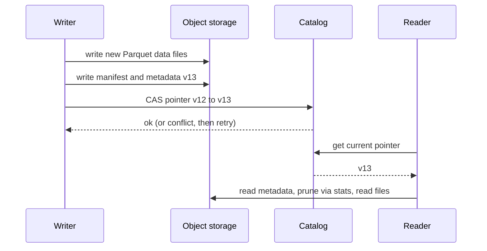

## In one minute
- A lakehouse puts a **transactional table format** (Delta Lake, Apache Iceberg, Apache Hudi) on top of Parquet files in object storage, giving lake economics with warehouse-like guarantees.
- The table format keeps a **metadata log** of which files make up each table version. A commit is one atomic swap of a pointer, so readers always see a consistent snapshot.
- That log enables ACID writes, **time travel**, schema evolution, row-level updates and deletes, and fast planning without listing directories.
- Many engines (Spark, Trino, Flink, warehouses) can read and write the same tables, which removes the copy from lake to warehouse.
- The cost is table maintenance: compaction, snapshot expiry, and orphan file cleanup are now your job.

## How it works

### Metadata over files
A plain lake defines a table as "all files under this prefix", which breaks with concurrent writers and partial writes. A table format instead defines the table as an explicit list of data files recorded in metadata. In Iceberg, a catalog points to the current metadata file; that file lists snapshots; each snapshot points to a manifest list; manifests list data files along with per-column statistics and partition values. Delta keeps an ordered transaction log of JSON commits with periodic Parquet checkpoints. The design was argued for in the 2021 CIDR paper that named the lakehouse: one open storage layer with transactions, instead of a lake plus a copied warehouse ([Armbrust et al., CIDR 2021](https://www.cidrdb.org/cidr2021/papers/cidr2021_paper17.pdf)).

### Atomic commits with optimistic concurrency
A writer writes new Parquet files first (invisible, since nothing references them), then writes new metadata, and finally tries to swap the table pointer from version N to N+1 with a compare-and-swap in the catalog, or by creating log file N+1 only if it does not exist. If another writer committed first, the swap fails; the writer re-reads, checks whether the changes conflict (for example both rewrote the same files), and retries. Iceberg retries 4 times by default, with backoff from 100 ms up to a minute, before failing the job ([Iceberg docs](https://iceberg.apache.org/docs/latest/configuration/)). Appends rarely conflict; concurrent updates to the same partition do.

### Updates and deletes
Files are immutable, so a row-level change is either **copy-on-write** (rewrite every file containing an affected row; slow writes, fast reads) or **merge-on-read** (write small delete files or delta files that readers apply at query time; fast writes, slower reads until compaction). Copy-on-write is Iceberg's default for deletes, so merge-on-read is a per-table choice you make ([Iceberg docs](https://iceberg.apache.org/docs/latest/configuration/)).

### Snapshots and time travel
Because old metadata and files are kept until expired, a query can read `VERSION AS OF 412` or a timestamp. This makes rollback after a bad job a metadata operation, and it makes ML training reproducible. Expiring snapshots older than a retention window then deletes unreferenced files; Iceberg's default maximum snapshot age when expiring is 5 days ([Iceberg docs](https://iceberg.apache.org/docs/latest/configuration/)).

### Medallion layering
A common layout is **bronze** (raw ingested), **silver** (cleaned, conformed), and **gold** (aggregated business tables), all as table-format tables, so streaming and batch jobs read and write the same storage.

## Down the stack

### Layer 1: The contract
A table format promises serializable or snapshot-isolated commits per table: each commit produces a new numbered snapshot that is either fully visible or not at all, readers always see one complete snapshot, and concurrent writers that conflict are detected and one of them must retry. Old snapshots remain readable until expired. It does not promise multi-table transactions (most catalogs cannot commit two tables atomically), and it does not promise good performance without maintenance.

### Layer 2: The mechanism
In Iceberg, the catalog stores one pointer per table: the path of the current `metadata.json`. That file lists the schema history, partition specs, and snapshots; each snapshot names a **manifest list** (an Avro file), which lists **manifests** with partition value ranges, and each manifest lists data files with record counts and per-column lower and upper bounds. Planning reads the manifest list, skips manifests whose partition ranges cannot match, then skips files using column bounds, so a table of a million files can be planned by reading a few MB. A commit writes a new `metadata.json` and asks the catalog to swap the pointer only if it still equals the version the writer started from. The spec leaves that atomic operation to the catalog: a check-and-put in a metastore or database, or an atomic rename on file systems like HDFS ([Iceberg spec](https://iceberg.apache.org/spec/)). Delta Lake instead writes `_delta_log/00000000000000000042.json` with put-if-absent semantics; whoever creates file 42 first wins, and a periodic checkpoint summarises the log (the protocol leaves the interval to writers) ([Delta protocol](https://github.com/delta-io/delta/blob/master/PROTOCOL.md)). S3 had no put-if-absent for years, so Delta on S3 allows writes from one Spark driver by default and needs a DynamoDB-backed log store for multi-cluster writers ([Delta docs](https://docs.delta.io/latest/delta-storage.html)); S3 added `If-None-Match` conditional writes only in August 2024 ([AWS](https://aws.amazon.com/about-aws/whats-new/2024/08/amazon-s3-conditional-writes)). Merge-on-read deletes are separate files: position deletes list `(file_path, row_position)` pairs, and equality deletes list column values to drop. Format v3 replaces new position delete files with **deletion vectors**, a bitmap of deleted row positions with at most one per data file per snapshot, stored in Puffin files; v3 writers must not add position delete files ([Iceberg spec](https://iceberg.apache.org/spec/)). Delta has the same idea, also called deletion vectors. Version 4 of the Iceberg spec, still under development, would stop new equality delete files too.

### Layer 3: The machine
The commit is a handful of small writes, a few KB each, plus one conditional request to the catalog; at the roughly 100 to 200 ms AWS quotes for small S3 requests ([S3 docs](https://docs.aws.amazon.com/AmazonS3/latest/userguide/optimizing-performance.html)), a commit costs around a second regardless of data size. That fixed cost is why tables sustain roughly one commit per second per table rather than thousands, and why streaming writers batch for 30 to 60 seconds. On read, every equality delete file must be loaded and its keys held in a hash set in memory, then each scanned row is probed against it; a few million delete keys means hundreds of MB of RAM per task, which is the real reason merge-on-read tables need compaction.

### Why it's built this way
1. Object stores cannot rename directories atomically, so atomicity must come from one small pointer swap.
2. Listing millions of objects is slow, so the table records its own file list with statistics.
3. Files are immutable and large, so row changes are either rewrites or side files, never in-place edits.
4. Keeping old metadata is cheap, so time travel comes almost for free, but storage grows until snapshots expire.

## Diagram


## Worked example
A payments company stores a 40 TB `transactions` table, partitioned by day, as Iceberg on S3. About 20 million new rows arrive per day, and compliance requires deleting a customer's records within 30 days of a request. They receive about 2,000 requests per day.

With copy-on-write, deleting one customer touches every file containing their rows. Customers transact across years, so one request might touch 600 files of 256 MB, about 150 GB of rewrite. Batched daily for 2,000 customers, the union might hit 40 percent of all files, roughly 16 TB of rewrite per day. That is far too expensive.

With merge-on-read, the daily job writes **equality delete files** keyed on `customer_id`, a few MB total. Readers filter those rows at scan time, adding a few percent of overhead. A weekly compaction rewrites only files where deleted rows exceed 10 percent, so each file is rewritten at most once a week, in a quiet window, and the rest stay filtered at read time.

The team also expires snapshots older than 7 days; otherwise "deleted" rows remain readable through time travel, which would fail the compliance requirement.

## In the wild
- **Uber, 2018: the 20-hour snapshot that created Hudi.** Uber's Hadoop lake held tens of petabytes, but the main tables were rebuilt from full snapshots: one rebuild took over 20 hours on more than 1,000 Spark executors, and a 100+ TB table was rewritten daily to absorb about 100 GB of new data. Data was fresh once every 24 hours. Hudi added upserts and incremental pulls on Parquet, ingestion moved to every 10 to 15 minutes, and end-to-end latency fell under one hour ([Uber Engineering](https://www.uber.com/en-US/blog/uber-big-data-platform/)).
- **Uber, 2026: maintenance as a fleet workload.** Uber now runs about 19,500 Hudi datasets, 350 logical PB, 350,000 commits and some 70,000 compaction, clean and clustering operations per day. Its lessons: centralise table configs, validate continuously to catch corrupt files early, and script recovery with shadow pipelines and automated backfills ([Uber Engineering](https://www.uber.com/en-US/blog/apache-hudi-at-uber/)).
- **A large tech company (via Databricks), 2020: a petabyte SIEM on Delta.** Security events such as network flows and SSH logins land at hundreds of TB per day in Delta tables, queried by streaming detectors and over 100 analysts. Instead of indexes, they Z-order data inside Parquet files so min/max skipping works across many columns at once, for needle queries like one IP address among millions ([Armbrust et al., VLDB 2020](https://www.vldb.org/pvldb/vol13/p3411-armbrust.pdf)).

## Trade-offs

| Option | Strengths | Weaknesses | Choose when |
|---|---|---|---|
| Lakehouse with Iceberg | Engine-neutral, hidden partitioning, strong spec | Catalog choice matters; maintenance jobs | Multi-engine platforms avoiding lock-in |
| Lakehouse with Delta | Mature in Spark, simple log design | Best features tied to one ecosystem | Spark-centric teams |
| Lakehouse with Hudi | Strong upsert and incremental pull | More configuration complexity | CDC-heavy ingestion with frequent upserts |
| Lake plus separate warehouse | Best SQL performance and governance in the warehouse | Two copies, two pipelines, drift | Strict BI SLAs, little ML on raw data |
| Warehouse only | Simplest operations | Proprietary storage, expensive for raw and ML data | Small to medium data, SQL-only consumers |

## Pitfalls in production
- **Small files from streaming.** A Flink job committing every minute creates thousands of tiny files and huge manifests. Schedule compaction and manifest rewrites, and commit less often.
- **Snapshot bloat.** Never expiring snapshots keeps every overwritten file forever and doubles storage. Expire on a schedule aligned with your time-travel needs.
- **Commit contention.** Several jobs updating the same table retry endlessly. Partition work so writers touch disjoint files, or serialise them through one writer.
- **Catalog as a single point of failure.** If the catalog is down, nothing commits. Use a highly available catalog service and monitor its latency.
- **Orphan files.** Failed writes leave unreferenced files that cost money forever. Run orphan cleanup with a safety margin longer than your longest job.
- **Maintenance nobody owns.** Compaction, expiry and orphan cleanup are easy to defer. Managed options now exist: Amazon S3 Tables (December 2024) store Iceberg tables in a table bucket and run compaction, snapshot management and unreferenced-file removal automatically ([S3 docs](https://docs.aws.amazon.com/AmazonS3/latest/userguide/s3-tables.html)). If you self-manage, give each job an owner and an alert.

## Leadership lens
- Pick one table format and one catalog for the organisation. Mixed formats multiply tooling and expertise.
- Budget engineering time for table maintenance from the start; it is the lakehouse equivalent of database vacuuming.
- Ask how deletes and GDPR will work before choosing copy-on-write or merge-on-read per table.
- Be realistic about BI latency: a well-tuned lakehouse is good, but sub-second dashboards may still need a serving layer or warehouse cache.

## Check yourself
1. Why can a reader never see a half-written commit in a table format?
   **Answer:** New data files are unreferenced until the metadata pointer swap, which is atomic, so readers see either the old snapshot or the new one.
2. When does merge-on-read beat copy-on-write?
   **Answer:** When updates or deletes are frequent and small relative to file size, because writing a small delete file is far cheaper than rewriting whole data files.
3. Why does snapshot expiry matter for privacy deletion?
   **Answer:** Older snapshots still reference files containing deleted rows, so the data stays reachable through time travel until those snapshots expire and files are removed.

## Practice
**Task:** Build a tiny table format with optimistic concurrency. `Table()` starts at version 0 with an empty file list. `snapshot()` returns `(version, files)` where files is a sorted list. `commit(base_version, added, removed)` succeeds only if `base_version` equals the current version; it then removes and adds file names, increments the version, and returns the new version. On conflict it raises `ConflictError`. `files_at(version)` supports time travel and raises `KeyError` for unknown versions (`RangeError` in TypeScript; Go returns `ErrConflict` and `ErrUnknownVersion` as errors).

```python starter
class ConflictError(Exception):
    pass

class Table:
    def __init__(self):
        pass  # TODO

    def snapshot(self):
        raise NotImplementedError

    def commit(self, base_version, added, removed):
        raise NotImplementedError

    def files_at(self, version):
        raise NotImplementedError
```

```python tests
def test_initial_snapshot():
    assert Table().snapshot() == (0, [])

def test_commit_advances_version():
    t = Table()
    assert t.commit(0, ["a.parquet"], []) == 1
    assert t.snapshot() == (1, ["a.parquet"])

def test_conflict_on_stale_base():
    t = Table()
    t.commit(0, ["a"], [])
    try:
        t.commit(0, ["b"], [])
        assert False, "expected conflict"
    except ConflictError:
        pass
    assert t.snapshot() == (1, ["a"])

def test_remove_and_time_travel():
    t = Table()
    t.commit(0, ["a", "b"], [])
    t.commit(1, ["c"], ["a"])
    assert t.files_at(1) == ["a", "b"]
    assert t.files_at(2) == ["b", "c"]

def test_unknown_version():
    try:
        Table().files_at(5)
        assert False
    except KeyError:
        pass
```

```python solution
class ConflictError(Exception):
    pass

class Table:
    def __init__(self):
        self.versions = [frozenset()]

    def snapshot(self):
        v = len(self.versions) - 1
        return (v, sorted(self.versions[v]))

    def commit(self, base_version, added, removed):
        if base_version != len(self.versions) - 1:
            raise ConflictError(base_version)
        cur = set(self.versions[-1])
        cur -= set(removed)
        cur |= set(added)
        self.versions.append(frozenset(cur))
        return len(self.versions) - 1

    def files_at(self, version):
        if not 0 <= version < len(self.versions):
            raise KeyError(version)
        return sorted(self.versions[version])
```

```typescript starter
export class ConflictError extends Error {}
export class Table {
  snapshot(): [number, string[]] { throw new Error("TODO"); }
  commit(baseVersion: number, added: string[], removed: string[]): number { throw new Error("TODO"); }
  filesAt(version: number): string[] { throw new Error("TODO"); }
}
```

```typescript tests
const expectThrow = (fn: () => void, cls: Function) => {
  try { fn(); } catch (e) { assert(e instanceof cls, "wrong error type"); return; }
  assert(false, "expected an error");
};
test("initial snapshot", () => assertEqual(new Table().snapshot(), [0, []]));
test("commit advances version", () => {
  const t = new Table();
  assertEqual(t.commit(0, ["a.parquet"], []), 1);
  assertEqual(t.snapshot(), [1, ["a.parquet"]]);
});
test("conflict on stale base", () => {
  const t = new Table();
  t.commit(0, ["a"], []);
  expectThrow(() => t.commit(0, ["b"], []), ConflictError);
  assertEqual(t.snapshot(), [1, ["a"]]);
});
test("remove and time travel", () => {
  const t = new Table();
  t.commit(0, ["a", "b"], []);
  t.commit(1, ["c"], ["a"]);
  assertEqual(t.filesAt(1), ["a", "b"]);
  assertEqual(t.filesAt(2), ["b", "c"]);
});
test("unknown version", () => expectThrow(() => new Table().filesAt(5), RangeError));
```

```typescript solution
export class ConflictError extends Error {}
export class Table {
  private versions: Set<string>[] = [new Set()];
  snapshot(): [number, string[]] {
    const v = this.versions.length - 1;
    return [v, [...this.versions[v]].sort()];
  }
  commit(baseVersion: number, added: string[], removed: string[]): number {
    if (baseVersion !== this.versions.length - 1) throw new ConflictError(String(baseVersion));
    const cur = new Set(this.versions[this.versions.length - 1]);
    removed.forEach(f => cur.delete(f));
    added.forEach(f => cur.add(f));
    this.versions.push(cur);
    return this.versions.length - 1;
  }
  filesAt(version: number): string[] {
    if (version < 0 || version >= this.versions.length) throw new RangeError(String(version));
    return [...this.versions[version]].sort();
  }
}
```

```go starter
package practice

import "errors"

var ErrConflict = errors.New("conflict")
var ErrUnknownVersion = errors.New("unknown version")

type Table struct{}

func NewTable() *Table { return &Table{} }

func (t *Table) Snapshot() (int, []string) { panic("TODO") }

func (t *Table) Commit(base int, added, removed []string) (int, error) { panic("TODO") }

func (t *Table) FilesAt(version int) ([]string, error) { panic("TODO") }
```

```go tests
package practice

import (
	"errors"
	"reflect"
	"testing"
)

func TestInitialSnapshot(t *testing.T) {
	v, files := NewTable().Snapshot()
	if v != 0 || len(files) != 0 {
		t.Fatalf("got %d %v", v, files)
	}
}

func TestCommitAdvances(t *testing.T) {
	tb := NewTable()
	if v, err := tb.Commit(0, []string{"a.parquet"}, nil); err != nil || v != 1 {
		t.Fatalf("got %d %v", v, err)
	}
}

func TestConflictOnStaleBase(t *testing.T) {
	tb := NewTable()
	tb.Commit(0, []string{"a"}, nil)
	if _, err := tb.Commit(0, []string{"b"}, nil); !errors.Is(err, ErrConflict) {
		t.Fatalf("want conflict, got %v", err)
	}
}

func TestTimeTravel(t *testing.T) {
	tb := NewTable()
	tb.Commit(0, []string{"a", "b"}, nil)
	tb.Commit(1, []string{"c"}, []string{"a"})
	v1, _ := tb.FilesAt(1)
	v2, _ := tb.FilesAt(2)
	if !reflect.DeepEqual(v1, []string{"a", "b"}) || !reflect.DeepEqual(v2, []string{"b", "c"}) {
		t.Fatalf("got %v %v", v1, v2)
	}
}

func TestUnknownVersion(t *testing.T) {
	if _, err := NewTable().FilesAt(5); !errors.Is(err, ErrUnknownVersion) {
		t.Fatalf("got %v", err)
	}
}
```

```go solution
package practice

import (
	"errors"
	"sort"
)

var ErrConflict = errors.New("conflict")
var ErrUnknownVersion = errors.New("unknown version")

type Table struct{ versions []map[string]bool }

func NewTable() *Table { return &Table{versions: []map[string]bool{{}}} }

func sortedKeys(m map[string]bool) []string {
	out := []string{}
	for k := range m {
		out = append(out, k)
	}
	sort.Strings(out)
	return out
}

func (t *Table) Snapshot() (int, []string) {
	v := len(t.versions) - 1
	return v, sortedKeys(t.versions[v])
}

func (t *Table) Commit(base int, added, removed []string) (int, error) {
	if base != len(t.versions)-1 {
		return 0, ErrConflict
	}
	cur := map[string]bool{}
	for k := range t.versions[base] {
		cur[k] = true
	}
	for _, f := range removed {
		delete(cur, f)
	}
	for _, f := range added {
		cur[f] = true
	}
	t.versions = append(t.versions, cur)
	return len(t.versions) - 1, nil
}

func (t *Table) FilesAt(version int) ([]string, error) {
	if version < 0 || version >= len(t.versions) {
		return nil, ErrUnknownVersion
	}
	return sortedKeys(t.versions[version]), nil
}
```

## Mock interview
**Prompt:** Your company runs a data lake for ML and a separate warehouse for BI, with nightly copies between them that drift. Propose a lakehouse migration for 2 PB of data and 400 daily jobs.

- Follow-up: Two streaming jobs write to the same table. What happens at commit time?
- Follow-up: A bad job corrupted a gold table at 3 a.m. How do you recover?
- Follow-up: Which BI workloads would you keep in the warehouse, and why?

**A strong answer covers:**
- Choice of table format and catalog, with reasons tied to the engines in use.
- Optimistic concurrency, conflict detection, and partitioning work to avoid contention.
- Rollback by time travel and snapshot retention policy balanced against storage and privacy.
- Compaction, snapshot expiry, and orphan cleanup as owned, monitored jobs.
- An incremental migration plan, table by table, with dual reads and validation.

## Sources and further study
**Primary**
- [Delta Lake transaction protocol](https://github.com/delta-io/delta/blob/master/PROTOCOL.md): the log, checkpoints, deletion vectors and the mutual-exclusion requirement, as a spec.
- [Amazon S3 conditional writes (2024)](https://aws.amazon.com/about-aws/whats-new/2024/08/amazon-s3-conditional-writes): the put-if-absent primitive object stores long lacked.

**Systems docs**
- [Iceberg configuration](https://iceberg.apache.org/docs/latest/configuration/): defaults for commit retries, delete mode, target file size and snapshot expiry.
- [Iceberg maintenance](https://iceberg.apache.org/docs/latest/maintenance/): expiring snapshots, removing orphan files, compacting data and manifests.
- [Delta Lake storage configuration](https://docs.delta.io/latest/delta-storage.html): why S3 needs a single writer or a DynamoDB log store.
- [Amazon S3 Tables](https://docs.aws.amazon.com/AmazonS3/latest/userguide/s3-tables.html): managed Iceberg (including v3) with automatic maintenance.

**Books**
- *Designing Data-Intensive Applications* (2nd ed.), Kleppmann and Riccomini, Ch 4 "Storage and Retrieval", section "Data Storage for Analytics": the column-oriented storage that table formats sit on.
- *Designing Data-Intensive Applications* (1st ed.), Martin Kleppmann, Ch 7 "Transactions": snapshot isolation and lost updates, the guarantees a table format rebuilds on top of files.

**Other curricula**
- [Azure Architecture Center: Big data architectures](https://learn.microsoft.com/en-us/azure/architecture/databases/guide/big-data-architectures): frames the lakehouse as combining lake and warehouse strengths over low-cost storage in open formats such as Parquet and ORC.
- [roadmap.sh: Data Engineer](https://roadmap.sh/data-engineer): teaches Delta Lake as Parquet plus a file-based transaction log for ACID and unified batch and streaming.
- [Azure Databricks: Medallion architecture](https://learn.microsoft.com/en-us/azure/databricks/lakehouse/medallion): bronze, silver and gold layers and what quality each guarantees.

## Watch
- [Data Lakehouses Explained (IBM Technology)](https://www.youtube.com/watch?v=Enu-EH7RHHM): the concept and where it sits relative to lakes and warehouses.
- [Introduction to Apache Iceberg With Project Co-Creator Ryan Blue (Snowflake Developers)](https://www.youtube.com/watch?v=k7E1QWtmH68): why Iceberg tracks files explicitly and how commits work.

## Free resources
- [Lakehouse: A New Generation of Open Platforms (CIDR 2021)](https://www.cidrdb.org/cidr2021/papers/cidr2021_paper17.pdf): the paper that named and argued for the architecture.
- [Delta Lake: High-Performance ACID Table Storage over Cloud Object Stores (VLDB 2020)](https://www.vldb.org/pvldb/vol13/p3411-armbrust.pdf): how a transaction log on object storage provides ACID.
- [Apache Iceberg table spec](https://iceberg.apache.org/spec/): snapshots, manifests, delete files, and commit rules in precise detail.
- [Apache Hudi overview](https://hudi.apache.org/docs/overview): copy-on-write versus merge-on-read and incremental queries.
- [Medallion architecture (Databricks)](https://www.databricks.com/glossary/medallion-architecture): the bronze, silver, gold layering pattern.
