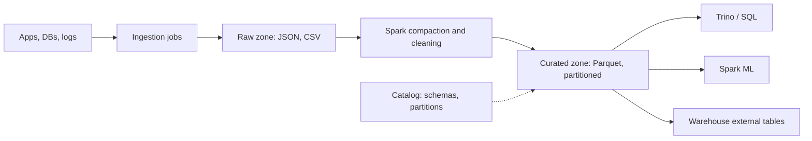

## In one minute
- A data lake stores large volumes of raw and processed data as files in cheap object storage (S3, GCS, ADLS), in open formats such as Parquet, and lets many engines read it.
- It separates **storage from compute**: data sits once at a few cents per GB-month, while Spark, Trino, or Flink clusters spin up only when needed.
- Schema is applied **on read**, which makes ingestion easy and pushes the cost of understanding the data onto every consumer.
- Performance depends almost entirely on **file layout**: columnar formats, partitioning, and file sizes decide how many bytes a query scans.
- Without a catalog, ownership, and lifecycle rules, a lake becomes a swamp: nobody knows which copy is correct or whether deleting a folder is safe.

## How it works

### Object storage as the foundation
Object stores offer near-unlimited capacity, eleven nines of durability, and high aggregate throughput, at roughly $20 to $23 per TB-month for standard tiers. They are not file systems: there is no atomic directory rename, listing millions of keys is slow, and AWS quotes roughly 100 to 200 ms for small-object requests and the first byte of large ones ([S3 docs](https://docs.aws.amazon.com/AmazonS3/latest/userguide/optimizing-performance.html)). Every design choice in a lake works around these limits.

### File formats
Raw data often lands as JSON or CSV, but analytical data should be **Parquet** or ORC. Parquet stores data column by column in row groups, with per-column statistics (min, max, null count) in the footer. Writers commonly default to 128 MB row groups (Iceberg's `write.parquet.row-group-size-bytes`, for one ([Iceberg docs](https://iceberg.apache.org/docs/latest/configuration/))), while the Parquet project itself suggests 512 MB to 1 GB for large sequential scans ([Parquet docs](https://parquet.apache.org/docs/file-format/configurations/)). A query touching 3 of 80 columns reads only those column chunks, and a filter like `country = 'DE'` can skip row groups whose min and max exclude it. Dictionary and run-length encoding plus Snappy or Zstd compression commonly shrink data 5 to 10 times compared with JSON.

### Partitioning and layout
Directories such as `events/ds=2026-10-14/region=eu/` let engines prune whole folders using the query predicate. Partition on columns that appear in most filters and have modest cardinality; date is the usual first choice. Over-partitioning by `user_id` creates millions of tiny files and kills performance. Aim for files between 128 MB and 1 GB.

### Zones and the catalog
Most lakes have zones: **raw** (immutable, as received), **cleansed** (typed, deduplicated), and **curated** (modelled for consumers). A metastore or catalog (Hive Metastore, AWS Glue, Unity, Polaris) maps table names to locations, schemas, and partitions, so engines can query `analytics.events` instead of a path. Access control, lineage, and data classification hang off the catalog.

## Down the stack

### Layer 1: The contract
Object storage promises that a successful PUT is durable (designed for eleven nines) and, on S3 since December 2020, that subsequent GETs and LISTs are strongly consistent; that change retired workarounds such as S3Guard and EMRFS Consistent View ([AWS blog](https://aws.amazon.com/blogs/aws/amazon-s3-update-strong-read-after-write-consistency/)). Since August 2024 S3 also offers conditional writes: a PUT with `If-None-Match` succeeds only if the key does not exist yet, a per-object put-if-absent ([AWS](https://aws.amazon.com/about-aws/whats-new/2024/08/amazon-s3-conditional-writes)). It still does not promise atomic multi-object writes, atomic directory renames, or fast listing. A lake built on top inherits exactly these guarantees unless a metadata layer adds more. Query engines promise that a filter on a partition column reads only matching partitions, and that a filter on any column with footer statistics may skip row groups, but neither is guaranteed to skip anything.

### Layer 2: The mechanism
A Parquet file is a sequence of **row groups**; each row group holds one **column chunk** per column; each chunk is a series of **pages** (often about 1 MB) with dictionary or plain encoding. The file ends with a Thrift-encoded **footer** listing the schema, every row group's byte offsets, and per-chunk statistics (`min_value`, `max_value`, `null_count`), followed by the footer length and the magic bytes `PAR1`. A reader issues a ranged GET for the last few KB, parses the footer, decides which row groups and columns it needs, and issues ranged GETs only for those byte ranges. Hive-style partitioning encodes partition values in the path (`ds=2026-10-14/`), and the metastore stores a row per partition with its location, so the planner can prune by predicate without listing the bucket.

### Layer 3: The machine
Each ranged GET to S3 has a first-byte latency in the tens to low hundreds of milliseconds, and a single connection streams about 50 to 100 MB/s. AWS's advice is to spread requests across many connections and fetch byte ranges in parallel, aligned to multipart part sizes when the object was uploaded that way ([S3 docs](https://docs.aws.amazon.com/AmazonS3/latest/userguide/optimizing-performance-guidelines.html)). Engines therefore prefer 8 to 16 MB ranges, so a single 256 MB column read becomes 16 to 32 parallel requests. S3 supports at least 5,500 GET/HEAD and 3,500 PUT/COPY/POST/DELETE requests per second per prefix, and scales beyond that gradually, returning HTTP 503 Slow Down while it does ([S3 docs](https://docs.aws.amazon.com/AmazonS3/latest/userguide/optimizing-performance.html)). That matters when a thousand tasks read the same partition. A LIST call returns at most 1,000 keys ([S3 API](https://docs.aws.amazon.com/AmazonS3/latest/API/API_ListObjectsV2.html)), so listing ten million files under one prefix needs 10,000 sequential calls, minutes of wall time. Decompression of Zstd runs at around 1 GB/s per core and Snappy faster, so with columnar pruning the CPU, not the network, often becomes the bottleneck.

### Why it's built this way
1. Storage on disks attached to compute is expensive and ties capacity to CPU, so data moves to object storage priced per GB.
2. Object storage has high per-request latency, so formats are designed for few, large, ranged reads.
3. Analytical queries touch few columns, so data is stored column by column with statistics to skip what is not needed.
4. Listing is slow and not transactional, so table metadata moves into a catalog, and later into table formats that track files explicitly.

## Diagram


## Worked example
A mobile analytics team collects 5 billion events per day, averaging 1 KB as JSON, so 5 TB per day raw.

Kept as gzip JSON, each day compresses to about 700 GB. A query for daily active users by country must read and parse all of it: on a 50-node Trino cluster at 200 MB/s per node, that is about 70 seconds and, on a pay-per-scan engine such as Athena at $5 per TB scanned ([Athena pricing](https://aws.amazon.com/athena/pricing/)), about $3.50 per query.

The compaction job rewrites each day to Parquet with Zstd, partitioned by `ds` and sorted by `country` within files. The day shrinks to about 350 GB. The DAU query reads only `user_id`, `country`, and `ds`, roughly 4 percent of the bytes, so about 14 GB. It finishes in a couple of seconds and costs 7 cents.

Storage over a year: 365 days of raw gzip at 700 GB is 255 TB, about $5,900 per month at $23 per TB. Moving raw files older than 30 days to an infrequent-access tier at roughly half the price and keeping Parquet hot saves around $2,500 per month. Lifecycle rules do this automatically.

## In the wild
- **AWS, 2017: a mistyped command takes S3 down in us-east-1.** While debugging billing, an engineer meant to remove a few servers, but one wrong input removed capacity behind S3's index subsystem (metadata and location for every object) and placement subsystem. Both needed a full restart, and S3 in the region was unavailable for about 4 hours 17 minutes, taking dependent services with it. AWS made the tool remove capacity slowly with minimum-capacity checks and sped up splitting the index into cells ([AWS](https://aws.amazon.com/message/41926/)). For a lake, the lesson is that "cheap and durable" storage still has a regional metadata service in the read path.
- **Facebook, 2012: the HDFS NameNode as the warehouse's weak point.** Facebook ran its warehouse on HDFS, with more than 100 PB of disk in its largest single filesystem. Cataloguing warehouse failures, the team found HDFS caused 41% of incidents, though only 10% would have been prevented by a highly available NameNode; the bigger win was removing about half of planned downtime, since upgrades stopped the whole cluster. They built AvatarNode, a hot-standby NameNode ([Meta Engineering](https://engineering.fb.com/2012/06/13/core-infra/under-the-hood-hadoop-distributed-filesystem-reliability-with-namenode-and-avatarnode/)).

## Trade-offs

| Option | Strengths | Weaknesses | Choose when |
|---|---|---|---|
| Data lake on object storage | Cheapest storage, open formats, any engine | No transactions on plain files, governance is on you | Large, varied data used by many engines |
| Data warehouse | Fast SQL, managed, ACID, fine-grained security | Proprietary storage, higher cost per TB, weak for ML on raw files | BI and well-modelled reporting |
| Lakehouse (lake plus table format) | Lake economics with ACID and time travel | More moving parts, table maintenance jobs | You need both ML on files and reliable SQL tables |
| HDFS on-premises | Data locality, no egress fees | Hardware, NameNode limits, coupled scaling | Existing on-prem clusters with fixed capacity |

## Pitfalls in production
- **Small files.** Streaming jobs that write every minute produce 1,440 files per partition per writer, and query planning time explodes. Schedule compaction to rewrite them into large files.
- **Partial writes visible.** A failed Spark job leaves half its files in the target folder and readers see a partial day. Write to a staging path and publish through a table format or a manifest swap.
- **The swamp.** Duplicate copies with names like `events_v2_final` appear and nobody trusts any of them. Require catalog registration, an owner, and a retention policy for every dataset.
- **Unbounded retention of PII.** Raw zones keep personal data forever, which conflicts with deletion requests. Tag sensitive columns, separate them, and design for row-level deletes.
- **Listing costs.** Engines listing a prefix with millions of objects spend minutes before reading data. In the Delta Lake paper's benchmark, Hive needed more than an hour just to find the objects of a table with 10,000 partitions on S3 ([Armbrust et al., VLDB 2020](https://www.vldb.org/pvldb/vol13/p3411-armbrust.pdf)). Use partition metadata in the catalog or a table format that tracks files explicitly.

## Leadership lens
- Treat the lake as a product with owners, SLAs, and a catalog, not as a dumping ground. Governance is cheaper upfront than as a cleanup project.
- Ask what the dominant query predicates are before approving a partitioning scheme. Changing it later means rewriting petabytes.
- Decide early whether you need table-level transactions. If yes, adopt a table format from day one rather than retrofitting.
- Watch egress and request costs, not only storage. Cross-region reads and millions of small GETs can exceed the storage bill.

## Check yourself
1. Why does Parquet make a query on 3 of 80 columns much cheaper than JSON?
   **Answer:** Parquet stores each column contiguously, so the engine reads only those column chunks, while JSON forces reading and parsing every full record.
2. Why is partitioning by `user_id` usually a mistake?
   **Answer:** High cardinality creates millions of tiny partitions and files, so planning and listing overhead dominate and each file is too small to scan efficiently.
3. What problem does plain object storage create for concurrent writers and readers?
   **Answer:** There is no atomic multi-file commit, so readers can see partial outputs and concurrent writers can overwrite each other without a coordinating metadata layer.

## Practice
**Task:** Implement `prune_files(files, predicate)` that mimics min/max statistics pruning. Each file is a dict with `path` and `stats`, where `stats` maps a column name to a `(min, max)` tuple. The predicate is a dict mapping a column to an `(op, value)` pair, where `op` is one of `"=="`, `"<"`, `">"`. Return the sorted list of paths that **might** contain matching rows. A file with no stats for a predicate column must be kept.

```python starter
def prune_files(files, predicate):
    # TODO
    raise NotImplementedError
```

```python tests
FILES = [
    {"path": "a", "stats": {"ds": (1, 5), "country": ("AT", "DE")}},
    {"path": "b", "stats": {"ds": (6, 9), "country": ("FR", "US")}},
    {"path": "c", "stats": {"ds": (3, 7)}},
]

def test_equality_prunes():
    assert prune_files(FILES, {"ds": ("==", 6)}) == ["b", "c"]

def test_less_than():
    assert prune_files(FILES, {"ds": ("<", 3)}) == ["a"]

def test_greater_than():
    assert prune_files(FILES, {"ds": (">", 7)}) == ["b"]

def test_missing_stats_kept():
    assert prune_files(FILES, {"country": ("==", "US")}) == ["b", "c"]

def test_conjunction():
    assert prune_files(FILES, {"ds": ("==", 4), "country": ("==", "DE")}) == ["a", "c"]

def test_empty_predicate_keeps_all():
    assert prune_files(FILES, {}) == ["a", "b", "c"]
```

```python solution
def _may_match(rng, op, v):
    lo, hi = rng
    if op == "==":
        return lo <= v <= hi
    if op == "<":
        return lo < v
    if op == ">":
        return hi > v
    return True

def prune_files(files, predicate):
    keep = []
    for f in files:
        ok = True
        for col, (op, v) in predicate.items():
            if col in f["stats"] and not _may_match(f["stats"][col], op, v):
                ok = False
                break
        if ok:
            keep.append(f["path"])
    return sorted(keep)
```

```typescript starter
export type Stat = [number | string, number | string];
export interface DataFile { path: string; stats: Record<string, Stat>; }
export type Pred = Record<string, ["==" | "<" | ">", number | string]>;
export function pruneFiles(files: DataFile[], predicate: Pred): string[] {
  throw new Error("TODO");
}
```

```typescript tests
const FILES: DataFile[] = [
  { path: "a", stats: { ds: [1, 5], country: ["AT", "DE"] } },
  { path: "b", stats: { ds: [6, 9], country: ["FR", "US"] } },
  { path: "c", stats: { ds: [3, 7] } },
];
test("equality prunes", () => assertEqual(pruneFiles(FILES, { ds: ["==", 6] }), ["b", "c"]));
test("less than", () => assertEqual(pruneFiles(FILES, { ds: ["<", 3] }), ["a"]));
test("greater than", () => assertEqual(pruneFiles(FILES, { ds: [">", 7] }), ["b"]));
test("missing stats kept", () => assertEqual(pruneFiles(FILES, { country: ["==", "US"] }), ["b", "c"]));
test("conjunction", () =>
  assertEqual(pruneFiles(FILES, { ds: ["==", 4], country: ["==", "DE"] }), ["a", "c"]));
test("empty predicate keeps all", () => assertEqual(pruneFiles(FILES, {}), ["a", "b", "c"]));
```

```typescript solution
export type Stat = [number | string, number | string];
export interface DataFile { path: string; stats: Record<string, Stat>; }
export type Pred = Record<string, ["==" | "<" | ">", number | string]>;
function mayMatch([lo, hi]: Stat, op: string, v: number | string): boolean {
  if (op === "==") return lo <= v && v <= hi;
  if (op === "<") return lo < v;
  if (op === ">") return hi > v;
  return true;
}
export function pruneFiles(files: DataFile[], predicate: Pred): string[] {
  return files
    .filter(f => Object.entries(predicate).every(([col, [op, v]]) =>
      !(col in f.stats) || mayMatch(f.stats[col], op, v)))
    .map(f => f.path)
    .sort();
}
```

```go starter
package practice

// Range holds a column's min and max; values are ints for simplicity.
type Range struct{ Min, Max int }

type File struct {
	Path  string
	Stats map[string]Range
}

type Cond struct {
	Op    string // "==", "<" or ">"
	Value int
}

func PruneFiles(files []File, predicate map[string]Cond) []string {
	panic("TODO")
}
```

```go tests
package practice

import (
	"reflect"
	"testing"
)

var files = []File{
	{"a", map[string]Range{"ds": {1, 5}, "region": {10, 20}}},
	{"b", map[string]Range{"ds": {6, 9}, "region": {30, 40}}},
	{"c", map[string]Range{"ds": {3, 7}}},
}

func check(t *testing.T, got, want []string) {
	t.Helper()
	if !reflect.DeepEqual(got, want) {
		t.Fatalf("got %v want %v", got, want)
	}
}

func TestEquality(t *testing.T)  { check(t, PruneFiles(files, map[string]Cond{"ds": {"==", 6}}), []string{"b", "c"}) }
func TestLessThan(t *testing.T)  { check(t, PruneFiles(files, map[string]Cond{"ds": {"<", 3}}), []string{"a"}) }
func TestGreater(t *testing.T)   { check(t, PruneFiles(files, map[string]Cond{"ds": {">", 7}}), []string{"b"}) }
func TestMissingKept(t *testing.T) {
	check(t, PruneFiles(files, map[string]Cond{"region": {"==", 35}}), []string{"b", "c"})
}
func TestEmptyPredicate(t *testing.T) { check(t, PruneFiles(files, nil), []string{"a", "b", "c"}) }
```

```go solution
package practice

import "sort"

type Range struct{ Min, Max int }

type File struct {
	Path  string
	Stats map[string]Range
}

type Cond struct {
	Op    string // "==", "<" or ">"
	Value int
}

func mayMatch(r Range, c Cond) bool {
	switch c.Op {
	case "==":
		return r.Min <= c.Value && c.Value <= r.Max
	case "<":
		return r.Min < c.Value
	case ">":
		return r.Max > c.Value
	}
	return true
}

func PruneFiles(files []File, predicate map[string]Cond) []string {
	keep := []string{}
	for _, f := range files {
		ok := true
		for col, c := range predicate {
			if r, has := f.Stats[col]; has && !mayMatch(r, c) {
				ok = false
				break
			}
		}
		if ok {
			keep = append(keep, f.Path)
		}
	}
	sort.Strings(keep)
	return keep
}
```

## Mock interview
**Prompt:** Your company ingests 20 TB per day of clickstream, app logs, and database exports. Design a data lake that serves both ad hoc SQL and ML training, with a monthly storage budget of $40,000.

- Follow-up: Analysts complain queries over one week take 10 minutes. Where do you look first?
- Follow-up: A user requests deletion of all their data under GDPR. How do you honour it?
- Follow-up: Why not just load everything into the warehouse?

**A strong answer covers:**
- Raw, cleansed, curated zones on object storage with Parquet and date partitioning.
- Storage and tiering arithmetic against the budget, including lifecycle rules.
- Compaction, file sizing, and catalog registration as first-class jobs.
- A plan for row-level deletes, such as a table format or periodic rewrite with a deletion list.
- When warehouse storage is worth the premium, and when external tables over the lake suffice.

## Sources and further study
**Primary**
- [Melnik et al., Dremel: Interactive Analysis of Web-Scale Datasets (VLDB 2010)](https://research.google/pubs/dremel-interactive-analysis-of-web-scale-datasets-2/): the nested columnar layout that Parquet adopted.
- [Armbrust et al., Delta Lake (VLDB 2020)](https://www.vldb.org/pvldb/vol13/p3411-armbrust.pdf): a precise list of what goes wrong with plain files on object stores, with listing benchmarks.

**Systems docs**
- [S3 performance guidelines](https://docs.aws.amazon.com/AmazonS3/latest/userguide/optimizing-performance-guidelines.html): parallel connections, byte-range fetches, and retries for tail latency.
- [Amazon S3 strong read-after-write consistency (2020)](https://aws.amazon.com/blogs/aws/amazon-s3-update-strong-read-after-write-consistency/): the end of eventual consistency and of S3Guard-style workarounds.
- [Amazon S3 conditional writes (2024)](https://aws.amazon.com/about-aws/whats-new/2024/08/amazon-s3-conditional-writes): put-if-absent on a single key.
- [Parquet configurations](https://parquet.apache.org/docs/file-format/configurations/): recommended row group and page sizes.

**Books**
- *Designing Data-Intensive Applications* (2nd ed.), Kleppmann and Riccomini, Ch 1 "Trade-Offs in Data Systems Architecture", section "Operational Versus Analytical Systems": where lakes and warehouses sit relative to OLTP.
- *Designing Data-Intensive Applications* (1st ed.), Martin Kleppmann, Ch 10 "Batch Processing", section "MapReduce and Distributed Filesystems": HDFS, schema-on-read, and why keeping raw data in many formats pays off.

**Other curricula**
- [roadmap.sh: Data Engineer](https://roadmap.sh/data-engineer): defines the lake by raw native-format storage and no schema on ingestion.
- [Azure Architecture Center: Big data architectures](https://learn.microsoft.com/en-us/azure/architecture/databases/guide/big-data-architectures): the lake is the batch layer's file store, feeding a separate analytical store.

## Watch
- [What is a Data Lake? (IBM Technology)](https://www.youtube.com/watch?v=LxcH6z8TFpI): a short conceptual overview of lakes versus warehouses.
- [Data Warehouse vs Data Lake vs Data Lakehouse (codebasics)](https://www.youtube.com/watch?v=yRerKDM1h74): how the three architectures relate.

## Free resources
- [Parquet file format](https://parquet.apache.org/docs/file-format/): row groups, column chunks, pages, and footer statistics.
- [Data lakes (Azure Architecture Center)](https://learn.microsoft.com/en-us/azure/architecture/data-guide/scenarios/data-lake): zones, use cases, and common challenges.
- [What is a data lake? (AWS)](https://aws.amazon.com/what-is/data-lake/): a vendor overview of lake components and governance.
- [Data lake (Wikipedia)](https://en.wikipedia.org/wiki/Data_lake): background, history, and the "data swamp" criticism.
