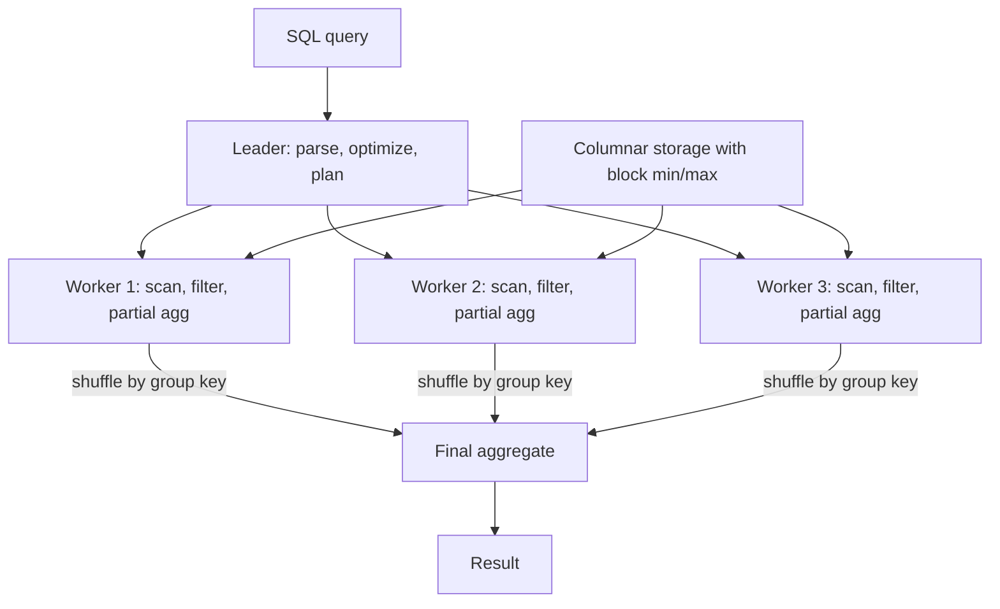

## In one minute
- A data warehouse is a database built for analytical queries: scanning and aggregating billions of rows, not fetching single rows by key.
- It gets its speed from **columnar storage**, heavy compression, **massively parallel** execution, and skipping data using per-block statistics.
- Data is usually modelled as a **star schema**: narrow, very long fact tables of events joined to wide dimension tables of descriptive attributes.
- Cloud warehouses (Snowflake, BigQuery, Redshift) separate storage from compute so you can scale concurrency and pay per query or per cluster-hour.
- The warehouse is where business definitions become official. The hard problems are modelling and governance as much as performance.

## How it works

### Row store versus column store
An OLTP database stores each row contiguously, which is ideal for "fetch order 123". An analytical query like "revenue by month for 2025" touches three columns across 2 billion rows. A column store keeps each column in its own compressed blocks, so it reads only `order_date`, `amount`, and maybe `region`. Values in one column are similar, so dictionary, run-length, and delta encoding often achieve 5 to 20 times compression, and the engine can run vectorised operations over thousands of values per CPU instruction batch.

### Data skipping
Warehouses divide tables into blocks and record min and max per column per block. Redshift uses 1 MB column blocks; Snowflake uses micro-partitions holding 50 to 500 MB of uncompressed data ([Snowflake docs](https://docs.snowflake.com/en/user-guide/tables-clustering-micropartitions)). A filter `order_date >= '2025-01-01'` skips every block whose max is earlier. Sorting or clustering a table on commonly filtered columns makes these ranges tight. Redshift's own example: five years of data sorted by date, queried for one month, can skip up to 98 percent of blocks ([Redshift docs](https://docs.aws.amazon.com/redshift/latest/dg/t_Sorting_data.html)).

### MPP execution
A query plan is split across many workers. Each scans its slice, filters, and computes partial aggregates; partial results are then shuffled by group key and combined. Joins are either **broadcast** (copy a small dimension to every worker) or **shuffle** (repartition both sides on the join key). The optimizer picks between them using table statistics, which is why stale statistics can turn a 5-second query into a 5-minute one.

### Dimensional modelling
A **fact** table records measurable events at a declared grain, such as one row per order line. Kimball calls declaring the grain the pivotal step, done before picking any dimension or measure, and recommends starting from the most atomic grain ([Kimball Group](https://www.kimballgroup.com/data-warehouse-business-intelligence-resources/kimball-techniques/dimensional-modeling-techniques/grain/)). Each fact row carries foreign keys to dimensions and numeric measures. **Dimension** tables describe the who, what, where, and when: customer, product, store, date. Changes to dimension attributes are handled with slowly changing dimension patterns, which Kimball numbers from type 0 to type 7. The two you meet most: type 1 overwrites the attribute, rewriting history, and type 2 adds a new row with validity dates so historic facts keep their original context.

## Down the stack

### Layer 1: The contract
A warehouse promises SQL semantics and that each statement sees one consistent version of every table, even while loads run. That is per statement, not per transaction: Snowflake supports only READ COMMITTED for tables, so two statements in one transaction can see different data if a load commits in between ([Snowflake docs](https://docs.snowflake.com/en/sql-reference/transactions)). Committed loads are durable. Performance is not part of the contract, but the practical envelope is seconds for scans of tens to hundreds of GB and sub-second for cached or pre-aggregated results. Most cloud warehouses do not enforce primary or foreign keys. Snowflake enforces only NOT NULL and CHECK on standard tables ([Snowflake docs](https://docs.snowflake.com/en/sql-reference/constraints-overview)), and BigQuery enforces neither key ([BigQuery docs](https://docs.cloud.google.com/bigquery/docs/primary-foreign-keys)). Worse, Redshift's planner trusts declared keys anyway, so a non-unique "primary key" can make `SELECT DISTINCT` return duplicates ([Redshift docs](https://docs.aws.amazon.com/redshift/latest/dg/t_Defining_constraints.html)). Uniqueness is the modeller's job, and a key you declare must be one your pipeline actually guarantees.

### Layer 2: The mechanism
In Snowflake, a table is a set of immutable **micro-partitions** of 50 to 500 MB uncompressed, each storing columns separately with a header of per-column min, max, distinct count, and null count. The metadata service keeps these headers, so the optimizer prunes partitions before any worker touches storage. A DML statement writes new micro-partitions and atomically swaps the table's partition list, which is how snapshots and time travel work. Old versions stay queryable for 1 day by default, up to 90 days on Enterprise edition ([Snowflake docs](https://docs.snowflake.com/en/user-guide/data-time-travel)). Redshift stores each column in 1 MB blocks, against the 2 to 32 KB typical of row stores, with **zone maps** (min and max per block) ([Redshift docs](https://docs.aws.amazon.com/redshift/latest/dg/c_columnar_storage_disk_mem_mgmnt.html)) and distributes rows across slices by a distribution key, so a join on that key needs no network shuffle. Execution is vectorised: operators process batches of around 1,000 to 4,000 values from one column at a time, and many engines compile query fragments to machine code. The idea comes from MonetDB/X100, which used 1,024-value vectors by default and showed tuple-at-a-time interpretation paying heavy overhead per row ([Boncz et al., CIDR 2005](https://www.cidrdb.org/cidr2005/papers/P19.pdf)).

### Layer 3: The machine
Vectorisation exists because of the CPU. A tight loop over a contiguous array of 32-bit integers fits in L1 cache (32 to 48 KB per core), lets the compiler use SIMD instructions that compare 8 or 16 values per instruction with AVX2 or AVX-512, and avoids branch mispredictions that cost about 15 cycles each. Row-at-a-time interpreters spend most of their time on virtual function calls and cache misses, typically 10 to 50 times slower. Compression helps twice: fewer bytes read from SSD or network, and dictionary codes small enough that filters run on integers instead of strings. Local NVMe caches on compute nodes read at several GB/s, while remote object storage supplies about 100 MB/s per connection, so warehouses aggressively cache hot micro-partitions on local disk.

### Why it's built this way
1. Analytical queries read few columns from many rows, so storing by column minimises bytes read.
2. Reading bytes is still the dominant cost, so heavy compression and min/max metadata skip as much as possible.
3. CPUs are fast only on contiguous, predictable data, so execution processes column batches instead of rows.
4. Storage and compute needs grow at different rates, so cloud warehouses keep data in object storage and cache it near elastic compute.
5. Immutable partitions make concurrency and caching simple, so updates write new partitions rather than modify old ones.

## Diagram


## Worked example
A retailer has `fact_sales` with 3 billion rows at the grain of one line item, 25 columns, 2.4 TB uncompressed and 300 GB compressed. Dimensions: `dim_product` (200,000 rows), `dim_store` (1,500 rows), `dim_date` (10 years of days).

Query: weekly revenue by product category for the last 13 weeks.

```sql
SELECT d.week_start, p.category, SUM(f.net_amount) AS revenue
FROM fact_sales f
JOIN dim_date d    ON f.date_key = d.date_key
JOIN dim_product p ON f.product_key = p.product_key
WHERE d.date >= CURRENT_DATE - 91
GROUP BY 1, 2;
```

The table is clustered by `date_key`, so 13 weeks out of 10 years means scanning about 2.5 percent of blocks. Only three columns of 25 are read, about 12 percent of each block. Combined, the scan is roughly 300 GB times 0.025 times 0.12, about 900 MB. Both dimensions are small enough to broadcast, so no shuffle of the fact table is needed. On a medium cluster this returns in 1 to 3 seconds. Without clustering, it scans all 36 GB of those columns and takes closer to 30 seconds and 40 times the compute.

## In the wild
- **Shopify, 2022: a $1 million-a-month query fixed by clustering.** A new marketing pipeline planned to run one BigQuery query 60 times a minute. Each run scanned about 75 GB, which priced out at roughly $949,000 a month on demand. Clustering the table on the two columns in the query's `WHERE` clause cut the scan to about 100 MB and the estimate to about $1,370 a month ([Shopify Engineering](https://shopify.engineering/reducing-bigquery-costs)).
- **Snowflake customers, 2024: stolen passwords, no MFA, mass data theft.** The group Mandiant tracks as UNC5537 logged in to customer Snowflake accounts with credentials taken by infostealer malware, some dating from 2020 and never rotated. At least 79.7% of the accounts used had earlier credential exposure, none had MFA, and none used network allow lists; about 165 organisations were notified. The warehouse was not breached, but it concentrated everything worth stealing behind one password ([Mandiant](https://cloud.google.com/blog/topics/threat-intelligence/unc5537-snowflake-data-theft-extortion)).

## Trade-offs

| Option | Strengths | Weaknesses | Choose when |
|---|---|---|---|
| Star schema (Kimball) | Simple joins, fast, business-friendly | Duplication in dimensions; needs conformed keys | BI and self-service analytics |
| Normalised enterprise model (Inmon) | Single integrated source, less redundancy | Many joins; slower to deliver value | Large enterprises with many source systems |
| One big wide table | No joins, fastest for one use case | Rigid; hard to update dimension attributes | Specific dashboards with fixed questions |
| Cloud warehouse | Elastic, managed, separate storage and compute | Cost surprises from unbounded queries | Most teams without a dedicated platform group |
| Self-hosted columnar (ClickHouse) | Very fast, cheap at scale | You run it; weaker on complex joins | High-volume event analytics with in-house ops |

## Pitfalls in production
- **Undefined grain.** A fact table mixes order-level and line-level rows and revenue double counts. Declare the grain in the model and test uniqueness on it.
- **Runaway cost.** An analyst runs `SELECT *` over 5 years on a pay-per-scan engine and spends hundreds of dollars. BigQuery on-demand bills $6.25 per TiB processed after the first free TiB each month, with a 10 MB minimum per table referenced ([BigQuery pricing](https://cloud.google.com/bigquery/pricing)). Require partition filters, set per-user quotas, and alert on expensive queries.
- **Poor clustering.** Data arrives out of order and block min/max ranges widen until pruning stops working. Monitor clustering depth and recluster or sort on load.
- **Metric drift.** Three teams define "active customer" three ways. Put definitions in a governed semantic layer or a single modelled table owned by one team.
- **Concurrency cliffs.** Fifty dashboards refresh at 9 a.m. and queue behind each other. Use result caching, materialised aggregates, or multi-cluster scaling.

## Leadership lens
- In design review, ask for the grain of each fact table and the top five query patterns. Clustering and modelling follow from those answers.
- Treat cost as an SLO: dashboards of spend per team, per query pattern, with owners for the largest consumers.
- Decide who owns business definitions. A warehouse without owned metrics turns into an argument about numbers in every meeting.
- Plan for data contracts with upstream teams so schema changes do not silently break reports.

## Check yourself
1. Why does clustering on `date_key` matter even though the engine already reads only needed columns?
   **Answer:** Column pruning reduces which columns are read, while clustering tightens block min/max ranges so whole blocks can be skipped; the savings multiply.
2. When would a broadcast join be a bad choice?
   **Answer:** When the "small" side is large, because copying it to every worker exhausts memory and network; a shuffle join on the key scales better.
3. Why add a new row instead of updating a dimension when a customer moves city?
   **Answer:** Type 2 history keeps past facts attributed to the city the customer lived in at the time, so historical reports do not change retroactively.

## Practice
**Task:** Implement `star_query(facts, dims, group_by, measure)`. `facts` is a list of dicts with foreign keys and numeric measures. `dims` maps a foreign-key column name to a dict from key to attribute dict. `group_by` is a list of attribute names that can come from any dimension (look them up through the fact's foreign keys); `measure` is the fact column to sum. Return a dict from a tuple of group-by values to the summed measure (in TypeScript and Go, the key is the values joined with `|`). Facts whose foreign key is missing from its dimension should be grouped under the attribute value `"unknown"`.

```python starter
def star_query(facts, dims, group_by, measure):
    # TODO
    raise NotImplementedError
```

```python tests
DIMS = {
    "product_key": {1: {"category": "toys"}, 2: {"category": "food"}},
    "store_key": {10: {"region": "north"}, 20: {"region": "south"}},
}
FACTS = [
    {"product_key": 1, "store_key": 10, "amount": 5},
    {"product_key": 1, "store_key": 20, "amount": 7},
    {"product_key": 2, "store_key": 10, "amount": 3},
]

def test_single_dimension():
    assert star_query(FACTS, DIMS, ["category"], "amount") == {("toys",): 12, ("food",): 3}

def test_two_dimensions():
    r = star_query(FACTS, DIMS, ["region", "category"], "amount")
    assert r == {("north", "toys"): 5, ("south", "toys"): 7, ("north", "food"): 3}

def test_unknown_key():
    f = FACTS + [{"product_key": 99, "store_key": 10, "amount": 1}]
    assert star_query(f, DIMS, ["category"], "amount")[("unknown",)] == 1

def test_empty_facts():
    assert star_query([], DIMS, ["category"], "amount") == {}
```

```python solution
from collections import defaultdict

def star_query(facts, dims, group_by, measure):
    attr_dim = {}
    for fk, table in dims.items():
        for attrs in table.values():
            for a in attrs:
                attr_dim[a] = fk
    out = defaultdict(int)
    for f in facts:
        key = []
        for a in group_by:
            fk = attr_dim[a]
            row = dims[fk].get(f.get(fk))
            key.append(row[a] if row and a in row else "unknown")
        out[tuple(key)] += f[measure]
    return dict(out)
```

```typescript starter
export type Fact = Record<string, number>;
export type Dims = Record<string, Record<number, Record<string, string>>>;
export function starQuery(facts: Fact[], dims: Dims, groupBy: string[], measure: string): Record<string, number> {
  throw new Error("TODO");
}
```

```typescript tests
// Result keys are the group-by values joined with "|".
const DIMS: Dims = {
  product_key: { 1: { category: "toys" }, 2: { category: "food" } },
  store_key: { 10: { region: "north" }, 20: { region: "south" } },
};
const FACTS: Fact[] = [
  { product_key: 1, store_key: 10, amount: 5 },
  { product_key: 1, store_key: 20, amount: 7 },
  { product_key: 2, store_key: 10, amount: 3 },
];
test("single dimension", () =>
  assertEqual(starQuery(FACTS, DIMS, ["category"], "amount"), { toys: 12, food: 3 }));
test("two dimensions", () => {
  const r = starQuery(FACTS, DIMS, ["region", "category"], "amount");
  assertEqual([r["north|toys"], r["south|toys"], r["north|food"]], [5, 7, 3]);
});
test("unknown key", () => {
  const f = FACTS.concat([{ product_key: 99, store_key: 10, amount: 1 }]);
  assertEqual(starQuery(f, DIMS, ["category"], "amount")["unknown"], 1);
});
test("empty facts", () => assertEqual(starQuery([], DIMS, ["category"], "amount"), {}));
```

```typescript solution
export type Fact = Record<string, number>;
export type Dims = Record<string, Record<number, Record<string, string>>>;
export function starQuery(facts: Fact[], dims: Dims, groupBy: string[], measure: string): Record<string, number> {
  const attrDim: Record<string, string> = {};
  for (const [fk, table] of Object.entries(dims))
    for (const attrs of Object.values(table))
      for (const a of Object.keys(attrs)) attrDim[a] = fk;
  const out: Record<string, number> = {};
  for (const f of facts) {
    const key = groupBy.map(a => {
      const fk = attrDim[a];
      const row = dims[fk][f[fk]];
      return row && a in row ? row[a] : "unknown";
    }).join("|");
    out[key] = (out[key] ?? 0) + f[measure];
  }
  return out;
}
```

```go starter
package practice

// Dims maps a foreign-key column to key -> attribute name -> value.
type Dims map[string]map[int]map[string]string

// StarQuery groups facts by the given attributes (joined with "|") and sums measure.
func StarQuery(facts []map[string]int, dims Dims, groupBy []string, measure string) map[string]int {
	panic("TODO")
}
```

```go tests
package practice

import (
	"reflect"
	"testing"
)

var dims = Dims{
	"product_key": {1: {"category": "toys"}, 2: {"category": "food"}},
	"store_key":   {10: {"region": "north"}, 20: {"region": "south"}},
}

var facts = []map[string]int{
	{"product_key": 1, "store_key": 10, "amount": 5},
	{"product_key": 1, "store_key": 20, "amount": 7},
	{"product_key": 2, "store_key": 10, "amount": 3},
}

func TestSingleDimension(t *testing.T) {
	got := StarQuery(facts, dims, []string{"category"}, "amount")
	if !reflect.DeepEqual(got, map[string]int{"toys": 12, "food": 3}) {
		t.Fatalf("got %v", got)
	}
}

func TestTwoDimensions(t *testing.T) {
	got := StarQuery(facts, dims, []string{"region", "category"}, "amount")
	want := map[string]int{"north|toys": 5, "south|toys": 7, "north|food": 3}
	if !reflect.DeepEqual(got, want) {
		t.Fatalf("got %v", got)
	}
}

func TestUnknownKey(t *testing.T) {
	f := append(append([]map[string]int{}, facts...), map[string]int{"product_key": 99, "store_key": 10, "amount": 1})
	if got := StarQuery(f, dims, []string{"category"}, "amount"); got["unknown"] != 1 {
		t.Fatalf("got %v", got)
	}
}

func TestEmptyFacts(t *testing.T) {
	if got := StarQuery(nil, dims, []string{"category"}, "amount"); len(got) != 0 {
		t.Fatalf("got %v", got)
	}
}
```

```go solution
package practice

import "strings"

type Dims map[string]map[int]map[string]string

func StarQuery(facts []map[string]int, dims Dims, groupBy []string, measure string) map[string]int {
	attrDim := map[string]string{}
	for fk, table := range dims {
		for _, attrs := range table {
			for a := range attrs {
				attrDim[a] = fk
			}
		}
	}
	out := map[string]int{}
	for _, f := range facts {
		parts := make([]string, len(groupBy))
		for i, a := range groupBy {
			fk := attrDim[a]
			parts[i] = "unknown"
			if row, ok := dims[fk][f[fk]]; ok {
				if v, ok := row[a]; ok {
					parts[i] = v
				}
			}
		}
		out[strings.Join(parts, "|")] += f[measure]
	}
	return out
}
```

## Mock interview
**Prompt:** Design the analytics warehouse for a food-delivery company with 15 million orders per day, serving 300 internal dashboards and ad hoc analysts, with a query p95 target of 5 seconds.

- Follow-up: What is the grain of your main fact table, and why?
- Follow-up: Monday morning dashboards time out. What do you change?
- Follow-up: How do you keep the monthly bill predictable?

**A strong answer covers:**
- Order-line or delivery-level fact tables with conformed dimensions for restaurant, courier, customer, date.
- Clustering by date and region, with arithmetic on bytes scanned per typical query.
- Materialised aggregates or result caching for hot dashboards and multi-cluster scaling for peak concurrency.
- Type 2 dimensions where history matters, such as restaurant commission plans.
- Cost controls: quotas, required partition filters, and spend attribution by team.

## Sources and further study
**Primary**
- [Boncz, Zukowski and Nes, MonetDB/X100: Hyper-Pipelining Query Execution (CIDR 2005)](https://www.cidrdb.org/cidr2005/papers/P19.pdf): the paper behind vectorised execution and why tuple-at-a-time engines waste the CPU.
- [Kimball Group: Grain](https://www.kimballgroup.com/data-warehouse-business-intelligence-resources/kimball-techniques/dimensional-modeling-techniques/grain/): why the grain is declared first and why atomic grain survives unexpected questions.

**Systems docs**
- [Snowflake transactions](https://docs.snowflake.com/en/sql-reference/transactions): READ COMMITTED isolation and what one statement can see.
- [Redshift sort keys](https://docs.aws.amazon.com/redshift/latest/dg/t_Sorting_data.html): 1 MB blocks, per-block min/max, compound versus interleaved keys.
- [Redshift table constraints](https://docs.aws.amazon.com/redshift/latest/dg/t_Defining_constraints.html): informational keys and how the planner can return wrong results when they lie.
- [BigQuery pricing](https://cloud.google.com/bigquery/pricing): on-demand per-TiB billing versus capacity (slot-hour) billing.

**Books**
- *Designing Data-Intensive Applications* (1st ed.), Martin Kleppmann, Ch 3 "Storage and Retrieval": the sections "Transaction Processing or Analytics?" and "Column-Oriented Storage".
- *Designing Data-Intensive Applications* (2nd ed.), Kleppmann and Riccomini, Ch 4 "Storage and Retrieval", section "Data Storage for Analytics": column stores, compression and vectorised processing.
- *The Data Warehouse Toolkit* (3rd ed.), Ralph Kimball and Margy Ross, Ch 5 "Procurement": slowly changing dimension types 0 to 7.

**Other curricula**
- [roadmap.sh: Data Engineer](https://roadmap.sh/data-engineer): treats the warehouse as columnar, ETL/ELT-fed storage, with star versus snowflake schema as its own node.
- [Azure Architecture Center: Big data architectures](https://learn.microsoft.com/en-us/azure/architecture/databases/guide/big-data-architectures): places a Kimball-style warehouse as the analytical data store at the end of the pipeline.
- [donnemartin/system-design-primer](https://github.com/donnemartin/system-design-primer): covers SQL scaling and NoSQL but has no section on warehouses or column stores.

## Watch
- [Data Modeling Tutorial: Star Schema (Kahan Data Solutions)](https://www.youtube.com/watch?v=gRE3E7VUzRU): building fact and dimension tables step by step.
- [What is STAR schema (codebasics)](https://www.youtube.com/watch?v=hQvCOBv_-LE): star versus snowflake schema and fact versus dimension tables.

## Free resources
- [Kimball dimensional modelling techniques](https://www.kimballgroup.com/data-warehouse-business-intelligence-resources/kimball-techniques/dimensional-modeling-techniques/): the canonical catalogue of grain, fact types, and slowly changing dimensions.
- [The Vertica Analytic Database: C-Store 7 Years Later (VLDB 2012)](https://www.vldb.org/pvldb/vol5/p1790_andrewlamb_vldb2012.pdf): how a real column store handles encoding, projections, and loading.
- [Snowflake micro-partitions and clustering](https://docs.snowflake.com/en/user-guide/tables-clustering-micropartitions): min/max pruning and clustering depth explained by the vendor.
- [Data warehousing (Azure Architecture Center)](https://learn.microsoft.com/en-us/azure/architecture/data-guide/relational-data/data-warehousing): reference architecture and technology choices.
- [Star schema (Wikipedia)](https://en.wikipedia.org/wiki/Star_schema): background and a compact example.
