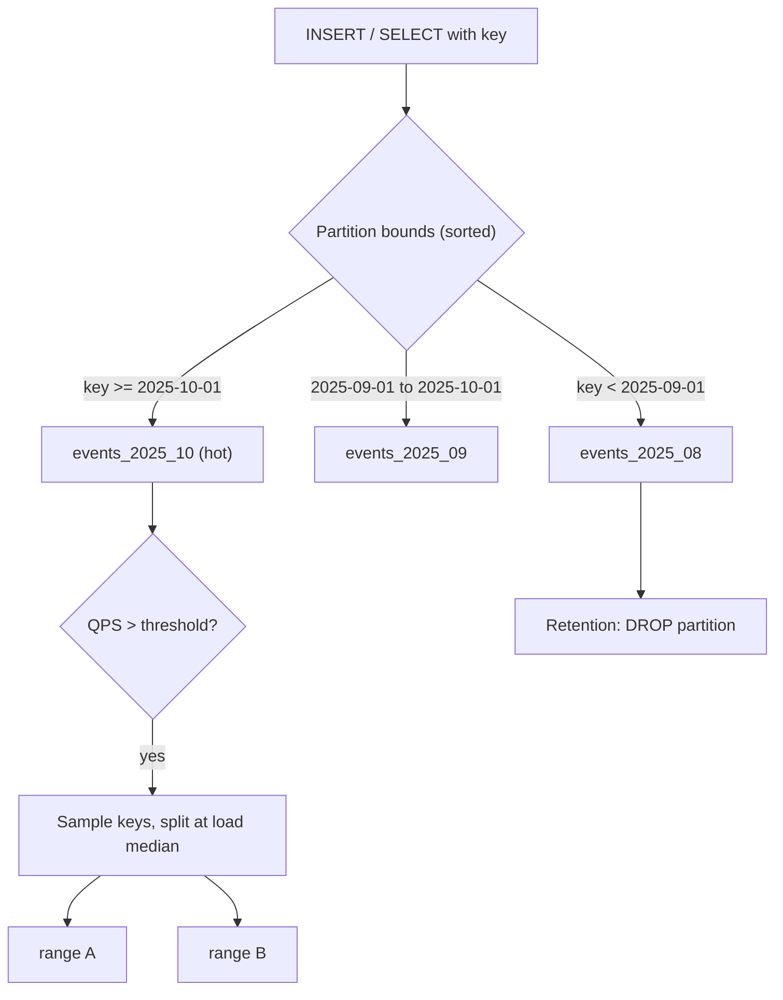

## In one minute
- Partitioning splits one logical table into smaller physical pieces by a rule on a partition key, so each query, index, vacuum or delete touches only the pieces it needs.
- Horizontal partitioning splits rows (by range, hash or list of values); vertical partitioning splits columns, moving wide or rarely read columns elsewhere.
- Range partitions keep neighbouring keys together, which makes scans and time-based retention cheap but concentrates sequential writes on one piece. Hash partitions spread writes evenly but turn every range query into a scatter.
- Partitions can live inside one server (Postgres declarative partitioning) or be the unit of distribution across many (CockroachDB ranges, Bigtable tablets). Sharding, the next lesson, is the multi-server case.
- The problem shapes are "hot spots" and "finding things fast": the partition key decides both where load lands and how much of the data a query must look at.

## How it works

### Why split a table at all
A single 4 TB `events` table has one heap, one set of deep B-tree indexes, and one autovacuum job that takes hours to walk it. Split it into one partition per month and a query for last week opens one or two partitions, each partition's indexes fit in memory, and retention becomes `DROP TABLE events_2025_09` instead of a billion-row `DELETE`. The Postgres manual puts it neatly: partitioning stands in for the upper levels of an index, so the heavily used parts are more likely to fit in memory ([Postgres docs](https://www.postgresql.org/docs/current/ddl-partitioning.html)).

The rule that assigns a row to a partition is a pure function of the **partition key**. Every benefit and every problem of partitioning comes from how well that key matches the access pattern.

### Horizontal strategies
**Range partitioning** gives each partition a contiguous interval of the key: `[2025-09-01, 2025-10-01)` or `user_id` from `A` to `F`. Range scans touch only overlapping partitions, and splitting or dropping by range is natural. The cost: a monotonically increasing key (a timestamp, an auto-increment ID) sends every insert to the last partition.

**Hash partitioning** assigns a row to `hash(key) mod N`. Writes spread evenly, but a range query must visit all N partitions, and changing N moves most rows, so systems fix N large up front or hash into splittable ranges of a hash space (see the consistent hashing lesson).

**List partitioning** maps explicit values to partitions, such as `region IN ('eu-west', 'eu-central')` for data residency.

**Composite partitioning** layers two rules, for example list by region, then range by month (sub-partitioning in Postgres).

### Vertical partitioning
Vertical partitioning moves columns. Moving a 6 KB `profile_json` blob out of `users` into `user_profiles` keeps the hot table narrow, so more rows fit per 8 KB page. Columnar stores take this to the limit by storing every column separately.

### Static versus dynamic partitions
In Postgres or MySQL you declare partitions, and a job or an extension like `pg_partman` creates next month's partition ahead of time. Distributed stores manage them for you: CockroachDB starts each table as one range, splits it when it passes `range_max_bytes` (512 MiB by default) or its load crosses a threshold, and merges neighbours smaller than `range_min_bytes` (128 MiB) back together ([CockroachDB docs](https://docs.cockroachlabs.com/docs/stable/configure-replication-zones)). Bigtable splits tablets at about 100 to 200 MB by default, and HBase does the same with regions, so the layout follows the real key distribution instead of a day-one guess ([Bigtable paper](https://static.googleusercontent.com/media/research.google.com/en//archive/bigtable-osdi06.pdf)). Managed stores also cap what one partition can absorb: a DynamoDB partition is designed for at most 3,000 read units and 1,000 write units per second, however much capacity the table has in total ([AWS docs](https://docs.aws.amazon.com/amazondynamodb/latest/developerguide/bp-partition-key-design.html)).

### Local and global secondary indexes
A **local** secondary index covers one partition; a **global** one spans all partitions and is itself partitioned by the indexed column. Local indexes are cheap and drop with their partition, but a lookup by another column probes every partition. Global indexes answer it in one probe but make each write touch two partitions, needing a distributed transaction or an asynchronous index. Postgres has only local indexes, which is why a unique constraint on a partitioned table must include all the partition key columns ([Postgres docs](https://www.postgresql.org/docs/current/ddl-partitioning.html#DDL-PARTITIONING-DECLARATIVE-LIMITATIONS)).

## Down the stack

### Layer 1: The contract
A partitioned table promises the same SQL results as an unpartitioned one; what changes is cost. A query whose `WHERE` clause constrains the partition key with constants or parameters is promised to touch only matching partitions (pruning). A query that does not constrain it is promised correctness, not speed: it scans every partition. Uniqueness is only guaranteed within what one index covers, so global uniqueness on a non-key column is not part of the contract in Postgres. In a distributed store the contract adds routing: any node can accept any key and will forward it to the current owner, with a retry if the range moved mid-request.

### Layer 2: The mechanism
Postgres stores the partitioning scheme in `pg_partitioned_table` (strategy and key columns) and each child's bounds in `pg_class.relpartbound`. On `INSERT`, tuple routing builds a `PartitionDispatch` for the parent and binary-searches the sorted bounds to find the child, recursing for sub-partitions. Planning-time pruning compares `WHERE` clauses against the same bounds; execution-time pruning handles values known only at run time, such as prepared statement parameters or the inner side of a nested loop, and shows up in `EXPLAIN ANALYZE` as `Subplans Removed: N`.

CockroachDB treats the whole database as one sorted key-value map cut into ranges. Range descriptors (start key, end key, replica locations) live in a two-level index: `meta1` points to `meta2` ranges, which point to data ranges, `meta1`'s location is gossiped, and every node caches `meta2` entries ([CockroachDB docs](https://docs.cockroachlabs.com/docs/stable/architecture/distribution-layer)). Load-based splitting now measures CPU by default: with `kv.allocator.load_based_rebalancing.objective` set to `cpu` (the default), a range becomes a split candidate above `kv.range_split.load_cpu_threshold` (500 ms of CPU per second); the older `kv.range_split.load_qps_threshold` of 2,500 applies only when the objective is `qps` ([CockroachDB settings](https://docs.cockroachlabs.com/docs/stable/cluster-settings)). Either way, it samples per-key load and picks a split key that roughly halves it; the split only writes new descriptors, because the data is already sorted in place. A single dominant key cannot be split, since one key lives in exactly one range. If that key carries a moderate share, say 60%, CockroachDB can still isolate it in its own range, but at 99% there is nothing useful to split ([CockroachDB docs](https://docs.cockroachlabs.com/docs/stable/load-based-splitting)).

### Layer 3: The machine
Each Postgres partition is a separate relation with its own heap files, visibility map and indexes. `DROP TABLE` on a partition writes a few catalog rows and unlinks files: milliseconds, and nearly no WAL. Deleting the same 200 million rows with `DELETE` writes a WAL record per tuple, several GB, and leaves dead tuples for vacuum. Partitioning also bounds index size: B-tree fan-out of a few hundred keeps depth at 3 or 4 levels either way, but a 10 GB per-partition index keeps its hot pages in shared buffers where a 900 GB one cannot, so a lookup costs about one random read instead of several.

The overheads show up in the lock manager and planner. A query that cannot prune takes an `AccessShareLock` on every partition and every index. Before PostgreSQL 18 each backend had only 16 fast-path lock slots, so a query over 50 partitions with 3 indexes each spilled into the shared lock table and contended on its 16 `lock_manager` LWLocks under concurrency. Postgres 18 sizes the fast-path arrays from `max_locks_per_transaction`, so the default of 64 gives 64 slots, up to a cap of 16,384 ([Postgres commit](https://git.postgresql.org/pg/commitdiff/c4d5cb71d)). Note also that partitions pruned at executor start-up are still locked. Planning time also grows with the number of unpruned partitions, and each session loads metadata for every partition it touches into its own memory. The manual says the planner handles up to a few thousand partitions fairly well only if typical queries prune all but a few ([Postgres docs](https://www.postgresql.org/docs/current/ddl-partitioning.html#DDL-PARTITIONING-DECLARATIVE-BEST-PRACTICES)), so thousands of tiny partitions are slower than dozens of reasonable ones.

### Why it's built this way
1. Memory is finite and random reads are slow, so smaller partitions keep each index small enough to stay hot.
2. Deleting rows one by one costs WAL and vacuum work proportional to the rows, while dropping a file costs a constant, so retention is aligned with partition boundaries.
3. Most queries filter on the same one or two columns, so choosing one of them as the partition key lets the planner skip most of the data with a cheap comparison against sorted bounds.
4. Data distribution is unknown and changes over time, so distributed stores split and merge dynamically by size and load instead of trusting a fixed layout.
5. Splitting by load needs per-key statistics, which are expensive, so they are sampled only after a range is already hot.

## Diagram


## Worked example
A SaaS audit log takes 3,000 inserts per second, about 260 million rows a day at 300 bytes each, roughly 78 GB a day before indexes. Retention is 90 days, so the table holds about 7 TB.

Unpartitioned, the nightly retention job deletes 260 million rows: tens of GB of WAL for replicas to replay, then 78 GB of dead tuples for vacuum. Partitioned by day, retention is `DROP TABLE audit_2025_07_18`.

Queries are "events for tenant X in the last 24 hours". With daily range partitions on `created_at`, the planner opens one or two partitions of 78 GB each instead of 7 TB, and an index on `(tenant_id, created_at)` inside each partition is about 10 GB rather than 900 GB. Ninety daily partitions is a comfortable count; hourly partitions would give 2,160, and a dashboard query over 30 days would lock and plan 720 partitions.

The catch: all 3,000 inserts per second land in today's partition. One Postgres server absorbs that, but in a distributed store it puts every write on one range and one node. Prefixing the key with a hash bucket, `(hash(tenant_id) % 16, created_at)`, trades 16-way scatter on reads for 16-way spread on writes.

## In the wild
- **GitLab, 2023: lock manager saturation on replicas.** After active client-facing replicas went from 8 to 6, each took up to 60,000 queries per second, and several hours of severe slowdowns followed. Nearly 70% of heavyweight locks were taking the slow path through the 16 `lock_manager` LWLocks, because hot queries touched more than 16 relations: the `projects` table alone had 57 indexes. GitLab flagged partitions without pruning as the same risk and planned more replicas, fewer indexes, and lock contention as a saturation metric ([GitLab](https://gitlab.com/gitlab-com/gl-infra/observability/team/-/work_items/2301)).
- **Figma, 2023-2024: vertical first, then horizontal.** Figma's database load grew almost 100x from 2020. It first moved groups of tables onto their own databases (vertical partitioning), but some tables still reached several terabytes and billions of rows, with vacuum trouble and RDS IOPS limits. It then built horizontal sharding on Postgres, with "colos" of tables sharing a shard key so joins within one key still work; the first table cut over in September 2023 with about 10 seconds of partial unavailability ([Figma](https://www.figma.com/blog/how-figmas-databases-team-lived-to-tell-the-scale/)).
- **Discord, 2017-2022: hot partitions in a message store.** Messages were partitioned by channel and time bucket in Cassandra. A single busy channel concentrated reads on one partition and slowed quorum queries across the cluster. Discord put a routing layer in front that coalesces concurrent reads of the same partition into one query, then moved from 177 Cassandra nodes to 72 ScyllaDB nodes, with p99 historical reads falling from 40-125 ms to 15 ms ([Discord](https://discord.com/blog/how-discord-stores-trillions-of-messages)).

## Trade-offs
| Option | Strengths | Weaknesses | Choose when |
|---|---|---|---|
| Range | Range scans prune well, cheap retention, natural splits | Sequential keys create a hot last partition | Time series, ordered scans, retention by age |
| Hash | Even write spread, no hot tail | Range queries hit every partition; changing N moves data | Point lookups by ID, write-heavy, no range scans |
| List | Explicit placement, data residency | Skew if one value dominates; new values need new partitions | Small fixed set of categories or regions |
| Composite | Combines placement and pruning | More partitions, more planning and ops | Region residency plus time retention |
| Vertical | Narrow hot rows, fewer pages per lookup | Joins to reassemble; two writes per update | Wide rows with rarely read columns |

## Pitfalls in production
- **Queries that do not mention the partition key.** A lookup by `order_id` on a table partitioned by `created_at` scans every partition's index. Put the key in the query, add it to the API, or keep a small lookup table from ID to partition.
- **Too many partitions.** Hourly partitions for a year are 8,760 relations; planning, locking and catalog caches slow down every query. Size partitions so a typical query touches a handful and the total stays in the hundreds.
- **Forgetting to pre-create partitions.** Inserts for a month with no partition fail, or fall into a `DEFAULT` partition. Attaching the right partition later scans the default one for rows that belong in it and fails if it finds any. Create partitions days ahead and alert when fewer than N future partitions exist.
- **Monotonic keys on dynamically split stores.** Splitting a hot last range just creates a new hot last range. Hash-prefix the key or use random IDs where order is not needed.
- **Unique constraints that silently weaken.** `UNIQUE(email)` cannot survive partitioning by `user_id` in Postgres. Enforce it in a separate unpartitioned table, deliberately.

## Leadership lens
- Ask for the top five queries by volume and check each one names the partition key; a key chosen for retention that the read path ignores is a design bug, not a tuning task.
- Treat partition creation and retention as owned automation with alerts, not a runbook step; the classic outage is the first insert of a new month at midnight.
- Partitioning one server buys months to years. Ask whether the real limit is single-node write throughput or storage, because only sharding fixes that, and it costs far more.
- Budget converting a live large table as a migration project with a rollback plan, not a schema change.

## Check yourself
1. A table is range-partitioned by month on `created_at`. Why is `SELECT * FROM t WHERE id = 42` slow, and what are two fixes?
   **Answer:** The query has no constraint on the partition key, so it probes every partition's index. Add a `created_at` bound from the caller, or encode the partition in the ID (for example a time-ordered ID) so the key can be derived.
2. Why does dropping a partition generate almost no WAL while deleting the same rows generates gigabytes?
   **Answer:** `DROP` changes a few catalog rows and unlinks files, a constant amount of work. `DELETE` logs a change per tuple and per index entry, and leaves dead tuples for vacuum.
3. A CockroachDB range is at 10,000 QPS but load-based splitting never splits it. What is the likely cause?
   **Answer:** Most of the load is on one key, and a single key cannot be split across ranges. The fix is in the data model, such as spreading that key's writes over several keys.

## Practice
**Task:** Build a range-partition router that splits hot ranges and merges cold ones. Keys are strings; `RangeRouter(split_threshold)` starts with one range covering every key, written as `("", "")` where an end of `""` means unbounded. A range `[start, end)` holds keys `k` with `start <= k` and (`end == ""` or `k < end`). `locate(key)` returns the start of the range holding `key`. `record(key, n)` adds `n` to the load of `key`; then, if the range's total load is at least `split_threshold` and it holds at least two distinct keys with load, split it once at the key `s` (any recorded key in the range except its smallest) that minimises the absolute difference between the load of keys below `s` and the rest, ties going to the smaller `s`. `decay()` halves every key's load with integer division and forgets keys that reach zero. `merge_cold(threshold)` scans left to right and merges a range into its left neighbour while their combined load is below `threshold`, returning the number of merges. `ranges()` returns `(start, end, load)` triples in key order.

```python starter
class RangeRouter:
    def __init__(self, split_threshold):
        self.split_threshold = split_threshold

    def locate(self, key):
        # TODO
        raise NotImplementedError

    def record(self, key, n=1):
        # TODO
        raise NotImplementedError

    def decay(self):
        # TODO
        raise NotImplementedError

    def merge_cold(self, threshold):
        # TODO
        raise NotImplementedError

    def ranges(self):
        # TODO
        raise NotImplementedError
```

```python tests
def test_starts_with_one_unbounded_range():
    r = RangeRouter(10)
    assert r.ranges() == [("", "", 0)]
    assert r.locate("anything") == ""

def test_split_at_load_median():
    r = RangeRouter(10)
    r.record("a", 3)
    r.record("b", 3)
    assert len(r.ranges()) == 1
    r.record("c", 4)
    assert r.ranges() == [("", "c", 6), ("c", "", 4)]
    assert r.locate("bzz") == ""
    assert r.locate("c") == "c"
    assert r.locate("zzz") == "c"

def test_single_hot_key_never_splits():
    r = RangeRouter(5)
    r.record("hot", 100)
    assert r.ranges() == [("", "", 100)]

def test_tie_picks_smaller_split_key():
    r = RangeRouter(4)
    r.record("a", 1)
    r.record("b", 2)
    r.record("c", 1)
    assert r.ranges() == [("", "b", 1), ("b", "", 3)], "b and c both differ by 2"

def test_hot_range_splits_again():
    r = RangeRouter(10)
    for k in ["a", "b", "c"]:
        r.record(k, 3)
    r.record("d", 1)
    assert r.ranges() == [("", "c", 6), ("c", "", 4)]
    r.record("e", 3)
    r.record("f", 3)
    assert r.ranges() == [("", "c", 6), ("c", "e", 4), ("e", "", 6)]

def test_decay_and_merge_cold():
    r = RangeRouter(10)
    for k in ["a", "b", "c"]:
        r.record(k, 3)
    r.record("d", 1)
    r.decay()
    assert r.ranges() == [("", "c", 2), ("c", "", 1)], "d decays to zero"
    assert r.merge_cold(4) == 1
    assert r.ranges() == [("", "", 3)]
    assert r.locate("zz") == ""

def test_merge_respects_threshold():
    r = RangeRouter(10)
    for k in ["a", "b", "c"]:
        r.record(k, 3)
    r.record("d", 1)
    assert r.merge_cold(10) == 0
    assert len(r.ranges()) == 2
```

```python solution
import bisect


class RangeRouter:
    def __init__(self, split_threshold):
        self.split_threshold = split_threshold
        self.starts = [""]
        self.loads = {}

    def _index(self, key):
        return bisect.bisect_right(self.starts, key) - 1

    def _end(self, i):
        return self.starts[i + 1] if i + 1 < len(self.starts) else ""

    def _keys_in(self, i):
        lo, hi = self.starts[i], self._end(i)
        return sorted(k for k in self.loads if k >= lo and (hi == "" or k < hi))

    def locate(self, key):
        return self.starts[self._index(key)]

    def record(self, key, n=1):
        self.loads[key] = self.loads.get(key, 0) + n
        i = self._index(key)
        keys = self._keys_in(i)
        total = sum(self.loads[k] for k in keys)
        if total < self.split_threshold or len(keys) < 2:
            return
        best, best_diff, below = None, None, 0
        for j in range(1, len(keys)):
            below += self.loads[keys[j - 1]]
            diff = abs(below - (total - below))
            if best_diff is None or diff < best_diff:
                best, best_diff = keys[j], diff
        self.starts.insert(i + 1, best)

    def decay(self):
        for k in list(self.loads):
            self.loads[k] //= 2
            if self.loads[k] == 0:
                del self.loads[k]

    def _load(self, i):
        return sum(self.loads[k] for k in self._keys_in(i))

    def merge_cold(self, threshold):
        merges, i = 0, 0
        while i + 1 < len(self.starts):
            if self._load(i) + self._load(i + 1) < threshold:
                del self.starts[i + 1]
                merges += 1
            else:
                i += 1
        return merges

    def ranges(self):
        return [(self.starts[i], self._end(i), self._load(i)) for i in range(len(self.starts))]
```

```typescript starter
export class RangeRouter {
  constructor(public splitThreshold: number) {}
  locate(key: string): string {
    throw new Error("TODO");
  }
  record(key: string, n: number = 1): void {
    throw new Error("TODO");
  }
  decay(): void {
    throw new Error("TODO");
  }
  mergeCold(threshold: number): number {
    throw new Error("TODO");
  }
  ranges(): [string, string, number][] {
    throw new Error("TODO");
  }
}
```

```typescript tests
test("starts with one unbounded range", () => {
  const r = new RangeRouter(10);
  assertEqual(r.ranges(), [["", "", 0]]);
  assertEqual(r.locate("anything"), "");
});
test("split at load median", () => {
  const r = new RangeRouter(10);
  r.record("a", 3);
  r.record("b", 3);
  assertEqual(r.ranges().length, 1);
  r.record("c", 4);
  assertEqual(r.ranges(), [["", "c", 6], ["c", "", 4]]);
  assertEqual(r.locate("bzz"), "");
  assertEqual(r.locate("c"), "c");
  assertEqual(r.locate("zzz"), "c");
});
test("single hot key never splits", () => {
  const r = new RangeRouter(5);
  r.record("hot", 100);
  assertEqual(r.ranges(), [["", "", 100]]);
});
test("tie picks smaller split key", () => {
  const r = new RangeRouter(4);
  r.record("a", 1);
  r.record("b", 2);
  r.record("c", 1);
  assertEqual(r.ranges(), [["", "b", 1], ["b", "", 3]], "b and c both differ by 2");
});
test("hot range splits again", () => {
  const r = new RangeRouter(10);
  for (const k of ["a", "b", "c"]) r.record(k, 3);
  r.record("d", 1);
  assertEqual(r.ranges(), [["", "c", 6], ["c", "", 4]]);
  r.record("e", 3);
  r.record("f", 3);
  assertEqual(r.ranges(), [["", "c", 6], ["c", "e", 4], ["e", "", 6]]);
});
test("decay and merge cold", () => {
  const r = new RangeRouter(10);
  for (const k of ["a", "b", "c"]) r.record(k, 3);
  r.record("d", 1);
  r.decay();
  assertEqual(r.ranges(), [["", "c", 2], ["c", "", 1]], "d decays to zero");
  assertEqual(r.mergeCold(4), 1);
  assertEqual(r.ranges(), [["", "", 3]]);
  assertEqual(r.locate("zz"), "");
});
test("merge respects threshold", () => {
  const r = new RangeRouter(10);
  for (const k of ["a", "b", "c"]) r.record(k, 3);
  r.record("d", 1);
  assertEqual(r.mergeCold(10), 0);
  assertEqual(r.ranges().length, 2);
});
```

```typescript solution
export class RangeRouter {
  private starts: string[] = [""];
  private loads = new Map<string, number>();

  constructor(public splitThreshold: number) {}

  private index(key: string): number {
    let i = 0;
    while (i + 1 < this.starts.length && this.starts[i + 1] <= key) i++;
    return i;
  }

  private end(i: number): string {
    return i + 1 < this.starts.length ? this.starts[i + 1] : "";
  }

  private keysIn(i: number): string[] {
    const lo = this.starts[i];
    const hi = this.end(i);
    return [...this.loads.keys()].filter((k) => k >= lo && (hi === "" || k < hi)).sort();
  }

  private load(i: number): number {
    return this.keysIn(i).reduce((s, k) => s + (this.loads.get(k) ?? 0), 0);
  }

  locate(key: string): string {
    return this.starts[this.index(key)];
  }

  record(key: string, n: number = 1): void {
    this.loads.set(key, (this.loads.get(key) ?? 0) + n);
    const i = this.index(key);
    const keys = this.keysIn(i);
    const total = keys.reduce((s, k) => s + (this.loads.get(k) ?? 0), 0);
    if (total < this.splitThreshold || keys.length < 2) return;
    let best = "";
    let bestDiff = Infinity;
    let below = 0;
    for (let j = 1; j < keys.length; j++) {
      below += this.loads.get(keys[j - 1]) ?? 0;
      const diff = Math.abs(below - (total - below));
      if (diff < bestDiff) {
        best = keys[j];
        bestDiff = diff;
      }
    }
    this.starts.splice(i + 1, 0, best);
  }

  decay(): void {
    for (const [k, v] of [...this.loads.entries()]) {
      const h = Math.floor(v / 2);
      if (h === 0) this.loads.delete(k);
      else this.loads.set(k, h);
    }
  }

  mergeCold(threshold: number): number {
    let merges = 0;
    let i = 0;
    while (i + 1 < this.starts.length) {
      if (this.load(i) + this.load(i + 1) < threshold) {
        this.starts.splice(i + 1, 1);
        merges++;
      } else {
        i++;
      }
    }
    return merges;
  }

  ranges(): [string, string, number][] {
    return this.starts.map((s, i): [string, string, number] => [s, this.end(i), this.load(i)]);
  }
}
```

```go starter
package practice

type Range struct {
	Start string
	End   string
	Load  int
}

type RangeRouter struct {
	splitThreshold int
}

func NewRangeRouter(splitThreshold int) *RangeRouter {
	return &RangeRouter{splitThreshold: splitThreshold}
}

func (r *RangeRouter) Locate(key string) string     { panic("TODO") }
func (r *RangeRouter) Record(key string, n int)     { panic("TODO") }
func (r *RangeRouter) Decay()                       { panic("TODO") }
func (r *RangeRouter) MergeCold(threshold int) int  { panic("TODO") }
func (r *RangeRouter) Ranges() []Range              { panic("TODO") }
```

```go tests
package practice

import (
	"reflect"
	"testing"
)

func want(t *testing.T, got, exp []Range) {
	t.Helper()
	if !reflect.DeepEqual(got, exp) {
		t.Fatalf("got %v, want %v", got, exp)
	}
}

func TestStartsWithOneUnboundedRange(t *testing.T) {
	r := NewRangeRouter(10)
	want(t, r.Ranges(), []Range{{"", "", 0}})
	if r.Locate("anything") != "" {
		t.Fatal("locate")
	}
}

func TestSplitAtLoadMedian(t *testing.T) {
	r := NewRangeRouter(10)
	r.Record("a", 3)
	r.Record("b", 3)
	if len(r.Ranges()) != 1 {
		t.Fatal("split too early")
	}
	r.Record("c", 4)
	want(t, r.Ranges(), []Range{{"", "c", 6}, {"c", "", 4}})
	if r.Locate("bzz") != "" || r.Locate("c") != "c" || r.Locate("zzz") != "c" {
		t.Fatal("locate after split")
	}
}

func TestSingleHotKeyNeverSplits(t *testing.T) {
	r := NewRangeRouter(5)
	r.Record("hot", 100)
	want(t, r.Ranges(), []Range{{"", "", 100}})
}

func TestTiePicksSmallerSplitKey(t *testing.T) {
	r := NewRangeRouter(4)
	r.Record("a", 1)
	r.Record("b", 2)
	r.Record("c", 1)
	want(t, r.Ranges(), []Range{{"", "b", 1}, {"b", "", 3}})
}

func TestHotRangeSplitsAgain(t *testing.T) {
	r := NewRangeRouter(10)
	for _, k := range []string{"a", "b", "c"} {
		r.Record(k, 3)
	}
	r.Record("d", 1)
	want(t, r.Ranges(), []Range{{"", "c", 6}, {"c", "", 4}})
	r.Record("e", 3)
	r.Record("f", 3)
	want(t, r.Ranges(), []Range{{"", "c", 6}, {"c", "e", 4}, {"e", "", 6}})
}

func TestDecayAndMergeCold(t *testing.T) {
	r := NewRangeRouter(10)
	for _, k := range []string{"a", "b", "c"} {
		r.Record(k, 3)
	}
	r.Record("d", 1)
	r.Decay()
	want(t, r.Ranges(), []Range{{"", "c", 2}, {"c", "", 1}})
	if got := r.MergeCold(4); got != 1 {
		t.Fatalf("merges = %d", got)
	}
	want(t, r.Ranges(), []Range{{"", "", 3}})
	if r.Locate("zz") != "" {
		t.Fatal("locate after merge")
	}
}

func TestMergeRespectsThreshold(t *testing.T) {
	r := NewRangeRouter(10)
	for _, k := range []string{"a", "b", "c"} {
		r.Record(k, 3)
	}
	r.Record("d", 1)
	if r.MergeCold(10) != 0 || len(r.Ranges()) != 2 {
		t.Fatal("should not merge")
	}
}
```

```go solution
package practice

import (
	"sort"
	"sync"
)

type Range struct {
	Start string
	End   string
	Load  int
}

type RangeRouter struct {
	mu             sync.Mutex
	splitThreshold int
	starts         []string
	loads          map[string]int
}

func NewRangeRouter(splitThreshold int) *RangeRouter {
	return &RangeRouter{splitThreshold: splitThreshold, starts: []string{""}, loads: map[string]int{}}
}

func (r *RangeRouter) index(key string) int {
	return sort.Search(len(r.starts), func(i int) bool { return r.starts[i] > key }) - 1
}

func (r *RangeRouter) end(i int) string {
	if i+1 < len(r.starts) {
		return r.starts[i+1]
	}
	return ""
}

func (r *RangeRouter) keysIn(i int) []string {
	lo, hi := r.starts[i], r.end(i)
	keys := []string{}
	for k := range r.loads {
		if k >= lo && (hi == "" || k < hi) {
			keys = append(keys, k)
		}
	}
	sort.Strings(keys)
	return keys
}

func (r *RangeRouter) load(i int) int {
	total := 0
	for _, k := range r.keysIn(i) {
		total += r.loads[k]
	}
	return total
}

func (r *RangeRouter) Locate(key string) string {
	r.mu.Lock()
	defer r.mu.Unlock()
	return r.starts[r.index(key)]
}

func (r *RangeRouter) Record(key string, n int) {
	r.mu.Lock()
	defer r.mu.Unlock()
	r.loads[key] += n
	i := r.index(key)
	keys := r.keysIn(i)
	total := 0
	for _, k := range keys {
		total += r.loads[k]
	}
	if total < r.splitThreshold || len(keys) < 2 {
		return
	}
	best, bestDiff, below := "", -1, 0
	for j := 1; j < len(keys); j++ {
		below += r.loads[keys[j-1]]
		diff := below - (total - below)
		if diff < 0 {
			diff = -diff
		}
		if bestDiff < 0 || diff < bestDiff {
			best, bestDiff = keys[j], diff
		}
	}
	r.starts = append(r.starts, "")
	copy(r.starts[i+2:], r.starts[i+1:])
	r.starts[i+1] = best
}

func (r *RangeRouter) Decay() {
	r.mu.Lock()
	defer r.mu.Unlock()
	for k, v := range r.loads {
		if v/2 == 0 {
			delete(r.loads, k)
		} else {
			r.loads[k] = v / 2
		}
	}
}

func (r *RangeRouter) MergeCold(threshold int) int {
	r.mu.Lock()
	defer r.mu.Unlock()
	merges, i := 0, 0
	for i+1 < len(r.starts) {
		if r.load(i)+r.load(i+1) < threshold {
			r.starts = append(r.starts[:i+1], r.starts[i+2:]...)
			merges++
		} else {
			i++
		}
	}
	return merges
}

func (r *RangeRouter) Ranges() []Range {
	r.mu.Lock()
	defer r.mu.Unlock()
	out := []Range{}
	for i := range r.starts {
		out = append(out, Range{r.starts[i], r.end(i), r.load(i)})
	}
	return out
}
```

## Mock interview
**Prompt:** A multi-tenant analytics product on PostgreSQL has a 6 TB `events` table growing 80 GB a day with 180-day retention; most queries ask for one tenant's last 7 days. Retention deletes take 9 hours and lag replicas. Design the partitioning scheme and the migration.

- Follow-up: one tenant produces 40% of all events. Does your scheme still work, and what would you change?
- Follow-up: the first insert after midnight on the 1st fails with "no partition of relation found for row". What happened, and how do you make sure it never happens again?
- Follow-up: product wants lookups by `event_id` alone. How do you avoid scanning 180 partitions?

**A strong answer covers:**
- Range partitions by day or week on `created_at`, sized so a 7-day query touches a few partitions and the total stays in the low hundreds, with retention by `DROP` or `DETACH ... CONCURRENTLY`.
- Local indexes on `(tenant_id, created_at)` per partition, and the explicit loss of global uniqueness on columns outside the key.
- Automated partition creation ahead of time, with an alert on the count of future partitions.
- A live migration: logical replication or dual writes, batched backfill, verification, then a short rename window with rollback.
- For the heavy tenant: a dedicated list partition, and recognising when single-node write throughput is the real limit (sharding).
- For `event_id` lookups: time-ordered IDs that encode the timestamp, or a narrow lookup table from ID to day.

## Sources and further study
**Primary**
- [Elhemali et al., Amazon DynamoDB (USENIX ATC 2022)](https://www.usenix.org/conference/atc22/presentation/elhemali): how a managed store handles traffic imbalance across partitions at 89 million requests per second.
- [PostgreSQL commit c4d5cb71d: increase the number of fast-path lock slots](https://git.postgresql.org/pg/commitdiff/c4d5cb71d): why 16 slots were too few for partitioned queries, and the Postgres 18 sizing.

**Systems docs**
- [CockroachDB: Cluster settings](https://docs.cockroachlabs.com/docs/stable/cluster-settings): the CPU and QPS split thresholds and the rebalancing objective.
- [CockroachDB: Replication zones](https://docs.cockroachlabs.com/docs/stable/configure-replication-zones): `range_min_bytes` and `range_max_bytes`, the size bounds for split and merge.
- [Amazon DynamoDB: Partition key design](https://docs.aws.amazon.com/amazondynamodb/latest/developerguide/bp-partition-key-design.html): per-partition throughput limits and how to spread a hot key.
- [pg_partman](https://github.com/pgpartman/pg_partman): the standard extension for creating time and ID partitions ahead of need and enforcing retention.

**Books**
- *Designing Data-Intensive Applications*, Martin Kleppmann, chapter 6 "Partitioning" (1st edition) or chapter 7 "Sharding" (2nd edition): key range versus hash, secondary indexes, rebalancing, request routing.
- *Designing Distributed Systems* (2nd edition), Brendan Burns, chapter 7 "Sharded Services": sharding functions and hot shards from a service builder's view.

**Other curricula**
- [Azure Well-Architected: Data partitioning](https://learn.microsoft.com/en-us/azure/well-architected/design-guides/partition-data): frames partitioning as horizontal, vertical and functional, and treats hot partitions and rebalancing as the main risks.
- [donnemartin/system-design-primer](https://github.com/donnemartin/system-design-primer): covers the same ground under "federation" (split by function) and "sharding", without in-database partitioning or pruning.

## Watch
- [PostgreSQL Partitioning in Production: A Practical Guide (Jimmy Angelakos)](https://www.youtube.com/watch?v=edQZauVU-ws): partitioning an existing huge table on a live system, and what it really fixes.
- [They Enabled Postgres Partitioning and their Backend fell apart (Hussein Nasser)](https://www.youtube.com/watch?v=YPorP8BsF_c): a real case of lock manager contention from queries that touched too many partitions.
- [Database Partitioning & Sharding Explained (Nishi Ajmera)](https://www.youtube.com/watch?v=EnWPwsMmaW0): a walkthrough of range and hash partitioning and rebalancing, following DDIA chapter 6.

## Free resources
- [PostgreSQL: Table Partitioning](https://www.postgresql.org/docs/current/ddl-partitioning.html): the official guide to declarative partitioning, pruning, and its limitations.
- [CockroachDB: Distribution Layer](https://www.cockroachlabs.com/docs/stable/architecture/distribution-layer): how one sorted key space is cut into ranges and addressed through meta ranges.
- [CockroachDB: Load-Based Splitting](https://www.cockroachlabs.com/docs/stable/load-based-splitting): how a hot range picks a split key from sampled per-key load.
- [Bigtable: A Distributed Storage System for Structured Data](https://research.google/pubs/bigtable-a-distributed-storage-system-for-structured-data/): the paper that introduced tablets, dynamic splitting and the three-level location hierarchy.
- [MySQL 8.4: Partitioning](https://dev.mysql.com/doc/refman/8.4/en/partitioning.html): range, list, hash and key partitioning in MySQL, with pruning rules and restrictions.
