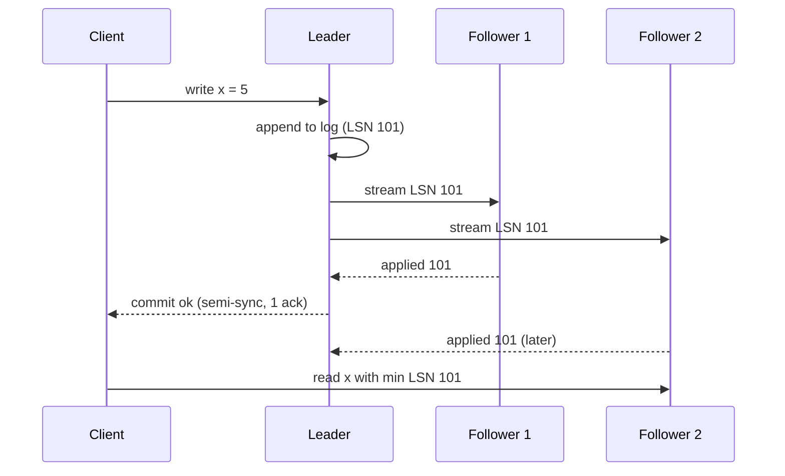

## In one minute
- Replication keeps copies of the same data on several nodes for availability, read scaling, and geographic locality.
- The main designs are single-leader (one writer, many followers), multi-leader (several writers that exchange changes), and leaderless (clients write to a quorum of replicas).
- The key decision is when a write counts as committed: after the leader alone (asynchronous), after one or more followers (semi-synchronous), or after a majority (consensus).
- Asynchronous replication means replica lag, which surfaces as stale reads and, on failover, lost writes.

## How it works

### Single-leader replication
All writes go to the leader. It records each change in a log (PostgreSQL's WAL, MySQL's binlog) and followers stream and replay that log in order. Followers serve reads, so read capacity scales with replica count while write capacity does not. Log shipping can be **physical** (byte-level page changes, needs identical versions) or **logical** (row-level changes, works across versions and feeds change data capture).

### Synchronous, semi-synchronous, asynchronous
With **asynchronous** replication the leader commits locally and acknowledges the client; followers catch up later. Writes are fast, but if the leader dies, anything not yet shipped is lost. With **synchronous** replication the leader waits for a follower to confirm durability. No acknowledged write is lost, but one slow follower stalls every write, so systems usually wait for *any one* of several followers (semi-synchronous, or "any 1 of 3"). Read the fine print on what happens when no follower answers. MySQL's semi-synchronous source waits `rpl_semi_sync_source_timeout` (10 seconds by default) and then quietly reverts to asynchronous replication until a replica catches up ([MySQL docs](https://dev.mysql.com/doc/refman/8.4/en/replication-semisync.html)), so the "no loss" promise lapses exactly when things go wrong. PostgreSQL instead blocks commits until a synchronous standby returns. Consensus-based systems (Raft in etcd, CockroachDB, Spanner's Paxos groups) wait for a majority, which tolerates a minority of failures without losing data or availability. In Raft, an entry is committed once the leader has stored it on a majority, and a candidate cannot win an election unless its log is at least as up to date as a majority's, which is what makes promotion safe ([Ongaro and Ousterhout](https://raft.github.io/raft.pdf)).

### Lag and its symptoms
Replica lag is the gap between the leader's log position and what a follower has applied. It is usually milliseconds and spikes to minutes under heavy writes, long-running replica queries, or network trouble. Visible symptoms:

- **Read-your-writes violations:** a user saves a profile and the next page, served by a replica, shows the old value.
- **Non-monotonic reads:** two requests hit two replicas and time appears to go backwards.
- **Causality violations:** a reply is visible before the message it answers.

These are the session guarantees Terry and colleagues named in 1994: read your writes, monotonic reads, writes follow reads, and monotonic writes ([Terry et al.](https://www.cs.cornell.edu/courses/cs734/2000FA/cached%20papers/SessionGuaranteesPDIS_1.html)). Fixes include routing a user's reads to the leader for a few seconds after a write, tracking the write's log position and reading only from replicas that have applied it, or pinning a sequence of related reads to one replica so time never runs backwards.

### Failover
When the leader fails, a follower is promoted. The hard parts are detection (a timeout too short causes needless failovers, too long extends downtime), choosing the most up-to-date follower, and fencing the old leader so it cannot keep accepting writes after a network partition heals. Two nodes both believing they are leader is **split brain**, and it corrupts data.

### Multi-leader and leaderless
Multi-leader setups accept writes in several regions and exchange changes asynchronously, so concurrent writes to the same row conflict and need a resolution rule (last-writer-wins, merge functions, CRDTs). Leaderless systems (Dynamo-style, Cassandra) write to W of N replicas and read from R; with `R + W > N` a read overlaps the latest write, though edge cases around sloppy quorums and concurrent writes remain. Amazon's Dynamo paper describes a common setting of N=3, R=2, W=2, with hinted handoff and Merkle-tree anti-entropy to repair replicas that missed writes ([DeCandia et al.](https://www.allthingsdistributed.com/files/amazon-dynamo-sosp2007.pdf)).

## Down the stack

### Layer 1: The contract
PostgreSQL makes the commit contract explicit with `synchronous_commit`. With `local`, a commit is acknowledged once the primary's WAL is flushed; standbys may lag, and failover can lose anything not yet shipped. With `remote_write`, a standby has received the WAL and written it to its OS, so it survives a standby process crash but not a standby power loss. With `on` (when synchronous standbys are configured), a standby has flushed it to disk. With `remote_apply`, a standby has replayed it, so a read on that standby immediately after commit sees the write. Each step up adds latency and narrows what a failover can lose. These levels only bite when `synchronous_standby_names` is set; with it empty, every non-`off` value behaves like `on` locally ([Postgres docs](https://www.postgresql.org/docs/current/runtime-config-wal.html#GUC-SYNCHRONOUS-COMMIT)).

### Layer 2: The mechanism
Changes are WAL records stored in segment files of 16 MB by default, set at `initdb` time ([Postgres docs](https://www.postgresql.org/docs/current/wal-internals.html)). On the primary, a `walsender` process per standby streams records; on the standby, `walreceiver` writes them and the `startup` process replays them. The standby reports three positions back: written, flushed, and replayed LSN, which the primary exposes in `pg_stat_replication` as `write_lsn`, `flush_lsn`, `replay_lsn` and the matching lag times. `synchronous_standby_names = 'ANY 1 (s1, s2)'` makes commits wait for whichever of two standbys confirms first, while `FIRST 1 (s1, s2)` waits for the highest-priority one that is connected ([Postgres docs](https://www.postgresql.org/docs/current/runtime-config-replication.html)). Replication slots stop the primary from deleting WAL a standby still needs, which protects the standby but can fill the primary's disk if a standby disappears. Since Postgres 13, `max_slot_wal_keep_size` caps that retention; its default of -1 still means unlimited, so set it. Postgres 17 added `sync_replication_slots`, which copies logical failover slots to a physical standby so change-data-capture consumers can continue after a promotion. MySQL's equivalent is the binlog with GTIDs. Its semi-synchronous plugin (renamed `rpl_semi_sync_source` and `rpl_semi_sync_replica`; the old master and slave names are deprecated) waits for one replica to acknowledge receipt. By default it waits after the binlog is synced but before the storage engine commits (`AFTER_SYNC`), so no other session can see a write the replica has not received.

### Layer 3: The machine
A synchronous commit costs a local WAL `fsync` (roughly 50 µs to 1 ms on SSDs), a network round trip (about 0.5 ms in one availability zone, 1 to 2 ms across zones, 60 to 150 ms across regions), and the standby's own `fsync`. WAL volume spikes after each checkpoint because the first change to any 8 KB page writes the full page image, so lag often follows the checkpoint cycle. Replay in PostgreSQL runs in a single `startup` process ([Postgres docs](https://www.postgresql.org/docs/current/hot-standby.html)), so a primary writing with 32 cores can produce WAL faster than one core on the standby replays it. Since Postgres 15, `recovery_prefetch` (default `try`) reads ahead in the WAL and issues read-ahead advice for pages not yet in memory, which hides some disk latency but not the single-core limit ([Postgres docs](https://www.postgresql.org/docs/current/runtime-config-wal.html)). Across regions, TCP throughput is limited by the bandwidth-delay product: filling 1 Gbps at 70 ms needs about 8.75 MB in flight, and smaller socket buffers silently cap the stream.

### Why it's built this way
1. Disks and machines fail, so data must exist on more than one node.
2. Concurrent writers on several nodes create conflicts, so most systems use one leader and ship its log.
3. Shipping the log the database already writes for crash recovery is cheaper than shipping data, so replication reuses the WAL.
4. Waiting for a remote acknowledgement adds at least one round trip per commit, so asynchronous is the default and synchronous is opt-in.
5. Two leaders would diverge, so promotion needs fencing or a majority vote.

## Diagram


## Worked example
An e-commerce database takes 4,000 writes per second at about 1 KB of WAL each, so 4 MB per second of log. It has one leader and three followers in the same region, plus one cross-region follower 70 ms away.

With async replication, normal lag is under 50 ms locally. During a nightly bulk import of 30 GB, WAL volume rises to 60 MB per second, and the cross-region follower, limited to 40 MB per second of bandwidth, falls 20 minutes behind. Had the region failed then, failing over to that replica would lose 20 minutes of orders.

The team makes three changes: semi-synchronous commit with "any 1 of the 2 local followers", which adds about 1 ms per commit and guarantees zero acknowledged loss on single-node failure; throttling the import to 20 MB per second; and an alert when any replica's lag exceeds 30 seconds. Reads that must reflect the user's own writes carry the commit LSN in the session and are routed to a replica at or past it.

## In the wild
- **GitHub, 2012: automatic failover to a cold replica, then split brain.** A schema migration overloaded the active MySQL node, health checks failed, and Pacemaker promoted a replica whose InnoDB buffer pool was cold. It performed so badly that the role flipped back. The next day a segfault partitioned the cluster and two masters were elected, one stale; 16 private repositories were briefly visible to the wrong users. GitHub made failover human-initiated afterwards ([GitHub](https://github.blog/2012-09-14-github-availability-this-week/)).
- **GitHub, 2018: 43 seconds of partition, 24 hours of repair.** Network maintenance cut the US East hub from the primary data center for 43 seconds. Orchestrator promoted West Coast primaries before they had all of East's writes, so both coasts held writes the other lacked. GitHub restored from backup and re-replicated rather than discard data, ran degraded for 24 hours 11 minutes, reconciled leftover writes by hand, and stopped cross-region promotion ([GitHub](https://github.blog/2018-10-30-oct21-post-incident-analysis/)).
- **Shopify, 2021: monotonic reads across lagging replicas.** Replicas with different lag let one request see a row in one table but not its related row in another. Shopify rejected waiting on every replica and GTID-based causal reads as too costly to run, and instead hashed a `consistent_read_id` in its ProxySQL fork to pin a series of reads to one replica ([Shopify](https://shopify.engineering/read-consistency-database-replicas)).

## Trade-offs
| Option | Strengths | Weaknesses | Choose when |
|---|---|---|---|
| Async single-leader | Fast writes, simple | Data loss on failover, stale reads | Some loss tolerable, read scaling needed |
| Semi-sync (any 1 of N) | No acknowledged loss on one failure | Extra round trip per commit | Losing committed writes is unacceptable |
| Consensus (majority) | Automatic, safe failover | Higher write latency, needs 3+ nodes | Strong consistency with high availability |
| Multi-leader | Local writes in each region | Conflicts, complex resolution | Multi-region writes, offline clients |
| Leaderless quorum | No failover, tunable R and W | Weaker guarantees, repair needed | High write availability, simple data model |

## Pitfalls in production
- **Silent lag.** Replicas fall hours behind and nobody notices until failover. Alert on lag in both bytes and seconds.
- **Long queries on replicas.** An analytics query conflicts with replay and either cancels or stalls replication. Postgres waits `max_standby_streaming_delay` (30 seconds by default) before cancelling the query, and `hot_standby_feedback` avoids cancellations at the cost of bloat on the primary. Use a dedicated replica for analytics with its own settings.
- **Split brain after failover.** The old leader returns and accepts writes. Fence it with leases, STONITH, or by revoking its access before promotion.
- **Failover drills never run.** The first real failover reveals stale DNS, broken runbooks and a cold buffer cache on the new leader. Rehearse failover regularly in production-like conditions.
- **Sync quietly becomes async.** MySQL semi-sync falls back after its timeout, so you think you have zero data loss and don't. Alert on the semi-sync status variables, not just on lag.
- **Assuming replicas are backups.** A bad `DELETE` replicates instantly. Keep point-in-time recovery backups separately.

## Leadership lens
- Write down the recovery point (how much data you may lose) and recovery time objectives; they choose async versus sync, not taste.
- Ask which reads can tolerate staleness and which cannot, and design routing explicitly for the latter.
- Prefer managed or consensus-based failover over hand-written scripts; promotion and fencing are where homegrown tooling fails.
- Budget cross-region bandwidth for peak write volume, not average.

## Check yourself
1. Why does synchronous replication to a single named follower reduce availability?
   **Answer:** Every commit waits for that follower, so if it is slow or down, writes stall even though the leader is healthy.
2. A user edits a post and sees the old version on refresh. What is happening and how do you fix it?
   **Answer:** The read hit a lagging replica; route that user's reads to the leader briefly, or to a replica that has applied the write's log position.
3. Why does `R + W > N` not make a leaderless store linearizable on its own?
   **Answer:** Concurrent writes, sloppy quorums, and partial write failures can still let reads see different values, so extra mechanisms are needed for strict ordering.

## Practice
**Task:** Model single-leader replication. `ReplicaSet(replicas)` takes follower names. `write(key, value)` appends to the leader's log and returns the new LSN (starting at 1). `replicate(name, upto)` makes a follower apply log entries in order up to `upto` (capped at the leader's LSN). `read(key, min_lsn)` returns `(node, value)` from the alphabetically first follower whose applied LSN is at least `min_lsn`, else `("leader", value)`; missing keys give `None` as the value. `lag(name)` returns leader LSN minus applied LSN, and `committed_lsn(w)` returns the highest LSN held by at least `w` nodes, counting the leader.

```python starter
class ReplicaSet:
    def __init__(self, replicas):
        raise NotImplementedError

    def write(self, key, value): raise NotImplementedError
    def replicate(self, name, upto): raise NotImplementedError
    def read(self, key, min_lsn): raise NotImplementedError
    def lag(self, name): raise NotImplementedError
    def committed_lsn(self, w): raise NotImplementedError
```

```python tests
def test_write_returns_increasing_lsn():
    rs = ReplicaSet(["a", "b"])
    assert rs.write("x", 1) == 1
    assert rs.write("x", 2) == 2
    assert rs.lag("a") == 2

def test_replicate_applies_in_order():
    rs = ReplicaSet(["a"])
    rs.write("x", 1); rs.write("x", 2); rs.write("y", 9)
    rs.replicate("a", 2)
    assert rs.read("x", 0) == ("a", 2)
    assert rs.read("y", 0) == ("a", None)
    assert rs.lag("a") == 1

def test_read_your_writes_falls_back_to_leader():
    rs = ReplicaSet(["a", "b"])
    lsn = rs.write("x", "new")
    assert rs.read("x", lsn) == ("leader", "new")
    rs.replicate("b", lsn)
    assert rs.read("x", lsn) == ("b", "new")

def test_replicate_is_capped():
    rs = ReplicaSet(["a"])
    rs.write("x", 1)
    rs.replicate("a", 99)
    assert rs.lag("a") == 0

def test_committed_lsn_quorum():
    rs = ReplicaSet(["a", "b"])
    for i in range(5):
        rs.write("k", i)
    rs.replicate("a", 4)
    rs.replicate("b", 2)
    assert rs.committed_lsn(1) == 5
    assert rs.committed_lsn(2) == 4
    assert rs.committed_lsn(3) == 2
    assert rs.committed_lsn(4) == 0
```

```python solution
class ReplicaSet:
    def __init__(self, replicas):
        self.log = []
        self.leader = {}
        self.data = {r: {} for r in replicas}
        self.applied = {r: 0 for r in replicas}

    def write(self, key, value):
        self.log.append((key, value))
        self.leader[key] = value
        return len(self.log)

    def replicate(self, name, upto):
        upto = min(upto, len(self.log))
        for lsn in range(self.applied[name] + 1, upto + 1):
            key, value = self.log[lsn - 1]
            self.data[name][key] = value
        self.applied[name] = max(self.applied[name], upto)

    def read(self, key, min_lsn):
        for name in sorted(self.data):
            if self.applied[name] >= min_lsn:
                return (name, self.data[name].get(key))
        return ("leader", self.leader.get(key))

    def lag(self, name):
        return len(self.log) - self.applied[name]

    def committed_lsn(self, w):
        positions = sorted([len(self.log)] + list(self.applied.values()), reverse=True)
        return positions[w - 1] if w <= len(positions) else 0
```

```typescript starter
export type Value = string | number | null;
export class ReplicaSet {
  constructor(replicas: string[]) {}
  write(key: string, value: Value): number { throw new Error("TODO"); }
  replicate(name: string, upto: number): void { throw new Error("TODO"); }
  read(key: string, minLsn: number): [string, Value] { throw new Error("TODO"); }
  lag(name: string): number { throw new Error("TODO"); }
  committedLsn(w: number): number { throw new Error("TODO"); }
}
```

```typescript tests
test("write returns increasing lsn", () => {
  const rs = new ReplicaSet(["a", "b"]);
  assertEqual([rs.write("x", 1), rs.write("x", 2), rs.lag("a")], [1, 2, 2]);
});
test("replicate applies in order", () => {
  const rs = new ReplicaSet(["a"]);
  rs.write("x", 1); rs.write("x", 2); rs.write("y", 9);
  rs.replicate("a", 2);
  assertEqual(rs.read("x", 0), ["a", 2]);
  assertEqual(rs.read("y", 0), ["a", null]);
  assertEqual(rs.lag("a"), 1);
});
test("read your writes falls back to leader", () => {
  const rs = new ReplicaSet(["a", "b"]);
  const lsn = rs.write("x", "new");
  assertEqual(rs.read("x", lsn), ["leader", "new"]);
  rs.replicate("b", lsn);
  assertEqual(rs.read("x", lsn), ["b", "new"]);
});
test("replicate is capped", () => {
  const rs = new ReplicaSet(["a"]);
  rs.write("x", 1);
  rs.replicate("a", 99);
  assertEqual(rs.lag("a"), 0);
});
test("committed lsn quorum", () => {
  const rs = new ReplicaSet(["a", "b"]);
  for (let i = 0; i < 5; i++) rs.write("k", i);
  rs.replicate("a", 4);
  rs.replicate("b", 2);
  assertEqual([1, 2, 3, 4].map(w => rs.committedLsn(w)), [5, 4, 2, 0]);
});
```

```typescript solution
export type Value = string | number | null;
export class ReplicaSet {
  private log: [string, Value][] = [];
  private leader = new Map<string, Value>();
  private data = new Map<string, Map<string, Value>>();
  private applied = new Map<string, number>();
  constructor(replicas: string[]) {
    for (const r of replicas) { this.data.set(r, new Map()); this.applied.set(r, 0); }
  }
  write(key: string, value: Value): number {
    this.log.push([key, value]);
    this.leader.set(key, value);
    return this.log.length;
  }
  replicate(name: string, upto: number): void {
    const target = Math.min(upto, this.log.length);
    const from = this.applied.get(name)!;
    for (let lsn = from + 1; lsn <= target; lsn++) {
      const [key, value] = this.log[lsn - 1];
      this.data.get(name)!.set(key, value);
    }
    this.applied.set(name, Math.max(from, target));
  }
  read(key: string, minLsn: number): [string, Value] {
    for (const name of [...this.data.keys()].sort()) {
      if (this.applied.get(name)! >= minLsn) return [name, this.data.get(name)!.get(key) ?? null];
    }
    return ["leader", this.leader.get(key) ?? null];
  }
  lag(name: string): number {
    return this.log.length - this.applied.get(name)!;
  }
  committedLsn(w: number): number {
    const pos = [this.log.length, ...this.applied.values()].sort((a, b) => b - a);
    return w <= pos.length ? pos[w - 1] : 0;
  }
}
```

```go starter
package practice

type ReplicaSet struct{}

func NewReplicaSet(replicas []string) *ReplicaSet { return &ReplicaSet{} }

func (rs *ReplicaSet) Write(key, value string) int     { panic("TODO") }
func (rs *ReplicaSet) Replicate(name string, upto int) { panic("TODO") }

// Read returns the serving node, the value, and whether the key exists there.
func (rs *ReplicaSet) Read(key string, minLSN int) (string, string, bool) { panic("TODO") }
func (rs *ReplicaSet) Lag(name string) int                                { panic("TODO") }
func (rs *ReplicaSet) CommittedLSN(w int) int                             { panic("TODO") }
```

```go tests
package practice

import "testing"

func TestWriteReturnsIncreasingLSN(t *testing.T) {
	rs := NewReplicaSet([]string{"a", "b"})
	if rs.Write("x", "1") != 1 || rs.Write("x", "2") != 2 || rs.Lag("a") != 2 {
		t.Fatal("bad lsn or lag")
	}
}

func TestReplicateAppliesInOrder(t *testing.T) {
	rs := NewReplicaSet([]string{"a"})
	rs.Write("x", "1")
	rs.Write("x", "2")
	rs.Write("y", "9")
	rs.Replicate("a", 2)
	if n, v, ok := rs.Read("x", 0); n != "a" || v != "2" || !ok {
		t.Fatalf("got %s %s %v", n, v, ok)
	}
	if _, _, ok := rs.Read("y", 0); ok || rs.Lag("a") != 1 {
		t.Fatal("y should not be applied yet")
	}
}

func TestReadYourWrites(t *testing.T) {
	rs := NewReplicaSet([]string{"a", "b"})
	lsn := rs.Write("x", "new")
	if n, v, _ := rs.Read("x", lsn); n != "leader" || v != "new" {
		t.Fatalf("got %s %s", n, v)
	}
	rs.Replicate("b", lsn)
	if n, _, _ := rs.Read("x", lsn); n != "b" {
		t.Fatalf("got %s", n)
	}
}

func TestReplicateCapped(t *testing.T) {
	rs := NewReplicaSet([]string{"a"})
	rs.Write("x", "1")
	rs.Replicate("a", 99)
	if rs.Lag("a") != 0 {
		t.Fatal("lag should be 0")
	}
}

func TestCommittedLSN(t *testing.T) {
	rs := NewReplicaSet([]string{"a", "b"})
	for i := 0; i < 5; i++ {
		rs.Write("k", "v")
	}
	rs.Replicate("a", 4)
	rs.Replicate("b", 2)
	want := map[int]int{1: 5, 2: 4, 3: 2, 4: 0}
	for w, lsn := range want {
		if got := rs.CommittedLSN(w); got != lsn {
			t.Fatalf("w=%d got %d want %d", w, got, lsn)
		}
	}
}
```

```go solution
package practice

import "sort"

type entry struct{ key, value string }

type ReplicaSet struct {
	log     []entry
	leader  map[string]string
	data    map[string]map[string]string
	applied map[string]int
}

func NewReplicaSet(replicas []string) *ReplicaSet {
	rs := &ReplicaSet{leader: map[string]string{}, data: map[string]map[string]string{},
		applied: map[string]int{}}
	for _, r := range replicas {
		rs.data[r] = map[string]string{}
		rs.applied[r] = 0
	}
	return rs
}

func (rs *ReplicaSet) Write(key, value string) int {
	rs.log = append(rs.log, entry{key, value})
	rs.leader[key] = value
	return len(rs.log)
}

func (rs *ReplicaSet) Replicate(name string, upto int) {
	if upto > len(rs.log) {
		upto = len(rs.log)
	}
	for lsn := rs.applied[name] + 1; lsn <= upto; lsn++ {
		e := rs.log[lsn-1]
		rs.data[name][e.key] = e.value
	}
	if upto > rs.applied[name] {
		rs.applied[name] = upto
	}
}

// Read returns the serving node, the value, and whether the key exists there.
func (rs *ReplicaSet) Read(key string, minLSN int) (string, string, bool) {
	names := make([]string, 0, len(rs.data))
	for n := range rs.data {
		names = append(names, n)
	}
	sort.Strings(names)
	for _, n := range names {
		if rs.applied[n] >= minLSN {
			v, ok := rs.data[n][key]
			return n, v, ok
		}
	}
	v, ok := rs.leader[key]
	return "leader", v, ok
}

func (rs *ReplicaSet) Lag(name string) int { return len(rs.log) - rs.applied[name] }

func (rs *ReplicaSet) CommittedLSN(w int) int {
	pos := []int{len(rs.log)}
	for _, a := range rs.applied {
		pos = append(pos, a)
	}
	sort.Sort(sort.Reverse(sort.IntSlice(pos)))
	if w < 1 || w > len(pos) {
		return 0
	}
	return pos[w-1]
}
```

## Mock interview
**Prompt:** Design the database tier for a banking app with 20 million users, 5,000 writes per second, and 50,000 reads per second, running in two regions. The business says no acknowledged transaction may ever be lost, and the app must survive a full region outage.

- Follow-up: Commit latency doubled after you enabled synchronous replication. What are your options?
- Follow-up: During a network partition, both regions think they are primary. How do you prevent this?
- Follow-up: A user transfers money and then sees the old balance. Fix it without sending all reads to the leader.

**A strong answer covers:**
- Translating "no loss" and "survive a region" into RPO zero and an RTO, and what that implies for synchronous or consensus replication.
- Quorum placement across at least three failure domains so a majority survives one region loss.
- Fencing, leases, or consensus to avoid split brain, rather than timeout-based promotion alone.
- Read scaling with followers plus session-level read-your-writes using log positions.
- Lag monitoring, failover drills, and separate point-in-time backups.

## Sources and further study
**Primary**
- [Ongaro and Ousterhout, In Search of an Understandable Consensus Algorithm (Raft, 2014)](https://raft.github.io/raft.pdf): majority commit and the election restriction that keeps promotion from losing committed entries.
- [DeCandia et al., Dynamo (SOSP 2007)](https://www.allthingsdistributed.com/files/amazon-dynamo-sosp2007.pdf): leaderless quorums, sloppy quorums, hinted handoff and anti-entropy.
- [Terry et al., Session Guarantees for Weakly Consistent Replicated Data (1994)](https://www.cs.cornell.edu/courses/cs734/2000FA/cached%20papers/SessionGuaranteesPDIS_1.html): the original definitions of read your writes and monotonic reads.

**Systems docs**
- [PostgreSQL: Replication settings](https://www.postgresql.org/docs/current/runtime-config-replication.html): `synchronous_standby_names`, slot limits, and standby conflict settings.
- [PostgreSQL: Hot Standby](https://www.postgresql.org/docs/current/hot-standby.html): how replay conflicts with standby queries and how cancellations work.
- [MySQL 8.4: Semisynchronous Replication](https://dev.mysql.com/doc/refman/8.4/en/replication-semisync.html): wait points, acknowledgement counts and the fallback to async.

**Books**
- *Designing Data-Intensive Applications*, Martin Kleppmann, chapter 5 "Replication" (1st edition) or chapter 6 (2nd edition): leaders and followers, replication lag, multi-leader and leaderless.
- *Database Internals*, Alex Petrov, chapter 11 "Replication and Consistency" and chapter 12 "Anti-Entropy and Dissemination".
- *Understanding Distributed Systems*, Roberto Vitillo, chapter "Replication": state machine replication and consistency models in short form.

**Other curricula**
- [donnemartin/system-design-primer](https://github.com/donnemartin/system-design-primer): presents master-slave and master-master replication with their disadvantages (lag, conflicts, failover complexity), but not commit levels or session guarantees.

## Watch
- [Distributed Systems 5.1: Replication (Martin Kleppmann)](https://www.youtube.com/watch?v=mBUCF1WGI_I): a Cambridge lecture introducing replication and the consistency problems it creates.

## Free resources
- [PostgreSQL: High Availability and Replication](https://www.postgresql.org/docs/current/warm-standby.html): streaming replication, synchronous commit, and failover in Postgres.
- [MySQL 8.4: Replication](https://dev.mysql.com/doc/refman/8.4/en/replication.html): binlog formats, GTIDs, and semi-synchronous replication (8.0 reached end of life in April 2026).
- [Jepsen: Consistency Models](https://jepsen.io/consistency): precise definitions of the guarantees replicas can offer.
- [Raft](https://raft.github.io/): the consensus algorithm behind many majority-replicated databases, with a visualization.
- [Kleppmann: Please stop calling databases CP or AP](https://martin.kleppmann.com/2015/05/11/please-stop-calling-databases-cp-or-ap.html): why replication guarantees need more nuance than CAP.
