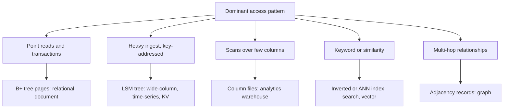

## In one minute
- A "database type" is a bundle of three choices: a data model (tables, documents, keys, edges, vectors), the queries it makes cheap, and a physical layout on disk or in memory that makes those queries cheap.
- The layout is what really separates the families: B-tree pages, log-structured merge trees, column files, inverted indexes, adjacency records and in-memory hash tables each favour a different access pattern.
- No layout is good at everything. Every structure trades read cost, write cost and space against each other, so a store that is fast for one query shape is slow or expensive for another.
- Most products end up polyglot: one system of record plus derived stores (search, analytics, cache, vectors) fed from it, which turns "which database" into "which data flows where, and who keeps it in sync".

## How it works

### Model, queries, layout
Every database answers two questions: what shape can I store, and which questions can I answer without reading everything? *Database Selection* gives a framework for choosing; this lesson explains why each family is fast at its sweet spot, which comes from how it lays out bytes.

The problem shape is "finding things fast", and it recurs outside databases: a code search tool builds an inverted index, a log pipeline appends segments and compacts them later.

### Row stores on B-trees
Postgres and MySQL keep rows in fixed-size pages (8 KB in Postgres, 16 KB in InnoDB) indexed by B+ trees ([Postgres docs](https://www.postgresql.org/docs/current/storage-page-layout.html)). A lookup walks three or four levels, the upper ones cached, so a point read costs about one disk read, and updates modify pages in place. InnoDB stores rows inside the primary-key tree (a clustered index); Postgres keeps an unordered heap pointed to by separate indexes. See *B-Trees*.

### Key-value stores
A key-value store gives up queries on anything but the key for predictable latency at any scale. In memory (Redis, Memcached, and Valkey, the BSD-licensed fork the Linux Foundation started from Redis 7.2.4 in 2024 after Redis changed its license ([Linux Foundation](https://www.linuxfoundation.org/press/linux-foundation-launches-open-source-valkey-community))) the layout is a hash table. Distributed on disk, the key picks a partition whose replicas hold a B-tree or LSM tree; in DynamoDB each storage replica keeps a write-ahead log plus a B-tree ([DynamoDB paper, ATC 2022](https://www.usenix.org/system/files/atc22-elhemali.pdf)). Every access must name a key; anything else is a scan.

### Document stores
Document databases (MongoDB, Couchbase, Firestore) store a nested record, such as an order with its line items, as one unit, so reading the aggregate needs no joins. MongoDB's WiredTiger engine keeps documents in B-trees with secondary indexes, so the layout is close to a row store; the difference is the model. You choose between embedding (fast reads, duplicated writes) and referencing (joins in your code), and the 16 MiB document cap rules out unbounded embedded lists ([MongoDB limits](https://www.mongodb.com/docs/manual/reference/limits/)).

### LSM-based stores: wide-column and time-series
Cassandra, ScyllaDB, HBase and Bigtable buffer writes in memory and a log, flush sorted immutable files, and merge them in the background. Writes become sequential; reads may check several files, bounded by bloom filters and compaction. Queries must follow the partition and clustering key. See *LSM Trees* and *Wide Column Databases*. Time-series databases add time-partitioned chunks and heavy compression of timestamps and values (*Time-Series Databases*).

### Column stores for analytics
ClickHouse, BigQuery, Snowflake and Redshift store each column separately, sorted by a chosen key and compressed with dictionary, run-length or delta encoding. A query that sums one column over a billion rows reads only that column, often at a tenth of its raw size. Single-row updates are expensive because a row spans many files.

### Search, graph and vector stores
**Search engines** (Elasticsearch, OpenSearch, on Lucene) keep an inverted index: for each term, a sorted list of documents containing it, in immutable segments merged in the background. **Graph databases** such as Neo4j store each node with direct pointers to its relationships, so an edge is a pointer hop (*Graph Databases*). **Vector databases** keep approximate nearest-neighbour indexes such as HNSW graphs (*Vector Databases*). Vector search is also becoming a feature of general stores rather than only a separate family: DynamoDB now offers vector indexes of up to 4,096 dimensions ([AWS quotas](https://docs.aws.amazon.com/amazondynamodb/latest/developerguide/ServiceQuotas.html)), and Postgres has the pgvector extension.

### Distributed SQL
Spanner, CockroachDB, YugabyteDB and TiDB split the key space into ranges, each replicated by consensus and usually stored in an LSM engine: Pebble in CockroachDB ([CockroachDB docs](https://docs.cockroachlabs.com/docs/stable/architecture/storage-layer)), RocksDB under TiKV. You get cross-machine transactions at the price of consensus round trips per write.

## Down the stack

### Layer 1: The contract
Each family promises a set of efficient queries and, implicitly, that everything outside the set costs a scan. A B-tree store promises point and range lookups on indexed columns in logarithmic I/O and in-place transactional updates. An LSM store promises high sustained write throughput and point reads that touch roughly one data block per lookup when bloom filters work, at the price of background compaction. A column store promises scans proportional to the columns touched, not the rows. An inverted index promises keyword lookups proportional to the matching postings.

### Layer 2: The mechanism
The RUM conjecture from Harvard's DASlab states the constraint ([DASlab](http://daslab.seas.harvard.edu/rum-conjecture/)): an access method can minimise at most two of read overhead, update overhead and memory (space) overhead. B-trees pick reads and space; they pay on updates by rewriting a whole page to change one row. A 100-byte update in a 16 KB InnoDB page eventually writes 16 KB, a write amplification above 100 before counting the redo log or the doublewrite buffer, which writes every flushed page twice so a torn write can be repaired ([MySQL docs](https://dev.mysql.com/doc/refman/8.4/en/innodb-doublewrite-buffer.html)). Postgres solves the same torn-page problem by adding a full-page image to its WAL the first time a page changes after each checkpoint ([Postgres docs](https://www.postgresql.org/docs/current/runtime-config-wal.html)).

LSM engines pick updates and space. RocksDB's leveled compaction uses a level size multiplier of 10 and a 256 MB base level by default, so each level holds ten times the previous one. Since version 8.4 RocksDB sizes levels from the bottom up by default (`level_compaction_dynamic_level_bytes`): the last level's target is its actual size, levels too small to matter stay empty, and about 90% of the data sits in the last level ([RocksDB wiki](https://github.com/facebook/rocksdb/wiki/Leveled-Compaction)). A byte written is rewritten roughly ten times per level it moves down, giving write amplification in the tens, but those writes are large sequential merges. Reads check the memtable, then at most one file per level, using a bloom filter (about 10 bits per key for a 1% false positive rate) to skip files that cannot contain the key ([RocksDB wiki](https://github.com/facebook/rocksdb/wiki/RocksDB-Bloom-Filter)).

Column stores pick reads for scans. ClickHouse's MergeTree stores data in parts sorted by the primary key, with a sparse index that has one entry per granule of 8,192 rows by default ([ClickHouse docs](https://clickhouse.com/docs/en/optimize/sparse-primary-indexes)), so the index for a billion rows fits in memory and a range query reads only the granules it needs.

### Layer 3: The machine
An NVMe SSD serves a random 4 KB read in about 80 to 100 microseconds and sequential reads at several GB/s. Inside, flash is programmed in pages of a few KB and erased in blocks of megabytes, so random small writes cause the drive's own garbage collection and wear. So write amplification is a real cost: it multiplies against the drive's rated writes per day.

Scanning one column of 8-byte integers streams contiguous 64-byte cache lines and lets SIMD process several values per instruction; the same scan in a row store drags every other column through the cache. An in-memory hash table skips the disk but pays for RAM, roughly an order of magnitude more per GB than SSD.

### Why it's built this way
1. Disks and SSDs read and write in blocks, not bytes, so every engine organises data into pages, files or segments.
2. Random writes to blocks are slow and wear flash, so write-heavy engines buffer in memory and append sorted files, then compact them.
3. Compaction and multi-file reads cost I/O, so LSM engines add bloom filters and level size ratios to bound read and write amplification.
4. Analytical queries touch few columns of many rows, so analytic engines store and compress by column, giving up cheap single-row updates.
5. No layout wins on reads, writes and space at once, so serious systems combine several stores and move data between them.

## Diagram


## Worked example
Two teams share a cost model. Both have 1 billion records of 100 bytes (100 GB), 4 KB pages, B-tree fanout 200 and 200,000 pages of cache. The LSM option uses a 256 MB base level, ratio 10 and 1% bloom filters.

**B-tree.** 40 records fit per leaf, so there are 25 million leaves, then 125,000, 625, 4 and 1 nodes above: height 5. The top four levels total 125,630 pages and fit in cache, so a point read costs one disk read. Each update rewrites a 4 KB page.

**LSM.** Levels hold up to 256 MB, 2.56 GB, 25.6 GB and 256 GB, so 100 GB needs 4 levels. Write amplification is 2 (log plus flush) plus 10 for each of the 3 lower levels: 32. Each byte written becomes 32 bytes of device writes, or 3,200 bytes per 100-byte record, versus 4,096 for the B-tree. A point read costs 1 plus 3 × 0.01 = 1.03 reads.

**IoT ingest team:** 50,000 writes and 5,000 reads per second. B-tree device traffic: 50,000 × 4,096 + 5,000 × 4,096 = 225 MB/s. LSM: 50,000 × 3,200 + 5,000 × 1.03 × 4,096 = 181 MB/s. The LSM wins, and its writes are sequential, which matters more on flash than the totals suggest.

**Catalogue team:** 5,000 writes and 100,000 reads per second. B-tree: 20 MB/s + 410 MB/s = 430 MB/s. LSM: 16 MB/s + 422 MB/s = 438 MB/s. The B-tree wins narrowly; add range scans and the gap widens, because an LSM range scan merges several files.

The model ignores page coalescing and block caches, but it shows that "LSM for writes, B-tree for reads" is a crossover on a curve, not a rule.

## In the wild
- **Jepsen, 2015: a search index used as the system of record loses writes.** Kyle Kingsbury's tests of Elasticsearch 1.5.0 lost acknowledged documents under partitions and pauses: about 22% (209 of 947) in one run that isolated a primary, and about 10% under `kill -9` because writes were acknowledged before the translog fsync, which ran every 5 seconds by default. His advice was the polyglot rule in this lesson: keep data in a safer database and continuously copy it into the index ([Jepsen](https://aphyr.com/posts/323-call-me-maybe-elasticsearch-1-5-0)).
- **Facebook, 2013: an in-memory hash store as a look-aside cache at billions of requests per second.** The NSDI paper on memcache shows what a key-only store needs around it at scale: leases that refuse stale sets and let only one client per key refill a miss (by default one token per key every 10 seconds), which cut peak database queries on hot keys from 17K/s to 1.3K/s, and invalidations driven from the database commit log ([USENIX](https://www.usenix.org/conference/nsdi13/technical-sessions/presentation/nishtala)).
- **Cloudflare, 2023: polyglot stores without the same HA bar.** When power failed at one Portland data center, the "highly available" control plane turned out to depend on Kafka and ClickHouse clusters that ran only there; newer products' databases had never been required to meet HA standards. Most services moved to the disaster-recovery site in about 6 hours, but analytics and logs took about 41 hours. Afterwards every GA product had to use the HA cluster and have a tested DR plan ([Cloudflare](https://blog.cloudflare.com/post-mortem-on-cloudflare-control-plane-and-analytics-outage/)).

## Trade-offs
| Layout (families) | Strengths | Weaknesses | Choose when |
|---|---|---|---|
| B+ tree row store (relational, document) | Fast point and range reads, in-place transactions, mature tooling | Write amplification on random updates, single-writer scaling | System of record, OLTP, mixed queries |
| In-memory hash (Redis, Memcached) | Sub-millisecond, simple | RAM cost, key-only access, durability limits | Caches, sessions, counters, leaderboards |
| LSM tree (wide-column, time-series, many KV) | Sustained high write rates, sequential I/O, good compression | Compaction debt, read and space amplification, tombstones | Ingest-heavy, key-addressed data |
| Column store (warehouse, OLAP) | Scans of few columns over billions of rows, high compression | Slow point lookups and updates | Analytics, dashboards, reporting |
| Inverted index (search) | Keyword, fuzzy and faceted queries | Not transactional, reindexing cost | Search over text, filtering by many fields |
| Adjacency records (graph) | Deep traversals as pointer hops | Hard to partition, weak at aggregates | Fraud rings, recommendations, dependency graphs |

## Pitfalls in production
- **Picking by model instead of query.** A document store chosen for "flexible schema" ends up joining collections in application code for every page. List the top ten queries first, then pick the layout that makes them cheap.
- **Using a derived store as the source of truth.** A search index or cache that holds data nowhere else loses it on a reindex or restart. Name the system of record and rebuild everything else from it.
- **Dual writes between stores.** Writing to Postgres and then Elasticsearch from the application drifts the moment one write fails. Feed derived stores from the commit log with change data capture or an outbox.
- **Ignoring compaction debt.** An LSM store that ingests faster than it compacts accumulates files until reads slow and writes stall. Watch pending compaction bytes and size disks for space amplification.
- **Polyglot sprawl.** Five databases for five features means five backup procedures, five upgrade paths and five on-call skill sets. Each new store needs a reason a current one cannot meet.

## Leadership lens
- Default to one well-run relational database for the system of record, and require a written reason, tied to a query or a measured limit, for every additional type.
- In design review, ask "which query will be slow on this store, and what will we do when someone needs it?" The answer reveals whether the team understands the layout.
- Count the operational cost of each new database type in people: who is on call, who has restored it from backup, who will upgrade it in two years.

## Check yourself
1. Why does a 100-byte update cost far more device writes in a B-tree than its size suggests?
   **Answer:** The engine writes whole pages, so changing 100 bytes eventually rewrites a 4 to 16 KB page, plus log records. Unless many updates hit the same page before it is flushed, write amplification is page size divided by record size.
2. A team stores clickstream events in a row store and their daily report scans 3 of 60 columns over 2 billion rows. Why would a column store be much faster?
   **Answer:** The column store reads only the 3 columns, about 5% of the bytes before compression, and those columns compress well because similar values sit together. The row store reads every column of every row.
3. Why do LSM engines need bloom filters, and what happens to reads without them?
   **Answer:** A key may be in any level, so a lookup would check every level's file for it. Bloom filters let the engine skip files that definitely lack the key, keeping a point read close to one disk read.

## Practice
**Task:** Build a storage engine cost model. `btree_height(n_keys, per_leaf, fanout)` counts levels: start with `ceil(n_keys / per_leaf)` leaves (at least 1), then divide by `fanout`, rounding up, until one node remains. `btree_read_ios(n_keys, per_leaf, fanout, cached_pages)` returns the height minus the number of levels, counted from the root down, whose cumulative node count fits in `cached_pages`. `lsm_levels(data_bytes, base_bytes, ratio)` starts with 1 level of capacity `base_bytes` and multiplies capacity by `ratio`, adding a level, while capacity is below `data_bytes`. `lsm_write_amp(levels, ratio)` is `2 + (levels - 1) * ratio`. `lsm_read_ios(levels, fpr, present)` is `1 + (levels - 1) * fpr` for a present key, else `levels * fpr`. `costs(w)` takes a workload with `n_keys`, `record_bytes`, `page_bytes`, `fanout`, `cached_pages`, `base_bytes`, `ratio`, `fpr`, `reads`, `writes` (per second), uses `per_leaf = page_bytes // record_bytes`, and returns device bytes per second as `(btree, lsm)`: B-tree is `writes * page_bytes + reads * btree_ios * page_bytes`, LSM is `writes * record_bytes * write_amp + reads * lsm_ios(present) * page_bytes`. `choose(w)` returns `"lsm"` if its cost is strictly lower, else `"btree"`.

```python starter
def btree_height(n_keys, per_leaf, fanout):
    # TODO
    raise NotImplementedError

def btree_read_ios(n_keys, per_leaf, fanout, cached_pages):
    # TODO
    raise NotImplementedError

def lsm_levels(data_bytes, base_bytes, ratio):
    # TODO
    raise NotImplementedError

def lsm_write_amp(levels, ratio):
    # TODO
    raise NotImplementedError

def lsm_read_ios(levels, fpr, present):
    # TODO
    raise NotImplementedError

def costs(w):
    # TODO
    raise NotImplementedError

def choose(w):
    # TODO
    raise NotImplementedError
```

```python tests
def workload(reads, writes, cached=200000):
    return {"n_keys": 10**9, "record_bytes": 100, "page_bytes": 4096, "fanout": 200,
            "cached_pages": cached, "base_bytes": 256 * 2**20, "ratio": 10, "fpr": 0.01,
            "reads": reads, "writes": writes}

def close(a, b):
    return abs(a - b) < 1e-6 * max(1.0, abs(b))

def test_btree_height():
    assert btree_height(10**9, 40, 200) == 5
    assert btree_height(40, 40, 200) == 1
    assert btree_height(41, 40, 200) == 2
    assert btree_height(0, 40, 200) == 1

def test_btree_read_ios_with_cache():
    assert btree_read_ios(10**9, 40, 200, 200000) == 1
    assert btree_read_ios(10**9, 40, 200, 0) == 5
    assert btree_read_ios(10**9, 40, 200, 5) == 3, "root and its 4 children fit, the next 625 do not"
    assert btree_read_ios(10**9, 40, 200, 10**9) == 0

def test_lsm_levels():
    base = 256 * 2**20
    assert lsm_levels(10**11, base, 10) == 4
    assert lsm_levels(100, base, 10) == 1
    assert lsm_levels(base, base, 10) == 1
    assert lsm_levels(base + 1, base, 10) == 2

def test_lsm_amplification():
    assert lsm_write_amp(4, 10) == 32
    assert lsm_write_amp(1, 10) == 2
    assert close(lsm_read_ios(4, 0.01, True), 1.03)
    assert close(lsm_read_ios(4, 0.01, False), 0.04)

def test_write_heavy_prefers_lsm():
    b, l = costs(workload(5000, 50000))
    assert close(b, 225280000)
    assert close(l, 160000000 + 5000 * 1.03 * 4096)
    assert choose(workload(5000, 50000)) == "lsm"

def test_read_heavy_prefers_btree():
    b, l = costs(workload(100000, 5000))
    assert close(b, 430080000)
    assert l > b
    assert choose(workload(100000, 5000)) == "btree"

def test_fully_cached_reads_only():
    assert costs(workload(1000, 0, 10**9))[0] == 0
    assert choose(workload(1000, 0, 10**9)) == "btree"
```

```python solution
def btree_height(n_keys, per_leaf, fanout):
    nodes = max(1, -(-n_keys // per_leaf))
    height = 1
    while nodes > 1:
        nodes = -(-nodes // fanout)
        height += 1
    return height

def btree_read_ios(n_keys, per_leaf, fanout, cached_pages):
    sizes = [max(1, -(-n_keys // per_leaf))]
    while sizes[-1] > 1:
        sizes.append(-(-sizes[-1] // fanout))
    sizes.reverse()
    cached, total = 0, 0
    for s in sizes:
        total += s
        if total > cached_pages:
            break
        cached += 1
    return len(sizes) - cached

def lsm_levels(data_bytes, base_bytes, ratio):
    levels, cap = 1, base_bytes
    while cap < data_bytes:
        cap *= ratio
        levels += 1
    return levels

def lsm_write_amp(levels, ratio):
    return 2 + (levels - 1) * ratio

def lsm_read_ios(levels, fpr, present):
    if present:
        return 1 + (levels - 1) * fpr
    return levels * fpr

def costs(w):
    per_leaf = w["page_bytes"] // w["record_bytes"]
    b_ios = btree_read_ios(w["n_keys"], per_leaf, w["fanout"], w["cached_pages"])
    btree = w["writes"] * w["page_bytes"] + w["reads"] * b_ios * w["page_bytes"]
    levels = lsm_levels(w["n_keys"] * w["record_bytes"], w["base_bytes"], w["ratio"])
    lsm = (w["writes"] * w["record_bytes"] * lsm_write_amp(levels, w["ratio"])
           + w["reads"] * lsm_read_ios(levels, w["fpr"], True) * w["page_bytes"])
    return (btree, lsm)

def choose(w):
    b, l = costs(w)
    return "lsm" if l < b else "btree"
```

```typescript starter
export type Workload = {
  nKeys: number; recordBytes: number; pageBytes: number; fanout: number; cachedPages: number;
  baseBytes: number; ratio: number; fpr: number; reads: number; writes: number;
};

export function btreeHeight(nKeys: number, perLeaf: number, fanout: number): number {
  throw new Error("TODO");
}
export function btreeReadIos(nKeys: number, perLeaf: number, fanout: number, cachedPages: number): number {
  throw new Error("TODO");
}
export function lsmLevels(dataBytes: number, baseBytes: number, ratio: number): number {
  throw new Error("TODO");
}
export function lsmWriteAmp(levels: number, ratio: number): number {
  throw new Error("TODO");
}
export function lsmReadIos(levels: number, fpr: number, present: boolean): number {
  throw new Error("TODO");
}
export function costs(w: Workload): [number, number] {
  throw new Error("TODO");
}
export function choose(w: Workload): string {
  throw new Error("TODO");
}
```

```typescript tests
function wl(reads: number, writes: number, cached: number = 200000): Workload {
  return { nKeys: 1e9, recordBytes: 100, pageBytes: 4096, fanout: 200, cachedPages: cached,
    baseBytes: 256 * 2 ** 20, ratio: 10, fpr: 0.01, reads, writes };
}
function near(a: number, b: number): boolean {
  return Math.abs(a - b) < 1e-6 * Math.max(1, Math.abs(b));
}

test("btree height", () => {
  assertEqual(btreeHeight(1e9, 40, 200), 5);
  assertEqual(btreeHeight(40, 40, 200), 1);
  assertEqual(btreeHeight(41, 40, 200), 2);
  assertEqual(btreeHeight(0, 40, 200), 1);
});
test("btree read ios with cache", () => {
  assertEqual(btreeReadIos(1e9, 40, 200, 200000), 1);
  assertEqual(btreeReadIos(1e9, 40, 200, 0), 5);
  assertEqual(btreeReadIos(1e9, 40, 200, 5), 3, "root and its 4 children fit, the next 625 do not");
  assertEqual(btreeReadIos(1e9, 40, 200, 1e9), 0);
});
test("lsm levels", () => {
  const base = 256 * 2 ** 20;
  assertEqual(lsmLevels(1e11, base, 10), 4);
  assertEqual(lsmLevels(100, base, 10), 1);
  assertEqual(lsmLevels(base, base, 10), 1);
  assertEqual(lsmLevels(base + 1, base, 10), 2);
});
test("lsm amplification", () => {
  assertEqual(lsmWriteAmp(4, 10), 32);
  assertEqual(lsmWriteAmp(1, 10), 2);
  assert(near(lsmReadIos(4, 0.01, true), 1.03), "present key");
  assert(near(lsmReadIos(4, 0.01, false), 0.04), "absent key");
});
test("write heavy prefers lsm", () => {
  const [b, l] = costs(wl(5000, 50000));
  assert(near(b, 225280000), "btree cost");
  assert(near(l, 160000000 + 5000 * 1.03 * 4096), "lsm cost");
  assertEqual(choose(wl(5000, 50000)), "lsm");
});
test("read heavy prefers btree", () => {
  const [b, l] = costs(wl(100000, 5000));
  assert(near(b, 430080000), "btree cost");
  assert(l > b, "lsm costs more");
  assertEqual(choose(wl(100000, 5000)), "btree");
});
test("fully cached reads only", () => {
  assertEqual(costs(wl(1000, 0, 1e9))[0], 0);
  assertEqual(choose(wl(1000, 0, 1e9)), "btree");
});
```

```typescript solution
export type Workload = {
  nKeys: number; recordBytes: number; pageBytes: number; fanout: number; cachedPages: number;
  baseBytes: number; ratio: number; fpr: number; reads: number; writes: number;
};

function levelSizes(nKeys: number, perLeaf: number, fanout: number): number[] {
  const sizes = [Math.max(1, Math.ceil(nKeys / perLeaf))];
  while (sizes[sizes.length - 1] > 1) sizes.push(Math.ceil(sizes[sizes.length - 1] / fanout));
  return sizes;
}

export function btreeHeight(nKeys: number, perLeaf: number, fanout: number): number {
  return levelSizes(nKeys, perLeaf, fanout).length;
}

export function btreeReadIos(nKeys: number, perLeaf: number, fanout: number, cachedPages: number): number {
  const sizes = levelSizes(nKeys, perLeaf, fanout).reverse();
  let cached = 0;
  let total = 0;
  for (const s of sizes) {
    total += s;
    if (total > cachedPages) break;
    cached++;
  }
  return sizes.length - cached;
}

export function lsmLevels(dataBytes: number, baseBytes: number, ratio: number): number {
  let levels = 1;
  let cap = baseBytes;
  while (cap < dataBytes) {
    cap *= ratio;
    levels++;
  }
  return levels;
}

export function lsmWriteAmp(levels: number, ratio: number): number {
  return 2 + (levels - 1) * ratio;
}

export function lsmReadIos(levels: number, fpr: number, present: boolean): number {
  return present ? 1 + (levels - 1) * fpr : levels * fpr;
}

export function costs(w: Workload): [number, number] {
  const perLeaf = Math.floor(w.pageBytes / w.recordBytes);
  const bIos = btreeReadIos(w.nKeys, perLeaf, w.fanout, w.cachedPages);
  const btree = w.writes * w.pageBytes + w.reads * bIos * w.pageBytes;
  const levels = lsmLevels(w.nKeys * w.recordBytes, w.baseBytes, w.ratio);
  const lsm = w.writes * w.recordBytes * lsmWriteAmp(levels, w.ratio) + w.reads * lsmReadIos(levels, w.fpr, true) * w.pageBytes;
  return [btree, lsm];
}

export function choose(w: Workload): string {
  const [b, l] = costs(w);
  return l < b ? "lsm" : "btree";
}
```

```go starter
package practice

type Workload struct {
	NKeys, RecordBytes, PageBytes, Fanout, CachedPages, BaseBytes, Ratio int
	FPR                                                             float64
	Reads, Writes                                                   int
}

func BtreeHeight(nKeys, perLeaf, fanout int) int                  { panic("TODO") }
func BtreeReadIos(nKeys, perLeaf, fanout, cachedPages int) int    { panic("TODO") }
func LsmLevels(dataBytes, baseBytes, ratio int) int               { panic("TODO") }
func LsmWriteAmp(levels, ratio int) int                           { panic("TODO") }
func LsmReadIos(levels int, fpr float64, present bool) float64    { panic("TODO") }
func Costs(w Workload) (float64, float64)                         { panic("TODO") }
func Choose(w Workload) string                                    { panic("TODO") }
```

```go tests
package practice

import (
	"math"
	"testing"
)

func wl(reads, writes, cached int) Workload {
	return Workload{NKeys: 1000000000, RecordBytes: 100, PageBytes: 4096, Fanout: 200, CachedPages: cached,
		BaseBytes: 256 << 20, Ratio: 10, FPR: 0.01, Reads: reads, Writes: writes}
}

func near(a, b float64) bool {
	return math.Abs(a-b) < 1e-6*math.Max(1, math.Abs(b))
}

func TestBtreeHeight(t *testing.T) {
	if BtreeHeight(1000000000, 40, 200) != 5 || BtreeHeight(40, 40, 200) != 1 ||
		BtreeHeight(41, 40, 200) != 2 || BtreeHeight(0, 40, 200) != 1 {
		t.Fatal("wrong height")
	}
}

func TestBtreeReadIosWithCache(t *testing.T) {
	cases := [][2]int{{200000, 1}, {0, 5}, {5, 3}, {1000000000, 0}}
	for _, c := range cases {
		if got := BtreeReadIos(1000000000, 40, 200, c[0]); got != c[1] {
			t.Fatalf("cached %d: got %d, want %d", c[0], got, c[1])
		}
	}
}

func TestLsmLevels(t *testing.T) {
	base := 256 << 20
	if LsmLevels(100000000000, base, 10) != 4 || LsmLevels(100, base, 10) != 1 ||
		LsmLevels(base, base, 10) != 1 || LsmLevels(base+1, base, 10) != 2 {
		t.Fatal("wrong level count")
	}
}

func TestLsmAmplification(t *testing.T) {
	if LsmWriteAmp(4, 10) != 32 || LsmWriteAmp(1, 10) != 2 {
		t.Fatal("wrong write amp")
	}
	if !near(LsmReadIos(4, 0.01, true), 1.03) || !near(LsmReadIos(4, 0.01, false), 0.04) {
		t.Fatal("wrong read ios")
	}
}

func TestWriteHeavyPrefersLsm(t *testing.T) {
	b, l := Costs(wl(5000, 50000, 200000))
	if !near(b, 225280000) || !near(l, 160000000+5000*1.03*4096) {
		t.Fatalf("costs %v %v", b, l)
	}
	if Choose(wl(5000, 50000, 200000)) != "lsm" {
		t.Fatal("want lsm")
	}
}

func TestReadHeavyPrefersBtree(t *testing.T) {
	b, l := Costs(wl(100000, 5000, 200000))
	if !near(b, 430080000) || l <= b {
		t.Fatalf("costs %v %v", b, l)
	}
	if Choose(wl(100000, 5000, 200000)) != "btree" {
		t.Fatal("want btree")
	}
}

func TestFullyCachedReadsOnly(t *testing.T) {
	if b, _ := Costs(wl(1000, 0, 1000000000)); b != 0 {
		t.Fatalf("btree cost %v", b)
	}
	if Choose(wl(1000, 0, 1000000000)) != "btree" {
		t.Fatal("want btree")
	}
}
```

```go solution
package practice

type Workload struct {
	NKeys, RecordBytes, PageBytes, Fanout, CachedPages, BaseBytes, Ratio int
	FPR                                                             float64
	Reads, Writes                                                   int
}

func ceilDiv(a, b int) int { return (a + b - 1) / b }

func levelSizes(nKeys, perLeaf, fanout int) []int {
	leaves := ceilDiv(nKeys, perLeaf)
	if leaves < 1 {
		leaves = 1
	}
	sizes := []int{leaves}
	for sizes[len(sizes)-1] > 1 {
		sizes = append(sizes, ceilDiv(sizes[len(sizes)-1], fanout))
	}
	return sizes
}

func BtreeHeight(nKeys, perLeaf, fanout int) int {
	return len(levelSizes(nKeys, perLeaf, fanout))
}

func BtreeReadIos(nKeys, perLeaf, fanout, cachedPages int) int {
	sizes := levelSizes(nKeys, perLeaf, fanout)
	cached, total := 0, 0
	for i := len(sizes) - 1; i >= 0; i-- {
		total += sizes[i]
		if total > cachedPages {
			break
		}
		cached++
	}
	return len(sizes) - cached
}

func LsmLevels(dataBytes, baseBytes, ratio int) int {
	levels, capacity := 1, baseBytes
	for capacity < dataBytes {
		capacity *= ratio
		levels++
	}
	return levels
}

func LsmWriteAmp(levels, ratio int) int { return 2 + (levels-1)*ratio }

func LsmReadIos(levels int, fpr float64, present bool) float64 {
	if present {
		return 1 + float64(levels-1)*fpr
	}
	return float64(levels) * fpr
}

func Costs(w Workload) (float64, float64) {
	perLeaf := w.PageBytes / w.RecordBytes
	bIos := BtreeReadIos(w.NKeys, perLeaf, w.Fanout, w.CachedPages)
	btree := float64(w.Writes*w.PageBytes) + float64(w.Reads*bIos*w.PageBytes)
	levels := LsmLevels(w.NKeys*w.RecordBytes, w.BaseBytes, w.Ratio)
	lsm := float64(w.Writes*w.RecordBytes*LsmWriteAmp(levels, w.Ratio)) +
		float64(w.Reads)*LsmReadIos(levels, w.FPR, true)*float64(w.PageBytes)
	return btree, lsm
}

func Choose(w Workload) string {
	b, l := Costs(w)
	if l < b {
		return "lsm"
	}
	return "btree"
}
```

## Mock interview
**Prompt:** You are building a fleet-tracking product. 200,000 vehicles report position and engine metrics every 5 seconds, dispatchers look up a vehicle's latest state and its last 24 hours, customers search vehicles by name and tag, and the finance team wants monthly reports across two years of history. Which database types do you use, and why?

- Follow-up: Walk through what happens on disk for one position report in the store you chose for it.
- Follow-up: A dispatcher asks for "all vehicles within 2 km of this depot right now". Which of your stores answers that, and how?
- Follow-up: Your team can operate only two databases well. What do you consolidate, and what do you give up?

**A strong answer covers:**
- Arithmetic first: 40,000 writes per second of small records, and the read patterns per user type.
- An LSM-based time-series or wide-column store for telemetry, keyed by vehicle and time, with retention and downsampling.
- A relational system of record for vehicles, customers and billing, with a geospatial index or a separate geo index for proximity queries.
- Derived stores (search index, column-store warehouse) fed by change data capture, with a clear source of truth.
- The consolidation trade-off: for example Postgres with a time-series extension and full-text search, accepting lower ingest ceilings and weaker relevance ranking.

## Sources and further study
**Primary**
- [O'Neil et al., The Log-Structured Merge-Tree (Acta Informatica, 1996)](https://www.cs.umb.edu/~poneil/lsmtree.pdf): the paper that introduced buffering writes in memory and merging sorted runs on disk.
- [Stonebraker and Çetintemel, "One Size Fits All": An Idea Whose Time Has Come and Gone (ICDE 2005)](https://cs.brown.edu/~ugur/fits_all.pdf): the argument that specialised engines (column stores, stream processors) beat one general engine by an order of magnitude.

**Systems docs**
- [RocksDB: Bloom filter](https://github.com/facebook/rocksdb/wiki/RocksDB-Bloom-Filter): bits per key, false positive rates and the memory cost of skipping files.
- [MySQL: InnoDB physical structure](https://dev.mysql.com/doc/refman/8.4/en/innodb-physical-structure.html): page size and how full a clustered index's pages end up under sequential and random inserts.
- [CockroachDB: storage layer](https://docs.cockroachlabs.com/docs/stable/architecture/storage-layer): how a distributed SQL database maps ranges onto the Pebble LSM engine.

**Books**
- *Designing Data-Intensive Applications* (2nd ed.), Martin Kleppmann and Chris Riccomini, Ch 4 "Storage and Retrieval": OLTP indexes, analytic storage, and full-text and multidimensional indexes side by side.
- *Database Internals*, Alex Petrov, Ch 1 "Introduction and Overview" and Ch 7 "Log-Structured Storage": row versus column layouts, and read, write and space amplification in LSM trees.

**Other curricula**
- [donnemartin/system-design-primer](https://github.com/donnemartin/system-design-primer): sorts NoSQL into key-value, document, wide-column and graph by abstraction, and frames the group with BASE; it does not cover physical layouts or column stores.
- [Azure Architecture Center: Understand data models](https://learn.microsoft.com/en-us/azure/architecture/data-guide/technology-choices/understand-data-store-models): starts from access patterns, maps them to models (including time series, search and vector), and names "search index as primary store" as an antipattern.
- [roadmap.sh: System Design](https://roadmap.sh/system-design): lists the families as separate one-paragraph nodes (Key-Value Store, Document Store, Wide Column Store, Graph Databases) under Databases.

## Watch
- [7 Database Paradigms (Fireship)](https://www.youtube.com/watch?v=W2Z7fbCLSTw): a fast survey of the families and their data models.
- [#04 - Database Storage: Log-Structured Merge Trees & Tuples (CMU Database Group)](https://www.youtube.com/watch?v=IHtVWGhG0Xg): LSM storage explained next to page-oriented storage.

## Free resources
- [The RUM Conjecture (Harvard DASlab)](http://daslab.seas.harvard.edu/rum-conjecture/): the read, update and memory trade-off that every access method faces.
- [Architecture of a Database System (Hellerstein, Stonebraker, Hamilton)](https://dsf.berkeley.edu/papers/fntdb07-architecture.pdf): how a relational engine is put together, from process model to storage.
- [RocksDB leveled compaction](https://github.com/facebook/rocksdb/wiki/Leveled-Compaction): level sizing, multipliers and why write amplification follows.
- [ClickHouse sparse primary indexes](https://clickhouse.com/docs/en/optimize/sparse-primary-indexes): granules, marks and how a column store skips data.
- [PostgreSQL database page layout](https://www.postgresql.org/docs/current/storage-page-layout.html): what is actually inside an 8 KB heap page.
- [Amazon DynamoDB: A Scalable, Predictably Performant, and Fully Managed NoSQL Database Service (USENIX ATC 2022)](https://www.usenix.org/conference/atc22/presentation/elhemali): how a key-value store is partitioned and operated at scale.
