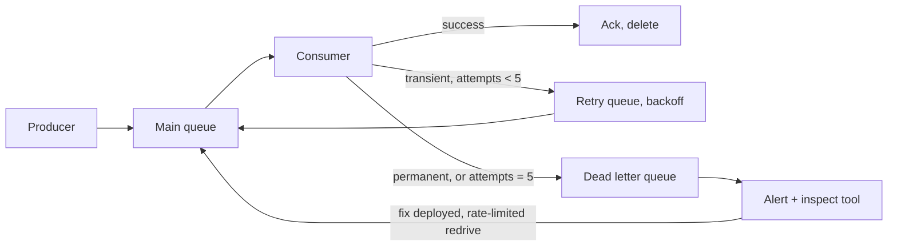

## In one minute
- A dead letter queue (DLQ) is where a messaging system puts messages that could not be processed after a bounded number of attempts.
- It stops a single bad message (a "poison pill") from blocking a queue or burning consumer capacity forever.
- A DLQ is only half a design: you also need alerting on it, tools to inspect messages, and a safe way to replay them.
- Separate *transient* failures (retry with backoff) from *permanent* ones (dead-letter immediately).
- An unwatched DLQ is silent data loss with extra steps.

## How it works

### Why messages fail repeatedly
Failures fall into two groups. *Transient*: a dependency timed out, a database was failing over, a rate limit hit. Retrying later usually succeeds. *Permanent*: malformed payload, schema version the consumer does not understand, a reference to an entity that does not exist, a bug triggered by specific data. Retrying a permanent failure only wastes capacity, and in an ordered queue it blocks everything behind it.

### Mechanics in common brokers
In SQS, each receive increments a message's receive count; when it exceeds `maxReceiveCount` the queue moves it to the configured DLQ, and a redrive operation can move messages back ([SQS dead-letter queues](https://docs.aws.amazon.com/AWSSimpleQueueService/latest/SQSDeveloperGuide/sqs-dead-letter-queues.html)). RabbitMQ routes rejected or expired messages to a dead letter exchange configured on the queue, with headers recording the reason and original queue. Watch the guarantee: classic queues republish dead letters without confirms, so a message can be lost if the target is unavailable, while quorum queues can dead-letter at least once ([RabbitMQ dead lettering](https://www.rabbitmq.com/docs/dlx)). Azure Service Bus has a built-in dead-letter subqueue per queue, with a reason and description; the default delivery limit is 10, and messages in the DLQ never expire, so someone must drain it ([Service Bus DLQ](https://learn.microsoft.com/en-us/azure/service-bus-messaging/service-bus-dead-letter-queues)).

Kafka consumer groups have no built-in DLQ because consumers own their offsets; frameworks and consumers publish failed records to a separate topic, often `orders.dlq`, then commit the offset and move on. Kafka Connect does this only for sink connectors ([Confluent: Kafka Connect concepts](https://docs.confluent.io/platform/current/connect/concepts.html)), and Kafka Streams gained DLQ support in its exception handlers in 4.2 ([Kafka 4.2 release](https://kafka.apache.org/blog/2026/02/17/apache-kafka-4.2.0-release-announcement/)). Kafka's newer share groups count deliveries per record, but a record that hits the limit (5 by default) or is rejected is simply archived; there is no DLQ for it yet ([KIP-932](https://cwiki.apache.org/confluence/display/KAFKA/KIP-932:+Queues+for+Kafka)).

### Retry tiers
A common pattern is a ladder: try inline a few times with short backoff; then publish to a retry topic or delayed queue (for example 1 minute, then 10 minutes, then 1 hour); then the DLQ. This keeps the main consumer fast while still giving transient failures room to recover. Each hop should carry metadata: original topic, partition and offset, attempt count, first failure time, last error class and message.

### Ordering
Moving a message aside breaks ordering for its key. If event 2 for order 42 is dead-lettered and event 3 is processed, state can go wrong. Options: accept it where events are independent; park *all* later messages for that key until the failed one is resolved; or design events as full-state snapshots so later ones supersede earlier ones.

### Replay
Replaying sends DLQ messages back to the main queue once the cause is fixed. It needs idempotent consumers, because some of these messages may have partially applied. It also needs rate limiting, because 2 million messages released at once can overload the system that just recovered.

## Down the stack

### Layer 1: The contract
In SQS, a received message becomes invisible for the visibility timeout; if the consumer does not delete it in time, it becomes visible again and its receive count rises. Once a receive would push the count past `maxReceiveCount`, the queue moves the message to the DLQ instead of delivering it. In RabbitMQ, a message is dead-lettered when it is rejected without requeue, expires by TTL, overflows a length limit, or exceeds a quorum queue's delivery limit. Since RabbitMQ 4.0 that limit defaults to 20, and without a dead-letter exchange the message is dropped, not parked ([RabbitMQ quorum queues](https://www.rabbitmq.com/docs/quorum-queues)). The DLQ itself promises nothing beyond storage: no alerting, no replay, no ordering relative to the source.

### Layer 2: The mechanism
An SQS queue's redrive policy is a small JSON document naming the DLQ's ARN and `maxReceiveCount`. Every receive returns a fresh *receipt handle*, which is what `DeleteMessage` and `ChangeMessageVisibility` need, so a slow consumer can extend its lease. Redrive back to the source is a message move task with an optional rate cap of at most 500 messages per second, and only one task can run per queue at a time ([StartMessageMoveTask](https://docs.aws.amazon.com/AWSSimpleQueueService/latest/APIReference/API_StartMessageMoveTask.html)). One quirk: on a standard queue with `maxReceiveCount` above 3, a message received 3 times without being deleted is moved to the back of the queue, so `ApproximateAgeOfOldestMessage` stops showing it. In RabbitMQ, queue arguments `x-dead-letter-exchange` and `x-dead-letter-routing-key` route dead messages, and each message gains an `x-death` header listing reason, source queue, count and time; quorum queues track a delivery count in their Raft log. Kafka has no broker-side DLQ because a partition is an append-only log: a consumer cannot skip one record and return to it later without committing past it. So frameworks copy the record to another topic: Kafka Connect with `errors.tolerance=all` and `errors.deadletterqueue.topic.name`, adding `__connect.errors.*` headers, or retry topics with suffixes such as `-retry-0`.

### Layer 3: The machine
Visibility is a per-message timestamp and receive count stored in a replicated backend, so each receive and delete is a network round trip of a few milliseconds. Poison messages often hurt more than they fail: a payload that triggers an out-of-memory error crashes the consumer process, and a JVM restart takes 10 to 30 seconds, so one bad message can take a consumer offline repeatedly until the count trips. SQS caps a message at 1 MiB including attributes (it was 256 KiB until August 2025), so a large payload plus a full stack trace can still fail to fit ([SQS quotas](https://docs.aws.amazon.com/AWSSimpleQueueService/latest/SQSDeveloperGuide/quotas-messages.html)); keep error metadata short and put big payloads in object storage with a pointer. Kafka DLQ topics keep the default 7-day retention unless changed, which is often shorter than the time it takes someone to notice ([Kafka topic configs](https://kafka.apache.org/42/configuration/topic-configs/)).

### Why it's built this way
1. A broker cannot tell a slow consumer from a dead one, so it uses leases and redelivers on timeout.
2. Redelivery of a message that always fails would loop forever, so brokers count receives and stop at a limit.
3. Logs cannot skip one entry and come back, so log-based systems copy failures to a separate topic and move on.
4. Failures that code cannot fix need humans, so dead messages must keep their context and live long enough to be triaged.
5. Recovery itself creates load spikes, so replay must be rate-limited.

## Diagram



## Worked example
An order service processes 3,000 messages per second from SQS. A deploy introduces a bug that fails on orders with a discount code, about 4% of traffic.

With `maxReceiveCount` 5 and a visibility timeout of 30 seconds, each failing message is received 5 times over about 2.5 minutes before landing in the DLQ. Failing traffic is 120 per second, but each consumes 5 attempts, so consumers spend 600 attempts per second, 20% of capacity, on doomed work. If the consumer fleet ran at 85% utilisation, the healthy traffic now queues and latency climbs.

The DLQ depth alarm (any message older than 5 minutes, or depth above 100) fires 3 minutes after the deploy. The team rolls back after 20 minutes: 120 x 1,200 seconds = 144,000 messages in the DLQ. They inspect a sample, confirm all share the error `DiscountNotFound`, deploy the fix, and redrive at 500 messages per second (the highest fixed rate SQS allows), taking about 5 minutes, while watching consumer error rates. Because order creation is idempotent on `order_id`, the few messages that had partially succeeded do not create duplicates.

Without a DLQ, those messages would have retried forever, consuming 20% of capacity until the fix, or been dropped by a catch-and-log handler.

## In the wild
- **Uber, 2018: retry topics and a DLQ so one failure does not block a partition.** Uber's insurance team, running the Driver Injury Protection program in more than 200 cities, found that while a handler kept failing the consumer would not commit a new offset, so the batches holding the bad messages stayed blocked. They moved failures to a chain of retry topics, each with a longer delay and its own consumers, ending in a DLQ topic that operators can list, purge, or merge back into the first retry topic without disturbing live traffic ([Uber Engineering](https://www.uber.com/US/en/blog/reliable-reprocessing/)).
- **GitHub, 2018: failed deliveries outlive their retention.** During a 24-hour degradation after a database failover, more than 5 million webhook events queued and about 200,000 webhook payloads passed their internal TTL and were dropped before delivery. Parked messages are only recoverable while they are still retained, so DLQ and backlog retention must be longer than the worst outage you plan for ([GitHub](https://github.blog/2018-10-30-oct21-post-incident-analysis/)).

## Trade-offs

| Option | Strengths | Weaknesses | Choose when |
| --- | --- | --- | --- |
| Broker-native DLQ (SQS, Service Bus) | Built in, automatic receive counting | Coarse: same retry policy for all errors | Simple queues with independent messages |
| Retry topics plus DLQ topic (Kafka) | Delayed retries without blocking partition | More topics, ordering per key is lost | High-throughput streams |
| Immediate DLQ for permanent errors | No wasted retries | Requires accurate error classification | Validation and schema failures |
| Block partition on failure | Preserves ordering | One bad message stalls everything | Strict ordering, low volume |
| Drop and log | Simplest | Silent data loss | Truly disposable messages only |

## Pitfalls in production
- **Nobody watches the DLQ.** Messages sit for weeks until retention deletes them. Alarm on depth and on age of oldest message, routed to the owning team.
- **DLQ retention shorter than source.** For standard queues SQS keeps the original enqueue timestamp, so a message near the end of its retention expires soon after landing; FIFO queues reset the timestamp on the move. Set DLQ retention longer than the source's, ideally the maximum.
- **Missing context.** A DLQ message with no error or origin cannot be triaged. Attach error class, stack summary, attempt count and source metadata.
- **Retrying permanent errors.** Malformed payloads burn retries. Classify exceptions and dead-letter non-retryable ones immediately.
- **Replaying everything at once.** The recovered system falls over again. Redrive with a rate limit and watch error rates.
- **Visibility timeout shorter than processing.** Healthy slow messages get redelivered, counted as failures, and dead-lettered. Set the timeout above p99 processing time, or extend it while working.

## Leadership lens
- Every queue gets a DLQ, an alarm and an owner on day one; make it part of the service template.
- Write the replay runbook before the first incident, including who approves redriving financial messages.
- Ask in review: which errors are retryable, and what happens to ordering when one message is set aside?
- Track DLQ inflow as a quality metric; a steady trickle usually means a contract mismatch between teams.

## Check yourself
1. Why should a schema validation error skip retries and go straight to the DLQ?
   **Answer:** It is permanent: the same payload will fail every time, so retries only waste capacity and delay other messages.
2. Why must consumers be idempotent before you redrive a DLQ?
   **Answer:** Some messages may have partially succeeded before failing, so reprocessing must not duplicate effects that already happened.
3. How can a too-short visibility timeout fill a DLQ with valid messages?
   **Answer:** Slow but healthy processing exceeds the timeout, the message is redelivered and its receive count climbs until it crosses the limit.

## Practice
**Task:** Model a queue with a dead letter queue. `DLQueue(max_receives)` supports `send(msg)`, `receive()` (returns the oldest available message or `None`, and increments its receive count), `ack(msg)` (done), and `nack(msg, retryable=True)`. A nacked message goes back to the end of the main queue, unless it is not retryable or its receive count has reached `max_receives`, in which case it moves to the DLQ. `dlq()` returns the DLQ contents in arrival order, and `redrive()` moves all of them back to the main queue with receive counts reset, returning how many moved.

```python starter
class DLQueue:
    def __init__(self, max_receives):
        pass

    def send(self, msg):
        raise NotImplementedError

    def receive(self):
        raise NotImplementedError

    def ack(self, msg):
        raise NotImplementedError

    def nack(self, msg, retryable=True):
        raise NotImplementedError

    def dlq(self):
        raise NotImplementedError

    def redrive(self):
        raise NotImplementedError
```

```python tests
def test_success_path():
    q = DLQueue(3)
    q.send("m1")
    m = q.receive()
    q.ack(m)
    assert q.receive() is None and q.dlq() == []

def test_dead_lettered_after_max_receives():
    q = DLQueue(3)
    q.send("bad")
    for _ in range(3):
        q.nack(q.receive())
    assert q.receive() is None
    assert q.dlq() == ["bad"]

def test_permanent_error_skips_retries():
    q = DLQueue(5)
    q.send("x")
    q.nack(q.receive(), retryable=False)
    assert q.dlq() == ["x"]

def test_retry_goes_to_back():
    q = DLQueue(5)
    q.send("a")
    q.send("b")
    q.nack(q.receive())
    assert q.receive() == "b"
    assert q.receive() == "a"

def test_redrive_resets_counts():
    q = DLQueue(1)
    q.send("p")
    q.nack(q.receive())
    assert q.redrive() == 1 and q.dlq() == []
    q.nack(q.receive())
    assert q.dlq() == ["p"]
```

```python solution
from collections import deque

class DLQueue:
    def __init__(self, max_receives):
        self.max = max_receives
        self.main = deque()
        self.dead = []
        self.counts = {}

    def send(self, msg):
        self.counts[msg] = 0
        self.main.append(msg)

    def receive(self):
        if not self.main:
            return None
        msg = self.main.popleft()
        self.counts[msg] += 1
        return msg

    def ack(self, msg):
        self.counts.pop(msg, None)

    def nack(self, msg, retryable=True):
        if not retryable or self.counts[msg] >= self.max:
            self.dead.append(msg)
        else:
            self.main.append(msg)

    def dlq(self):
        return list(self.dead)

    def redrive(self):
        n = len(self.dead)
        for msg in self.dead:
            self.send(msg)
        self.dead = []
        return n
```

```typescript starter
export class DLQueue {
  constructor(maxReceives: number) {}
  send(msg: string): void { throw new Error("TODO"); }
  receive(): string | null { throw new Error("TODO"); }
  ack(msg: string): void { throw new Error("TODO"); }
  nack(msg: string, retryable = true): void { throw new Error("TODO"); }
  dlq(): string[] { throw new Error("TODO"); }
  redrive(): number { throw new Error("TODO"); }
}
```

```typescript tests
test("success path", () => {
  const q = new DLQueue(3);
  q.send("m1");
  q.ack(q.receive()!);
  assertEqual(q.receive(), null);
  assertEqual(q.dlq(), []);
});
test("dead lettered after max receives", () => {
  const q = new DLQueue(3);
  q.send("bad");
  for (let i = 0; i < 3; i++) q.nack(q.receive()!);
  assertEqual(q.receive(), null);
  assertEqual(q.dlq(), ["bad"]);
});
test("permanent error skips retries", () => {
  const q = new DLQueue(5);
  q.send("x");
  q.nack(q.receive()!, false);
  assertEqual(q.dlq(), ["x"]);
});
test("retry goes to back", () => {
  const q = new DLQueue(5);
  q.send("a");
  q.send("b");
  q.nack(q.receive()!);
  assertEqual(q.receive(), "b");
  assertEqual(q.receive(), "a");
});
test("redrive resets counts", () => {
  const q = new DLQueue(1);
  q.send("p");
  q.nack(q.receive()!);
  assertEqual(q.redrive(), 1);
  assertEqual(q.dlq(), []);
  q.nack(q.receive()!);
  assertEqual(q.dlq(), ["p"]);
});
```

```typescript solution
export class DLQueue {
  private main: string[] = [];
  private dead: string[] = [];
  private counts = new Map<string, number>();
  constructor(private maxReceives: number) {}
  send(msg: string): void {
    this.counts.set(msg, 0);
    this.main.push(msg);
  }
  receive(): string | null {
    const msg = this.main.shift();
    if (msg === undefined) return null;
    this.counts.set(msg, (this.counts.get(msg) ?? 0) + 1);
    return msg;
  }
  ack(msg: string): void {
    this.counts.delete(msg);
  }
  nack(msg: string, retryable = true): void {
    if (!retryable || (this.counts.get(msg) ?? 0) >= this.maxReceives) this.dead.push(msg);
    else this.main.push(msg);
  }
  dlq(): string[] {
    return [...this.dead];
  }
  redrive(): number {
    const moved = this.dead;
    this.dead = [];
    moved.forEach((m) => this.send(m));
    return moved.length;
  }
}
```

```go starter
package practice

type DLQueue struct{}

func NewDLQueue(maxReceives int) *DLQueue { return &DLQueue{} }

func (q *DLQueue) Send(msg string) { panic("TODO") }

// Receive returns false when the main queue is empty.
func (q *DLQueue) Receive() (string, bool) { panic("TODO") }

func (q *DLQueue) Ack(msg string) { panic("TODO") }

func (q *DLQueue) Nack(msg string, retryable bool) { panic("TODO") }

func (q *DLQueue) DLQ() []string { panic("TODO") }

func (q *DLQueue) Redrive() int { panic("TODO") }
```

```go tests
package practice

import (
	"reflect"
	"testing"
)

func recv(t *testing.T, q *DLQueue) string {
	t.Helper()
	m, ok := q.Receive()
	if !ok {
		t.Fatal("queue unexpectedly empty")
	}
	return m
}

func TestSuccessPath(t *testing.T) {
	q := NewDLQueue(3)
	q.Send("m1")
	q.Ack(recv(t, q))
	if _, ok := q.Receive(); ok || len(q.DLQ()) != 0 {
		t.Fatal("expected empty queues")
	}
}

func TestMaxReceives(t *testing.T) {
	q := NewDLQueue(3)
	q.Send("bad")
	for i := 0; i < 3; i++ {
		q.Nack(recv(t, q), true)
	}
	if _, ok := q.Receive(); ok || !reflect.DeepEqual(q.DLQ(), []string{"bad"}) {
		t.Fatalf("dlq %v", q.DLQ())
	}
}

func TestPermanentError(t *testing.T) {
	q := NewDLQueue(5)
	q.Send("x")
	q.Nack(recv(t, q), false)
	if !reflect.DeepEqual(q.DLQ(), []string{"x"}) {
		t.Fatalf("dlq %v", q.DLQ())
	}
}

func TestRetryToBack(t *testing.T) {
	q := NewDLQueue(5)
	q.Send("a")
	q.Send("b")
	q.Nack(recv(t, q), true)
	if recv(t, q) != "b" || recv(t, q) != "a" {
		t.Fatal("wrong order")
	}
}

func TestRedrive(t *testing.T) {
	q := NewDLQueue(1)
	q.Send("p")
	q.Nack(recv(t, q), true)
	if q.Redrive() != 1 || len(q.DLQ()) != 0 {
		t.Fatal("redrive failed")
	}
	q.Nack(recv(t, q), true)
	if !reflect.DeepEqual(q.DLQ(), []string{"p"}) {
		t.Fatalf("dlq %v", q.DLQ())
	}
}
```

```go solution
package practice

type DLQueue struct {
	max    int
	main   []string
	dead   []string
	counts map[string]int
}

func NewDLQueue(maxReceives int) *DLQueue {
	return &DLQueue{max: maxReceives, counts: map[string]int{}}
}

func (q *DLQueue) Send(msg string) {
	q.counts[msg] = 0
	q.main = append(q.main, msg)
}

// Receive returns false when the main queue is empty.
func (q *DLQueue) Receive() (string, bool) {
	if len(q.main) == 0 {
		return "", false
	}
	msg := q.main[0]
	q.main = q.main[1:]
	q.counts[msg]++
	return msg, true
}

func (q *DLQueue) Ack(msg string) { delete(q.counts, msg) }

func (q *DLQueue) Nack(msg string, retryable bool) {
	if !retryable || q.counts[msg] >= q.max {
		q.dead = append(q.dead, msg)
	} else {
		q.main = append(q.main, msg)
	}
}

func (q *DLQueue) DLQ() []string { return append([]string{}, q.dead...) }

func (q *DLQueue) Redrive() int {
	moved := q.dead
	q.dead = nil
	for _, m := range moved {
		q.Send(m)
	}
	return len(moved)
}
```

## Mock interview
**Prompt:** An order pipeline consumes 3,000 messages per second. A bad deploy makes 4% of messages fail. Design the failure handling so healthy traffic is unaffected and no order is lost.

- Follow-up: How do you separate transient from permanent failures, and what does each path look like?
- Follow-up: Messages for the same order must apply in sequence. What changes?
- Follow-up: The fix is deployed and 150,000 messages wait in the DLQ. How do you replay safely?

**A strong answer covers:**
- Bounded retries with backoff, then DLQ, with error classification.
- Capacity math for wasted retries and its effect on healthy latency.
- Alarms on DLQ depth and age, plus ownership and runbooks.
- Ordering options per key: accept, park the key, or use state snapshots.
- Idempotent consumers and rate-limited redrive.

## Sources and further study
**Primary**
- [KIP-932: Queues for Kafka](https://cwiki.apache.org/confluence/display/KAFKA/KIP-932:+Queues+for+Kafka): delivery counts, the REJECT outcome and archiving, Kafka's first broker-side poison-message limit.
- [Apache Kafka 4.2.0 release announcement](https://kafka.apache.org/blog/2026/02/17/apache-kafka-4.2.0-release-announcement/): DLQ support in Kafka Streams exception handlers.

**Systems docs**
- [RabbitMQ: Dead lettering](https://www.rabbitmq.com/docs/dlx): the four dead-letter reasons, the `x-death` header, and at-most-once versus at-least-once dead-lettering.
- [RabbitMQ: Quorum queues](https://www.rabbitmq.com/docs/quorum-queues): delivery limits and why 4.0 set a default of 20.
- [Amazon SQS: StartMessageMoveTask](https://docs.aws.amazon.com/AWSSimpleQueueService/latest/APIReference/API_StartMessageMoveTask.html): redrive destinations, rate limits and one task per queue.
- [Confluent: Kafka Connect concepts](https://docs.confluent.io/platform/current/connect/concepts.html): `errors.tolerance`, the sink-only DLQ topic and error-context headers.

**Books**
- *Designing Data-Intensive Applications* (2nd ed.), Martin Kleppmann and Chris Riccomini, Ch 12 "Stream Processing": how log-based brokers handle a message a consumer cannot process.
- *Release It!* (2nd ed.), Michael T. Nygard, Ch 5 "Stability Patterns": timeouts, circuit breakers, bulkheads and fail fast, the habits that keep one bad input from becoming an outage.

**Other curricula**
- [Azure Architecture Center: Competing Consumers pattern](https://learn.microsoft.com/en-us/azure/architecture/patterns/competing-consumers): frames poison-message detection as a core consideration and points to dead-lettering after `MaxDeliveryCount`.
- [Azure Architecture Center: Idempotent Consumer pattern](https://learn.microsoft.com/en-us/azure/architecture/patterns/idempotent-consumer): reminds you that DLQ resubmissions arrive long after the normal redelivery window, so dedupe records must outlast them.

## Watch
- [Dead Letter Queues - System Design (Greg Hogg)](https://www.youtube.com/watch?v=7qPO2sO4SCg): what DLQs are for and how they fit a queue design.
- [Errors and Dead Letter Queues, Kafka Connect 101 (Confluent)](https://www.youtube.com/watch?v=GWBk9LIzy-A): DLQ handling in a Kafka pipeline.

## Free resources
- [Amazon SQS dead-letter queues](https://docs.aws.amazon.com/AWSSimpleQueueService/latest/SQSDeveloperGuide/sqs-dead-letter-queues.html): receive counts, redrive and retention caveats.
- [Azure Service Bus dead-letter queues](https://learn.microsoft.com/en-us/azure/service-bus-messaging/service-bus-dead-letter-queues): dead-letter reasons and subqueue behaviour.
- [Dead Letter Channel (Enterprise Integration Patterns)](https://www.enterpriseintegrationpatterns.com/patterns/messaging/DeadLetterChannel.html): the original pattern description.
- [Avoiding insurmountable queue backlogs (AWS Builders' Library)](https://aws.amazon.com/builders-library/avoiding-insurmountable-queue-backlogs/): poison messages, backlogs and recovery.
