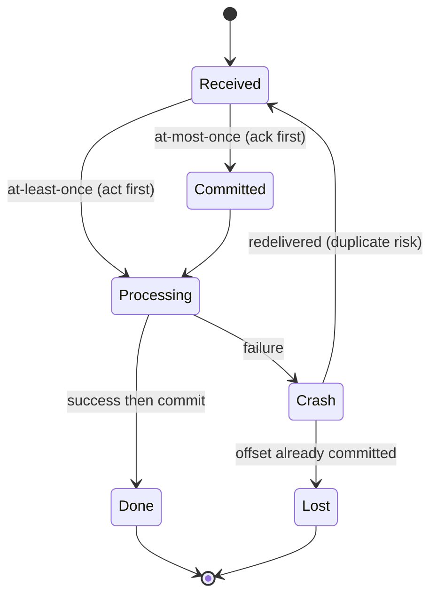

## In one minute
- Delivery semantics describe how many times a message's *effect* can happen when producers, brokers and consumers fail: at most once, at least once, or exactly once.
- They are decided by *when you acknowledge relative to when you act*: ack first gives at most once, act first gives at least once.
- Exactly-once *delivery* over an unreliable network is impossible; exactly-once *effect* is achievable by making processing idempotent or transactional.
- Most production systems run at-least-once delivery plus idempotent consumers, which is often called "effectively once".
- The semantics apply per hop; an end-to-end guarantee is only as strong as its weakest hop.

## How it works

### Why duplicates and losses happen
A producer sends a message and the acknowledgement is lost. It cannot tell whether the broker stored the message, so it must either retry (risking a duplicate) or give up (risking a loss). The same dilemma repeats between broker and consumer: the consumer processes a message and crashes before committing its offset or acking. On restart, the broker redelivers. No protocol over a lossy channel can remove this ambiguity; it can only choose which side to err on. This is the [Two Generals' Problem](https://en.wikipedia.org/wiki/Two_Generals%27_Problem) in miniature.

### At most once
The consumer commits or acks *before* processing. If it crashes mid-processing, the message is gone. Producers send without retries. This is acceptable for metrics samples, telemetry and cache invalidation hints where a missing message is cheaper than a duplicate or extra latency.

### At least once
The consumer processes *then* commits. A crash between the two causes redelivery and reprocessing. Producers retry until acknowledged. Nothing is lost, but every downstream effect must tolerate repeats. This is the default in SQS, RabbitMQ with manual acks, and Kafka with commit-after-processing.

Defaults move, so check the version you run. Kafka producers used to default to `acks=1` with idempotence off, which could lose a write on leader failover and duplicate one on retry. KIP-679 changed the defaults to `acks=all` and `enable.idempotence=true` for Kafka 3.0, but a config-validation bug kept idempotence off until 3.0.1, 3.1.1 and 3.2.0 ([KAFKA-13598](https://issues.apache.org/jira/browse/KAFKA-13598)). It is still switched off silently if you set a conflicting `acks`, `retries` or `max.in.flight.requests.per.connection` without enabling it explicitly ([Kafka producer configs](https://kafka.apache.org/42/configuration/producer-configs/)). Set it explicitly.

### Exactly-once effect
Two techniques get you there:

1. **Idempotent processing.** Give each message a stable id (generated by the producer, not the broker) and record processed ids in the same transaction as the side effect. A redelivered message finds its id and is skipped. Alternatively make the operation naturally idempotent: `SET balance = 50` instead of `ADD 10`, upserts keyed by business id.
2. **Transactions spanning input and output.** Kafka's idempotent producer (sequence numbers per partition so the broker drops retried duplicates) plus transactions let a consume-transform-produce job write output records and commit input offsets atomically ([KIP-98](https://cwiki.apache.org/confluence/display/KAFKA/KIP-98+-+Exactly+Once+Delivery+and+Transactional+Messaging)). Downstream readers with `read_committed` never see aborted output. This covers Kafka-to-Kafka only; the moment you call an external API or database, you are back to idempotency.

### The outbox problem
A service must update its database *and* publish an event. Doing both directly risks one succeeding without the other. The transactional outbox writes the event into an outbox table in the same database transaction, and a relay publishes it afterwards, at least once ([microservices.io](https://microservices.io/patterns/data/transactional-outbox.html)). Consumers deduplicate by event id.

## Down the stack

### Layer 1: The contract
Each system states its guarantee per hop. A Kafka producer with `acks=all` gets an acknowledgement only after every in-sync replica has the record, and with `min.insync.replicas=2` an acknowledged write survives the loss of any one broker; if the in-sync set shrinks below that, the producer gets `NotEnoughReplicas` instead of a weak ack ([Kafka topic configs](https://kafka.apache.org/42/configuration/topic-configs/)). A committed consumer offset means "everything before this has been handled"; on restart, consumption resumes exactly there. SQS standard queues promise at-least-once delivery and best-effort ordering; SQS FIFO queues drop a message whose deduplication id was seen in the previous 5 minutes ([SQS exactly-once processing](https://docs.aws.amazon.com/AWSSimpleQueueService/latest/SQSDeveloperGuide/FIFO-queues-exactly-once-processing.html)).

Read "exactly once" labels closely. Google Pub/Sub's exactly-once delivery promises no redelivery before the ack deadline and none after a successful ack, but a publisher that sends twice still produces two messages with different IDs ([Pub/Sub API reference](https://docs.cloud.google.com/pubsub/docs/reference/rest/v1/projects.subscriptions)). None of these promises extends past the system boundary to your database or an email provider.

### Layer 2: The mechanism
Kafka's idempotent producer is assigned a producer id and epoch, and numbers each batch per partition. The partition leader remembers the last five batch sequences per producer, which is why idempotence requires at most 5 in-flight requests per connection; a retried batch with a known sequence is acknowledged without being written again, and a gap raises an out-of-order error. Transactions add a coordinator that logs state in the internal `__transaction_state` topic. The producer registers partitions with `AddPartitionsToTxn`, adds the consumed offsets with `sendOffsetsToTransaction` (so offset commits to `__consumer_offsets` join the transaction), and on commit the coordinator writes COMMIT or ABORT control markers into every touched partition. A `read_committed` consumer reads only up to the last stable offset, holding back records from open transactions. On the consumer side, the dedup pattern is a unique index: the insert of the event id fails or succeeds atomically with the business update.

### Layer 3: The machine
`acks=all` costs a replication round trip inside the cluster, typically 1 to 3 ms. Kafka does not `fsync` per message by default; durability comes from replicas holding the data in their page caches, and the OS flushes to disk later. That trade is safe only while replicas fail independently. NATS JetStream makes a similar one, acknowledging at once but flushing about every two minutes by default, and Jepsen showed that a simulated power loss then drops acknowledged writes ([Jepsen: NATS 2.12.1](https://jepsen.io/analyses/nats-2.12.1)). Transactions add control records and coordinator round trips per commit, which is why stream processors commit every 100 ms or so and accept that much extra latency. In PostgreSQL, the dedup insert touches a B-tree index page and appends a WAL record; the commit waits for the WAL `fsync`, around 0.1 to 1 ms on an SSD, and group commit lets many concurrent transactions share one flush. That is why batching 100 events per transaction raises throughput by an order of magnitude.

### Why it's built this way
1. Networks lose acknowledgements, so senders retry, and retries create duplicates; no protocol avoids this.
2. Machines crash between acting and recording, so the order of "act" and "ack" chooses between loss and duplication.
3. A broker can only deduplicate what it can identify, so producers carry ids and sequence numbers.
4. External systems cannot join a broker's transaction, so exactly-once effects end up implemented at the sink with idempotency.
5. Remembering every id forever is too expensive, so dedup state is windowed, and the window bounds the guarantee.

## Diagram



## Worked example
A payments ledger consumes 5,000 `PaymentCaptured` events per second from Kafka and credits merchant balances in PostgreSQL.

Consumers commit offsets every 5 seconds. A consumer crashing just before a commit has processed up to 5 seconds of its partition's events, say 500 events if it owns 10% of traffic, which will all be redelivered to the new owner after rebalance. Without deduplication, 500 merchants get double credits. During a rolling deploy of 20 consumers, that could happen 20 times.

Fix: the consumer runs, per event, a single transaction:

```sql
BEGIN;
INSERT INTO processed_events (event_id) VALUES ($1)
  ON CONFLICT DO NOTHING;            -- 0 rows means duplicate: ROLLBACK and skip
UPDATE balances SET amount = amount + $2 WHERE merchant_id = $3;
COMMIT;
```

The `processed_events` table grows by 432 million rows a day, so it is partitioned by day and partitions older than 7 days are dropped. That is safe only because Kafka redelivery can never reach back further than the consumer's committed offset plus the commit interval, and producer retries settle within minutes. The extra insert adds about 0.3 ms per event; batching 100 events per transaction keeps throughput well above 5,000 per second.

## In the wild
- **Jepsen, 2013: Kafka acknowledges writes it then loses.** When the in-sync replica set shrank to just the leader, the leader kept acknowledging writes held only on its own disk, and a lagging replica could later be elected leader. In one run 520 of 987 acknowledged writes, about 53%, were lost. Kafka later added `min.insync.replicas` and a switch to disable unclean leader election, which is why `acks=all` alone is not the whole contract ([Jepsen](https://aphyr.com/posts/293-call-me-maybe-kafka)).
- **Jepsen, 2022: Redpanda duplicates and reorders under retries.** With server-side idempotence off by default, producer retries wrote duplicates, and some duplicates appeared even with it on. Uncommitted Raft entries were applied early, so messages were reordered or landed at more than one offset, and some acknowledged messages never showed up. Several issues were fixed in 21.10.2 through 21.11.15, the duplicate-writes-by-default fix was slated for 22.1.1, and others stayed open ([Jepsen](https://jepsen.io/analyses/redpanda-21.10.1)).
- **Jepsen, 2025: NATS JetStream loses acknowledged writes on power loss.** JetStream acknowledges a publish immediately but by default flushes to disk only about every two minutes. In a simulated power failure Jepsen lost 131,418 of 930,005 acknowledged messages, about 30 seconds of writes, and corrupted data files caused much larger losses. NATS chose to document the risk rather than change the default ([Jepsen](https://jepsen.io/analyses/nats-2.12.1)).

## Trade-offs

| Option | Strengths | Weaknesses | Choose when |
| --- | --- | --- | --- |
| At most once | Simplest, lowest latency | Silent loss on crash | Telemetry, best-effort notifications |
| At least once | No loss, simple to run | Duplicates must be handled | Default for most pipelines |
| At least once + idempotent consumer | Exactly-once effect, works with any sink | Dedup storage and key design | Money, inventory, anything counted |
| Broker transactions (Kafka EOS) | Atomic read-process-write within Kafka | Only covers Kafka, adds latency | Stream processing between topics |

## Pitfalls in production
- **Broker-generated ids for dedup.** A producer retry creates a new broker id, so dedup misses it. Use an id assigned by the producer or derived from the business event.
- **Dedup check outside the transaction.** Check-then-act races let two consumers both apply. Insert the id and apply the effect in one transaction, or use a unique constraint.
- **Dedup window shorter than redelivery window.** Old duplicates slip through after the id expires. Size retention from the maximum redelivery delay, including DLQ replays.
- **Side effects that cannot be deduplicated.** Emails and third-party API calls. Pass an idempotency key to the third party or record the send before acking.
- **Believing "exactly once" marketing.** It usually holds only inside one system. Trace each hop and write down its guarantee.

## Leadership lens
- Make "what happens if this message is processed twice?" a standard design review question.
- Standardise event envelopes with a producer-assigned id, timestamp and schema version.
- Prefer at-least-once with idempotency over distributed transactions; it composes across systems.
- Budget the storage and latency of dedup tables explicitly.

## Check yourself
1. Why is exactly-once delivery impossible but exactly-once processing possible?
   **Answer:** A sender cannot distinguish a lost message from a lost ack, so it must risk duplicates or loss. The receiver can, however, detect and discard duplicates so the effect happens once.
2. Why must the dedup record and the side effect share a transaction?
   **Answer:** Otherwise a crash between them either applies the effect without recording it, causing a later duplicate, or records it without applying, causing a loss.
3. Does Kafka's exactly-once mode protect a consumer that writes to an external database?
   **Answer:** No. It only makes Kafka reads and writes atomic together; the external write needs its own idempotency.

## Practice
**Task:** Simulate one consumer crash under different semantics. `simulate(log, crash_at, mode)` processes message ids in `log` from committed offset 0, appending each applied message to an effects list. In `"at_most_once"` it commits offset `i + 1` before applying message `i`; in `"at_least_once"` and `"effectively_once"` it applies and then commits. When `i == crash_at` on the first run, it crashes at the point between the two steps, then restarts from the committed offset and runs to the end without crashing. In `"effectively_once"`, applying records the id atomically and skips ids already recorded. Return the effects list.

```python starter
def simulate(log, crash_at, mode):
    # TODO
    raise NotImplementedError
```

```python tests
LOG = ["a", "b", "c"]

def test_no_crash():
    for mode in ("at_most_once", "at_least_once", "effectively_once"):
        assert simulate(LOG, None, mode) == ["a", "b", "c"]

def test_at_most_once_loses():
    assert simulate(LOG, 1, "at_most_once") == ["a", "c"]

def test_at_least_once_duplicates():
    assert simulate(LOG, 1, "at_least_once") == ["a", "b", "b", "c"]

def test_effectively_once():
    assert simulate(LOG, 1, "effectively_once") == ["a", "b", "c"]

def test_producer_duplicate_in_log():
    assert simulate(["a", "a", "b"], None, "at_least_once") == ["a", "a", "b"]
    assert simulate(["a", "a", "b"], 0, "effectively_once") == ["a", "b"]
```

```python solution
def simulate(log, crash_at, mode):
    effects, seen = [], set()
    committed = 0

    def apply(msg):
        if mode == "effectively_once":
            if msg in seen:
                return
            seen.add(msg)
        effects.append(msg)

    for attempt in (1, 2):
        i = committed
        crashed = False
        while i < len(log):
            if mode == "at_most_once":
                committed = i + 1
                if attempt == 1 and i == crash_at:
                    crashed = True
                    break
                apply(log[i])
            else:
                apply(log[i])
                if attempt == 1 and i == crash_at:
                    crashed = True
                    break
                committed = i + 1
            i += 1
        if not crashed:
            break
    return effects
```

```typescript starter
export type Mode = "at_most_once" | "at_least_once" | "effectively_once";

export function simulate(log: string[], crashAt: number | null, mode: Mode): string[] {
  throw new Error("TODO");
}
```

```typescript tests
const LOG = ["a", "b", "c"];
test("no crash", () => {
  for (const m of ["at_most_once", "at_least_once", "effectively_once"] as Mode[]) {
    assertEqual(simulate(LOG, null, m), ["a", "b", "c"]);
  }
});
test("at most once loses", () => {
  assertEqual(simulate(LOG, 1, "at_most_once"), ["a", "c"]);
});
test("at least once duplicates", () => {
  assertEqual(simulate(LOG, 1, "at_least_once"), ["a", "b", "b", "c"]);
});
test("effectively once", () => {
  assertEqual(simulate(LOG, 1, "effectively_once"), ["a", "b", "c"]);
});
test("producer duplicate in log", () => {
  assertEqual(simulate(["a", "a", "b"], null, "at_least_once"), ["a", "a", "b"]);
  assertEqual(simulate(["a", "a", "b"], 0, "effectively_once"), ["a", "b"]);
});
```

```typescript solution
export type Mode = "at_most_once" | "at_least_once" | "effectively_once";

export function simulate(log: string[], crashAt: number | null, mode: Mode): string[] {
  const effects: string[] = [];
  const seen = new Set<string>();
  let committed = 0;
  const apply = (m: string) => {
    if (mode === "effectively_once") {
      if (seen.has(m)) return;
      seen.add(m);
    }
    effects.push(m);
  };
  for (const attempt of [1, 2]) {
    let crashed = false;
    for (let i = committed; i < log.length; i++) {
      const crashHere = attempt === 1 && i === crashAt;
      if (mode === "at_most_once") {
        committed = i + 1;
        if (crashHere) { crashed = true; break; }
        apply(log[i]);
      } else {
        apply(log[i]);
        if (crashHere) { crashed = true; break; }
        committed = i + 1;
      }
    }
    if (!crashed) break;
  }
  return effects;
}
```

```go starter
package practice

// Simulate uses crashAt = -1 for "no crash".
func Simulate(log []string, crashAt int, mode string) []string {
	panic("TODO")
}
```

```go tests
package practice

import (
	"reflect"
	"testing"
)

var lg = []string{"a", "b", "c"}

func eq(t *testing.T, got, want []string) {
	t.Helper()
	if !reflect.DeepEqual(got, want) {
		t.Fatalf("got %v, want %v", got, want)
	}
}

func TestNoCrash(t *testing.T) {
	for _, m := range []string{"at_most_once", "at_least_once", "effectively_once"} {
		eq(t, Simulate(lg, -1, m), []string{"a", "b", "c"})
	}
}

func TestAtMostOnceLoses(t *testing.T)  { eq(t, Simulate(lg, 1, "at_most_once"), []string{"a", "c"}) }
func TestAtLeastOnceDups(t *testing.T)  { eq(t, Simulate(lg, 1, "at_least_once"), []string{"a", "b", "b", "c"}) }
func TestEffectivelyOnce(t *testing.T)  { eq(t, Simulate(lg, 1, "effectively_once"), []string{"a", "b", "c"}) }

func TestProducerDuplicate(t *testing.T) {
	eq(t, Simulate([]string{"a", "a", "b"}, -1, "at_least_once"), []string{"a", "a", "b"})
	eq(t, Simulate([]string{"a", "a", "b"}, 0, "effectively_once"), []string{"a", "b"})
}
```

```go solution
package practice

// Simulate uses crashAt = -1 for "no crash".
func Simulate(log []string, crashAt int, mode string) []string {
	effects := []string{}
	seen := map[string]bool{}
	committed := 0
	apply := func(m string) {
		if mode == "effectively_once" {
			if seen[m] {
				return
			}
			seen[m] = true
		}
		effects = append(effects, m)
	}
	for attempt := 1; attempt <= 2; attempt++ {
		crashed := false
		for i := committed; i < len(log); i++ {
			crashHere := attempt == 1 && i == crashAt
			if mode == "at_most_once" {
				committed = i + 1
				if crashHere {
					crashed = true
					break
				}
				apply(log[i])
			} else {
				apply(log[i])
				if crashHere {
					crashed = true
					break
				}
				committed = i + 1
			}
		}
		if !crashed {
			break
		}
	}
	return effects
}
```

## Mock interview
**Prompt:** Design the pipeline that turns 5,000 payment events per second into merchant balance updates and payout emails. Finance requires that no payment is lost or counted twice.

- Follow-up: A consumer crashes during a rebalance. Trace exactly which events are redelivered.
- Follow-up: How long must you keep deduplication records, and what sets that bound?
- Follow-up: Why not rely on Kafka's exactly-once transactions end to end?

**A strong answer covers:**
- At-least-once delivery everywhere, with producer-assigned event ids.
- Dedup insert and balance update in one database transaction.
- Transactional outbox for publishing events from the payment service.
- Dedup retention sized from commit interval, retries and replay windows.
- Idempotency keys for external side effects like email and payout APIs.

## Sources and further study
**Primary**
- [KIP-98: Exactly once delivery and transactional messaging](https://cwiki.apache.org/confluence/display/KAFKA/KIP-98+-+Exactly+Once+Delivery+and+Transactional+Messaging): the design of producer ids, epochs, sequence numbers and transaction markers.
- [KAFKA-13598: idempotent producer not enabled by default](https://issues.apache.org/jira/browse/KAFKA-13598): the bug that kept Kafka 3.0's new default from taking effect, and the versions that fixed it.
- [Jepsen: NATS 2.12.1 (2025)](https://jepsen.io/analyses/nats-2.12.1): what an acknowledgement is worth when the broker flushes lazily.

**Systems docs**
- [Apache Kafka producer configuration](https://kafka.apache.org/42/configuration/producer-configs/): `acks`, `enable.idempotence` and the in-flight limit, with the rules for when idempotence turns itself off.
- [Amazon SQS: exactly-once processing](https://docs.aws.amazon.com/AWSSimpleQueueService/latest/SQSDeveloperGuide/FIFO-queues-exactly-once-processing.html): FIFO deduplication ids and the 5-minute interval.
- [Google Pub/Sub subscription API reference](https://docs.cloud.google.com/pubsub/docs/reference/rest/v1/projects.subscriptions): what its exactly-once delivery flag does and does not cover.

**Books**
- *Designing Data-Intensive Applications* (2nd ed.), Martin Kleppmann and Chris Riccomini, Ch 12 "Stream Processing" and Ch 13 "A Philosophy of Streaming Systems": fault tolerance in stream processors and the "Aiming for Correctness" argument for end-to-end idempotence.
- *Understanding Distributed Systems* (2nd ed.), Roberto Vitillo, chapter "Asynchronous transactions": keeping services consistent over messaging when a distributed transaction is not an option.

**Other curricula**
- [Azure Architecture Center: Idempotent Consumer pattern](https://learn.microsoft.com/en-us/azure/architecture/patterns/idempotent-consumer): treats at-least-once delivery as a given and puts deduplication in the consumer.
- [donnemartin/system-design-primer](https://github.com/donnemartin/system-design-primer): mentions only that SQS may deliver a message twice; it does not cover delivery semantics as a topic.

## Watch
- [Kafka Delivery Semantics (Irtiza Hafiz)](https://www.youtube.com/watch?v=V0c0qAP7sWk): at-most, at-least and exactly once in Kafka terms.
- [Kafka - Exactly once semantics with Matthias J. Sax (The Geek Narrator)](https://www.youtube.com/watch?v=twgbAL_EaQw): a Kafka committer on how EOS really works.

## Free resources
- [Kafka documentation: message delivery semantics](https://kafka.apache.org/documentation/#semantics): official explanation of each guarantee in Kafka.
- [Exactly-once semantics in Apache Kafka (Confluent)](https://www.confluent.io/blog/exactly-once-semantics-are-possible-heres-how-apache-kafka-does-it/): idempotent producers and transactions.
- [Transactional outbox (microservices.io)](https://microservices.io/patterns/data/transactional-outbox.html): publishing events reliably from a database transaction.
- [Making retries safe with idempotent APIs (AWS Builders' Library)](https://aws.amazon.com/builders-library/making-retries-safe-with-idempotent-APIs/): idempotency design at AWS.
- [Two Generals' Problem (Wikipedia)](https://en.wikipedia.org/wiki/Two_Generals%27_Problem): why the ambiguity cannot be removed.
