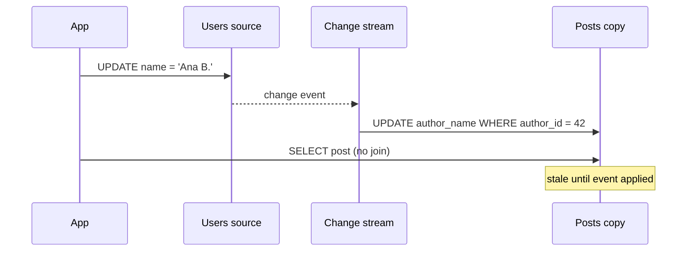

## In one minute
- Denormalization stores the same fact in more than one place so reads avoid joins, aggregations, or cross-service calls.
- You trade write cost and consistency risk for read speed: every copy must be updated when the source changes, and copies can drift.
- Common forms: duplicated columns (author name on each post), precomputed aggregates (comment count), embedded documents, and read-optimized tables keyed by query.
- Do it for measured, hot read paths. Keep a single source of truth and a repair path for every copy.

## How it works

### Why normalize in the first place
A normalized schema stores each fact once, an idea that goes back to Codd's relational model, which treated redundancy and the inconsistency it invites as problems for the schema to remove ([Codd, 1970](https://www.seas.upenn.edu/~zives/03f/cis550/codd.pdf)). Updates touch one row, and anomalies (two addresses for the same customer) cannot happen. The price is paid at read time: a product page may join six tables, and an aggregate like "followers" scans an index on every view.

### What denormalizing changes
You move work from read time to write time. Instead of joining `posts` to `users` for the author name, you copy `author_name` into `posts`. Instead of `COUNT(*)` over `comments`, you keep `comment_count` on the post. The read becomes a single-row lookup. Each write now has a fan-out: renaming a user updates every post they wrote, and adding a comment increments a counter.

### Keeping copies in step
There are three main strategies, in decreasing order of consistency.

1. **Same transaction.** Update the source and copies atomically. Strong, but only works inside one database, and hot counters create lock contention.
2. **Change-driven async update.** Write the source, then propagate via triggers, change data capture, or events. Readers see stale copies for milliseconds to seconds.
3. **Periodic rebuild.** Recompute copies in batch. Simple and self-healing, but staleness is measured in minutes or hours.

Most real systems combine an async path for freshness with a periodic reconciliation job that detects and repairs drift. Facebook's TAO stores every two-way graph edge as two denormalized rows on two shards; it writes them without a shared transaction, so a crash can leave one side missing, and an asynchronous job repairs these "hanging" edges ([Bronson et al., USENIX ATC 2013](https://www.usenix.org/system/files/conference/atc13/atc13-bronson.pdf)).

### In NoSQL stores
Key-value and wide-column stores (DynamoDB, Cassandra) offer no joins, so denormalization is the default design method. You list the access patterns before designing anything, then shape items so each pattern is one query on a table or index, with data duplicated as needed. Current DynamoDB guidance no longer treats one single table as the only right answer: it puts entities that are read together in one table and splits ones with independent access patterns ([DynamoDB docs](https://docs.aws.amazon.com/amazondynamodb/latest/developerguide/bp-modeling-nosql.html)).

## Down the stack

### Layer 1: The contract
A denormalized design promises: the source table is authoritative; each copy equals the source within a stated staleness budget (zero for same-transaction updates, seconds for change-driven updates, hours for batch rebuilds); and any drift is detected and repaired within a stated window. Readers of a copy get no guarantee that two copies agree with each other at the same instant. If you cannot state these three numbers for a field, the design is not finished.

### Layer 2: The mechanism
Same-transaction copies use application code or a trigger, for example an `AFTER UPDATE OF name ON users FOR EACH ROW` trigger that runs `UPDATE posts SET author_name = NEW.name WHERE author_id = NEW.id`. Change-driven copies usually read the write-ahead log: Debezium attaches to a PostgreSQL logical replication slot (`pgoutput` plugin) and emits events with `before`, `after`, and the source LSN ([Debezium docs](https://debezium.io/documentation/reference/stable/connectors/postgresql.html)). The consumer applies them conditionally, `UPDATE posts SET author_name = $1, author_ver = $2 WHERE author_id = $3 AND author_ver < $2`, so replays and reordered events cannot roll a copy backwards. Deletes need the same care: keep a versioned tombstone for a while, or a delayed older update can recreate a row the source already removed ([Azure Architecture Center](https://learn.microsoft.com/en-us/azure/architecture/patterns/index-table)). Counters use atomic increments (`SET like_count = like_count + 1`, or DynamoDB `UpdateItem` with `ADD`), and hot counters split into N sub-rows chosen at random and summed on read. An increment is atomic but not idempotent: a client that retries after a timeout may count twice. Where that matters, use a conditional write or record the event id with the increment ([DynamoDB docs](https://docs.aws.amazon.com/amazondynamodb/latest/developerguide/WorkingWithItems.html)).

### Layer 3: The machine
In PostgreSQL every `UPDATE` writes a new tuple version, not an in-place change. If no indexed column changes and the page has free space, it is a heap-only tuple (HOT) update; otherwise every index on the table gets a new entry too ([Postgres docs](https://www.postgresql.org/docs/current/storage-hot.html)). Index a denormalized column and its updates can never be HOT. Each version also produces a WAL record, typically 100 to 300 bytes, and the commit waits for an `fsync` of the WAL, roughly 50 µs to 1 ms on SSDs. A single hot counter row therefore serializes on its row lock and on commit latency, capping it at a few thousand increments per second before group commit helps. Renaming a prolific user with 200,000 posts writes 200,000 new tuples, around 40 MB of heap plus WAL that every replica must replay. On the read side, a page of 50 posts with the author embedded is one index range scan touching 2 or 3 pages, while the join version may touch 50 more pages in `users`, each a random read if not cached.

### Why it's built this way
1. Reads often outnumber writes 100 to 1 or more ([system-design-primer](https://github.com/donnemartin/system-design-primer)) and joins cost random page reads, so precomputing the answer on write is cheaper overall.
2. Every copy must change when the source changes, so writes get amplified by the fan-out.
3. Updating copies in the same transaction holds locks across many rows, so large fan-outs move to an asynchronous path.
4. Asynchronous paths can lose, duplicate, or reorder events, so updates carry versions and a reconciliation job repairs drift.
5. One row cannot absorb unlimited writes, so hot aggregates are sharded or batched.

## Diagram


## Worked example
A social feed renders 50 posts per page at 20,000 page views per second. Normalized, each page joins `posts`, `users`, and counts `likes` and `comments`: roughly 1 million row reads per second for counts alone, and P99 is 180 ms.

After denormalizing, each post row carries `author_name`, `author_avatar`, `like_count`, and `comment_count`. A page is one range read of 50 rows, and P99 drops to 15 ms. The write side changes:

- Likes arrive at 5,000 per second. Incrementing one row per like serializes on hot posts; a viral post can take 500 likes per second. The fix is sharded counters (10 sub-rows summed on read) or buffered increments flushed every second.
- A rename fans out to every post by that user. An average user has 300 posts, a prolific one 200,000. Renames are rare, so an async job batching 1,000 rows per transaction is fine.
- A nightly reconciliation recomputes counts for posts touched in the last day and fixes any that drifted.

## In the wild
- **Slack, 2022: a lookup sharded the wrong way turns into a scatter query.** On 22 February a gradual Consul upgrade emptied part of the memcached tier. Group DM membership was cached by channel but stored in Vitess sharded by user, so every cache miss became a query sent to every shard. The database overloaded, could not refill the cache, and many users could not load Slack. The fix pointed the query at an existing table of the same membership sharded by channel, a copy keyed the way the query reads it ([Slack](https://slack.engineering/slacks-incident-on-2-22-22/)).
- **Facebook, 2013: denormalized graph edges with a repair job.** TAO serves the social graph at about a billion reads and millions of writes per second. Each two-way relationship is stored as a forward and an inverse edge on different shards, plus cached per-type counts. The two writes are not atomic, so TAO accepts temporary drift and runs an asynchronous repair job, the same source-plus-reconciliation shape this lesson recommends ([USENIX ATC 2013](https://www.usenix.org/system/files/conference/atc13/atc13-bronson.pdf)).
- **Instacart, 2025: denormalized search documents cost 10x the writes.** Instacart's search index in Elasticsearch held denormalized product documents, so billions of price and inventory changes became partial document rewrites, and fixing bad data could take days. Moving to a normalized model in Postgres cut the write workload by 10x and made search about twice as fast ([Instacart](https://company.instacart.com/tech-innovation/how-instacart-built-a-modern-search-infrastructure-on-postgres)).

## Trade-offs
| Option | Strengths | Weaknesses | Choose when |
|---|---|---|---|
| Fully normalized | One source of truth, cheap writes | Joins and aggregates at read time | Write-heavy, or reads are already fast |
| Duplicated columns | Removes joins on hot reads | Fan-out on update, drift | Source rarely changes, read often |
| Precomputed aggregates | O(1) counts and sums | Hot-row contention, drift | Counts shown on every view |
| Separate read model | Shaped exactly for the query | Another store to run and rebuild | Read and write shapes differ a lot |
| Cache instead | No schema change | Invalidation, cold starts | Data is read-mostly and keyed simply |

## Pitfalls in production
- **Silent drift.** A bug or failed event leaves copies wrong forever. Run reconciliation that compares copies to the source and alerts on mismatch rate.
- **Hot counters.** A single counter row becomes the write bottleneck. Shard the counter or batch increments.
- **Unbounded fan-out.** Updating a field copied into millions of rows locks tables or saturates the queue. Bound fan-out, or store a reference for high-cardinality cases.
- **Forgotten copies.** A new engineer updates the source and not the third copy added a year ago. Document copies next to the source, and route writes through one module.
- **Out-of-order async updates.** Two renames applied in the wrong order leave the old name. Carry a version and apply only newer versions.

## Leadership lens
- Ask for the read and write ratio and the measured latency before approving a denormalization. "It might be slow" is not a reason.
- Require a named source of truth, a propagation path, a staleness budget, and a repair job for every duplicated field.
- Consider whether a cache or materialized view would get the same win with less ownership burden.
- Count the copies per entity. Each new copy adds a code path every future feature must remember.

## Check yourself
1. Why do denormalized counters often need sharding while denormalized names do not?
   **Answer:** Counters are written on every event and concentrate writes on one row, while names change rarely, so their fan-out cost is occasional rather than continuous.
2. What does a periodic reconciliation job buy you if the async path already works?
   **Answer:** It bounds the lifetime of drift caused by bugs, lost events, or manual fixes, which the async path cannot detect by itself.
3. Why is denormalization the default in DynamoDB-style stores?
   **Answer:** They have no joins and charge per item read, so the only way to serve a query cheaply is to store data already shaped for it.

## Practice
**Task:** Implement a small store with a source table `users` (id to name) and `posts` that carry a denormalized `author_name`, plus a denormalized `post_count` per user. Write `add_user`, `add_post(post_id, user_id)`, `delete_post(post_id)`, and `rename(user_id, name)` that keep every copy correct. Then write `find_drift()` returning a sorted list of `("post", id)` and `("user", id)` tuples whose copies disagree with the source, and `repair()` that fixes them and returns how many it fixed. Tests corrupt data directly to simulate bugs.

```python starter
class Store:
    def __init__(self):
        self.users = {}       # id -> name
        self.posts = {}       # id -> {"author_id", "author_name"}
        self.post_count = {}  # user id -> int

    def add_user(self, uid, name): raise NotImplementedError
    def add_post(self, pid, uid): raise NotImplementedError
    def delete_post(self, pid): raise NotImplementedError
    def rename(self, uid, name): raise NotImplementedError
    def find_drift(self): raise NotImplementedError
    def repair(self): raise NotImplementedError
```

```python tests
def make():
    s = Store()
    s.add_user(1, "Ana"); s.add_user(2, "Bo")
    s.add_post(10, 1); s.add_post(11, 1); s.add_post(12, 2)
    return s

def test_add_sets_copies():
    s = make()
    assert s.posts[10]["author_name"] == "Ana"
    assert s.post_count == {1: 2, 2: 1}

def test_rename_fans_out():
    s = make()
    s.rename(1, "Ana B.")
    assert [s.posts[p]["author_name"] for p in (10, 11)] == ["Ana B.", "Ana B."]
    assert s.find_drift() == []

def test_delete_updates_count():
    s = make()
    s.delete_post(12)
    assert s.post_count[2] == 0

def test_drift_detected():
    s = make()
    s.posts[11]["author_name"] = "stale"
    s.post_count[2] = 7
    assert s.find_drift() == [("post", 11), ("user", 2)]

def test_repair_fixes_everything():
    s = make()
    s.posts[11]["author_name"] = "stale"
    s.post_count[1] = 0
    assert s.repair() == 2
    assert s.find_drift() == []
    assert s.post_count[1] == 2
```

```python solution
class Store:
    def __init__(self):
        self.users, self.posts, self.post_count = {}, {}, {}

    def add_user(self, uid, name):
        self.users[uid] = name
        self.post_count[uid] = 0

    def add_post(self, pid, uid):
        self.posts[pid] = {"author_id": uid, "author_name": self.users[uid]}
        self.post_count[uid] += 1

    def delete_post(self, pid):
        self.post_count[self.posts.pop(pid)["author_id"]] -= 1

    def rename(self, uid, name):
        self.users[uid] = name
        for p in self.posts.values():
            if p["author_id"] == uid:
                p["author_name"] = name

    def _true_counts(self):
        counts = {u: 0 for u in self.users}
        for p in self.posts.values():
            counts[p["author_id"]] += 1
        return counts

    def find_drift(self):
        out = [("post", pid) for pid, p in self.posts.items()
               if p["author_name"] != self.users[p["author_id"]]]
        counts = self._true_counts()
        out += [("user", u) for u in self.users if self.post_count.get(u) != counts[u]]
        return sorted(out)

    def repair(self):
        drift = self.find_drift()
        counts = self._true_counts()
        for kind, i in drift:
            if kind == "post":
                self.posts[i]["author_name"] = self.users[self.posts[i]["author_id"]]
            else:
                self.post_count[i] = counts[i]
        return len(drift)
```

```typescript starter
export interface Post { authorId: number; authorName: string }
export type Drift = ["post" | "user", number];
export class Store {
  users = new Map<number, string>();
  posts = new Map<number, Post>();
  postCount = new Map<number, number>();
  addUser(uid: number, name: string): void { throw new Error("TODO"); }
  addPost(pid: number, uid: number): void { throw new Error("TODO"); }
  deletePost(pid: number): void { throw new Error("TODO"); }
  rename(uid: number, name: string): void { throw new Error("TODO"); }
  findDrift(): Drift[] { throw new Error("TODO"); }
  repair(): number { throw new Error("TODO"); }
}
```

```typescript tests
function make(): Store {
  const s = new Store();
  s.addUser(1, "Ana"); s.addUser(2, "Bo");
  s.addPost(10, 1); s.addPost(11, 1); s.addPost(12, 2);
  return s;
}
test("add sets copies", () => {
  const s = make();
  assertEqual(s.posts.get(10)!.authorName, "Ana");
  assertEqual([s.postCount.get(1), s.postCount.get(2)], [2, 1]);
});
test("rename fans out", () => {
  const s = make();
  s.rename(1, "Ana B.");
  assertEqual([s.posts.get(10)!.authorName, s.posts.get(11)!.authorName], ["Ana B.", "Ana B."]);
  assertEqual(s.findDrift(), []);
});
test("delete updates count", () => {
  const s = make();
  s.deletePost(12);
  assertEqual(s.postCount.get(2), 0);
});
test("drift detected", () => {
  const s = make();
  s.posts.get(11)!.authorName = "stale";
  s.postCount.set(2, 7);
  assertEqual(s.findDrift(), [["post", 11], ["user", 2]]);
});
test("repair fixes everything", () => {
  const s = make();
  s.posts.get(11)!.authorName = "stale";
  s.postCount.set(1, 0);
  assertEqual(s.repair(), 2);
  assertEqual(s.findDrift(), []);
  assertEqual(s.postCount.get(1), 2);
});
```

```typescript solution
export interface Post { authorId: number; authorName: string }
export type Drift = ["post" | "user", number];
export class Store {
  users = new Map<number, string>();
  posts = new Map<number, Post>();
  postCount = new Map<number, number>();
  addUser(uid: number, name: string): void {
    this.users.set(uid, name);
    this.postCount.set(uid, 0);
  }
  addPost(pid: number, uid: number): void {
    this.posts.set(pid, { authorId: uid, authorName: this.users.get(uid)! });
    this.postCount.set(uid, this.postCount.get(uid)! + 1);
  }
  deletePost(pid: number): void {
    const p = this.posts.get(pid)!;
    this.posts.delete(pid);
    this.postCount.set(p.authorId, this.postCount.get(p.authorId)! - 1);
  }
  rename(uid: number, name: string): void {
    this.users.set(uid, name);
    for (const p of this.posts.values()) if (p.authorId === uid) p.authorName = name;
  }
  private trueCounts(): Map<number, number> {
    const c = new Map<number, number>();
    for (const u of this.users.keys()) c.set(u, 0);
    for (const p of this.posts.values()) c.set(p.authorId, c.get(p.authorId)! + 1);
    return c;
  }
  findDrift(): Drift[] {
    const out: Drift[] = [];
    for (const [pid, p] of this.posts) {
      if (p.authorName !== this.users.get(p.authorId)) out.push(["post", pid]);
    }
    const c = this.trueCounts();
    for (const u of this.users.keys()) {
      if (this.postCount.get(u) !== c.get(u)) out.push(["user", u]);
    }
    return out.sort((a, b) => (a[0] === b[0] ? a[1] - b[1] : a[0] < b[0] ? -1 : 1));
  }
  repair(): number {
    const drift = this.findDrift(), c = this.trueCounts();
    for (const [kind, id] of drift) {
      if (kind === "post") {
        const p = this.posts.get(id)!;
        p.authorName = this.users.get(p.authorId)!;
      } else this.postCount.set(id, c.get(id)!);
    }
    return drift.length;
  }
}
```

```go starter
package practice

type Post struct {
	AuthorID   int
	AuthorName string
}

type Drift struct {
	Kind string // "post" or "user"
	ID   int
}

type Store struct {
	Users     map[int]string
	Posts     map[int]*Post
	PostCount map[int]int
}

func NewStore() *Store {
	return &Store{Users: map[int]string{}, Posts: map[int]*Post{}, PostCount: map[int]int{}}
}

func (s *Store) AddUser(uid int, name string) { panic("TODO") }
func (s *Store) AddPost(pid, uid int)         { panic("TODO") }
func (s *Store) DeletePost(pid int)           { panic("TODO") }
func (s *Store) Rename(uid int, name string)  { panic("TODO") }
func (s *Store) FindDrift() []Drift           { panic("TODO") }
func (s *Store) Repair() int                  { panic("TODO") }
```

```go tests
package practice

import (
	"reflect"
	"testing"
)

func makeStore() *Store {
	s := NewStore()
	s.AddUser(1, "Ana")
	s.AddUser(2, "Bo")
	s.AddPost(10, 1)
	s.AddPost(11, 1)
	s.AddPost(12, 2)
	return s
}

func TestAddSetsCopies(t *testing.T) {
	s := makeStore()
	if s.Posts[10].AuthorName != "Ana" || s.PostCount[1] != 2 || s.PostCount[2] != 1 {
		t.Fatal("copies wrong after add")
	}
}

func TestRenameFansOut(t *testing.T) {
	s := makeStore()
	s.Rename(1, "Ana B.")
	if s.Posts[10].AuthorName != "Ana B." || s.Posts[11].AuthorName != "Ana B." {
		t.Fatal("rename not propagated")
	}
	if len(s.FindDrift()) != 0 {
		t.Fatal("unexpected drift")
	}
}

func TestDeleteUpdatesCount(t *testing.T) {
	s := makeStore()
	s.DeletePost(12)
	if s.PostCount[2] != 0 {
		t.Fatalf("got %d", s.PostCount[2])
	}
}

func TestDriftDetected(t *testing.T) {
	s := makeStore()
	s.Posts[11].AuthorName = "stale"
	s.PostCount[2] = 7
	want := []Drift{{"post", 11}, {"user", 2}}
	if got := s.FindDrift(); !reflect.DeepEqual(got, want) {
		t.Fatalf("got %v", got)
	}
}

func TestRepair(t *testing.T) {
	s := makeStore()
	s.Posts[11].AuthorName = "stale"
	s.PostCount[1] = 0
	if n := s.Repair(); n != 2 {
		t.Fatalf("repaired %d", n)
	}
	if len(s.FindDrift()) != 0 || s.PostCount[1] != 2 {
		t.Fatal("still drifted")
	}
}
```

```go solution
package practice

import "sort"

type Post struct {
	AuthorID   int
	AuthorName string
}

type Drift struct {
	Kind string // "post" or "user"
	ID   int
}

type Store struct {
	Users     map[int]string
	Posts     map[int]*Post
	PostCount map[int]int
}

func NewStore() *Store {
	return &Store{Users: map[int]string{}, Posts: map[int]*Post{}, PostCount: map[int]int{}}
}

func (s *Store) AddUser(uid int, name string) {
	s.Users[uid] = name
	s.PostCount[uid] = 0
}

func (s *Store) AddPost(pid, uid int) {
	s.Posts[pid] = &Post{AuthorID: uid, AuthorName: s.Users[uid]}
	s.PostCount[uid]++
}

func (s *Store) DeletePost(pid int) {
	p := s.Posts[pid]
	delete(s.Posts, pid)
	s.PostCount[p.AuthorID]--
}

func (s *Store) Rename(uid int, name string) {
	s.Users[uid] = name
	for _, p := range s.Posts {
		if p.AuthorID == uid {
			p.AuthorName = name
		}
	}
}

func (s *Store) trueCounts() map[int]int {
	c := map[int]int{}
	for u := range s.Users {
		c[u] = 0
	}
	for _, p := range s.Posts {
		c[p.AuthorID]++
	}
	return c
}

func (s *Store) FindDrift() []Drift {
	out := []Drift{}
	for pid, p := range s.Posts {
		if p.AuthorName != s.Users[p.AuthorID] {
			out = append(out, Drift{"post", pid})
		}
	}
	c := s.trueCounts()
	for u := range s.Users {
		if n, ok := s.PostCount[u]; !ok || n != c[u] {
			out = append(out, Drift{"user", u})
		}
	}
	sort.Slice(out, func(i, j int) bool {
		if out[i].Kind != out[j].Kind {
			return out[i].Kind < out[j].Kind
		}
		return out[i].ID < out[j].ID
	})
	return out
}

func (s *Store) Repair() int {
	drift, c := s.FindDrift(), s.trueCounts()
	for _, d := range drift {
		if d.Kind == "post" {
			p := s.Posts[d.ID]
			p.AuthorName = s.Users[p.AuthorID]
		} else {
			s.PostCount[d.ID] = c[d.ID]
		}
	}
	return len(drift)
}
```

## Mock interview
**Prompt:** You run a marketplace where each listing page shows seller name, seller rating, and review count. Pages get 50,000 views per second and the normalized query joins five tables at 120 ms P99. Design a denormalized read path.

- Follow-up: A seller's rating updates on every review, and top sellers get 200 reviews per minute. How do you avoid hot-row contention?
- Follow-up: An event consumer was down for an hour and some listings show old ratings. How do you detect and repair this?
- Follow-up: When would you choose a separate read store over denormalized columns in the same database?

**A strong answer covers:**
- Which fields to copy, based on read frequency and change frequency.
- A named source of truth and an explicit propagation mechanism (transaction, CDC, or events).
- Sharded or batched counters for high-write aggregates.
- Versioned or idempotent updates so replays and reordering are safe.
- A reconciliation job and a drift metric with an alert.

## Sources and further study
**Primary**
- [Codd, A Relational Model of Data for Large Shared Data Banks (1970)](https://www.seas.upenn.edu/~zives/03f/cis550/codd.pdf): the paper that set up normal form and named redundancy as the thing to control.
- [Bronson et al., TAO: Facebook's Distributed Data Store for the Social Graph (USENIX ATC 2013)](https://www.usenix.org/system/files/conference/atc13/atc13-bronson.pdf): denormalized inverse edges and counts at very large scale, with asynchronous repair.

**Systems docs**
- [DynamoDB: first steps for modeling relational data](https://docs.aws.amazon.com/amazondynamodb/latest/developerguide/bp-modeling-nosql.html): access patterns first, then single-table, multi-table or aggregate design.
- [DynamoDB: atomic counters and conditional writes](https://docs.aws.amazon.com/amazondynamodb/latest/developerguide/WorkingWithItems.html): why a retried increment overcounts and how conditions make writes idempotent.
- [Debezium: PostgreSQL connector](https://debezium.io/documentation/reference/stable/connectors/postgresql.html): the change event format and replication slot handling behind change-driven copies.

**Books**
- *Designing Data-Intensive Applications* (1st ed.), Martin Kleppmann, chapter 2 "Data Models and Query Languages" (normalization, one-to-many and many-to-one) and chapter 11 "Stream Processing" (section "Databases and Streams": keeping derived copies in sync with change data capture).

**Other curricula**
- [donnemartin/system-design-primer](https://github.com/donnemartin/system-design-primer): presents denormalization as trading write speed for read speed, mentions materialized views as the database-managed form, and warns that under heavy writes a denormalized schema can be slower than a normalized one.
- [Azure Architecture Center: Index Table pattern](https://learn.microsoft.com/en-us/azure/architecture/patterns/index-table): full, partial and no duplication, with versioned, idempotent updates and tombstones for the async path.
- [roadmap.sh: System Design](https://roadmap.sh/system-design): includes Denormalization as its own node, alongside Materialized View and Index Table.

## Watch
- [Examples of Denormalization (Dr. Daniel Soper)](https://www.youtube.com/watch?v=O3ZHi2nW7tI): a lecture walking through concrete denormalization techniques.

## Free resources
- [Wikipedia: Denormalization](https://en.wikipedia.org/wiki/Denormalization): background and the main techniques.
- [DynamoDB: NoSQL design best practices](https://docs.aws.amazon.com/amazondynamodb/latest/developerguide/bp-general-nosql-design.html): designing tables around access patterns.
- [MongoDB: Data Modeling](https://www.mongodb.com/docs/manual/data-modeling/): when to embed and when to reference.
- [Martin Fowler: CQRS](https://martinfowler.com/bliki/CQRS.html): separating read models from write models, and the cost of doing so.
