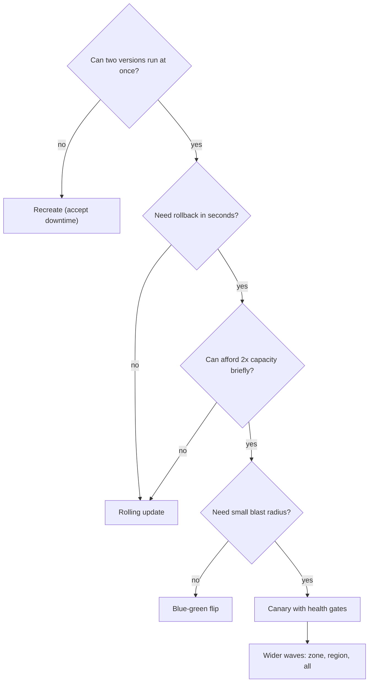

## In one minute
- A deployment strategy decides how a new version replaces the old one: all at once (recreate), a few instances at a time (rolling), a whole parallel fleet and one switch (blue-green), a small slice of traffic first (canary), or a copy of traffic with no user impact (shadow).
- Every strategy is a choice along four axes: **blast radius** (how many users a bad build can hurt before you notice), **rollback time**, **capacity overhead**, and **version mixing** (whether old and new run side by side).
- Large organisations combine them: build once, deploy to one box, then one cell or zone, then progressively wider waves, with automated health gates and bake time between waves.
- Configuration, feature flags, schemas and ML models are deployments too. Several of the biggest outages in recent years came from config pushed everywhere at once.
- The strategy only works if the release is compatible both ways: new code with old data and old code with new data, because every non-recreate strategy runs both at once.

## How it works

### The menu
**Recreate.** Stop every old instance, then start the new ones. No extra capacity and no version mixing, but downtime equals startup time and every user meets the new version at once. Kubernetes calls it `strategy: Recreate`; it fits batch workers and software that cannot run two versions against the same state.

**Rolling.** Replace instances in batches: start a few new ones, wait for readiness, remove a few old ones, repeat. Kubernetes' default `RollingUpdate` uses `maxSurge` and `maxUnavailable` (25% each by default) ([Kubernetes docs](https://kubernetes.io/docs/concepts/workloads/controllers/deployment/)). It needs little spare capacity, but each batch meets real traffic uncompared, and rollback is another full rolling deploy. The [rolling deployments lesson](rolling-deployments.md) covers the mechanics.

**Blue-green.** Stand up a complete second fleet with the new version, test it against production dependencies, then flip all traffic in one routing change. Rollback is the same flip, in seconds, as long as the old fleet is still running. The cost is double capacity during the release, and the flip still exposes every user at once. See [blue-green deployments](blue-green-deployments.md).

**Canary.** Route a small percentage of traffic, say 1%, to the new version, compare its error rate and latency against a baseline, and widen in steps (1%, 10%, 50%, 100%) only while it stays healthy. Blast radius is tiny and rollback is a weight change, but the rollout is slow and the analysis must be statistically sound. See [canary releases](canary-releases.md).

**Shadow (dark launch).** Mirror real requests to the new version and discard its responses, comparing them with the live version's output. Users are never affected, so it suits rewrites, new databases and new models. It cannot test side effects unless writes are stubbed, and it doubles downstream load.

**Feature flags.** Ship the code dark and turn behaviour on per user, per percentage or per tenant at runtime. Flags separate deploy from release, so the deploy itself can be boring. See [feature flags](feature-flags.md).

### Combining them: waves and cells
At scale, the question shifts from "which strategy" to "in what order do we expose the fleet". Amazon's published practice deploys to one box first, then one availability zone, then one region, then progressively larger waves of regions, with automated rollback on alarm and a bake time at each stage that gives slow failures (memory leaks, daily batch jobs, certificate expiry paths) a chance to show up. The numbers are deliberately slow: the one box serves at most about 10% of a region's or zone's requests and bakes for at least an hour, the first region bakes for at least 12 hours, later waves for 2 to 4 hours, and bake time also waits for a minimum count of requests. With default settings a change takes about four or five business days to reach every region, and deployments skip nights, weekends and holidays when on-call engineers are slower to respond ([AWS Builders' Library](https://builder.aws.com/content/3ErTKQOTKc5NIw031UePBPxTQ6I/automating-safe-hands-off-deployments)). Microsoft's guidance is similar: bake times measured in hours and days, growing with each ring ([Azure Well-Architected](https://learn.microsoft.com/en-us/azure/well-architected/operational-excellence/safe-deployments)). Inside each wave, a rolling or blue-green mechanism does the actual replacement. Cell-based architectures make this cleaner: each cell is an independent copy of the stack serving a fixed slice of customers, so a wave is a set of cells and blast radius is literally the share of customers in those cells.

### Problem shape: partial failure and blast radius
Google's SRE team found that roughly 70% of outages come from changes to a live system ([Google SRE book, ch. 1](https://sre.google/sre-book/introduction/)), so the rollout is where most risk lives. Choosing a strategy is a way of bounding partial failure. The same reasoning applies to rolling out a new prompt or model in an AI product: shadow it on logged traffic, canary it to 1% of conversations, compare quality metrics against the incumbent, and keep the old model loaded so rollback is a routing change rather than a redeploy.

## Down the stack

### Layer 1: The contract
A deployment strategy's contract can be written as four numbers per release. **Exposure**: the fraction of traffic served by the new version before the first health gate is evaluated (recreate and blue-green: 100%; rolling: one batch; canary: the first step). **Detection-to-rollback time**: from an alarm firing to all traffic on the old version (canary and blue-green: one routing update; rolling and recreate: a redeploy). **Capacity overhead**: peak instances relative to steady state (recreate 1x, rolling 1x plus surge, blue-green and mesh-weighted canary up to 2x). **Mixed-version window**: how long both versions serve at once (zero for recreate; the whole rollout for rolling and canary; the drain period for blue-green). A good release process states these numbers up front.

### Layer 2: The mechanism
Where the switch lives decides how fast it moves. **DNS** weights and records are cached by resolvers and clients for at least the TTL, and some clients ignore TTLs entirely, so a DNS cutover drains over minutes to hours. **Load balancer** changes, such as re-weighting AWS ALB target groups, apply to new connections within seconds. **Service mesh** routing (Istio `VirtualService` weights, Envoy `weighted_clusters`) splits per request, which allows 1% canaries. The Kubernetes Gateway API gives the same split in a vendor-neutral form: an `HTTPRoute` lists `backendRefs` with proportional weights such as 90 and 10 ([Gateway API](https://gateway-api.sigs.k8s.io/guides/traffic-splitting/)). Envoy's `request_mirror_policies` implement shadow traffic: mirroring is fire-and-forget, Envoy does not wait for the shadow, and it appends `-shadow` to the Host header so the shadow service can tell copies apart ([Envoy docs](https://www.envoyproxy.io/docs/envoy/latest/api-v3/config/route/v3/route_components.proto)). Managed platforms now ship these strategies too: Amazon ECS added built-in blue/green and, in October 2025, built-in linear and canary deployments with bake times and lifecycle hooks ([AWS](https://aws.amazon.com/about-aws/whats-new/2025/10/amazon-ecs-built-in-linear-canary-deployments)). **Orchestrators** encode the strategy declaratively: Kubernetes Deployments support `Recreate` and `RollingUpdate`, and controllers such as Argo Rollouts or Flagger add `blueGreen` and `canary` strategies with analysis steps that query Prometheus and abort automatically. In-process, a flag SDK evaluates rules from a locally cached ruleset.

A **health gate** is a function from metrics to a verdict: wait, proceed or roll back. It compares the new version against a baseline running the old version at the same time (not against last week), and it needs a minimum request count before it can judge anything. Google's canary guidance puts that floor at about 50 data points per metric for the statistical tests to mean anything, which at one-minute resolution can stretch an analysis to hours ([Google Cloud](https://cloud.google.com/blog/products/devops-sre/canary-analysis-lessons-learned-and-best-practices-from-google-and-waze)).

### Layer 3: The machine
Deploy speed is dominated by startup, not routing. Pulling a 1 GB container image at 100 MB/s takes 10 seconds per node unless it is cached; a JVM service may need 30 to 90 seconds of JIT warm-up before its latency matches the old fleet, which can fail a naive canary on p99 latency even when the code is fine. Empty in-process caches send a burst of misses to the database for the first minutes, so a blue-green flip of a large fleet can briefly double database load. Removing old instances needs connection draining: the load balancer stops new requests, in-flight requests finish, HTTP/2 servers send `GOAWAY`, and only then does the process exit, often after a `preStop` sleep of a few seconds so endpoint removal propagates to every proxy. Long-lived connections (WebSockets, gRPC streams) do not move on a routing change at all until they reconnect, so "100% switched" at the balancer can still mean thousands of clients on the old version.

### Why it's built this way
1. Tests cannot reproduce production traffic, data and dependencies, so some failures only appear when real users hit the new version.
2. If failures will reach users anyway, the controllable variable is how many users and for how long, which is exposure times detection time.
3. Fast rollback needs the old version still running, which costs capacity; slow rollback is cheap but extends every incident, so strategies trade money for recovery time.
4. Some failures are slow (leaks, daily jobs, rare paths), so gates add bake time, and wide fleets deploy in waves so a slow failure stays contained to the early waves.
5. Running two versions at once is unavoidable for zero-downtime strategies, so compatibility between versions becomes a requirement of every change.

## Diagram


## Worked example
A checkout service runs 40 instances across three zones and serves 6,000 requests per second. New instances take 90 seconds to pull, start and warm up. The team deploys twice a day and wants a bad build to cost fewer than 1,000 failed checkouts.

Suppose a bad build fails 20% of requests and alarms fire 3 minutes after the bad version starts serving.

**Recreate.** Every deploy causes 90 seconds of downtime: 540,000 failed requests, before the build is even known to be bad. Ruled out.

**Rolling, batches of 4.** The first batch serves 10% of traffic, 600 requests per second, 120 of which fail. In the 3 minutes to detection that is 21,600 failures, and the rollout has meanwhile moved on to more batches unless each batch bakes. Rollback is another rolling deploy, about 10 batches of 90 seconds each, 15 minutes. Far above budget.

**Blue-green.** 40 extra instances for the release window, about 30 minutes per deploy including bake, so 1 hour a day of double capacity. Detection still happens with 100% exposure: 1,200 failures per second for 3 minutes is 216,000. Rollback takes 5 seconds, but the exposure already blew the budget.

**Canary at 1%, then 10%, 50%, 100%, with 10-minute bakes.** At 1%, 60 requests per second hit the new version and 12 fail. A gate with a minimum of 3,000 canary requests can judge after 50 seconds; with a 2-minute evaluation window, about 1,440 failures in the worst case. Tightening the first gate to abort when the canary's error rate exceeds twice the baseline after 1,500 requests (25 seconds) brings it under 400. Rollback is a weight change. The cost is a rollout of about 45 minutes and a few spare instances during the early steps.

The team picks canary with automated gates for code, keeps blue-green for runtime upgrades, and puts risky features behind flags.

## In the wild
- **Cloudflare, 2019: a rule change that skipped the staged rollout.** A new WAF rule with a regex that backtracked catastrophically went to the whole network in seconds, because WAF rules were shipped globally rather than through the staged path used for code. A CPU safeguard had been removed by mistake in an earlier refactor, so every core pegged and about 80% of traffic failed for 27 minutes. Cloudflare restored the safeguard, reviewed all 3,868 rules and added staged rollouts for rules ([Cloudflare](https://blog.cloudflare.com/details-of-the-cloudflare-outage-on-july-2-2019/)).
- **Google Cloud, 2025: global data reaches unflagged code.** A Service Control code path added on 29 May had no feature flag and no error handling. On 12 June a quota policy with blank fields replicated worldwide within seconds and crash-looped API frontends in every region. A kill switch went out after about 40 minutes, but restarts without randomised backoff overloaded Spanner in us-central1 and stretched recovery to hours. Google committed to flag-gating critical changes and rolling out globally replicated data incrementally ([Google Cloud](https://status.cloud.google.com/incidents/ow5i3PPK96RduMcb1SsW)).
- **Cloudflare, 2025: a generated config file pushed network-wide.** A ClickHouse permissions change made a query return duplicate rows, doubling the Bot Management feature file that is rebuilt every five minutes and pushed everywhere. It exceeded a 200-feature limit and the proxy panicked, so core traffic largely failed for about three hours, flapping as good and bad files alternated. Cloudflare said it would treat internal config like user input and add global kill switches ([Cloudflare](https://blog.cloudflare.com/18-november-2025-outage/)).

## Trade-offs
| Strategy | Strengths | Weaknesses | Choose when |
|---|---|---|---|
| Recreate | Simplest, no mixing, no extra capacity | Downtime, full exposure | Batch workers, dev, incompatible versions |
| Rolling | Little extra capacity, built into orchestrators | Slow rollback, uncompared exposure per batch | Stateless services with good readiness checks |
| Blue-green | Rollback in seconds, test the full new fleet first | 2x capacity, full exposure at the flip | Infrastructure changes, few releases a day |
| Canary | Tiny blast radius, metric-driven progression | Slow, needs traffic volume and good metrics | High-traffic user-facing services |
| Shadow | Zero user impact, real load and inputs | No side effects tested, doubles downstream load | Rewrites, new datastores, new models |
| Feature flags | Release without deploy, per-user control | Flag debt, combinations to test | Product features, kill switches |

## Pitfalls in production
- **Config deployed outside the pipeline.** Code goes through canaries while a config change, rules file or flag flips globally in seconds. Route config through the same staged rollout with gates and bake time.
- **Gates that compare against the past.** Comparing a canary with yesterday's error rate confuses traffic patterns with regressions. Compare against a baseline group on the old version running at the same time.
- **Warm-up failing healthy builds.** Cold JIT and caches make every new version look slower at first, and teams learn to ignore the gate. Exclude a warm-up period or warm instances with synthetic traffic before they join.
- **Incompatible schema changes.** A migration that drops a column breaks the old version during a rolling or canary deploy and makes rollback impossible. Use expand and contract: add, deploy readers, backfill, then remove in a later release.
- **Slow failures outrun the bake.** A leak that takes six hours to exhaust memory passes a 10-minute bake on every wave. Stretch bake time on the first production wave and watch resource trends, not just error rates.

## Leadership lens
- Ask for the four numbers on every service: exposure before the first gate, detection time, rollback time and capacity overhead. Their product is the expected damage of a bad release.
- Standardise on one rollout controller and one gate definition across teams; bespoke deploy scripts are where unsafe shortcuts hide.
- Treat config, flags, schemas and models as deployable artifacts with the same staged rollout. Global instant pushes are the largest remaining blast radius in most organisations.
- Invest in deploy frequency. Small, frequent changes make each canary easier to judge and each rollback cheaper, which pays back the slower per-release pipeline.

## Check yourself
1. Why does blue-green give fast rollback but not a small blast radius?
   **Answer:** The old fleet stays running, so rollback is one routing change. But the flip moves all traffic at once, so every user meets the new version before any production signal exists.
2. A canary fails its latency gate on every release, and the problem disappears after ten minutes. What is likely happening, and what is the fix?
   **Answer:** Fresh instances are cold (JIT, caches, connection pools) while the baseline is warm. Warm the canary before measuring, exclude a warm-up window, or compare against freshly started baseline instances.
3. Why are database schema changes a constraint on every zero-downtime strategy?
   **Answer:** Rolling, canary and blue-green all run old and new code against the same database at some point, so each schema state must work with both versions, which forces expand-and-contract migrations.
4. When is shadow traffic better than a canary?
   **Answer:** When the change has no user-visible side effects to test, but a failure would be costly, such as a new storage engine or a rewritten pricing service. Shadowing compares outputs on real traffic without exposing anyone.

## Practice
**Task:** Build a deployment strategy calculator. `plan(n, boot, bake, switch, strategy)` takes a fleet size, the seconds to start a batch of instances (they start in parallel), the bake time after each exposure step, the seconds for a routing switch, and a strategy with `kind` plus `batch` (rolling) or `steps` (canary percentages). It returns `total` seconds, `peak` instances, `downtime` seconds, `exposure` (fraction of traffic on the new version before the first gate) and `rollback` seconds. Recreate: total `boot + bake`, peak `n`, downtime `boot`, exposure 1, rollback `boot`. Rolling: `w = ceil(n / batch)` waves, total `w * (boot + bake)`, peak `n + min(batch, n)`, downtime 0, exposure `min(batch, n) / n`, rollback `w * boot`. Blue-green: total `boot + switch + bake`, peak `2n`, downtime 0, exposure 1, rollback `switch`. Canary (old fleet stays full while new instances scale to each step): total `len(steps) * (boot + switch + bake)`, peak `n + ceil(n * steps[-1] / 100)`, downtime 0, exposure `steps[0] / 100`, rollback `switch`. Reject an unknown kind, `n < 1`, `batch < 1`, or steps that are empty, not strictly increasing, not positive, or not ending at 100. `choose(n, boot, bake, switch, options, max_peak, max_exposure, max_rollback)` returns the index of the option with the smallest total that meets all three limits (earliest on ties), or none.

```python starter
def plan(n, boot, bake, switch, strategy):
    # TODO
    raise NotImplementedError

def choose(n, boot, bake, switch, options, max_peak, max_exposure, max_rollback):
    # TODO
    raise NotImplementedError
```

```python tests
OPTIONS = [
    {"kind": "recreate"},
    {"kind": "rolling", "batch": 2},
    {"kind": "rolling", "batch": 3},
    {"kind": "blue_green"},
    {"kind": "canary", "steps": [5, 25, 100]},
]

def test_recreate_and_blue_green():
    assert plan(10, 60, 300, 5, OPTIONS[0]) == {"total": 360, "peak": 10, "downtime": 60, "exposure": 1.0, "rollback": 60}
    assert plan(10, 60, 300, 5, OPTIONS[3]) == {"total": 365, "peak": 20, "downtime": 0, "exposure": 1.0, "rollback": 5}

def test_rolling_rounds_waves_up():
    assert plan(10, 60, 300, 5, OPTIONS[1]) == {"total": 1800, "peak": 12, "downtime": 0, "exposure": 0.2, "rollback": 300}
    assert plan(10, 60, 300, 5, OPTIONS[2]) == {"total": 1440, "peak": 13, "downtime": 0, "exposure": 0.3, "rollback": 240}

def test_rolling_batch_larger_than_fleet():
    p = plan(4, 10, 20, 1, {"kind": "rolling", "batch": 10})
    assert p == {"total": 30, "peak": 8, "downtime": 0, "exposure": 1.0, "rollback": 10}

def test_canary():
    assert plan(10, 60, 300, 5, OPTIONS[4]) == {"total": 1095, "peak": 20, "downtime": 0, "exposure": 0.05, "rollback": 5}

def test_invalid_inputs_rejected():
    bad = [{"kind": "big_bang"}, {"kind": "rolling", "batch": 0},
           {"kind": "canary", "steps": []}, {"kind": "canary", "steps": [10, 5, 100]},
           {"kind": "canary", "steps": [10, 50]}, {"kind": "canary", "steps": [0, 100]}]
    for s in bad:
        try:
            plan(10, 60, 300, 5, s)
            assert False, "should reject %r" % (s,)
        except ValueError:
            pass
    try:
        plan(0, 60, 300, 5, {"kind": "recreate"})
        assert False, "empty fleet"
    except ValueError:
        pass

def test_choose_respects_limits():
    assert choose(10, 60, 300, 5, OPTIONS, 15, 0.25, 600) == 1
    assert choose(10, 60, 300, 5, OPTIONS, 20, 0.25, 600) == 4
    assert choose(10, 60, 300, 5, OPTIONS, 20, 1.0, 600) == 0

def test_choose_none():
    assert choose(10, 60, 300, 5, OPTIONS, 12, 0.25, 10) is None
```

```python solution
import math

def plan(n, boot, bake, switch, strategy):
    if n < 1:
        raise ValueError("fleet must have at least one instance")
    kind = strategy.get("kind")
    if kind == "recreate":
        return {"total": boot + bake, "peak": n, "downtime": boot, "exposure": 1.0, "rollback": boot}
    if kind == "rolling":
        batch = strategy.get("batch", 0)
        if batch < 1:
            raise ValueError("batch must be at least 1")
        b = min(batch, n)
        waves = math.ceil(n / batch)
        return {"total": waves * (boot + bake), "peak": n + b, "downtime": 0,
                "exposure": b / n, "rollback": waves * boot}
    if kind == "blue_green":
        return {"total": boot + switch + bake, "peak": 2 * n, "downtime": 0, "exposure": 1.0, "rollback": switch}
    if kind == "canary":
        steps = strategy.get("steps", [])
        if not steps or steps[-1] != 100 or steps[0] <= 0:
            raise ValueError("steps must be positive and end at 100")
        for a, b in zip(steps, steps[1:]):
            if b <= a:
                raise ValueError("steps must increase")
        return {"total": len(steps) * (boot + switch + bake),
                "peak": n + math.ceil(n * steps[-1] / 100), "downtime": 0,
                "exposure": steps[0] / 100, "rollback": switch}
    raise ValueError("unknown strategy %r" % (kind,))

def choose(n, boot, bake, switch, options, max_peak, max_exposure, max_rollback):
    best, best_total = None, None
    for i, s in enumerate(options):
        p = plan(n, boot, bake, switch, s)
        if p["peak"] > max_peak or p["exposure"] > max_exposure or p["rollback"] > max_rollback:
            continue
        if best_total is None or p["total"] < best_total:
            best, best_total = i, p["total"]
    return best
```

```typescript starter
export interface Strategy {
  kind: string;
  batch?: number;
  steps?: number[];
}

export interface Plan {
  total: number;
  peak: number;
  downtime: number;
  exposure: number;
  rollback: number;
}

export function plan(n: number, boot: number, bake: number, sw: number, strategy: Strategy): Plan {
  throw new Error("TODO");
}

export function choose(n: number, boot: number, bake: number, sw: number, options: Strategy[],
  maxPeak: number, maxExposure: number, maxRollback: number): number | null {
  throw new Error("TODO");
}
```

```typescript tests
const OPTIONS: Strategy[] = [
  { kind: "recreate" },
  { kind: "rolling", batch: 2 },
  { kind: "rolling", batch: 3 },
  { kind: "blue_green" },
  { kind: "canary", steps: [5, 25, 100] },
];

test("recreate and blue green", () => {
  assertEqual(plan(10, 60, 300, 5, OPTIONS[0]), { total: 360, peak: 10, downtime: 60, exposure: 1, rollback: 60 });
  assertEqual(plan(10, 60, 300, 5, OPTIONS[3]), { total: 365, peak: 20, downtime: 0, exposure: 1, rollback: 5 });
});
test("rolling rounds waves up", () => {
  assertEqual(plan(10, 60, 300, 5, OPTIONS[1]), { total: 1800, peak: 12, downtime: 0, exposure: 0.2, rollback: 300 });
  assertEqual(plan(10, 60, 300, 5, OPTIONS[2]), { total: 1440, peak: 13, downtime: 0, exposure: 0.3, rollback: 240 });
});
test("rolling batch larger than fleet", () => {
  assertEqual(plan(4, 10, 20, 1, { kind: "rolling", batch: 10 }), { total: 30, peak: 8, downtime: 0, exposure: 1, rollback: 10 });
});
test("canary", () => {
  assertEqual(plan(10, 60, 300, 5, OPTIONS[4]), { total: 1095, peak: 20, downtime: 0, exposure: 0.05, rollback: 5 });
});
test("invalid inputs rejected", () => {
  const bad: Strategy[] = [{ kind: "big_bang" }, { kind: "rolling", batch: 0 },
    { kind: "canary", steps: [] }, { kind: "canary", steps: [10, 5, 100] },
    { kind: "canary", steps: [10, 50] }, { kind: "canary", steps: [0, 100] }];
  for (const s of bad) {
    let threw = false;
    try { plan(10, 60, 300, 5, s); } catch (e) { threw = true; }
    assert(threw, "should reject " + JSON.stringify(s));
  }
  let threw = false;
  try { plan(0, 60, 300, 5, { kind: "recreate" }); } catch (e) { threw = true; }
  assert(threw, "empty fleet");
});
test("choose respects limits", () => {
  assertEqual(choose(10, 60, 300, 5, OPTIONS, 15, 0.25, 600), 1);
  assertEqual(choose(10, 60, 300, 5, OPTIONS, 20, 0.25, 600), 4);
  assertEqual(choose(10, 60, 300, 5, OPTIONS, 20, 1.0, 600), 0);
});
test("choose none", () => {
  assertEqual(choose(10, 60, 300, 5, OPTIONS, 12, 0.25, 10), null);
});
```

```typescript solution
export interface Strategy {
  kind: string;
  batch?: number;
  steps?: number[];
}

export interface Plan {
  total: number;
  peak: number;
  downtime: number;
  exposure: number;
  rollback: number;
}

export function plan(n: number, boot: number, bake: number, sw: number, strategy: Strategy): Plan {
  if (n < 1) throw new Error("fleet must have at least one instance");
  switch (strategy.kind) {
    case "recreate":
      return { total: boot + bake, peak: n, downtime: boot, exposure: 1, rollback: boot };
    case "rolling": {
      const batch = strategy.batch ?? 0;
      if (batch < 1) throw new Error("batch must be at least 1");
      const b = Math.min(batch, n);
      const waves = Math.ceil(n / batch);
      return { total: waves * (boot + bake), peak: n + b, downtime: 0, exposure: b / n, rollback: waves * boot };
    }
    case "blue_green":
      return { total: boot + sw + bake, peak: 2 * n, downtime: 0, exposure: 1, rollback: sw };
    case "canary": {
      const steps = strategy.steps ?? [];
      if (steps.length === 0 || steps[steps.length - 1] !== 100 || steps[0] <= 0) {
        throw new Error("steps must be positive and end at 100");
      }
      for (let i = 1; i < steps.length; i++) {
        if (steps[i] <= steps[i - 1]) throw new Error("steps must increase");
      }
      return {
        total: steps.length * (boot + sw + bake),
        peak: n + Math.ceil((n * steps[steps.length - 1]) / 100),
        downtime: 0,
        exposure: steps[0] / 100,
        rollback: sw,
      };
    }
    default:
      throw new Error("unknown strategy " + strategy.kind);
  }
}

export function choose(n: number, boot: number, bake: number, sw: number, options: Strategy[],
  maxPeak: number, maxExposure: number, maxRollback: number): number | null {
  let best: number | null = null;
  let bestTotal = Infinity;
  options.forEach((s, i) => {
    const p = plan(n, boot, bake, sw, s);
    if (p.peak > maxPeak || p.exposure > maxExposure || p.rollback > maxRollback) return;
    if (p.total < bestTotal) {
      best = i;
      bestTotal = p.total;
    }
  });
  return best;
}
```

```go starter
package practice

type Strategy struct {
	Kind  string
	Batch int
	Steps []int
}

type Plan struct {
	Total, Peak, Downtime int
	Exposure              float64
	Rollback              int
}

func PlanFor(n, boot, bake, sw int, s Strategy) (Plan, error) { panic("TODO") }

func Choose(n, boot, bake, sw int, options []Strategy, maxPeak int, maxExposure float64, maxRollback int) (int, bool) {
	panic("TODO")
}
```

```go tests
package practice

import "testing"

var options = []Strategy{
	{Kind: "recreate"},
	{Kind: "rolling", Batch: 2},
	{Kind: "rolling", Batch: 3},
	{Kind: "blue_green"},
	{Kind: "canary", Steps: []int{5, 25, 100}},
}

func mustPlan(t *testing.T, n, boot, bake, sw int, s Strategy, want Plan) {
	t.Helper()
	got, err := PlanFor(n, boot, bake, sw, s)
	if err != nil {
		t.Fatalf("unexpected error: %v", err)
	}
	if got != want {
		t.Fatalf("%+v: got %+v, want %+v", s, got, want)
	}
}

func TestRecreateAndBlueGreen(t *testing.T) {
	mustPlan(t, 10, 60, 300, 5, options[0], Plan{360, 10, 60, 1.0, 60})
	mustPlan(t, 10, 60, 300, 5, options[3], Plan{365, 20, 0, 1.0, 5})
}

func TestRollingRoundsWavesUp(t *testing.T) {
	mustPlan(t, 10, 60, 300, 5, options[1], Plan{1800, 12, 0, 0.2, 300})
	mustPlan(t, 10, 60, 300, 5, options[2], Plan{1440, 13, 0, 0.3, 240})
}

func TestRollingBatchLargerThanFleet(t *testing.T) {
	mustPlan(t, 4, 10, 20, 1, Strategy{Kind: "rolling", Batch: 10}, Plan{30, 8, 0, 1.0, 10})
}

func TestCanary(t *testing.T) {
	mustPlan(t, 10, 60, 300, 5, options[4], Plan{1095, 20, 0, 0.05, 5})
}

func TestInvalidInputsRejected(t *testing.T) {
	bad := []Strategy{{Kind: "big_bang"}, {Kind: "rolling", Batch: 0},
		{Kind: "canary", Steps: []int{}}, {Kind: "canary", Steps: []int{10, 5, 100}},
		{Kind: "canary", Steps: []int{10, 50}}, {Kind: "canary", Steps: []int{0, 100}}}
	for _, s := range bad {
		if _, err := PlanFor(10, 60, 300, 5, s); err == nil {
			t.Fatalf("should reject %+v", s)
		}
	}
	if _, err := PlanFor(0, 60, 300, 5, Strategy{Kind: "recreate"}); err == nil {
		t.Fatal("empty fleet")
	}
}

func TestChooseRespectsLimits(t *testing.T) {
	cases := []struct {
		peak     int
		exposure float64
		want     int
	}{{15, 0.25, 1}, {20, 0.25, 4}, {20, 1.0, 0}}
	for _, c := range cases {
		got, ok := Choose(10, 60, 300, 5, options, c.peak, c.exposure, 600)
		if !ok || got != c.want {
			t.Fatalf("limits %+v: got %d %v, want %d", c, got, ok, c.want)
		}
	}
}

func TestChooseNone(t *testing.T) {
	if _, ok := Choose(10, 60, 300, 5, options, 12, 0.25, 10); ok {
		t.Fatal("expected no option to qualify")
	}
}
```

```go solution
package practice

import (
	"errors"
	"fmt"
)

type Strategy struct {
	Kind  string
	Batch int
	Steps []int
}

type Plan struct {
	Total, Peak, Downtime int
	Exposure              float64
	Rollback              int
}

func ceilDiv(a, b int) int { return (a + b - 1) / b }

func PlanFor(n, boot, bake, sw int, s Strategy) (Plan, error) {
	if n < 1 {
		return Plan{}, errors.New("fleet must have at least one instance")
	}
	switch s.Kind {
	case "recreate":
		return Plan{boot + bake, n, boot, 1.0, boot}, nil
	case "rolling":
		if s.Batch < 1 {
			return Plan{}, errors.New("batch must be at least 1")
		}
		b := s.Batch
		if b > n {
			b = n
		}
		waves := ceilDiv(n, s.Batch)
		return Plan{waves * (boot + bake), n + b, 0, float64(b) / float64(n), waves * boot}, nil
	case "blue_green":
		return Plan{boot + sw + bake, 2 * n, 0, 1.0, sw}, nil
	case "canary":
		st := s.Steps
		if len(st) == 0 || st[len(st)-1] != 100 || st[0] <= 0 {
			return Plan{}, errors.New("steps must be positive and end at 100")
		}
		for i := 1; i < len(st); i++ {
			if st[i] <= st[i-1] {
				return Plan{}, errors.New("steps must increase")
			}
		}
		return Plan{len(st) * (boot + sw + bake), n + ceilDiv(n*st[len(st)-1], 100), 0,
			float64(st[0]) / 100, sw}, nil
	}
	return Plan{}, fmt.Errorf("unknown strategy %q", s.Kind)
}

func Choose(n, boot, bake, sw int, options []Strategy, maxPeak int, maxExposure float64, maxRollback int) (int, bool) {
	best, bestTotal, found := 0, 0, false
	for i, s := range options {
		p, err := PlanFor(n, boot, bake, sw, s)
		if err != nil || p.Peak > maxPeak || p.Exposure > maxExposure || p.Rollback > maxRollback {
			continue
		}
		if !found || p.Total < bestTotal {
			best, bestTotal, found = i, p.Total, true
		}
	}
	return best, found
}
```

## Mock interview
**Prompt:** You own deployments for a payments API: 300 instances in 6 regions, 50,000 requests per second at peak, about 30 deploys a day across 12 teams. Last quarter a bad config change took down every region within two minutes. Design the release process.

- Follow-up: How do you decide the size and order of waves, and how long each one bakes?
- Follow-up: A release includes a database migration. How does that change the rollout and the rollback plan?
- Follow-up: Teams complain the pipeline takes four hours from merge to full rollout. What do you trade, and what do you refuse to trade?

**A strong answer covers:**
- Staged waves: one box or cell, one zone, one region, then wider groups of regions, with exposure, gate criteria and bake time stated for each wave.
- Automated health gates comparing against a concurrent baseline, with minimum sample sizes, and automatic rollback that does not need a human.
- Config, flags and rules files flowing through the same staged pipeline as code, never pushed globally at once.
- Expand-and-contract migrations so every step is compatible with both versions and rollback stays possible.
- Speed through smaller changes, parallel low-risk waves and shorter bakes for low-risk change types, while keeping the first-wave bake and the automated gates fixed.

## Sources and further study
**Primary**
- [Google SRE book, ch. 1: Introduction](https://sre.google/sre-book/introduction/): the observation that about 70% of outages come from changes, and why progressive rollouts follow.
- [Google Cloud: Service Control incident report (June 2025)](https://status.cloud.google.com/incidents/ow5i3PPK96RduMcb1SsW): what happens when data skips the rollout path that code follows.

**Systems docs**
- [Kubernetes Gateway API: traffic splitting](https://gateway-api.sigs.k8s.io/guides/traffic-splitting/): weighted `backendRefs` for canary and blue-green without a vendor mesh.
- [Envoy route configuration](https://www.envoyproxy.io/docs/envoy/latest/api-v3/config/route/v3/route_components.proto): `weighted_clusters` and `request_mirror_policies`, the mechanisms under most meshes.
- [Amazon ECS blue/green deployments](https://docs.aws.amazon.com/AmazonECS/latest/developerguide/deployment-type-blue-green.html): bake time, lifecycle hooks and test traffic as managed features.

**Books**
- *The Site Reliability Workbook*, Beyer et al., chapter 16 "Canarying Releases": release velocity versus reliability and how canaries fit release engineering.
- *Release It!* (2nd edition), Michael T. Nygard, chapter 13 "Design for Deployment": the fallacy of planned downtime and the phases of a zero-downtime deploy.
- *Building Microservices* (2nd edition), Sam Newman, chapter 8 "Deployment": principles of microservice deployment and the options for running them.

**Other curricula**
- [Azure Well-Architected: safe deployment practices](https://learn.microsoft.com/en-us/azure/well-architected/operational-excellence/safe-deployments): progressive exposure, health models and bake times in hours or days, plus an emergency path for hotfixes.
- [roadmap.sh System Design](https://roadmap.sh/system-design): covers Deployment Stamps as a cloud pattern but has no node on rollout strategies.

## Watch
- [Top 5 Most-Used Deployment Strategies (ByteByteGo)](https://www.youtube.com/watch?v=AWVTKBUnoIg): a quick comparison of the main strategies side by side.
- [Kubernetes Deployment Patterns: rolling updates, canary and blue/green (Appsbroker Academy)](https://www.youtube.com/watch?v=-ynSCM1oSyo): the same strategies shown on a real cluster.

## Free resources
- [Automating safe, hands-off deployments (AWS Builders' Library)](https://aws.amazon.com/builders-library/automating-safe-hands-off-deployments/): one-box, waves, bake time and automatic rollback at Amazon scale.
- [Canarying releases (Google SRE Workbook)](https://sre.google/workbook/canarying-releases/): how to pick canary size, duration and metrics, and why to compare against a concurrent control.
- [Kubernetes Deployments](https://kubernetes.io/docs/concepts/workloads/controllers/deployment/): `Recreate` and `RollingUpdate`, surge and unavailability settings.
- [Argo Rollouts concepts](https://argoproj.github.io/argo-rollouts/concepts/): blue-green and canary strategies as a Kubernetes controller, with analysis steps.
- [BlueGreenDeployment (Martin Fowler)](https://martinfowler.com/bliki/BlueGreenDeployment.html): the original short description of the pattern and its database caveat.
