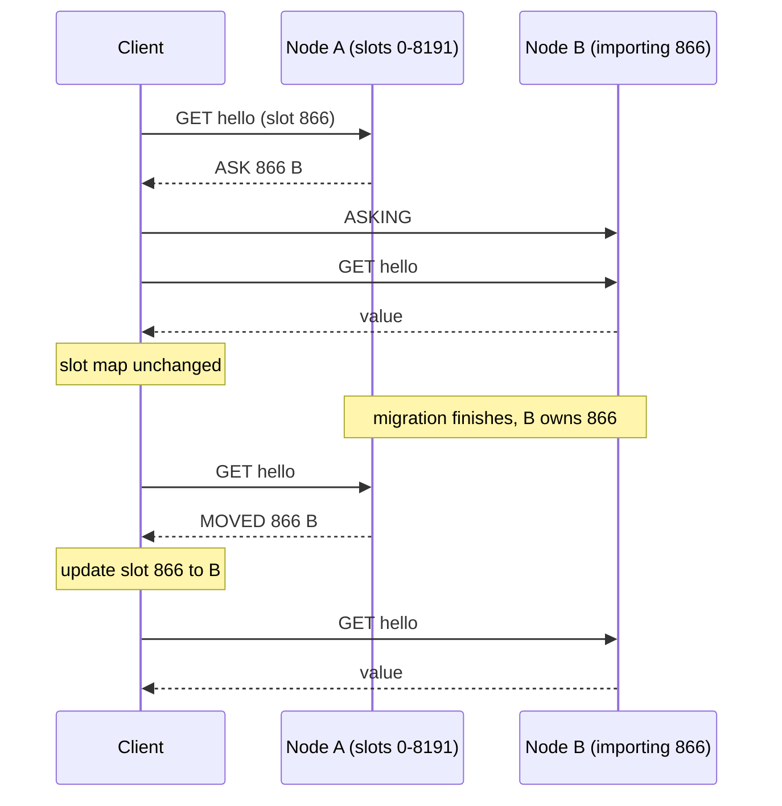

## In one minute
- A distributed cache spreads one logical key-value cache across many servers, because the hot data no longer fits in one machine's memory, CPU or network card.
- The central design choice is where routing lives: inside the client library, in a proxy, or in the servers themselves (Redis Cluster's hash slots with redirects).
- Replication in a cache buys availability and read capacity, not durability: replicas are asynchronous, and a failover can silently drop recent writes.
- Partitioning turns one request into many: a page that reads 40 keys may touch every shard, so tail latency and connection counts grow with the cluster.
- The database behind the cache is the real capacity limit. Design for what happens when a shard, a zone or the whole cache is empty.

## How it works

### Why one box stops being enough
A single cache node runs out of something: memory (a 1.5 TB working set does not fit in a 128 GB machine), throughput (Redis executes commands on one thread, roughly 100,000 to 200,000 simple operations per second without pipelining), network (a 25 Gbit/s NIC moves about 3 GB/s), or blast radius (when the only node restarts, every read hits the database).

This lesson is about the architecture once you split. How entries get in and out (cache-aside, write-through) and what to evict are separate topics; *Consistent Hashing*, *Hot Keys* and *Design a Distributed Cache* go deeper on placement, skew and a full design.

### Three places to put the routing
**Client-side sharding.** Each application process holds the server list and hashes keys to servers itself. Memcached has always worked this way: the servers do not know about each other. It is one hop, but every language needs an identical hashing library, and processes with different configs disagree about where keys live.

**A routing proxy.** Applications talk to a local or shared proxy (Twemproxy, Facebook's mcrouter, Envoy's Redis proxy) that owns the pool layout. Mcrouter expresses policy as composable route handles: `PoolRoute` for a sharded pool, `AllSyncRoute` to write to several replicas, `FailoverRoute` to try a backup pool, `WarmUpRoute` to fill a cold pool from a warm one. It costs a hop of tens of microseconds and a fleet to run, but layout changes need no application deploys.

**Server-side clustering.** In Redis Cluster the nodes agree among themselves who owns which of 16,384 hash slots. A client may send a command to any node; a node that does not own the slot replies `MOVED <slot> <host:port>`, and a smart client caches the slot map so it usually goes straight to the right node. This avoids a proxy while keeping one source of truth, at the cost of smarter clients. Managed services often let you pick: Azure Managed Redis offers an OSS clustering policy, where clients follow `MOVED` and `ASK` themselves, and a proxy-based policy behind a single endpoint that costs a little routing overhead ([Azure caching guidance](https://learn.microsoft.com/en-us/azure/architecture/best-practices/caching)).

### Replication and failure
Cache replicas serve two purposes. For **availability**, a replica in another zone is promoted when its primary dies, so the shard does not go cold. For **read capacity**, reads of hot keys spread across replicas. Both are asynchronous in Redis, so a replica can serve a value the primary has already overwritten, and a promotion can lose acknowledged writes; the cluster specification says there is always a window in which writes can be lost during partitions ([Redis cluster spec](https://redis.io/docs/latest/operate/oss_and_stack/reference/cluster-spec/)). That is acceptable for a cache only because the database still holds the truth.

Memcached has no replication of its own. Facebook's answer was the **gutter pool**: about 1% of servers that take over the keys of any failed server with short TTLs ([Facebook NSDI 2013](https://www.usenix.org/system/files/conference/nsdi13/nsdi13-final170_update.pdf)), so a dead node causes a burst of short-lived entries instead of a burst of database reads. The general lesson is to decide explicitly what a failed shard's traffic hits next.

### Multi-key reads and fan-out
A product page that needs 40 keys issues one multiget per shard involved. With 16 shards, 40 random keys touch about 15 of them, and the page waits for the slowest. Adding shards makes this worse, not better: more shards means more round trips per page for the same work. The fix is to co-locate keys that are read together. Redis Cluster supports this with **hash tags**: only the part of the key between the first `{` and the next `}` is hashed, so `{user:42}:profile` and `{user:42}:cart` land in the same slot and can be fetched, or updated atomically, in one command.

This is the fan-out problem shape; it reappears when a search query scatters to 50 index shards, or an agent waits on ten parallel tool calls.

### Near caches
A small in-process L1 in front of the distributed L2 removes the network hop for the hottest keys and shields their shard. The cost is a weaker consistency layer: invalidations must reach every process, or the L1 uses TTLs of seconds.

## Down the stack

### Layer 1: The contract
A distributed cache promises much less than a database. Any `GET` may miss, even immediately after a `SET`, because of eviction, a restart or a failover. Writes are acknowledged by the primary before replication, so a failover can discard them. Reads from replicas can be stale by the replication lag, usually milliseconds but unbounded under load. Atomic multi-key operations exist only within one slot; Redis rejects a multi-key command spanning slots with `CROSSSLOT`. The Redis cluster specification says plainly that it does not guarantee strong consistency, so correct code treats every answer as a hint and every miss as normal.

### Layer 2: The mechanism
Redis Cluster maps a key to `CRC16(key) mod 16384` using the XMODEM CRC (polynomial `0x1021`), after applying the hash-tag rule. Each node keeps the full slot table and gossips `PING` and `PONG` messages on a cluster bus at the client port plus 10,000 (or `cluster-port`) ([Redis cluster spec](https://redis.io/docs/latest/operate/oss_and_stack/reference/cluster-spec/)), carrying its view of slot ownership and a configuration epoch that resolves conflicting claims. A node that does not answer for `cluster-node-timeout` (15,000 ms by default) is flagged `PFAIL` (possibly failing); when a majority of primaries report it within twice the node timeout, it becomes `FAIL`, and one of its replicas wins an election and takes over its slots with a higher epoch.

Resharding moves one slot at a time. The source marks the slot `MIGRATING` and the target `IMPORTING`, and keys move with `MIGRATE`. During the move, a key already moved produces `ASK <slot> <target>` from the source. The client sends `ASKING` and then the command to the target, but does not update its slot map, because the slot still belongs to the source until the move finishes. Only `MOVED` changes the map. Clients refresh the whole map with `CLUSTER SHARDS` (or the older `CLUSTER SLOTS`). A connection that sends `READONLY` to a replica may read the slots that replica serves.

Key-by-key migration is no longer the only way. Redis 8.4 added `CLUSTER MIGRATION IMPORT`, run on the target, which copies whole slot ranges as a snapshot plus a replication stream; when the remaining lag drops under `cluster-slot-migration-handoff-max-lag-bytes` (1 MB by default), the source pauses writes, for at most 10 seconds by default, and ownership flips in one step ([Redis docs](https://redis.io/docs/latest/commands/cluster-migration/)). Valkey 9.0 shipped the same idea as `CLUSTER MIGRATESLOTS` in October 2025: the source keeps every key until the whole slot has moved, so there is no half-migrated slot for multi-key commands to trip over and big collections stream item by item instead of as one huge `MIGRATE` payload ([Valkey](https://valkey.io/blog/introducing-valkey-9/)). Clients still need to handle `ASK`, because older servers and tools use the classic path.

### Layer 3: The machine
A `GET` of a 1 KB value costs the Redis thread a few microseconds: parse the RESP request, one hash table lookup, copy into the output buffer, one `write`. Within an availability zone a round trip is about 100 to 300 microseconds; across zones it is closer to 1 ms, and AWS bills cross-zone traffic, including to ElastiCache, at $0.01 per GB in each direction ([AWS EC2 pricing](https://aws.amazon.com/ec2/pricing/on-demand/)). So network, not CPU, dominates, and the levers are fewer round trips (pipelining and multiget turn 40 reads into one `write` and one `read` syscall per shard) and fewer bytes.

Connections are the hidden cost: a thousand application servers with 4 connections to each of 32 nodes is 128,000 TCP connections, each with kernel socket buffers and a Redis client struct. Memory has traps too: allocator fragmentation after churn in value sizes, and an RDB snapshot `fork()` that shares pages copy-on-write, so a write-heavy node can briefly need close to double its memory.

### Why it's built this way
1. RAM per machine and packets per core are fixed, so a large hot set must be partitioned.
2. Partitioning needs a stable key-to-node map that survives membership changes, so the cluster uses a fixed slot space (or a hash ring) and moves slots, not keys one by one.
3. Moving data while serving traffic means some keys are temporarily in two places, so the protocol separates a one-off redirect (`ASK`) from a permanent one (`MOVED`).
4. Synchronous replication would double write latency for data the database already holds, so replicas are asynchronous and the contract admits loss.

## Diagram


## Worked example
A catalogue service needs 800,000 reads per second at peak over 1.2 TB of hot values averaging 1 KB.

**Memory.** Keys, hash table entries and allocator overhead add roughly 25%, so plan for 1.5 TB. Nodes with about 100 GB usable each need 15; use 16 primaries, 1,024 slots each.

**Throughput.** 800,000 / 16 is 50,000 reads per second per primary, comfortably inside one Redis thread, and 50 MB/s of values per node is a small fraction of the NIC.

**Replicas and zones.** One replica per primary in a second zone gives 32 nodes. If clients read from whichever copy is in their own zone, no read crosses zones. If instead half the reads cross zones, that is about 400 MB/s, roughly 34,500 GB per day, which at $0.01 per GB in each direction costs about $690 per day, or $250,000 per year, for nothing.

**Fan-out.** A product page reads 40 keys. Spread randomly, they touch about 15 of the 16 shards. If each shard's p99 is 2 ms, the chance that a page hits at least one p99 response ([The Tail at Scale](https://research.google/pubs/the-tail-at-scale/)) is 1 - 0.99^15, about 14%, so the page's p90 is already above the shard's p99. Grouping a product's keys under one hash tag, `{product:981}`, collapses the page to one or two shards.

**Failure.** A primary dies; detection takes 15 seconds plus an election. Meanwhile 50,000 reads per second for its slots fall through to a database sized for 20,000. Decide in advance: read from the replica, shed, or use a gutter pool.

## In the wild
- **Discord, 2017: a correct Redis failover, an incorrect client.** A Google Cloud live migration knocked a Redis primary offline. The cluster failed over as designed, but API instances hit a known bug in their failover handling, and the outage compounded with a bad edge-cache rule, a Cassandra failure and other services running out of memory. It lasted about 2 hours 51 minutes and ended with a full restart that reconnected millions of clients over about 20 minutes. The failover path in the client is part of the cache architecture, and needs testing like the server ([Discord](https://discordstatus.com/incidents/qk9cdgnqnhcn)).
- **GitHub, 2018: 1.35 Tbps from exposed memcached servers.** Attackers spoofed GitHub's address in UDP requests to memcached servers open on the internet, which answered with responses up to about 51,000 times larger. Traffic peaked at 1.35 Tbps and 126.9 million packets per second. GitHub was down for about five minutes and intermittently unavailable for four more, until traffic was routed through Akamai's scrubbing ([GitHub](https://github.blog/news-insights/company-news/ddos-incident-report/)).
- **Slack, 2022: the cache control plane worked, and the database still fell over.** During a Consul agent rollout, Slack's cache control plane replaced deregistered memcached nodes with empty spares, exactly as designed. Each miss on group DM membership became a query to every Vitess shard, because the table was sharded by user but read by channel, and retries kept the system overloaded. Fixes included re-sharding by channel and throttling client boots ([Slack](https://slack.engineering/slacks-incident-on-2-22-22/)).

## Trade-offs
| Option | Strengths | Weaknesses | Choose when |
|---|---|---|---|
| Client-side sharding | One hop, no extra infrastructure | Identical hashing in every language, config skew | Few languages, simple pools (classic Memcached) |
| Routing proxy | Central policy, replication, failover and warm-up without app changes | Extra hop, proxy fleet to operate | Many services and languages, frequent pool changes |
| Server-side cluster | One source of truth, online resharding | Smart clients, redirects, cross-slot limits | Redis at scale, keys that need co-location |
| Read from replicas | More read capacity, survives a primary loss | Stale reads, more memory | Hot keys, read-heavy traffic |
| Near cache (L1) | No network hop for the hottest keys | Invalidation to every process, more staleness | Read-mostly keys with tolerant staleness |

## Pitfalls in production
- **The database sized for a warm cache.** A cache restart or a lost zone sends every miss to a database sized for a 95% hit rate. Know the database's capacity at 0% hit rate, and add warm-up, request coalescing and load shedding.
- **Slot map refresh storms.** After a failover, thousands of clients receive `MOVED` and all call `CLUSTER SHARDS` at once. Rate-limit map refreshes per client and apply individual `MOVED` replies directly.
- **Unbounded fan-out.** A multiget across every shard makes page latency equal to the cluster's worst node. Co-locate keys with hash tags and cap per-request fan-out.
- **Big values and big keys.** A 5 MB value or a hash with a million fields blocks the single thread while it is serialised or deleted. Split them, and delete large keys with `UNLINK`, which frees memory in the background.
- **Treating the cache as durable.** Sessions or counters stored only in the cache vanish on failover. Anything you cannot recompute belongs in a database.
- **Cache ports open to the internet.** Memcached once listened on UDP by default, and exposed servers became 51,000x DDoS amplifiers in 2018; version 1.5.6 turned UDP off by default ([memcached release notes](https://github.com/memcached/memcached/wiki/ReleaseNotes156)). Keep cache nodes on private networks with authentication on.

## Leadership lens
- Ask "what does the database see when this cache is empty?" in every design review. If the answer is an outage, the cache is a hidden availability dependency and needs an owner and a runbook.
- Decide between proxy, client sharding and cluster mode once per organisation. Mixed approaches mean every team re-learns failover, and incidents are debugged in three ways.
- Track cost per cached GB and per million reads, including cross-zone traffic. Zone-aware reads are often the cheapest win available.

## Check yourself
1. Why does a Redis Cluster client update its slot map on `MOVED` but not on `ASK`?
   **Answer:** `MOVED` means the slot now permanently belongs to another node. `ASK` happens mid-migration: only some keys have moved, the source still owns the slot, so the redirect applies to that one request.
2. You double the number of cache shards to cut latency, and page p99 gets worse. Why?
   **Answer:** Pages that read many keys now fan out to more shards, so each page waits for the slowest of more round trips. Throughput per shard dropped, but tail latency is driven by fan-out.
3. Why is asynchronous replication acceptable for a cache when it would not be for a payments database?
   **Answer:** The cache is not the source of truth. A lost write produces a miss or a stale value that TTLs and invalidation repair, while the database still holds the correct data.

## Practice
**Task:** Build a Redis Cluster style client router. `key_slot(key)` returns `CRC16(key) mod 16384` using CRC-16/XMODEM (polynomial `0x1021`, initial value 0, no reflection) over the key's bytes (keys are ASCII), after the hash-tag rule: if the key has a `{` and a later `}` with at least one character between the first `{` and the first `}` after it, hash only that substring. `Router(ranges)` takes inclusive `(start, end, primary, replicas)` slot ranges. `node_for(key, read)` returns the slot's primary, or for a read when the slot has replicas, the next replica in a round robin driven by one counter shared by all such reads. `group(keys)` maps each primary to its keys in input order, with nodes in order of first appearance. `execute(key, send)` calls `send(node, key, asking)` starting at the key's primary; on `("MOVED", slot, node)` it records that the slot's primary is `node` (with no replicas) and retries there; on `("ASK", slot, node)` it retries once at `node` with `asking` true and leaves the map unchanged; on `("OK", value)` it returns the value. After 5 redirects it fails (Python `RuntimeError`, TypeScript `throw`, Go an error).

```python starter
def key_slot(key):
    # TODO
    raise NotImplementedError

class Router:
    def __init__(self, ranges):
        self.ranges = ranges

    def node_for(self, key, read=False):
        # TODO
        raise NotImplementedError

    def group(self, keys):
        # TODO
        raise NotImplementedError

    def execute(self, key, send):
        # TODO
        raise NotImplementedError
```

```python tests
def two_nodes():
    return Router([(0, 8191, "A", ["A1", "A2"]), (8192, 16383, "B", [])])

def test_crc_known_vectors():
    assert key_slot("123456789") == 12739
    assert key_slot("foo") == 12182
    assert key_slot("hello") == 866

def test_hash_tags():
    assert key_slot("{user:1000}.following") == key_slot("user:1000") == 1649
    assert key_slot("foo{bar}{zap}") == key_slot("bar")
    assert key_slot("foo{{bar}}zap") == key_slot("{bar")
    assert key_slot("foo{}{bar}") != key_slot("bar"), "empty tag hashes the whole key"

def test_route_primary_and_replicas():
    r = two_nodes()
    assert r.node_for("hello") == "A"
    assert [r.node_for("hello", True) for _ in range(3)] == ["A1", "A2", "A1"]
    assert r.node_for("foo", True) == "B", "no replicas means primary"

def test_group_multiget():
    r = two_nodes()
    assert r.group(["foo", "hello", "bar", "{foo}x"]) == {"B": ["foo", "{foo}x"], "A": ["hello", "bar"]}

def test_moved_updates_only_that_slot():
    r = Router([(0, 16383, "A", ["A1"])])
    calls = []
    def send(node, key, asking):
        calls.append((node, key, asking))
        return ("MOVED", 866, "C") if node == "A" else ("OK", "v")
    assert r.execute("hello", send) == "v"
    assert calls == [("A", "hello", False), ("C", "hello", False)]
    assert r.node_for("hello") == "C"
    assert r.node_for("hello", True) == "C"
    assert r.node_for("bar") == "A"
    calls.clear()
    assert r.execute("hello", send) == "v"
    assert calls == [("C", "hello", False)]

def test_ask_does_not_update_map():
    r = Router([(0, 16383, "A", [])])
    calls = []
    def send(node, key, asking):
        calls.append((node, key, asking))
        if node == "A":
            return ("ASK", 866, "D")
        return ("OK", "w") if asking else ("MOVED", 866, "A")
    assert r.execute("hello", send) == "w"
    assert calls == [("A", "hello", False), ("D", "hello", True)]
    assert r.node_for("hello") == "A"

def test_too_many_redirects():
    r = Router([(0, 16383, "A", [])])
    calls = []
    def send(node, key, asking):
        calls.append(node)
        return ("MOVED", key_slot(key), "B" if node == "A" else "A")
    try:
        r.execute("k", send)
        assert False, "expected an error"
    except RuntimeError:
        pass
    assert len(calls) == 6
```

```python solution
def _crc16(data):
    crc = 0
    for b in data:
        crc ^= b << 8
        for _ in range(8):
            if crc & 0x8000:
                crc = ((crc << 1) ^ 0x1021) & 0xFFFF
            else:
                crc = (crc << 1) & 0xFFFF
    return crc

def key_slot(key):
    start = key.find("{")
    if start != -1:
        end = key.find("}", start + 1)
        if end > start + 1:
            key = key[start + 1:end]
    return _crc16(key.encode()) % 16384

class Router:
    def __init__(self, ranges):
        self.primary = [""] * 16384
        self.replicas = [[] for _ in range(16384)]
        for start, end, primary, replicas in ranges:
            for s in range(start, end + 1):
                self.primary[s] = primary
                self.replicas[s] = list(replicas)
        self.rr = 0

    def node_for(self, key, read=False):
        s = key_slot(key)
        reps = self.replicas[s]
        if read and reps:
            node = reps[self.rr % len(reps)]
            self.rr += 1
            return node
        return self.primary[s]

    def group(self, keys):
        out = {}
        for k in keys:
            out.setdefault(self.node_for(k), []).append(k)
        return out

    def execute(self, key, send):
        node, asking = self.node_for(key), False
        for _ in range(6):
            reply = send(node, key, asking)
            if reply[0] == "OK":
                return reply[1]
            _, slot, target = reply
            if reply[0] == "MOVED":
                self.primary[slot] = target
                self.replicas[slot] = []
                asking = False
            else:
                asking = True
            node = target
        raise RuntimeError("too many redirects")
```

```typescript starter
export type Reply = { kind: string; slot?: number; node?: string; value?: string };
export type SlotRange = [number, number, string, string[]];

export function keySlot(key: string): number {
  throw new Error("TODO");
}

export class Router {
  constructor(ranges: SlotRange[]) {}
  nodeFor(key: string, read: boolean = false): string {
    throw new Error("TODO");
  }
  group(keys: string[]): Record<string, string[]> {
    throw new Error("TODO");
  }
  execute(key: string, send: (node: string, key: string, asking: boolean) => Reply): string {
    throw new Error("TODO");
  }
}
```

```typescript tests
function twoNodes(): Router {
  return new Router([[0, 8191, "A", ["A1", "A2"]], [8192, 16383, "B", []]]);
}

test("crc known vectors", () => {
  assertEqual(keySlot("123456789"), 12739);
  assertEqual(keySlot("foo"), 12182);
  assertEqual(keySlot("hello"), 866);
});
test("hash tags", () => {
  assertEqual(keySlot("{user:1000}.following"), 1649);
  assertEqual(keySlot("user:1000"), 1649);
  assertEqual(keySlot("foo{bar}{zap}"), keySlot("bar"));
  assertEqual(keySlot("foo{{bar}}zap"), keySlot("{bar"));
  assert(keySlot("foo{}{bar}") !== keySlot("bar"), "empty tag hashes the whole key");
});
test("route primary and replicas", () => {
  const r = twoNodes();
  assertEqual(r.nodeFor("hello"), "A");
  assertEqual([r.nodeFor("hello", true), r.nodeFor("hello", true), r.nodeFor("hello", true)], ["A1", "A2", "A1"]);
  assertEqual(r.nodeFor("foo", true), "B", "no replicas means primary");
});
test("group multiget", () => {
  assertEqual(twoNodes().group(["foo", "hello", "bar", "{foo}x"]), { B: ["foo", "{foo}x"], A: ["hello", "bar"] });
});
test("moved updates only that slot", () => {
  const r = new Router([[0, 16383, "A", ["A1"]]]);
  let log: [string, string, boolean][] = [];
  const send = (node: string, key: string, asking: boolean): Reply => {
    log.push([node, key, asking]);
    return node === "A" ? { kind: "MOVED", slot: 866, node: "C" } : { kind: "OK", value: "v" };
  };
  assertEqual(r.execute("hello", send), "v");
  assertEqual(log, [["A", "hello", false], ["C", "hello", false]]);
  assertEqual(r.nodeFor("hello"), "C");
  assertEqual(r.nodeFor("hello", true), "C");
  assertEqual(r.nodeFor("bar"), "A");
  log = [];
  assertEqual(r.execute("hello", send), "v");
  assertEqual(log, [["C", "hello", false]]);
});
test("ask does not update map", () => {
  const r = new Router([[0, 16383, "A", []]]);
  const log: [string, string, boolean][] = [];
  const send = (node: string, key: string, asking: boolean): Reply => {
    log.push([node, key, asking]);
    if (node === "A") return { kind: "ASK", slot: 866, node: "D" };
    return asking ? { kind: "OK", value: "w" } : { kind: "MOVED", slot: 866, node: "A" };
  };
  assertEqual(r.execute("hello", send), "w");
  assertEqual(log, [["A", "hello", false], ["D", "hello", true]]);
  assertEqual(r.nodeFor("hello"), "A");
});
test("too many redirects", () => {
  const r = new Router([[0, 16383, "A", []]]);
  const seen: string[] = [];
  const send = (node: string, key: string, asking: boolean): Reply => {
    seen.push(node);
    return { kind: "MOVED", slot: keySlot(key), node: node === "A" ? "B" : "A" };
  };
  let threw = false;
  try {
    r.execute("k", send);
  } catch (e) {
    threw = true;
  }
  assert(threw, "expected an error");
  assertEqual(seen.length, 6);
});
```

```typescript solution
export type Reply = { kind: string; slot?: number; node?: string; value?: string };
export type SlotRange = [number, number, string, string[]];

function crc16(key: string): number {
  let crc = 0;
  for (let i = 0; i < key.length; i++) {
    crc ^= (key.charCodeAt(i) & 0xff) << 8;
    for (let b = 0; b < 8; b++) {
      crc = crc & 0x8000 ? ((crc << 1) ^ 0x1021) & 0xffff : (crc << 1) & 0xffff;
    }
  }
  return crc;
}

export function keySlot(key: string): number {
  const start = key.indexOf("{");
  if (start !== -1) {
    const end = key.indexOf("}", start + 1);
    if (end > start + 1) key = key.slice(start + 1, end);
  }
  return crc16(key) % 16384;
}

export class Router {
  private primary: string[] = new Array(16384).fill("");
  private replicas: string[][] = [];
  private rr = 0;

  constructor(ranges: SlotRange[]) {
    for (let s = 0; s < 16384; s++) this.replicas.push([]);
    for (const [start, end, primary, reps] of ranges) {
      for (let s = start; s <= end; s++) {
        this.primary[s] = primary;
        this.replicas[s] = reps.slice();
      }
    }
  }

  nodeFor(key: string, read: boolean = false): string {
    const s = keySlot(key);
    const reps = this.replicas[s];
    if (read && reps.length > 0) {
      const node = reps[this.rr % reps.length];
      this.rr++;
      return node;
    }
    return this.primary[s];
  }

  group(keys: string[]): Record<string, string[]> {
    const out: Record<string, string[]> = {};
    for (const k of keys) {
      const n = this.nodeFor(k);
      if (!(n in out)) out[n] = [];
      out[n].push(k);
    }
    return out;
  }

  execute(key: string, send: (node: string, key: string, asking: boolean) => Reply): string {
    let node = this.nodeFor(key);
    let asking = false;
    for (let i = 0; i < 6; i++) {
      const reply = send(node, key, asking);
      if (reply.kind === "OK") return reply.value ?? "";
      const target = reply.node ?? "";
      if (reply.kind === "MOVED") {
        const slot = reply.slot ?? 0;
        this.primary[slot] = target;
        this.replicas[slot] = [];
        asking = false;
      } else {
        asking = true;
      }
      node = target;
    }
    throw new Error("too many redirects");
  }
}
```

```go starter
package practice

type Reply struct {
	Kind  string
	Slot  int
	Node  string
	Value string
}

type SlotRange struct {
	Start, End int
	Primary    string
	Replicas   []string
}

type Sender func(node, key string, asking bool) Reply

func KeySlot(key string) int { panic("TODO") }

type Router struct{}

func NewRouter(ranges []SlotRange) *Router { return &Router{} }

func (r *Router) NodeFor(key string, read bool) string           { panic("TODO") }
func (r *Router) Group(keys []string) map[string][]string        { panic("TODO") }
func (r *Router) Execute(key string, send Sender) (string, error) { panic("TODO") }
```

```go tests
package practice

import (
	"reflect"
	"testing"
)

type call struct {
	node, key string
	asking    bool
}

func twoNodes() *Router {
	return NewRouter([]SlotRange{{0, 8191, "A", []string{"A1", "A2"}}, {8192, 16383, "B", nil}})
}

func TestCRCKnownVectors(t *testing.T) {
	if KeySlot("123456789") != 12739 || KeySlot("foo") != 12182 || KeySlot("hello") != 866 {
		t.Fatal("wrong slot for known vectors")
	}
}

func TestHashTags(t *testing.T) {
	if KeySlot("{user:1000}.following") != 1649 || KeySlot("user:1000") != 1649 {
		t.Fatal("tag should hash user:1000")
	}
	if KeySlot("foo{bar}{zap}") != KeySlot("bar") || KeySlot("foo{{bar}}zap") != KeySlot("{bar") {
		t.Fatal("first tag rule broken")
	}
	if KeySlot("foo{}{bar}") == KeySlot("bar") {
		t.Fatal("empty tag hashes the whole key")
	}
}

func TestRoutePrimaryAndReplicas(t *testing.T) {
	r := twoNodes()
	if r.NodeFor("hello", false) != "A" {
		t.Fatal("primary")
	}
	got := []string{r.NodeFor("hello", true), r.NodeFor("hello", true), r.NodeFor("hello", true)}
	if !reflect.DeepEqual(got, []string{"A1", "A2", "A1"}) {
		t.Fatalf("got %v", got)
	}
	if r.NodeFor("foo", true) != "B" {
		t.Fatal("no replicas means primary")
	}
}

func TestGroupMultiget(t *testing.T) {
	got := twoNodes().Group([]string{"foo", "hello", "bar", "{foo}x"})
	want := map[string][]string{"B": {"foo", "{foo}x"}, "A": {"hello", "bar"}}
	if !reflect.DeepEqual(got, want) {
		t.Fatalf("got %v", got)
	}
}

func TestMovedUpdatesOnlyThatSlot(t *testing.T) {
	r := NewRouter([]SlotRange{{0, 16383, "A", []string{"A1"}}})
	var log []call
	send := func(node, key string, asking bool) Reply {
		log = append(log, call{node, key, asking})
		if node == "A" {
			return Reply{Kind: "MOVED", Slot: 866, Node: "C"}
		}
		return Reply{Kind: "OK", Value: "v"}
	}
	v, err := r.Execute("hello", send)
	if err != nil || v != "v" {
		t.Fatalf("got %q %v", v, err)
	}
	if !reflect.DeepEqual(log, []call{{"A", "hello", false}, {"C", "hello", false}}) {
		t.Fatalf("calls %v", log)
	}
	if r.NodeFor("hello", false) != "C" || r.NodeFor("hello", true) != "C" || r.NodeFor("bar", false) != "A" {
		t.Fatal("map not updated correctly")
	}
	log = nil
	if v, _ := r.Execute("hello", send); v != "v" || len(log) != 1 || log[0].node != "C" {
		t.Fatalf("second call %v", log)
	}
}

func TestAskDoesNotUpdateMap(t *testing.T) {
	r := NewRouter([]SlotRange{{0, 16383, "A", nil}})
	var log []call
	send := func(node, key string, asking bool) Reply {
		log = append(log, call{node, key, asking})
		if node == "A" {
			return Reply{Kind: "ASK", Slot: 866, Node: "D"}
		}
		if asking {
			return Reply{Kind: "OK", Value: "w"}
		}
		return Reply{Kind: "MOVED", Slot: 866, Node: "A"}
	}
	v, err := r.Execute("hello", send)
	if err != nil || v != "w" {
		t.Fatalf("got %q %v", v, err)
	}
	if !reflect.DeepEqual(log, []call{{"A", "hello", false}, {"D", "hello", true}}) {
		t.Fatalf("calls %v", log)
	}
	if r.NodeFor("hello", false) != "A" {
		t.Fatal("ASK must not change the map")
	}
}

func TestTooManyRedirects(t *testing.T) {
	r := NewRouter([]SlotRange{{0, 16383, "A", nil}})
	n := 0
	send := func(node, key string, asking bool) Reply {
		n++
		other := "A"
		if node == "A" {
			other = "B"
		}
		return Reply{Kind: "MOVED", Slot: KeySlot(key), Node: other}
	}
	if _, err := r.Execute("k", send); err == nil {
		t.Fatal("expected an error")
	}
	if n != 6 {
		t.Fatalf("sent %d times, want 6", n)
	}
}
```

```go solution
package practice

import (
	"errors"
	"sync"
)

type Reply struct {
	Kind  string
	Slot  int
	Node  string
	Value string
}

type SlotRange struct {
	Start, End int
	Primary    string
	Replicas   []string
}

type Sender func(node, key string, asking bool) Reply

func crc16(data []byte) int {
	crc := 0
	for _, b := range data {
		crc ^= int(b) << 8
		for i := 0; i < 8; i++ {
			if crc&0x8000 != 0 {
				crc = ((crc << 1) ^ 0x1021) & 0xFFFF
			} else {
				crc = (crc << 1) & 0xFFFF
			}
		}
	}
	return crc
}

func KeySlot(key string) int {
	for i := 0; i < len(key); i++ {
		if key[i] == '{' {
			for j := i + 1; j < len(key); j++ {
				if key[j] == '}' {
					if j > i+1 {
						key = key[i+1 : j]
					}
					break
				}
			}
			break
		}
	}
	return crc16([]byte(key)) % 16384
}

type Router struct {
	mu       sync.Mutex
	primary  [16384]string
	replicas [16384][]string
	rr       int
}

func NewRouter(ranges []SlotRange) *Router {
	r := &Router{}
	for _, sr := range ranges {
		for s := sr.Start; s <= sr.End; s++ {
			r.primary[s] = sr.Primary
			r.replicas[s] = append([]string(nil), sr.Replicas...)
		}
	}
	return r
}

func (r *Router) nodeFor(key string, read bool) string {
	s := KeySlot(key)
	reps := r.replicas[s]
	if read && len(reps) > 0 {
		node := reps[r.rr%len(reps)]
		r.rr++
		return node
	}
	return r.primary[s]
}

func (r *Router) NodeFor(key string, read bool) string {
	r.mu.Lock()
	defer r.mu.Unlock()
	return r.nodeFor(key, read)
}

func (r *Router) Group(keys []string) map[string][]string {
	r.mu.Lock()
	defer r.mu.Unlock()
	out := map[string][]string{}
	for _, k := range keys {
		n := r.nodeFor(k, false)
		out[n] = append(out[n], k)
	}
	return out
}

func (r *Router) Execute(key string, send Sender) (string, error) {
	node := r.NodeFor(key, false)
	asking := false
	for i := 0; i < 6; i++ {
		reply := send(node, key, asking)
		if reply.Kind == "OK" {
			return reply.Value, nil
		}
		if reply.Kind == "MOVED" {
			r.mu.Lock()
			r.primary[reply.Slot] = reply.Node
			r.replicas[reply.Slot] = nil
			r.mu.Unlock()
			asking = false
		} else {
			asking = true
		}
		node = reply.Node
	}
	return "", errors.New("too many redirects")
}
```

## Mock interview
**Prompt:** Your company runs a 6-node Redis primary-replica setup for a social app at 300,000 reads per second, and the working set will triple this year. Propose the architecture for the next two years and how you get there without downtime.

- Follow-up: A primary fails at peak. Walk through the next 30 seconds for clients, the database and the cache.
- Follow-up: The feed service reads 200 keys per request. What happens to its latency as you add shards, and what do you do about it?
- Follow-up: Why not just put a client-side consistent hash in front of independent Redis instances?

**A strong answer covers:**
- Capacity arithmetic for memory, operations per second and network per node, with headroom for a zone loss.
- A routing choice (cluster mode, proxy, or client sharding) with reasons tied to the team's languages and operational maturity.
- Online migration: dual-write or warm-up of the new cluster, slot migration with `ASK` and `MOVED`, and a hit-rate gate before cutover.
- Failure behaviour: detection time, replica promotion, lost writes, and what protects the database during the gap.
- Fan-out control with hash tags or per-user key grouping, and zone-aware reads for cost and latency.

## Sources and further study
**Primary**
- [Karger et al., Consistent Hashing and Random Trees (STOC 1997)](https://www.cs.princeton.edu/courses/archive/fall09/cos518/papers/chash.pdf): the original distributed-caching paper behind hash rings and minimal key movement.

**Systems docs**
- [Redis CLUSTER MIGRATION](https://redis.io/docs/latest/commands/cluster-migration/): atomic slot migration in Redis 8.4, its handoff threshold and write-pause timeout.
- [Introducing Valkey 9.0](https://valkey.io/blog/introducing-valkey-9/): atomic slot migration, multiple databases in cluster mode and throughput changes.
- [Caching guidance (Azure Architecture Center)](https://learn.microsoft.com/en-us/azure/architecture/best-practices/caching): a managed Redis with both a cluster-aware and a proxy routing policy, and layered local plus shared caches.

**Books**
- *Designing Data-Intensive Applications* (1st ed.), Martin Kleppmann, chapter 6 "Partitioning": fixed partition counts, rebalancing and request routing, the same choices a cache cluster makes.
- *Designing Distributed Systems* (2nd ed.), Brendan Burns, chapter 7 "Sharded Services": sharded caching, sharding functions and hot shards.
- *Understanding Distributed Systems* (2nd ed.), Roberto Vitillo, chapter "Caching": local versus external caches and what an external cache's failure does to the service behind it.

**Other curricula**
- [donnemartin/system-design-primer](https://github.com/donnemartin/system-design-primer#cache): places Memcached and Redis as application caches and moves on; it does not cover routing, replication or slot migration.
- [Caching challenges and strategies (AWS Builders' Library)](https://builder.aws.com/content/3K9TeXp6strMiJ4vhakpRD7BQWO/caching-challenges-and-strategies): argues external caches avoid cold starts on deploy but add a fleet that can fail, and pairs them with in-memory fallbacks.

## Watch
- [NSDI '13 - Scaling Memcache at Facebook (USENIX)](https://www.youtube.com/watch?v=m4_7W4XzRgk): pools, gutter servers, regional replication and mcrouter's ancestors.
- [Lecture 16: Cache Consistency: Memcached at Facebook (MIT 6.824)](https://www.youtube.com/watch?v=Myp8z0ybdzM): the same system examined for its consistency trade-offs.

## Free resources
- [Redis Cluster specification](https://redis.io/docs/latest/operate/oss_and_stack/reference/cluster-spec/): slots, hash tags, `MOVED`, `ASK`, gossip and failover in the authors' words.
- [Scaling Memcache at Facebook (NSDI 2013)](https://www.usenix.org/system/files/conference/nsdi13/nsdi13-final170_update.pdf): the classic paper on running cache fleets at scale.
- [mcrouter route handles](https://github.com/facebook/mcrouter/wiki/List-of-Route-Handles): how a routing proxy composes sharding, replication and failover.
- [A large scale analysis of hundreds of in-memory cache clusters at Twitter (OSDI 2020)](https://www.usenix.org/conference/osdi20/presentation/yang): real workload data on sizes, TTLs and skew.
- [The Tail at Scale (Google Research)](https://research.google/pubs/the-tail-at-scale/): why fan-out makes rare slow responses common.
- [EVCache (Netflix)](https://github.com/Netflix/EVCache): a client-sharded, zone-replicated Memcached deployment you can read.
