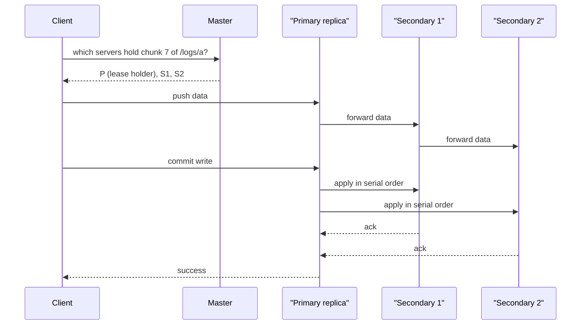

## In one minute
- A distributed file system (DFS) presents one namespace of files and directories while spreading the bytes over hundreds or thousands of machines.
- The classic design (GFS, HDFS) splits files into large chunks (64 to 128 MB), replicates each chunk on three servers across racks, and keeps all metadata in a central master.
- Clients ask the master *where* data lives, then read and write directly to chunk servers, so the master stays off the data path.
- The central master is simple and fast but becomes the limit on file count and availability; later systems (Colossus, Ceph, HDFS federation) shard or distribute metadata.
- DFS designs favour large sequential reads and appends over small random writes, and offer weaker semantics than a local POSIX file system.

## How it works

### Roles
**The metadata server** (GFS master, HDFS NameNode) holds the namespace tree, the mapping from each file to its ordered list of chunk ids, and the current location of every chunk replica. It keeps all of this in RAM for speed, and persists namespace changes to an operation log that is replicated before the change is acknowledged. Chunk locations are not persisted; the master rebuilds them from chunk server reports at startup ([GFS paper](https://static.googleusercontent.com/media/research.google.com/en//archive/gfs-sosp2003.pdf)).

**Chunk servers** (DataNodes) store chunks as ordinary local files, verify checksums on read, and send heartbeats with their chunk lists.

**Clients** cache metadata, compute which chunk contains a byte offset (`offset / chunk_size`), ask the master once for that chunk's replicas, and then talk only to chunk servers.

### Write path
The master grants a *lease* on the chunk to one replica, the primary. The client pushes data along a pipeline of replicas, each forwarding to the next, so every link carries the data once. The client then asks the primary to commit; the primary picks a serial order and the secondaries apply in that order. If any replica fails, the client retries, which can leave duplicate records. GFS called this "record append, at least once"; applications deduplicated with unique ids.

### Placement and re-replication
Replica placement balances durability against write cost. HDFS puts the first replica on the writer's node, the second on a different rack, and the third on another node in that second rack ([HDFS architecture](https://hadoop.apache.org/docs/stable/hadoop-project-dist/hadoop-hdfs/HdfsDesign.html)). That survives a full rack loss while only one copy crosses the rack boundary. When a server dies, its heartbeat stops, and the master schedules copies of every chunk that dropped below the target replica count, prioritising chunks with only one copy left. A 12 TB server failure means 12 TB of re-replication spread over the cluster.

### Limits of the single master
Every file, directory and block costs about 150 bytes of NameNode heap as a rule of thumb, so 10 million single-block files need about 3 GB ([Cloudera](https://www.cloudera.com/blog/technical/the-small-files-problem.html)). 500 million files of 1 to 2 chunks each needs on the order of 100 to 200 GB of heap, and every open, list, or create goes through one process. This is the *small files problem*. Fixes include packing small files into containers (HAR, SequenceFiles, Parquet), federating the namespace across several masters, or a distributed metadata layer. Google's GFS successor, Colossus, keeps file system metadata in Bigtable behind a horizontally scalable set of *curators*, which let it grow more than 100 times past the largest GFS clusters ([Google Cloud](https://cloud.google.com/blog/products/storage-data-transfer/a-peek-behind-colossus-googles-file-system)). The single-master ceiling is real but high: LinkedIn runs a 380 GB NameNode heap holding 1.1 billion namespace objects ([LinkedIn](https://www.linkedin.com/blog/engineering/open-source/the-exabyte-club-linkedin-s-journey-of-scaling-the-hadoop-distr)).

High availability adds a standby master that tails the edit log from a quorum of JournalNodes and takes over via ZooKeeper, with fencing so the old master cannot keep writing ([HDFS HA](https://hadoop.apache.org/docs/stable/hadoop-project-dist/hadoop-hdfs/HDFSHighAvailabilityWithQJM.html)). Current Hadoop 3 releases also let standbys serve reads as *Observer* NameNodes: each client carries the last transaction id it saw, and an Observer waits until it has caught up to that id before answering, so a client never reads older state than it wrote ([Observer NameNode](https://hadoop.apache.org/docs/stable/hadoop-project-dist/hadoop-hdfs/ObserverNameNode.html)); at LinkedIn that roughly tripled namespace throughput.

## Down the stack

### Layer 1: The contract
HDFS promises a single-writer, append-only file: one client holds the write lease on a path, others can read concurrently, and there is no random overwrite. Visibility and durability are separate calls. `hflush()` guarantees that data written so far has reached every DataNode in the pipeline and is visible to new readers, but it may still sit in those machines' memory. `hsync()` additionally asks each DataNode to fsync. `close()` completes the last block and makes the file length final at the NameNode. Namespace operations (create, rename, delete) are atomic and durable once acknowledged, because the NameNode logs them to a quorum of JournalNodes first. GFS's contract was weaker: record appends were atomic but at least once, and a region written concurrently could end up consistent yet undefined, holding mingled fragments of several writes ([GFS paper](https://static.googleusercontent.com/media/research.google.com/en//archive/gfs-sosp2003.pdf)).

### Layer 2: The mechanism
HDFS splits files into blocks of 128 MB by default. On a DataNode each block is two local files: the data, and a `.meta` file holding a CRC32C for every 512 bytes (`dfs.bytes-per-checksum`). A writer sends data as packets of about 64 KB, each containing chunks with their checksums. The packet flows down the pipeline of DataNodes, and acknowledgements flow back up; the client keeps unacknowledged packets in an ack queue and, if a DataNode fails, rebuilds the pipeline from the survivors and resends. Readers verify checksums and, on a mismatch, report the bad replica to the NameNode and read another.

The NameNode persists the namespace as an `fsimage` checkpoint plus an edit log; with high availability, edits go to a quorum of JournalNodes and the standby replays them continuously. Block locations are never persisted. DataNodes send heartbeats every 3 seconds and periodic full block reports, and a DataNode that has been silent for about 10 minutes (twice the 5-minute recheck interval plus ten heartbeats) is declared dead and its blocks re-replicated ([hdfs-default.xml](https://hadoop.apache.org/docs/stable/hadoop-project-dist/hadoop-hdfs/hdfs-default.xml)). The long timeout is deliberate: it stops a brief network blip from triggering a re-replication storm. GFS used 64 MB chunks, 64 KB checksum blocks with 32-bit checksums, chunk leases of 60 seconds, and under 64 bytes of master metadata per chunk.

### Layer 3: The machine
Block size comes from disk physics. A hard drive seek costs around 10 ms while sequential transfer runs at 100 to 250 MB/s, so reading a 128 MB block spends about 1% of its time seeking. Small blocks would turn analytics scans into seek-bound workloads and inflate NameNode memory. Checksums every 512 bytes are cheap because modern CPUs compute CRC32C with a dedicated instruction.

The pipeline is a network design. Each byte leaves the client's NIC once and crosses each link once, instead of the client sending three copies over its own uplink. DataNodes serve reads with `transferTo`, which maps to `sendfile` on Linux and moves bytes from page cache to socket without copying through user space. When the reader runs on the same machine, short-circuit local reads pass an open file descriptor over a Unix domain socket so the client reads the block file directly. The NameNode is a JVM holding the namespace on heap, so very large namespaces mean heaps of tens to hundreds of gigabytes and garbage collection pauses that stall every client.

### Why it's built this way
1. Commodity disks and servers fail constantly, so data is replicated across machines and racks and verified by checksum on every read.
2. Disks are fast sequentially and slow to seek, so files are cut into huge blocks and workloads are streaming.
3. Huge blocks keep the metadata small enough for one machine's RAM, which makes a single master simple and fast.
4. A single master must not touch data, so clients get locations once and move bytes directly with DataNodes.
5. Cross-rack bandwidth is scarce, so pipelined writes and rack-aware placement send each byte across the core network as few times as possible.

## Diagram


## Worked example
An analytics cluster has 400 data nodes, each with 12 × 16 TB disks: 77 PB raw. With 3x replication, usable capacity is about 25 PB, and at 75% target fill, about 19 PB of data.

With 128 MB blocks, 19 PB is about 150 million blocks. At roughly 150 bytes per block object plus file and directory objects, the NameNode needs around 60 to 80 GB of heap, which is workable. If the same data were stored as 1 MB files, the count would be 19 billion objects and no single NameNode could hold it. The team enforces compaction jobs that rewrite small outputs into 512 MB Parquet files.

Recovery: one node holds 192 TB × 75% = 144 TB. When it dies, the other 399 nodes each copy about 360 GB. If re-replication is throttled to 50 MB/s per node to protect production jobs, recovery takes about 2 hours, during which some blocks have only two copies. The probability of losing a second and third replica holder of the same block in that window is low, but it is why HDFS prioritises single-replica blocks first and why larger clusters move cold data to erasure coding. HDFS has supported that natively since Hadoop 3 with policies such as RS-6-3, which stores 6 blocks of data in 9 instead of 18, but erasure-coded files give up part of the contract: `append()` and `truncate()` fail, and `hflush()` and `hsync()` do nothing, so write-ahead logs and other files that need them must stay replicated ([HDFS erasure coding](https://hadoop.apache.org/docs/stable/hadoop-project-dist/hadoop-hdfs/HDFSErasureCoding.html)).

## In the wild
- **Facebook, 2012: measuring the cost of a single NameNode.** Facebook's warehouse ran the largest HDFS cluster it knew of, over 100 PB of raw disk in one namespace. Reviewing incidents, it found HDFS behind 41% of warehouse incidents, but only 10% of warehouse issues and unplanned downtime would have been avoided by a highly available NameNode, while removing the NameNode as a single point of failure would cut planned downtime by about half, since every upgrade or restart stopped the cluster. Its answer, AvatarNode, wrapped the NameNode in a ZooKeeper-coordinated hot standby with manual failover, and DataNodes sent block reports to both ([Facebook Engineering](https://engineering.fb.com/2012/06/13/core-infra/under-the-hood-hadoop-distributed-filesystem-reliability-with-namenode-and-avatarnode/)).
- **LinkedIn, 2021: scaling one namespace to a billion objects.** LinkedIn's largest cluster stores 500 PB on 10,000 nodes behind one NameNode with a 380 GB heap. On the way, a DistCp job copying 100 million log files made the NameNode unresponsive to every other client, oversized block reports stalled it until each drive was split into ten virtual volumes, and a full garbage collection at that heap size would mean a multi-minute outage. Fixes included Observer reads, which tripled namespace throughput, and a separate "satellite" cluster for logs that were half the namespace but 0.07% of the bytes ([LinkedIn Engineering](https://www.linkedin.com/blog/engineering/open-source/the-exabyte-club-linkedin-s-journey-of-scaling-the-hadoop-distr)).

## Trade-offs
| Option | Strengths | Weaknesses | Choose when |
|---|---|---|---|
| HDFS-style central metadata | Simple, strong namespace consistency, data locality for compute | Master memory and throughput limits, small files problem | Batch analytics on large files in your own data centre |
| Federated or distributed metadata (Colossus, HDFS federation) | Scales to billions of files | More complex, cross-namespace operations harder | Very large multi-tenant storage |
| Ceph (CRUSH placement, no central lookup) | No metadata bottleneck for objects and blocks, self-healing | Operational complexity, tuning | Unified block, object, and file storage on-premises |
| Cloud object storage instead | No servers to run, near-infinite capacity | No rename atomicity, no appends, higher latency | Most new cloud analytics |
| NFS or a single NAS | POSIX semantics, simple | Single-box limits | Small teams, home directories |

## Pitfalls in production
- **Small files.** Millions of tiny files exhaust master memory and slow every listing. Compact them and set file count quotas per directory.
- **Master as a single point of failure.** Without HA, a NameNode crash stops the whole cluster. Run active-standby with fencing and test failover.
- **Unbalanced disks after expansion.** New nodes sit empty while old ones fill. Run the balancer continuously at a throttled rate.
- **Re-replication storms.** A rack power loss triggers petabytes of copying. Delay re-replication for short outages and throttle network use.
- **Assuming POSIX semantics.** Appends, concurrent writers, and rename behaviour differ from local disks. Use a single writer per file and write-then-rename patterns.

## Leadership lens
- Ask about file count and average file size before capacity; metadata is usually the first limit.
- Decide whether you need a DFS at all; for most cloud workloads, object storage plus a table format replaces it.
- Make failure-domain mapping (rack, power, switch) part of the cluster's configuration review, since placement is only as good as the topology it is told.
- Treat re-replication time as a durability metric and report it.

## Check yourself
1. Why does the client send data through a pipeline of replicas rather than to each replica directly?
   **Answer:** A chain uses each server's network link once, so the client's uplink is not divided three ways and total write throughput is higher.
2. Why does the master not persist chunk locations?
   **Answer:** Chunk servers are the source of truth for what they hold, so the master rebuilds locations from their reports and avoids keeping a second copy in sync.
3. Why do small files hurt a DFS even when total bytes are modest?
   **Answer:** Every file and chunk is an object in master memory and a separate metadata operation, so file count, not bytes, sets the limit.
4. What does HDFS rack-aware placement protect against, and at what cost?
   **Answer:** Losing an entire rack, at the cost of sending one replica's worth of data across the rack boundary on each write.

## Practice
**Task:** Write the metadata logic of a chunk master. `Master(racks, chunk_size, rf)` takes a dict of node to rack. `create(name, size)` splits the file into `ceil(size / chunk_size)` chunks and places `rf` replicas per chunk on distinct live nodes, using at least two racks when more than one exists and preferring less-loaded nodes. `locate(name, offset)` returns `(chunk_index, replicas)` or `None` for an unknown file or out-of-range offset. `fail(node)` removes the node and re-replicates its chunks onto other live nodes; `under_replicated()` counts chunks with fewer than `rf` replicas.

```python starter
class Master:
    def __init__(self, racks, chunk_size, rf):
        self.racks = racks

    def create(self, name, size):
        raise NotImplementedError

    def locate(self, name, offset):
        raise NotImplementedError

    def fail(self, node):
        raise NotImplementedError

    def under_replicated(self):
        raise NotImplementedError
```

```python tests
RACKS = {"a1": "A", "a2": "A", "a3": "A", "b1": "B", "b2": "B", "b3": "B"}

def test_chunk_count_and_distinct_replicas():
    m = Master(RACKS, 64, 3)
    chunks = m.create("/f", 200)
    assert len(chunks) == 4
    for reps in chunks:
        assert len(set(reps)) == 3

def test_replicas_span_two_racks():
    m = Master(RACKS, 64, 3)
    for reps in m.create("/f", 640):
        assert len({RACKS[n] for n in reps}) == 2

def test_load_is_balanced():
    m = Master(RACKS, 10, 3)
    m.create("/f", 200)
    load = {n: 0 for n in RACKS}
    for i in range(20):
        for n in m.locate("/f", i * 10)[1]:
            load[n] += 1
    assert max(load.values()) - min(load.values()) <= 1

def test_locate():
    m = Master(RACKS, 64, 3)
    m.create("/f", 200)
    assert m.locate("/f", 130)[0] == 2
    assert m.locate("/f", 200) is None
    assert m.locate("/nope", 0) is None

def test_failure_rereplicates():
    m = Master(RACKS, 64, 2)
    m.create("/f", 640)
    m.fail("a1")
    assert m.under_replicated() == 0
    for i in range(10):
        reps = m.locate("/f", i * 64)[1]
        assert "a1" not in reps and len(set(reps)) == 2

def test_not_enough_nodes():
    m = Master({"x": "R", "y": "R"}, 64, 2)
    m.create("/f", 64)
    m.fail("x")
    assert m.under_replicated() == 1
```

```python solution
class Master:
    def __init__(self, racks, chunk_size, rf):
        self.racks, self.chunk_size, self.rf = dict(racks), chunk_size, rf
        self.files, self.load = {}, {n: 0 for n in racks}

    def _pick(self, exclude, avoid_rack=None):
        cands = [n for n in self.racks if n not in exclude]
        if avoid_rack is not None:
            other = [n for n in cands if self.racks[n] != avoid_rack]
            cands = other or cands
        if not cands:
            return None
        best = min(cands, key=lambda n: (self.load[n], n))
        self.load[best] += 1
        return best

    def create(self, name, size):
        chunks = []
        for _ in range(-(-size // self.chunk_size)):
            reps = []
            for i in range(self.rf):
                avoid = self.racks[reps[0]] if i == 1 else None
                node = self._pick(reps, avoid)
                if node is None:
                    break
                reps.append(node)
            chunks.append(reps)
        self.files[name] = (size, chunks)
        return [list(r) for r in chunks]

    def locate(self, name, offset):
        if name not in self.files or not 0 <= offset < self.files[name][0]:
            return None
        idx = offset // self.chunk_size
        return idx, list(self.files[name][1][idx])

    def fail(self, node):
        self.racks.pop(node, None)
        self.load.pop(node, None)
        for _, chunks in self.files.values():
            for reps in chunks:
                if node in reps:
                    reps.remove(node)
                    new = self._pick(reps)
                    if new is not None:
                        reps.append(new)

    def under_replicated(self):
        return sum(1 for _, ch in self.files.values() for r in ch if len(r) < self.rf)
```

```typescript starter
export class Master {
  constructor(public racks: Record<string, string>, public chunkSize: number, public rf: number) {}
  create(name: string, size: number): string[][] { throw new Error("TODO"); }
  locate(name: string, offset: number): [number, string[]] | null { throw new Error("TODO"); }
  fail(node: string): void { throw new Error("TODO"); }
  underReplicated(): number { throw new Error("TODO"); }
}
```

```typescript tests
const RACKS: Record<string, string> = { a1: "A", a2: "A", a3: "A", b1: "B", b2: "B", b3: "B" };
test("chunk count and distinct replicas", () => {
  const chunks = new Master({ ...RACKS }, 64, 3).create("/f", 200);
  assertEqual(chunks.length, 4);
  for (const reps of chunks) assertEqual(new Set(reps).size, 3);
});
test("replicas span two racks", () => {
  for (const reps of new Master({ ...RACKS }, 64, 3).create("/f", 640)) {
    assertEqual(new Set(reps.map((n) => RACKS[n])).size, 2);
  }
});
test("load is balanced", () => {
  const m = new Master({ ...RACKS }, 10, 3);
  m.create("/f", 200);
  const load: Record<string, number> = {};
  for (const n of Object.keys(RACKS)) load[n] = 0;
  for (let i = 0; i < 20; i++) for (const n of m.locate("/f", i * 10)![1]) load[n]++;
  const v = Object.values(load);
  assert(Math.max(...v) - Math.min(...v) <= 1, "unbalanced " + JSON.stringify(load));
});
test("locate", () => {
  const m = new Master({ ...RACKS }, 64, 3);
  m.create("/f", 200);
  assertEqual(m.locate("/f", 130)![0], 2);
  assertEqual(m.locate("/f", 200), null);
  assertEqual(m.locate("/nope", 0), null);
});
test("failure rereplicates", () => {
  const m = new Master({ ...RACKS }, 64, 2);
  m.create("/f", 640);
  m.fail("a1");
  assertEqual(m.underReplicated(), 0);
  for (let i = 0; i < 10; i++) {
    const reps = m.locate("/f", i * 64)![1];
    assert(!reps.includes("a1") && new Set(reps).size === 2, "bad replicas " + reps);
  }
});
test("not enough nodes", () => {
  const m = new Master({ x: "R", y: "R" }, 64, 2);
  m.create("/f", 64);
  m.fail("x");
  assertEqual(m.underReplicated(), 1);
});
```

```typescript solution
export class Master {
  private files = new Map<string, [number, string[][]]>();
  private load = new Map<string, number>();

  constructor(public racks: Record<string, string>, public chunkSize: number, public rf: number) {
    for (const n of Object.keys(racks)) this.load.set(n, 0);
  }

  private pick(exclude: string[], avoidRack?: string): string | null {
    let cands = [...this.load.keys()].filter((n) => !exclude.includes(n));
    if (avoidRack !== undefined) {
      const other = cands.filter((n) => this.racks[n] !== avoidRack);
      if (other.length > 0) cands = other;
    }
    if (cands.length === 0) return null;
    cands.sort((a, b) => this.load.get(a)! - this.load.get(b)! || (a < b ? -1 : 1));
    this.load.set(cands[0], this.load.get(cands[0])! + 1);
    return cands[0];
  }

  create(name: string, size: number): string[][] {
    const chunks: string[][] = [];
    for (let c = 0; c < Math.ceil(size / this.chunkSize); c++) {
      const reps: string[] = [];
      for (let i = 0; i < this.rf; i++) {
        const node = this.pick(reps, i === 1 ? this.racks[reps[0]] : undefined);
        if (node === null) break;
        reps.push(node);
      }
      chunks.push(reps);
    }
    this.files.set(name, [size, chunks]);
    return chunks.map((r) => [...r]);
  }

  locate(name: string, offset: number): [number, string[]] | null {
    const f = this.files.get(name);
    if (!f || offset < 0 || offset >= f[0]) return null;
    const idx = Math.floor(offset / this.chunkSize);
    return [idx, [...f[1][idx]]];
  }

  fail(node: string): void {
    this.load.delete(node);
    for (const [, chunks] of this.files.values()) {
      for (const reps of chunks) {
        const i = reps.indexOf(node);
        if (i < 0) continue;
        reps.splice(i, 1);
        const n = this.pick(reps);
        if (n !== null) reps.push(n);
      }
    }
  }

  underReplicated(): number {
    let count = 0;
    for (const [, chunks] of this.files.values()) for (const r of chunks) if (r.length < this.rf) count++;
    return count;
  }
}
```

```go starter
package practice

type Master struct{}

func NewMaster(racks map[string]string, chunkSize int64, rf int) *Master { return &Master{} }

func (m *Master) Create(name string, size int64) [][]string                 { panic("TODO") }
func (m *Master) Locate(name string, offset int64) (int, []string, bool)    { panic("TODO") }
func (m *Master) Fail(node string)                                           { panic("TODO") }
func (m *Master) UnderReplicated() int                                       { panic("TODO") }
```

```go tests
package practice

import "testing"

func racks() map[string]string {
	return map[string]string{"a1": "A", "a2": "A", "a3": "A", "b1": "B", "b2": "B", "b3": "B"}
}

func distinct(xs []string) int {
	s := map[string]bool{}
	for _, x := range xs {
		s[x] = true
	}
	return len(s)
}

func TestChunkCountAndDistinctReplicas(t *testing.T) {
	chunks := NewMaster(racks(), 64, 3).Create("/f", 200)
	if len(chunks) != 4 {
		t.Fatalf("chunks %d", len(chunks))
	}
	for _, r := range chunks {
		if distinct(r) != 3 {
			t.Fatalf("replicas %v", r)
		}
	}
}

func TestReplicasSpanTwoRacks(t *testing.T) {
	rk := racks()
	for _, r := range NewMaster(racks(), 64, 3).Create("/f", 640) {
		var rs []string
		for _, n := range r {
			rs = append(rs, rk[n])
		}
		if distinct(rs) != 2 {
			t.Fatalf("racks %v", rs)
		}
	}
}

func TestLoadIsBalanced(t *testing.T) {
	m := NewMaster(racks(), 10, 3)
	m.Create("/f", 200)
	load := map[string]int{}
	for n := range racks() {
		load[n] = 0
	}
	for i := int64(0); i < 20; i++ {
		_, reps, _ := m.Locate("/f", i*10)
		for _, n := range reps {
			load[n]++
		}
	}
	lo, hi := 1<<30, 0
	for _, v := range load {
		lo, hi = min(lo, v), max(hi, v)
	}
	if hi-lo > 1 {
		t.Fatalf("load %v", load)
	}
}

func TestLocate(t *testing.T) {
	m := NewMaster(racks(), 64, 3)
	m.Create("/f", 200)
	if idx, _, ok := m.Locate("/f", 130); !ok || idx != 2 {
		t.Fatalf("idx %d ok %v", idx, ok)
	}
	if _, _, ok := m.Locate("/f", 200); ok {
		t.Fatal("offset past end")
	}
	if _, _, ok := m.Locate("/nope", 0); ok {
		t.Fatal("unknown file")
	}
}

func TestFailureRereplicates(t *testing.T) {
	m := NewMaster(racks(), 64, 2)
	m.Create("/f", 640)
	m.Fail("a1")
	if m.UnderReplicated() != 0 {
		t.Fatal("under-replicated chunks remain")
	}
	for i := int64(0); i < 10; i++ {
		_, reps, _ := m.Locate("/f", i*64)
		for _, n := range reps {
			if n == "a1" {
				t.Fatal("dead node still listed")
			}
		}
		if distinct(reps) != 2 {
			t.Fatalf("replicas %v", reps)
		}
	}
}

func TestNotEnoughNodes(t *testing.T) {
	m := NewMaster(map[string]string{"x": "R", "y": "R"}, 64, 2)
	m.Create("/f", 64)
	m.Fail("x")
	if m.UnderReplicated() != 1 {
		t.Fatalf("got %d", m.UnderReplicated())
	}
}
```

```go solution
package practice

import "sort"

type file struct {
	size   int64
	chunks [][]string
}

type Master struct {
	racks     map[string]string
	load      map[string]int
	files     map[string]*file
	chunkSize int64
	rf        int
}

func NewMaster(racks map[string]string, chunkSize int64, rf int) *Master {
	m := &Master{racks: map[string]string{}, load: map[string]int{}, files: map[string]*file{}, chunkSize: chunkSize, rf: rf}
	for n, r := range racks {
		m.racks[n], m.load[n] = r, 0
	}
	return m
}

func contains(xs []string, x string) bool {
	for _, y := range xs {
		if y == x {
			return true
		}
	}
	return false
}

func (m *Master) pick(exclude []string, avoidRack string) (string, bool) {
	var cands, other []string
	for n := range m.load {
		if !contains(exclude, n) {
			cands = append(cands, n)
			if avoidRack != "" && m.racks[n] != avoidRack {
				other = append(other, n)
			}
		}
	}
	if len(other) > 0 {
		cands = other
	}
	if len(cands) == 0 {
		return "", false
	}
	sort.Slice(cands, func(i, j int) bool {
		if m.load[cands[i]] != m.load[cands[j]] {
			return m.load[cands[i]] < m.load[cands[j]]
		}
		return cands[i] < cands[j]
	})
	m.load[cands[0]]++
	return cands[0], true
}

func (m *Master) Create(name string, size int64) [][]string {
	f := &file{size: size}
	for c := int64(0); c < (size+m.chunkSize-1)/m.chunkSize; c++ {
		var reps []string
		for i := 0; i < m.rf; i++ {
			avoid := ""
			if i == 1 {
				avoid = m.racks[reps[0]]
			}
			n, ok := m.pick(reps, avoid)
			if !ok {
				break
			}
			reps = append(reps, n)
		}
		f.chunks = append(f.chunks, reps)
	}
	m.files[name] = f
	return f.chunks
}

func (m *Master) Locate(name string, offset int64) (int, []string, bool) {
	f, ok := m.files[name]
	if !ok || offset < 0 || offset >= f.size {
		return 0, nil, false
	}
	idx := int(offset / m.chunkSize)
	return idx, append([]string{}, f.chunks[idx]...), true
}

func (m *Master) Fail(node string) {
	delete(m.load, node)
	for _, f := range m.files {
		for ci, reps := range f.chunks {
			if !contains(reps, node) {
				continue
			}
			var kept []string
			for _, n := range reps {
				if n != node {
					kept = append(kept, n)
				}
			}
			if n, ok := m.pick(kept, ""); ok {
				kept = append(kept, n)
			}
			f.chunks[ci] = kept
		}
	}
}

func (m *Master) UnderReplicated() int {
	count := 0
	for _, f := range m.files {
		for _, r := range f.chunks {
			if len(r) < m.rf {
				count++
			}
		}
	}
	return count
}
```

## Mock interview
**Prompt:** Design the storage layer for a company-wide data lake on its own hardware: 30 PB today, growing 40% per year, read mostly by Spark jobs scanning large files, plus a long tail of small files from ad hoc tools.

- Follow-up: How do you keep the metadata service from becoming the bottleneck as file count grows?
- Follow-up: A top-of-rack switch fails, taking 40 nodes offline for 20 minutes. What should the system do?
- Follow-up: When would you switch cold data from replication to erasure coding?

**A strong answer covers:**
- Chunked files with replicated, rack-aware placement and direct client-to-server data flow.
- Metadata sizing per object and a plan for small files (compaction, quotas, federation).
- HA metadata with a replicated log and fenced failover.
- Delayed and throttled re-replication to avoid storms from transient failures.
- Tiering hot data on 3x replication and cold data on erasure coding, with the recovery cost of each.

## Sources and further study
**Primary**
- [HDFS: Observer NameNode](https://hadoop.apache.org/docs/stable/hadoop-project-dist/hadoop-hdfs/ObserverNameNode.html): consistent reads from standbys, with state ids and `msync()`.
- [HDFS: high availability with the Quorum Journal Manager](https://hadoop.apache.org/docs/stable/hadoop-project-dist/hadoop-hdfs/HDFSHighAvailabilityWithQJM.html): JournalNodes, fencing and failover.

**Systems docs**
- [HDFS erasure coding](https://hadoop.apache.org/docs/stable/hadoop-project-dist/hadoop-hdfs/HDFSErasureCoding.html): striped layout, built-in policies and the operations EC files lose.
- [hdfs-default.xml](https://hadoop.apache.org/docs/stable/hadoop-project-dist/hadoop-hdfs/hdfs-default.xml): every default quoted in this lesson, from block size to heartbeat timing.
- [Google Cloud: a peek behind Colossus](https://cloud.google.com/blog/products/storage-data-transfer/a-peek-behind-colossus-googles-file-system): curators, D servers and metadata in Bigtable.
- [Cloudera: the small files problem](https://www.cloudera.com/blog/technical/the-small-files-problem.html): where the 150-bytes-per-object rule comes from and how to pack files.

**Books**
- *Designing Data-Intensive Applications* (1st ed.), Martin Kleppmann, Ch 10 "Batch Processing": MapReduce over distributed file systems, data locality and why HDFS looks the way it does.
- *Understanding Distributed Systems* (2nd ed.), Roberto Vitillo, chapter "File storage": a walk through a cloud file store's metadata and data layers.

**Other curricula**
- [donnemartin/system-design-primer](https://github.com/donnemartin/system-design-primer): lists GFS and HDFS as reference architectures to read, without explaining them.
- [Azure Architecture Center: choose a storage service](https://learn.microsoft.com/en-us/azure/architecture/guide/technology-choices/storage-options): steers HDFS workloads to Data Lake Storage, an object store with a hierarchical namespace and HDFS compatibility, and HPC to managed Lustre.

## Watch
- [Lecture 3: GFS (MIT 6.824)](https://www.youtube.com/watch?v=EpIgvowZr00): Robert Morris walks through the GFS paper and its consistency model.
- [Ceph Tech Talk: Intro to Ceph](https://www.youtube.com/watch?v=PmLPbrf-x9g): RADOS, CRUSH placement, and how Ceph avoids a central lookup.

## Free resources
- [The Google File System (SOSP 2003)](https://static.googleusercontent.com/media/research.google.com/en//archive/gfs-sosp2003.pdf): the paper that set the pattern for large-scale DFS design.
- [HDFS Architecture](https://hadoop.apache.org/docs/stable/hadoop-project-dist/hadoop-hdfs/HdfsDesign.html): NameNode, DataNodes, replica placement, and the write pipeline.
- [Ceph (OSDI 2006)](https://www.usenix.org/legacy/event/osdi06/tech/full_papers/weil/weil.pdf): a distributed file system with distributed metadata and computed placement.
- [Ceph architecture](https://docs.ceph.com/en/latest/architecture/): current documentation on RADOS, CRUSH, and the metadata servers.
