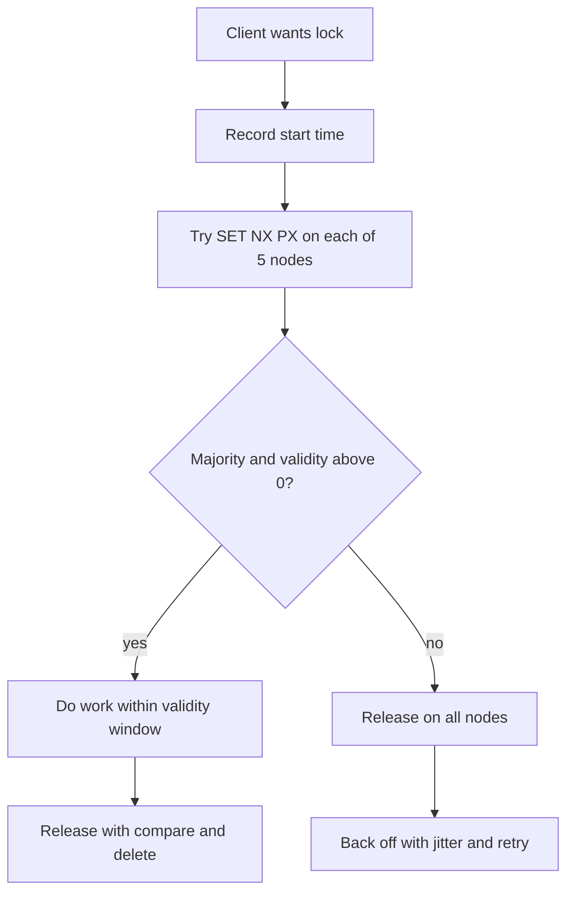

## In one minute
- A distributed lock gives one process at a time the right to act on a shared resource across machines.
- Decide first what the lock is for. An **efficiency** lock only avoids duplicate work, so an occasional double holder is fine. A **correctness** lock protects data, so a double holder means corruption.
- Every practical lock is a lease with a timeout, because a crashed holder must not block everyone forever. Timeouts mean a paused holder can outlive its lock.
- For correctness, combine a lock from a consensus-backed store with **fencing tokens** checked by the resource. Redis-based locks are fine for efficiency, risky for correctness.

## How it works

### The single-node lease
The common Redis pattern is `SET lock:invoice-77 <random-id> NX PX 30000`. `NX` makes it succeed only if the key is absent, and `PX` sets a 30 s expiry so a crashed holder does not deadlock the system. Release must be a compare-and-delete: delete the key only if its value still equals my random id. Since Redis 8.4 that is one command, `DELEX key IFEQ <random-id>`; on older versions it is a short Lua script ([Redis docs](https://redis.io/docs/latest/develop/clients/patterns/distributed-locks/)). A plain `DEL` can remove a lock another client acquired after yours expired.

The weakness is the single Redis node. Replication is asynchronous, so if the primary fails over to a replica before the key replicates, a second client acquires the same lock. The Redis docs call this a safety violation and say the single-node lock suits only cases where an occasional double holder is acceptable.

### Redlock
Redlock acquires the same key on N independent Redis masters (typically 5). The client records the start time, tries each node with a short timeout (the spec suggests about 5 to 50 ms for a 10 s TTL, so a dead node cannot eat the validity window), and holds the lock only if it got a majority and the elapsed time is well under the TTL. Remaining validity is `ttl - elapsed - drift`. If it fails, it releases on all nodes.

The critique, made clearly by Martin Kleppmann, is that Redlock's safety depends on timing: bounded network delay, bounded process pauses, and clocks that do not jump. A GC pause or a clock step after acquiring makes the client act on an expired lock, and he notes stop-the-world pauses have been known to last minutes ([Kleppmann](https://martin.kleppmann.com/2016/02/08/how-to-do-distributed-locking.html)). Redlock also gives no fencing token, so the resource cannot detect it. The Redis docs now carry a consistency disclaimer that agrees on two points: implement fencing tokens for long work, and know that Redis TTLs follow the wall clock, not a monotonic one.

### Consensus-backed locks
etcd, ZooKeeper, and Consul store lock state through Raft or Zab, so failover does not lose a granted lock. ZooKeeper's recipe creates an ephemeral sequential znode under `/locks/x`; the lowest sequence number holds the lock, and each waiter watches only its predecessor. The ephemeral node vanishes when the holder's session expires ([ZooKeeper recipes](https://zookeeper.apache.org/doc/current/recipes.html)). etcd ties a key to a lease and exposes a revision number that increases with every write, which serves as a fencing token.

Consensus makes the *grant* durable; it does not make the *holder* safe. Jepsen's 2020 test of etcd 3.4.3 saw two clients hold the same etcd lock at once even in a healthy cluster, and with short leases and process pauses about 18% of acknowledged updates to a lock-guarded set were lost. Its advice is to treat any lock as a performance aid and to fence with the lock key's revision ([Jepsen](https://jepsen.io/analyses/etcd-3.4.3)).

### Fencing tokens
Every grant comes with a number that never decreases. The holder passes it on every write, and the resource remembers the highest token it accepted and rejects lower ones. This closes the pause gap: a holder that wakes after expiry carries an old token and is refused. It requires the resource to cooperate. A database can check it in a `WHERE` clause; an S3 bucket or a third-party API usually cannot. The idea is old: Google's Chubby called the token a *sequencer*, and for servers that could not check one it fell back to a *lock-delay*, refusing to regrant a lost lock for up to one minute ([Chubby paper](https://static.googleusercontent.com/media/research.google.com/en//archive/chubby-osdi06.pdf)).

### Database locks
If the protected data lives in one database, use that database. `SELECT ... FOR UPDATE`, advisory locks like `pg_advisory_xact_lock`, or a conditional update on a version column are transactional with the data itself. That is usually simpler and safer than any external lock. Prefer the transaction-level advisory form: a session-level advisory lock ignores transaction semantics, so it stays held after a rollback until you unlock it or the session ends ([Postgres docs](https://www.postgresql.org/docs/current/explicit-locking.html)).

## Down the stack

### Layer 1: The contract
Be precise about which of two contracts you need. An *efficiency* lock promises that, most of the time, only one worker does a piece of work; an occasional double run costs money but not correctness. A *correctness* lock promises mutual exclusion on a resource even across crashes, failovers, pauses and clock jumps. No lease-based lock can deliver the second promise alone, because the holder cannot know it still holds the lock at the instant its write lands. The strongest testable promise is: the lock service grants each lock to one session at a time, every grant carries a strictly larger token, and the resource rejects writes with a smaller token. Latency: one round trip to acquire uncontended, and up to one lease of unavailability when a holder dies.

### Layer 2: The mechanism
Redis executes commands on a single thread, so `SET key val NX PX ttl` is atomic, and a Lua release script runs to completion with nothing interleaved. The holder's random value, typically 16 to 20 random bytes, is what makes compare-and-delete safe. Replication is asynchronous, so a grant acknowledged by the primary can vanish if the primary dies before shipping it. Redlock's reference clients subtract a drift allowance of about 1% of the TTL plus a couple of milliseconds from validity, and the algorithm asks that a crashed node stay down for at least one TTL before rejoining, since a restart without the key on disk can grant the lock again.

etcd's `concurrency.Mutex` writes a key under the lock prefix bound to the session's lease, then waits for deletion of the key whose create revision is just below its own; the holder's create revision doubles as a fencing token. ZooKeeper (usually through Curator's `InterProcessMutex`) does the same with ephemeral sequential znodes. Consul acquires a KV key with a session and, by default, applies a 15 s *lock-delay* after a session is invalidated, so a new holder cannot grab the lock while the old one may still be finishing ([Consul docs](https://developer.hashicorp.com/consul/docs/automate/session)). Postgres advisory locks live in the server's shared-memory lock table and are freed when the transaction or session ends.

### Layer 3: The machine
A Redis `SET NX` costs microseconds of CPU; the round trip inside one datacenter is typically a few hundred microseconds. Durability is the weak point: with the common `appendfsync everysec` setting a crash can lose about the last second of writes, including lock grants, while `appendfsync always` pays an fsync per write. Redis stores key expiry as an absolute Unix-time deadline, so if the server's wall clock is stepped forward, locks expire early everywhere at once. Consensus-backed locks pay a quorum round trip plus a WAL fsync per acquire and release, usually low single-digit milliseconds, but a grant survives the loss of any minority.

The holder's side is where safety actually breaks. A JVM stop-the-world pause, a VM steal or a page fault on a swapped-out page can freeze a process for longer than its lease. Database session locks fail in a different way: if a client host dies silently, the server notices only when TCP does, and Linux's default keepalive starts probing after 7,200 s ([kernel docs](https://docs.kernel.org/networking/ip-sysctl.html)), so an advisory lock can be held for hours unless you set keepalives or `idle_in_transaction_session_timeout`.

### Why it's built this way
1. A process cannot tell a crashed lock holder from a slow one, so locks must expire, which makes them leases.
2. Leases depend on elapsed time, and processes pause unpredictably, so a holder can always act after its lease ends.
3. Only the resource sees writes in their true order, so the final safety check must live there, as a monotonically increasing fencing token.
4. Tokens need a durable, totally ordered counter, which is exactly what a consensus log provides and what an asynchronously replicated cache does not.

## Diagram


## Worked example
A nightly job generates invoices from 10,000 accounts across 20 workers. Each worker locks `account:<id>` before generating.

Efficiency case: if two workers occasionally process the same account, the second insert hits a unique constraint on `(account_id, period)` and is discarded. A single Redis node at about 0.3 ms per `SET NX` adds 3 s of total lock overhead across the run. Redis is the right tool.

Correctness case: workers also debit a prepaid balance through a ledger service. A worker takes the lock with a 30 s TTL, then stalls 45 s on a slow downstream call. A second worker takes the lock, debits $120, and finishes. The first wakes and debits $120 again. Fix it in layers:

- Use etcd and pass its revision as a fencing token.
- The ledger stores `last_token` per account and rejects lower tokens.
- Make the debit idempotent with a key such as `invoice-77:2026-10`, so even a same-token retry cannot double charge.

Lock cost on etcd is about 2 to 5 ms per acquire because it is a Raft write. Across 10,000 accounts that is a fair price for money movement.

## In the wild
- **Jepsen, 2020: etcd locks are not mutual exclusion.** Testing etcd 3.4.3, Jepsen saw two processes hold the same lock even without faults; with 1 to 3 s leases, violations appeared within minutes, and with pauses every five seconds about 18% of acknowledged updates to a lock-guarded set were lost. A bug also let a client receive a lock after its lease had expired while waiting. The recommendation was to fence with the lock key's revision and to document that locks do not guarantee exclusion ([Jepsen](https://jepsen.io/analyses/etcd-3.4.3)).
- **AWS, 2025: a delayed writer overwrites newer state.** In us-east-1, one of three DynamoDB DNS Enactors stalled while applying an old plan. A faster Enactor applied the newest plan and then cleaned up old ones; the slow one, whose freshness check ran only once at the start, then overwrote the endpoint with its stale plan, and cleanup deleted that plan, leaving `dynamodb.us-east-1.amazonaws.com` with no IP addresses. DynamoDB was impaired from 11:48 PM to 2:40 AM PDT. This is the paused-holder problem without a fencing check at the resource; AWS disabled the automation worldwide until the race is fixed ([AWS](https://aws.amazon.com/message/101925/)).

## Trade-offs
| Option | Strengths | Weaknesses | Choose when |
|---|---|---|---|
| Single Redis `SET NX PX` | Sub-ms, simple | Lost on failover, no fencing | Efficiency locks, dedup of work |
| Redlock | Survives minority node loss | Timing assumptions, no fencing, 5 nodes to run | Rarely; prefer the others |
| etcd / ZooKeeper / Consul | Consensus-backed, sessions, fencing via revisions | Ms latency, tier-0 dependency to operate | Correctness locks across services |
| Database row or advisory lock | Transactional with the data | Couples lock load to the DB | The resource is that database |
| No lock, conditional writes | No coordinator at all | Needs a CAS-capable store | Optimistic concurrency fits the workload |

## Pitfalls in production
- Releasing with plain `DEL` deletes another client's lock after yours expired. Always compare-and-delete with your unique token.
- Work longer than the TTL. Renew the lease, but tie renewal to real progress: a background heartbeat thread can keep renewing while the work thread is stuck, which Amazon's Builders' Library warns against. Check remaining validity before each side effect ([AWS Builders' Library](https://builder.aws.com/content/3Ev0vH0hfkcUizISUWYTvHibtcp/leader-election-in-distributed-systems)).
- Treating a lock as a transaction. A lock does not roll back partial writes when the holder dies; pair it with idempotency or a transactional outbox.
- One hot lock serialises a whole fleet. Lock at the finest useful granularity and measure wait time.
- Lock services as single points of failure. Decide whether work should stop or proceed unlocked when the lock store is down, and test that path.

## Leadership lens
- In design review, ask "what happens if two holders run concurrently for a minute?" The answer decides between Redis and a consensus store plus fencing.
- Push for designs that avoid locks: partition ownership, idempotent writes, compare-and-set on a version column.
- Require every correctness lock to name its fencing check and where it is enforced.
- Monitor acquisition latency, wait time, and expirations while held, which reveal TTLs set too low.

## Check yourself
1. Why must release check the lock's value before deleting it?
   **Answer:** Your lock may have expired and been granted to another client; an unconditional delete would release their lock and let a third client in.
2. Why does a fencing token protect against a GC pause when a TTL does not?
   **Answer:** The TTL only expires the lock at the store; the paused client still believes it holds it. The token is checked at the resource, which rejects the stale holder's lower number.
3. When is a single Redis lock an acceptable choice?
   **Answer:** When a double holder only wastes work and the downstream operation is idempotent or constrained.
4. What does Redlock's validity calculation subtract, and why?
   **Answer:** The time spent acquiring and an allowance for clock drift, because the lock started expiring on the first node before the last one granted it.

## Practice
**Task:** Implement a Redlock-style quorum lock with an injected clock. `LockNode` has `set_nx(key, owner, ttl, now)` returning `True` if the key is free or expired, and `release(key, owner)` that deletes only if `owner` matches. `acquire(nodes, key, owner, ttl, drift, clock)` calls `clock()` once before and once after trying every node (unreachable nodes are `None`). It returns the remaining validity `ttl - elapsed - drift` if a majority of the full list granted and validity is positive; otherwise it releases on every reachable node and returns `None`.

```python starter
class LockNode:
    def set_nx(self, key, owner, ttl, now):
        # TODO
        return False

    def release(self, key, owner):
        # TODO
        return False


def acquire(nodes, key, owner, ttl, drift, clock):
    # TODO
    return None
```

```python tests
def ticking(times):
    it = iter(times)
    return lambda: next(it)

def test_majority_acquires_with_validity():
    nodes = [LockNode(), LockNode(), None]
    assert acquire(nodes, "k", "a", 100, 2, ticking([0, 10])) == 88

def test_second_client_blocked():
    nodes = [LockNode() for _ in range(3)]
    acquire(nodes, "k", "a", 100, 0, ticking([0, 1]))
    assert acquire(nodes, "k", "b", 100, 0, ticking([5, 6])) is None

def test_slow_acquire_fails_and_releases():
    nodes = [LockNode() for _ in range(3)]
    assert acquire(nodes, "k", "a", 100, 5, ticking([0, 99])) is None
    assert acquire(nodes, "k", "b", 100, 0, ticking([100, 101])) == 99

def test_release_checks_owner():
    n = LockNode()
    n.set_nx("k", "a", 50, 0)
    assert not n.release("k", "b")
    assert not n.set_nx("k", "c", 50, 10)
    assert n.release("k", "a")

def test_expired_lock_can_be_taken():
    n = LockNode()
    n.set_nx("k", "a", 50, 0)
    assert n.set_nx("k", "b", 50, 50)
```

```python solution
class LockNode:
    def __init__(self):
        self.locks = {}

    def set_nx(self, key, owner, ttl, now):
        cur = self.locks.get(key)
        if cur is not None and now < cur[1]:
            return False
        self.locks[key] = (owner, now + ttl)
        return True

    def release(self, key, owner):
        cur = self.locks.get(key)
        if cur is None or cur[0] != owner:
            return False
        del self.locks[key]
        return True


def acquire(nodes, key, owner, ttl, drift, clock):
    start = clock()
    granted = 0
    for n in nodes:
        if n is not None and n.set_nx(key, owner, ttl, start):
            granted += 1
    validity = ttl - (clock() - start) - drift
    if granted >= len(nodes) // 2 + 1 and validity > 0:
        return validity
    for n in nodes:
        if n is not None:
            n.release(key, owner)
    return None
```

```typescript starter
export class LockNode {
  setNx(key: string, owner: string, ttl: number, now: number): boolean {
    throw new Error("TODO");
  }

  release(key: string, owner: string): boolean {
    throw new Error("TODO");
  }
}

export function acquire(nodes: (LockNode | null)[], key: string, owner: string, ttl: number, drift: number, clock: () => number): number | null {
  throw new Error("TODO");
}
```

```typescript tests
function ticking(times: number[]): () => number {
  let i = 0;
  return () => times[i++];
}

test("majority acquires with validity", () => {
  const nodes = [new LockNode(), new LockNode(), null];
  assertEqual(acquire(nodes, "k", "a", 100, 2, ticking([0, 10])), 88);
});

test("second client blocked", () => {
  const nodes = [new LockNode(), new LockNode(), new LockNode()];
  acquire(nodes, "k", "a", 100, 0, ticking([0, 1]));
  assertEqual(acquire(nodes, "k", "b", 100, 0, ticking([5, 6])), null);
});

test("slow acquire fails and releases", () => {
  const nodes = [new LockNode(), new LockNode(), new LockNode()];
  assertEqual(acquire(nodes, "k", "a", 100, 5, ticking([0, 99])), null);
  assertEqual(acquire(nodes, "k", "b", 100, 0, ticking([100, 101])), 99);
});

test("release checks owner", () => {
  const n = new LockNode();
  n.setNx("k", "a", 50, 0);
  assert(!n.release("k", "b"), "wrong owner cannot release");
  assert(!n.setNx("k", "c", 50, 10), "still held");
  assert(n.release("k", "a"), "owner releases");
});

test("expired lock can be taken", () => {
  const n = new LockNode();
  n.setNx("k", "a", 50, 0);
  assert(n.setNx("k", "b", 50, 50), "expired at 50");
});
```

```typescript solution
export class LockNode {
  private locks = new Map<string, [string, number]>();

  setNx(key: string, owner: string, ttl: number, now: number): boolean {
    const cur = this.locks.get(key);
    if (cur !== undefined && now < cur[1]) return false;
    this.locks.set(key, [owner, now + ttl]);
    return true;
  }

  release(key: string, owner: string): boolean {
    const cur = this.locks.get(key);
    if (cur === undefined || cur[0] !== owner) return false;
    this.locks.delete(key);
    return true;
  }
}

export function acquire(nodes: (LockNode | null)[], key: string, owner: string, ttl: number, drift: number, clock: () => number): number | null {
  const start = clock();
  let granted = 0;
  for (const n of nodes) {
    if (n !== null && n.setNx(key, owner, ttl, start)) granted++;
  }
  const validity = ttl - (clock() - start) - drift;
  if (granted >= Math.floor(nodes.length / 2) + 1 && validity > 0) return validity;
  for (const n of nodes) {
    if (n !== null) n.release(key, owner);
  }
  return null;
}
```

```go starter
package practice

type LockNode struct{}

func (n *LockNode) SetNX(key, owner string, ttl, now int) bool {
	panic("TODO")
}

func (n *LockNode) Release(key, owner string) bool {
	panic("TODO")
}

// Acquire returns the remaining validity and true, or 0 and false on failure.
// A nil node is unreachable.
func Acquire(nodes []*LockNode, key, owner string, ttl, drift int, clock func() int) (int, bool) {
	panic("TODO")
}
```

```go tests
package practice

import "testing"

func ticking(times ...int) func() int {
	i := 0
	return func() int {
		v := times[i]
		i++
		return v
	}
}

func TestMajorityAcquiresWithValidity(t *testing.T) {
	nodes := []*LockNode{{}, {}, nil}
	if v, ok := Acquire(nodes, "k", "a", 100, 2, ticking(0, 10)); !ok || v != 88 {
		t.Fatalf("got %d %v", v, ok)
	}
}

func TestSecondClientBlocked(t *testing.T) {
	nodes := []*LockNode{{}, {}, {}}
	Acquire(nodes, "k", "a", 100, 0, ticking(0, 1))
	if _, ok := Acquire(nodes, "k", "b", 100, 0, ticking(5, 6)); ok {
		t.Fatal("b should be blocked")
	}
}

func TestSlowAcquireFailsAndReleases(t *testing.T) {
	nodes := []*LockNode{{}, {}, {}}
	if _, ok := Acquire(nodes, "k", "a", 100, 5, ticking(0, 99)); ok {
		t.Fatal("slow acquire should fail")
	}
	if v, ok := Acquire(nodes, "k", "b", 100, 0, ticking(100, 101)); !ok || v != 99 {
		t.Fatalf("got %d %v", v, ok)
	}
}

func TestReleaseChecksOwner(t *testing.T) {
	n := &LockNode{}
	n.SetNX("k", "a", 50, 0)
	if n.Release("k", "b") {
		t.Fatal("wrong owner released")
	}
	if n.SetNX("k", "c", 50, 10) {
		t.Fatal("lock should still be held")
	}
	if !n.Release("k", "a") {
		t.Fatal("owner should release")
	}
}

func TestExpiredLockCanBeTaken(t *testing.T) {
	n := &LockNode{}
	n.SetNX("k", "a", 50, 0)
	if !n.SetNX("k", "b", 50, 50) {
		t.Fatal("expired lock should be free")
	}
}
```

```go solution
package practice

type lockEntry struct {
	owner   string
	expires int
}

type LockNode struct {
	locks map[string]lockEntry
}

func (n *LockNode) SetNX(key, owner string, ttl, now int) bool {
	if cur, ok := n.locks[key]; ok && now < cur.expires {
		return false
	}
	if n.locks == nil {
		n.locks = map[string]lockEntry{}
	}
	n.locks[key] = lockEntry{owner, now + ttl}
	return true
}

func (n *LockNode) Release(key, owner string) bool {
	cur, ok := n.locks[key]
	if !ok || cur.owner != owner {
		return false
	}
	delete(n.locks, key)
	return true
}

func Acquire(nodes []*LockNode, key, owner string, ttl, drift int, clock func() int) (int, bool) {
	start := clock()
	granted := 0
	for _, n := range nodes {
		if n != nil && n.SetNX(key, owner, ttl, start) {
			granted++
		}
	}
	validity := ttl - (clock() - start) - drift
	if granted >= len(nodes)/2+1 && validity > 0 {
		return validity, true
	}
	for _, n := range nodes {
		if n != nil {
			n.Release(key, owner)
		}
	}
	return 0, false
}
```

## Mock interview
**Prompt:** A ticketing system sells 50,000 seats for a concert in a 10-minute burst at 20k requests per second. Product asks for a distributed lock per seat so no seat is sold twice. Design the concurrency control.

- Follow-up: the lock holder's payment call takes 40 s and the lock TTL is 30 s; what happens?
- Follow-up: your Redis primary fails over mid-sale; what guarantees remain?
- Follow-up: could you meet the requirement with no distributed lock at all?

**A strong answer covers:**
- Distinguishing a seat hold (efficiency, TTL-based) from the final sale (correctness).
- Final sale as a conditional write on the seat row, such as `UPDATE ... WHERE status = 'held' AND hold_id = $1`.
- Fencing or version checks so a stale holder cannot complete the sale.
- Redis for short holds is acceptable because the database enforces the invariant.
- Lock granularity, hot rows, and queueing to smooth the burst.
- Idempotent payment capture and release of expired holds.

## Sources and further study
**Primary**
- [Burrows, The Chubby lock service (OSDI 2006)](https://static.googleusercontent.com/media/research.google.com/en//archive/chubby-osdi06.pdf): coarse-grained locks, sequencers and lock-delay from Google's production lock service.
- [Gray and Cheriton, Leases (SOSP 1989)](https://www.andrew.cmu.edu/course/15-440/assets/READINGS/gray1989.pdf): the original argument for time-bounded grants and the clock-drift bound they need.
- [Jepsen: etcd 3.4.3](https://jepsen.io/analyses/etcd-3.4.3): fault injection showing why a consensus-backed lock still needs fencing.

**Systems docs**
- [Consul sessions](https://developer.hashicorp.com/consul/docs/automate/session): session invalidation, health-check binding and the 15 s lock-delay.
- [PostgreSQL explicit locking](https://www.postgresql.org/docs/current/explicit-locking.html): row locks and session versus transaction advisory locks.
- [Redis DELEX command](https://redis.io/docs/latest/commands/delex/): the native compare-and-delete added in Redis 8.4.

**Books**
- *Designing Data-Intensive Applications* (1st edition), Martin Kleppmann, chapter 8 "The Trouble with Distributed Systems": process pauses, unreliable clocks and fencing tokens.
- *Site Reliability Engineering*, Beyer et al. (eds.), chapter 23 "Managing Critical State": why locks should be renewable leases backed by consensus ([read free](https://sre.google/sre-book/managing-critical-state/)).

**Other curricula**
- [Amazon Builders' Library: Leader election in distributed systems](https://builder.aws.com/content/3Ev0vH0hfkcUizISUWYTvHibtcp/leader-election-in-distributed-systems): frames locks and leases as leadership, and warns about GC pauses and background heartbeats.
- [donnemartin/system-design-primer](https://github.com/donnemartin/system-design-primer): mentions ZooKeeper, etcd and Consul only for service discovery; it does not teach locking, leases or fencing.

## Watch
- [UMass CS677 Lecture 14: Leader Election, Distributed Locks (UMass OS)](https://www.youtube.com/watch?v=HzynQENHG7Q): lock services and mutual exclusion in a university lecture.
- [How Distributed Lock works, ft Redis (ByteMonk)](https://www.youtube.com/watch?v=qY4MfWv01pI): short visual explanation of Redis locks and Redlock.

## Free resources
- [How to do distributed locking (Martin Kleppmann)](https://martin.kleppmann.com/2016/02/08/how-to-do-distributed-locking.html): the case for fencing tokens and against timing-based safety.
- [Is Redlock safe? (antirez)](http://antirez.com/news/101): the Redis author's reply; read both to judge the trade-off yourself.
- [Distributed locks with Redis](https://redis.io/docs/latest/develop/use/patterns/distributed-locks/): the official single-node and Redlock description.
- [ZooKeeper recipes](https://zookeeper.apache.org/doc/current/recipes.html): lock and shared-lock recipes with ephemeral sequential znodes.
- [Lease pattern (martinfowler.com)](https://martinfowler.com/articles/patterns-of-distributed-systems/lease.html): leases, renewal, and clock considerations explained with code.
