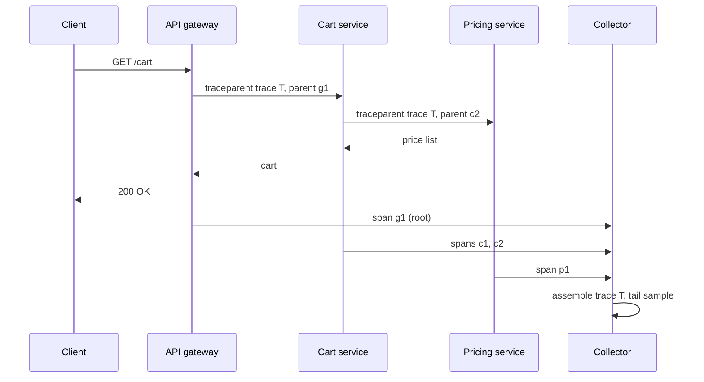

## In one minute
- A trace records the path of one request through many services as a tree of **spans**. Each span is a timed operation with a parent, attributes, and status.
- **Context propagation** carries the trace ID and parent span ID across process boundaries, usually in the W3C `traceparent` header or message metadata.
- Instrumentation (OpenTelemetry SDKs and auto-instrumentation) creates spans; a **collector** batches, samples, and exports them to a backend such as Jaeger, Tempo, or a vendor.
- Volume forces **sampling**. Head sampling is cheap but blind to outcome; tail sampling keeps errors and slow traces but needs buffering.
- Traces answer "where did this request spend its time" and "which dependency failed".

## How it works

### Spans and the trace tree
A span has a 16-byte `trace_id` shared by the whole trace, an 8-byte `span_id` (both random by default in OpenTelemetry SDKs ([OTel trace SDK spec](https://opentelemetry.io/docs/specs/otel/trace/sdk/))), a parent ID, a name like `GET /cart`, start and end times, attributes, and a status. Its kind is server, client, producer, consumer, or internal. A client span in service A and the matching server span in service B show network and queueing time as the gap between them.

### Propagation
When service A calls B, the SDK injects a header:

`traceparent: 00-4bf92f3577b34da6a3ce929d0e0e4736-00f067aa0ba902b7-01`

The fields are version, trace ID, parent span ID, and flags, where the lowest bit says whether this trace is sampled ([W3C Trace Context](https://www.w3.org/TR/trace-context/)). Trace Context Level 2, still a Candidate Recommendation draft, adds a second flag (`02`) declaring that the right-most 7 bytes of the trace ID are random, so downstream systems can sample or shard on them consistently ([W3C Trace Context Level 2](https://www.w3.org/TR/trace-context-2/)). B extracts it, creates a server span with that parent, and passes context to its own outgoing calls. For queues, the context goes into message headers, and the consumer span may **link** to the producer span rather than be its child, since one batch can contain messages from many traces. Any hop that drops the header breaks the trace into disconnected pieces.

### Collection pipeline
SDKs batch spans and export them over OTLP (port 4317 for gRPC, 4318 for HTTP; the spec's default transport is `http/protobuf` ([OTLP exporter spec](https://opentelemetry.io/docs/specs/otel/protocol/exporter/))) to a collector tier, which enriches, scrubs, samples, and fans out to backends. Backends have converged on the same pipeline: Jaeger v2, released in November 2024, is built on the OpenTelemetry Collector and ingests OTLP natively ([CNCF](https://www.cncf.io/blog/2024/11/12/jaeger-v2-released-opentelemetry-in-the-core/)). Backends index spans by trace ID plus a few searchable fields such as service, operation, duration, and error.

### Sampling
**Head sampling** decides at the root, for example keep 1 percent, and propagates the decision via the sampled flag so every service agrees. It is cheap and consistent but drops 99 percent of rare errors. Dapper ran Google-wide at one trace in 1,024 and found that enough for high-volume services but not for low-traffic ones, which pushed it toward adaptive sampling by target rate ([Dapper paper](https://static.googleusercontent.com/media/research.google.com/en//archive/papers/dapper-2010-1.pdf)). In OpenTelemetry the ratio sampler `TraceIdRatioBased` is now deprecated in favour of `ProbabilitySampler`, because its exact algorithm was never specified, so it is safe only at the root ([OTel trace SDK spec](https://opentelemetry.io/docs/specs/otel/trace/sdk/)). **Tail sampling** buffers all spans of a trace in a collector (keyed by trace ID, so all spans of a trace must reach the same collector instance) and decides after the trace completes: keep all errors, all traces over 2 seconds, and 1 percent of the rest. It costs memory and a load-balancing layer that routes by trace ID. The Collector's tail sampling processor waits 30 seconds (`decision_wait`) and holds 50,000 traces (`num_traces`) by default, and its docs prescribe a first tier with the load-balancing exporter in front of the sampling tier ([tail sampling processor](https://github.com/open-telemetry/opentelemetry-collector-contrib/blob/main/processor/tailsamplingprocessor/README.md)).

## Down the stack

### Layer 1: The contract
Tracing promises far less than people assume. If every hop propagates context and the trace is sampled, the backend will eventually hold a tree of spans sharing one trace ID, with parent links and per-host timestamps. It does not promise completeness (SDKs drop spans when buffers fill), ordering across hosts (clocks differ), or timeliness (spans arrive seconds to minutes after the request). Instrumentation promises bounded overhead: a few microseconds per span and no blocking of the request path on export.

### Layer 2: The mechanism
In the OpenTelemetry SDK, starting a span reads the current context (thread-local in Java, `contextvars` in Python, `context.Context` passed explicitly in Go), generates a random 64-bit span ID, and records a monotonic start time. Ending the span hands it to a **BatchSpanProcessor**: a bounded queue (2,048 spans by default) drained by a background worker that exports up to 512 spans per batch every 5 seconds or when the batch fills, with a 30-second export timeout ([OTel trace SDK spec](https://opentelemetry.io/docs/specs/otel/trace/sdk/)). If the queue is full, new spans are dropped and a counter increments, which is how the SDK keeps the request path non-blocking. The **propagator** writes `traceparent` on outgoing requests and parses it on incoming ones; the sampler decision is the `01` flag. Export uses OTLP over gRPC or HTTP: a protobuf `ExportTraceServiceRequest` grouping spans by resource and instrumentation scope. Tail-sampling collectors keep a map from trace ID to buffered spans and a timer per trace; a load-balancing exporter in front hashes the trace ID onto a ring of sampler instances.

### Layer 3: The machine
Creating a span costs roughly 0.5 to 2 microseconds and allocates a few hundred bytes; a service handling 20,000 requests per second with 10 spans each allocates around 40 to 80 MB per second of short-lived objects, which in garbage-collected runtimes shows up as more frequent young-generation collections. Timestamps come from a monotonic clock read via vDSO in about 20 to 30 nanoseconds without a syscall. Export batches of 512 spans compress to tens of KB, so network cost is small, but each OTLP export is a gRPC call over HTTP/2 that the collector must decode, which makes protobuf parsing a large share of collector CPU. Cross-host timestamps rely on NTP, which typically keeps hosts within 1 to 10 milliseconds; that is why a 2 ms child span can appear to start before its parent.

### Why it's built this way
1. Requests cross many processes, so identity must travel with the request in headers.
2. Tracing must never slow down or break the request, so spans are buffered, exported asynchronously, and dropped under pressure.
3. Recording every span of every request is too expensive to store, so sampling decides what to keep.
4. The interesting traces are known only after they finish, so tail sampling buffers whole traces at a cost in memory and routing.

## Diagram


## Worked example
An online store handles 8,000 requests per second at the edge. Each request fans out to about 25 spans across 9 services, so the fleet produces 200,000 spans per second. At roughly 500 bytes per span after OTLP encoding, that is 100 MB/s, about 8.6 TB per day.

Keeping everything for 7 days would mean 60 TB, too much for the budget. Head sampling at 2 percent cuts storage to about 170 GB per day but keeps only 2 percent of the 0.3 percent of requests that fail, so engineers rarely find the trace they need.

Tail sampling instead: a load-balancing collector tier routes spans by trace ID to 12 sampling collectors. Each waits 10 seconds after the last span of a trace before deciding. Buffered data is 100 MB/s times 10 seconds, about 1 GB spread across the tier. Policy: keep 100 percent of traces with an error, 100 percent over 1.5 seconds (about 1 percent of traces), and 2 percent of the rest. Kept volume is roughly 0.3 + 1 + 2 percent, about 3.3 percent, so 285 GB per day and 2 TB for a week, while every failing and slow request is available.

## In the wild
- **Google, 2010: Dapper shows that sampling makes always-on tracing affordable.** In a web search cluster, tracing every request added 16.3 percent to average latency, while sampling 1 in 16 or fewer was within measurement error, and the production default of 1 in 1,024 still gave enough data for high-volume services. The collection daemon never used more than 0.3 percent of one core. Low-traffic services missed events at that rate, so Google moved toward adaptive sampling by target traces per second ([Dapper paper](https://static.googleusercontent.com/media/research.google.com/en//archive/papers/dapper-2010-1.pdf)).
- **Uber, 2021: critical-path analysis over Jaeger traces.** With a few thousand microservices and close to 100,000 operations, single trace views were unreadable, so Uber built CRISP to compute the critical path of each trace and aggregate it at p50, p95 and p99. One finding: an operation on an important critical path was about 15 percent faster at p50 on a 2.4 GHz CPU SKU than on a 2.2 GHz one, with roughly 1.5 times worse tail latency on the slower SKU ([Uber](https://www.uber.com/en-IL/blog/crisp-critical-path-analysis-for-microservice-architectures/)).
- **Slack, 2020: traces as rows you can query.** Slack flattened spans into a simple `SpanEvent` record (ID, parent, trace ID, timestamp, duration, tags) and loaded about 310 million traces and 8.5 billion spans a day into a real-time store and a data warehouse. Large services were sampled at 1 to 2 percent, some low-volume services at 100 percent, and a slash command could trace every request from one client for two minutes when debugging a customer issue ([Slack](https://slack.engineering/tracing-at-slack-thinking-in-causal-graphs/)).

## Trade-offs

| Option | Strengths | Weaknesses | Choose when |
|---|---|---|---|
| Head sampling | Simple, cheap, consistent across services | Misses rare errors and slow outliers | Very high volume, aggregate latency analysis |
| Tail sampling | Keeps interesting traces by outcome | Collector memory, trace-ID routing, decision delay | You need every error and slow trace |
| Keep everything | Complete data, no sampling bias | Storage and ingest cost | Low traffic or short retention |

## Pitfalls in production
- **Broken propagation.** A proxy, thread pool, or async callback loses context and traces split into fragments. Use instrumented clients and executors, and test propagation in CI with a synthetic request.
- **Clock skew.** Hosts disagree by milliseconds and children appear to start before parents. Trust durations within a host, and keep NTP healthy.
- **Sensitive data in attributes.** SQL statements and URLs include emails or tokens. Scrub in the collector and set allow-lists for attributes.
- **High-cardinality span names.** Naming spans `GET /users/12345` defeats aggregation. Use route templates like `GET /users/{id}`.
- **Tail sampler overload.** A burst exceeds collector memory and spans are dropped silently. Monitor dropped spans and scale the collector tier on throughput.

## Leadership lens
- Make propagation a platform responsibility: shared libraries, gateways, and message clients must carry context by default.
- Decide the sampling policy with product and on-call input: which traces must never be lost?
- Link signals: put trace IDs in logs and exemplars on latency histograms so alerts lead to traces in one click.

## Check yourself
1. Why must all spans of a trace reach the same collector for tail sampling?
   **Answer:** The decision depends on the whole trace, such as any span erroring or total duration, so one instance must see every span before deciding.
2. What does the gap between a client span and its server span tell you?
   **Answer:** Time spent outside the callee's handler: network latency, connection setup, and queueing before the server started processing.
3. Why use span links rather than parent-child for batch consumers?
   **Answer:** A batch contains messages from many traces, and a span can have only one parent, so links connect the consumer span to each producer without forcing a false hierarchy.

## Practice
**Task:** Implement two tracing helpers. `parse_traceparent(header)` parses a W3C header of the form `version-traceid-spanid-flags`, returning a dict with `trace_id`, `parent_id`, and `sampled` (a bool from the lowest flag bit), or `None` if the header is malformed: wrong field count, wrong lengths (2, 32, 16, 2 hex characters), non-hex characters, or an all-zero trace or span ID. `critical_path(spans)` takes spans as dicts with `id`, `parent` (None for root), `name`, `start`, `end`, and returns span names along the critical path: start at the root, then repeatedly move to the child that ends last.

```python starter
def parse_traceparent(header):
    # TODO
    raise NotImplementedError

def critical_path(spans):
    # TODO
    raise NotImplementedError
```

```python tests
def test_parse_valid():
    h = "00-4bf92f3577b34da6a3ce929d0e0e4736-00f067aa0ba902b7-01"
    assert parse_traceparent(h) == {"trace_id": "4bf92f3577b34da6a3ce929d0e0e4736",
                                    "parent_id": "00f067aa0ba902b7", "sampled": True}

def test_parse_not_sampled():
    h = "00-4bf92f3577b34da6a3ce929d0e0e4736-00f067aa0ba902b7-00"
    assert parse_traceparent(h)["sampled"] is False

def test_parse_rejects_bad():
    assert parse_traceparent("00-abc-def-01") is None
    assert parse_traceparent("00-" + "0" * 32 + "-00f067aa0ba902b7-01") is None
    assert parse_traceparent("00-4bf92f3577b34da6a3ce929d0e0e473z-00f067aa0ba902b7-01") is None

def test_critical_path():
    spans = [
        {"id": "a", "parent": None, "name": "gateway", "start": 0, "end": 100},
        {"id": "b", "parent": "a", "name": "auth", "start": 1, "end": 10},
        {"id": "c", "parent": "a", "name": "cart", "start": 11, "end": 95},
        {"id": "d", "parent": "c", "name": "pricing", "start": 20, "end": 90},
        {"id": "e", "parent": "c", "name": "cache", "start": 12, "end": 15},
    ]
    assert critical_path(spans) == ["gateway", "cart", "pricing"]

def test_single_span():
    assert critical_path([{"id": "x", "parent": None, "name": "only", "start": 0, "end": 1}]) == ["only"]
```

```python solution
import string

def _hex(s, n):
    return len(s) == n and all(c in string.hexdigits for c in s)

def parse_traceparent(header):
    parts = header.split("-")
    if len(parts) != 4:
        return None
    ver, tid, sid, flags = parts
    if not (_hex(ver, 2) and _hex(tid, 32) and _hex(sid, 16) and _hex(flags, 2)):
        return None
    if set(tid) == {"0"} or set(sid) == {"0"}:
        return None
    return {"trace_id": tid, "parent_id": sid, "sampled": bool(int(flags, 16) & 1)}

def critical_path(spans):
    children = {}
    root = None
    for s in spans:
        if s["parent"] is None:
            root = s
        else:
            children.setdefault(s["parent"], []).append(s)
    path, cur = [], root
    while cur is not None:
        path.append(cur["name"])
        kids = children.get(cur["id"], [])
        cur = max(kids, key=lambda k: k["end"]) if kids else None
    return path
```

```typescript starter
export interface Parent { traceId: string; parentId: string; sampled: boolean; }
export interface Span { id: string; parent: string | null; name: string; start: number; end: number; }
export function parseTraceparent(header: string): Parent | null {
  throw new Error("TODO");
}
export function criticalPath(spans: Span[]): string[] {
  throw new Error("TODO");
}
```

```typescript tests
const TID = "4bf92f3577b34da6a3ce929d0e0e4736";
test("parse valid", () => assertEqual(parseTraceparent("00-" + TID + "-00f067aa0ba902b7-01"),
  { traceId: TID, parentId: "00f067aa0ba902b7", sampled: true }));
test("parse not sampled", () =>
  assertEqual(parseTraceparent("00-" + TID + "-00f067aa0ba902b7-00")!.sampled, false));
test("parse rejects bad", () => {
  assertEqual(parseTraceparent("00-abc-def-01"), null);
  assertEqual(parseTraceparent("00-" + "0".repeat(32) + "-00f067aa0ba902b7-01"), null);
  assertEqual(parseTraceparent("00-4bf92f3577b34da6a3ce929d0e0e473z-00f067aa0ba902b7-01"), null);
});
test("critical path", () => {
  const spans: Span[] = [
    { id: "a", parent: null, name: "gateway", start: 0, end: 100 },
    { id: "b", parent: "a", name: "auth", start: 1, end: 10 },
    { id: "c", parent: "a", name: "cart", start: 11, end: 95 },
    { id: "d", parent: "c", name: "pricing", start: 20, end: 90 },
    { id: "e", parent: "c", name: "cache", start: 12, end: 15 },
  ];
  assertEqual(criticalPath(spans), ["gateway", "cart", "pricing"]);
});
test("single span", () =>
  assertEqual(criticalPath([{ id: "x", parent: null, name: "only", start: 0, end: 1 }]), ["only"]));
```

```typescript solution
export interface Parent { traceId: string; parentId: string; sampled: boolean; }
export interface Span { id: string; parent: string | null; name: string; start: number; end: number; }
const isHex = (s: string, n: number) => s.length === n && /^[0-9a-fA-F]+$/.test(s);
export function parseTraceparent(header: string): Parent | null {
  const parts = header.split("-");
  if (parts.length !== 4) return null;
  const [ver, tid, sid, flags] = parts;
  if (!(isHex(ver, 2) && isHex(tid, 32) && isHex(sid, 16) && isHex(flags, 2))) return null;
  if (/^0+$/.test(tid) || /^0+$/.test(sid)) return null;
  return { traceId: tid, parentId: sid, sampled: (parseInt(flags, 16) & 1) === 1 };
}
export function criticalPath(spans: Span[]): string[] {
  const children = new Map<string, Span[]>();
  let cur: Span | undefined = spans.find(s => s.parent === null);
  for (const s of spans) if (s.parent !== null) children.set(s.parent, [...(children.get(s.parent) ?? []), s]);
  const path: string[] = [];
  while (cur) {
    path.push(cur.name);
    const kids: Span[] = children.get(cur.id) ?? [];
    cur = kids.length ? kids.reduce((a, b) => (b.end > a.end ? b : a)) : undefined;
  }
  return path;
}
```

```go starter
package practice

import "errors"

var ErrMalformed = errors.New("malformed traceparent")

type Parent struct {
	TraceID, ParentID string
	Sampled           bool
}

type Span struct {
	ID, Parent, Name string // Parent is "" for the root
	Start, End       int
}

func ParseTraceparent(header string) (Parent, error) { panic("TODO") }

func CriticalPath(spans []Span) []string { panic("TODO") }
```

```go tests
package practice

import (
	"reflect"
	"strings"
	"testing"
)

const tid = "4bf92f3577b34da6a3ce929d0e0e4736"

func TestParseValid(t *testing.T) {
	p, err := ParseTraceparent("00-" + tid + "-00f067aa0ba902b7-01")
	if err != nil || p != (Parent{tid, "00f067aa0ba902b7", true}) {
		t.Fatalf("got %v %v", p, err)
	}
}

func TestParseNotSampled(t *testing.T) {
	p, err := ParseTraceparent("00-" + tid + "-00f067aa0ba902b7-00")
	if err != nil || p.Sampled {
		t.Fatalf("got %v %v", p, err)
	}
}

func TestParseRejectsBad(t *testing.T) {
	for _, h := range []string{"00-abc-def-01", "00-" + strings.Repeat("0", 32) + "-00f067aa0ba902b7-01",
		"00-4bf92f3577b34da6a3ce929d0e0e473z-00f067aa0ba902b7-01"} {
		if _, err := ParseTraceparent(h); err == nil {
			t.Fatalf("accepted %q", h)
		}
	}
}

func TestCriticalPath(t *testing.T) {
	spans := []Span{{"a", "", "gateway", 0, 100}, {"b", "a", "auth", 1, 10},
		{"c", "a", "cart", 11, 95}, {"d", "c", "pricing", 20, 90}, {"e", "c", "cache", 12, 15}}
	if got := CriticalPath(spans); !reflect.DeepEqual(got, []string{"gateway", "cart", "pricing"}) {
		t.Fatalf("got %v", got)
	}
}

func TestSingleSpan(t *testing.T) {
	if got := CriticalPath([]Span{{"x", "", "only", 0, 1}}); !reflect.DeepEqual(got, []string{"only"}) {
		t.Fatalf("got %v", got)
	}
}
```

```go solution
package practice

import (
	"encoding/hex"
	"errors"
	"strconv"
	"strings"
)

var ErrMalformed = errors.New("malformed traceparent")

type Parent struct {
	TraceID, ParentID string
	Sampled           bool
}

type Span struct {
	ID, Parent, Name string
	Start, End       int
}

func isHex(s string, n int) bool {
	_, err := hex.DecodeString(s)
	return len(s) == n && err == nil
}

func ParseTraceparent(header string) (Parent, error) {
	p := strings.Split(header, "-")
	if len(p) != 4 || !isHex(p[0], 2) || !isHex(p[1], 32) || !isHex(p[2], 16) || !isHex(p[3], 2) {
		return Parent{}, ErrMalformed
	}
	if strings.Trim(p[1], "0") == "" || strings.Trim(p[2], "0") == "" {
		return Parent{}, ErrMalformed
	}
	flags, _ := strconv.ParseUint(p[3], 16, 8)
	return Parent{p[1], p[2], flags&1 == 1}, nil
}

func CriticalPath(spans []Span) []string {
	children := map[string][]Span{}
	var cur *Span
	for i := range spans {
		if spans[i].Parent == "" {
			cur = &spans[i]
		} else {
			children[spans[i].Parent] = append(children[spans[i].Parent], spans[i])
		}
	}
	path := []string{}
	for cur != nil {
		path = append(path, cur.Name)
		var next *Span
		for i, k := range children[cur.ID] {
			if next == nil || k.End > next.End {
				next = &children[cur.ID][i]
			}
		}
		cur = next
	}
	return path
}
```

## Mock interview
**Prompt:** Your platform has 120 microservices, 50,000 requests per second, and on-call engineers cannot tell which dependency causes p99 spikes. Design a tracing system within a budget of 1 TB of trace storage per day.

- Follow-up: How do you guarantee every failed checkout is traceable?
- Follow-up: Half of your traffic goes through Kafka. How does context survive?
- Follow-up: How would you find which service adds the most latency across all traces, not just one?

**A strong answer covers:**
- OpenTelemetry SDKs and auto-instrumentation via shared libraries, with W3C propagation enforced at gateways.
- Volume arithmetic and a tail-sampling policy that keeps all errors and slow traces within the budget.
- Trace-ID-aware load balancing to the sampling collectors and monitoring of dropped spans.
- Context in message headers with span links for batch consumers.
- Span-derived RED metrics or trace analytics for aggregate questions, plus exemplars linking metrics to traces.

## Sources and further study
**Primary**
- [W3C Trace Context Level 2](https://www.w3.org/TR/trace-context-2/): the draft that adds the random trace-ID flag on top of Level 1.
- [OpenTelemetry trace SDK specification](https://opentelemetry.io/docs/specs/otel/trace/sdk/): ID generation, samplers (including the `TraceIdRatioBased` deprecation) and batch processor defaults.
- [OTLP exporter specification](https://opentelemetry.io/docs/specs/otel/protocol/exporter/): transports, ports and environment variables every SDK honours.

**Systems docs**
- [OpenTelemetry tail sampling processor](https://github.com/open-telemetry/opentelemetry-collector-contrib/blob/main/processor/tailsamplingprocessor/README.md): policies, defaults and the two-tier scaling layout.
- [Jaeger v2 released (CNCF)](https://www.cncf.io/blog/2024/11/12/jaeger-v2-released-opentelemetry-in-the-core/): why a major tracing backend rebuilt itself on the OpenTelemetry Collector.

**Books**
- *Observability Engineering*, Majors, Fong-Jones and Miranda, chapter 6 "Stitching Events into Traces" and chapter 17 "Cheap and Accurate Enough: Sampling".
- *Building Microservices* (2nd edition), Sam Newman, chapter 10 "From Monitoring to Observability": correlation IDs and tracing as the step after log aggregation.

**Other curricula**
- [Azure Architecture Center: monitoring and diagnostics](https://learn.microsoft.com/en-us/azure/architecture/best-practices/monitoring): frames tracing as debugging operations across services, held together by correlation IDs in every record.
- [AWS Builders' Library: instrumenting distributed systems](https://builder.aws.com/content/3EuxPBdIiiUhB5IK47p3O3fxhy7/instrumenting-distributed-systems-for-operational-visibility): the latency and status of every dependency call recorded in each request log, a log-based complement to traces.
- [donnemartin/system-design-primer](https://github.com/donnemartin/system-design-primer): lists the Dapper paper but has no tracing section.

## Watch
- [Why tracing is hard (Ben Sigelman)](https://www.youtube.com/watch?v=lKn15ORS29M): a Dapper and OpenTelemetry co-creator on the practical difficulties.
- [Keynote: OpenTracing and Containers (Ben Sigelman, CNCF)](https://www.youtube.com/watch?v=n8mUiLIXkto): depth versus breadth in tracing and where it is heading.

## Free resources
- [Dapper, a Large-Scale Distributed Systems Tracing Infrastructure](https://static.googleusercontent.com/media/research.google.com/en//archive/papers/dapper-2010-1.pdf): Google's paper that defined spans, trees, and low-overhead sampling.
- [W3C Trace Context](https://www.w3.org/TR/trace-context/): the standard `traceparent` and `tracestate` headers.
- [OpenTelemetry traces](https://opentelemetry.io/docs/concepts/signals/traces/): spans, kinds, links, and the data model.
- [OpenTelemetry sampling](https://opentelemetry.io/docs/concepts/sampling/): head versus tail sampling with configuration guidance.
