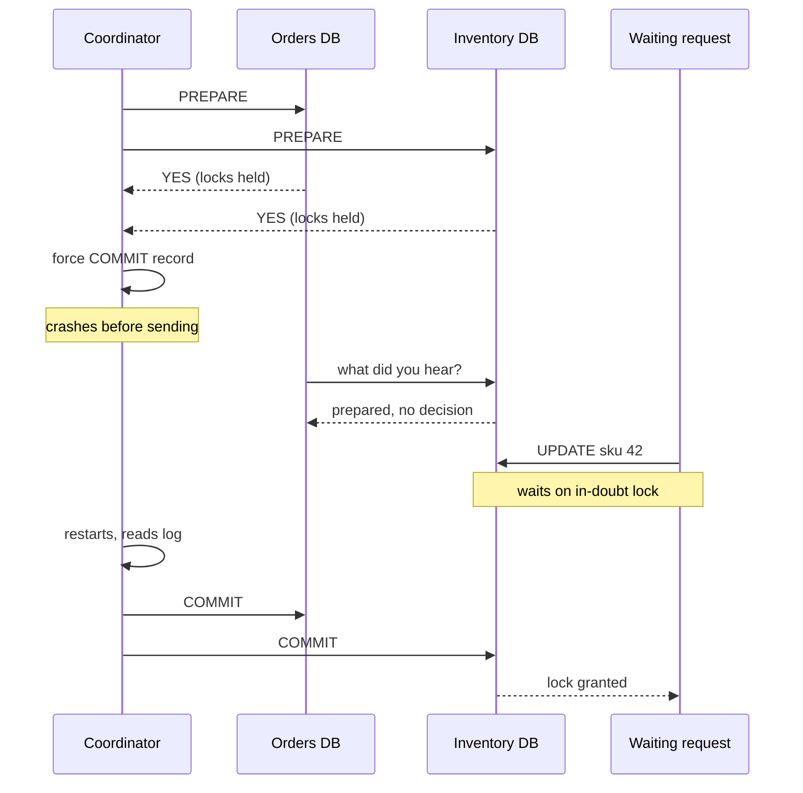

## In one minute
- A distributed transaction promises all-or-nothing across machines that fail independently, which puts coordination, forced disk writes and held locks on the critical path of every write.
- The costs: participants block while in doubt, availability multiplies down with every participant, lock hold times stretch to the slowest member, and isolation does not compose across systems.
- XA across heterogeneous resources is only as strong as its weakest driver, and "heuristic" decisions can break atomicity outright.
- Non-blocking atomic commit needs a replicated coordinator, which means consensus. Spanner and CockroachDB build exactly that, inside one system with one operator.
- Across services and teams, shrink the transaction to one entity and coordinate the rest with messages, sagas and idempotent retries.

## How it works

### What we are asking for
A local transaction gets atomicity almost for free: one forced commit record in one log decides the outcome. A distributed transaction has no single log. Several resource managers each own a slice of the change, each can crash independently, and the network can delay any message. Two-phase commit (its own lesson) answers with a promise followed by a decision. This lesson is about why that answer, and any answer like it, is expensive in ways that show up only under load, during failures, or when participants belong to different teams.

This is the multi-step consistency and partial failure problem shape. An AI agent that books a flight and a hotel through two vendor APIs faces the same question, except that neither API offers a prepare step, so the agent is in saga territory from the start.

### Problem 1: participants block while in doubt
A participant that votes yes is *in doubt* until the decision arrives: its changes are durable but invisible, and its locks stay held. Participants can try *cooperative termination* and ask each other. If any peer committed, the decision was commit. If any peer aborted or never voted, commit was impossible, so abort is safe. But if every reachable peer is also prepared, nobody knows whether the coordinator logged commit before it died, and all of them wait. That is exactly the state left when the coordinator dies between its commit record and its first `COMMIT` message, so it is common, not exotic.

### Problem 2: availability multiplies down
A transaction that needs every participant is only as available as all of them together. Four participants at 99.95% give about 99.80%: roughly 17 hours of failed or stalled transactions a year instead of 4.4. The coordinator is one more participant.

### Problem 3: latency and lock hold time stretch
Locks are held until the decision reaches each participant. A local update on a hot row might hold its lock for 1 ms; inside a cross-zone 2PC, two round trips and two forced writes make it 10 to 30 ms. Throughput on one row is roughly the inverse of the hold time: 1,000 updates per second at 1 ms, 40 at 25 ms. Tails compound too, because prepare waits for the slowest vote. If each participant is slow 1% of the time, a transaction across five hits a slow one about 4.9% of the time. Google measured the same shape in production: in F1, which runs 2PC across Paxos groups in Spanner, 2PC usually doubles commit latency, commits take 50 to 150 ms, and the protocol works well up to tens of participants but aborts and latency rise sharply with hundreds ([F1, VLDB 2013](https://www.vldb.org/pvldb/vol6/p1068-shute.pdf)).

### Problem 4: isolation does not compose
Atomic commit decides *whether* the writes happen together, not what concurrent readers see. If each participant runs snapshot isolation with its own clock, a reader can see shard A after a transfer commits and shard B before it: money disappears for a moment. Global serializability needs strict two-phase locking everywhere or globally comparable timestamps (Spanner's TrueTime, CockroachDB's hybrid logical clocks). Distributed deadlocks also escape every local detector, because each node sees only half of the cycle, so systems fall back to lock timeouts.

### Problem 5: heterogeneity and heuristic outcomes
XA lets a transaction manager drive any resource that implements `xa_prepare`, `xa_commit`, `xa_rollback` and `xa_recover`, but the guarantee is only as strong as the weakest driver. Many systems cannot join at all. Kafka's transactions stop at Kafka: KIP-939, accepted in 2024, would let a producer hold a prepared transaction for an external coordinator, but its tracking issue is still open and scheduled for a future 4.x release ([KIP-939](https://cwiki.apache.org/confluence/display/KAFKA/KIP-939%3A+Support+Participation+in+2PC), [KAFKA-15370](https://issues.apache.org/jira/browse/KAFKA-15370)). DynamoDB's `TransactWriteItems` takes up to 100 actions, all in one account and Region, with no external participants ([AWS docs](https://docs.aws.amazon.com/amazondynamodb/latest/APIReference/API_TransactWriteItems.html)). A payment provider's HTTP API has no prepare at all. Worse, some resources let an administrator or a timeout decide an in-doubt transaction alone. XA calls this a *heuristic* outcome; Java's JTA reports it as `HeuristicMixedException` when some participants committed and others rolled back. Atomicity is gone and a human must reconcile.

### Problem 6: coupling across teams
A distributed transaction ties the participants' schemas, availability and deploy schedules together. Pat Helland argues that systems which must scale almost without limit make the transaction boundary one *entity* (an order, an account) on one machine, and coordinate between entities with retried, idempotent messages ([Helland, CIDR 2007](https://www.cidrdb.org/cidr2007/papers/cidr07p15.pdf)). The application then owns the workflow the transaction manager used to hide.

## Down the stack

### Layer 1: The contract
The atomic commitment problem, as stated by Bernstein, Hadzilacos and Goodman, asks for five properties: all processes that decide reach the same decision; a decision, once reached, is never reversed; commit is decided only if every process voted yes; if there are no failures and all vote yes, the decision is commit; and once failures are repaired, every process eventually decides. Nothing promises a decision *while* failures persist. Skeen showed in 1981 that a protocol is non-blocking only if no participant state is adjacent to both commit and abort, a test 2PC's prepared state fails ([Skeen 1981](https://www.cs.cornell.edu/courses/cs614/2004sp/papers/Ske81.pdf)); with Stonebraker he then showed that no commit protocol stays non-blocking when the network can partition. Gray and Lamport later framed the fix as replicating the decision with consensus: Paxos Commit uses 2F + 1 coordinators, keeps 2PC's stable-storage delay, and reduces to classic 2PC when F = 0 ([Gray and Lamport](https://www.microsoft.com/en-us/research/wp-content/uploads/2016/02/tr-2003-96.pdf)). A product promising non-blocking atomic commit across independent systems either runs consensus underneath or relies on timeouts that can violate atomicity.

### Layer 2: The mechanism
MySQL's `XA PREPARE` and `XA RECOVER` mirror Postgres's `PREPARE TRANSACTION` and `pg_prepared_xacts`. A JTA transaction manager such as Narayana or Atomikos keeps its own decision log and, on restart, calls `xa_recover` on each resource to list in-doubt `Xid`s and match them against that log. If the log is lost, the matching is impossible.

Distributed databases move the coordinator's state into a replicated record. CockroachDB keeps a *transaction record* in a Raft range; with parallel commits, on by default since 19.2, it is marked `STAGING` along with the list of in-flight writes, and any node that finds an abandoned staging transaction can check those writes and finish it. That cut cross-range commit latency roughly in half, from two consensus rounds to one ([Cockroach Labs](https://www.cockroachlabs.com/blog/parallel-commits/)). Spanner runs 2PC between Paxos groups, so the coordinator is itself replicated, and adds *commit wait* on TrueTime so commit timestamps order reads globally.

### Layer 3: The machine
With presumed abort, a commit across `n` participants costs `n + 1` forced log writes (each prepare plus the coordinator's commit record) and `4n` messages. On NVMe an `fsync` takes roughly 20 to 200 µs, but in a replicated store each "force" is a majority write: 1 to 2 ms within a region, 60 to 150 ms across continents. Waiting is not free either. In Postgres a prepared transaction pins the oldest visible transaction id, so `VACUUM` cannot remove newer dead tuples and tables bloat, and its locks sit in the shared lock table where every request on those rows queues behind them. Left long enough, it can force a shutdown to prevent transaction id wraparound, which is why the docs advise leaving `max_prepared_transactions` at zero unless an external transaction manager closes prepared transactions promptly ([Postgres docs](https://www.postgresql.org/docs/current/sql-prepare-transaction.html)).

### Why it's built this way
1. Machines fail independently, so no single log can decide for all of them; someone must collect promises and announce one decision.
2. A promise must survive a crash, so it is forced to disk before it is sent, and the participant must hold locks until it learns the outcome.
3. A single coordinator can die holding the only copy of the decision, so participants block; removing that block requires replicating the decision with consensus.
4. Consensus and global timestamps are feasible inside one system run by one team, so distributed databases absorb the cost there.
5. Across organisations, nobody controls every participant's recovery code or uptime, so designs shrink the transaction to one entity and accept asynchronous, compensating coordination between entities.

## Diagram


## Worked example
A checkout writes an order in the orders database and decrements stock in the inventory database through a JTA transaction manager inside the checkout service, with the databases in different zones.

Availability: orders, inventory and the coordinating checkout instance are each 99.95%. Together that is 0.9995 cubed, about 99.85%, or around 13 hours a year of failed or stalled checkouts, before counting the payment call.

Contention: a local stock decrement holds the SKU row lock for about 0.8 ms. Inside 2PC the lock is held through the prepare round trip, the coordinator's forced write and the commit message, about 12 ms with cross-zone hops. In a flash sale one SKU gets 400 checkouts per second. At 0.8 ms the row absorbs about 1,250 per second; at 12 ms it caps near 83, so the queue grows by over 300 requests a second.

Coordinator crash: a checkout pod is killed right after forcing 120 commit records and before sending them. The 120 transactions sit prepared in inventory, locking 30 hot SKUs. Recovery runs only once the replacement pod reattaches the old log volume, four minutes later. Every checkout touching those SKUs waits, and the retry storm afterwards exceeds the original load.

The redesign makes the order the transaction boundary: checkout inserts the order as `PENDING` with an outbox event in one local transaction, and inventory reserves stock in its own local transaction and emits `StockReserved` or `OutOfStock`. Locks last under 1 ms, the databases fail independently, and a crash leaves a pending order to resume rather than locks to wait on.

## In the wild
- **Google, 2012: AdWords moves onto distributed transactions and pays for them in latency.** F1 replaced a sharded MySQL setup that was hard to reshard, and has served all AdWords campaign data since early 2012: over 100 TB at hundreds of thousands of requests per second. Commits take 50 to 150 ms and cross-group commits run 2PC, which roughly doubles that, so the team clustered each customer's rows under one root to keep most transactions inside one Paxos group and avoid 2PC entirely ([F1, VLDB 2013](https://www.vldb.org/pvldb/vol6/p1068-shute.pdf)).
- **Jepsen and PingCAP, 2019: TiDB retries quietly broke transaction boundaries.** TiDB uses a Percolator-style lock-then-commit protocol. Jepsen found that two automatic retry paths re-applied a conflicting transaction's writes outside its original reads, giving lost updates and read skew; one test lost 64 of 378 inserts. TiDB 3.0.0-rc.2 turned automatic retries off by default, after which the snapshot isolation tests passed ([Jepsen](https://jepsen.io/analyses/tidb-2.1.7)).
- **Jepsen, 2024: a late commit message lands in the wrong Kafka transaction.** Testing Bufstream, Jepsen found that a delayed `EndTxn` from one transaction could commit or abort the producer's next one, causing lost writes, aborted reads and torn transactions, and reproduced it in Kafka itself. The Kafka protocol had no transaction number to tell the two apart ([Jepsen](https://jepsen.io/analyses/bufstream-0.1.0)). Kafka 4.0 completed KIP-890's server-side defence, which bumps the producer epoch per transaction to reduce such zombie transactions ([Apache Kafka](https://kafka.apache.org/blog/2025/03/18/apache-kafka-4.0.0-release-announcement/)).

## Trade-offs
| Option | Strengths | Weaknesses | Choose when |
|---|---|---|---|
| XA / 2PC across services | Real atomicity, familiar model | Blocks on coordinator loss, multiplies downtime, heuristic outcomes | Few trusted resources, low contention, short outages tolerable |
| Distributed SQL (Spanner, CockroachDB) | Atomic and serializable, coordinator replicated | Higher write latency, one vendor holds all the data | The data can live in one system and needs strong invariants |
| Single-entity transactions plus messages | Local commits, scales with entities | Workflow logic moves into the app, eventual consistency | High scale, many teams, natural entity boundaries |
| Saga with compensations | No cross-service locks, survives partial outages | No isolation, compensations must be designed and tested | Multi-step business processes across services |
| Reservation (try, confirm, cancel) | Bounded holds with expiry, explicit business semantics | Every participant needs reserve and expiry APIs | Inventory, seats, credit holds |

## Pitfalls in production
- **Coordinator log on ephemeral disk.** A transaction manager logging to a container's local filesystem loses decisions on reschedule. Put the log on durable storage or in a replicated store.
- **Timeouts that act as decisions.** Rolling back in-doubt work after N minutes "to free locks" produces mixed outcomes. If you allow it, alert on every heuristic decision and reconcile it.
- **Invisible in-doubt transactions.** Nobody watches `pg_prepared_xacts` or `XA RECOVER` until vacuum stalls. Alert on the count and age of prepared transactions.
- **Assuming atomic means isolated.** Cross-shard reports see half-applied transfers. Use global timestamps, one consistent snapshot, or reads that tolerate skew.
- **Enlisting resources that cannot prepare.** Wrapping an HTTP call in a "transaction" gives no atomicity. Treat it as a saga step with an idempotency key.
- **Hot rows in long transactions.** Throughput on a popular row is one over the hold time. Use escrow, reservations or a sharded counter.

## Leadership lens
- In design review, ask which invariant actually requires atomicity across systems. Often only one (money must balance) does, and it can be kept inside one database.
- Ask for the arithmetic: combined availability of all participants, lock hold time on the hottest row, and in-doubt resolution time after a coordinator crash.
- Count the teams whose systems enlist in the transaction. Each one becomes a dependency for the others' incidents and change windows.
- If you adopt distributed SQL to get transactions, budget for the write latency and the migration, and decide who owns the cluster.
- Require a runbook and dashboard for in-doubt or stuck work before launch, whichever approach is chosen: prepared transactions for 2PC, stuck sagas for workflows.

## Check yourself
1. Coordinator is down; participant A is prepared, participant B is unreachable, participant C has aborted. Can A safely decide?
   **Answer:** Yes, it can abort. C aborted, so C never voted yes or was told to abort, and the coordinator cannot have logged commit. One aborted or unvoted peer is enough.
2. Why does adding a fifth participant to a transaction hurt latency more than the extra network hop suggests?
   **Answer:** The prepare phase waits for the slowest participant, so the transaction's latency is the maximum of five distributions. Each extra participant raises the chance of hitting someone's tail and lengthens lock hold times for all of them.
3. A team says their XA setup is safe because the database rolls back prepared transactions after ten minutes. What is wrong?
   **Answer:** That is a heuristic decision. If the coordinator had logged commit and other participants committed, the outcome is now mixed, which is exactly what the protocol exists to prevent.
4. Why do Spanner and CockroachDB not suffer from the classic coordinator blocking problem?
   **Answer:** The coordinator's decision lives in a consensus-replicated record, so another replica or node can read it and finish the transaction if the original coordinator fails.

## Practice
**Task:** Build the recovery tool an operator runs after a coordinator outage. `resolve(states, coordinator)` takes a map from participant name to `"init"`, `"prepared"`, `"committed"`, `"aborted"` or `"unreachable"`, and the coordinator's status: `"commit"` or `"abort"` (a logged decision), `"none"` (reachable, nothing logged) or `"down"`. A logged decision wins; `"none"` means presumed abort; when the coordinator is down, use cooperative termination: any committed participant means commit, any aborted or init participant means abort, otherwise return `"blocked"`. Unknown values raise an error. `locked_keys(txns)` takes `(id, states, coordinator, keys)` records and returns the sorted, de-duplicated keys held by blocked transactions; `stalled_requests(txns, requests)` returns the indexes of requests whose key is one of those.

```python starter
def resolve(states, coordinator):
    # TODO
    raise NotImplementedError

def locked_keys(txns):
    # TODO
    raise NotImplementedError

def stalled_requests(txns, requests):
    # TODO
    raise NotImplementedError
```

```python tests
def test_logged_decision_wins():
    assert resolve({"a": "prepared", "b": "unreachable"}, "commit") == "commit"
    assert resolve({"a": "prepared", "b": "prepared"}, "abort") == "abort"

def test_presumed_abort_when_nothing_logged():
    assert resolve({"a": "prepared", "b": "prepared"}, "none") == "abort"

def test_peer_committed_means_commit():
    assert resolve({"a": "prepared", "b": "committed", "c": "unreachable"}, "down") == "commit"

def test_peer_aborted_or_unvoted_means_abort():
    assert resolve({"a": "prepared", "b": "aborted"}, "down") == "abort"
    assert resolve({"a": "prepared", "b": "init", "c": "unreachable"}, "down") == "abort"

def test_all_prepared_blocks():
    assert resolve({"a": "prepared", "b": "prepared"}, "down") == "blocked"
    assert resolve({"a": "prepared", "b": "unreachable"}, "down") == "blocked"

def test_unknown_values_raise():
    for states, coord in [({"a": "prepared"}, "maybe"), ({"a": "pending"}, "down")]:
        try:
            resolve(states, coord)
            assert False, "expected ValueError"
        except ValueError:
            pass

def test_locked_keys_and_stalled_requests():
    txns = [
        ("t1", {"a": "prepared", "b": "prepared"}, "down", ["sku42", "sku7"]),
        ("t2", {"a": "prepared", "b": "committed"}, "down", ["sku9"]),
        ("t3", {"a": "prepared", "b": "unreachable"}, "down", ["sku7", "sku1"]),
        ("t4", {"a": "prepared"}, "commit", ["sku5"]),
    ]
    assert locked_keys(txns) == ["sku1", "sku42", "sku7"]
    assert stalled_requests(txns, ["sku9", "sku7", "sku5", "sku1", "sku2"]) == [1, 3]

def test_nothing_blocked():
    txns = [("t1", {"a": "aborted"}, "down", ["k"])]
    assert locked_keys(txns) == []
    assert stalled_requests(txns, ["k"]) == []
```

```python solution
PARTICIPANT_STATES = {"init", "prepared", "committed", "aborted", "unreachable"}
COORDINATOR_STATES = {"commit", "abort", "none", "down"}

def resolve(states, coordinator):
    if coordinator not in COORDINATOR_STATES:
        raise ValueError("unknown coordinator status: " + str(coordinator))
    for s in states.values():
        if s not in PARTICIPANT_STATES:
            raise ValueError("unknown participant state: " + str(s))
    if coordinator in ("commit", "abort"):
        return coordinator
    if coordinator == "none":
        return "abort"
    seen = set(states.values())
    if "committed" in seen:
        return "commit"
    if "aborted" in seen or "init" in seen:
        return "abort"
    return "blocked"

def locked_keys(txns):
    keys = set()
    for _txn_id, states, coordinator, held in txns:
        if resolve(states, coordinator) == "blocked":
            keys.update(held)
    return sorted(keys)

def stalled_requests(txns, requests):
    locked = set(locked_keys(txns))
    return [i for i, key in enumerate(requests) if key in locked]
```

```typescript starter
export interface Txn {
  id: string;
  states: Record<string, string>;
  coordinator: string;
  keys: string[];
}

export function resolve(states: Record<string, string>, coordinator: string): string {
  throw new Error("TODO");
}

export function lockedKeys(txns: Txn[]): string[] {
  throw new Error("TODO");
}

export function stalledRequests(txns: Txn[], requests: string[]): number[] {
  throw new Error("TODO");
}
```

```typescript tests
function throws(fn: () => void): boolean {
  try {
    fn();
    return false;
  } catch (e) {
    return true;
  }
}

test("logged decision wins", () => {
  assertEqual(resolve({ a: "prepared", b: "unreachable" }, "commit"), "commit");
  assertEqual(resolve({ a: "prepared", b: "prepared" }, "abort"), "abort");
});
test("presumed abort when nothing logged", () => {
  assertEqual(resolve({ a: "prepared", b: "prepared" }, "none"), "abort");
});
test("peer committed means commit", () => {
  assertEqual(resolve({ a: "prepared", b: "committed", c: "unreachable" }, "down"), "commit");
});
test("peer aborted or unvoted means abort", () => {
  assertEqual(resolve({ a: "prepared", b: "aborted" }, "down"), "abort");
  assertEqual(resolve({ a: "prepared", b: "init", c: "unreachable" }, "down"), "abort");
});
test("all prepared blocks", () => {
  assertEqual(resolve({ a: "prepared", b: "prepared" }, "down"), "blocked");
  assertEqual(resolve({ a: "prepared", b: "unreachable" }, "down"), "blocked");
});
test("unknown values throw", () => {
  assert(throws(() => resolve({ a: "prepared" }, "maybe")), "bad coordinator");
  assert(throws(() => resolve({ a: "pending" }, "down")), "bad participant");
});
test("locked keys and stalled requests", () => {
  const txns: Txn[] = [
    { id: "t1", states: { a: "prepared", b: "prepared" }, coordinator: "down", keys: ["sku42", "sku7"] },
    { id: "t2", states: { a: "prepared", b: "committed" }, coordinator: "down", keys: ["sku9"] },
    { id: "t3", states: { a: "prepared", b: "unreachable" }, coordinator: "down", keys: ["sku7", "sku1"] },
    { id: "t4", states: { a: "prepared" }, coordinator: "commit", keys: ["sku5"] },
  ];
  assertEqual(lockedKeys(txns), ["sku1", "sku42", "sku7"]);
  assertEqual(stalledRequests(txns, ["sku9", "sku7", "sku5", "sku1", "sku2"]), [1, 3]);
});
test("nothing blocked", () => {
  const txns: Txn[] = [{ id: "t1", states: { a: "aborted" }, coordinator: "down", keys: ["k"] }];
  assertEqual(lockedKeys(txns), []);
  assertEqual(stalledRequests(txns, ["k"]), []);
});
```

```typescript solution
export interface Txn {
  id: string;
  states: Record<string, string>;
  coordinator: string;
  keys: string[];
}

const PARTICIPANT_STATES = new Set(["init", "prepared", "committed", "aborted", "unreachable"]);
const COORDINATOR_STATES = new Set(["commit", "abort", "none", "down"]);

export function resolve(states: Record<string, string>, coordinator: string): string {
  if (!COORDINATOR_STATES.has(coordinator)) throw new Error("unknown coordinator status: " + coordinator);
  const seen = new Set<string>();
  for (const s of Object.values(states)) {
    if (!PARTICIPANT_STATES.has(s)) throw new Error("unknown participant state: " + s);
    seen.add(s);
  }
  if (coordinator === "commit" || coordinator === "abort") return coordinator;
  if (coordinator === "none") return "abort";
  if (seen.has("committed")) return "commit";
  if (seen.has("aborted") || seen.has("init")) return "abort";
  return "blocked";
}

export function lockedKeys(txns: Txn[]): string[] {
  const keys = new Set<string>();
  for (const t of txns) {
    if (resolve(t.states, t.coordinator) === "blocked") {
      for (const k of t.keys) keys.add(k);
    }
  }
  return Array.from(keys).sort();
}

export function stalledRequests(txns: Txn[], requests: string[]): number[] {
  const locked = new Set(lockedKeys(txns));
  const out: number[] = [];
  requests.forEach((key, i) => {
    if (locked.has(key)) out.push(i);
  });
  return out;
}
```

```go starter
package practice

type Txn struct {
	ID          string
	States      map[string]string
	Coordinator string
	Keys        []string
}

func Resolve(states map[string]string, coordinator string) (string, error) {
	panic("TODO")
}

func LockedKeys(txns []Txn) ([]string, error) {
	panic("TODO")
}

func StalledRequests(txns []Txn, requests []string) ([]int, error) {
	panic("TODO")
}
```

```go tests
package practice

import (
	"reflect"
	"testing"
)

func mustResolve(t *testing.T, states map[string]string, coord string) string {
	t.Helper()
	got, err := Resolve(states, coord)
	if err != nil {
		t.Fatalf("unexpected error: %v", err)
	}
	return got
}

func TestLoggedDecisionWins(t *testing.T) {
	if got := mustResolve(t, map[string]string{"a": "prepared", "b": "unreachable"}, "commit"); got != "commit" {
		t.Fatalf("got %s", got)
	}
	if got := mustResolve(t, map[string]string{"a": "prepared", "b": "prepared"}, "abort"); got != "abort" {
		t.Fatalf("got %s", got)
	}
}

func TestPresumedAbort(t *testing.T) {
	if got := mustResolve(t, map[string]string{"a": "prepared", "b": "prepared"}, "none"); got != "abort" {
		t.Fatalf("got %s", got)
	}
}

func TestPeerCommitted(t *testing.T) {
	if got := mustResolve(t, map[string]string{"a": "prepared", "b": "committed", "c": "unreachable"}, "down"); got != "commit" {
		t.Fatalf("got %s", got)
	}
}

func TestPeerAbortedOrUnvoted(t *testing.T) {
	if got := mustResolve(t, map[string]string{"a": "prepared", "b": "aborted"}, "down"); got != "abort" {
		t.Fatalf("got %s", got)
	}
	if got := mustResolve(t, map[string]string{"a": "prepared", "b": "init", "c": "unreachable"}, "down"); got != "abort" {
		t.Fatalf("got %s", got)
	}
}

func TestAllPreparedBlocks(t *testing.T) {
	if got := mustResolve(t, map[string]string{"a": "prepared", "b": "prepared"}, "down"); got != "blocked" {
		t.Fatalf("got %s", got)
	}
	if got := mustResolve(t, map[string]string{"a": "prepared", "b": "unreachable"}, "down"); got != "blocked" {
		t.Fatalf("got %s", got)
	}
}

func TestUnknownValuesError(t *testing.T) {
	if _, err := Resolve(map[string]string{"a": "prepared"}, "maybe"); err == nil {
		t.Fatal("expected error for coordinator status")
	}
	if _, err := Resolve(map[string]string{"a": "pending"}, "down"); err == nil {
		t.Fatal("expected error for participant state")
	}
}

func TestLockedKeysAndStalled(t *testing.T) {
	txns := []Txn{
		{"t1", map[string]string{"a": "prepared", "b": "prepared"}, "down", []string{"sku42", "sku7"}},
		{"t2", map[string]string{"a": "prepared", "b": "committed"}, "down", []string{"sku9"}},
		{"t3", map[string]string{"a": "prepared", "b": "unreachable"}, "down", []string{"sku7", "sku1"}},
		{"t4", map[string]string{"a": "prepared"}, "commit", []string{"sku5"}},
	}
	keys, err := LockedKeys(txns)
	if err != nil || !reflect.DeepEqual(keys, []string{"sku1", "sku42", "sku7"}) {
		t.Fatalf("keys = %v, err = %v", keys, err)
	}
	idx, err := StalledRequests(txns, []string{"sku9", "sku7", "sku5", "sku1", "sku2"})
	if err != nil || !reflect.DeepEqual(idx, []int{1, 3}) {
		t.Fatalf("stalled = %v, err = %v", idx, err)
	}
}

func TestNothingBlocked(t *testing.T) {
	txns := []Txn{{"t1", map[string]string{"a": "aborted"}, "down", []string{"k"}}}
	keys, err := LockedKeys(txns)
	if err != nil || len(keys) != 0 {
		t.Fatalf("keys = %v, err = %v", keys, err)
	}
	idx, err := StalledRequests(txns, []string{"k"})
	if err != nil || len(idx) != 0 {
		t.Fatalf("stalled = %v, err = %v", idx, err)
	}
}
```

```go solution
package practice

import (
	"fmt"
	"sort"
)

type Txn struct {
	ID          string
	States      map[string]string
	Coordinator string
	Keys        []string
}

var participantStates = map[string]bool{
	"init": true, "prepared": true, "committed": true, "aborted": true, "unreachable": true,
}

func Resolve(states map[string]string, coordinator string) (string, error) {
	switch coordinator {
	case "commit", "abort", "none", "down":
	default:
		return "", fmt.Errorf("unknown coordinator status %q", coordinator)
	}
	seen := map[string]bool{}
	for _, s := range states {
		if !participantStates[s] {
			return "", fmt.Errorf("unknown participant state %q", s)
		}
		seen[s] = true
	}
	switch {
	case coordinator == "commit" || coordinator == "abort":
		return coordinator, nil
	case coordinator == "none":
		return "abort", nil
	case seen["committed"]:
		return "commit", nil
	case seen["aborted"] || seen["init"]:
		return "abort", nil
	}
	return "blocked", nil
}

func LockedKeys(txns []Txn) ([]string, error) {
	set := map[string]bool{}
	for _, t := range txns {
		outcome, err := Resolve(t.States, t.Coordinator)
		if err != nil {
			return nil, fmt.Errorf("txn %s: %w", t.ID, err)
		}
		if outcome == "blocked" {
			for _, k := range t.Keys {
				set[k] = true
			}
		}
	}
	keys := make([]string, 0, len(set))
	for k := range set {
		keys = append(keys, k)
	}
	sort.Strings(keys)
	return keys, nil
}

func StalledRequests(txns []Txn, requests []string) ([]int, error) {
	keys, err := LockedKeys(txns)
	if err != nil {
		return nil, err
	}
	locked := map[string]bool{}
	for _, k := range keys {
		locked[k] = true
	}
	out := []int{}
	for i, k := range requests {
		if locked[k] {
			out = append(out, i)
		}
	}
	return out, nil
}
```

## Mock interview
**Prompt:** Your company's checkout uses XA transactions across an orders Postgres, an inventory Postgres and an ActiveMQ broker, coordinated by the checkout service. Peak is 3,000 checkouts per second, and last month a checkout deploy left inventory rows locked for six minutes. Diagnose the design and propose what to do.

- Follow-up: Walk through exactly which state the locked inventory transactions were in, and why the database could not release them.
- Follow-up: An engineer proposes auto-rolling back prepared transactions older than 60 seconds. What happens to a transaction whose commit was already logged?
- Follow-up: The finance team insists an order must never exist without its stock reservation. How do you meet that without cross-database atomic commit?

**A strong answer covers:**
- The in-doubt window: participants prepared, coordinator log on a pod that was replaced, and why cooperative termination could not decide when all were prepared.
- The arithmetic of combined availability and of lock hold time on hot SKUs, showing why the problem worsens at peak.
- Why heuristic timeouts trade blocking for mixed outcomes, and what must be monitored if any are allowed.
- A redesign around single-entity local transactions, an outbox, and a reservation or saga with explicit pending states, with the invariant restated in business terms.
- When a distributed SQL database would be the better answer, and the latency and migration cost of choosing it.

## Sources and further study
**Primary**
- [Gray and Lamport, Consensus on Transaction Commit (MSR-TR-2003-96, revised 2005)](https://www.microsoft.com/en-us/research/wp-content/uploads/2016/02/tr-2003-96.pdf): Paxos Commit, and why classic 2PC is its F = 0 special case.
- [Skeen, Nonblocking Commit Protocols (SIGMOD 1981)](https://www.cs.cornell.edu/courses/cs614/2004sp/papers/Ske81.pdf): the formal condition for a commit protocol to avoid blocking.
- [Corbett et al., Spanner (OSDI 2012)](https://research.google/pubs/spanner-googles-globally-distributed-database-2/): 2PC over Paxos groups with globally ordered commit timestamps.
- [Shute et al., F1 (VLDB 2013)](https://www.vldb.org/pvldb/vol6/p1068-shute.pdf): what distributed transactions cost a large production application, and the schema tricks that avoid them.

**Systems docs**
- [DynamoDB TransactWriteItems](https://docs.aws.amazon.com/amazondynamodb/latest/APIReference/API_TransactWriteItems.html): a transaction API scoped to one account and Region, with its item and size limits.
- [KIP-939: Support Participation in 2PC](https://cwiki.apache.org/confluence/display/KAFKA/KIP-939%3A+Support+Participation+in+2PC): the proposed `prepareTransaction` API that would let Kafka join an external coordinator.
- [Jepsen: TiDB 2.1.7](https://jepsen.io/analyses/tidb-2.1.7): how retries can silently weaken a distributed transaction protocol.

**Books**
- *Designing Data-Intensive Applications* (1st edition), Martin Kleppmann, chapter 9 "Consistency and Consensus", section "Distributed Transactions and Consensus": 2PC, XA, heuristic decisions and why the coordinator blocks.
- *Database Internals*, Alex Petrov, chapter 13 "Distributed Transactions": 2PC, 3PC, Calvin and Spanner side by side.
- *Building Microservices* (2nd edition), Sam Newman, chapter 6 "Workflow": the case for saying no to distributed transactions between services.

**Other curricula**
- [MIT 6.5840 lecture notes: Distributed Transactions](https://pdos.csail.mit.edu/6.824/notes/l-2pc.txt): frames distributed transactions as concurrency control plus atomic commit over sharded data.
- [donnemartin/system-design-primer](https://github.com/donnemartin/system-design-primer): covers federation and sharding as ways to split a database but does not discuss keeping writes atomic across the pieces.

## Watch
- [Distributed Systems 7.1: Two-phase commit (Martin Kleppmann)](https://www.youtube.com/watch?v=-_rdWB9hN1c): the protocol and the exact point where it blocks.
- [Transactions: myths, surprises and opportunities (Strange Loop, Martin Kleppmann)](https://www.youtube.com/watch?v=5ZjhNTM8XU8): isolation levels, distributed transactions and what the guarantees really cover.
- [Lecture 12: Distributed Transactions (MIT 6.824)](https://www.youtube.com/watch?v=aDp99WDIM_4): concurrency control combined with two-phase commit, and the cost of both.

## Free resources
- [Life beyond Distributed Transactions: an Apostate's Opinion (Pat Helland, CIDR 2007)](https://www.cidrdb.org/cidr2007/papers/cidr07p15.pdf): the case for entity-sized transactions and messaging between them.
- [PREPARE TRANSACTION (PostgreSQL docs)](https://www.postgresql.org/docs/current/sql-prepare-transaction.html): how prepared transactions hold locks and why leaving them around is dangerous.
- [Parallel Commits (Cockroach Labs)](https://www.cockroachlabs.com/blog/parallel-commits/): how a replicated transaction record removes the coordinator round trip and the blocking.
- [Transactions in Apache Kafka (Confluent)](https://www.confluent.io/blog/transactions-apache-kafka/): what Kafka's transactions guarantee and why they stop at Kafka's boundary.
- [Two-phase commit protocol (Wikipedia)](https://en.wikipedia.org/wiki/Two-phase_commit_protocol): background, presumed-abort variants and the blocking property.
- [Transactions at Strange Loop (Martin Kleppmann)](https://martin.kleppmann.com/2015/09/26/transactions-at-strange-loop.html): slides and notes accompanying the talk.
