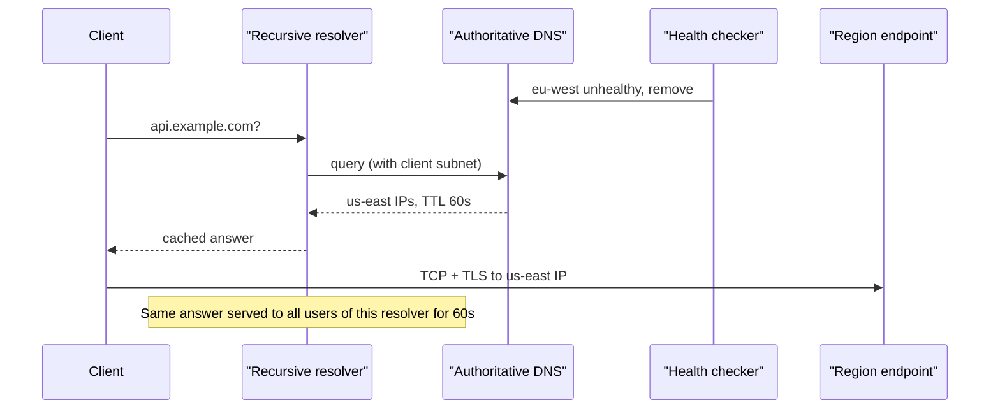

## In one minute
- DNS load balancing spreads traffic by changing *which IP addresses* a name resolves to, before any connection is opened.
- The authoritative server can rotate records, weight them, pick by client location, or drop unhealthy targets from answers.
- It has no view of individual requests: it steers *resolvers*, and resolvers cache answers for the TTL or longer.
- Use it for coarse, global steering (region, failover), not per-request balancing.
- Treat every DNS change as taking minutes to converge, and design failover around that delay.

## How it works

### The resolution path
A client asks a recursive resolver (an ISP's, a corporate one, or a public one like 8.8.8.8). It walks root, TLD and authoritative servers and caches each answer for its TTL. Your balancing logic lives only in the authoritative server. Everything downstream is a cache you do not control.

So the unit you balance is the *resolver*, not the user. The address the authoritative server sees belongs to the resolver, and one resolver may serve a single office or a whole continent ([Google SRE book, ch. 19](https://sre.google/sre-book/load-balancing-frontend/)). The answer it caches decides where all of those users go until the TTL expires.

### Policies the authoritative server can apply
- **Round robin:** return all A/AAAA records and rotate their order per query. The order is only a hint: the client's stub resolver re-sorts the list by the destination address selection rules ([RFC 6724](https://www.rfc-editor.org/rfc/rfc6724)), and Happy Eyeballs interleaves IPv6 and IPv4 and starts the next attempt after 250 ms ([RFC 8305](https://www.rfc-editor.org/rfc/rfc8305)).
- **Weighted:** return records chosen with probability proportional to a weight. Useful for canaries and unequal capacity.
- **Geo or latency-based:** map the resolver's IP, or the client subnet from the EDNS Client Subnet option, to the closest or fastest region. Not every resolver sends that option: Cloudflare's 1.1.1.1 deliberately omits it for privacy ([Cloudflare FAQ](https://developers.cloudflare.com/1.1.1.1/faq/)), so its users are placed by the resolver's own location.
- **Failover with health checks:** the provider probes endpoints from several vantage points and removes failing ones from answers. Route 53, for example, probes every 10 or 30 seconds and calls an endpoint healthy while more than 18% of its checkers agree, so one isolated checker region cannot fail it ([Route 53 docs](https://docs.aws.amazon.com/Route53/latest/DeveloperGuide/dns-failover-determining-health-of-endpoints.html)).

### Why TTL is the central knob
A low TTL (30 to 60 seconds) lets you shift traffic quickly but raises query volume and adds resolution round trips. A high TTL is cheap and fast for clients but locks in stale answers during an incident. Resolvers may clamp TTLs, clients may cache addresses longer, and long-lived connections never re-resolve, so a long tail lingers for hours. Resolvers that implement serve-stale go further on purpose: when they cannot reach your authoritative servers, they keep answering from expired cache with a 30-second TTL, for up to one to three days ([RFC 8767](https://www.rfc-editor.org/rfc/rfc8767)). That protects you during a DNS provider outage, and it also means a record you deleted can outlive its TTL.

### What DNS cannot see
The authoritative server does not know an endpoint's connection count, current latency, or request cost. It sees only resolver query rates. That is why DNS is the first tier, choosing a region or a set of load balancer IPs, with an L4 or L7 load balancer behind each address doing real balancing.

## Down the stack

### Layer 1: The contract
The authoritative server promises only this: for a given question (name, type, class), return a set of records and a TTL saying how long the answer may be reused. A recursive resolver may serve that answer to anyone for up to TTL seconds, and may cache a negative answer (NXDOMAIN) for the smaller of the SOA record's MINIMUM field and its own TTL ([RFC 2308](https://www.rfc-editor.org/rfc/rfc2308)). There is no promise that two consecutive queries get the same answer, that a client sticks to one address, or that a change is seen by everyone at once. Failure is explicit only in rare cases (SERVFAIL, timeouts); a stale answer looks exactly like a fresh one.

### Layer 2: The mechanism
A DNS message has a 12-byte header (16-bit ID, flags such as QR, AA, TC and RD, and four section counts), a question section, then answer resource records. Each record carries name, type, class, a 32-bit TTL, a length, and data. A load-balancing authoritative server, such as Route 53 or PowerDNS with Lua records, evaluates a policy per query: it reads health state fed by its probers, applies weights or a latency table keyed by the client's network, and builds the answer. The EDNS0 OPT pseudo-record advertises the UDP payload size the resolver accepts and can carry the Client Subnet option, truncated for privacy to a /24 for IPv4 or a /56 for IPv6. The response echoes a *scope prefix* telling the resolver how widely it may share that answer in its cache ([RFC 7871](https://www.rfc-editor.org/rfc/rfc7871)). Newer SVCB and HTTPS records ([RFC 9460](https://www.rfc-editor.org/rfc/rfc9460), 2023) add a priority field whose equal-priority entries clients shuffle, plus hints such as `alpn=h3`, so a single lookup can steer both the endpoint and the protocol.

### Layer 3: The machine
A query is one UDP datagram of about 40 to 60 bytes; a response with four A records is about 120 bytes, since each A record with a compressed name pointer costs 16 bytes. One round trip to a nearby resolver is 1 to 20 ms; a full recursive walk on a cold cache is 50 to 200 ms. Answers above the advertised size set the TC bit and force a retry over TCP, adding a handshake round trip. The 2020 DNS Flag Day settled on 1232 bytes as a safe EDNS size, because IPv6's 1280-byte minimum MTU minus 48 bytes of headers avoids IP fragmentation, which many firewalls drop; the same campaign made answering over TCP port 53 mandatory for authoritative servers ([DNS Flag Day 2020](https://www.dnsflagday.net/2020/)). The old 512-byte limit some textbooks still quote applies only to queries without EDNS. Authoritative servers answer in microseconds of CPU per query and scale across cores with `SO_REUSEPORT` sockets, so the expensive part is never the server; it is the round trips and caches between it and the user.

### Why it's built this way
1. Billions of clients cannot all ask one authority, so DNS is a hierarchy with caching everywhere.
2. Caching means the authority loses control of an answer once it leaves, so TTL is the only steering lever.
3. UDP gives a single round trip with no connection state, which caps message size, so answers carry a few records, not a fleet.
4. Resolvers hide the user's location, so ECS was added to recover it, at the cost of cache fragmentation and privacy.
5. All of this makes DNS a slow, coarse control loop, which is why precise balancing lives in L4 and L7 load balancers.

## Diagram



## Worked example
An API serves 40,000 requests per second from three regions: us-east (50%), eu-west (30%) and ap-south (20%), using latency routing with health checks and a 60-second TTL.

Query load: 20,000 active resolvers re-querying once a minute is about 330 queries per second; a 1-hour TTL drops that to about 6.

Failover timing when eu-west fails:

1. Health checks every 10 seconds, 3 failures to trip: about 30 seconds.
2. Provider propagates the change to its edge: 5 to 30 seconds.
3. Resolvers hold the old answer for up to 60 seconds.
4. Pooled connections to eu-west persist until they error.

Realistic recovery for 90% of traffic is 2 to 3 minutes. At 12,000 RPS, a 3-minute outage fails about 2 million requests, roughly 2% of a 0.1% monthly error budget (about 104 million requests). That number decides whether you need anycast or client-side retries against a second hostname.

Capacity: if Europe fails over to us-east, it carries 32,000 RPS, 60% above normal. Size headroom for losing the largest neighbour.

## In the wild
- **AWS, 2025: the DNS plan that emptied DynamoDB's endpoint.** DynamoDB's regional records are weighted DNS plans built by a Planner and applied to Route 53 by three independent Enactors. On 19 to 20 October one Enactor stalled, then applied a much older plan over a newer one, and a cleanup job deleted that old plan, leaving `dynamodb.us-east-1.amazonaws.com` with no IP addresses. DNS impact ran from 11:48 PM to 2:40 AM PDT, the last 15 minutes being resolver caches expiring, and the knock-on effects across EC2 and other services lasted much longer. AWS disabled the automation worldwide until the race is fixed ([AWS](https://aws.amazon.com/message/101925/)).
- **Akamai, 2021: one config push breaks the steering layer.** On 22 July a software configuration update hit a bug in the DNS component of Akamai's Secure Edge CDN, so browsers could not be directed to many customers' sites for up to an hour. Rolling the update back fixed it, and Akamai committed to reviewing its update process ([Akamai](https://www.akamai.com/blog/news/akamai-summarizes-service-disruption-resolved)).
- **Route 53 BGP hijack, 2018: caches spread a bad answer.** For about two hours on 24 April, eNet (AS10297) announced more-specific /24s of Amazon's Route 53 address space, and the hijacking servers answered only for myetherwallet.com, pointing it at a phishing site. Resolvers that queried them, including some 1.1.1.1 locations, cached the forged answer, so users whose networks never saw the bad route were still affected. Cloudflare recommended DNSSEC, RPKI and HSTS ([Cloudflare](https://blog.cloudflare.com/bgp-leaks-and-crypto-currencies/)).

## Trade-offs

| Option | Strengths | Weaknesses | Choose when |
| --- | --- | --- | --- |
| Round-robin DNS | Free, simple | No health awareness, uneven due to caching | Small fleets of identical, stable endpoints |
| Weighted DNS | Gradual shifts, canaries | Weights apply per resolver, not per user | Region migrations and staged rollouts |
| Geo/latency DNS | Users reach nearby regions | Resolver location may not match user | Multi-region user-facing services |
| DNS failover | Removes dead regions automatically | Minutes to converge | Cross-region disaster recovery |
| Anycast | Sub-minute shifts, no client caching | Needs BGP and owned IP space | Edge networks, DNS itself, DDoS absorption |

## Pitfalls in production
- **Clients ignore TTL.** OpenJDK caches successful lookups for 30 seconds by default, but `networkaddress.cache.ttl=-1`, or an old app server running under a security manager, caches forever ([OpenJDK java.security](https://github.com/openjdk/jdk/blob/master/src/java.base/share/conf/security/java.security)). Many HTTP clients also pin one IP per pool. Set the TTL explicitly, recycle pooled connections, and test failover with real client stacks.
- **Oversized answers.** Twenty A records can exceed 1232 bytes and force TCP fallback. Return a few.
- **Health checks that lie.** A check against the load balancer can pass while the app behind it fails. Probe a path that exercises real dependencies, from several locations, with a quorum.
- **Geo mismatch.** Users behind VPNs or distant resolvers land on the wrong continent. Enable EDNS Client Subnet and measure real latency.
- **Failover into overload.** Removing a region shifts all its load at once and can cascade. Keep N+1 capacity and drain stepwise for planned moves.

## Leadership lens
- Ask "how long until 99% of traffic has moved?" and expect a measured number, not the TTL value.
- Put DNS configuration in version control with review. Bad DNS changes are a classic cause of total outages.
- Use DNS for region selection and load balancers for per-connection fairness; push back on designs that expect DNS to balance individual servers.

## Check yourself
1. Why can weighted DNS at 90/10 produce a 70/30 split of actual traffic?
   **Answer:** Weights apply per resolver query, and resolvers differ hugely in how many users they serve. A few large resolvers that cached the minority answer can carry a disproportionate share of users for the whole TTL.
2. You set TTL to 30 seconds, yet traffic to a drained region lingers for 20 minutes. What are likely causes?
   **Answer:** Long-lived or pooled connections that never re-resolve, client libraries that cache addresses beyond TTL, and resolvers that enforce a minimum TTL.
3. Why is DNS usually paired with an L4 or L7 load balancer rather than listing every server?
   **Answer:** DNS has no per-request view of load or health and converges slowly, so it should point at a stable, highly available entry point that does real balancing.

## Practice
**Task:** Implement the answer-selection step of a weighted, health-aware authoritative DNS server. `pick_answer(records, healthy, k, rnd)` takes a list of `(ip, weight)` tuples, a set of healthy IPs, the maximum number of records to return, and `rnd`, a function returning floats in [0, 1). Choose up to `k` distinct IPs by weighted random sampling without replacement, ignoring zero-weight records. Each draw computes `r = rnd() * total_weight` and picks the first record, in list order, whose cumulative weight exceeds `r`. If no record is healthy, fail open and sample from all positive-weight records.

```python starter
def pick_answer(records, healthy, k, rnd):
    # TODO: weighted sampling without replacement among healthy records
    raise NotImplementedError
```

```python tests
def seq(*vals):
    state = {"i": 0}
    def rnd():
        v = vals[state["i"] % len(vals)]
        state["i"] += 1
        return v
    return rnd

R = [("a", 1), ("b", 1), ("c", 1)]

def test_low_draws_pick_in_order():
    assert pick_answer(R, {"a", "b", "c"}, 2, seq(0.0)) == ["a", "b"]

def test_high_draws_pick_from_end():
    assert pick_answer(R, {"a", "b", "c"}, 2, seq(0.99)) == ["c", "b"]

def test_weights_shape_choice():
    recs = [("a", 9), ("b", 1)]
    assert pick_answer(recs, {"a", "b"}, 1, seq(0.85)) == ["a"]
    assert pick_answer(recs, {"a", "b"}, 1, seq(0.95)) == ["b"]

def test_unhealthy_excluded_and_k_capped():
    assert pick_answer(R, {"b", "c"}, 3, seq(0.0)) == ["b", "c"]

def test_fail_open_when_none_healthy():
    assert pick_answer(R, set(), 1, seq(0.0)) == ["a"]

def test_zero_weight_never_returned():
    assert pick_answer([("a", 0), ("b", 5)], {"a", "b"}, 2, seq(0.0)) == ["b"]
```

```python solution
def pick_answer(records, healthy, k, rnd):
    pool = [(ip, w) for ip, w in records if w > 0 and ip in healthy]
    if not pool:
        pool = [(ip, w) for ip, w in records if w > 0]
    out = []
    while pool and len(out) < k:
        total = sum(w for _, w in pool)
        r = rnd() * total
        cum = 0
        for i, (ip, w) in enumerate(pool):
            cum += w
            if r < cum:
                out.append(ip)
                pool.pop(i)
                break
    return out
```

```typescript starter
export function pickAnswer(records: [string, number][], healthy: Set<string>, k: number, rnd: () => number): string[] {
  throw new Error("TODO");
}
```

```typescript tests
function seq(...vals: number[]): () => number {
  let i = 0;
  return () => vals[i++ % vals.length];
}
const R: [string, number][] = [["a", 1], ["b", 1], ["c", 1]];
const ALL = new Set(["a", "b", "c"]);
test("low draws pick in order", () => {
  assertEqual(pickAnswer(R, ALL, 2, seq(0)), ["a", "b"]);
});
test("high draws pick from end", () => {
  assertEqual(pickAnswer(R, ALL, 2, seq(0.99)), ["c", "b"]);
});
test("weights shape choice", () => {
  const recs: [string, number][] = [["a", 9], ["b", 1]];
  assertEqual(pickAnswer(recs, new Set(["a", "b"]), 1, seq(0.85)), ["a"]);
  assertEqual(pickAnswer(recs, new Set(["a", "b"]), 1, seq(0.95)), ["b"]);
});
test("unhealthy excluded and k capped", () => {
  assertEqual(pickAnswer(R, new Set(["b", "c"]), 3, seq(0)), ["b", "c"]);
});
test("fail open when none healthy", () => {
  assertEqual(pickAnswer(R, new Set(), 1, seq(0)), ["a"]);
});
test("zero weight never returned", () => {
  assertEqual(pickAnswer([["a", 0], ["b", 5]], new Set(["a", "b"]), 2, seq(0)), ["b"]);
});
```

```typescript solution
export function pickAnswer(records: [string, number][], healthy: Set<string>, k: number, rnd: () => number): string[] {
  let pool = records.filter(([ip, w]) => w > 0 && healthy.has(ip));
  if (pool.length === 0) pool = records.filter(([, w]) => w > 0);
  const out: string[] = [];
  while (pool.length > 0 && out.length < k) {
    const total = pool.reduce((s, [, w]) => s + w, 0);
    const r = rnd() * total;
    let cum = 0;
    for (let i = 0; i < pool.length; i++) {
      cum += pool[i][1];
      if (r < cum) {
        out.push(pool[i][0]);
        pool.splice(i, 1);
        break;
      }
    }
  }
  return out;
}
```

```go starter
package practice

type Record struct {
	IP     string
	Weight int
}

func PickAnswer(records []Record, healthy map[string]bool, k int, rnd func() float64) []string {
	panic("TODO")
}
```

```go tests
package practice

import (
	"reflect"
	"testing"
)

func seq(vals ...float64) func() float64 {
	i := 0
	return func() float64 { v := vals[i%len(vals)]; i++; return v }
}

var all = map[string]bool{"a": true, "b": true, "c": true}
var recs = []Record{{"a", 1}, {"b", 1}, {"c", 1}}

func check(t *testing.T, got, want []string) {
	t.Helper()
	if !reflect.DeepEqual(got, want) {
		t.Fatalf("got %v, want %v", got, want)
	}
}

func TestLowDrawsInOrder(t *testing.T)  { check(t, PickAnswer(recs, all, 2, seq(0)), []string{"a", "b"}) }
func TestHighDrawsFromEnd(t *testing.T) { check(t, PickAnswer(recs, all, 2, seq(0.99)), []string{"c", "b"}) }

func TestWeights(t *testing.T) {
	w := []Record{{"a", 9}, {"b", 1}}
	h := map[string]bool{"a": true, "b": true}
	check(t, PickAnswer(w, h, 1, seq(0.85)), []string{"a"})
	check(t, PickAnswer(w, h, 1, seq(0.95)), []string{"b"})
}

func TestUnhealthyExcluded(t *testing.T) {
	check(t, PickAnswer(recs, map[string]bool{"b": true, "c": true}, 3, seq(0)), []string{"b", "c"})
}

func TestFailOpen(t *testing.T) { check(t, PickAnswer(recs, map[string]bool{}, 1, seq(0)), []string{"a"}) }

func TestZeroWeight(t *testing.T) {
	check(t, PickAnswer([]Record{{"a", 0}, {"b", 5}}, all, 2, seq(0)), []string{"b"})
}
```

```go solution
package practice

type Record struct {
	IP     string
	Weight int
}

func PickAnswer(records []Record, healthy map[string]bool, k int, rnd func() float64) []string {
	var pool []Record
	for _, r := range records {
		if r.Weight > 0 && healthy[r.IP] {
			pool = append(pool, r)
		}
	}
	if len(pool) == 0 {
		for _, r := range records {
			if r.Weight > 0 {
				pool = append(pool, r)
			}
		}
	}
	out := []string{}
	for len(pool) > 0 && len(out) < k {
		total := 0
		for _, r := range pool {
			total += r.Weight
		}
		x := rnd() * float64(total)
		cum := 0
		for i, r := range pool {
			cum += r.Weight
			if x < float64(cum) {
				out = append(out, r.IP)
				pool = append(pool[:i], pool[i+1:]...)
				break
			}
		}
	}
	return out
}
```

## Mock interview
**Prompt:** You run a consumer API in three regions at 40,000 RPS total. Design how users are routed to a region, and how traffic leaves a region that fails, with a target of under 5 minutes to move 99% of traffic.

- Follow-up: What TTL do you choose, and what does it cost in query volume and latency?
- Follow-up: A large mobile client keeps hitting the dead region for 30 minutes. Why, and how do you fix it?
- Follow-up: When would you replace DNS steering with anycast?

**A strong answer covers:**
- DNS chooses a region; a load balancer in each region balances connections.
- TTL as a trade-off between agility, authoritative query cost, and resolution latency, with numbers.
- Health checks that exercise real dependencies, from multiple vantage points with a quorum.
- Client behaviour: connection pooling, DNS caching in SDKs, and periodic connection recycling.
- Capacity planning so surviving regions absorb the failed region's load.

## Sources and further study
**Primary**
- [RFC 8767: Serving Stale Data to Improve DNS Resiliency](https://www.rfc-editor.org/rfc/rfc8767): why a resolver may keep answering with an expired record, and for how long.
- [RFC 9460: SVCB and HTTPS resource records](https://www.rfc-editor.org/rfc/rfc9460): priority, protocol hints and apex aliasing in one record type.
- [RFC 8305: Happy Eyeballs v2](https://www.rfc-editor.org/rfc/rfc8305): how clients sort, interleave and race the addresses you return.

**Systems docs**
- [Route 53: how health checks decide health](https://docs.aws.amazon.com/Route53/latest/DeveloperGuide/dns-failover-determining-health-of-endpoints.html): probe intervals, timeouts and the 18% quorum rule.
- [Cloudflare 1.1.1.1 FAQ](https://developers.cloudflare.com/1.1.1.1/faq/): a major public resolver that does not send EDNS Client Subnet.
- [DNS Flag Day 2020](https://www.dnsflagday.net/2020/): the 1232-byte EDNS default and the TCP fallback rules.

**Books**
- *Site Reliability Engineering*, Beyer et al., chapter 19 "Load Balancing at the Frontend": DNS as the first tier and a VIP behind it. Written in 2016, so its 512-byte limit and "ECS not yet standard" remarks are dated.
- *Understanding Distributed Systems*, Roberto Vitillo, chapters "Discovery" and "Network load balancing": DNS resolution, then the L4 and L7 balancing that sits behind it.
- *Computer Networking: A Top-Down Approach* (8th ed.), Kurose and Ross, chapter 2 "Application Layer": the DNS hierarchy, caching and message format.

**Other curricula**
- [donnemartin/system-design-primer](https://github.com/donnemartin/system-design-primer): lists weighted round robin, latency-based and geolocation routing under DNS, without covering TTL convergence or resolver behaviour.

## Watch
- [Everything You Need to Know About DNS (ByteByteGo)](https://www.youtube.com/watch?v=27r4Bzuj5NQ): resolution chain, caching and record types.
- [Anycast vs Global Server Load Balancing (F5 DevCentral)](https://www.youtube.com/watch?v=-2WnHiKPrgE): contrasts DNS-based global balancing with anycast.

## Free resources
- [Amazon Route 53 routing policies](https://docs.aws.amazon.com/Route53/latest/DeveloperGuide/routing-policy.html): concrete descriptions of weighted, latency, geo and failover policies.
- [Route 53 DNS failover](https://docs.aws.amazon.com/Route53/latest/DeveloperGuide/dns-failover.html): how health checks and failover records interact in a real provider.
- [RFC 7871: Client Subnet in DNS Queries](https://www.rfc-editor.org/rfc/rfc7871): the mechanism behind accurate geo answers and its privacy cost.
- [RFC 2782: DNS SRV records](https://www.rfc-editor.org/rfc/rfc2782): priority and weight fields for client-side selection.
