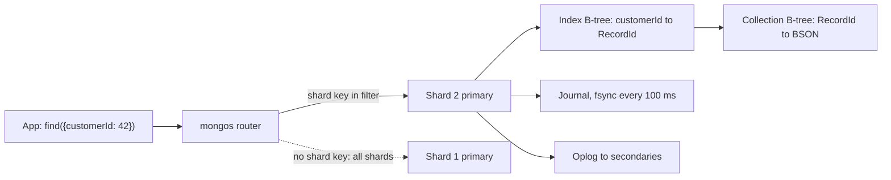

## In one minute
- A document database stores each record as a self-describing tree of fields, arrays and nested objects (JSON in the API, BSON or similar on disk), in collections that do not force one schema.
- The unit of design is the aggregate, the data one request reads or writes together. In one document, a read is one lookup and a write is atomic without a transaction.
- Queries reach inside documents with dotted paths, and arrays get special treatment: a condition on an array field matches if any element matches, and indexes on arrays store one entry per element.
- Scaling is by sharding on a key inside the document, so the shard key decides which queries hit one shard and which fan out to all of them.
- Flexibility moves cost rather than removing it: schema rules live in code and validators, duplicated data is yours to keep in step, and unbounded documents get slow to rewrite.

## How it works

### Documents and aggregates
A relational row is flat, so anything one-to-many (an order's line items) lives in another table joined by key. A document keeps that shape: one order holds the customer snapshot, the address, an array of line items and the payment status, and reading it is one lookup by `_id`.

Martin Fowler calls this *aggregate orientation*. The *SQL vs NoSQL* lesson compares the models by access pattern; here we go inside the engine. The design rule: draw document boundaries around what is read and changed together, and around what must change atomically.

### Embedding versus referencing
Embed when the child belongs to one parent, is read with it, and is bounded: line items in an order. Reference (store the other document's `_id`) when the child is shared, large, independently changing or unbounded: the product a line item points at, the comments on a viral post. The *extended reference* sits between: embed the few fields you display (product name and price at purchase) and keep the `_id`. That copy is denormalized data (see *Denormalization*), fine for a price frozen at purchase, dangerous for a customer's current email.

### Flexible schema is still a schema
Collections accept documents of any shape, so two versions of an entity can coexist during a migration; readers check a `schemaVersion` field and upgrade documents lazily on write. MongoDB can enforce a JSON Schema validator per collection, and teams that skip it discover years later that `price` is a string in 3% of documents. The default `strict` level checks every insert and update but says nothing about documents written before the validator existed; MongoDB 9.0 (September 2026) added a `constraint` level that guarantees every document in the collection satisfies the rules ([MongoDB docs](https://www.mongodb.com/docs/manual/core/schema-validation/specify-validation-level/)).

### Querying inside documents
Filters name fields by path: `{"customer.city": "Lyon"}` descends into an embedded object. Arrays are where the model differs most from SQL. `{"tags": "gift"}` matches a document whose `tags` array contains `"gift"`; `{"items.sku": "B7"}` walks every element of `items`. Multiple operators on one array path, such as `{"items.qty": {"$gt": 5, "$lt": 3}}`, are each satisfied by *some* element, not necessarily the same one, so an order with quantities 2 and 9 matches. To require one element to satisfy all conditions you need `$elemMatch`. The Practice section has you implement exactly this.

### Atomicity, transactions and scale
A write to one document is atomic and isolated, nested arrays included ([MongoDB docs](https://www.mongodb.com/docs/manual/core/transactions/)). That is the multi-step consistency problem shape solved by layout instead of locking, so good schemas keep invariants (an order's total equals the sum of its items) inside one document. MongoDB has multi-document ACID transactions (since 4.0 for replica sets, 4.2 for sharded clusters), but they cost round trips, abort after 60 seconds by default ([MongoDB docs](https://www.mongodb.com/docs/manual/core/transactions-production-consideration/)), and often signal a boundary drawn in the wrong place. Since 9.0 the server also rejects new transactions once 10,000 are open at the same time by default ([MongoDB 9.0 release notes](https://www.mongodb.com/docs/manual/release-notes/9.0/)).

To scale out, a collection is sharded on a field such as `customerId`. Queries that include the shard key go to one shard; queries without it are scatter-gather. The same model appears in Postgres as a `jsonb` column with a GIN index, and in Firestore and Elasticsearch.

## Down the stack

### Layer 1: The contract
A single-document write is atomic: all of its field changes are visible or none are. Durability is tunable per operation. With write concern `w: "majority"` (the default since MongoDB 5.0) the server acknowledges only once a majority of replica set members have the write, so it survives a primary failover. One exception: with arbiters, if data-bearing voting members do not outnumber the voting majority (two data nodes plus an arbiter, say), the default drops to `w: 1` ([MongoDB docs](https://www.mongodb.com/docs/manual/reference/write-concern/)); with `w: 1` a failover can roll it back. Read concern `local` may return data a failover later undoes, `majority` returns only majority-acknowledged data, and `linearizable` also confirms the primary is still primary. Nothing is promised across documents unless you open a transaction.

### Layer 2: The mechanism
On the wire and on disk, MongoDB documents are BSON: a 4-byte little-endian total length, a sequence of elements, then a `0x00` terminator. Each element is a 1-byte type tag, the field name as a null-terminated string, and the value. Field names repeat in every document, which is the storage tax of flexible schema. BSON documents are capped at 16 MiB and 100 levels of nesting ([MongoDB limits](https://www.mongodb.com/docs/manual/reference/limits/)).

WiredTiger keeps each collection in a B-tree keyed by an internal 64-bit `RecordId`; the `_id` index and secondary indexes are separate B-trees mapping values to `RecordId`. An index on an array field is *multikey*: one entry per element, so 50 tags make 50 entries, and a compound index may not cover two array fields of one document ("parallel arrays", which would need a cross product).

Replication streams an *oplog*, a capped collection of idempotent operations ([MongoDB docs](https://www.mongodb.com/docs/manual/core/replica-set-oplog/)). An `$inc` from the client is logged as a `$set` of the resulting value, so replaying an entry twice is harmless. Elections follow a Raft-derived protocol. Sharded clusters split each collection into chunk ranges of the shard key (128 MB by default, [MongoDB docs](https://www.mongodb.com/docs/manual/core/sharding-data-partitioning/)); a balancer moves chunks between shards, and `mongos` routers use a cached routing table to send each query to one shard or all of them.

### Layer 3: The machine
WiredTiger's cache defaults to the larger of 50% of (RAM minus 1 GB) and 256 MB, and holds pages uncompressed; on disk, collection blocks are Snappy-compressed by default (zstd for time series collections) and indexes use prefix compression ([MongoDB docs](https://www.mongodb.com/docs/manual/core/wiredtiger/)), so repeated field names shrink on disk but cost full size in cache. Writes go to a journal (a write-ahead log) that is flushed with `fsync` every 100 ms by default, or immediately when a write asks for `j: true` ([MongoDB docs](https://www.mongodb.com/docs/manual/core/journaling/)). Every 60 seconds a checkpoint writes a consistent snapshot of the B-trees to new blocks, so recovery replays only the journal since the last checkpoint.

A small change to a large document is not free. In memory WiredTiger can keep a small delta, but when the page is written out the whole new document goes into the new page image, so updating one counter in a 2 MB document rewrites 2 MB on disk, and every read of it pulls megabytes through the cache.

### Why it's built this way
1. Applications think in objects and joins cost random I/O, so the engine stores the object as one contiguous record.
2. Entities change shape over time, so each document carries its own field names; that costs bytes, so blocks are compressed.
3. Contiguous records make single-record atomicity cheap, so that is the promise and cross-record transactions are opt-in.
4. Queries into arrays must be fast, so indexes hold one entry per element, which makes huge arrays expensive to write.
5. One machine runs out of disk and write throughput, so collections split by shard key, and a query's cost depends on naming it.

## Diagram


## Worked example
A marketplace stores 200 million orders. An order has 4 line items of about 150 bytes of BSON each plus a 600-byte envelope (customer snapshot, address, status), roughly 1.2 KB, or 240 GB in total. Field names are about 25% of that: 30 fields at about 10 bytes each. Snappy brings it to around 100 GB on disk; the cache still holds documents uncompressed.

Loading one order by `_id` is two B-tree descents (index, then collection) with cached upper levels: one or two disk reads at worst. The relational version joins four tables.

Now product teams ask for "all orders containing SKU B7 in the last week". An index on `{"items.sku": 1, "createdAt": -1}` is multikey: 800 million entries for 200 million orders. At about 40 bytes per entry that is 32 GB of index, and every new order writes 4 entries. Sharded on `customerId`, this query cannot target one shard, so with 8 shards each query costs 8 index scans plus a merge in `mongos`. If it runs 500 times a second, that is 4,000 shard-level queries a second; a separate read model keyed by SKU, fed from a change stream, may be cheaper.

## In the wild
- **Jepsen, 2020: MongoDB 4.2.6 transactions and the defaults.** Even with snapshot read concern and majority write concern, Jepsen observed read skew, cyclic information flow and duplicate writes. Transactions ignored database- and collection-level concerns and fell back to `local` and `w: 1`, so acknowledged writes could be lost in a partition. MongoDB traced the anomalies to a transaction retry bug, with a patch scheduled for 4.2.8. The advice: set concerns explicitly on every transaction ([Jepsen](https://jepsen.io/analyses/mongodb-4.2.6)).
- **Stripe, 2017: moving an embedded aggregate into its own collection.** Stripe moved hundreds of millions of Subscription objects out of Customer records into their own table without downtime: dual-write and backfill, switch reads, switch writes, then delete the old path. The backfill used an offline Hadoop job over database snapshots to find the objects without hammering production, and the Scientist library compared old and new read paths before each switch ([Stripe](https://stripe.com/blog/online-migrations)).

## Trade-offs
| Option | Strengths | Weaknesses | Choose when |
|---|---|---|---|
| Embed children | One read, atomic updates, data locality | Duplication, document growth, 16 MiB cap | Child is owned, bounded and read with the parent |
| Reference by `_id` | No duplication, independent growth | Extra round trips or `$lookup`, no cross-document atomicity | Child is shared, large or unbounded |
| Extended reference | Fast display with a stable snapshot | Copies drift if the source changes | Values that should be frozen at write time |
| Bucket pattern (fixed-size child documents) | Bounded documents, fewer index entries | More complex reads and writes | High-volume child events such as readings or messages |
| Relational table with `jsonb` | Joins, constraints and flexible fields together | Weaker horizontal scaling, GIN index write cost | Mostly relational data with some variable attributes |

## Pitfalls in production
- **Unbounded arrays.** Comments or followers embedded in a parent grow until every update rewrites megabytes and the document hits the 16 MiB limit. Cap arrays, use the bucket pattern, or move children to their own collection.
- **Monotonic shard keys.** Sharding on a timestamp or an `ObjectId` (whose first 4 bytes are seconds since the epoch) sends every insert to the last chunk, one hot shard. Use a hashed shard key or a compound key that leads with a high-cardinality field.
- **Scatter-gather by accident.** A query without the shard key runs on every shard at the slowest shard's latency. Choose the key from access patterns and keep a read model for the rest.
- **Silent schema drift.** Without validators, `{"price": {"$gt": 10}}` silently skips documents where `price` became a string, because comparisons only match the same type class ([MongoDB docs](https://www.mongodb.com/docs/manual/reference/bson-type-comparison-order/)). Add JSON Schema validation and versioned migrations.
- **Acknowledged writes that vanish.** With `w: 1`, a primary that crashes before replicating loses acknowledged writes to rollback. Use `w: "majority"` for anything a user was told succeeded.

## Leadership lens
- Ask for the top ten access patterns with QPS before any schema is drawn; the schema derives from them, and changing aggregates later means migrating every document.
- Treat the shard key as a one-way door. Resharding is possible in recent versions but is a long, I/O-heavy operation: it runs at least 5 minutes, needs roughly twice the collection and index size in free space across the shards, and blocks writes for about two seconds at the end ([MongoDB docs](https://www.mongodb.com/docs/manual/core/sharding-reshard-a-collection/)). Review the key choice the way you would a public API.
- Make one owner responsible for each duplicated field and its sync path (change stream, outbox or batch repair), or the copies will disagree within a quarter.
- Budget for schema governance: validators, a `schemaVersion` convention and lazy migrations are cheap to start with and expensive to retrofit.

## Check yourself
1. Why is `{"scores": {"$gt": 80, "$lt": 85}}` true for a document whose `scores` are `[70, 90]`, and how do you express "one score between 80 and 85"?
   **Answer:** Each operator on an array path is satisfied independently by any element: 90 is above 80 and 70 is below 85. `$elemMatch` applies all conditions to the same element.
2. A team stores a user's notification feed as an array inside the user document. What breaks first as the product grows?
   **Answer:** Write cost: each notification rewrites an ever larger document, long before the 16 MiB cap. Feeds belong in their own collection or bounded buckets.
3. Why does the oplog record `$inc: 1` as a `$set` of the new value?
   **Answer:** Oplog entries must be idempotent because a secondary may apply an entry more than once during recovery. Setting the final value twice is harmless; incrementing twice is not.
4. When does a document store give you atomicity without a transaction?
   **Answer:** When every field the operation changes lives in one document, because a single-document write is atomic and isolated. Designing aggregates around invariants is how you use that.

## Practice
**Task:** Implement the filter matcher at the heart of a document store's query engine. `matches(doc, query)` returns whether a document satisfies a filter, and `find(docs, query)` returns the `_id` values of matching documents in input order. A filter maps dotted paths to conditions, and all entries must hold. Resolving a path descends into objects; when it meets an array, a numeric segment indexes into it, and any other segment is applied to every object element. A resolved value that is an array is compared both as a whole and element by element. A condition is either a literal (match if any candidate equals it, with numbers comparing by value and objects by keys and values) or an object of operators: `$eq`, `$ne` (no candidate equals), `$gt`, `$gte`, `$lt`, `$lte` (some candidate satisfies it, comparing only number with number or string with string), `$in` (some candidate equals some listed value), and `$exists` (whether the path resolved to anything). Each operator is checked independently, so different array elements may satisfy different operators. The top-level keys `$and` and `$or` take a list of filters.

```python starter
def matches(doc, query):
    # TODO
    raise NotImplementedError


def find(docs, query):
    # TODO
    raise NotImplementedError
```

```python tests
DOCS = [
    {"_id": "o1", "status": "paid", "total": 120,
     "customer": {"name": "Ana", "city": "Lyon"}, "tags": ["gift", "rush"],
     "items": [{"sku": "A1", "qty": 2}, {"sku": "B7", "qty": 9}]},
    {"_id": "o2", "status": "open", "total": 40,
     "customer": {"name": "Ben", "city": "Oslo"}, "tags": ["rush"],
     "items": [{"sku": "B7", "qty": 1}]},
    {"_id": "o3", "status": "paid", "total": 75.5,
     "customer": {"name": "Cy", "city": "Lyon"},
     "items": [{"sku": "C3", "qty": 4}], "coupon": "SPRING"},
]


def test_equality_and_nested_paths():
    assert find(DOCS, {"status": "paid"}) == ["o1", "o3"]
    assert find(DOCS, {"status": "paid", "customer.city": "Lyon"}) == ["o1", "o3"]
    assert find(DOCS, {"status": "open", "customer.city": "Lyon"}) == []
    assert find(DOCS, {"customer": {"city": "Oslo", "name": "Ben"}}) == ["o2"]
    assert matches(DOCS[0], {})


def test_array_contains_and_whole_array():
    assert find(DOCS, {"tags": "rush"}) == ["o1", "o2"]
    assert find(DOCS, {"tags": ["rush"]}) == ["o2"]
    assert find(DOCS, {"tags.0": "rush"}) == ["o2"]


def test_paths_through_arrays_of_objects():
    assert find(DOCS, {"items.sku": "B7"}) == ["o1", "o2"]
    assert find(DOCS, {"items.1.sku": "B7"}) == ["o1"]
    assert find(DOCS, {"items.0.qty": {"$gte": 2}}) == ["o1", "o3"]


def test_operators_match_any_element_independently():
    assert find(DOCS, {"items.qty": {"$gt": 5, "$lt": 3}}) == ["o1"], "9 > 5 and 2 < 3"
    assert find(DOCS, {"items.qty": {"$gt": 3, "$lt": 5}}) == ["o1", "o3"], "o1: 9 > 3 and 2 < 5"


def test_exists_and_ne():
    assert find(DOCS, {"coupon": {"$exists": False}}) == ["o1", "o2"]
    assert find(DOCS, {"coupon": {"$exists": True}}) == ["o3"]
    assert find(DOCS, {"tags": {"$ne": "gift"}}) == ["o2", "o3"]


def test_in_and_or_and():
    assert find(DOCS, {"status": {"$in": ["open", "void"]}}) == ["o2"]
    assert find(DOCS, {"$or": [{"total": {"$lt": 50}}, {"coupon": "SPRING"}]}) == ["o2", "o3"]
    assert find(DOCS, {"$and": [{"tags": "rush"}, {"total": {"$gte": 100}}]}) == ["o1"]


def test_comparisons_respect_types():
    assert find(DOCS, {"total": {"$gt": 75}}) == ["o1", "o3"]
    assert find(DOCS, {"total": {"$gt": "100"}}) == [], "string never compares with number"
    assert find(DOCS, {"customer.name": {"$lt": "B"}}) == ["o1"]
```

```python solution
def _is_num(v):
    return isinstance(v, (int, float)) and not isinstance(v, bool)


def _eq(a, b):
    if _is_num(a) or _is_num(b):
        return _is_num(a) and _is_num(b) and a == b
    if isinstance(a, list) or isinstance(b, list):
        if not (isinstance(a, list) and isinstance(b, list)) or len(a) != len(b):
            return False
        return all(_eq(x, y) for x, y in zip(a, b))
    if isinstance(a, dict) or isinstance(b, dict):
        if not (isinstance(a, dict) and isinstance(b, dict)) or set(a) != set(b):
            return False
        return all(_eq(a[k], b[k]) for k in a)
    return type(a) == type(b) and a == b


def _resolve(value, parts):
    if not parts:
        return [value]
    head, rest = parts[0], parts[1:]
    if isinstance(value, dict):
        return _resolve(value[head], rest) if head in value else []
    if isinstance(value, list):
        if head.isdigit():
            i = int(head)
            return _resolve(value[i], rest) if i < len(value) else []
        out = []
        for el in value:
            if isinstance(el, dict):
                out.extend(_resolve(el, parts))
        return out
    return []


def _candidates(vals):
    out = []
    for v in vals:
        out.append(v)
        if isinstance(v, list):
            out.extend(v)
    return out


def _compare(a, b, op):
    if not ((_is_num(a) and _is_num(b)) or (isinstance(a, str) and isinstance(b, str))):
        return False
    if op == "$gt":
        return a > b
    if op == "$gte":
        return a >= b
    if op == "$lt":
        return a < b
    return a <= b


def _is_operator_doc(cond):
    return isinstance(cond, dict) and len(cond) > 0 and all(k.startswith("$") for k in cond)


def _check(vals, cond):
    cands = _candidates(vals)
    if not _is_operator_doc(cond):
        return any(_eq(c, cond) for c in cands)
    for op, arg in cond.items():
        if op == "$exists":
            ok = (len(vals) > 0) == arg
        elif op == "$eq":
            ok = any(_eq(c, arg) for c in cands)
        elif op == "$ne":
            ok = not any(_eq(c, arg) for c in cands)
        elif op == "$in":
            ok = any(_eq(c, a) for c in cands for a in arg)
        else:
            ok = any(_compare(c, arg, op) for c in cands)
        if not ok:
            return False
    return True


def matches(doc, query):
    for key, cond in query.items():
        if key == "$or":
            ok = any(matches(doc, q) for q in cond)
        elif key == "$and":
            ok = all(matches(doc, q) for q in cond)
        else:
            ok = _check(_resolve(doc, key.split(".")), cond)
        if not ok:
            return False
    return True


def find(docs, query):
    return [d["_id"] for d in docs if matches(d, query)]
```

```typescript starter
export type Doc = { [key: string]: any };

export function matches(doc: Doc, query: Doc): boolean {
  throw new Error("TODO");
}

export function find(docs: Doc[], query: Doc): string[] {
  throw new Error("TODO");
}
```

```typescript tests
const DOCS: Doc[] = [
  { _id: "o1", status: "paid", total: 120, customer: { name: "Ana", city: "Lyon" },
    tags: ["gift", "rush"], items: [{ sku: "A1", qty: 2 }, { sku: "B7", qty: 9 }] },
  { _id: "o2", status: "open", total: 40, customer: { name: "Ben", city: "Oslo" },
    tags: ["rush"], items: [{ sku: "B7", qty: 1 }] },
  { _id: "o3", status: "paid", total: 75.5, customer: { name: "Cy", city: "Lyon" },
    items: [{ sku: "C3", qty: 4 }], coupon: "SPRING" },
];

test("equality and nested paths", () => {
  assertEqual(find(DOCS, { status: "paid" }), ["o1", "o3"]);
  assertEqual(find(DOCS, { status: "paid", "customer.city": "Lyon" }), ["o1", "o3"]);
  assertEqual(find(DOCS, { status: "open", "customer.city": "Lyon" }), []);
  assertEqual(find(DOCS, { customer: { city: "Oslo", name: "Ben" } }), ["o2"]);
  assert(matches(DOCS[0], {}), "empty filter matches");
});
test("array contains and whole array", () => {
  assertEqual(find(DOCS, { tags: "rush" }), ["o1", "o2"]);
  assertEqual(find(DOCS, { tags: ["rush"] }), ["o2"]);
  assertEqual(find(DOCS, { "tags.0": "rush" }), ["o2"]);
});
test("paths through arrays of objects", () => {
  assertEqual(find(DOCS, { "items.sku": "B7" }), ["o1", "o2"]);
  assertEqual(find(DOCS, { "items.1.sku": "B7" }), ["o1"]);
  assertEqual(find(DOCS, { "items.0.qty": { $gte: 2 } }), ["o1", "o3"]);
});
test("operators match any element independently", () => {
  assertEqual(find(DOCS, { "items.qty": { $gt: 5, $lt: 3 } }), ["o1"], "9 > 5 and 2 < 3");
  assertEqual(find(DOCS, { "items.qty": { $gt: 3, $lt: 5 } }), ["o1", "o3"], "o1: 9 > 3 and 2 < 5");
});
test("exists and ne", () => {
  assertEqual(find(DOCS, { coupon: { $exists: false } }), ["o1", "o2"]);
  assertEqual(find(DOCS, { coupon: { $exists: true } }), ["o3"]);
  assertEqual(find(DOCS, { tags: { $ne: "gift" } }), ["o2", "o3"]);
});
test("in, or, and", () => {
  assertEqual(find(DOCS, { status: { $in: ["open", "void"] } }), ["o2"]);
  assertEqual(find(DOCS, { $or: [{ total: { $lt: 50 } }, { coupon: "SPRING" }] }), ["o2", "o3"]);
  assertEqual(find(DOCS, { $and: [{ tags: "rush" }, { total: { $gte: 100 } }] }), ["o1"]);
});
test("comparisons respect types", () => {
  assertEqual(find(DOCS, { total: { $gt: 75 } }), ["o1", "o3"]);
  assertEqual(find(DOCS, { total: { $gt: "100" } }), [], "string never compares with number");
  assertEqual(find(DOCS, { "customer.name": { $lt: "B" } }), ["o1"]);
});
```

```typescript solution
export type Doc = { [key: string]: any };

function isObj(v: any): boolean {
  return typeof v === "object" && v !== null && !Array.isArray(v);
}

function same(a: any, b: any): boolean {
  if (Array.isArray(a) || Array.isArray(b)) {
    if (!Array.isArray(a) || !Array.isArray(b) || a.length !== b.length) return false;
    return a.every((x, i) => same(x, b[i]));
  }
  if (isObj(a) || isObj(b)) {
    if (!isObj(a) || !isObj(b)) return false;
    const ka = Object.keys(a);
    if (ka.length !== Object.keys(b).length) return false;
    return ka.every((k) => k in b && same(a[k], b[k]));
  }
  return a === b;
}

function resolve(value: any, parts: string[]): any[] {
  if (parts.length === 0) return [value];
  const [head, ...rest] = parts;
  if (Array.isArray(value)) {
    if (/^\d+$/.test(head)) {
      const i = Number(head);
      return i < value.length ? resolve(value[i], rest) : [];
    }
    const out: any[] = [];
    for (const el of value) if (isObj(el)) out.push(...resolve(el, parts));
    return out;
  }
  if (isObj(value)) return head in value ? resolve(value[head], rest) : [];
  return [];
}

function candidates(vals: any[]): any[] {
  const out: any[] = [];
  for (const v of vals) {
    out.push(v);
    if (Array.isArray(v)) out.push(...v);
  }
  return out;
}

function compare(a: any, b: any, op: string): boolean {
  const ok = (typeof a === "number" && typeof b === "number") ||
    (typeof a === "string" && typeof b === "string");
  if (!ok) return false;
  if (op === "$gt") return a > b;
  if (op === "$gte") return a >= b;
  if (op === "$lt") return a < b;
  return a <= b;
}

function isOperatorDoc(cond: any): boolean {
  if (!isObj(cond)) return false;
  const keys = Object.keys(cond);
  return keys.length > 0 && keys.every((k) => k.startsWith("$"));
}

function check(vals: any[], cond: any): boolean {
  const cands = candidates(vals);
  if (!isOperatorDoc(cond)) return cands.some((c) => same(c, cond));
  for (const op of Object.keys(cond)) {
    const arg = cond[op];
    let ok: boolean;
    if (op === "$exists") ok = (vals.length > 0) === arg;
    else if (op === "$eq") ok = cands.some((c) => same(c, arg));
    else if (op === "$ne") ok = !cands.some((c) => same(c, arg));
    else if (op === "$in") ok = cands.some((c) => (arg as any[]).some((a) => same(c, a)));
    else ok = cands.some((c) => compare(c, arg, op));
    if (!ok) return false;
  }
  return true;
}

export function matches(doc: Doc, query: Doc): boolean {
  for (const key of Object.keys(query)) {
    const cond = query[key];
    let ok: boolean;
    if (key === "$or") ok = (cond as Doc[]).some((q) => matches(doc, q));
    else if (key === "$and") ok = (cond as Doc[]).every((q) => matches(doc, q));
    else ok = check(resolve(doc, key.split(".")), cond);
    if (!ok) return false;
  }
  return true;
}

export function find(docs: Doc[], query: Doc): string[] {
  return docs.filter((d) => matches(d, query)).map((d) => d._id as string);
}
```

```go starter
package practice

type Doc = map[string]any

func Matches(doc Doc, query Doc) bool { panic("TODO") }

func Find(docs []Doc, query Doc) []string { panic("TODO") }
```

```go tests
package practice

import (
	"reflect"
	"testing"
)

func docs() []Doc {
	return []Doc{
		{"_id": "o1", "status": "paid", "total": 120,
			"customer": Doc{"name": "Ana", "city": "Lyon"}, "tags": []any{"gift", "rush"},
			"items": []any{Doc{"sku": "A1", "qty": 2}, Doc{"sku": "B7", "qty": 9}}},
		{"_id": "o2", "status": "open", "total": 40,
			"customer": Doc{"name": "Ben", "city": "Oslo"}, "tags": []any{"rush"},
			"items": []any{Doc{"sku": "B7", "qty": 1}}},
		{"_id": "o3", "status": "paid", "total": 75.5,
			"customer": Doc{"name": "Cy", "city": "Lyon"},
			"items":    []any{Doc{"sku": "C3", "qty": 4}}, "coupon": "SPRING"},
	}
}

func expect(t *testing.T, q Doc, want []string) {
	t.Helper()
	got := Find(docs(), q)
	if len(got) == 0 && len(want) == 0 {
		return
	}
	if !reflect.DeepEqual(got, want) {
		t.Fatalf("query %v: got %v, want %v", q, got, want)
	}
}

func TestEqualityAndNestedPaths(t *testing.T) {
	expect(t, Doc{"status": "paid"}, []string{"o1", "o3"})
	expect(t, Doc{"status": "paid", "customer.city": "Lyon"}, []string{"o1", "o3"})
	expect(t, Doc{"status": "open", "customer.city": "Lyon"}, []string{})
	expect(t, Doc{"customer": Doc{"city": "Oslo", "name": "Ben"}}, []string{"o2"})
	if !Matches(docs()[0], Doc{}) {
		t.Fatal("empty filter matches")
	}
}

func TestArrayContainsAndWholeArray(t *testing.T) {
	expect(t, Doc{"tags": "rush"}, []string{"o1", "o2"})
	expect(t, Doc{"tags": []any{"rush"}}, []string{"o2"})
	expect(t, Doc{"tags.0": "rush"}, []string{"o2"})
}

func TestPathsThroughArraysOfObjects(t *testing.T) {
	expect(t, Doc{"items.sku": "B7"}, []string{"o1", "o2"})
	expect(t, Doc{"items.1.sku": "B7"}, []string{"o1"})
	expect(t, Doc{"items.0.qty": Doc{"$gte": 2}}, []string{"o1", "o3"})
}

func TestOperatorsMatchAnyElementIndependently(t *testing.T) {
	expect(t, Doc{"items.qty": Doc{"$gt": 5, "$lt": 3}}, []string{"o1"})
	expect(t, Doc{"items.qty": Doc{"$gt": 3, "$lt": 5}}, []string{"o1", "o3"})
}

func TestExistsAndNe(t *testing.T) {
	expect(t, Doc{"coupon": Doc{"$exists": false}}, []string{"o1", "o2"})
	expect(t, Doc{"coupon": Doc{"$exists": true}}, []string{"o3"})
	expect(t, Doc{"tags": Doc{"$ne": "gift"}}, []string{"o2", "o3"})
}

func TestInOrAnd(t *testing.T) {
	expect(t, Doc{"status": Doc{"$in": []any{"open", "void"}}}, []string{"o2"})
	expect(t, Doc{"$or": []any{Doc{"total": Doc{"$lt": 50}}, Doc{"coupon": "SPRING"}}}, []string{"o2", "o3"})
	expect(t, Doc{"$and": []any{Doc{"tags": "rush"}, Doc{"total": Doc{"$gte": 100}}}}, []string{"o1"})
}

func TestComparisonsRespectTypes(t *testing.T) {
	expect(t, Doc{"total": Doc{"$gt": 75}}, []string{"o1", "o3"})
	expect(t, Doc{"total": Doc{"$gt": "100"}}, []string{})
	expect(t, Doc{"customer.name": Doc{"$lt": "B"}}, []string{"o1"})
}
```

```go solution
package practice

import (
	"strconv"
	"strings"
)

type Doc = map[string]any

func num(v any) (float64, bool) {
	switch x := v.(type) {
	case int:
		return float64(x), true
	case int64:
		return float64(x), true
	case float64:
		return x, true
	}
	return 0, false
}

func same(a, b any) bool {
	if x, ok := num(a); ok {
		y, ok2 := num(b)
		return ok2 && x == y
	}
	if _, ok := num(b); ok {
		return false
	}
	switch av := a.(type) {
	case []any:
		bv, ok := b.([]any)
		if !ok || len(av) != len(bv) {
			return false
		}
		for i := range av {
			if !same(av[i], bv[i]) {
				return false
			}
		}
		return true
	case Doc:
		bv, ok := b.(Doc)
		if !ok || len(av) != len(bv) {
			return false
		}
		for k, v := range av {
			w, ok := bv[k]
			if !ok || !same(v, w) {
				return false
			}
		}
		return true
	case string:
		bv, ok := b.(string)
		return ok && av == bv
	case bool:
		bv, ok := b.(bool)
		return ok && av == bv
	}
	return false
}

func resolve(value any, parts []string) []any {
	if len(parts) == 0 {
		return []any{value}
	}
	head, rest := parts[0], parts[1:]
	switch v := value.(type) {
	case Doc:
		if child, ok := v[head]; ok {
			return resolve(child, rest)
		}
	case []any:
		if i, err := strconv.Atoi(head); err == nil && i >= 0 {
			if i < len(v) {
				return resolve(v[i], rest)
			}
			return nil
		}
		var out []any
		for _, el := range v {
			if _, ok := el.(Doc); ok {
				out = append(out, resolve(el, parts)...)
			}
		}
		return out
	}
	return nil
}

func candidates(vals []any) []any {
	var out []any
	for _, v := range vals {
		out = append(out, v)
		if arr, ok := v.([]any); ok {
			out = append(out, arr...)
		}
	}
	return out
}

func compare(a, b any, op string) bool {
	var c int
	if x, ok := num(a); ok {
		y, ok2 := num(b)
		if !ok2 {
			return false
		}
		switch {
		case x < y:
			c = -1
		case x > y:
			c = 1
		}
	} else if s, ok := a.(string); ok {
		t, ok2 := b.(string)
		if !ok2 {
			return false
		}
		c = strings.Compare(s, t)
	} else {
		return false
	}
	switch op {
	case "$gt":
		return c > 0
	case "$gte":
		return c >= 0
	case "$lt":
		return c < 0
	}
	return c <= 0
}

func isOperatorDoc(cond any) (Doc, bool) {
	d, ok := cond.(Doc)
	if !ok || len(d) == 0 {
		return nil, false
	}
	for k := range d {
		if !strings.HasPrefix(k, "$") {
			return nil, false
		}
	}
	return d, true
}

func anyOf(cands []any, pred func(any) bool) bool {
	for _, c := range cands {
		if pred(c) {
			return true
		}
	}
	return false
}

func check(vals []any, cond any) bool {
	cands := candidates(vals)
	ops, isOps := isOperatorDoc(cond)
	if !isOps {
		return anyOf(cands, func(c any) bool { return same(c, cond) })
	}
	for op, arg := range ops {
		var ok bool
		switch op {
		case "$exists":
			want, _ := arg.(bool)
			ok = (len(vals) > 0) == want
		case "$eq":
			ok = anyOf(cands, func(c any) bool { return same(c, arg) })
		case "$ne":
			ok = !anyOf(cands, func(c any) bool { return same(c, arg) })
		case "$in":
			list, _ := arg.([]any)
			ok = anyOf(cands, func(c any) bool {
				return anyOf(list, func(a any) bool { return same(c, a) })
			})
		default:
			ok = anyOf(cands, func(c any) bool { return compare(c, arg, op) })
		}
		if !ok {
			return false
		}
	}
	return true
}

func Matches(doc Doc, query Doc) bool {
	for key, cond := range query {
		var ok bool
		switch key {
		case "$or", "$and":
			subs, _ := cond.([]any)
			ok = key == "$and"
			for _, s := range subs {
				q, _ := s.(Doc)
				if Matches(doc, q) != ok {
					ok = !ok
					break
				}
			}
		default:
			ok = check(resolve(doc, strings.Split(key, ".")), cond)
		}
		if !ok {
			return false
		}
	}
	return true
}

func Find(docs []Doc, query Doc) []string {
	out := []string{}
	for _, d := range docs {
		if Matches(d, query) {
			id, _ := d["_id"].(string)
			out = append(out, id)
		}
	}
	return out
}
```

## Mock interview
**Prompt:** Move an online store's catalog and orders from one Postgres instance to a document database: 5 million products, 300 million orders growing by 1 million a day. Hot queries are "order by id", "a customer's last 20 orders" and "products in a category by price". Design collections, indexes and shard keys.

- Follow-up: How do you handle a product whose price changes after it has been ordered, and a product whose name is corrected?
- Follow-up: The shard key is `orderId`, an `ObjectId`, and one shard is at 90% CPU while others idle. Why, and how do you fix it?
- Follow-up: Finance wants "total revenue by SKU per day". Do you serve that from this database?

**A strong answer covers:**
- Orders embed line items with a frozen price and name snapshot; products are their own collection; customers do not embed their order list.
- Shard orders on `customerId` so "last 20 orders" targets one shard, and note that "order by id" then needs the customer id or a lookup.
- Indexes `{customerId: 1, createdAt: -1}` on orders and `{category: 1, price: 1}` on products, each serving its query in index order.
- Why a monotonic `ObjectId` shard key creates a hot last chunk, and the fix (hashed key, or a refined key added with resharding).
- Write concern `majority` for orders, and analytics from a separate store fed by change streams, not scatter-gather on the primary cluster.

## Sources and further study
**Primary**
- [Schultz et al., Tunable Consistency in MongoDB (VLDB 2019)](http://www.vldb.org/pvldb/vol12/p2071-schultz.pdf): MongoDB's own account of write and read concerns, and what each combination costs in latency.
- [Jepsen: MongoDB 4.2.6](https://jepsen.io/analyses/mongodb-4.2.6): an independent test of multi-document transactions and their defaults.

**Systems docs**
- [MongoDB: specify a validation level](https://www.mongodb.com/docs/manual/core/schema-validation/specify-validation-level/): `strict`, `moderate` and the 9.0 `constraint` level.
- [MongoDB: reshard a collection](https://www.mongodb.com/docs/manual/core/sharding-reshard-a-collection/): space, time and write-blocking costs of changing a shard key.
- [MongoDB: journaling](https://www.mongodb.com/docs/manual/core/journaling/): when WiredTiger syncs the journal and what `j: true` changes.

**Books**
- *Designing Data-Intensive Applications* (2nd ed.), Martin Kleppmann and Chris Riccomini, Ch 3 "Data Models and Query Languages" and Ch 5 "Encoding and Evolution": document locality and schema-on-read, and how to evolve record formats safely.

**Other curricula**
- [donnemartin/system-design-primer](https://github.com/donnemartin/system-design-primer): frames a document store as "a key-value store with documents stored as values", queryable by the documents' internal structure.
- [Azure Architecture Center: Understand data models](https://learn.microsoft.com/en-us/azure/architecture/data-guide/technology-choices/understand-data-store-models): lists document size growth and narrow transaction scope as the main considerations, and growing ad hoc joins as the signal to add a relational read model.
- [roadmap.sh: System Design](https://roadmap.sh/system-design): its "Document Store" node defines the model in one paragraph, with MongoDB as the example.

## Watch
- [Relational vs document databases, data locality, and p99 (Ben Dicken)](https://www.youtube.com/watch?v=LfZnVlW2lT0): how the two models trade locality against flexibility, with attention to tail latency.
- [MongoDB Internals: From Storage Engine to Aggregation Framework (DevTernity Conference)](https://www.youtube.com/watch?v=HsOZn7eGx68): Norberto Leite on the pluggable storage layer, WiredTiger and how queries execute.
- [Large Scale MongoDB WiredTiger (Percona)](https://www.youtube.com/watch?v=G5RZztyrkdI): operating WiredTiger at scale, including cache and checkpoint behaviour.

## Free resources
- [BSON specification](https://bsonspec.org/spec.html): the exact byte layout of documents, element types and field names.
- [MongoDB: WiredTiger storage engine](https://www.mongodb.com/docs/manual/core/wiredtiger/): cache sizing, journaling, checkpoints and compression defaults.
- [MongoDB: multikey indexes](https://www.mongodb.com/docs/manual/core/index-multikey/): how array fields are indexed and the parallel-array restriction.
- [MongoDB: write concern](https://www.mongodb.com/docs/manual/reference/write-concern/): what each acknowledgement level guarantees and when writes can roll back.
- [Aggregate Oriented Database (Martin Fowler)](https://martinfowler.com/bliki/AggregateOrientedDatabase.html): the modelling idea behind document stores, in one page.
- [PostgreSQL: JSON types](https://www.postgresql.org/docs/current/datatype-json.html): how `jsonb` stores documents inside a relational engine and how to index them.
