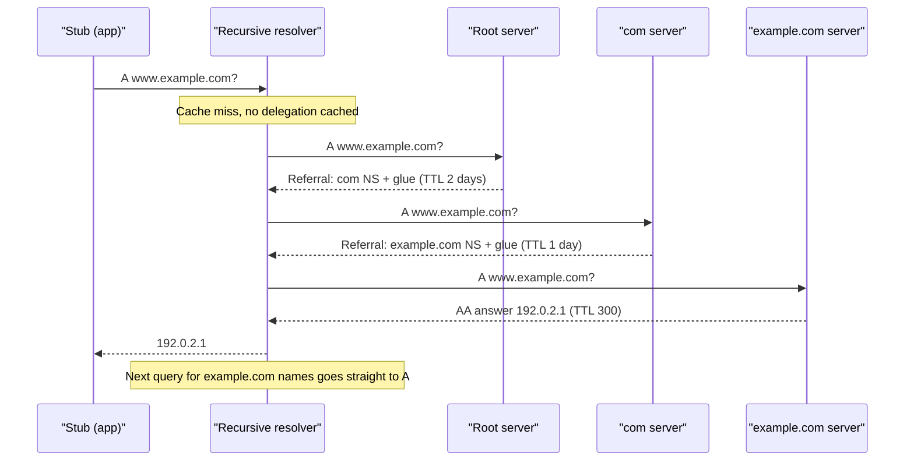

## In one minute
- DNS is a delegated, cached database. The root delegates `com`, `com` delegates `example.com`, and a recursive resolver walks those referrals once and then caches every step: answers, aliases, delegations and "does not exist".
- TTL is your change-propagation budget. You choose it per record, ahead of time: an answer you published yesterday with a one-day TTL cannot be recalled today.
- Every service you run depends on two DNS systems you must design for: the authoritative side (your zones, your provider) and the resolver side (the caches your clients and your own fleet use).
- GeoDNS and health-checked failover steer resolvers, not users, and converge in minutes. They are good for choosing a region, poor for anything faster.
- DNS failures are rare but total: when names stop resolving, every dependency fails at once, so redundancy and stale-serving matter more than raw speed.

## How it works

### Delegation: who is authoritative
A *zone* is a slice of the name tree run by one operator. The parent holds `NS` records naming the child's nameservers, plus *glue* addresses when those nameservers live inside the child zone. The child holds its own `NS`, `SOA` and data. The registrar only puts your `NS` records into the TLD zone. If the parent points at a server that no longer serves the zone (a *lame delegation*), resolvers waste timeouts on it, and changing providers means changing parent `NS` records that `com` publishes with a two-day TTL.

### What a resolver caches
A recursive resolver (Unbound, BIND, a cloud resolver, `1.1.1.1`) caches four kinds of state, each with its own TTL:

- **Answers** for a name and type, such as the `A` records of `www.example.com`.
- **Aliases** (`CNAME`), followed and cached link by link.
- **Delegations**: which servers are authoritative for `com` and `example.com`. This is why a warm resolver almost never asks a root server.
- **Negative answers**: `NXDOMAIN` (name does not exist) or NODATA (name exists, type does not), cached for the minimum of the `SOA` record's last field and the SOA TTL (RFC 2308).

### Record types that shape designs
`CNAME` hands a hostname to a CDN or load balancer, but cannot sit at the zone apex next to `SOA` and `NS`; providers work around that with ALIAS records or "CNAME flattening". `TXT` carries ownership proofs (ACME DNS-01, SPF), `CAA` lists which CAs may issue for the domain, `SRV` gives host, port and weight for service discovery, and `HTTPS` records advertise protocols such as `h3` before the first connection ([RFC 9460](https://www.rfc-editor.org/rfc/rfc9460)).

### TTL strategy
TTLs are a trade between agility and cost. Sensible defaults: `NS` and delegations at one to two days, stable `A` records at 5 to 60 minutes, records you may fail over at 30 to 60 seconds, and a negative TTL of a few minutes. Planned changes follow a pattern: lower the TTL to 60 seconds at least one old TTL before the change, make the change, verify, then raise it again. Lowering the TTL at the moment of the change does nothing for answers already cached under the old one.

### Steering and failover
The authoritative server can answer per query by resolver location (GeoDNS), by the EDNS Client Subnet, by weight, or by health checks that remove dead endpoints. It sees the resolver's address, not the user's, and caching sets the limits ([Google SRE book, ch. 19](https://sre.google/sre-book/load-balancing-frontend/)): one resolver fronts many users, some resolvers enforce minimum TTLs, client libraries cache on their own, and open connections never re-resolve. The DNS Load Balancing lesson covers the policies; remember that DNS failover takes minutes and its tail hours.

### Resolvers inside your own fleet
Every process has a *stub* resolver (glibc's, configured by `/etc/resolv.conf`) that forwards to a recursive resolver. Its defaults matter at scale. Kubernetes sets `ndots:5` and several search domains ([Kubernetes DNS](https://kubernetes.io/docs/concepts/services-networking/dns-pod-service/)), so a lookup of `api.stripe.com` (two dots) first tries `api.stripe.com.default.svc.cluster.local` and two other suffixes, each for `A` and `AAAA`: eight queries instead of two. A node-local cache (NodeLocal DNSCache) or a trailing dot on external names (`api.stripe.com.`) removes most of that load.

## Down the stack

### Layer 1: The contract
A resolver promises an answer that was true at the authority within the past TTL seconds, and carries no version, so stale looks exactly like current. `NXDOMAIN` is an authoritative "does not exist" and is cached; `SERVFAIL` means the resolver failed and is cached only briefly. With serve-stale (RFC 8767), a resolver that cannot reach any authority may return expired data, up to one to three days old, with a 30-second TTL. Nothing orders updates across names: a client may see one name's new record and another's old one.

### Layer 2: The mechanism
A referral is a response with an empty answer section, the child's `NS` records in the authority section and glue in the additional section, without the AA (authoritative answer) bit. The resolver algorithm (RFC 1034, section 5.3.3) is: look in the cache for the answer; otherwise find the closest ancestor zone whose delegation is cached, query one of its servers, and repeat on each referral until an authoritative answer or `NXDOMAIN`. Unbound keeps an infrastructure cache of each nameserver's smoothed round-trip time and prefers the fastest, and with `prefetch: yes` it refreshes popular entries when less than 10% of their TTL remains, so hot names never expire under load, at the cost of about 10% more upstream traffic ([Unbound docs](https://unbound.docs.nlnetlabs.nl/en/latest/manpages/unbound.conf.html)). QNAME minimisation ([RFC 9156](https://www.rfc-editor.org/rfc/rfc9156)) sends each ancestor only the next label, so the root learns `com`, not your full hostname. DNSSEC adds `RRSIG` signatures over record sets, `DNSKEY` records for zone keys, and `DS` records in the parent that chain trust from the root.

### Layer 3: The machine
A query is one UDP datagram of 40 to 80 bytes; a cache hit in the same data centre returns in well under a millisecond, a cold recursive walk takes 50 to 200 ms. Answers too big for the size the client advertised in EDNS come back truncated (the TC bit set), and the client retries over TCP, which every general-purpose DNS implementation must support ([RFC 7766](https://www.rfc-editor.org/rfc/rfc7766)). Since DNS Flag Day 2020 the recommended EDNS buffer is 1,232 bytes, the IPv6 minimum MTU minus headers, so answers never rely on IP fragmentation, which is unreliable and easier to spoof ([DNS Flag Day 2020](https://www.dnsflagday.net/2020/)). Large DNSSEC answers therefore move to TCP more often than people expect, so firewalls must allow TCP port 53. The 16-bit query ID plus a randomised source port give about 32 bits an off-path attacker must guess to spoof an answer, the defence adopted after Kaminsky's 2008 attack. glibc's stub resolver waits 5 seconds before retrying a lost UDP query ([resolv.conf(5)](https://man7.org/linux/man-pages/man5/resolv.conf.5.html)), so a single dropped packet shows up as a 5-second latency spike; in Kubernetes, a Linux conntrack race when `A` and `AAAA` queries leave the same socket in parallel produced exactly those spikes, which is one reason NodeLocal DNSCache skips DNAT and upgrades upstream queries to TCP ([Kubernetes docs](https://kubernetes.io/docs/tasks/administer-cluster/nodelocaldns/)). The root's 13 server names are served by about 2,000 anycast instances (2,047 in October 2026, per [root-servers.org](https://root-servers.org/)), which is why a root outage has never taken down resolution.

### Why it's built this way
1. No single server can answer for every name, so authority is delegated down a tree.
2. Walking the tree per lookup would be slow and melt its top, so answers, delegations and negatives are all cached.
3. Caches cannot be told about changes, so TTL is the only consistency mechanism, and it is decided before the change.
4. One small question and one small answer do not justify a connection, so DNS uses UDP, which caps message size (large answers fall back to TCP) and makes spoofing the main threat.
5. Because so much rests on it, DNS favours availability over freshness: multiple nameservers, anycast, and serving stale data when authorities are unreachable.

## Diagram


## Worked example
You are moving `api.example.com` from an old load balancer to a new one. The record has a 1-hour TTL, and about 50,000 distinct resolvers query it.

Two hours before the change you drop the TTL to 60 seconds. Authoritative load rises from 50,000 / 3,600 = 14 to 50,000 / 60 = 830 queries per second, a few dollars a day at managed-provider prices. At cutover most resolvers move within 2 minutes. The tail is resolvers that clamp TTLs, JVM services that cache addresses for the life of the process, and pooled connections that stay on the old load balancer, so you keep it serving for 24 hours and watch its traffic fall to zero.

Now the fleet side: 3,000 pods each make 400 external lookups per second with `ndots:5` and no node-local cache. Each lookup becomes 8 queries, so cluster DNS sees 3,000 x 400 x 8 = 9.6 million queries per second, mostly `NXDOMAIN` for search-path guesses. Trailing dots plus a node-local cache cut that by two to three orders of magnitude.

## In the wild
- **AWS, 2025: automation empties a regional endpoint.** On 19 and 20 October, a latent race between two DNS Enactors in DynamoDB's DNS management system let a delayed Enactor apply an old plan just before a cleanup job deleted that plan. The record for `dynamodb.us-east-1.amazonaws.com` was left with no IP addresses, and the system could not repair itself. DynamoDB API errors lasted from 23:48 to 02:40 PDT: DNS was fixed by hand at 02:25, and the last 15 minutes were cached answers expiring. AWS disabled the automation worldwide pending a fix ([AWS](https://aws.amazon.com/message/101925/)).
- **Slack, 2021: a DNSSEC rollout that could not be rolled back fast.** On 30 September, Slack signed `slack.com` and published a DS record. A Route 53 bug returned NSEC answers for a wildcard without the right type bitmap, so validating resolvers cached "no `AAAA` record" and then failed `A` lookups too. Pulling the DS record did not help, because resolvers had cached it for up to 24 hours (Google Public DNS capped it at 6), and some users could not reach Slack for about a day ([Slack](https://slack.engineering/what-happened-during-slacks-dnssec-rollout/)).

## Trade-offs
| Option | Strengths | Weaknesses | Choose when |
| --- | --- | --- | --- |
| Long TTL (1 hour to 1 day) | Fewer queries, faster lookups, survives authority outages longer | Changes and failover are slow | Stable records, NS and delegations |
| Short TTL (30 to 60 s) | Fast changes and DNS failover | More queries and more cold lookups on the critical path | Records you may need to move during an incident |
| Single authoritative provider | Simple, one API, one set of features | Provider outage takes your names down | Small or internal zones |
| Two authoritative providers | Survives a provider outage | Must keep zones in sync; proprietary features (geo, ALIAS) do not mix | Revenue-critical public domains |
| GeoDNS steering | Cheap, works with any IP addresses | Steers resolvers, converges in minutes | Region selection |
| Anycast addresses | Routing reacts in seconds, no client cache | Needs BGP and owned address space | Edge networks and DNS servers themselves |
| Node-local caching resolver | Cuts latency and central resolver load | One more daemon per node to operate | Large Kubernetes or VM fleets |

## Pitfalls in production
- **Cached NXDOMAIN for a new name.** Something queried the name before it existed and resolvers cached the negative answer, sometimes for an hour. Fix: a negative TTL of a few minutes, and create records before anything looks them up.
- **Single DNS provider.** The 2016 Dyn attack made many large sites unreachable although their servers were fine. Fix: a secondary provider for critical zones, kept in sync through zone transfers or infrastructure as code.
- **Authoritative DNS that depends on your own network.** In Facebook's 2021 outage the DNS servers withdrew their routes when backbone checks failed, so the names vanished, internal tools included ([Meta](https://engineering.fb.com/2021/10/05/networking-traffic/outage-details/)). Fix: authoritative capacity and out-of-band access independent of your network.
- **Search-path amplification.** `ndots:5` multiplies external lookups by four. Fix: fully qualified names with a trailing dot, a lower `ndots`, and node-local caching.
- **DNSSEC key rollover mistakes.** A `DS` record in the parent that no longer matches the zone's keys makes the zone fail validation everywhere at once. Fix: automate rollovers and monitor validation from an external validating resolver.

## Leadership lens
- Treat DNS changes as production deploys: version-controlled zone files or Terraform, review, and a planned TTL schedule for migrations.
- Ask "what happens to us if our DNS provider is down for four hours?" and decide consciously between a second provider and accepting the risk.
- Make internal resolution an owned platform component with dashboards (query rate, `NXDOMAIN` share, SERVFAIL rate, latency).
- Expect DNS-based failover numbers in minutes and have them measured; promise faster failover only with anycast or client-side retry.

## Check yourself
1. You lowered a record's TTL from 1 day to 60 seconds and changed its address in the same edit. Why do some clients still see the old address the next morning?
   **Answer:** Resolvers that cached the old answer under the 1-day TTL keep it until that TTL expires. The lower TTL only affects answers fetched after the edit, so it must be lowered at least one old TTL in advance.
2. Why does a warm recursive resolver almost never query a root server?
   **Answer:** It caches the delegations for TLDs such as `com`, which carry two-day TTLs, and starts each new lookup from the closest cached ancestor zone.
3. What is the difference between `NXDOMAIN` and `SERVFAIL` for caching and retries?
   **Answer:** `NXDOMAIN` is an authoritative "does not exist" that resolvers cache for the negative TTL. `SERVFAIL` means the resolver failed to get an answer; it is cached only briefly and the client may retry or try another resolver.
4. Why can a pod in Kubernetes send eight DNS queries to resolve `api.stripe.com`?
   **Answer:** With `ndots:5`, a name with fewer than five dots is first tried with each search domain appended, and each attempt asks for both `A` and `AAAA`.

## Practice
**Task:** Build an iterative resolver with a cache. `Resolver(servers, root, negative_ttl)` takes a map from server ID to a list of records `(name, type, value, ttl)` and the root server's ID. A server answers a question by checking, in order: records with the same name and type (answer: all their values in list order, cached with the minimum TTL); a `CNAME` for the name (cache it, then resolve the target); the longest `NS` record whose name is a zone containing the queried name, where `value` is the child server's ID (a referral: cache the delegation with its TTL and ask that server); otherwise `NXDOMAIN` (return an empty list, cached for `negative_ttl`). `resolve(name, rtype, now)` lower-cases names and strips a trailing dot, uses cached answers, aliases and negatives while `now < expiry`, and otherwise starts from the closest cached unexpired delegation, or the root. Count every server query in `queries`. A `CNAME` chain longer than 8 links or more than 16 referrals is an error.

```python starter
class Resolver:
    def __init__(self, servers, root, negative_ttl):
        self.queries = 0
        # TODO

    def resolve(self, name, rtype, now):
        raise NotImplementedError
```

```python tests
SERVERS = {
    "root": [("com", "NS", "tld", 172800)],
    "tld": [("example.com", "NS", "ex", 86400), ("other.com", "NS", "oth", 86400)],
    "ex": [
        ("www.example.com", "A", "192.0.2.1", 300),
        ("www.example.com", "A", "192.0.2.2", 300),
        ("api.example.com", "CNAME", "edge.other.com", 600),
        ("loop1.example.com", "CNAME", "loop2.example.com", 60),
        ("loop2.example.com", "CNAME", "loop1.example.com", 60),
    ],
    "oth": [("edge.other.com", "A", "198.51.100.7", 60)],
}

def make():
    return Resolver(SERVERS, "root", 30)

def test_full_walk():
    r = make()
    assert r.resolve("www.example.com", "A", 0) == ["192.0.2.1", "192.0.2.2"]
    assert r.queries == 3

def test_answer_cached():
    r = make()
    r.resolve("www.example.com", "A", 0)
    assert r.resolve("www.example.com", "A", 299) == ["192.0.2.1", "192.0.2.2"]
    assert r.queries == 3

def test_expired_answer_uses_cached_delegation():
    r = make()
    r.resolve("www.example.com", "A", 0)
    r.resolve("www.example.com", "A", 300)
    assert r.queries == 4

def test_cname_across_zones():
    r = make()
    assert r.resolve("api.example.com", "A", 0) == ["198.51.100.7"]
    assert r.queries == 5
    assert r.resolve("api.example.com", "A", 59) == ["198.51.100.7"]
    assert r.queries == 5

def test_negative_caching():
    r = make()
    assert r.resolve("nope.example.com", "A", 0) == []
    assert r.queries == 3
    assert r.resolve("nope.example.com", "A", 29) == []
    assert r.queries == 3
    r.resolve("nope.example.com", "A", 30)
    assert r.queries == 4

def test_case_and_trailing_dot():
    r = make()
    assert r.resolve("WWW.Example.COM.", "A", 0) == ["192.0.2.1", "192.0.2.2"]

def test_cname_loop_is_error():
    r = make()
    try:
        r.resolve("loop1.example.com", "A", 0)
        assert False, "expected an error"
    except ValueError:
        pass
```

```python solution
def _norm(name):
    name = name.lower()
    return name[:-1] if name.endswith(".") else name

def _in_zone(name, zone):
    return zone == "" or name == zone or name.endswith("." + zone)

class Resolver:
    def __init__(self, servers, root, negative_ttl):
        self.servers = servers
        self.root = root
        self.negative_ttl = negative_ttl
        self.queries = 0
        self.answers = {}
        self.cnames = {}
        self.negatives = {}
        self.delegations = {}

    def _ask(self, server, name, rtype):
        recs = [(_norm(n), t, v, ttl) for n, t, v, ttl in self.servers.get(server, [])]
        hits = [r for r in recs if r[0] == name and r[1] == rtype]
        if hits:
            return ("answer", [r[2] for r in hits], min(r[3] for r in hits))
        for n, t, v, ttl in recs:
            if n == name and t == "CNAME":
                return ("cname", _norm(v), ttl)
        best = None
        for n, t, v, ttl in recs:
            if t == "NS" and _in_zone(name, n) and (best is None or len(n) > len(best[0])):
                best = (n, v, ttl)
        if best:
            return ("referral", best, 0)
        return ("nxdomain", None, 0)

    def resolve(self, name, rtype, now, depth=0):
        name = _norm(name)
        if depth > 8:
            raise ValueError("CNAME chain too long")
        key = (name, rtype)
        if key in self.answers and now < self.answers[key][1]:
            return list(self.answers[key][0])
        if key in self.negatives and now < self.negatives[key]:
            return []
        if name in self.cnames and now < self.cnames[name][1]:
            return self.resolve(self.cnames[name][0], rtype, now, depth + 1)
        server, best = self.root, None
        for zone, (srv, exp) in self.delegations.items():
            if now < exp and _in_zone(name, zone) and (best is None or len(zone) > len(best)):
                server, best = srv, zone
        for _ in range(16):
            self.queries += 1
            kind, data, ttl = self._ask(server, name, rtype)
            if kind == "answer":
                self.answers[key] = (data, now + ttl)
                return list(data)
            if kind == "cname":
                self.cnames[name] = (data, now + ttl)
                return self.resolve(data, rtype, now, depth + 1)
            if kind == "referral":
                zone, srv, zttl = data
                self.delegations[zone] = (srv, now + zttl)
                server = srv
                continue
            self.negatives[key] = now + self.negative_ttl
            return []
        raise ValueError("too many referrals")
```

```typescript starter
export type Rec = [string, string, string, number];

export class Resolver {
  queries = 0;
  constructor(servers: { [id: string]: Rec[] }, root: string, negativeTtl: number) {}
  resolve(name: string, rtype: string, now: number): string[] {
    throw new Error("TODO");
  }
}
```

```typescript tests
const SERVERS: { [id: string]: Rec[] } = {
  root: [["com", "NS", "tld", 172800]],
  tld: [["example.com", "NS", "ex", 86400], ["other.com", "NS", "oth", 86400]],
  ex: [
    ["www.example.com", "A", "192.0.2.1", 300],
    ["www.example.com", "A", "192.0.2.2", 300],
    ["api.example.com", "CNAME", "edge.other.com", 600],
    ["loop1.example.com", "CNAME", "loop2.example.com", 60],
    ["loop2.example.com", "CNAME", "loop1.example.com", 60],
  ],
  oth: [["edge.other.com", "A", "198.51.100.7", 60]],
};
const make = () => new Resolver(SERVERS, "root", 30);

test("full walk", () => {
  const r = make();
  assertEqual(r.resolve("www.example.com", "A", 0), ["192.0.2.1", "192.0.2.2"]);
  assertEqual(r.queries, 3);
});
test("answer cached", () => {
  const r = make();
  r.resolve("www.example.com", "A", 0);
  assertEqual(r.resolve("www.example.com", "A", 299), ["192.0.2.1", "192.0.2.2"]);
  assertEqual(r.queries, 3);
});
test("expired answer uses cached delegation", () => {
  const r = make();
  r.resolve("www.example.com", "A", 0);
  r.resolve("www.example.com", "A", 300);
  assertEqual(r.queries, 4);
});
test("cname across zones", () => {
  const r = make();
  assertEqual(r.resolve("api.example.com", "A", 0), ["198.51.100.7"]);
  assertEqual(r.queries, 5);
  assertEqual(r.resolve("api.example.com", "A", 59), ["198.51.100.7"]);
  assertEqual(r.queries, 5);
});
test("negative caching", () => {
  const r = make();
  assertEqual(r.resolve("nope.example.com", "A", 0), []);
  assertEqual(r.queries, 3);
  assertEqual(r.resolve("nope.example.com", "A", 29), []);
  assertEqual(r.queries, 3);
  r.resolve("nope.example.com", "A", 30);
  assertEqual(r.queries, 4);
});
test("case and trailing dot", () => {
  const r = make();
  assertEqual(r.resolve("WWW.Example.COM.", "A", 0), ["192.0.2.1", "192.0.2.2"]);
});
test("cname loop is error", () => {
  const r = make();
  let threw = false;
  try {
    r.resolve("loop1.example.com", "A", 0);
  } catch (e) {
    threw = true;
  }
  assert(threw, "expected an error");
});
```

```typescript solution
export type Rec = [string, string, string, number];

const norm = (n: string): string => {
  const l = n.toLowerCase();
  return l.endsWith(".") ? l.slice(0, -1) : l;
};
const inZone = (name: string, zone: string): boolean =>
  zone === "" || name === zone || name.endsWith("." + zone);

export class Resolver {
  queries = 0;
  private answers = new Map<string, [string[], number]>();
  private cnames = new Map<string, [string, number]>();
  private negatives = new Map<string, number>();
  private delegations = new Map<string, [string, number]>();

  constructor(private servers: { [id: string]: Rec[] }, private root: string, private negativeTtl: number) {}

  resolve(name: string, rtype: string, now: number, depth = 0): string[] {
    name = norm(name);
    if (depth > 8) throw new Error("CNAME chain too long");
    const key = name + "|" + rtype;
    const a = this.answers.get(key);
    if (a && now < a[1]) return [...a[0]];
    const neg = this.negatives.get(key);
    if (neg !== undefined && now < neg) return [];
    const c = this.cnames.get(name);
    if (c && now < c[1]) return this.resolve(c[0], rtype, now, depth + 1);
    let server = this.root;
    let best: string | null = null;
    for (const [zone, [srv, exp]] of this.delegations) {
      if (now < exp && inZone(name, zone) && (best === null || zone.length > best.length)) {
        server = srv;
        best = zone;
      }
    }
    for (let i = 0; i < 16; i++) {
      this.queries++;
      const recs = (this.servers[server] || []).map(([n, t, v, ttl]) => [norm(n), t, v, ttl] as Rec);
      const hits = recs.filter(([n, t]) => n === name && t === rtype);
      if (hits.length > 0) {
        const vals = hits.map((h) => h[2]);
        this.answers.set(key, [vals, now + Math.min(...hits.map((h) => h[3]))]);
        return [...vals];
      }
      const cn = recs.find(([n, t]) => n === name && t === "CNAME");
      if (cn) {
        this.cnames.set(name, [norm(cn[2]), now + cn[3]]);
        return this.resolve(cn[2], rtype, now, depth + 1);
      }
      let ref: Rec | null = null;
      for (const r of recs) {
        if (r[1] === "NS" && inZone(name, r[0]) && (ref === null || r[0].length > ref[0].length)) ref = r;
      }
      if (ref) {
        this.delegations.set(ref[0], [ref[2], now + ref[3]]);
        server = ref[2];
        continue;
      }
      this.negatives.set(key, now + this.negativeTtl);
      return [];
    }
    throw new Error("too many referrals");
  }
}
```

```go starter
package practice

type Record struct {
	Name, Type, Value string
	TTL               int
}

type Resolver struct {
	Queries int
}

func NewResolver(servers map[string][]Record, root string, negativeTTL int) *Resolver {
	return &Resolver{}
}

func (r *Resolver) Resolve(name, rtype string, now int) ([]string, error) {
	panic("TODO")
}
```

```go tests
package practice

import (
	"reflect"
	"testing"
)

var servers = map[string][]Record{
	"root": {{"com", "NS", "tld", 172800}},
	"tld":  {{"example.com", "NS", "ex", 86400}, {"other.com", "NS", "oth", 86400}},
	"ex": {
		{"www.example.com", "A", "192.0.2.1", 300},
		{"www.example.com", "A", "192.0.2.2", 300},
		{"api.example.com", "CNAME", "edge.other.com", 600},
		{"loop1.example.com", "CNAME", "loop2.example.com", 60},
		{"loop2.example.com", "CNAME", "loop1.example.com", 60},
	},
	"oth": {{"edge.other.com", "A", "198.51.100.7", 60}},
}

func mustResolve(t *testing.T, r *Resolver, name string, now int, want []string) {
	t.Helper()
	got, err := r.Resolve(name, "A", now)
	if err != nil {
		t.Fatalf("unexpected error: %v", err)
	}
	if len(want) == 0 && len(got) == 0 {
		return
	}
	if !reflect.DeepEqual(got, want) {
		t.Fatalf("got %v, want %v", got, want)
	}
}

func expectQueries(t *testing.T, r *Resolver, n int) {
	t.Helper()
	if r.Queries != n {
		t.Fatalf("queries = %d, want %d", r.Queries, n)
	}
}

var www = []string{"192.0.2.1", "192.0.2.2"}

func TestFullWalk(t *testing.T) {
	r := NewResolver(servers, "root", 30)
	mustResolve(t, r, "www.example.com", 0, www)
	expectQueries(t, r, 3)
}

func TestAnswerCached(t *testing.T) {
	r := NewResolver(servers, "root", 30)
	mustResolve(t, r, "www.example.com", 0, www)
	mustResolve(t, r, "www.example.com", 299, www)
	expectQueries(t, r, 3)
}

func TestExpiredAnswerUsesCachedDelegation(t *testing.T) {
	r := NewResolver(servers, "root", 30)
	mustResolve(t, r, "www.example.com", 0, www)
	mustResolve(t, r, "www.example.com", 300, www)
	expectQueries(t, r, 4)
}

func TestCnameAcrossZones(t *testing.T) {
	r := NewResolver(servers, "root", 30)
	mustResolve(t, r, "api.example.com", 0, []string{"198.51.100.7"})
	expectQueries(t, r, 5)
	mustResolve(t, r, "api.example.com", 59, []string{"198.51.100.7"})
	expectQueries(t, r, 5)
}

func TestNegativeCaching(t *testing.T) {
	r := NewResolver(servers, "root", 30)
	mustResolve(t, r, "nope.example.com", 0, nil)
	expectQueries(t, r, 3)
	mustResolve(t, r, "nope.example.com", 29, nil)
	expectQueries(t, r, 3)
	mustResolve(t, r, "nope.example.com", 30, nil)
	expectQueries(t, r, 4)
}

func TestCaseAndTrailingDot(t *testing.T) {
	r := NewResolver(servers, "root", 30)
	mustResolve(t, r, "WWW.Example.COM.", 0, www)
}

func TestCnameLoopIsError(t *testing.T) {
	r := NewResolver(servers, "root", 30)
	if _, err := r.Resolve("loop1.example.com", "A", 0); err == nil {
		t.Fatal("expected an error")
	}
}
```

```go solution
package practice

import (
	"errors"
	"strings"
)

type Record struct {
	Name, Type, Value string
	TTL               int
}

type cached struct {
	values []string
	target string
	exp    int
}

type Resolver struct {
	Queries     int
	servers     map[string][]Record
	root        string
	negTTL      int
	answers     map[string]cached
	cnames      map[string]cached
	negatives   map[string]int
	delegations map[string]cached
}

func NewResolver(servers map[string][]Record, root string, negativeTTL int) *Resolver {
	return &Resolver{servers: servers, root: root, negTTL: negativeTTL,
		answers: map[string]cached{}, cnames: map[string]cached{},
		negatives: map[string]int{}, delegations: map[string]cached{}}
}

func norm(n string) string { return strings.TrimSuffix(strings.ToLower(n), ".") }

func inZone(name, zone string) bool {
	return zone == "" || name == zone || strings.HasSuffix(name, "."+zone)
}

func (r *Resolver) Resolve(name, rtype string, now int) ([]string, error) {
	return r.resolve(name, rtype, now, 0)
}

func (r *Resolver) resolve(name, rtype string, now, depth int) ([]string, error) {
	name = norm(name)
	if depth > 8 {
		return nil, errors.New("CNAME chain too long")
	}
	key := name + "|" + rtype
	if a, ok := r.answers[key]; ok && now < a.exp {
		return append([]string(nil), a.values...), nil
	}
	if exp, ok := r.negatives[key]; ok && now < exp {
		return []string{}, nil
	}
	if c, ok := r.cnames[name]; ok && now < c.exp {
		return r.resolve(c.target, rtype, now, depth+1)
	}
	server, best := r.root, ""
	found := false
	for zone, d := range r.delegations {
		if now < d.exp && inZone(name, zone) && (!found || len(zone) > len(best)) {
			server, best, found = d.target, zone, true
		}
	}
	for i := 0; i < 16; i++ {
		r.Queries++
		var vals []string
		minTTL := -1
		var cname *Record
		var ref *Record
		for _, rec := range r.servers[server] {
			rec := rec
			rec.Name = norm(rec.Name)
			switch {
			case rec.Name == name && rec.Type == rtype:
				vals = append(vals, rec.Value)
				if minTTL < 0 || rec.TTL < minTTL {
					minTTL = rec.TTL
				}
			case rec.Name == name && rec.Type == "CNAME" && cname == nil:
				cname = &rec
			case rec.Type == "NS" && inZone(name, rec.Name) && (ref == nil || len(rec.Name) > len(ref.Name)):
				ref = &rec
			}
		}
		if len(vals) > 0 {
			r.answers[key] = cached{values: vals, exp: now + minTTL}
			return append([]string(nil), vals...), nil
		}
		if cname != nil {
			r.cnames[name] = cached{target: norm(cname.Value), exp: now + cname.TTL}
			return r.resolve(cname.Value, rtype, now, depth+1)
		}
		if ref != nil {
			r.delegations[ref.Name] = cached{target: ref.Value, exp: now + ref.TTL}
			server = ref.Value
			continue
		}
		r.negatives[key] = now + r.negTTL
		return []string{}, nil
	}
	return nil, errors.New("too many referrals")
}
```

## Mock interview
**Prompt:** Your company's public API and website run on `example.com` with one managed DNS provider. Leadership asks you to make DNS "not a single point of failure" and to support a region failover target of 5 minutes. Walk through the design.

- Follow-up: How do you keep two authoritative providers consistent when one of them supports geo-routing and the other does not?
- Follow-up: Your internal services call partner APIs by hostname and DNS latency spikes to 5 seconds for a few requests per minute. What is happening?
- Follow-up: What TTLs do you set on the apex, the API hostname, and the NS records, and why?

**A strong answer covers:**
- Authoritative availability (multiple providers, anycast) versus resolver availability (local caches, serve-stale).
- A TTL plan per record type, lowered ahead of planned changes.
- Realistic failover timing including client caching and long-lived connections.
- Zone data managed as code and pushed to both providers, using only features both support for critical records.
- Diagnosing stub resolver behaviour: UDP loss with 5-second retries, `ndots` amplification, and node-local caching.

## Sources and further study
**Primary**
- [RFC 7766: DNS Transport over TCP](https://www.rfc-editor.org/rfc/rfc7766): why TCP support is mandatory, with connection reuse and pipelining.
- [RFC 9156: DNS Query Name Minimisation](https://www.rfc-editor.org/rfc/rfc9156): sending each ancestor zone only the labels it needs.
- [RFC 9460: SVCB and HTTPS resource records](https://www.rfc-editor.org/rfc/rfc9460): protocol hints, alternative endpoints and apex aliasing in DNS.

**Systems docs**
- [Unbound configuration manual](https://unbound.docs.nlnetlabs.nl/en/latest/manpages/unbound.conf.html): prefetch, serve-expired and the infrastructure cache in a real recursive resolver.
- [Kubernetes NodeLocal DNSCache](https://kubernetes.io/docs/tasks/administer-cluster/nodelocaldns/): why a per-node cache avoids conntrack races and UDP timeouts.
- [DNS Flag Day 2020](https://www.dnsflagday.net/2020/): the 1,232-byte EDNS buffer and the TCP requirement for authoritative servers.

**Books**
- *Computer Networking: A Top-Down Approach*, Kurose and Ross, section 2.4 "DNS: The Internet's Directory Service": hierarchy, caching, records and message format.
- *TCP/IP Illustrated, Volume 1* (2nd edition), Fall and Stevens, chapter 11 "Name Resolution and the Domain Name System": DNS on the wire, including EDNS and TCP fallback.

**Other curricula**
- [donnemartin/system-design-primer](https://github.com/donnemartin/system-design-primer): a short section on records, TTL caching and DNS-based routing (weighted, latency, geo), noting propagation delay and DDoS risk.
- [Google SRE book, chapter 19: Load Balancing at the Frontend](https://sre.google/sre-book/load-balancing-frontend/): DNS as the first tier of load balancing and why resolver caching limits it; it still cites the old 512-byte UDP limit, which EDNS lifted.

## Watch
- [How DNS Works (Computerphile)](https://www.youtube.com/watch?v=uOfonONtIuk): the delegation walk and caching explained on paper.
- [Everything You Need to Know About DNS (ByteByteGo)](https://www.youtube.com/watch?v=27r4Bzuj5NQ): record types, resolution and caching in one short overview.

## Free resources
- [RFC 1034: Domain Names, Concepts and Facilities](https://www.rfc-editor.org/rfc/rfc1034): the original design, including the resolver algorithm in section 5.3.3.
- [RFC 2308: Negative Caching of DNS Queries](https://www.rfc-editor.org/rfc/rfc2308): how NXDOMAIN and NODATA are cached and for how long.
- [RFC 8767: Serving Stale Data to Improve DNS Resiliency](https://www.rfc-editor.org/rfc/rfc8767): the availability-over-freshness behaviour of modern resolvers.
- [How updating DNS works (Julia Evans)](https://jvns.ca/blog/how-updating-dns-works/): why changes appear to "propagate", explained with real commands.
- [Understanding how Facebook disappeared from the Internet (Cloudflare)](https://blog.cloudflare.com/october-2021-facebook-outage/): what the 2021 outage looked like from a large resolver.
- [Kubernetes DNS for Services and Pods](https://kubernetes.io/docs/concepts/services-networking/dns-pod-service/): search domains, `ndots` and pod DNS policies.
