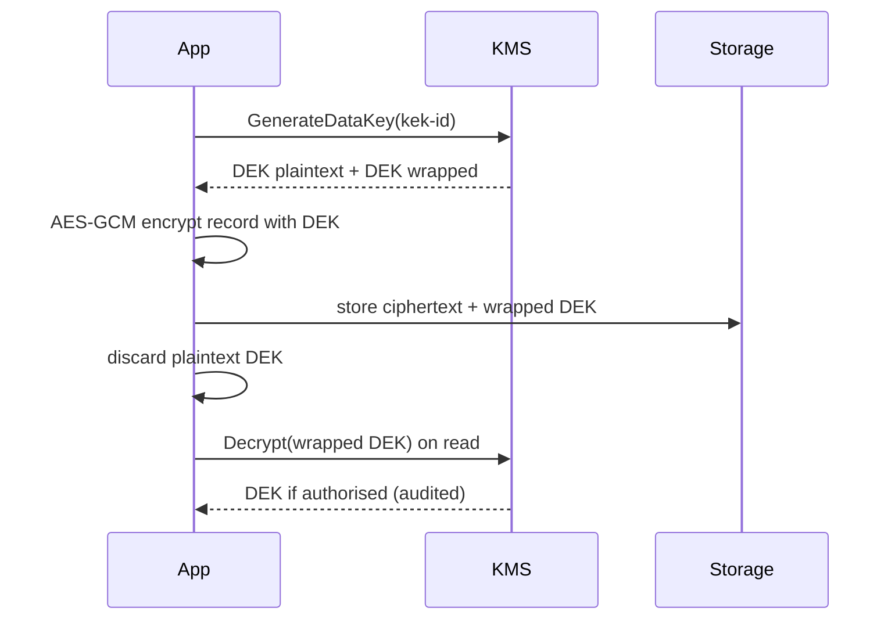

## In one minute
- Encryption at rest protects stored data (disks, databases, object storage, backups) from someone who gets the bytes but not the keys.
- Practical systems use envelope encryption: data is encrypted with a data key, and the data key is encrypted (wrapped) by a master key that never leaves a key management service or HSM.
- The threat model decides the layer. Disk encryption stops a stolen drive; application-level encryption also stops a database admin or a leaked backup.
- Key management is the real work: who can call decrypt, how keys rotate, and what audit trail exists.
- Encryption at rest does nothing against an attacker who compromises the running application, because the app decrypts data for them.

## How it works

### Layers
1. Full disk or volume encryption: the storage layer encrypts every block. Transparent to apps, protects against lost or decommissioned hardware. PostgreSQL, for example, has no built-in transparent data encryption and points to file-system or block-level encryption such as dm-crypt with LUKS, noting that this gives no protection while the file system is mounted ([PostgreSQL docs](https://www.postgresql.org/docs/current/encryption-options.html)).
2. Database or storage service encryption (TDE, server-side object encryption): the engine encrypts files or objects with keys from a KMS. Protects backups and snapshots, still transparent to queries. This layer is now the floor rather than an option on the big clouds: since 5 January 2023 Amazon S3 encrypts every new object with SSE-S3 (AES-256) and the setting cannot be turned off ([AWS S3 docs](https://docs.aws.amazon.com/AmazonS3/latest/userguide/default-encryption-faq.html)), and Google Cloud encrypts all customer content at rest by default ([Google Cloud](https://cloud.google.com/docs/security/encryption/default-encryption)). The design decision left to you is who controls the keys.
3. Application-level or field-level encryption: the app encrypts specific values before storing them. The database only ever sees ciphertext. Protects against database-level access, but you lose the ability to index, sort, or search those fields without extra techniques, such as a keyed HMAC column for exact-match lookup or a purpose-built scheme like MongoDB's Queryable Encryption, which supports equality, range, prefix, suffix and substring queries on encrypted fields ([MongoDB docs](https://www.mongodb.com/docs/manual/core/queryable-encryption/)).

### Envelope encryption
The app asks the KMS for a data encryption key (DEK). The KMS returns the DEK in plaintext and also wrapped under a key encryption key (KEK) that stays inside the KMS. The app encrypts data locally with the DEK using an AEAD cipher such as AES-256-GCM, stores the ciphertext next to the wrapped DEK, and discards the plaintext DEK. To read, it sends the wrapped DEK to the KMS, gets the DEK back if authorised, and decrypts locally.

### Rotation
Rotating the KEK creates a new key version. New wraps use the new version; old wrapped DEKs still decrypt because the KMS keeps old versions. AWS KMS rotates customer managed keys yearly by default when rotation is on, supports on-demand rotation, and has rotated AWS managed keys every year since May 2022, down from every three years; it is explicit that rotation does not re-encrypt data or rotate data keys, so it does nothing for a leaked DEK ([AWS KMS docs](https://docs.aws.amazon.com/kms/latest/developerguide/rotate-keys.html)). Re-wrapping existing DEKs under the new version is cheap because only the 32-byte key is touched, not the data. Rotating DEKs requires re-encrypting data, which is expensive and usually done only after a suspected compromise.

### Authenticated encryption and context
AES-GCM produces a tag that detects tampering. Binding additional authenticated data such as the tenant id and record id means a ciphertext copied from one row to another fails to decrypt, stopping swap attacks. GCM needs a unique nonce per encryption under the same key; with random 96-bit nonces, keep each key to well under 2^32 encryptions.

### Crypto-shredding
If each tenant or user has its own DEK, deleting that key makes all their data unreadable, including in backups. This is a practical way to meet deletion obligations without rewriting archives.

## Down the stack
### Layer 1: The contract
A KMS promises that `Decrypt` returns plaintext only if the caller's identity is allowed by the key policy and the supplied encryption context matches the one used at encryption, byte for byte. It promises that every call is logged and that key material never leaves its HSMs in plaintext. AES-GCM promises confidentiality and integrity as long as a (key, nonce) pair is never reused; with random 96-bit nonces, NIST requires that the total number of encryptions under one key not exceed 2^32 ([NIST SP 800-38D, section 8.3](https://csrc.nist.gov/pubs/sp/800/38/d/final)). NIST announced in 2024 that it will revise SP 800-38D, so check for the newer edition before quoting limits in a design review. Disk encryption promises much less: confidentiality of sectors at rest, no integrity.

### Layer 2: The mechanism
`GenerateDataKey` returns two fields: `Plaintext` and `CiphertextBlob`. The blob embeds the key id and version, so `Decrypt` does not need to be told which key to use. The encryption context is bound as additional authenticated data. On Linux, dm-crypt with LUKS encrypts each sector with AES-XTS, using the sector number as the tweak. The LUKS header holds the volume master key wrapped by one or more key slots, each derived from a passphrase or token with a slow KDF. Cloud block storage uses a per-volume data key wrapped by a KMS key; the host unwraps it at attach time and keeps it in the hypervisor or offload card, never in the guest. MySQL InnoDB stores a per-tablespace key in the tablespace header, wrapped by a master key from a keyring plugin.

### Layer 3: The machine
With AES-NI, AES-256-GCM runs at roughly 4 to 8 GB/s per core and XTS is similar, so encryption rarely limits a disk that does 3 to 7 GB/s, though it shows up as CPU at very high IOPS. XTS is deterministic per sector: the same plaintext at the same sector produces the same ciphertext, so an attacker with snapshots over time can see which sectors changed. A 4 KB sector has no spare room for a tag, so disk encryption cannot detect tampering. Plaintext keys live in RAM, where core dumps, swap, and cold-boot attacks can expose them, so key-handling processes disable core dumps and `mlock` key pages. A KMS call is an HTTPS request of 5 to 20 ms, and HSMs handle thousands, not millions, of operations per second.

### Why it's built this way
HSMs are slow and scarce, so they wrap small keys and bulk data is encrypted locally. Sectors are fixed size, so disk encryption uses a tweakable mode without integrity, and authenticated encryption has to happen higher up. Insiders and compromised database credentials sit above the disk layer, so only application-level encryption stops them. Immutable backups cannot be edited, so deletion is done by destroying keys.

## Diagram


## Worked example
A health records service stores 2 billion documents, average 8 KB, about 16 TB, and serves 20,000 reads per second.

Calling the KMS on every read means 20,000 requests per second, 5 to 20 ms added per read, and about 52 billion billable calls a month. AWS KMS's default shared quota for symmetric operations is 10,000 per second per account and region, 20,000 in some regions and 100,000 in the largest ones, and it counts calls S3 or EBS make on your behalf ([AWS KMS quotas](https://docs.aws.amazon.com/kms/latest/developerguide/requests-per-second.html)), so in most regions this design would be throttled on day one.

Instead, use one DEK per patient and cache unwrapped DEKs in memory for 5 minutes, bounded to 100,000 entries. With a 95 percent cache hit rate, KMS traffic falls to 1,000 calls per second. Local AES-GCM on 8 KB costs a few microseconds.

Storage overhead per record: 12-byte nonce, 16-byte tag, plus a reference to the wrapped DEK (about 180 bytes per patient, stored once). On 16 TB, overhead is well under 1 percent.

A patient deletion request deletes their wrapped DEK. Their documents in 35 days of backups become unreadable immediately, without restoring and rewriting backups.

## In the wild
- **LastPass, 2022: encrypted vault backups and the keys to the container.** Using source code and technical details from an August 2022 breach, the attacker targeted an employee, obtained a cloud storage access key and the two storage-container decryption keys, and copied a backup of customer vault data. Usernames, passwords and notes inside each vault were encrypted with AES-256 under a key derived from the user's master password (PBKDF2, 100,100 iterations by default), but website URLs were stored unencrypted. Storage encryption fell to stolen keys; only the per-user client-side layer still stood, and its strength depended on each master password ([LastPass](https://blog.lastpass.com/posts/notice-of-recent-security-incident)).
- **Microsoft, 2023: a signing key's path through a crash dump.** Microsoft's initial investigation found that a 2021 crash of a consumer signing system had produced a memory dump that was moved to an internet-connected debugging environment, where credential scanning missed key material; a compromised engineer account was the likely route to the key Storm-0558 used. A March 2024 addendum said no dump containing the key was actually found, but the lesson stands: plaintext keys live in process memory, and dumps of that memory must be treated as secret ([MSRC](https://www.microsoft.com/en-us/msrc/blog/2023/09/results-of-major-technical-investigations-for-storm-0558-key-acquisition)).
- **CircleCI, 2023: encryption keys pulled from a running process.** With a stolen, already-authenticated SSO session, the attacker created production tokens and extracted encryption keys from a running process, which made customers' encrypted environment variables and tokens readable. Encryption at rest was in place and did not matter, because the attacker was inside the system that legitimately decrypts ([CircleCI](https://circleci.com/blog/jan-4-2023-incident-report/)).

## Trade-offs
| Option | Strengths | Weaknesses | Choose when |
| --- | --- | --- | --- |
| Disk or volume encryption | Zero app changes, covers everything | Anyone with OS or DB access reads plaintext | Baseline, always on |
| Database or storage service encryption with KMS | Protects snapshots and backups, audited key use | DB users and admins still see plaintext | Default for managed databases and buckets |
| Application-level field encryption | Database and backups hold only ciphertext | No indexing or search on encrypted fields, app complexity | Highly sensitive fields, strict insider threat model |
| Customer-managed keys (BYOK) | Customer can revoke access | Operational burden, outage if key disabled | Enterprise and regulated customers |

## Pitfalls in production
- Reusing a GCM nonce with the same key breaks confidentiality and integrity. Use random nonces with bounded volume per key, or a nonce-misuse resistant mode.
- Plaintext DEKs in logs, crash dumps, or long-lived caches defeat the design. Keep them in memory briefly and scrub logs.
- Over-broad KMS decrypt permissions mean every service can read everything. Scope decrypt rights per key and per service.
- Disabling or deleting a KEK by mistake makes data permanently unreadable. AWS KMS forces a 7 to 30 day waiting period (30 by default) before deletion and recommends disabling a key when unsure ([AWS KMS docs](https://docs.aws.amazon.com/kms/latest/developerguide/deleting-keys.html)); add alarms on any use of a key pending deletion.
- Encrypting the secrets but not the metadata. Unencrypted columns such as URLs, file names or email subjects often reveal as much as the encrypted payload. Decide field by field, with the threat model in hand.
- Calling the KMS on every request hits quotas and adds latency. Cache unwrapped DEKs with a short TTL.

## Leadership lens
- Write the threat model first: which attacker is each encryption layer meant to stop?
- Decide key granularity (per service, per tenant, per user); it drives cost, blast radius, and deletion options.
- Review who holds `Decrypt` on each key; that list is your real access control.

## Check yourself
1. A team enables storage encryption on its database and says customer data is safe from employees. What is wrong?
   **Answer:** The database decrypts transparently for any authorised connection, so admins and anyone with DB credentials still read plaintext. Only application-level encryption with restricted key access stops insiders.
2. Why is rotating a KEK cheap but rotating DEKs expensive?
   **Answer:** KEK rotation only re-wraps small data keys, or just applies to new wraps. DEK rotation requires decrypting and re-encrypting all the data those keys protect.
3. How does binding the record id as additional authenticated data help?
   **Answer:** Decryption fails if the ciphertext is moved to another record, so an attacker with write access cannot swap encrypted values between rows.
4. How does per-user keying make deletion easier?
   **Answer:** Destroying the user's key renders all their ciphertext, including copies in backups, unreadable without touching the backups.

## Practice
**Task:** Implement `DekCache(kms_decrypt, ttl, max_entries)`, the cache that keeps envelope encryption off the KMS hot path. `get(wrapped, now)` returns the plaintext DEK for a wrapped key, calling `kms_decrypt(wrapped)` only on a miss or when the cached entry is at least `ttl` seconds old. When adding would exceed `max_entries`, evict the least recently used entry. `invalidate(wrapped)` drops an entry, for example after a key is revoked. Time is passed in as `now`; do not read a clock.

```python starter
class DekCache:
    def __init__(self, kms_decrypt, ttl, max_entries):
        self.kms_decrypt = kms_decrypt

    def get(self, wrapped, now):
        raise NotImplementedError

    def invalidate(self, wrapped):
        raise NotImplementedError
```

```python tests
def fake_kms():
    calls = []
    def decrypt(w):
        calls.append(w)
        return "dek-" + w
    return decrypt, calls

def test_hit_avoids_kms():
    d, calls = fake_kms()
    c = DekCache(d, 300, 10)
    assert c.get("a", 0) == "dek-a"
    assert c.get("a", 100) == "dek-a"
    assert len(calls) == 1

def test_ttl_expiry():
    d, calls = fake_kms()
    c = DekCache(d, 300, 10)
    c.get("a", 0)
    c.get("a", 300)
    assert len(calls) == 2

def test_lru_eviction():
    d, calls = fake_kms()
    c = DekCache(d, 300, 2)
    c.get("a", 0); c.get("b", 1); c.get("a", 2); c.get("c", 3)
    c.get("a", 4)
    assert calls == ["a", "b", "c"]
    c.get("b", 5)
    assert calls == ["a", "b", "c", "b"]

def test_invalidate():
    d, calls = fake_kms()
    c = DekCache(d, 300, 10)
    c.get("a", 0)
    c.invalidate("a")
    c.invalidate("missing")
    c.get("a", 1)
    assert len(calls) == 2
```

```python solution
from collections import OrderedDict

class DekCache:
    def __init__(self, kms_decrypt, ttl, max_entries):
        self.kms_decrypt = kms_decrypt
        self.ttl = ttl
        self.max_entries = max_entries
        self.entries = OrderedDict()

    def get(self, wrapped, now):
        hit = self.entries.get(wrapped)
        if hit is not None and now - hit[1] < self.ttl:
            self.entries.move_to_end(wrapped)
            return hit[0]
        dek = self.kms_decrypt(wrapped)
        self.entries[wrapped] = (dek, now)
        self.entries.move_to_end(wrapped)
        while len(self.entries) > self.max_entries:
            self.entries.popitem(last=False)
        return dek

    def invalidate(self, wrapped):
        self.entries.pop(wrapped, None)
```

```typescript starter
export class DekCache {
  constructor(private kmsDecrypt: (wrapped: string) => string, ttl: number, maxEntries: number) {}

  get(wrapped: string, now: number): string {
    throw new Error("TODO");
  }

  invalidate(wrapped: string): void {
    throw new Error("TODO");
  }
}
```

```typescript tests
function fakeKms(): [(w: string) => string, string[]] {
  const calls: string[] = [];
  return [(w: string) => { calls.push(w); return "dek-" + w; }, calls];
}

test("hit avoids kms", () => {
  const [d, calls] = fakeKms();
  const c = new DekCache(d, 300, 10);
  assertEqual(c.get("a", 0), "dek-a");
  assertEqual(c.get("a", 100), "dek-a");
  assertEqual(calls.length, 1);
});

test("ttl expiry", () => {
  const [d, calls] = fakeKms();
  const c = new DekCache(d, 300, 10);
  c.get("a", 0);
  c.get("a", 300);
  assertEqual(calls.length, 2);
});

test("lru eviction", () => {
  const [d, calls] = fakeKms();
  const c = new DekCache(d, 300, 2);
  c.get("a", 0); c.get("b", 1); c.get("a", 2); c.get("c", 3);
  c.get("a", 4);
  assertEqual(calls, ["a", "b", "c"]);
  c.get("b", 5);
  assertEqual(calls, ["a", "b", "c", "b"]);
});

test("invalidate", () => {
  const [d, calls] = fakeKms();
  const c = new DekCache(d, 300, 10);
  c.get("a", 0);
  c.invalidate("a");
  c.invalidate("missing");
  c.get("a", 1);
  assertEqual(calls.length, 2);
});
```

```typescript solution
export class DekCache {
  private entries = new Map<string, [string, number]>();

  constructor(private kmsDecrypt: (wrapped: string) => string, private ttl: number, private maxEntries: number) {}

  get(wrapped: string, now: number): string {
    const hit = this.entries.get(wrapped);
    if (hit !== undefined && now - hit[1] < this.ttl) {
      this.entries.delete(wrapped);
      this.entries.set(wrapped, hit);
      return hit[0];
    }
    const dek = this.kmsDecrypt(wrapped);
    this.entries.delete(wrapped);
    this.entries.set(wrapped, [dek, now]);
    while (this.entries.size > this.maxEntries) {
      const oldest = this.entries.keys().next().value as string;
      this.entries.delete(oldest);
    }
    return dek;
  }

  invalidate(wrapped: string): void {
    this.entries.delete(wrapped);
  }
}
```

```go starter
package practice

type DekCache struct {
	decrypt func(string) string
}

func NewDekCache(decrypt func(string) string, ttl int64, maxEntries int) *DekCache {
	return &DekCache{decrypt: decrypt}
}

func (c *DekCache) Get(wrapped string, now int64) string { panic("TODO") }

func (c *DekCache) Invalidate(wrapped string) { panic("TODO") }
```

```go tests
package practice

import (
	"reflect"
	"testing"
)

func fakeKms() (func(string) string, *[]string) {
	calls := []string{}
	return func(w string) string { calls = append(calls, w); return "dek-" + w }, &calls
}

func TestHitAvoidsKms(t *testing.T) {
	d, calls := fakeKms()
	c := NewDekCache(d, 300, 10)
	if c.Get("a", 0) != "dek-a" || c.Get("a", 100) != "dek-a" || len(*calls) != 1 {
		t.Fatalf("calls %v", *calls)
	}
}

func TestTTLExpiry(t *testing.T) {
	d, calls := fakeKms()
	c := NewDekCache(d, 300, 10)
	c.Get("a", 0)
	c.Get("a", 300)
	if len(*calls) != 2 {
		t.Fatalf("calls %v", *calls)
	}
}

func TestLRUEviction(t *testing.T) {
	d, calls := fakeKms()
	c := NewDekCache(d, 300, 2)
	c.Get("a", 0)
	c.Get("b", 1)
	c.Get("a", 2)
	c.Get("c", 3)
	c.Get("a", 4)
	if !reflect.DeepEqual(*calls, []string{"a", "b", "c"}) {
		t.Fatalf("calls %v", *calls)
	}
	c.Get("b", 5)
	if !reflect.DeepEqual(*calls, []string{"a", "b", "c", "b"}) {
		t.Fatalf("calls %v", *calls)
	}
}

func TestInvalidate(t *testing.T) {
	d, calls := fakeKms()
	c := NewDekCache(d, 300, 10)
	c.Get("a", 0)
	c.Invalidate("a")
	c.Invalidate("missing")
	c.Get("a", 1)
	if len(*calls) != 2 {
		t.Fatalf("calls %v", *calls)
	}
}
```

```go solution
package practice

import (
	"container/list"
	"sync"
)

type entry struct {
	key, dek string
	at       int64
}

type DekCache struct {
	mu         sync.Mutex
	decrypt    func(string) string
	ttl        int64
	maxEntries int
	order      *list.List
	items      map[string]*list.Element
}

func NewDekCache(decrypt func(string) string, ttl int64, maxEntries int) *DekCache {
	return &DekCache{decrypt: decrypt, ttl: ttl, maxEntries: maxEntries, order: list.New(), items: map[string]*list.Element{}}
}

func (c *DekCache) Get(wrapped string, now int64) string {
	c.mu.Lock()
	defer c.mu.Unlock()
	if el, ok := c.items[wrapped]; ok {
		e := el.Value.(*entry)
		if now-e.at < c.ttl {
			c.order.MoveToFront(el)
			return e.dek
		}
		c.order.Remove(el)
		delete(c.items, wrapped)
	}
	dek := c.decrypt(wrapped)
	c.items[wrapped] = c.order.PushFront(&entry{wrapped, dek, now})
	for c.order.Len() > c.maxEntries {
		last := c.order.Back()
		c.order.Remove(last)
		delete(c.items, last.Value.(*entry).key)
	}
	return dek
}

func (c *DekCache) Invalidate(wrapped string) {
	c.mu.Lock()
	defer c.mu.Unlock()
	if el, ok := c.items[wrapped]; ok {
		c.order.Remove(el)
		delete(c.items, wrapped)
	}
}
```

## Mock interview
**Prompt:** A B2B SaaS stores documents for 5,000 tenants, 300 TB in object storage and metadata in PostgreSQL. Several enterprise customers require that they can revoke your access to their data. Design encryption at rest.

- Follow-up: How do you avoid calling the KMS on every document read at 30,000 reads per second?
- Follow-up: A tenant revokes their key. What happens to in-flight requests and caches?
- Follow-up: How do you handle a tenant's deletion request when backups are immutable for 90 days?

**A strong answer covers:**
- Envelope encryption with per-tenant KEKs, customer-managed keys for those who need them.
- DEK caching with short TTLs and bounded size, and the security trade-off of caching.
- Least-privilege decrypt permissions per service and audited KMS use.
- Crypto-shredding for deletion across backups.
- Clear behaviour when a key is disabled: fail closed, alert, and document the outage risk for the customer.

## Sources and further study
**Primary**
- [NIST SP 800-38D, GCM and GMAC](https://csrc.nist.gov/pubs/sp/800/38/d/final): the GCM specification, IV constructions and the invocation limits, with NIST's 2024 note that it will be revised.
- [NIST SP 800-57 Part 1 Rev. 5, Recommendation for Key Management](https://csrc.nist.gov/pubs/sp/800/57/pt1/r5/final): key types, cryptoperiods and the key lifecycle behind KEK and DEK policy.
- [Halderman et al., Lest We Remember: Cold Boot Attacks on Encryption Keys (USENIX Security 2008)](https://www.usenix.org/legacy/event/sec08/tech/full_papers/halderman/halderman.pdf): why keys in RAM are not safe just because the disk is encrypted.

**Systems docs**
- [AWS KMS: Rotate keys](https://docs.aws.amazon.com/kms/latest/developerguide/rotate-keys.html): what rotation does and, importantly, what it does not re-encrypt.
- [AWS KMS: Request quotas](https://docs.aws.amazon.com/kms/latest/developerguide/requests-per-second.html): the shared per-region limits that force data key caching.
- [AWS Encryption SDK: Data key caching](https://docs.aws.amazon.com/encryption-sdk/latest/developer-guide/data-key-caching.html): the official version of the DEK cache in the worked example, with its security thresholds.
- [Azure data encryption at rest](https://learn.microsoft.com/en-us/azure/security/fundamentals/encryption-atrest): a third cloud's key hierarchy and its service-managed versus customer-managed key models.

**Books**
- *Building Microservices* (2nd edition), Sam Newman, chapter 11 "Security": its "Securing Data" section on data at rest, key handling and picking well-known implementations.
- *Computer Networking: A Top-Down Approach* (8th edition), Kurose and Ross, chapter 8 "Security in Computer Networks": symmetric ciphers, integrity and the cryptography vocabulary used here.

**Other curricula**
- [donnemartin/system-design-primer](https://github.com/donnemartin/system-design-primer): reduces the topic to one bullet, "encrypt in transit and at rest", with no discussion of keys or threat models.
- [roadmap.sh cyber security roadmap](https://roadmap.sh/cyber-security): places it under "Basics of Cryptography" alongside hashing and PKI, without envelope encryption or KMS design.

## Watch
- [AWS re:Invent 2017: A Deep Dive into AWS Encryption Services (SID329)](https://www.youtube.com/watch?v=gTZgxsCTfbk): envelope encryption and KMS internals from the service team.
- [Envelope Encryption (Bennett Hardwick, Encrypt(Syd) 2022)](https://www.youtube.com/watch?v=XG3H05yo6BU): why envelope encryption exists and how to apply it.

## Free resources
- [AWS KMS concepts](https://docs.aws.amazon.com/kms/latest/developerguide/concepts.html): KEKs, data keys, envelope encryption, and encryption context.
- [Envelope encryption (Google Cloud KMS)](https://cloud.google.com/kms/docs/envelope-encryption): the same model explained from another provider's perspective.
- [Default encryption at rest (Google Cloud)](https://cloud.google.com/docs/security/encryption/default-encryption): how a hyperscaler layers keys from chunk level up to a root KMS.
- [OWASP Cryptographic Storage Cheat Sheet](https://cheatsheetseries.owasp.org/cheatsheets/Cryptographic_Storage_Cheat_Sheet.html): algorithm choices, key management, and common mistakes.
