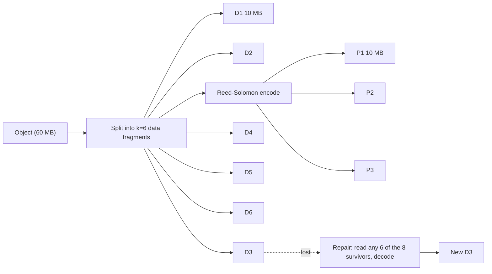

## In one minute
- Erasure coding splits data into *k* data fragments, computes *m* parity fragments, and stores all *k + m* on different disks or hosts. Any *k* of them are enough to rebuild the original.
- A 10+4 code survives any 4 lost fragments with 1.4x storage overhead, where 3x replication survives only 2 lost copies at 3x overhead.
- The price is paid on reads after failures and on repair: rebuilding one lost fragment means reading *k* others, so repair traffic is about *k* times the lost data.
- Reed-Solomon is the standard code; Local Reconstruction Codes (LRC) add local parities to make common single-fragment repairs cheaper.
- Large systems use replication for hot, small, or frequently updated data and erasure coding for large, warm, and cold data.

## How it works

### The idea
The simplest erasure code is a single XOR parity, as in RAID 5. With data blocks A, B, C, store P = A XOR B XOR C. Lose any one block and XOR the remaining three to rebuild it. That is a 3+1 code: any 3 of 4 fragments recover the data, at 1.33x overhead.

To survive more than one loss you need more independent parity fragments. Reed-Solomon ([background](https://en.wikipedia.org/wiki/Reed%E2%80%93Solomon_error_correction)) treats the *k* data fragments as values of a polynomial over a finite field (usually GF(2^8), so every byte is a field element) and computes *m* additional evaluations as parity. Any *k* distinct evaluations determine the polynomial, so any *k* fragments rebuild the rest. Encoding and decoding are matrix multiplications over the field, implemented with lookup tables and SIMD at several GB/s per core.

### Choosing k and m
The two parameters set three things:
- **Overhead** is `(k + m) / k`. 6+3 is 1.5x, 10+4 is 1.4x, 17+3 is about 1.18x.
- **Fault tolerance** is *m* simultaneous fragment losses.
- **Repair cost** is reading *k* fragments to rebuild one. Wider stripes save space but make repairs more expensive and touch more machines per read.

Fragments must be placed in independent failure domains. A 6+3 stripe across 9 racks survives losing 3 racks. Spreading across 3 availability zones with 3 fragments each survives losing a whole zone, since 6 fragments remain.

### Read and write behaviour
A healthy read can fetch only the data fragments, so there is no decoding unless something is missing; this is a *systematic* code. A degraded read must fetch *k* fragments from different hosts and decode, so tail latency rises during failures. Some systems read *k + 1* fragments and use the first *k* to arrive, trading extra traffic for lower latency.

Writes are best done for whole stripes. Updating 4 KB in the middle of a 10+4 stripe means reading old data and parity, recomputing, and writing several fragments, which is why erasure coding suits immutable objects, sealed log segments, and append-only files, and why systems often write new data replicated first and convert it to erasure-coded form once it is sealed. Azure Storage is the textbook case: it appends to extents held as three full copies, seals an extent at around 1 GB, erasure codes it lazily in the background, and only then deletes the copies ([Huang et al., ATC 2012](https://www.usenix.org/conference/atc12/technical-sessions/presentation/huang)).

### Local Reconstruction Codes
Most failures are single fragments. Azure's LRC splits a 12-fragment data stripe into two groups of 6, each with a local XOR parity, plus 2 global parities (12+2+2). A single lost fragment is rebuilt from its group of 6 instead of 12, halving repair reads, while the global parities still cover rarer multi-fragment losses. Overhead rises slightly (1.33x versus 1.17x for 12+2) in exchange for cheaper, faster repairs. The paper frames the win the other way round too: against the 6+3 Reed-Solomon code that GFS's successor used, 12+2+2 keeps the same six-fragment repair cost while cutting overhead from 1.5x to 1.33x ([Huang et al.](https://www.usenix.org/conference/atc12/technical-sessions/presentation/huang)).

## Down the stack

### Layer 1: The contract
A Reed-Solomon *k*+*m* code is maximum distance separable: any *k* of the *k*+*m* fragments reconstruct the stripe, and no code with the same overhead can tolerate more losses. The guarantee is about *erasures*, fragments known to be missing; the code does not on its own identify which fragment is corrupt, so every fragment carries its own checksum and a bad checksum turns corruption into an erasure. The durability a system advertises is not a property of the code alone: it depends on fragment placement across independent failure domains, on how fast lost fragments are detected and rebuilt, and on correlated failures such as a bad batch of drives.

### Layer 2: The mechanism
Practical libraries work in GF(2^8), where each byte is a field element, addition is XOR, and multiplication is defined modulo an irreducible polynomial (0x11D is a common choice). Encoding multiplies the *k* data fragments by an (*k*+*m*) × *k* generator matrix whose top *k* rows are the identity, so data fragments are stored as-is (a systematic code) and the bottom *m* rows produce parity. The parity rows come from a Vandermonde or Cauchy construction chosen so that every *k* × *k* submatrix is invertible. Decoding picks any *k* surviving rows, inverts that *k* × *k* matrix once per failure pattern, and multiplies.

HDFS ships policies named by their layout, such as `RS-6-3-1024k` (enabled by default) and `RS-10-4-1024k`: files are striped across *k* DataNodes in 1 MB cells, round-robin, with parity cells on *m* more nodes ([HDFS erasure coding](https://hadoop.apache.org/docs/stable/hadoop-project-dist/hadoop-hdfs/HDFSErasureCoding.html)). Ceph erasure-coded pools take `k` and `m` in a profile fixed at pool creation. Older guides name Jerasure as the default plugin, but from the Tentacle release the default is Intel's ISA-L and Jerasure is no longer maintained ([Ceph erasure code](https://docs.ceph.com/en/latest/rados/operations/erasure-code/)). Partial overwrites, needed for block and file data, require `allow_ec_overwrites` on BlueStore, and Tentacle adds an opt-in, irreversible `allow_ec_optimizations` mode that reads and writes only the touched part of a stripe. Backblaze describes its Vaults as splitting each file into 17 data and 3 parity shards, one on each of 20 storage pods in 20 cabinets, so a pod, cabinet power or cabinet network failure costs one shard ([Backblaze docs](https://www.backblaze.com/docs/cloud-storage-resiliency-durability-and-availability)), and S3 likewise Reed-Solomon codes objects into *k* data and *m* parity shards ([Warfield, 2023](https://www.allthingsdistributed.com/2023/07/building-and-operating-a-pretty-big-storage-system.html)).

### Layer 3: The machine
Multiplying a byte by a constant in GF(2^8) is a table lookup. Libraries such as Intel ISA-L split each byte into two 4-bit halves and look each up in a 16-entry table with the `pshufb` shuffle instruction, which performs 16 lookups at once in SSE and 32 in AVX2, then XOR the results. Encoding runs at several gigabytes per second per core, so arithmetic is rarely the bottleneck; memory bandwidth and the network are.

Repair is where the cost lands. Rebuilding one lost 1 MB cell in a 10+4 stripe reads 10 MB from 10 machines; rebuilding a failed 16 TB drive under that code moves roughly ten times its capacity across the network, against one times for 3-way replication. Degraded reads wait for the slowest of *k* hosts, so tail latency rises. Small writes are penalised too: updating 4 KiB inside a stripe means reading old data and parity, recomputing, and writing data plus *m* parity fragments, so systems avoid in-place updates and code only sealed, immutable data. Small files fit badly: a file smaller than one cell still needs its full set of parity cells, so overhead for tiny files can exceed that of replication.

Repair traffic is also attackable with better codes. *Regenerating* codes such as Clay read a little from more survivors instead of whole fragments from *k* of them. Ceph's documentation gives the numbers for a k=8, m=4 pool losing a 1 GiB shard: Reed-Solomon downloads 8 GiB, a Clay profile downloads 250 MiB from each of 11 survivors, 2.75 GiB in all ([Ceph Clay](https://docs.ceph.com/en/latest/rados/operations/erasure-code-clay/)). The cost is more, smaller disk reads per repair.

### Why it's built this way
1. Replication triples the hardware bill, so large stores use codes that tolerate the same failures at 1.2 to 1.5 times overhead.
2. Field arithmetic is cheap with SIMD table lookups, so the cost shifts from CPU to reading *k* fragments over the network.
3. Repair traffic grows with *k*, so wider stripes save disk but slow recovery, which motivates local reconstruction codes.
4. Partial stripe updates are expensive read-modify-write cycles, so erasure coding is applied to immutable, sealed data, often after an initial replicated phase.
5. Codes handle erasures, not silent errors, so every fragment is checksummed and scrubbed to turn corruption into a known loss.

## Diagram


## Worked example
A storage team holds 20 PB of logical warm data and compares 3x replication with RS 10+4.

**Capacity.** Replication needs 60 PB raw. RS 10+4 needs 28 PB raw. With 16 TB disks, that is about 3,750 disks instead of 1,750 disks for erasure coding, a difference of 2,000 disks plus servers, power, and rack space.

**Durability.** Replication survives 2 simultaneous losses of the same object's copies; RS 10+4 survives 4. With fragments in independent failure domains and repair within hours, the probability of losing data under 10+4 is orders of magnitude lower than under 3x replication.

**Repair.** A 16 TB disk fails. Under replication, the cluster copies 16 TB. Under 10+4, rebuilding each lost fragment reads 10 others, so 160 TB crosses the network. With 500 hosts each giving 100 MB/s to repair (50 GB/s in total), replication finishes in about 5 minutes and erasure coding in about an hour, 10 times the network load. The team throttles repair to protect foreground traffic and prioritises stripes that have lost 2 or more fragments.

**Latency.** Healthy reads look the same. Degraded reads of a 1 MB range now need 10 parallel fetches and a decode, adding a few milliseconds and raising p99. Hot data under 1 MB stays replicated.

## In the wild
- **Facebook, 2014: f4 moves warm photos off triple replication.** Haystack kept every BLOB at an effective replication factor of 3.6. Because request rates fall as photos age, Facebook built f4 for warm BLOBs: Reed-Solomon 10+4 within a cell, blocks on different racks, plus an XOR of two volumes held in a third datacenter instead of a full geo-copy. A full second copy in another datacenter would cost 1.4 x 2 = 2.8; the XOR scheme costs (1.4 x 2 + 1.4) / 2 = 2.1. After 19 months f4 held over 65 PB of logical data and saved over 53 PB of raw storage ([f4, OSDI 2014](https://www.usenix.org/conference/osdi14/technical-sessions/presentation/muralidhar)).
- **Microsoft, 2012: LRC in Windows Azure Storage.** About to pass an exabyte of data, Azure replaced plain Reed-Solomon with a 12+2+2 Local Reconstruction Code on sealed extents. It kept repair reads at six fragments while cutting overhead from 1.5x to 1.33x, and decoding a 4 KB fragment took 7.12 microseconds against 13.2 for Reed-Solomon. The paper won best paper at USENIX ATC ([Huang et al.](https://www.usenix.org/conference/atc12/technical-sessions/presentation/huang)).
- **Dropbox, 2026: erasure-coded volumes left nearly empty.** A new service that erasure codes data on the fly produced severely under-filled volumes in Magic Pocket, so in the worst cases less than 5% of allocated capacity held live data and storage overhead climbed faster than compaction could reclaim it. Dropbox added two compaction strategies, one packing partly full volumes together and one re-encoding live blobs from the sparsest volumes, after which compaction overhead over a week ran 30 to 50% lower than in cells using the old strategy alone ([Dropbox Tech](https://dropbox.tech/infrastructure/improving-storage-efficiency-in-magic-pocket-our-immutable-blob-store)).

## Trade-offs
| Option | Strengths | Weaknesses | Choose when |
|---|---|---|---|
| 3x replication | Simple, fast reads and repairs, cheap small updates | 3x storage, tolerates only 2 losses | Hot data, small objects, databases |
| RS narrow (6+3) | 1.5x overhead, tolerates 3 losses, moderate repair | Still costs network on repair | Warm data, mid-size clusters |
| RS wide (17+3) | About 1.18x overhead | Expensive repairs, many hosts per read | Cold archives |
| LRC (12+2+2) | Cheap single-fragment repair, low overhead | More complex, slightly more overhead than plain RS | Large clouds with frequent disk churn |
| Replicate first, then encode | Fast writes, efficient long-term storage | Background conversion work | Append-heavy systems like HDFS and log stores |

## Pitfalls in production
- **Fragments sharing a failure domain.** Two fragments on the same host or rack turn one failure into two. Enforce placement constraints and audit them.
- **Repair storms.** A rack loss triggers massive reconstruction that starves foreground traffic. Throttle repair, delay it for short outages, and prioritise the most degraded stripes.
- **Small objects.** A 4 KB object split 10 ways yields tiny fragments and many IOPS. Pack small objects into large stripes or keep them replicated.
- **Partial updates.** In-place updates on erasure-coded data cause read-modify-write amplification. Keep coded data immutable.
- **Silent corruption.** Decoding with a corrupt fragment produces corrupt output. Checksum every fragment and scrub regularly.

## Leadership lens
- Pick codes per storage tier from measured access patterns, not one code for everything.
- Make repair bandwidth a capacity-planning input; a design that saves disks but saturates the network during failures is not cheaper.
- Ask how many fragments a stripe can lose and how long repair takes; those two numbers define real durability.
- Account for CPU: encoding and decoding at tens of GB/s per cluster need cores and SIMD-capable libraries.

## Check yourself
1. Why does RS 10+4 tolerate more failures than 3x replication while using less than half the space?
   **Answer:** Any 10 of 14 fragments rebuild the data, so 4 losses are survivable, and parity costs only 40% extra instead of 200%.
2. Why is repair more expensive under erasure coding?
   **Answer:** Rebuilding one fragment requires reading *k* surviving fragments over the network, not one copy.
3. Why do systems often write data replicated and convert it to erasure coding later?
   **Answer:** Small or changing writes are cheap with replicas, while coding is efficient only for large, immutable, full stripes.
4. What problem does LRC solve?
   **Answer:** It lets the common single-fragment failure be repaired from a small local group instead of all *k* fragments.

## Practice
**Task:** Implement a single-parity erasure code. `encode(data, k)` pads `data` (bytes) with zeros to a multiple of `k`, splits it into `k` equal data shards, and appends one parity shard that is the byte-wise XOR of the data shards, returning `k + 1` shards. `decode(shards, length)` receives the `k + 1` shards with at most one replaced by `None`, rebuilds the missing one by XOR, and returns the original `length` bytes. If more than one shard is missing, return `None`. Handle empty input.

```python starter
def encode(data, k):
    raise NotImplementedError

def decode(shards, length):
    raise NotImplementedError
```

```python tests
DATA = b"erasure coding keeps data safe"

def test_shapes():
    shards = encode(DATA, 4)
    assert len(shards) == 5
    assert len({len(s) for s in shards}) == 1

def test_decode_with_nothing_missing():
    assert decode(encode(DATA, 4), len(DATA)) == DATA

def test_recover_any_single_loss():
    for lost in range(5):
        shards = encode(DATA, 4)
        shards[lost] = None
        assert decode(shards, len(DATA)) == DATA

def test_two_losses_fail():
    shards = encode(DATA, 4)
    shards[0] = None
    shards[2] = None
    assert decode(shards, len(DATA)) is None

def test_parity_is_xor():
    shards = encode(bytes([1, 2, 4, 8]), 2)
    assert shards[2] == bytes([1 ^ 4, 2 ^ 8])

def test_empty_input():
    shards = encode(b"", 3)
    assert len(shards) == 4
    assert decode(shards, 0) == b""
```

```python solution
def _xor(blocks):
    out = bytearray(len(blocks[0]))
    for b in blocks:
        for i, x in enumerate(b):
            out[i] ^= x
    return bytes(out)

def encode(data, k):
    size = -(-len(data) // k)
    padded = data + bytes(size * k - len(data))
    shards = [padded[i * size:(i + 1) * size] for i in range(k)]
    return shards + [_xor(shards)]

def decode(shards, length):
    missing = [i for i, s in enumerate(shards) if s is None]
    if len(missing) > 1:
        return None
    shards = list(shards)
    if missing:
        shards[missing[0]] = _xor([s for s in shards if s is not None])
    return b"".join(shards[:-1])[:length]
```

```typescript starter
export function encode(data: number[], k: number): number[][] { throw new Error("TODO"); }
export function decode(shards: (number[] | null)[], length: number): number[] | null {
  throw new Error("TODO");
}
```

```typescript tests
const DATA = Array.from("erasure coding keeps data safe", (c) => c.charCodeAt(0));
test("shapes", () => {
  const shards = encode(DATA, 4);
  assertEqual(shards.length, 5);
  assertEqual(new Set(shards.map((s) => s.length)).size, 1);
});
test("decode with nothing missing", () => {
  assertEqual(decode(encode(DATA, 4), DATA.length), DATA);
});
test("recover any single loss", () => {
  for (let lost = 0; lost < 5; lost++) {
    const shards: (number[] | null)[] = encode(DATA, 4);
    shards[lost] = null;
    assertEqual(decode(shards, DATA.length), DATA);
  }
});
test("two losses fail", () => {
  const shards: (number[] | null)[] = encode(DATA, 4);
  shards[0] = null;
  shards[2] = null;
  assertEqual(decode(shards, DATA.length), null);
});
test("parity is xor", () => {
  assertEqual(encode([1, 2, 4, 8], 2)[2], [1 ^ 4, 2 ^ 8]);
});
test("empty input", () => {
  const shards = encode([], 3);
  assertEqual(shards.length, 4);
  assertEqual(decode(shards, 0), []);
});
```

```typescript solution
function xorAll(blocks: number[][], size: number): number[] {
  const out = new Array<number>(size).fill(0);
  for (const b of blocks) for (let i = 0; i < size; i++) out[i] ^= b[i];
  return out;
}

export function encode(data: number[], k: number): number[][] {
  const size = Math.ceil(data.length / k);
  const padded = data.concat(new Array<number>(size * k - data.length).fill(0));
  const shards: number[][] = [];
  for (let i = 0; i < k; i++) shards.push(padded.slice(i * size, (i + 1) * size));
  shards.push(xorAll(shards, size));
  return shards;
}

export function decode(shards: (number[] | null)[], length: number): number[] | null {
  const missing = shards.map((s, i) => (s === null ? i : -1)).filter((i) => i >= 0);
  if (missing.length > 1) return null;
  const present = shards.filter((s): s is number[] => s !== null);
  const full = shards.map((s) => s ?? xorAll(present, present[0].length));
  return full.slice(0, -1).flat().slice(0, length);
}
```

```go starter
package practice

func Encode(data []byte, k int) [][]byte                { panic("TODO") }
func Decode(shards [][]byte, length int) ([]byte, bool) { panic("TODO") }
```

```go tests
package practice

import (
	"bytes"
	"testing"
)

var data = []byte("erasure coding keeps data safe")

func TestShapes(t *testing.T) {
	shards := Encode(data, 4)
	if len(shards) != 5 {
		t.Fatalf("shards %d", len(shards))
	}
	for _, s := range shards {
		if len(s) != len(shards[0]) {
			t.Fatal("unequal shard sizes")
		}
	}
}

func TestDecodeWithNothingMissing(t *testing.T) {
	if got, ok := Decode(Encode(data, 4), len(data)); !ok || !bytes.Equal(got, data) {
		t.Fatalf("got %q", got)
	}
}

func TestRecoverAnySingleLoss(t *testing.T) {
	for lost := 0; lost < 5; lost++ {
		shards := Encode(data, 4)
		shards[lost] = nil
		if got, ok := Decode(shards, len(data)); !ok || !bytes.Equal(got, data) {
			t.Fatalf("lost %d: got %q", lost, got)
		}
	}
}

func TestTwoLossesFail(t *testing.T) {
	shards := Encode(data, 4)
	shards[0], shards[2] = nil, nil
	if _, ok := Decode(shards, len(data)); ok {
		t.Fatal("expected failure")
	}
}

func TestParityIsXor(t *testing.T) {
	if got := Encode([]byte{1, 2, 4, 8}, 2)[2]; !bytes.Equal(got, []byte{1 ^ 4, 2 ^ 8}) {
		t.Fatalf("got %v", got)
	}
}

func TestEmptyInput(t *testing.T) {
	shards := Encode(nil, 3)
	if len(shards) != 4 {
		t.Fatalf("shards %d", len(shards))
	}
	if got, ok := Decode(shards, 0); !ok || len(got) != 0 {
		t.Fatalf("got %v", got)
	}
}
```

```go solution
package practice

func xorAll(blocks [][]byte, size int) []byte {
	out := make([]byte, size)
	for _, b := range blocks {
		for i := 0; i < size; i++ {
			out[i] ^= b[i]
		}
	}
	return out
}

func Encode(data []byte, k int) [][]byte {
	size := (len(data) + k - 1) / k
	padded := make([]byte, size*k)
	copy(padded, data)
	shards := make([][]byte, 0, k+1)
	for i := 0; i < k; i++ {
		shards = append(shards, padded[i*size:(i+1)*size])
	}
	return append(shards, xorAll(shards, size))
}

func Decode(shards [][]byte, length int) ([]byte, bool) {
	missing, size := -1, 0
	var present [][]byte
	for i, s := range shards {
		if s == nil {
			if missing >= 0 {
				return nil, false
			}
			missing = i
			continue
		}
		present, size = append(present, s), len(s)
	}
	full := append([][]byte{}, shards...)
	if missing >= 0 {
		full[missing] = xorAll(present, size)
	}
	var out []byte
	for _, s := range full[:len(full)-1] {
		out = append(out, s...)
	}
	return out[:length], true
}
```

## Mock interview
**Prompt:** Your object store holds 100 PB on 3x replication and storage cost is growing faster than revenue. Propose a plan to introduce erasure coding without hurting latency or durability.

- Follow-up: Which code would you pick, and how would you place fragments across three availability zones?
- Follow-up: A zone goes offline for six hours. What happens to reads and to repair traffic?
- Follow-up: How do you handle the billions of objects under 64 KB?

**A strong answer covers:**
- Tiering by access pattern: keep hot and small objects replicated, encode warm and cold data.
- Concrete code choice with overhead, fault tolerance, and placement per zone (for example 6+3 with 3 fragments per zone).
- Repair cost math and throttling, plus delaying repair for transient outages.
- Degraded-read latency and mitigations such as reading extra fragments.
- Background conversion of sealed data, checksums on every fragment, and continuous scrubbing.

## Sources and further study
**Primary**
- [Huang et al., Erasure Coding in Windows Azure Storage (USENIX ATC 2012), talk page](https://www.usenix.org/conference/atc12/technical-sessions/presentation/huang): the LRC paper's abstract, slides and video.
- [Muralidhar et al., f4: Facebook's Warm BLOB Storage System (OSDI 2014)](https://www.usenix.org/conference/osdi14/technical-sessions/presentation/muralidhar): when and how to move data from replication to coding, with geo-XOR.

**Systems docs**
- [Ceph: Clay code plugin](https://docs.ceph.com/en/latest/rados/operations/erasure-code-clay/): a regenerating code in production software, with repair-traffic numbers.
- [Backblaze: resiliency, durability and availability](https://www.backblaze.com/docs/cloud-storage-resiliency-durability-and-availability): vaults, tomes and 17+3 shards across cabinets.
- [Dropbox: improving storage efficiency in Magic Pocket](https://dropbox.tech/infrastructure/improving-storage-efficiency-in-magic-pocket-our-immutable-blob-store): what erasure-coded volumes cost when they are under-filled.

**Books**
- *Database Internals* (1st ed.), Alex Petrov, Ch 11 "Replication and Consistency": the replication baseline that erasure coding is weighed against.
- *Understanding Distributed Systems* (2nd ed.), Roberto Vitillo, chapter "File storage": walks through a cloud blob store's layered architecture, where erasure coding lives in the lowest layer.

**Other curricula**
- [Azure Architecture Center: choose a storage service](https://learn.microsoft.com/en-us/azure/architecture/guide/technology-choices/storage-options): presents redundancy as a menu (LRS, ZRS, GRS) and leaves the coding underneath to the platform.
- [donnemartin/system-design-primer](https://github.com/donnemartin/system-design-primer): does not cover erasure coding; durability is discussed only as replication.

## Watch
- [Reed Solomon Encoding (Computerphile)](https://www.youtube.com/watch?v=fBRMaEAFLE0): an intuitive explanation of how polynomial codes recover lost data.
- [What are Reed-Solomon Codes? (vcubingx)](https://www.youtube.com/watch?v=1pQJkt7-R4Q): a visual walk through the maths of recovery from any k pieces.

## Free resources
- [Erasure Coding in Windows Azure Storage (USENIX ATC 2012)](https://www.usenix.org/system/files/conference/atc12/atc12-final181_0.pdf): the LRC paper, with production repair and overhead numbers.
- [Backblaze: Reed-Solomon explained](https://www.backblaze.com/blog/reed-solomon/): how a cloud storage company uses 17+3 coding, with open-source code.
- [Ceph: Erasure code](https://docs.ceph.com/en/latest/rados/operations/erasure-code/): configuring k, m, and failure domains in a real system.
- [HDFS Erasure Coding](https://hadoop.apache.org/docs/stable/hadoop-project-dist/hadoop-hdfs/HDFSErasureCoding.html): striped layout, policies, and trade-offs in HDFS.
- [Wikipedia: Erasure code](https://en.wikipedia.org/wiki/Erasure_code): background on optimal codes and their properties.
