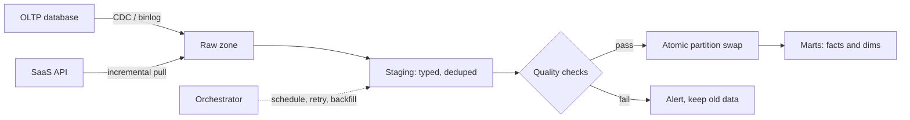

## In one minute
- An ETL pipeline **extracts** data from operational sources, **transforms** it into clean, modelled shapes, and **loads** it where analysts and systems can query it.
- Modern stacks usually run **ELT**: land raw data first, then transform inside the warehouse with SQL, because warehouse compute is elastic and raw data stays replayable.
- The core reliability property is **idempotent, partitioned loads**: rerunning a day must produce the same result, not double it.
- Extraction is the hardest part to get right: full dumps are simple but heavy, incremental cursors miss deletes, and change data capture (CDC) is accurate but operationally demanding.
- Pipelines fail quietly. Data quality checks and freshness SLAs matter as much as job success.

## How it works

### Extract
There are three common patterns. A **full snapshot** copies the whole table each run; easy and correct, but a 2 TB table nightly is expensive and hammers the source. An **incremental cursor** selects rows where `updated_at > last_watermark`; cheap, but it misses hard deletes and rows whose clock was skewed or updated inside the same transaction window. **CDC** reads the database's replication log (MySQL binlog, Postgres WAL) and emits every insert, update, and delete in commit order ([Debezium docs](https://debezium.io/documentation/reference/stable/architecture.html)), which is the only approach that captures deletes and intermediate states reliably.

### Transform
Transformations clean types, deduplicate, conform keys across systems, join reference data, and build modelled tables such as facts and dimensions. A good layout has layers: **raw** (exact copy of the source), **staging** (typed and deduplicated), and **marts** (business-level tables). Each layer is a pure function of the one below, so you can rebuild any layer from raw.

### Load
Loads should replace a whole partition atomically: write to a temporary location, validate, then swap. `INSERT` appends are the classic source of double counting when a job retries. For slowly changing dimensions, a `MERGE` keyed on the business key keeps history rows with `valid_from` and `valid_to`.

### Orchestration
An orchestrator (Airflow, Dagster, Prefect) runs tasks as a DAG on a schedule, handles retries, and tracks which logical date each run covers. The important idea is the **logical date**: the run for 2026-10-14 processes exactly that day's partition, whenever it actually executes. That makes backfills a loop over dates, provided tasks are idempotent and read the interval from the run instead of calling `now()` ([Airflow docs](https://airflow.apache.org/docs/apache-airflow/stable/best-practices.html)).

## Down the stack

### Layer 1: The contract
For every logical date, the published partition reflects every committed source change in that interval exactly once, no matter how many times the job ran. Readers see either the old partition or the new one, never a mix. Data is published by a stated freshness deadline (for example 06:00 UTC), or an alert fires. If checks fail, the previous good version stays visible.

### Layer 2: The mechanism
In Postgres, CDC uses a **logical replication slot** with the `pgoutput` plugin. The slot remembers a `confirmed_flush_lsn`; the server keeps all WAL after that point. The connector decodes WAL into `BEGIN`, `INSERT`, `UPDATE`, `DELETE`, and `COMMIT` messages with the commit LSN, and acknowledges an LSN only after Kafka has durably accepted the events. In MySQL, the connector reads the row-based binlog (`WRITE_ROWS`, `UPDATE_ROWS`, `DELETE_ROWS` events) and tracks a GTID set. The initial load takes a consistent snapshot, records the log position at the snapshot, then streams from that position, so no change is missed between the two ([Debezium docs](https://debezium.io/documentation/reference/stable/connectors/postgresql.html)). Until Postgres 17, a logical slot lived only on the primary, so a failover lost the slot and forced a fresh snapshot; Postgres 17 can sync slots created with `failover` to a standby (`sync_replication_slots`) ([Postgres docs](https://www.postgresql.org/docs/current/logicaldecoding-explanation.html)), and Debezium exposes this as `slot.failover`. In Airflow, each run carries `data_interval_start` and `data_interval_end`; tasks template these into queries, and a backfill simply creates runs for past intervals. Airflow 3.0 (April 2025) changed the details: `execution_date` is gone in favour of `logical_date`, manual and asset-triggered runs can have no logical date at all, `catchup` now defaults to off, and a bare cron string now uses a timetable with no data interval unless `create_cron_data_intervals` is set. Backfills became scheduler-managed runs started from the UI or API rather than a separate CLI job ([Airflow release notes](https://airflow.apache.org/docs/apache-airflow/stable/release_notes.html)). A pipeline upgraded from Airflow 2 without checking these can silently process empty intervals. The load step writes files to a new path and then updates the catalog's partition location (or commits a table-format snapshot), which is the atomic switch readers observe.

### Layer 3: The machine
A replication slot pins WAL on the database's disk. A busy primary writing 50 MB/s of WAL fills 180 GB per hour if the connector stops, so a dead connector can fill the primary's disk and take down production. The cap, `max_slot_wal_keep_size`, defaults to -1 (unlimited) and invalidates the slot when exceeded; Postgres 18 adds `idle_replication_slot_timeout` to invalidate slots that sit unused ([Postgres docs](https://www.postgresql.org/docs/current/runtime-config-replication.html)). Either way the connector must re-snapshot, which is cheaper than a full disk. A slot on a quiet database can also pin WAL while connected, because other databases on the same server keep writing; a periodic heartbeat write lets it advance. Each commit on the source is an `fsync` of WAL, typically 0.5 to 2 ms on SSD, and CDC adds no extra fsyncs because it reads the same log. On the load side, writers buffer rows into Parquet row groups (128 MB by default in parquet-java ([parquet-java](https://github.com/apache/parquet-java/blob/master/parquet-hadoop/README.md))) in memory before compressing and uploading them; S3 accepts multipart uploads of up to 10,000 parts of 5 MiB to 5 GiB each ([AWS docs](https://docs.aws.amazon.com/AmazonS3/latest/userguide/qfacts.html)), and each PUT costs 20 to 100 ms, so writing thousands of tiny files is dominated by request latency rather than bandwidth.

### Why it's built this way
1. Source databases are tuned for transactions, and long analytical reads hurt them, so pipelines read the replication log instead of querying tables.
2. The log is ordered and contains deletes, so it is the only complete record of change; but it is retained only briefly, so CDC lands it in cheap durable storage quickly.
3. Jobs fail and retry, so every write must be idempotent: keyed by partition and deduplicated by log position.
4. Readers must never see partial results, and object stores lack atomic directory renames, so publication is a single metadata update.
5. Pipelines break silently, so checks gate publication and freshness is measured as an SLO, end to end rather than per stage, since one stage can succeed while the next drops a field ([SRE workbook](https://sre.google/workbook/data-processing/)).

## Diagram


## Worked example
An e-commerce company wants a daily `orders_fact` table. The `orders` table holds 400 million rows (about 180 GB) and receives 3 million inserts and 1 million updates per day.

A nightly full snapshot would move 180 GB and hold a long read transaction on a replica for about 40 minutes. An incremental cursor on `updated_at` moves only 4 million rows, about 2 GB, in under a minute, but cancelled orders that are hard-deleted never appear. The team chooses CDC through Debezium into Kafka, landing roughly 4 million change events per day into the raw zone as hourly Parquet files.

The staging job deduplicates to the latest version per `order_id` within the day:

```sql
INSERT OVERWRITE staging.orders PARTITION (ds = '2026-10-14')
SELECT * FROM (
  SELECT *, ROW_NUMBER() OVER (
    PARTITION BY order_id ORDER BY commit_lsn DESC) AS rn
  FROM raw.orders_cdc WHERE ds = '2026-10-14'
) WHERE rn = 1;
```

Then `orders_fact` is merged with this partition. Checks run before publish: row count within 30 percent of the 7-day average, no null `customer_id`, revenue total within 5 percent of the payments system. A failed check leaves yesterday's table in place and pages the data on-call.

## In the wild
- **Uber, 2018: full-snapshot rebuilds give way to incremental upserts.** Uber's lake rebuilt main tables from full snapshots: one rebuild took over 20 hours on more than 1,000 Spark executors, rewriting a table of over 100 TB to add about 100 GB of new data, so data was fresh once every 24 hours. Apache Hudi added upserts and incremental pulls on Parquet; ingestion jobs then ran every 10 to 15 minutes and latency fell below one hour ([Uber](https://www.uber.com/en-US/blog/uber-big-data-platform/)).
- **Decodable/Gunnar Morling, 2022: the slot that ate the disk.** A stopped Debezium-based connector left an inactive logical slot on an Amazon RDS Postgres 14 instance. RDS writes a heartbeat every five minutes and uses 64 MB WAL segments, so the "idle" database retained about 18 GB of WAL a day and filled a 200 GiB disk in under two weeks. The advice: alert when a slot retains more than about 100 MB, drop unused slots, and emit periodic heartbeat messages ([morling.dev](https://morling.dev/blog/insatiable-postgres-replication-slot)).
- **Segment, 2017: deduplicating at the consumer.** About 0.6% of ingested events were duplicates, mostly clients on flaky networks resending. Segment partitioned Kafka by message ID and gave each worker an embedded RocksDB of IDs seen in a four-week window; after three months it held about 60 billion keys in 1.5 TB on disk ([Segment](https://www.twilio.com/en-us/blog/insights/exactly-once-delivery)).

## Trade-offs

| Option | Strengths | Weaknesses | Choose when |
|---|---|---|---|
| Classic ETL (transform before load) | Only clean data lands; less warehouse cost | Raw data lost; reprocessing needs the source again | Strict PII rules, small fixed targets |
| ELT (load raw, transform in warehouse) | Replayable raw history, SQL-based transforms, elastic compute | Warehouse bill grows; raw zone needs governance | Most modern analytics stacks |
| Incremental cursor extract | Simple, cheap | Misses deletes; clock skew gaps | Append-only or soft-delete sources |
| CDC extract | Exact, ordered, includes deletes | Connectors, schema evolution, log retention to manage | Large mutable tables, near-real-time needs |

## Pitfalls in production
- **Non-idempotent appends.** A retried job inserts the same day twice and revenue doubles. Always overwrite or merge by partition and key.
- **Late-arriving data.** Events for yesterday arrive today and never get processed. Reprocess a trailing window (for example the last 3 days) on every run, or partition by arrival date and handle event time downstream.
- **Silent schema changes.** A source team renames a column and the pipeline loads nulls for a week. Enforce schema contracts and fail loudly on unexpected changes.
- **Watermark gaps.** Using `updated_at > last_run_time` drops rows committed late by long transactions. Overlap the window and dedupe, or use CDC log positions.
- **Green jobs, wrong data.** Every task succeeds but a filter bug drops half the rows. Add volume, null-rate, and reconciliation checks that block publishing.

## Leadership lens
- Ask for each pipeline's freshness SLA and owner. A pipeline without an owner becomes everyone's 3 a.m. problem.
- Insist that every job is a pure function of its logical date and inputs. That one rule turns backfills, retries, and bug fixes into routine operations.
- Agree on data contracts with source teams. Most pipeline incidents start with an upstream change nobody announced.
- Watch the cost curve: ELT moves spend to warehouse compute. Incremental models and partition pruning keep it in check.

## Check yourself
1. Why does an incremental extract based on `updated_at` miss data even when the column is always set?
   **Answer:** It cannot see hard deletes, and a long transaction can commit a row with an `updated_at` earlier than the last watermark, so the row falls behind the cursor.
2. What does a logical date give you that wall-clock scheduling does not?
   **Answer:** Each run is tied to a specific data interval, so reruns and backfills recompute exactly that interval and produce the same result.
3. Why keep the raw layer in ELT even after staging tables exist?
   **Answer:** It lets you rebuild every downstream table after a logic bug without going back to the source system, which may no longer have the history.

## Practice
**Task:** Write `apply_cdc(snapshot, events)` that applies an ordered list of CDC events to a table snapshot. The snapshot is a dict from primary key to row dict. Each event is a dict with `op` (`"c"`, `"u"`, or `"d"`), `key`, `lsn` (log sequence number), and `row` (absent for deletes). Events may arrive out of order and may be duplicated, so apply them in `lsn` order and ignore any event whose `lsn` is not greater than the last applied `lsn` for that key. Return the new snapshot without mutating the input.

```python starter
def apply_cdc(snapshot, events):
    # TODO
    raise NotImplementedError
```

```python tests
def test_insert_update_delete():
    ev = [{"op": "c", "key": 1, "lsn": 1, "row": {"v": "a"}},
          {"op": "u", "key": 1, "lsn": 2, "row": {"v": "b"}},
          {"op": "c", "key": 2, "lsn": 3, "row": {"v": "x"}},
          {"op": "d", "key": 2, "lsn": 4}]
    assert apply_cdc({}, ev) == {1: {"v": "b"}}

def test_out_of_order_uses_lsn():
    ev = [{"op": "u", "key": 1, "lsn": 5, "row": {"v": "new"}},
          {"op": "u", "key": 1, "lsn": 3, "row": {"v": "old"}}]
    assert apply_cdc({}, ev) == {1: {"v": "new"}}

def test_duplicates_are_idempotent():
    e = {"op": "u", "key": 7, "lsn": 9, "row": {"v": 1}}
    assert apply_cdc({}, [e, e, e]) == {7: {"v": 1}}

def test_input_not_mutated():
    snap = {1: {"v": "a"}}
    apply_cdc(snap, [{"op": "d", "key": 1, "lsn": 1}])
    assert snap == {1: {"v": "a"}}

def test_delete_missing_key_is_noop():
    assert apply_cdc({3: {"v": 0}}, [{"op": "d", "key": 9, "lsn": 1}]) == {3: {"v": 0}}
```

```python solution
def apply_cdc(snapshot, events):
    table = dict(snapshot)
    last = {}
    for e in sorted(events, key=lambda e: e["lsn"]):
        k = e["key"]
        if k in last and e["lsn"] <= last[k]:
            continue
        last[k] = e["lsn"]
        if e["op"] == "d":
            table.pop(k, None)
        else:
            table[k] = dict(e["row"])
    return table
```

```typescript starter
export type Row = Record<string, unknown>;
export interface CdcEvent { op: "c" | "u" | "d"; key: number; lsn: number; row?: Row; }
export function applyCdc(snapshot: Map<number, Row>, events: CdcEvent[]): Map<number, Row> {
  throw new Error("TODO");
}
```

```typescript tests
const entries = (m: Map<number, Row>) => [...m.entries()].sort((a, b) => a[0] - b[0]);
test("insert, update, delete", () => {
  const ev: CdcEvent[] = [
    { op: "c", key: 1, lsn: 1, row: { v: "a" } }, { op: "u", key: 1, lsn: 2, row: { v: "b" } },
    { op: "c", key: 2, lsn: 3, row: { v: "x" } }, { op: "d", key: 2, lsn: 4 }];
  assertEqual(entries(applyCdc(new Map(), ev)), [[1, { v: "b" }]]);
});
test("out of order uses lsn", () => {
  const ev: CdcEvent[] = [{ op: "u", key: 1, lsn: 5, row: { v: "new" } },
    { op: "u", key: 1, lsn: 3, row: { v: "old" } }];
  assertEqual(entries(applyCdc(new Map(), ev)), [[1, { v: "new" }]]);
});
test("duplicates are idempotent", () => {
  const e: CdcEvent = { op: "u", key: 7, lsn: 9, row: { v: 1 } };
  assertEqual(entries(applyCdc(new Map(), [e, e, e])), [[7, { v: 1 }]]);
});
test("input not mutated", () => {
  const snap = new Map<number, Row>([[1, { v: "a" }]]);
  applyCdc(snap, [{ op: "d", key: 1, lsn: 1 }]);
  assertEqual(entries(snap), [[1, { v: "a" }]]);
});
test("delete of missing key is a no-op", () => {
  const snap = new Map<number, Row>([[3, { v: 0 }]]);
  assertEqual(entries(applyCdc(snap, [{ op: "d", key: 9, lsn: 1 }])), [[3, { v: 0 }]]);
});
```

```typescript solution
export type Row = Record<string, unknown>;
export interface CdcEvent { op: "c" | "u" | "d"; key: number; lsn: number; row?: Row; }
export function applyCdc(snapshot: Map<number, Row>, events: CdcEvent[]): Map<number, Row> {
  const table = new Map(snapshot);
  const last = new Map<number, number>();
  for (const e of [...events].sort((a, b) => a.lsn - b.lsn)) {
    const prev = last.get(e.key);
    if (prev !== undefined && e.lsn <= prev) continue;
    last.set(e.key, e.lsn);
    if (e.op === "d") table.delete(e.key);
    else table.set(e.key, { ...(e.row ?? {}) });
  }
  return table;
}
```

```go starter
package practice

type Event struct {
	Op  string // "c", "u" or "d"
	Key int
	LSN int
	Row map[string]string
}

func ApplyCDC(snapshot map[int]map[string]string, events []Event) map[int]map[string]string {
	panic("TODO")
}
```

```go tests
package practice

import (
	"reflect"
	"testing"
)

type R = map[string]string

func TestInsertUpdateDelete(t *testing.T) {
	ev := []Event{{"c", 1, 1, R{"v": "a"}}, {"u", 1, 2, R{"v": "b"}},
		{"c", 2, 3, R{"v": "x"}}, {"d", 2, 4, nil}}
	got := ApplyCDC(map[int]map[string]string{}, ev)
	if !reflect.DeepEqual(got, map[int]map[string]string{1: {"v": "b"}}) {
		t.Fatalf("got %v", got)
	}
}

func TestOutOfOrderUsesLSN(t *testing.T) {
	ev := []Event{{"u", 1, 5, R{"v": "new"}}, {"u", 1, 3, R{"v": "old"}}}
	if got := ApplyCDC(map[int]map[string]string{}, ev); got[1]["v"] != "new" {
		t.Fatalf("got %v", got)
	}
}

func TestDuplicatesIdempotent(t *testing.T) {
	e := Event{"u", 7, 9, R{"v": "1"}}
	if got := ApplyCDC(map[int]map[string]string{}, []Event{e, e, e}); len(got) != 1 {
		t.Fatalf("got %v", got)
	}
}

func TestInputNotMutated(t *testing.T) {
	snap := map[int]map[string]string{1: {"v": "a"}}
	ApplyCDC(snap, []Event{{"d", 1, 1, nil}})
	if _, ok := snap[1]; !ok {
		t.Fatal("snapshot was mutated")
	}
}

func TestDeleteMissingKey(t *testing.T) {
	got := ApplyCDC(map[int]map[string]string{3: {"v": "0"}}, []Event{{"d", 9, 1, nil}})
	if len(got) != 1 {
		t.Fatalf("got %v", got)
	}
}
```

```go solution
package practice

import "sort"

type Event struct {
	Op  string // "c", "u" or "d"
	Key int
	LSN int
	Row map[string]string
}

func ApplyCDC(snapshot map[int]map[string]string, events []Event) map[int]map[string]string {
	table := make(map[int]map[string]string, len(snapshot))
	for k, v := range snapshot {
		table[k] = v
	}
	sorted := append([]Event(nil), events...)
	sort.SliceStable(sorted, func(i, j int) bool { return sorted[i].LSN < sorted[j].LSN })
	last := map[int]int{}
	for _, e := range sorted {
		if prev, ok := last[e.Key]; ok && e.LSN <= prev {
			continue
		}
		last[e.Key] = e.LSN
		if e.Op == "d" {
			delete(table, e.Key)
			continue
		}
		row := make(map[string]string, len(e.Row))
		for k, v := range e.Row {
			row[k] = v
		}
		table[e.Key] = row
	}
	return table
}
```

## Mock interview
**Prompt:** Design the pipeline that feeds a finance dashboard with daily revenue from a sharded Postgres orders database of 2 billion rows, with data ready by 6 a.m. and exact agreement with the payments ledger.

- Follow-up: How do you capture refunds that hard-delete order rows?
- Follow-up: The job fails halfway through loading. What does the dashboard show?
- Follow-up: When would you pick a nightly snapshot over CDC?

**A strong answer covers:**
- CDC from replicas into a raw zone, with log retention sized for outages.
- Layered raw, staging, mart design with dedupe by key and log position.
- Partition-overwrite or merge loads with an atomic swap, so readers never see partial data.
- Blocking reconciliation checks against the ledger before publishing.
- Backfill strategy tied to logical dates, plus freshness alerting at 5 a.m.

## Sources and further study
**Primary**
- [PostgreSQL: logical decoding concepts](https://www.postgresql.org/docs/current/logicaldecoding-explanation.html): replication slots, the WAL and catalog rows they retain, and failover slot synchronisation.
- [Airflow 3.0 release notes](https://airflow.apache.org/docs/apache-airflow/stable/release_notes.html): the logical-date, catchup and backfill changes that affect every scheduled pipeline.

**Systems docs**
- [Debezium PostgreSQL connector](https://debezium.io/documentation/reference/stable/connectors/postgresql.html): snapshot modes, WAL disk space consumption, heartbeats and failover slots.
- [dbt incremental models](https://docs.getdbt.com/docs/build/incremental-models): merge, delete+insert and insert-overwrite strategies for idempotent loads in the warehouse.

**Books**
- *Fundamentals of Data Engineering*, Joe Reis and Matt Housley, chapters 7 "Ingestion" and 8 "Queries, Modeling, and Transformation".
- *Designing Data-Intensive Applications*, Martin Kleppmann, chapter 11 "Stream Processing", section "Databases and Streams": change data capture and log compaction (chapter 12 in the 2026 second edition).

**Other curricula**
- [Google SRE workbook, "Data Processing Pipelines"](https://sre.google/workbook/data-processing/): frames a pipeline's health as freshness, correctness and coverage SLOs measured end to end.
- [roadmap.sh Software Architect](https://roadmap.sh/software-architect): lists "ETL Datawarehouses" as one node, with ETL framed as feeding a warehouse rather than as an operational system.

## Watch
- [Functional Data Engineering: A Set of Best Practices (AI Council)](https://www.youtube.com/watch?v=4Spo2QRTz1k): Maxime Beauchemin on idempotent, partition-based pipelines.
- [ETL vs ELT (Kahan Data Solutions)](https://www.youtube.com/watch?v=_Nk0v9qUWk4): a short comparison of where the transform step lives.

## Free resources
- [Extract, transform, load (Azure Architecture Center)](https://learn.microsoft.com/en-us/azure/architecture/data-guide/relational-data/etl): ETL versus ELT with reference architectures.
- [Airflow best practices](https://airflow.apache.org/docs/apache-airflow/stable/best-practices.html): idempotent tasks, logical dates, and avoiding top-level code.
- [How we structure our dbt projects](https://docs.getdbt.com/best-practices/how-we-structure/1-guide-overview): a concrete layering of staging, intermediate, and mart models.
- [Debezium architecture](https://debezium.io/documentation/reference/stable/architecture.html): how log-based CDC connectors read database logs into Kafka.
