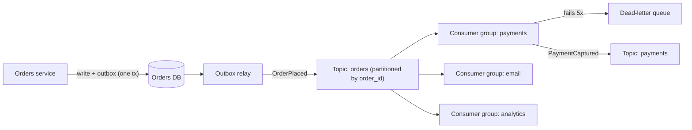

## In one minute
- In an event-driven architecture, components announce facts ("OrderPlaced", "PaymentFailed") and other components react, instead of calling each other directly.
- Producers do not know who consumes their events, so new consumers can be added without touching the producer. That decoupling is the main benefit.
- The broker (a log like Kafka or a queue or bus like SQS, RabbitMQ, or EventBridge) delivers at least once, so consumers must be idempotent and tolerate reordering where the broker does not guarantee order.
- The costs are eventual consistency, harder end-to-end reasoning, and a contract problem: event schemas become public APIs that are hard to change.

## How it works

### Kinds of events
Not every "event" means the same thing. An **event notification** is thin ("Order 42 changed") and makes consumers call back for details, which reintroduces coupling and load. It also hides the business flow: Fowler's warning is that the flow is not written down in any one program, so you learn it by watching the running system ([Fowler](https://martinfowler.com/articles/201701-event-driven.html)). **Event-carried state transfer** puts the needed data in the event so consumers can keep a local copy and never call back, at the price of many copies of the data ([Fowler](https://martinfowler.com/articles/201701-event-driven.html)). A **domain event** records a business fact in the producer's language. Be explicit about which you are publishing, because it determines payload size, coupling, and replay value. Whatever the kind, give every event a standard envelope. The CNCF CloudEvents spec requires `id`, `source`, `specversion` and `type`, and says a producer must keep `source` plus `id` unique per distinct event, so consumers may treat a repeat of that pair as a duplicate ([CloudEvents spec](https://github.com/cloudevents/spec/blob/main/cloudevents/spec.md)). That pair is your deduplication key.

### Brokers: logs versus queues
A **log** (Kafka, Kinesis, Pulsar) appends events to partitions and keeps them for a retention period. Each consumer group tracks its own offset, so many independent consumers can read the same stream and new ones can replay history. Ordering is guaranteed only within a partition, so you choose a partition key (for example `order_id`) to keep related events in order. A **queue** (SQS, RabbitMQ) hands each message to one consumer and deletes it on acknowledgement. Queues are simpler for work distribution; logs are better for fan-out and replay. Plain pub/sub without a log (such as Azure Event Grid) sits apart from both: it pushes each event to current subscribers and does not keep it, so a subscriber added tomorrow sees nothing from today ([Azure Architecture Center](https://learn.microsoft.com/en-us/azure/architecture/guide/architecture-styles/event-driven)).

The line between logs and queues is blurring. Kafka's share groups let many consumers work on one partition with per-record acknowledgement and delivery counts, which is queue behaviour on top of a log; they arrived as early access in Kafka 4.0 and were declared production-ready in 4.2 in February 2026 ([Apache Kafka](https://kafka.apache.org/blog/2026/02/17/apache-kafka-4.2.0-release-announcement/)).

### Delivery guarantees
Brokers and networks fail, so the practical guarantee is at-least-once. A consumer that processes an event and crashes before committing its offset will see the event again. Make handlers idempotent: store processed event IDs, use upserts keyed by business ID, or compare versions. On the producer side, use a transactional outbox so the database change and the event are committed together. Broker-side producer idempotence helps but only covers retries of the same send: in Kafka it rejects a retried batch the broker already has, and it is on by default together with `acks=all` ([Kafka producer configs](https://kafka.apache.org/43/configuration/producer-configs/)). Kafka 3.0 made both the defaults, but a bug kept idempotence off unless set explicitly until 3.0.1, 3.1.1 and 3.2.0, so older clients may still be running without it ([Kafka 3.0 upgrade notes](https://kafka.apache.org/30/getting-started/upgrade/)). It does nothing about a handler that charges a card twice.

### Choreography and failure handling
When many services react to each other's events, the business process is spread across them (choreography). That scales organisationally but makes it hard to answer "where is order 42 stuck?". For long processes with compensations, an orchestrator that emits commands and listens for results is easier to monitor. Messages that keep failing go to a dead-letter queue after a bounded number of attempts, with alerting and a replay tool. Put a correlation ID on every event from the start, so logs and traces can join one business transaction across producers, brokers and consumers; retrofitting it later is much harder ([Azure Architecture Center](https://learn.microsoft.com/en-us/azure/architecture/guide/architecture-styles/event-driven)).

## Down the stack

### Layer 1: The contract
Using Kafka as the reference broker: a record acknowledged with `acks=all` (the producer default) is stored on every in-sync replica, and with `min.insync.replicas=2` and replication factor 3 it survives the loss of one broker. Records in a partition are delivered in offset order. A consumer group gets each partition assigned to exactly one member at a time. Delivery is at-least-once: a consumer that processes records and crashes before committing its offset will receive them again. Ordering across partitions is not guaranteed.

### Layer 2: The mechanism
Producers group records into a `RecordBatch` per partition. The batch header carries `baseOffset`, `producerId`, `producerEpoch`, and `baseSequence`; with idempotence enabled the broker rejects duplicate sequence numbers, so producer retries do not create duplicates. Each partition is a directory of segment files: a `.log` file of batches, a sparse `.index` mapping offsets to file positions, and a `.timeindex`. Segments roll at 1 GiB by default and are deleted or compacted by retention. A leader appends, followers fetch, and the leader advances the high watermark when all in-sync replicas have the record; consumers only read up to it. Consumer groups coordinate through a group coordinator broker, and committed offsets are themselves records in the internal `__consumer_offsets` topic. The classic protocol used `JoinGroup` and `SyncGroup` with a stop-the-world barrier, and the group leader (a client) computed assignments. Kafka 4.0 (March 2025) made the replacement generally available: consumers send a single `ConsumerGroupHeartbeat` RPC, the coordinator computes the target assignment on the broker, and partitions move incrementally so members whose assignment does not change keep working ([KIP-848](https://cwiki.apache.org/confluence/display/KAFKA/KIP-848%3A+The+Next+Generation+of+the+Consumer+Rebalance+Protocol)). Clients opt in with `group.protocol=consumer`. Kafka 4.0 is also the first release that runs with no ZooKeeper at all; metadata lives in the KRaft controller quorum ([Apache Kafka](https://kafka.apache.org/blog/2025/03/18/apache-kafka-4.0.0-release-announcement/)).

### Layer 3: The machine
Appends go to the OS page cache with a `write` call. Kafka does not `fsync` per message by default; it relies on replication to other machines for durability and lets the kernel flush in the background. Sequential writes to a log let a single NVMe drive sustain gigabytes per second, while random small writes would be limited by IOPS. Consumers reading recent data are served from page cache, and on plaintext connections the broker uses `sendfile` to copy file pages straight to the socket without entering user space; TLS prevents this unless kernel TLS is in use. Batching (`batch.size` default 16 KB, plus `linger.ms`) amortises syscalls, headers, and compression across many records. Kafka 4.0 raised the `linger.ms` default from 0 to 5 ms because bigger batches usually give similar or lower latency overall ([KIP-1030](https://cwiki.apache.org/confluence/display/KAFKA/KIP-1030%3A+Change+constraints+and+default+values+for+various+configurations), [Kafka producer configs](https://kafka.apache.org/43/configuration/producer-configs/)).

### Why it's built this way
1. Disks and networks are fast for sequential bytes and slow for random small operations, so the broker is an append-only log.
2. Per-message `fsync` would cap throughput at device flush latency, so durability comes from replicating to other machines instead.
3. Consumers run at different speeds and some need replay, so the broker retains data and each group tracks its own offset.
4. Total order across all events would need a single writer, so order is promised only per partition and you choose the key.
5. Networks and processes fail between processing and committing, so delivery is at-least-once and consumers must be idempotent.

## Diagram


## Worked example
An e-commerce platform publishes `OrderPlaced` at a peak of 2,000 events per second, average 1.5 KB each, into a topic with 24 partitions keyed by `order_id`. Throughput is about 3 MB/s, trivial for a small Kafka cluster. Seven-day retention needs 3 MB/s x 604,800 s, about 1.8 TB per replica, so 5.4 TB with replication factor 3.

Each consumer group can run up to 24 consumers, one per partition. The email consumer takes 40 ms per event, so one consumer handles 25 events per second and 24 consumers handle 600 per second. At peak it falls behind by 1,400 events per second, and after a 30-minute sale it is 2.5 million events behind, about 70 minutes of catch-up at full speed after the peak. That is acceptable for receipts. The payment consumer must keep up, so its handler is kept under 5 ms and its lag is alerted at 10 seconds.

A bug causes a payment consumer to crash after charging but before committing offsets. On restart it re-reads 200 events. Because the handler checks a `processed_events` table keyed by event ID inside the same transaction as the charge record, no customer is charged twice.

## In the wild
- **AWS, 2020: Kinesis takes EventBridge down with it.** On 25 November a capacity addition pushed every Kinesis front-end server past the operating system's thread limit, because each server kept threads in proportion to the size of the fleet. Shard maps could not be built, Kinesis was impaired into the night, and services built on it went too: EventBridge saw errors and delays from 5:15 AM PST until most were resolved at 4:15 PM, which also hit ECS and EKS workflows. AWS moved to fewer, larger servers, added thread alarms and sped up cellularization ([AWS](https://aws.amazon.com/message/11201/)).
- **Honeycomb, 2025: the event log itself fails.** On 5 December the EU Kafka cluster lost redundancy and about a quarter of event partitions had no leader. Unbalanced brokers then filled their disks, and ingest was switched off with under 5% disk left, for about six and a half hours. Disabling tiered storage freed space but damaged internal metadata, so the team evacuated to a new cluster, moving producers first and then consumers ([Honeycomb](https://status.honeycomb.io/incidents/pjzh0mtqw3vt)).
- **Jepsen, 2022: duplicates from a Kafka-compatible broker.** Testing Redpanda 21.10.1 found that server-side idempotence was off by default, so producer retries wrote duplicates, and duplicates still appeared with it on under pauses, crashes and partitions. Some acknowledged messages never showed up in any poll. The fixes landed over the following releases; the lesson for consumers is unchanged: deduplicate by event ID ([Jepsen](https://jepsen.io/analyses/redpanda-21.10.1)).

## Trade-offs
| Option | Strengths | Weaknesses | Choose when |
|---|---|---|---|
| Synchronous request/response | Simple, immediate answer, easy to trace | Temporal coupling, cascading failures | The caller needs the result to proceed |
| Event notification | Small events, loose coupling | Consumers call back, adding load and coupling | Consumers need only a trigger |
| Event-carried state transfer | Consumers are autonomous and fast | Larger events, duplicated data, schema coupling | Consumers need data and must not depend on producer uptime |
| Orchestrated workflow | Visible process state, clear compensation | Central coordinator to build and run | Long, multi-step business processes |

## Pitfalls in production
- **Dual writes.** Writing to the database and then publishing loses events on crash. Use an outbox table or change data capture.
- **Poison messages.** One malformed event blocks a partition forever. Retry a bounded number of times, then park it in a dead-letter queue and alert.
- **Hot partitions.** Keying by tenant sends one large tenant's events to one partition. Choose a key with enough cardinality, or split large tenants.
- **Breaking schema changes.** Renaming a field breaks consumers you did not know existed. Use a schema registry with compatibility rules and add fields rather than change them.
- **Invisible lag.** Consumers silently fall hours behind. Alert on consumer lag in time, not only in message count.

## Leadership lens
- Treat event schemas as public APIs: versioned, reviewed, and owned by the producing team.
- Ask for each event: who consumes it, what ordering they need, and what happens on duplicates.
- Decide where business process state lives. If nobody can say where an order is stuck, add an orchestrator or a process view.
- Budget for tooling: lag dashboards, DLQ replay, and tracing across asynchronous hops.

## Check yourself
1. Why do event consumers need to be idempotent even when the broker claims exactly-once?
   **Answer:** Exactly-once usually covers only the broker's own read-process-write path. Side effects in external systems, crashes before commit, and producer retries can still cause redelivery.
2. You need all events for one order processed in order. How do you get that from a partitioned log?
   **Answer:** Use `order_id` as the partition key so all events for that order land in one partition, which is consumed sequentially by one consumer in the group.
3. What is the risk of thin notification events?
   **Answer:** Every consumer calls back to the producer for details, creating load spikes and runtime coupling to the producer's availability.

## Practice
**Task:** Build a tiny at-least-once event bus. `EventBus(max_attempts)` has `subscribe(name, handler)`, `publish(event)`, and a `dead_letters` list. `publish` delivers the event (a dict with an `"id"` key) to every subscriber in subscription order. Each subscriber deduplicates: if it already handled an event ID successfully, it is skipped. If a handler raises, retry it immediately up to `max_attempts` total attempts, then append `(name, event["id"])` to `dead_letters`. One subscriber's failure must not stop delivery to the others.

```python starter
class EventBus:
    def __init__(self, max_attempts):
        # TODO
        raise NotImplementedError

    def subscribe(self, name, handler):
        raise NotImplementedError

    def publish(self, event):
        raise NotImplementedError
```

```python tests
def test_fan_out():
    seen = []
    bus = EventBus(3)
    bus.subscribe("a", lambda e: seen.append(("a", e["id"])))
    bus.subscribe("b", lambda e: seen.append(("b", e["id"])))
    bus.publish({"id": 1})
    assert seen == [("a", 1), ("b", 1)]

def test_duplicate_skipped():
    seen = []
    bus = EventBus(3)
    bus.subscribe("a", lambda e: seen.append(e["id"]))
    bus.publish({"id": 7})
    bus.publish({"id": 7})
    assert seen == [7]

def test_retry_then_success():
    calls = []
    def flaky(e):
        calls.append(1)
        if len(calls) < 3:
            raise RuntimeError("boom")
    bus = EventBus(3)
    bus.subscribe("f", flaky)
    bus.publish({"id": 1})
    assert len(calls) == 3 and bus.dead_letters == []

def test_dead_letter_and_isolation():
    seen = []
    def bad(e):
        raise RuntimeError("always")
    bus = EventBus(2)
    bus.subscribe("bad", bad)
    bus.subscribe("good", lambda e: seen.append(e["id"]))
    bus.publish({"id": 5})
    assert bus.dead_letters == [("bad", 5)] and seen == [5]

def test_failed_event_not_marked_done():
    calls = []
    def bad(e):
        calls.append(1)
        raise RuntimeError("x")
    bus = EventBus(1)
    bus.subscribe("bad", bad)
    bus.publish({"id": 9})
    bus.publish({"id": 9})
    assert len(calls) == 2
```

```python solution
class EventBus:
    def __init__(self, max_attempts):
        self.max_attempts = max_attempts
        self.subs = []
        self.done = {}
        self.dead_letters = []

    def subscribe(self, name, handler):
        self.subs.append((name, handler))
        self.done[name] = set()

    def publish(self, event):
        eid = event["id"]
        for name, handler in self.subs:
            if eid in self.done[name]:
                continue
            for _ in range(self.max_attempts):
                try:
                    handler(event)
                    self.done[name].add(eid)
                    break
                except Exception:
                    pass
            else:
                self.dead_letters.append((name, eid))
```

```typescript starter
export type Event = { id: number };
export type Handler = (e: Event) => void;

export class EventBus {
  deadLetters: [string, number][] = [];
  constructor(maxAttempts: number) {}
  subscribe(name: string, handler: Handler): void {
    throw new Error("TODO");
  }
  publish(event: Event): void {
    throw new Error("TODO");
  }
}
```

```typescript tests
test("fan out", () => {
  const seen: [string, number][] = [];
  const bus = new EventBus(3);
  bus.subscribe("a", (e) => { seen.push(["a", e.id]); });
  bus.subscribe("b", (e) => { seen.push(["b", e.id]); });
  bus.publish({ id: 1 });
  assertEqual(seen, [["a", 1], ["b", 1]]);
});
test("duplicate skipped", () => {
  const seen: number[] = [];
  const bus = new EventBus(3);
  bus.subscribe("a", (e) => { seen.push(e.id); });
  bus.publish({ id: 7 });
  bus.publish({ id: 7 });
  assertEqual(seen, [7]);
});
test("retry then success", () => {
  let calls = 0;
  const bus = new EventBus(3);
  bus.subscribe("f", () => { calls++; if (calls < 3) throw new Error("boom"); });
  bus.publish({ id: 1 });
  assert(calls === 3 && bus.deadLetters.length === 0, "should succeed on third attempt");
});
test("dead letter and isolation", () => {
  const seen: number[] = [];
  const bus = new EventBus(2);
  bus.subscribe("bad", () => { throw new Error("always"); });
  bus.subscribe("good", (e) => { seen.push(e.id); });
  bus.publish({ id: 5 });
  assertEqual(bus.deadLetters, [["bad", 5]]);
  assertEqual(seen, [5]);
});
test("failed event not marked done", () => {
  let calls = 0;
  const bus = new EventBus(1);
  bus.subscribe("bad", () => { calls++; throw new Error("x"); });
  bus.publish({ id: 9 });
  bus.publish({ id: 9 });
  assertEqual(calls, 2);
});
```

```typescript solution
export type Event = { id: number };
export type Handler = (e: Event) => void;

export class EventBus {
  deadLetters: [string, number][] = [];
  private subs: [string, Handler][] = [];
  private done = new Map<string, Set<number>>();
  constructor(private maxAttempts: number) {}
  subscribe(name: string, handler: Handler): void {
    this.subs.push([name, handler]);
    this.done.set(name, new Set());
  }
  publish(event: Event): void {
    for (const [name, handler] of this.subs) {
      const done = this.done.get(name)!;
      if (done.has(event.id)) continue;
      let ok = false;
      for (let i = 0; i < this.maxAttempts && !ok; i++) {
        try { handler(event); ok = true; } catch (e) { /* retry */ }
      }
      if (ok) done.add(event.id);
      else this.deadLetters.push([name, event.id]);
    }
  }
}
```

```go starter
package practice

// Handler processes an event ID and returns an error on failure.
type Handler func(id int) error

// DeadLetter records a subscriber that gave up on an event.
type DeadLetter struct {
	Name string
	ID   int
}

// EventBus is an at-least-once bus with per-subscriber dedup.
type EventBus struct {
	DeadLetters []DeadLetter
}

func NewEventBus(maxAttempts int) *EventBus { return &EventBus{} }

func (b *EventBus) Subscribe(name string, h Handler) { panic("TODO") }

func (b *EventBus) Publish(id int) { panic("TODO") }
```

```go tests
package practice

import (
	"errors"
	"reflect"
	"testing"
)

func TestFanOut(t *testing.T) {
	var seen []string
	b := NewEventBus(3)
	b.Subscribe("a", func(int) error { seen = append(seen, "a"); return nil })
	b.Subscribe("b", func(int) error { seen = append(seen, "b"); return nil })
	b.Publish(1)
	if !reflect.DeepEqual(seen, []string{"a", "b"}) {
		t.Fatalf("got %v", seen)
	}
}

func TestDuplicateSkipped(t *testing.T) {
	n := 0
	b := NewEventBus(3)
	b.Subscribe("a", func(int) error { n++; return nil })
	b.Publish(7)
	b.Publish(7)
	if n != 1 {
		t.Fatalf("handled %d times", n)
	}
}

func TestRetryThenSuccess(t *testing.T) {
	n := 0
	b := NewEventBus(3)
	b.Subscribe("f", func(int) error {
		n++
		if n < 3 {
			return errors.New("boom")
		}
		return nil
	})
	b.Publish(1)
	if n != 3 || len(b.DeadLetters) != 0 {
		t.Fatalf("n=%d dead=%v", n, b.DeadLetters)
	}
}

func TestDeadLetterAndIsolation(t *testing.T) {
	good := 0
	b := NewEventBus(2)
	b.Subscribe("bad", func(int) error { return errors.New("always") })
	b.Subscribe("good", func(int) error { good++; return nil })
	b.Publish(5)
	if !reflect.DeepEqual(b.DeadLetters, []DeadLetter{{"bad", 5}}) || good != 1 {
		t.Fatalf("dead=%v good=%d", b.DeadLetters, good)
	}
}

func TestFailedNotMarkedDone(t *testing.T) {
	n := 0
	b := NewEventBus(1)
	b.Subscribe("bad", func(int) error { n++; return errors.New("x") })
	b.Publish(9)
	b.Publish(9)
	if n != 2 {
		t.Fatalf("calls=%d", n)
	}
}
```

```go solution
package practice

// Handler processes an event ID and returns an error on failure.
type Handler func(id int) error

// DeadLetter records a subscriber that gave up on an event.
type DeadLetter struct {
	Name string
	ID   int
}

type sub struct {
	name string
	h    Handler
	done map[int]bool
}

// EventBus is an at-least-once bus with per-subscriber dedup.
type EventBus struct {
	DeadLetters []DeadLetter
	maxAttempts int
	subs        []*sub
}

func NewEventBus(maxAttempts int) *EventBus { return &EventBus{maxAttempts: maxAttempts} }

func (b *EventBus) Subscribe(name string, h Handler) {
	b.subs = append(b.subs, &sub{name: name, h: h, done: map[int]bool{}})
}

func (b *EventBus) Publish(id int) {
	for _, s := range b.subs {
		if s.done[id] {
			continue
		}
		ok := false
		for i := 0; i < b.maxAttempts && !ok; i++ {
			ok = s.h(id) == nil
		}
		if ok {
			s.done[id] = true
		} else {
			b.DeadLetters = append(b.DeadLetters, DeadLetter{s.name, id})
		}
	}
}
```

## Mock interview
**Prompt:** A marketplace has 30 services calling each other synchronously, and one slow service regularly takes down checkout. Propose an event-driven redesign for order placement, payment, fulfilment, and notifications at 3,000 orders per second peak.

- Follow-up: How do you guarantee the order row and the `OrderPlaced` event are never out of sync?
- Follow-up: A consumer deploy has a bug and processes 2 hours of events incorrectly. How do you recover?
- Follow-up: Choreography or orchestration for this flow, and why?

**A strong answer covers:**
- Which interactions stay synchronous (the user needs an answer) and which become events.
- Outbox or CDC for atomic publish, and idempotent consumers keyed by event ID.
- Partition key choice for ordering, partition count for consumer parallelism, and lag alerting.
- Replay from retained log offsets into a fixed consumer, with idempotency making replay safe.
- Schema registry and compatibility rules for event evolution.
- An orchestrator or process view for visibility of long-running flows.

## Sources and further study
**Primary**
- [CloudEvents specification](https://github.com/cloudevents/spec/blob/main/cloudevents/spec.md): the CNCF standard event envelope, including the `source` plus `id` uniqueness rule.
- [KIP-848: The next generation of the consumer rebalance protocol](https://cwiki.apache.org/confluence/display/KAFKA/KIP-848%3A+The+Next+Generation+of+the+Consumer+Rebalance+Protocol): why the JoinGroup/SyncGroup barrier was replaced.
- [Jepsen: Kafka (2013)](https://aphyr.com/posts/293-call-me-maybe-kafka): how an in-sync replica set shrinking to the leader lost acknowledged writes, which led to `min.insync.replicas`.

**Systems docs**
- [Apache Kafka 4.0 release announcement](https://kafka.apache.org/blog/2025/03/18/apache-kafka-4.0.0-release-announcement/): ZooKeeper removed, new consumer protocol GA, queues in early access.
- [Apache Kafka 4.2 release announcement](https://kafka.apache.org/blog/2026/02/17/apache-kafka-4.2.0-release-announcement/): share groups (queues) production-ready.
- [Kafka producer configs](https://kafka.apache.org/43/configuration/producer-configs/): current defaults for `acks`, `enable.idempotence`, `linger.ms` and `batch.size`.

**Books**
- *Fundamentals of Software Architecture* (2nd ed.), Mark Richards and Neal Ford, Ch 15 "Event-Driven Architecture Style": broker versus mediator topologies and their risks.
- *Designing Data-Intensive Applications* (1st ed.), Martin Kleppmann, Ch 11 "Stream Processing": logs versus traditional brokers, and databases as streams.
- *Building Microservices* (2nd ed.), Sam Newman, Ch 4 "Microservice Communication Styles": when to choose events over request/response.

**Other curricula**
- [donnemartin/system-design-primer](https://github.com/donnemartin/system-design-primer): treats events under "Asynchronism" as message queues and task queues with back pressure; it does not cover event schemas, ordering keys or replay.
- [roadmap.sh: Software Design and Architecture](https://roadmap.sh/software-design-architecture): an Event Driven node that frames it as an architectural style for decoupling and independent scaling; its system design map instead files event-driven work under background jobs. Neither covers brokers, ordering or delivery guarantees.

## Watch
- [The Many Meanings of Event-Driven Architecture, Martin Fowler (GOTO 2017)](https://www.youtube.com/watch?v=STKCRSUsyP0): distinguishes notification, state transfer, event sourcing, and CQRS.

## Free resources
- [What do you mean by "Event-Driven"?](https://martinfowler.com/articles/201701-event-driven.html): the four patterns people confuse under one name.
- [Azure Architecture Center: Event-driven architecture style](https://learn.microsoft.com/en-us/azure/architecture/guide/architecture-styles/event-driven): pub/sub versus streaming, with benefits and challenges.
- [Transactional outbox (microservices.io)](https://microservices.io/patterns/data/transactional-outbox.html): how to publish events atomically with a database write.
- [Apache Kafka documentation](https://kafka.apache.org/documentation/): partitions, consumer groups, offsets, and delivery semantics from the source.
- [Amazon EventBridge: What is EventBridge?](https://docs.aws.amazon.com/eventbridge/latest/userguide/eb-what-is.html): a managed event bus with routing rules and archives.
