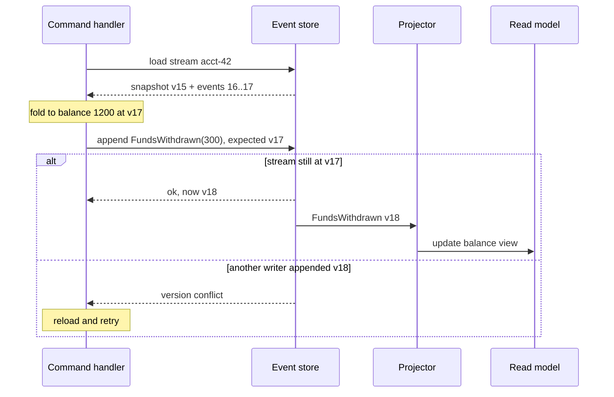

## In one minute
- Event sourcing stores every state change as an immutable event in an append-only log. Current state is derived by replaying (folding) the events, not read from a mutable row.
- You get a complete audit trail, the ability to answer "what was the state on March 3rd?", and the freedom to build new read models from history at any time.
- Writes use optimistic concurrency per stream: append only if the stream is still at the version you read. That replaces row locks.
- The costs are real: event schemas live forever, long streams need snapshots, queries need projections (usually CQRS), and deleting personal data needs a plan.

## How it works

### Streams, events, and versions
Each aggregate (an account, an order, a cart) has its own stream. Events are named in the past tense and carry business meaning: `FundsDeposited{amount: 500}`, not `BalanceUpdated{balance: 1200}`. Each event in a stream has a sequence number, so the stream's version is the number of the last event. Mistakes are not edited away: a wrong `FundsDeposited` is cancelled by a new compensating event such as `DepositReversed`, and both stay in the stream ([Azure Architecture Center](https://learn.microsoft.com/en-us/azure/architecture/patterns/event-sourcing)).

### Handling a command
To process `Withdraw(account 42, 300)`, the handler loads stream 42, folds its events into current state (balance 1,200 at version 17), checks the rule (balance must cover the withdrawal), and appends `FundsWithdrawn{300}` with **expected version 17**. If another writer appended version 18 in the meantime, the store rejects the append and the handler reloads and retries. This optimistic check is the only concurrency control needed, and it is scoped to one stream, so streams scale independently. It also explains why a message broker is not an event store: Kafka can fan events out, but it has no per-aggregate stream reads and no append-if-version check, so it cannot stop two writers from both spending the same balance ([Azure Architecture Center](https://learn.microsoft.com/en-us/azure/architecture/patterns/event-sourcing)). Use Kafka to distribute events, and a store with expected-version appends to decide them.

Testing follows the same shape: given these past events, when this command arrives, then expect these new events. Such tests need no database, but projections, idempotency and upcasters still need their own integration tests.

### Snapshots
Replaying 50,000 events on every command is slow. Periodically store a snapshot (state plus the version it reflects) and on load replay only the events after it. Snapshots are a cache: you can delete them and rebuild from events, so their format can change freely.

### Projections and queries
The event log is bad at queries like "all accounts overdrawn in Spain". Projectors subscribe to the global event feed and build read models, which is why event sourcing is nearly always paired with CQRS. Because the log is complete, you can add a new projection years later and backfill it by replaying from the start, or answer a temporal query by replaying only up to a chosen time ([Fowler](https://martinfowler.com/eaaDev/EventSourcing.html)).

### Schema evolution
Events are facts about the past and should not be rewritten. To evolve, add optional fields with defaults, or introduce a new event version and **upcast** old events to the new shape when reading. Never change the meaning of an existing field.

### Personal data
Immutable logs clash with deletion rights. The simplest fix is to keep personal data out of events entirely: store it in an ordinary table and put only a subject ID in the event, so deletion never touches the log. Where personal fields must be in events, use crypto-shredding: encrypt them with a per-subject key stored elsewhere, and delete the key to make the data unreadable. It costs encryption on every read and write and needs solid key management ([Azure Architecture Center](https://learn.microsoft.com/en-us/azure/architecture/patterns/event-sourcing)).

## Down the stack

### Layer 1: The contract
An event store promises that appended events are durable and immutable, that events within a stream have consecutive version numbers, and that an append with an expected version succeeds only if the stream is exactly at that version. It also exposes a global ordering across streams so subscribers can resume from a position without missing events. Reads of one stream return all its events in order. Nothing promises fast queries across streams; that is the projections' job.

### Layer 2: The mechanism
In a dedicated store such as EventStoreDB (renamed KurrentDB), events are appended to the end of the latest chunk file, and the server closes it and opens a new one once it grows past 256 MiB ([KurrentDB docs](https://docs.kurrent.io/server/v25.1/configuration/db-config.html)). Each event carries its stream ID, event number, and log position, with an index mapping streams to positions. Appends specify an expected state: a specific revision, or `no_stream`, `stream_exists` or `any` (no check) ([KurrentDB client docs](https://docs.kurrent.io/clients/node/v1.0/appending-events.html)). In Postgres, the common design is an `events` table with a unique constraint on `(stream_id, version)`; an append inserts rows with the next versions, and a concurrent writer gets a unique violation, which is the optimistic concurrency check. Global ordering needs care: a `bigserial` value is assigned before commit, so a later-numbered transaction can commit first and a subscriber reading by ID can skip an earlier one that commits a moment later. Waiting for the missing number does not work either, because a rolled-back transaction leaves a gap that is never filled. Solutions include a single writer (or an advisory lock held from allocation to commit), or storing each row's `xid8` transaction ID and reading only rows below `pg_snapshot_xmin(pg_current_snapshot())`, the oldest transaction still in flight ([Dudycz](https://event-driven.io/en/ordering_in_postgres_outbox/)).

### Layer 3: The machine
Appending is a sequential write plus `fsync` at commit: about 0.05 to 0.2 ms on local NVMe, often 1 to 5 ms on network-attached cloud volumes, so stores batch concurrent appends into one flush. KurrentDB flushes every write by default; turning that off trades durability for speed ([KurrentDB docs](https://docs.kurrent.io/server/v25.1/configuration/db-config.html)). Loading a stream is an index seek followed by a sequential range read; 500 events of 400 bytes is 200 KB, a few pages that are usually cached. Deserialising JSON at 500 events costs a fraction of a millisecond; a stream of 100,000 events costs tens of milliseconds and megabytes of allocation, which is what snapshots avoid. Storage grows forever, but at 3.5 TB per year on disks costing cents per GB-month, keeping history is cheap compared with losing it.

### Why it's built this way
1. History has business value and storage is cheap, so every change is kept instead of overwritten.
2. Sequential appends are the fastest write a disk can do, so the store is an append-only log.
3. Concurrent writers must not corrupt an aggregate, and locks across a network are fragile, so appends carry an expected version.
4. Replaying long streams costs I/O and CPU on every load, so snapshots cache folded state.
5. Querying a log is slow, so read models are projected into stores built for queries.

## Diagram


## Worked example
A digital wallet has 8 million accounts. Each account averages 3 events per day; heavy merchant accounts reach 2,000 per day. At an average of 400 bytes per event, daily ingest is about 24 million events, roughly 10 GB, and 3.5 TB per year before replication.

Loading a typical account means reading a few hundred events in one sequential range scan, under 5 ms. Merchant accounts would accumulate 700,000 events a year, so the system snapshots every 500 events. A load then reads one snapshot and at most 499 events.

Concurrency conflicts are rare for consumers but common for merchants, where 30 payments per second can hit the same stream. The team measures a 6% conflict rate at peak on the busiest merchant, with retries adding a median 4 ms. To cut contention they split the merchant ledger into per-day sub-streams and compute the balance from a projection, keeping the per-stream append rate low.

Two years later, compliance asks for a report of every account whose balance dipped below zero for more than an hour. Because every change is in the log, a new projector replays 17 billion events over a weekend, partitioned by account across 64 workers at about 2,000 events per second each, roughly 37 hours.

## In the wild
- **LMAX, 2011: an exchange that is its event log.** LMAX's retail trading platform kept all business state in memory on a single thread and processed about 6 million orders per second on one 3 GHz server. There was no database: input events were journaled to disk, a snapshot was taken every night, and a restart (JVM included) loaded the snapshot and replayed that day's journal in under a minute. Several replicas processed every event, so failover took microseconds ([martinfowler.com](https://martinfowler.com/articles/lmax.html)).
- **LangWatch, 2026: folding events against stale reads.** Migrating a live observability product to event sourcing on ClickHouse, the team saw trace summaries randomly reset to empty with no errors. Folds were loading prior state from a replica that had not yet received the latest write and applying new events to an empty state. Sequentially consistent reads cost 10 to 14 seconds; the fix was a Redis write-through cache of folded state, which cut each fold step from about 200 ms to 1.5 ms. The system now handles about 6,000 events per second ([LangWatch](https://langwatch.ai/blog/four-refactors-and-a-funeral-migrating-a-live-system-to-event-sourcing)).

## Trade-offs
| Option | Strengths | Weaknesses | Choose when |
|---|---|---|---|
| State-oriented storage (CRUD) | Simple, easy queries, mature tooling | History lost unless separately audited | Most business data |
| CRUD plus audit table or CDC | History for compliance, normal queries | Audit is secondary and can drift from intent | You need an audit trail but not replays |
| Event sourcing | Full history, temporal queries, new views from the past | Event versioning, projections, snapshots, learning curve | Ledgers, workflows, domains where history is the product |

## Pitfalls in production
- **Events as database diffs.** `RowUpdated{column: "status"}` events carry no business intent, so projections must reverse-engineer meaning. Model domain events.
- **Hot streams.** One aggregate receiving hundreds of writes per second produces constant version conflicts. Redesign aggregate boundaries or split streams by time or sub-entity.
- **Unbounded replays.** Loading a stream with a million events takes seconds. Snapshot on a fixed event count and monitor stream lengths.
- **Breaking event changes.** Renaming or repurposing a field breaks old projections and replays. Use upcasters and additive changes only, and keep a schema registry.
- **Side effects during replay.** Rebuilding a projection re-sends emails or re-charges cards. Keep side effects out of projectors, or put external calls behind a gateway that is switched off during replay and guarded by idempotency keys ([Fowler](https://martinfowler.com/eaaDev/EventSourcing.html)).

## Leadership lens
- Ask whether the business actually values history. If nobody will ever query the past, event sourcing is mostly cost.
- Insist on a schema evolution policy and an owner for event contracts before the first event ships.
- Plan GDPR and retention up front. Retrofitting crypto-shredding onto years of events is painful.
- Budget team learning time. Engineers new to the model commonly put logic in the wrong place or model events as CRUD diffs.

## Check yourself
1. Why does event sourcing not need row locks for concurrent writers on the same aggregate?
   **Answer:** Each append states the expected stream version, and the store rejects it if the stream moved on, so conflicting writers detect the race and retry with fresh state.
2. Can you delete all snapshots safely? Why?
   **Answer:** Yes. Snapshots are derived caches of the event stream, so state can always be rebuilt by replaying the events.
3. How do you change the shape of an event that has been stored for three years?
   **Answer:** Leave stored events untouched and add an upcaster that converts old versions to the new shape at read time, or add only optional fields with defaults.

## Practice
**Task:** Implement an in-memory event store for bank accounts. `append(stream, expected_version, events)` appends a list of `(kind, amount)` events, where `kind` is `"deposited"` or `"withdrawn"`; it raises `ValueError` if the stream's current version (its event count) differs from `expected_version`, and otherwise returns the new version. `balance(stream, at_version=None)` folds events into a balance, optionally only the first `at_version` events, for temporal queries. Unknown streams have version 0 and balance 0. Appending an empty list is allowed and changes nothing.

```python starter
class EventStore:
    def __init__(self):
        # TODO
        raise NotImplementedError

    def append(self, stream, expected_version, events):
        raise NotImplementedError

    def balance(self, stream, at_version=None):
        raise NotImplementedError
```

```python tests
def test_append_and_fold():
    s = EventStore()
    assert s.append("a", 0, [("deposited", 100), ("withdrawn", 30)]) == 2
    assert s.balance("a") == 70

def test_version_conflict():
    s = EventStore()
    s.append("a", 0, [("deposited", 100)])
    try:
        s.append("a", 0, [("deposited", 5)])
        assert False, "expected ValueError"
    except ValueError:
        pass
    assert s.balance("a") == 100

def test_temporal_query():
    s = EventStore()
    s.append("a", 0, [("deposited", 100)])
    s.append("a", 1, [("withdrawn", 40), ("deposited", 10)])
    assert s.balance("a", at_version=1) == 100
    assert s.balance("a", at_version=2) == 60
    assert s.balance("a") == 70

def test_streams_are_independent():
    s = EventStore()
    s.append("a", 0, [("deposited", 10)])
    assert s.append("b", 0, [("deposited", 99)]) == 1
    assert s.balance("a") == 10 and s.balance("b") == 99

def test_unknown_stream():
    assert EventStore().balance("zz") == 0

def test_empty_append():
    s = EventStore()
    assert s.append("a", 0, []) == 0
```

```python solution
class EventStore:
    def __init__(self):
        self.streams = {}

    def append(self, stream, expected_version, events):
        log = self.streams.setdefault(stream, [])
        if len(log) != expected_version:
            raise ValueError("version conflict")
        log.extend(events)
        return len(log)

    def balance(self, stream, at_version=None):
        log = self.streams.get(stream, [])
        if at_version is not None:
            log = log[:at_version]
        total = 0
        for kind, amount in log:
            total += amount if kind == "deposited" else -amount
        return total
```

```typescript starter
export type Ev = ["deposited" | "withdrawn", number];

export class EventStore {
  append(stream: string, expectedVersion: number, events: Ev[]): number {
    throw new Error("TODO");
  }
  balance(stream: string, atVersion?: number): number {
    throw new Error("TODO");
  }
}
```

```typescript tests
test("append and fold", () => {
  const s = new EventStore();
  assertEqual(s.append("a", 0, [["deposited", 100], ["withdrawn", 30]]), 2);
  assertEqual(s.balance("a"), 70);
});
test("version conflict", () => {
  const s = new EventStore();
  s.append("a", 0, [["deposited", 100]]);
  let threw = false;
  try { s.append("a", 0, [["deposited", 5]]); } catch (e) { threw = true; }
  assert(threw, "expected conflict");
  assertEqual(s.balance("a"), 100);
});
test("temporal query", () => {
  const s = new EventStore();
  s.append("a", 0, [["deposited", 100]]);
  s.append("a", 1, [["withdrawn", 40], ["deposited", 10]]);
  assertEqual(s.balance("a", 1), 100);
  assertEqual(s.balance("a", 2), 60);
  assertEqual(s.balance("a"), 70);
});
test("streams independent", () => {
  const s = new EventStore();
  s.append("a", 0, [["deposited", 10]]);
  assertEqual(s.append("b", 0, [["deposited", 99]]), 1);
  assertEqual([s.balance("a"), s.balance("b")], [10, 99]);
});
test("unknown stream", () => {
  assertEqual(new EventStore().balance("zz"), 0);
});
test("empty append", () => {
  assertEqual(new EventStore().append("a", 0, []), 0);
});
```

```typescript solution
export type Ev = ["deposited" | "withdrawn", number];

export class EventStore {
  private streams = new Map<string, Ev[]>();
  append(stream: string, expectedVersion: number, events: Ev[]): number {
    const log = this.streams.get(stream) ?? [];
    if (log.length !== expectedVersion) throw new Error("version conflict");
    log.push(...events);
    this.streams.set(stream, log);
    return log.length;
  }
  balance(stream: string, atVersion?: number): number {
    let log = this.streams.get(stream) ?? [];
    if (atVersion !== undefined) log = log.slice(0, atVersion);
    return log.reduce((sum, [kind, amt]) => sum + (kind === "deposited" ? amt : -amt), 0);
  }
}
```

```go starter
package practice

// Event is a deposit or withdrawal.
type Event struct {
	Kind   string // "deposited" or "withdrawn"
	Amount int
}

type EventStore struct{}

func NewEventStore() *EventStore { return &EventStore{} }

// Append returns the new version, or an error if expectedVersion is stale.
func (s *EventStore) Append(stream string, expectedVersion int, events []Event) (int, error) {
	panic("TODO")
}

// Balance folds the first atVersion events (all if atVersion < 0).
func (s *EventStore) Balance(stream string, atVersion int) int {
	panic("TODO")
}
```

```go tests
package practice

import "testing"

func TestAppendAndFold(t *testing.T) {
	s := NewEventStore()
	v, err := s.Append("a", 0, []Event{{"deposited", 100}, {"withdrawn", 30}})
	if err != nil || v != 2 || s.Balance("a", -1) != 70 {
		t.Fatalf("v=%d err=%v bal=%d", v, err, s.Balance("a", -1))
	}
}

func TestConflict(t *testing.T) {
	s := NewEventStore()
	s.Append("a", 0, []Event{{"deposited", 100}})
	if _, err := s.Append("a", 0, []Event{{"deposited", 5}}); err == nil {
		t.Fatal("expected conflict")
	}
	if s.Balance("a", -1) != 100 {
		t.Fatal("conflicting append must not apply")
	}
}

func TestTemporal(t *testing.T) {
	s := NewEventStore()
	s.Append("a", 0, []Event{{"deposited", 100}})
	s.Append("a", 1, []Event{{"withdrawn", 40}, {"deposited", 10}})
	if s.Balance("a", 1) != 100 || s.Balance("a", 2) != 60 || s.Balance("a", -1) != 70 {
		t.Fatal("temporal balances wrong")
	}
}

func TestIndependentStreams(t *testing.T) {
	s := NewEventStore()
	s.Append("a", 0, []Event{{"deposited", 10}})
	if v, _ := s.Append("b", 0, []Event{{"deposited", 99}}); v != 1 || s.Balance("a", -1) != 10 {
		t.Fatal("streams not independent")
	}
}

func TestUnknownAndEmpty(t *testing.T) {
	s := NewEventStore()
	if s.Balance("zz", -1) != 0 {
		t.Fatal("unknown stream should be 0")
	}
	if v, err := s.Append("a", 0, nil); v != 0 || err != nil {
		t.Fatal("empty append should succeed at version 0")
	}
}
```

```go solution
package practice

import "errors"

// Event is a deposit or withdrawal.
type Event struct {
	Kind   string // "deposited" or "withdrawn"
	Amount int
}

type EventStore struct {
	streams map[string][]Event
}

func NewEventStore() *EventStore { return &EventStore{streams: map[string][]Event{}} }

// Append returns the new version, or an error if expectedVersion is stale.
func (s *EventStore) Append(stream string, expectedVersion int, events []Event) (int, error) {
	log := s.streams[stream]
	if len(log) != expectedVersion {
		return len(log), errors.New("version conflict")
	}
	log = append(log, events...)
	s.streams[stream] = log
	return len(log), nil
}

// Balance folds the first atVersion events (all if atVersion < 0).
func (s *EventStore) Balance(stream string, atVersion int) int {
	log := s.streams[stream]
	if atVersion >= 0 && atVersion < len(log) {
		log = log[:atVersion]
	}
	total := 0
	for _, e := range log {
		if e.Kind == "deposited" {
			total += e.Amount
		} else {
			total -= e.Amount
		}
	}
	return total
}
```

## Mock interview
**Prompt:** Design the ledger for a payments company processing 5,000 transactions per second across 20 million accounts, with regulators requiring a full history and the ability to reconstruct any balance at any past time.

- Follow-up: A single marketplace account receives 500 credits per second. What breaks and how do you fix it?
- Follow-up: A customer invokes their right to erasure. How do you comply with an immutable log?
- Follow-up: How do you add a fraud-detection read model two years after launch?

**A strong answer covers:**
- Per-account streams with optimistic concurrency on expected version.
- Snapshots on a fixed event count, with stream length monitoring.
- Hot-aggregate mitigation: sub-streams, batching, or a different aggregate boundary.
- CQRS projections for queries and backfilling new views by replay.
- Event versioning with upcasters and a schema registry.
- Crypto-shredding or separate PII storage for erasure.

## Sources and further study
**Primary**
- [Martin Fowler, The LMAX Architecture (2011)](https://martinfowler.com/articles/lmax.html): event sourcing with in-memory state, nightly snapshots and journal replay at millions of events per second.
- [Oskar Dudycz, How Postgres sequences issues can impact your messaging guarantees (2022)](https://event-driven.io/en/ordering_in_postgres_outbox/): why `bigserial` positions skip events and the transaction-ID fix.

**Systems docs**
- [KurrentDB: database settings](https://docs.kurrent.io/server/v25.1/configuration/db-config.html): chunk files, flushing and verification on startup.
- [KurrentDB: appending events](https://docs.kurrent.io/clients/node/v1.0/appending-events.html): expected stream state and optimistic concurrency in a client.

**Books**
- *Designing Data-Intensive Applications* (2nd ed.), Martin Kleppmann and Chris Riccomini, Ch 3 "Data Models and Query Languages", section "Event Sourcing and CQRS"; in the 1st ed., Ch 11 "Stream Processing", section "Databases and Streams".
- *Clean Architecture* (1st ed.), Robert C. Martin, Ch 6 "Functional Programming", section "Event Sourcing": storing transactions instead of state as a way to segregate mutability.
- *Domain-Driven Design* (1st ed.), Eric Evans, Ch 6 "The Life Cycle of a Domain Object": aggregates, the consistency boundary that becomes one event stream.

**Other curricula**
- [roadmap.sh: System Design](https://roadmap.sh/system-design): a one-paragraph node (immutable events, replay, audit trail) that points to the Azure pattern page; nothing on concurrency, snapshots or schema evolution.
- [donnemartin/system-design-primer](https://github.com/donnemartin/system-design-primer): does not cover event sourcing; its closest material is message queues under "Asynchronism".

## Watch
- [Event Sourcing, Greg Young (GOTO 2014)](https://www.youtube.com/watch?v=8JKjvY4etTY): the mechanics and motivation from one of the pattern's main proponents.
- [A Decade of DDD, CQRS, Event Sourcing, Greg Young (DDD Europe)](https://www.youtube.com/watch?v=LDW0QWie21s): lessons and mistakes from ten years of real systems.

## Free resources
- [Event Sourcing (martinfowler.com)](https://martinfowler.com/eaaDev/EventSourcing.html): the canonical description with temporal queries and replays.
- [Event Sourcing pattern (Azure Architecture Center)](https://learn.microsoft.com/en-us/azure/architecture/patterns/event-sourcing): practical issues such as versioning, snapshots, and consistency.
- [Event sourcing (microservices.io)](https://microservices.io/patterns/data/event-sourcing.html): how the pattern fits with sagas and CQRS in microservices.
- [What is Event Sourcing? (Event Store blog)](https://www.eventstore.com/blog/what-is-event-sourcing): an introduction from the makers of a dedicated event database.
