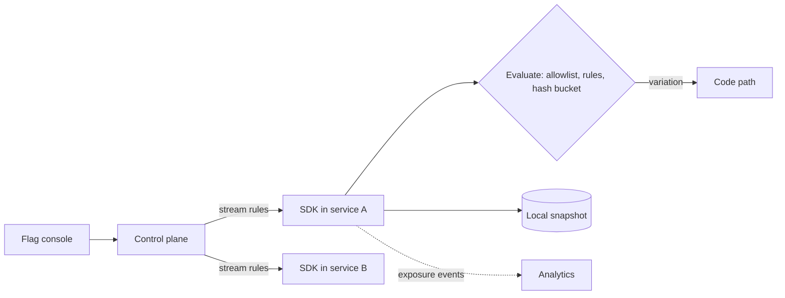

## In one minute
- A feature flag is a runtime decision point in code whose value comes from configuration, so behaviour can change without a deploy.
- Flags separate deploy (code reaches servers) from release (users see the behaviour). That makes trunk-based development and instant kill switches possible.
- Flags come in kinds with different lifetimes: release toggles (days to weeks), experiment toggles, ops toggles and kill switches (some long-lived), and permission toggles (can last years).
- Evaluation must be local and fast: SDKs cache rules in memory and stream updates, so a flag check costs microseconds and survives a flag-service outage.
- Every flag is a branch in your code. Without removal discipline, flags become the largest source of untested combinations.

## How it works

### The evaluation model
A flag has a key, variations, and ordered targeting rules: explicit user allowlists, attribute rules (`country == "DE"`, `plan == "enterprise"`), then a percentage rollout, then a default. The SDK receives the full rule set, evaluates it in-process against a context object (user id, tenant, region, app version), and returns a variation. Vendors have moved from "users" to typed contexts, so one flag can roll out by user, by organisation, or by device, each hashed on its own key and kind ([LaunchDarkly docs](https://launchdarkly.com/docs/home/releases/percentage-rollouts)).

Pete Hodgson's names for the parts are useful in design review: the toggle point is the `if` in your code, the toggle router decides, and the toggle configuration is the data the router reads ([martinfowler.com](https://martinfowler.com/articles/feature-toggles.html)). OpenFeature, a CNCF incubating project, standardises the router's API so the vendor behind it can be swapped through a provider ([OpenFeature](https://openfeature.dev/docs/reference/intro/)).

### Deterministic percentage rollout
Percentage rollouts hash a stable unit id together with the flag key, for example `hash(flag_key + ":" + user_id)`, map it to a bucket from 0 to 9,999, and enable the flag if the bucket is below the rollout threshold. Including the flag key decorrelates flags, so the same 10 percent of users are not always first. Because the bucket is fixed, raising the rollout from 10 to 20 percent keeps the first 10 percent enabled and adds new users. LaunchDarkly, for example, uses 100,000 buckets, so a rollout can be set to three decimal places of a percent, and widening variation A from 50 to 70 percent simply adds buckets 50,001 to 70,000 ([LaunchDarkly docs](https://launchdarkly.com/docs/home/releases/percentage-rollouts)).

### Delivery
A control plane streams flag definitions to SDKs, with polling as a fallback; changes propagate in about a second. Servers bootstrap from a local snapshot or relay proxy so a flag-service outage does not block startup. Browser and mobile SDKs receive evaluated values for one user, not the rules, to avoid leaking targeting data.

### Defaults and failure
Every call site supplies a default used when the SDK has no data. Pick it deliberately: usually the old behaviour, but for a kill switch the safe default is "feature running".

### Lifecycle
Each flag gets an owner and expiry. Report stale flags (100 percent for 30 days, or unevaluated for 30 days) and make removal part of done. Tools encode this per kind: Unleash expects release and experiment flags to live 40 days and operational flags 7, treats kill switch and permission flags as permanent, and marks a flag "potentially stale" once it outlives its type ([Unleash docs](https://docs.getunleash.io/concepts/feature-flags)). Hodgson goes further and suggests "time bombs": a test that fails once a flag passes its expiry date ([martinfowler.com](https://martinfowler.com/articles/feature-toggles.html)).

You cannot test every combination of 50 flags. Test the configuration you expect in production, the fallback with the new flags off, and optionally everything on ([martinfowler.com](https://martinfowler.com/articles/feature-toggles.html)).

## Down the stack
### Layer 1: The contract
A flag SDK promises that evaluation is deterministic for a given rule-set version and context, never throws, and always returns a variation, falling back to the caller's default on any error. OpenFeature writes this down as a requirement: client methods must not throw, and abnormal execution returns the default with an error code and reason in the evaluation details ([OpenFeature spec 1.4](https://openfeature.dev/specification/sections/flag-evaluation)). Updates are eventually consistent: a change reaches most processes within a few seconds, with no ordering guarantee across flags and no atomic multi-flag change. A process that loses its connection keeps serving its last known rules.

### Layer 2: The mechanism
The SDK keeps an in-memory map from flag key to a parsed rule set with a version number. Updates usually arrive over Server-Sent Events: a `put` event carries the full data set on connect, `patch` events carry one flag with its new version, and `delete` events leave a versioned tombstone ([LaunchDarkly Go SDK](https://github.com/launchdarkly/go-server-sdk/blob/v7/internal/datasource/streaming_data_source.go)). The SDK applies a patch only if its version is higher than the stored one, which makes out-of-order delivery harmless. Evaluation walks prerequisites, individual targets, then rules made of clauses (`in`, `startsWith`, `semVerGreaterThan`), then a fallthrough rollout. One widely used SDK computes the bucket by joining `flagKey.salt.contextKey`, taking the first 15 hex digits of its SHA-1, dividing by 16^15 - 1, and comparing against weights expressed in units of 1/100,000; experiments can replace the key and salt with a fixed seed ([LaunchDarkly evaluator](https://github.com/launchdarkly/go-server-sdk-evaluation/blob/v3/evaluator_bucketing.go)). Exposure events are counted in memory and flushed in batches every few seconds.

### Layer 3: The machine
Two thousand flags at about 2 KB each is 4 MB of rules per process. An evaluation is a hash map lookup, a few string comparisons, and one hash over roughly 40 bytes, a few hundred nanoseconds. Updates swap a pointer to a new immutable map (copy on write), so readers never take a lock on the hot path. Each SSE stream is a long-lived HTTP connection, so 10,000 pods mean 10,000 open sockets on the flag service. After an outage they all reconnect and each pulls the full 4 MB payload, 40 GB in a burst, which is why SDKs reconnect with jittered exponential backoff and large fleets put relay proxies in each cluster, so thousands of local connections share one upstream stream ([LaunchDarkly Relay Proxy](https://launchdarkly.com/docs/sdk/relay-proxy)). One Go SDK starts its reconnect delay at 1 second, caps it at 30, and applies 50 percent jitter ([LaunchDarkly Go SDK](https://github.com/launchdarkly/go-server-sdk/blob/v7/internal/datasource/streaming_data_source.go)).

### Why it's built this way
Flags sit on hot paths, so evaluation must be local. Network partitions are normal, so stale but available beats failing. Messages can be reordered or replayed, so each flag carries a version. Fan-out to thousands of processes is expensive, so relays and backoff protect the control plane.

## Diagram


## Worked example
A service handles 15,000 RPS and each request checks 12 flags. That is 180,000 evaluations per second per fleet. In-process evaluation with a hash and a few comparisons costs about 1 to 2 microseconds, so the total is under half a CPU core across the fleet. A remote call per evaluation at 1 ms each would add 12 ms per request and 180,000 calls per second to a flag service, which is why remote evaluation is a design error.

Rollout of a new pricing page: employees on day 1, then 1 and 10 percent of users. On day 4 a bug appears for a legacy currency. A rule `currency == "XYZ" -> off` propagates in a second with no deploy. Full rollout follows on day 7, and the flag and old path are deleted the next sprint.

The cost side: 400 engineers creating 15 flags each per year and removing none gives 6,000 live flags, an untestable space. Expiry policies keep the count in the low hundreds. Microsoft's Azure DevOps team uses a blunter nudge: one XML file of flag definitions per service, so a growing file motivates its owners to delete old flags ([Microsoft Learn](https://learn.microsoft.com/en-us/devops/operate/progressive-experimentation-feature-flags)).

## In the wild
- **Knight Capital, 2012: a repurposed flag wakes dead code.** New order-routing code reused a flag that once enabled "Power Peg", logic retired since 2003, and a technician copied the code to only seven of eight servers. Orders carrying the flag hit the eighth server, which still ran Power Peg, and removing the new code from the other seven made them run it too. In about 45 minutes Knight got 4 million executions in 154 stocks and lost more than $460 million. The SEC noted there was no written deploy procedure and no second-person review ([SEC order](https://www.sec.gov/litigation/admin/2013/34-70694.pdf)).
- **Google Cloud, 2025: the missing flag.** A Service Control quota check added on 29 May had no error handling and was "not feature flag protected". On 12 June a policy row with blank fields replicated worldwide and crash-looped the binary in every region, returning 503s across Google Cloud APIs. The red button was ready in about 25 minutes and fully rolled out in about 40, but us-central1 took up to about 2 h 40 min to recover. Google now requires changes to critical binaries to be flag-protected and off by default ([Google Cloud](https://status.cloud.google.com/incidents/ow5i3PPK96RduMcb1SsW)).
- **Cloudflare, 2025: no switch for a generated file.** A ClickHouse permissions change made the Bot Management feature file, rebuilt every five minutes, roughly double and pass the proxy's 200-feature limit (about 60 were in use). Core traffic failed from 11:20 UTC until about 14:30, with full recovery at 17:06. Among the fixes: "enabling more global kill switches for features" ([Cloudflare](https://blog.cloudflare.com/18-november-2025-outage/)).

## Trade-offs
| Option | Strengths | Weaknesses | Choose when |
| --- | --- | --- | --- |
| Config file flags in the repo | Simple, reviewed, versioned | Needs a deploy or config push to change | Few flags, low change frequency |
| Hosted or self-run flag service with streaming SDKs | Instant changes, targeting, audit log | Another critical dependency, vendor cost | Many teams, frequent releases |
| Database-backed homegrown flags | Full control | Easy to build remote-per-call evaluation and no audit | Strong platform team, special needs |
| Branch-based releases (no flags) | No runtime branches | Long-lived branches, painful merges, no kill switch | Very small codebases |

## Pitfalls in production
- Flag checks that call a remote service on every request add latency and create an outage dependency. Evaluate locally from a cached rule set.
- Stale flags pile up and an old flag gets flipped by accident, reviving dead code. Enforce owners, expiry dates, and deletion.
- Inconsistent evaluation across services when one sees the new value seconds before another. Pass the evaluated decision along with the request when consistency matters.
- Unsafe defaults: if the SDK fails to load, the feature turns on for everyone. Choose defaults deliberately per flag.
- Flag changes with no audit trail make incident review guesswork. Log who changed what, and show flag changes on dashboards.
- Reusing an old flag key for new behaviour lets any server still running old code interpret it the old way. Retire keys for good and delete the dead code path with the flag.
- Risky new code paths ship without a flag because "it is only a check". Guard every change to a critical binary, defaulting to off, so the kill switch exists before you need it.

## Leadership lens
- Decide flag kinds and their maximum lifetimes; release toggles older than a quarter should page their owner.
- Treat the flag system as tier-zero: it can change production behaviour instantly, so restrict who can change which flags.
- Ask in review: what is the default if flags fail to load, and when will this flag be removed?

## Check yourself
1. Why hash the flag key together with the user id instead of the user id alone?
   **Answer:** Hashing the user id alone places the same users in the lowest buckets for every flag, so a small group would always get every new feature first. Including the flag key gives each flag an independent assignment.
2. Why does deterministic hashing matter when raising a rollout from 10 to 20 percent?
   **Answer:** The users below the old threshold stay below the new one, so nobody who had the feature loses it, and only new users are added.
3. What should happen if the flag service is down when a pod starts?
   **Answer:** The SDK should load the last known snapshot or a relay proxy copy and fall back to safe defaults otherwise, so the service starts and behaves predictably.
4. How is a kill switch different from a release toggle?
   **Answer:** A kill switch is long-lived and meant for operators to shed or disable functionality in incidents; a release toggle is temporary and removed after rollout.

## Practice
**Task:** Write `evaluate(flag, ctx)` for a flag dict with keys `key`, `enabled` (bool kill switch), `allow` (list of user ids always on), `rules` (list of `[attribute, value, result]` checked in order), and `rollout` (0 to 100). Return False if `enabled` is false. Otherwise return True if the user id is in `allow`, the result of the first rule whose attribute equals the value in `ctx`, else True if the user's bucket is below `rollout * 100`. Write `bucket(key, user_id)` too: the 32-bit FNV-1a hash of the UTF-8 string `key + ":" + user_id`, modulo 10,000 (start at 2166136261; for each byte, XOR it in, then multiply by 16777619 modulo 2^32). Production SDKs use SHA-1 or MurmurHash; FNV-1a keeps the exercise dependency-free.

```python starter
def bucket(key, user_id):
    raise NotImplementedError

def evaluate(flag, ctx):
    raise NotImplementedError
```

```python tests
def make(rollout, **kw):
    f = {"key": "new-ui", "enabled": True, "allow": [], "rules": [], "rollout": rollout}
    f.update(kw)
    return f

def test_kill_switch_wins():
    assert evaluate(make(100, enabled=False, allow=["u1"]), {"user_id": "u1"}) is False

def test_allowlist():
    assert evaluate(make(0, allow=["u1"]), {"user_id": "u1"}) is True

def test_rule_before_rollout():
    f = make(100, rules=[["country", "DE", False]])
    assert evaluate(f, {"user_id": "u2", "country": "DE"}) is False
    assert evaluate(f, {"user_id": "u2", "country": "FR"}) is True

def test_bucket_range_and_stability():
    b = bucket("new-ui", "u9")
    assert 0 <= b < 10000 and b == bucket("new-ui", "u9")

def test_rollout_is_monotonic():
    users = ["u" + str(i) for i in range(500)]
    at10 = set(u for u in users if evaluate(make(10), {"user_id": u}))
    at20 = set(u for u in users if evaluate(make(20), {"user_id": u}))
    assert at10 <= at20 and 20 < len(at10) < 80

def test_zero_and_full():
    assert evaluate(make(0), {"user_id": "x"}) is False
    assert evaluate(make(100), {"user_id": "x"}) is True
```

```python solution
def bucket(key, user_id):
    h = 2166136261
    for b in (key + ":" + user_id).encode():
        h = ((h ^ b) * 16777619) & 0xFFFFFFFF
    return h % 10000

def evaluate(flag, ctx):
    if not flag["enabled"]:
        return False
    uid = ctx["user_id"]
    if uid in flag["allow"]:
        return True
    for attr, value, result in flag["rules"]:
        if ctx.get(attr) == value:
            return result
    return bucket(flag["key"], uid) < flag["rollout"] * 100
```

```typescript starter
export interface Flag {
  key: string;
  enabled: boolean;
  allow: string[];
  rules: [string, string, boolean][];
  rollout: number;
}

export function bucket(key: string, userId: string): number {
  throw new Error("TODO");
}

export function evaluate(flag: Flag, ctx: Record<string, string>): boolean {
  throw new Error("TODO");
}
```

```typescript tests
function make(rollout: number, extra: Partial<Flag> = {}): Flag {
  return { key: "new-ui", enabled: true, allow: [], rules: [], rollout: rollout, ...extra };
}

test("kill switch wins", () => {
  assertEqual(evaluate(make(100, { enabled: false, allow: ["u1"] }), { user_id: "u1" }), false);
});

test("allowlist", () => {
  assertEqual(evaluate(make(0, { allow: ["u1"] }), { user_id: "u1" }), true);
});

test("rule before rollout", () => {
  const f = make(100, { rules: [["country", "DE", false]] });
  assertEqual(evaluate(f, { user_id: "u2", country: "DE" }), false);
  assertEqual(evaluate(f, { user_id: "u2", country: "FR" }), true);
});

test("bucket range and stability", () => {
  const b = bucket("new-ui", "u9");
  assert(b >= 0 && b < 10000 && b === bucket("new-ui", "u9"), "bad bucket");
});

test("rollout is monotonic", () => {
  const users: string[] = [];
  for (let i = 0; i < 500; i++) users.push("u" + i);
  const at10 = users.filter((u) => evaluate(make(10), { user_id: u }));
  const at20 = new Set(users.filter((u) => evaluate(make(20), { user_id: u })));
  assert(at10.every((u) => at20.has(u)), "lost users when widening");
  assert(at10.length > 20 && at10.length < 80, "distribution off");
});

test("zero and full", () => {
  assertEqual(evaluate(make(0), { user_id: "x" }), false);
  assertEqual(evaluate(make(100), { user_id: "x" }), true);
});
```

```typescript solution
export interface Flag {
  key: string;
  enabled: boolean;
  allow: string[];
  rules: [string, string, boolean][];
  rollout: number;
}

export function bucket(key: string, userId: string): number {
  const s = key + ":" + userId;
  let h = 2166136261;
  for (let i = 0; i < s.length; i++) {
    h = Math.imul(h ^ s.charCodeAt(i), 16777619) >>> 0;
  }
  return h % 10000;
}

export function evaluate(flag: Flag, ctx: Record<string, string>): boolean {
  if (!flag.enabled) return false;
  const uid = ctx["user_id"];
  if (flag.allow.includes(uid)) return true;
  for (const [attr, value, result] of flag.rules) {
    if (ctx[attr] === value) return result;
  }
  return bucket(flag.key, uid) < flag.rollout * 100;
}
```

```go starter
package practice

type Rule struct {
	Attr, Value string
	Result      bool
}

type Flag struct {
	Key     string
	Enabled bool
	Allow   []string
	Rules   []Rule
	Rollout int
}

func Bucket(key, userID string) int { panic("TODO") }

func Evaluate(f Flag, ctx map[string]string) bool { panic("TODO") }
```

```go tests
package practice

import (
	"strconv"
	"testing"
)

func make10(rollout int) Flag { return Flag{Key: "new-ui", Enabled: true, Rollout: rollout} }

func TestKillSwitch(t *testing.T) {
	f := Flag{Key: "new-ui", Enabled: false, Allow: []string{"u1"}, Rollout: 100}
	if Evaluate(f, map[string]string{"user_id": "u1"}) {
		t.Fatal("kill switch should win")
	}
}

func TestAllowlist(t *testing.T) {
	f := Flag{Key: "new-ui", Enabled: true, Allow: []string{"u1"}}
	if !Evaluate(f, map[string]string{"user_id": "u1"}) {
		t.Fatal("allowlisted user should be on")
	}
}

func TestRuleBeforeRollout(t *testing.T) {
	f := Flag{Key: "new-ui", Enabled: true, Rules: []Rule{{"country", "DE", false}}, Rollout: 100}
	if Evaluate(f, map[string]string{"user_id": "u2", "country": "DE"}) {
		t.Fatal("rule should turn it off")
	}
	if !Evaluate(f, map[string]string{"user_id": "u2", "country": "FR"}) {
		t.Fatal("rollout should turn it on")
	}
}

func TestBucket(t *testing.T) {
	b := Bucket("new-ui", "u9")
	if b < 0 || b >= 10000 || b != Bucket("new-ui", "u9") {
		t.Fatalf("bad bucket %d", b)
	}
}

func TestMonotonic(t *testing.T) {
	count := 0
	for i := 0; i < 500; i++ {
		ctx := map[string]string{"user_id": "u" + strconv.Itoa(i)}
		on10 := Evaluate(make10(10), ctx)
		if on10 && !Evaluate(make10(20), ctx) {
			t.Fatal("user lost when widening")
		}
		if on10 {
			count++
		}
	}
	if count <= 20 || count >= 80 {
		t.Fatalf("distribution off: %d", count)
	}
}

func TestZeroAndFull(t *testing.T) {
	ctx := map[string]string{"user_id": "x"}
	if Evaluate(make10(0), ctx) || !Evaluate(make10(100), ctx) {
		t.Fatal("0 and 100 percent wrong")
	}
}
```

```go solution
package practice

type Rule struct {
	Attr, Value string
	Result      bool
}

type Flag struct {
	Key     string
	Enabled bool
	Allow   []string
	Rules   []Rule
	Rollout int
}

func Bucket(key, userID string) int {
	h := uint32(2166136261)
	for _, b := range []byte(key + ":" + userID) {
		h ^= uint32(b)
		h *= 16777619
	}
	return int(h % 10000)
}

func Evaluate(f Flag, ctx map[string]string) bool {
	if !f.Enabled {
		return false
	}
	uid := ctx["user_id"]
	for _, a := range f.Allow {
		if a == uid {
			return true
		}
	}
	for _, r := range f.Rules {
		if v, ok := ctx[r.Attr]; ok && v == r.Value {
			return r.Result
		}
	}
	return Bucket(f.Key, uid) < f.Rollout*100
}
```

## Mock interview
**Prompt:** Design a feature flag platform for 60 services and 500 engineers, handling 2 million flag evaluations per second at peak. Flags must change within 5 seconds and the platform must not become a single point of failure.

- Follow-up: How do SDKs get updates, and what happens during a control-plane outage?
- Follow-up: How do you stop thousands of stale flags from accumulating?
- Follow-up: How would you support a mobile app without shipping all targeting rules to the client?

**A strong answer covers:**
- Local in-process evaluation with streamed rule sets and local snapshots.
- Deterministic hashing with the flag key as salt for stable percentage rollouts.
- Relay proxies or edge caches to fan out updates and survive control-plane outages.
- Flag kinds, owners, expiry, stale-flag reports, and deletion in the definition of done.
- Access control and audit logs for flag changes, and server-side evaluation for clients.

## Sources and further study
**Primary**
- [OpenFeature specification: flag evaluation](https://openfeature.dev/specification/sections/flag-evaluation): the vendor-neutral contract, including "must not throw" and evaluation details.
- [LaunchDarkly evaluator bucketing source](https://github.com/launchdarkly/go-server-sdk-evaluation/blob/v3/evaluator_bucketing.go): the exact hash, salt and seed handling of a production SDK.
- [SEC order on Knight Capital (2013)](https://www.sec.gov/litigation/admin/2013/34-70694.pdf): the regulator's account of a repurposed flag and a partial deploy.

**Systems docs**
- [LaunchDarkly: percentage rollouts](https://launchdarkly.com/docs/home/releases/percentage-rollouts): 100,000 buckets, contexts and stickiness when widening.
- [Unleash: feature flag types](https://docs.getunleash.io/concepts/feature-flags): expected lifetimes per kind and automatic stale marking.
- [LaunchDarkly: Relay Proxy](https://launchdarkly.com/docs/sdk/relay-proxy): fanning one upstream stream out to many local SDKs.

**Books**
- *Software Engineering at Google*, Winters, Manshreck and Wright, chapter 24 "Continuous Delivery": flag-guarding every change and change-neutral releases.
- *Accelerate*, Forsgren, Humble and Kim, chapter 4 "Technical Practices": trunk-based development, which flags make possible.
- *The Site Reliability Workbook*, Beyer et al., chapter 16 "Canarying Releases": how staged exposure and flags fit together.

**Other curricula**
- [Azure Well-Architected: safe deployment practices](https://learn.microsoft.com/en-us/azure/well-architected/operational-excellence/safe-deployments): frames flags as one tool for progressive exposure and fast rollback inside a gated rollout.
- [Microsoft Learn: progressive experimentation with feature flags](https://learn.microsoft.com/en-us/devops/operate/progressive-experimentation-feature-flags): the Azure DevOps team's own practice of deploy versus exposure, stages and flag review each sprint.

## Watch
- [Feature Flags Suck! The Problems With Feature Flagging and How To Avoid Them (Pete Hodgson, CNCF)](https://www.youtube.com/watch?v=MDERgrcaT6w): the failure modes of flag sprawl and how to manage them.
- [Feature flags: the toggle, the A/B test and the canary (Santosh Hari, NDC Oslo 2020)](https://www.youtube.com/watch?v=FD5fX02QCmY): how one mechanism supports release, experiment, and canary use cases.

## Free resources
- [Feature Toggles (aka Feature Flags), Pete Hodgson on martinfowler.com](https://martinfowler.com/articles/feature-toggles.html): the standard taxonomy of toggle kinds and how to manage each.
- [OpenFeature introduction](https://openfeature.dev/docs/reference/intro/): a vendor-neutral API for flag evaluation and its concepts of providers and context.
- [CanaryRelease (Martin Fowler)](https://martinfowler.com/bliki/CanaryRelease.html): how flags and canaries complement each other.
