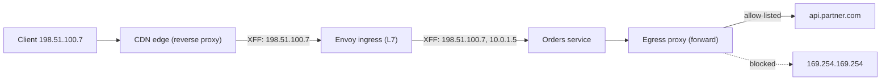

## In one minute
- Both are intermediaries that end one connection and open another. The difference is whom they act for: a forward proxy acts for clients and is chosen by the client side; a reverse proxy acts for servers, and clients believe it is the origin.
- Reverse proxies (NGINX, HAProxy, Envoy, cloud load balancers, CDN edges) are where TLS termination, routing, load balancing, retries, buffering, caching and rate limiting live.
- Forward proxies matter in system design mainly as egress control: allow-listing and auditing outbound calls, and stopping server-side request forgery from webhooks, URL fetchers and AI agent tools.
- Because the proxy is the backend's peer, the client's address is lost. `X-Forwarded-For`, `Forwarded` or the PROXY protocol restore it, and they can be trusted only from hops you control.
- Every proxy is a hop with its own timeouts, retries, buffers and connection pools. Most proxy incidents come from those settings disagreeing across layers.

## How it works

### Same mechanism, different principal
Mechanically both accept a connection, read a request, open or reuse a connection elsewhere, and relay. What differs is who configured it and whom it serves. A forward proxy sits near clients (a corporate gateway, a scraper's proxy pool, your services' egress proxy) and the destination sees the proxy's address. A reverse proxy sits near servers and owns the public hostname; the client cannot tell how many servers, regions or versions are behind it.

### Forward proxies and egress control
An explicit forward proxy is configured in the client (`HTTPS_PROXY`). For HTTPS the client sends `CONNECT api.partner.com:443`, the proxy opens a TCP connection and then blindly relays bytes, so it sees the destination host but not the content, unless it intercepts TLS with its own trusted CA, which corporate gateways do. A transparent proxy intercepts traffic without client configuration, usually by routing rules.

In backend systems, the important use is an egress proxy. Any feature that fetches a user-supplied URL (webhooks, link previews, an AI agent's browse tool) can be tricked into calling `http://169.254.169.254/` and leaking cloud credentials. On AWS, requiring IMDSv2 blunts the simplest version, because a session token must first be fetched with a `PUT` that most URL fetchers never send; the setting can be made the account default and enforced for every new instance ([AWS](https://docs.aws.amazon.com/AWSEC2/latest/UserGuide/configuring-IMDS-new-instances.html)). It does not help against other internal services, so the egress proxy is still needed. An egress proxy such as Stripe's Smokescreen resolves the hostname itself, refuses private and link-local addresses, applies a per-service allow-list, and logs every call. Resolving inside the proxy is what defeats DNS rebinding, where a name resolves to a public address at check time and a private one at connect time. This is the "trust but verify" shape: the same control applies to an agent calling tools and to a payment service calling a bank.

### What a reverse proxy does
- **TLS termination and routing** by host, path, header or SNI to upstream clusters.
- **Load balancing and health checks**, active (probes) and passive (outlier detection on real errors).
- **Connection pooling:** 20,000 client connections become a few hundred warm upstream connections.
- **Buffering:** read a slow client's whole request before bothering the app, and absorb a fast upstream response so the app worker is freed while the proxy trickles bytes to a slow phone.
- **Caching, compression, rate limiting, authentication and access logs**, done once instead of in every service.

### Restoring client identity
The backend sees the proxy's address. HTTP proxies append the address they received the connection from to `X-Forwarded-For`, so after two hops it reads `client, edge` and the backend's peer is the second proxy. `X-Forwarded-Proto` and `X-Forwarded-Host` carry the original scheme and host, and RFC 7239 standardises all of this as `Forwarded: for=...;proto=...` ([RFC 7239](https://www.rfc-editor.org/rfc/rfc7239.html)). Layer 4 proxies, which do not parse HTTP, use the PROXY protocol: a short header at the very start of the TCP stream carrying the original addresses and ports, in a text form (v1) or a binary form with optional TLV fields (v2) ([HAProxy spec](https://www.haproxy.org/download/2.9/doc/proxy-protocol.txt)).

Any client can send its own `X-Forwarded-For`. The safe rule is to walk the list from the right, skipping addresses of proxies you trust, and take the first untrusted one. The leftmost entry is whatever the client chose to write.

### Layer 4 versus layer 7
A layer 4 proxy forwards TCP or UDP byte streams, chooses a backend per connection and can pass TLS through untouched. It is cheap and protocol-agnostic but blind to requests. A layer 7 proxy parses HTTP, so it can route per request, retry, cache and rewrite, at the cost of terminating TLS and spending CPU on parsing.

## Down the stack

### Layer 1: The contract
A reverse proxy promises the client the origin's HTTP semantics. It must strip hop-by-hop headers and may add `Via`. RFC 9110, which replaced RFC 7230 in 2022, requires removing `Connection` and every header it names, and lists `Proxy-Connection`, `Keep-Alive`, `TE`, `Transfer-Encoding` and `Upgrade` as fields to drop ([RFC 9110](https://www.rfc-editor.org/rfc/rfc9110.html)); most proxies also strip the proxy authentication headers and `Trailer`, as the older RFC 2616 list did. Its own failures have distinct codes: 502 when the upstream sent an invalid response or the connection failed, 503 when no healthy upstream exists, 504 when the upstream did not answer in time. Retries are safe only when the method is idempotent or the request was never sent; NGINX's `proxy_next_upstream` has not retried POST, LOCK or PATCH once sent since 1.9.13 unless told to with `non_idempotent` ([NGINX proxy module](https://nginx.org/en/docs/http/ngx_http_proxy_module.html)).

### Layer 2: The mechanism
NGINX runs a master process and one single-threaded worker per core. Each worker runs an `epoll` event loop over thousands of connections and keeps its own pool of idle upstream connections (`keepalive 32` in an `upstream` block). For most of NGINX's history upstream keep-alive had to be switched on by hand, with `proxy_http_version 1.1` and an empty `Connection` header, because the default upstream protocol was HTTP/1.0 with a new connection per request. That changed in 1.29.7 (March 2026, now in the 1.30 stable line): upstream keep-alive is on by default (`keepalive 32 local`), the default proxy protocol is HTTP/1.1, and the `Connection` header is no longer sent ([NGINX changes](https://nginx.org/en/CHANGES)). Older configs and older builds still behave the old way, so check the version before trusting the default.

Envoy organises everything as a pipeline ([Envoy terminology](https://www.envoyproxy.io/docs/envoy/latest/intro/arch_overview/intro/terminology)). A *listener* accepts connections; *listener filters* such as the TLS inspector peek at SNI and ALPN; a *filter chain* is selected; the HTTP connection manager network filter parses HTTP/1.1, 2 or 3 and runs *HTTP filters* (authentication, rate limiting, and finally the router); the router picks a *cluster*, a load-balancing policy chooses an endpoint, and a per-worker connection pool supplies the connection. A main thread receives configuration from a control plane over xDS (listeners, routes, clusters and endpoints) and publishes read-only snapshots to workers through thread-local storage, so the request path takes no locks ([Envoy threading model](https://www.envoyproxy.io/docs/envoy/latest/intro/arch_overview/intro/threading_model)).

### Layer 3: The machine
Each proxied request holds two sockets and, with TLS on both sides, two sessions, so a proxy serving 100,000 concurrent clients needs file-descriptor limits above 200,000. Every byte crosses the kernel twice; a layer 4 proxy can use `splice` to move data between sockets without copying into user space, while a layer 7 proxy must copy to parse. NGINX's default response buffers are 8 x 4 or 8 KB per connection, and larger responses spill to temporary files on disk. Inside one data centre a proxy hop adds roughly 0.1 to 0.5 ms. Without upstream keep-alive, one proxy talking to one backend address can open at most about 28,000 connections (Linux's default ephemeral range is 32768 to 60999 ([kernel docs](https://docs.kernel.org/networking/ip-sysctl.html))) per 60-second `TIME_WAIT` period, roughly 470 new connections per second, before it runs out of ephemeral ports. With `SO_REUSEPORT`, the kernel spreads new connections across workers' listening sockets instead of waking every worker for each one.

### Why it's built this way
1. Clients should not know the server topology, so one stable entry point hides scaling, deploys and failures.
2. That entry point sees every request, so cross-cutting work (TLS, auth, limits, logs) is cheapest there.
3. Application workers are expensive and slow clients hold them hostage, so the proxy buffers and multiplexes.
4. Terminating connections loses the client's identity, so forwarding headers and the PROXY protocol exist, with trust rules.
5. Fleet configuration changes constantly, so Envoy takes it over an API (xDS) rather than from files and reloads.

## Diagram


## Worked example
A media API returns 500 KB responses to mobile clients averaging 50 KB/s, with 20,000 downloads in flight. Each app instance has 200 worker threads.

Without proxy buffering, a worker writes until the client's TCP window fills and then waits, so each request occupies a worker for about 10 seconds. Serving 20,000 concurrent downloads needs 100 instances doing almost nothing. With buffering, the app writes 500 KB to the proxy over the data-centre network in about 5 ms and moves on, and the proxy streams to the phone. The app needs a handful of instances; the proxy needs memory for buffered bodies, so you size buffers for typical responses (here 64 KB in memory, the rest spilling to disk) rather than holding 20,000 x 500 KB = 10 GB in RAM.

Second issue: the proxy forwards 5,000 requests per second to one backend address with upstream keep-alive off. It opens 5,000 connections per second, each leaving a `TIME_WAIT` entry for 60 seconds, and exhausts its 28,000 ephemeral ports in under 6 seconds; requests fail with `EADDRNOTAVAIL` and the proxy returns 502. Enabling `keepalive 64` with HTTP/1.1 upstream drops new connections to a few per second. On NGINX 1.29.7 and later this is the default behaviour, but the default pool of 32 idle connections per worker may still be too small for 5,000 requests per second, so size it from the request rate and latency.

## In the wild
- **Cloudflare, 2017: Cloudbleed.** A reverse-proxy HTML parser checked the end of its buffer with `==` instead of `>=`, so on malformed pages it read past the buffer and wrote memory from other requests into responses. Leaks were possible from 22 September 2016; at the peak, 13 to 18 February 2017, about 1 request in 3.3 million was affected. Cloudflare disabled the trigger feature 47 minutes after Google's report and finished the global fix in under 7 hours ([Cloudflare](https://blog.cloudflare.com/incident-report-on-memory-leak-caused-by-cloudflare-parser-bug/)).
- **Slack, 2020: HAProxy's backend list goes stale.** HAProxy had a fixed number of server slots per zone, filled through its runtime API by a sync program. After autoscaling added about 75% more web instances, the program tried to fill new slots before freeing dead ones, failed, and stopped updating. When evening scale-down removed the old instances HAProxy still pointed at, users got 503s. A rolling HAProxy restart fixed it, and Slack moved ingress toward Envoy with xDS ([Slack](https://slack.engineering/a-terrible-horrible-no-good-very-bad-day-at-slack/)).
- **Cloudflare, 2025: a doubled config file panics the new proxy.** A database permissions change made a query return duplicate rows, doubling the Bot Management feature file pushed to every machine. The file passed the module's preallocated 200-feature limit, the Rust FL2 proxy panicked and served 5xx, while the older FL proxy kept running but scored every request as a bot. Main impact lasted about three hours, with full recovery about six hours after the change; follow-ups treat internal config like user input and add global kill switches ([Cloudflare](https://blog.cloudflare.com/18-november-2025-outage/)).

## Trade-offs
| Option | Strengths | Weaknesses | Choose when |
| --- | --- | --- | --- |
| Explicit forward proxy | Central egress allow-lists and audit, SSRF defence | Every client must be configured; a bypass path defeats it | Outbound calls to partners, webhooks, agent tools |
| Transparent forward proxy | No client changes | TLS interception breaks pinned clients and raises privacy issues | Corporate networks, compliance gateways |
| L4 reverse proxy | Cheap, any protocol, TLS passthrough | Per-connection balancing only, no HTTP features | Databases, raw TCP, very high throughput |
| L7 reverse proxy (NGINX, HAProxy) | Rich routing, caching, buffering, mature | File-based config and reloads | Edge and ingress for a modest number of services |
| Envoy with a control plane | Dynamic config over xDS, deep observability, HTTP/2 and gRPC | Operating a control plane, steeper learning curve | Large microservice fleets and service meshes |
| Managed load balancer or CDN | No servers to run, global edge, DDoS absorption | Less control, per-request cost, vendor limits | Public entry points for most teams |

## Pitfalls in production
- **Trusting the leftmost `X-Forwarded-For`.** Attackers bypass IP allow-lists and per-IP rate limits by writing their own value. Fix: walk from the right past known proxy ranges, or use the address your edge provider sets in its own header.
- **Retry amplification across layers.** Client, ingress and sidecar each making 3 attempts turn one request into up to 27 during a slowdown. Fix: retry at one layer, with a retry budget (say at most 20% extra requests) and backoff.
- **Timeouts out of order.** An outer proxy timeout shorter than the inner one returns 504 while the backend keeps working, and the client retries a request still in progress. Fix: outer timeouts strictly longer than inner ones, and propagate deadlines.
- **Request smuggling.** When the proxy and backend disagree on where a body ends (`Content-Length` versus `Transfer-Encoding`), an attacker hides a second request inside the first. Fix: reject ambiguous requests at the edge and speak HTTP/2 end to end. HTTP/2 only at the front is not enough: a front end that downgrades to HTTP/1.1 for the backend reintroduces conflicting length fields ([PortSwigger](https://portswigger.net/web-security/request-smuggling/advanced/http2-downgrading)).
- **Stale upstream addresses.** NGINX resolves upstream hostnames once at startup by default and keeps sending traffic to old IPs after a cloud load balancer changes address. Fix: add the `resolve` parameter to `server` lines with a `resolver` configured, free in open-source NGINX since 1.27.3 and previously a paid feature ([NGINX upstream module](https://nginx.org/en/docs/http/ngx_http_upstream_module.html)), or use a proxy with dynamic endpoint discovery.

## Leadership lens
- Insist on one documented chain of trust for client identity: which hop sets the client address, which ranges are trusted, and which header the services read.
- Put retry, timeout and buffering policy in one place per path and review it as a whole; layered defaults are how a slowdown becomes an outage.
- Route all outbound calls from services and AI agents through an egress proxy with allow-lists. It is cheap to add early and painful to retrofit after an SSRF incident.
- Choose the proxy by who will operate it: NGINX or a managed load balancer for a small team, Envoy with a control plane only when you will staff it.
- Track the project's health, not just its features. The community Kubernetes ingress-nginx controller stopped receiving releases and security fixes in March 2026, and Kubernetes points users to Gateway API implementations instead ([Kubernetes](https://kubernetes.io/blog/2025/11/11/ingress-nginx-retirement/)).

## Check yourself
1. A request reaches your service with `X-Forwarded-For: 6.6.6.6, 203.0.113.9` from your ingress at 10.0.0.4, and only 10.0.0.0/8 is trusted. What is the client address?
   **Answer:** 203.0.113.9. Walking from the right, 10.0.0.4 is trusted, 203.0.113.9 is not, so it is the client; 6.6.6.6 was written by the client and is ignored.
2. Why does proxy response buffering let an application serve far more slow clients with the same workers?
   **Answer:** The application hands the full response to the proxy at data-centre speed and frees the worker, and the proxy's event loop holds thousands of slow connections cheaply.
3. Why can't a forward proxy using `CONNECT` cache HTTPS responses?
   **Answer:** After `CONNECT` it relays an encrypted byte stream and never sees the requests or responses, only the destination host and port.
4. When would you pick a layer 4 proxy over a layer 7 one?
   **Answer:** For non-HTTP protocols, when TLS must pass through to the backend, or when per-connection balancing is enough and you want the lowest cost per byte.

## Practice
**Task:** Write two functions every reverse proxy needs. `client_ip(remote_addr, xff, trusted)` returns the real client IPv4 address: build the chain from the comma-separated `xff` entries (trimmed, empty ones skipped) followed by `remote_addr`, then walk from the right. A trusted address (inside any CIDR in `trusted`, such as `10.0.0.0/8`; a bare address means `/32`) is skipped; the first untrusted address is returned. If an entry is not a valid dotted IPv4 address (four decimal parts, each 0 to 255), return the last valid address examined. If every address is trusted, return the leftmost. `strip_hop_by_hop(headers)` takes a list of `(name, value)` pairs and returns them in order without hop-by-hop headers: `connection`, `keep-alive`, `proxy-connection`, `te`, `trailer`, `transfer-encoding`, `upgrade`, `proxy-authorization`, `proxy-authenticate`, plus every header named in a `Connection` value. Names compare case-insensitively.

```python starter
def client_ip(remote_addr, xff, trusted):
    # TODO
    raise NotImplementedError

def strip_hop_by_hop(headers):
    # TODO
    raise NotImplementedError
```

```python tests
T = ["10.0.0.0/8"]

def test_no_header_untrusted_peer():
    assert client_ip("198.51.100.7", "", T) == "198.51.100.7"

def test_single_trusted_hop():
    assert client_ip("10.0.0.2", "203.0.113.9", T) == "203.0.113.9"

def test_spoofed_header_from_untrusted_peer_ignored():
    assert client_ip("198.51.100.20", "1.2.3.4", T) == "198.51.100.20"

def test_multi_hop_ignores_client_written_entries():
    assert client_ip("10.0.0.2", "1.2.3.4, 203.0.113.9, 10.1.1.1", T) == "203.0.113.9"

def test_all_trusted_returns_leftmost():
    assert client_ip("10.0.0.2", "10.9.9.9", T) == "10.9.9.9"

def test_invalid_entry_stops_walk():
    assert client_ip("10.0.0.2", "garbage, 10.1.1.1", T) == "10.1.1.1"
    assert client_ip("10.0.0.2", "300.1.1.1", T) == "10.0.0.2"

def test_cidr_boundaries():
    tr = ["192.168.4.0/22", "172.16.0.9"]
    assert client_ip("192.168.7.255", "8.8.8.8", tr) == "8.8.8.8"
    assert client_ip("192.168.8.0", "8.8.8.8", tr) == "192.168.8.0"
    assert client_ip("172.16.0.9", "8.8.4.4", tr) == "8.8.4.4"

def test_strip_hop_by_hop():
    h = [("Host", "a"), ("Connection", "keep-alive, X-Debug"), ("Keep-Alive", "timeout=5"),
         ("x-debug", "1"), ("Transfer-Encoding", "chunked"), ("Accept", "*/*")]
    assert strip_hop_by_hop(h) == [("Host", "a"), ("Accept", "*/*")]
```

```python solution
HOP = {"connection", "keep-alive", "proxy-connection", "te", "trailer",
       "transfer-encoding", "upgrade", "proxy-authorization", "proxy-authenticate"}

def _ipv4(s):
    parts = s.split(".")
    if len(parts) != 4:
        return None
    n = 0
    for p in parts:
        if not p.isdigit() or int(p) > 255:
            return None
        n = n * 256 + int(p)
    return n

def _trusted(n, trusted):
    for c in trusted:
        addr, _, bits = c.partition("/")
        prefix = int(bits) if bits else 32
        mask = ((1 << prefix) - 1) << (32 - prefix) if prefix else 0
        if n & mask == _ipv4(addr) & mask:
            return True
    return False

def client_ip(remote_addr, xff, trusted):
    chain = [e.strip() for e in xff.split(",") if e.strip()] + [remote_addr]
    last_valid = remote_addr
    for addr in reversed(chain):
        n = _ipv4(addr)
        if n is None:
            return last_valid
        last_valid = addr
        if not _trusted(n, trusted):
            return addr
    return chain[0]

def strip_hop_by_hop(headers):
    drop = set(HOP)
    for name, value in headers:
        if name.lower() == "connection":
            for tok in value.split(","):
                if tok.strip():
                    drop.add(tok.strip().lower())
    return [(n, v) for n, v in headers if n.lower() not in drop]
```

```typescript starter
export function clientIp(remoteAddr: string, xff: string, trusted: string[]): string {
  throw new Error("TODO");
}

export function stripHopByHop(headers: [string, string][]): [string, string][] {
  throw new Error("TODO");
}
```

```typescript tests
const T = ["10.0.0.0/8"];
test("no header, untrusted peer", () => {
  assertEqual(clientIp("198.51.100.7", "", T), "198.51.100.7");
});
test("single trusted hop", () => {
  assertEqual(clientIp("10.0.0.2", "203.0.113.9", T), "203.0.113.9");
});
test("spoofed header from untrusted peer ignored", () => {
  assertEqual(clientIp("198.51.100.20", "1.2.3.4", T), "198.51.100.20");
});
test("multi hop ignores client-written entries", () => {
  assertEqual(clientIp("10.0.0.2", "1.2.3.4, 203.0.113.9, 10.1.1.1", T), "203.0.113.9");
});
test("all trusted returns leftmost", () => {
  assertEqual(clientIp("10.0.0.2", "10.9.9.9", T), "10.9.9.9");
});
test("invalid entry stops walk", () => {
  assertEqual(clientIp("10.0.0.2", "garbage, 10.1.1.1", T), "10.1.1.1");
  assertEqual(clientIp("10.0.0.2", "300.1.1.1", T), "10.0.0.2");
});
test("cidr boundaries", () => {
  const tr = ["192.168.4.0/22", "172.16.0.9"];
  assertEqual(clientIp("192.168.7.255", "8.8.8.8", tr), "8.8.8.8");
  assertEqual(clientIp("192.168.8.0", "8.8.8.8", tr), "192.168.8.0");
  assertEqual(clientIp("172.16.0.9", "8.8.4.4", tr), "8.8.4.4");
});
test("strip hop-by-hop", () => {
  const h: [string, string][] = [["Host", "a"], ["Connection", "keep-alive, X-Debug"], ["Keep-Alive", "timeout=5"],
    ["x-debug", "1"], ["Transfer-Encoding", "chunked"], ["Accept", "*/*"]];
  assertEqual(stripHopByHop(h), [["Host", "a"], ["Accept", "*/*"]]);
});
```

```typescript solution
const HOP = ["connection", "keep-alive", "proxy-connection", "te", "trailer",
  "transfer-encoding", "upgrade", "proxy-authorization", "proxy-authenticate"];

function ipv4(s: string): number | null {
  const parts = s.split(".");
  if (parts.length !== 4) return null;
  let n = 0;
  for (const p of parts) {
    if (!/^[0-9]+$/.test(p) || Number(p) > 255) return null;
    n = n * 256 + Number(p);
  }
  return n;
}

function isTrusted(n: number, trusted: string[]): boolean {
  for (const c of trusted) {
    const [addr, bits] = c.split("/");
    const prefix = bits === undefined ? 32 : Number(bits);
    const mask = prefix === 0 ? 0 : (~0 << (32 - prefix)) >>> 0;
    if (((n & mask) >>> 0) === ((ipv4(addr)! & mask) >>> 0)) return true;
  }
  return false;
}

export function clientIp(remoteAddr: string, xff: string, trusted: string[]): string {
  const chain = xff.split(",").map((e) => e.trim()).filter((e) => e !== "");
  chain.push(remoteAddr);
  let lastValid = remoteAddr;
  for (let i = chain.length - 1; i >= 0; i--) {
    const n = ipv4(chain[i]);
    if (n === null) return lastValid;
    lastValid = chain[i];
    if (!isTrusted(n, trusted)) return chain[i];
  }
  return chain[0];
}

export function stripHopByHop(headers: [string, string][]): [string, string][] {
  const drop = new Set(HOP);
  for (const [name, value] of headers) {
    if (name.toLowerCase() === "connection") {
      for (const tok of value.split(",")) {
        if (tok.trim() !== "") drop.add(tok.trim().toLowerCase());
      }
    }
  }
  return headers.filter(([n]) => !drop.has(n.toLowerCase()));
}
```

```go starter
package practice

type Header struct {
	Name, Value string
}

func ClientIP(remoteAddr, xff string, trusted []string) string {
	panic("TODO")
}

func StripHopByHop(headers []Header) []Header {
	panic("TODO")
}
```

```go tests
package practice

import (
	"reflect"
	"testing"
)

var tr10 = []string{"10.0.0.0/8"}

func expectIP(t *testing.T, got, want string) {
	t.Helper()
	if got != want {
		t.Fatalf("got %q, want %q", got, want)
	}
}

func TestNoHeaderUntrustedPeer(t *testing.T) {
	expectIP(t, ClientIP("198.51.100.7", "", tr10), "198.51.100.7")
}

func TestSingleTrustedHop(t *testing.T) {
	expectIP(t, ClientIP("10.0.0.2", "203.0.113.9", tr10), "203.0.113.9")
}

func TestSpoofedHeaderIgnored(t *testing.T) {
	expectIP(t, ClientIP("198.51.100.20", "1.2.3.4", tr10), "198.51.100.20")
}

func TestMultiHop(t *testing.T) {
	expectIP(t, ClientIP("10.0.0.2", "1.2.3.4, 203.0.113.9, 10.1.1.1", tr10), "203.0.113.9")
}

func TestAllTrustedReturnsLeftmost(t *testing.T) {
	expectIP(t, ClientIP("10.0.0.2", "10.9.9.9", tr10), "10.9.9.9")
}

func TestInvalidEntryStopsWalk(t *testing.T) {
	expectIP(t, ClientIP("10.0.0.2", "garbage, 10.1.1.1", tr10), "10.1.1.1")
	expectIP(t, ClientIP("10.0.0.2", "300.1.1.1", tr10), "10.0.0.2")
}

func TestCIDRBoundaries(t *testing.T) {
	tr := []string{"192.168.4.0/22", "172.16.0.9"}
	expectIP(t, ClientIP("192.168.7.255", "8.8.8.8", tr), "8.8.8.8")
	expectIP(t, ClientIP("192.168.8.0", "8.8.8.8", tr), "192.168.8.0")
	expectIP(t, ClientIP("172.16.0.9", "8.8.4.4", tr), "8.8.4.4")
}

func TestStripHopByHop(t *testing.T) {
	h := []Header{{"Host", "a"}, {"Connection", "keep-alive, X-Debug"}, {"Keep-Alive", "timeout=5"},
		{"x-debug", "1"}, {"Transfer-Encoding", "chunked"}, {"Accept", "*/*"}}
	want := []Header{{"Host", "a"}, {"Accept", "*/*"}}
	if got := StripHopByHop(h); !reflect.DeepEqual(got, want) {
		t.Fatalf("got %v, want %v", got, want)
	}
}
```

```go solution
package practice

import (
	"strconv"
	"strings"
)

type Header struct {
	Name, Value string
}

func ipv4(s string) (uint32, bool) {
	parts := strings.Split(s, ".")
	if len(parts) != 4 {
		return 0, false
	}
	var n uint32
	for _, p := range parts {
		if p == "" || strings.Trim(p, "0123456789") != "" || len(p) > 3 {
			return 0, false
		}
		v, _ := strconv.Atoi(p)
		if v > 255 {
			return 0, false
		}
		n = n<<8 | uint32(v)
	}
	return n, true
}

func trusted(n uint32, cidrs []string) bool {
	for _, c := range cidrs {
		addr, bits, hasBits := strings.Cut(c, "/")
		prefix := 32
		if hasBits {
			prefix, _ = strconv.Atoi(bits)
		}
		var mask uint32
		if prefix > 0 {
			mask = ^uint32(0) << (32 - prefix)
		}
		base, _ := ipv4(addr)
		if n&mask == base&mask {
			return true
		}
	}
	return false
}

func ClientIP(remoteAddr, xff string, cidrs []string) string {
	var chain []string
	for _, e := range strings.Split(xff, ",") {
		if e = strings.TrimSpace(e); e != "" {
			chain = append(chain, e)
		}
	}
	chain = append(chain, remoteAddr)
	lastValid := remoteAddr
	for i := len(chain) - 1; i >= 0; i-- {
		n, ok := ipv4(chain[i])
		if !ok {
			return lastValid
		}
		lastValid = chain[i]
		if !trusted(n, cidrs) {
			return chain[i]
		}
	}
	return chain[0]
}

var hop = []string{"connection", "keep-alive", "proxy-connection", "te", "trailer",
	"transfer-encoding", "upgrade", "proxy-authorization", "proxy-authenticate"}

func StripHopByHop(headers []Header) []Header {
	drop := map[string]bool{}
	for _, h := range hop {
		drop[h] = true
	}
	for _, h := range headers {
		if strings.EqualFold(h.Name, "connection") {
			for _, tok := range strings.Split(h.Value, ",") {
				if tok = strings.TrimSpace(tok); tok != "" {
					drop[strings.ToLower(tok)] = true
				}
			}
		}
	}
	out := []Header{}
	for _, h := range headers {
		if !drop[strings.ToLower(h.Name)] {
			out = append(out, h)
		}
	}
	return out
}
```

## Mock interview
**Prompt:** You are designing the entry and exit points for a platform of 150 microservices handling 60,000 requests per second, some of which call partner APIs and fetch customer-supplied webhook URLs. Describe where proxies go, what each one is responsible for, and how services learn the real client address.

- Follow-up: A security review finds a webhook fetcher can reach the cloud metadata endpoint. How does your design prevent that, including DNS rebinding?
- Follow-up: During a backend slowdown, request volume at the backend triples. Where did the extra load come from and how do you stop it?
- Follow-up: When would you choose Envoy with a control plane over NGINX, and what does that cost the team?

**A strong answer covers:**
- A layered entry path (CDN or managed edge, then an L7 ingress) with TLS termination, routing, buffering and rate limiting placed deliberately.
- A single, documented trust chain for `X-Forwarded-For` or the PROXY protocol, read right to left against known proxy ranges.
- An egress proxy that resolves names itself, blocks private and link-local ranges, allow-lists per service and logs every call.
- Retry and timeout policy at one layer, with retry budgets and outer timeouts longer than inner ones.
- Upstream keep-alive and connection pooling, with the ephemeral-port arithmetic.
- An operational view of the proxy choice: config model (files and reloads versus xDS), observability and who runs it.

## Sources and further study
**Primary**
- [RFC 9110: HTTP Semantics](https://www.rfc-editor.org/rfc/rfc9110.html): intermediaries, connection-specific fields, and the exact meanings of 502, 503 and 504.
- [RFC 7239: Forwarded HTTP Extension](https://www.rfc-editor.org/rfc/rfc7239.html): the standard replacement for the `X-Forwarded-*` family.

**Systems docs**
- [NGINX upstream module](https://nginx.org/en/docs/http/ngx_http_upstream_module.html): `keepalive`, `resolve` and per-server parameters, with the version each changed in.
- [NGINX changelog](https://nginx.org/en/CHANGES): where default changes such as upstream keep-alive in 1.29.7 are announced.
- [AWS: configure instance metadata options](https://docs.aws.amazon.com/AWSEC2/latest/UserGuide/configuring-IMDS-new-instances.html): requiring and enforcing IMDSv2 against SSRF.
- [Kubernetes: Ingress NGINX retirement](https://kubernetes.io/blog/2025/11/11/ingress-nginx-retirement/): why a popular proxy controller was retired and what replaces it.

**Books**
- *Building Secure and Reliable Systems*, Adkins et al., chapter 3 "Case Study: Safe Proxies": a proxy as the single audited path for privileged actions.
- *Release It!* (2nd ed.), Michael Nygard, chapter 9 "Interconnect": DNS, load balancing and demand control between tiers.

**Other curricula**
- [donnemartin/system-design-primer](https://github.com/donnemartin/system-design-primer): frames a reverse proxy as a web server that centralises services, and separates it from a load balancer by noting a proxy is useful even with one backend.
- [Azure Architecture Center: Gateway Offloading](https://learn.microsoft.com/en-us/azure/architecture/patterns/gateway-offloading): reverse proxy as a pattern, with warnings about gateway bypass and trusting forwarded headers.

## Watch
- [Proxy vs Reverse Proxy (Real-world Examples) (ByteByteGo)](https://www.youtube.com/watch?v=4NB0NDtOwIQ): a short visual comparison of both roles with common deployments.

## Free resources
- [Envoy threading model](https://www.envoyproxy.io/docs/envoy/latest/intro/arch_overview/intro/threading_model): how the main thread, workers and thread-local configuration fit together.
- [Envoy terminology](https://www.envoyproxy.io/docs/envoy/latest/intro/arch_overview/intro/terminology): listeners, filter chains, clusters and endpoints defined precisely.
- [Inside NGINX: How We Designed for Performance and Scale](https://blog.nginx.org/blog/inside-nginx-how-we-designed-for-performance-scale): the master and worker event-loop architecture.
- [NGINX proxy module reference](https://nginx.org/en/docs/http/ngx_http_proxy_module.html): buffering, `proxy_next_upstream` retries and timeouts, directive by directive.
- [The PROXY protocol specification (HAProxy)](https://www.haproxy.org/download/2.9/doc/proxy-protocol.txt): how L4 proxies pass the original client address.
- [Smokescreen (Stripe)](https://github.com/stripe/smokescreen): an open-source egress proxy built to stop SSRF.
