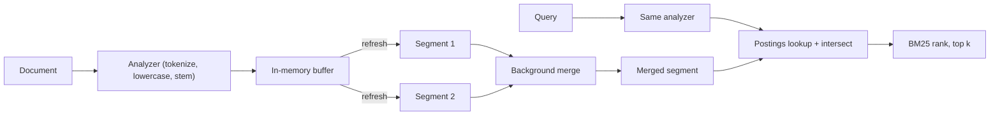

## In one minute
- A full-text search engine answers "which documents contain these words, best first" using an *inverted index*: a map from each term to the sorted list of documents (and positions) that contain it.
- Text passes through an analyzer (tokenize, lowercase, remove stop words, stem) at both index and query time; mismatched analysis is the most common cause of "search can't find it."
- Ranking usually starts with BM25, which rewards rare terms and repeated terms but damps long documents.
- Lucene, and the engines built on it (Elasticsearch, OpenSearch, Solr), write immutable segments and merge them in the background, which is why new documents become searchable after a refresh, not instantly.

## How it works

### Analysis
Before anything is indexed, text is turned into terms. A typical English analyzer splits "Running shoes, size 10!" into `run`, `shoe`, `size`, `10`: split on word boundaries, lowercase, drop punctuation, stem plurals and verb forms. Other choices include n-grams for partial matching, synonyms, and language-specific tokenizers for Chinese or Japanese, which have no spaces. The query must go through the same analyzer, or "shoes" will never match the indexed `shoe`.

### The inverted index
For each term, the index stores a *postings list*: the ids of documents containing it, in ascending order, plus optional term frequencies and positions. Ascending doc ids allow delta encoding (store gaps, not ids) and compact integer compression, so a postings list often costs 1 to 2 bytes per entry. The term dictionary itself is stored as a compressed prefix structure (Lucene uses a finite-state transducer) so that looking up a term costs a few memory accesses.

A query `running AND shoes` becomes an intersection of two postings lists. Because both are sorted, intersection walks them together and uses skip pointers to jump ahead, so its cost is close to the length of the shorter list. Phrase queries additionally check that positions are adjacent.

### Ranking with BM25
BM25 scores each matching document by summing, for each query term, an IDF weight times a saturating function of term frequency ([Robertson and Zaragoza, 2009](https://www.staff.city.ac.uk/~sbrp622/papers/foundations_bm25_review.pdf)):
- **IDF**: a term in 10 of 10 million documents is far more informative than one in 5 million.
- **Term frequency saturation** (parameter `k1`, about 1.2): the fifth occurrence adds much less than the first.
- **Length normalization** (parameter `b`, about 0.75): a match in a 20-word title counts for more than one in a 5,000-word page.

Elasticsearch and Lucene default to `k1 = 1.2` and `b = 0.75` ([Elasticsearch docs](https://www.elastic.co/docs/reference/elasticsearch/index-settings/similarity)). Not every engine ranks this way: Postgres's `ts_rank` and `ts_rank_cd` use no corpus-wide statistics at all, so a rare term counts no more than a common one ([Postgres docs](https://www.postgresql.org/docs/current/textsearch-controls.html)).

Production relevance layers more on top: field boosts (title over body), freshness, popularity, personalization, and often a learned re-ranker or vector similarity applied to the top few hundred candidates. When keyword and vector results are merged, reciprocal rank fusion is the usual first step: each list contributes 1/(60 + rank), so no score calibration is needed ([Cormack et al., SIGIR 2009](http://cormack.uwaterloo.ca/cormack/cormacksigir09-rrf.pdf)).

### Segments, refresh, and merges
Lucene does not update an index in place. New documents are buffered in memory and written as a small immutable *segment* on refresh. Elasticsearch defaults to every second (5 seconds on Elastic's Serverless offering), but a shard that has not been searched for 30 seconds stops refreshing in the background until the next search arrives ([Elasticsearch docs](https://www.elastic.co/docs/reference/elasticsearch/index-settings/index-modules)). A search queries every segment and combines results. Deletes are recorded as bitmaps, and an update is a delete plus an add. A background merge policy combines small segments into larger ones, purging deleted documents. A separate translog provides durability between full commits.

This is the same immutable-files-plus-compaction idea as an LSM tree, and it carries the same costs: merge I/O, temporary disk overhead, and a short visibility delay.

### Distribution
A cluster splits an index into shards, each a full Lucene index. A query fans out to one copy of every shard, each returns its top *k*, and a coordinator merges them. The primary shard count is set at index creation in Elasticsearch. The split API can multiply it, but only by copying into a new index while the source is read-only ([Elasticsearch docs](https://www.elastic.co/docs/api/doc/elasticsearch/operation/operation-indices-split)), so oversharding (thousands of tiny shards) and undersharding (shards that take hours to recover) are both common mistakes. Elastic's guidance is 10 to 50 GB and under 200 million documents per shard, well below Lucene's hard cap of about 2.1 billion documents, deleted ones included ([Elasticsearch docs](https://www.elastic.co/docs/deploy-manage/production-guidance/optimize-performance/size-shards)).

## Down the stack

### Layer 1: The contract
Elasticsearch on Lucene promises two different things at two different times. A document is *durable* when the index call returns, because with the default `index.translog.durability: request` the translog is fsynced on the primary and every allocated replica before the acknowledgement ([Elasticsearch docs](https://www.elastic.co/docs/reference/elasticsearch/index-settings/translog)). It is *searchable* only after the next refresh, by default within about a second on an active index. Results are the top *k* by score, but scores are computed per shard: IDF comes from each shard's own statistics, so the same document can rank differently on different shards unless you pay for `dfs_query_then_fetch`.

### Layer 2: The mechanism
A Lucene segment is a set of write-once files. The term dictionary lives in `.tim`, indexed by an FST in `.tip` small enough to keep in memory. Each term entry points into `.doc` (doc ids and term frequencies), `.pos` (positions for phrase queries), and `.pay` (offsets and payloads). Stored fields (`.fdt`) and column-oriented doc values (`.dvd`) sit alongside, and `.liv` is a bitmap of live documents, which is how deletes work without rewriting a segment. A `segments_N` file is the commit point listing the segments that make up the index.

Postings are encoded in blocks of 128 doc ids. Within a block, ids are delta encoded and then bit-packed with the minimum width that fits the largest delta, and a short tail is written as variable-length integers. Skip data lets `advance(target)` jump over whole blocks during an intersection without decoding them. Older formats kept it in a separate multi-level skip list; the current Lucene 10 format interleaves it with the postings in two levels, one entry before every 128-doc block and another every 32 blocks (4,096 docs), each holding the doc delta, file pointers and, since Lucene 8, *impacts*: the competitive term frequency and norm pairs for that range ([Lucene docs](https://lucene.apache.org/core/10_3_1/core/org/apache/lucene/codecs/lucene103/Lucene103PostingsFormat.html)). Block-max WAND uses them to compute an upper bound on any document's score in a block and skips blocks that cannot beat the current *k*th best result.

### Layer 3: The machine
Lucene opens index files with `MMapDirectory` on 64-bit platforms, so reading a postings block is a memory access into the page cache rather than a `read()` syscall. That is why Elasticsearch guidance is to give the JVM heap at most about half the RAM, and to stay below roughly 31 GB so the JVM keeps compressed object pointers, leaving the rest to the OS to cache index files. A cold index costs page faults and random reads; a warm one is bound by memory bandwidth.

Bit-packed blocks of 128 are chosen for the CPU. Decoding a fixed-width block is a branch-free loop the JVM can vectorise, and 128 ids at a few bits each fit in a handful of 64-byte cache lines. Refresh writes a new segment into the page cache without fsync, which is why it is cheap enough to run every second. A Lucene commit (an Elasticsearch flush) fsyncs segment files and writes a new `segments_N`, after which the translog can be trimmed. Merges rewrite whole segments sequentially; the default tiered merge policy caps merged segments at about 5 GB.

### Why it's built this way
1. Text queries are intersections and unions of term lists, so the index is inverted by term and kept sorted by doc id.
2. Sorted ids have small gaps, so delta encoding plus bit-packing shrinks postings to a few bits per entry and lets more of the index live in RAM.
3. Rewriting compressed sorted lists in place is impractical, so new data goes into new immutable segments and merges clean up.
4. Fsyncing a segment every second is too expensive, so visibility (refresh) is separated from durability (translog and commit).
5. Most queries need only the top results, so per-block score bounds let the engine skip data instead of scoring every match.

## Diagram


## Worked example
A marketplace indexes 50 million product listings, averaging 2 KB of text each, about 100 GB of source. After analysis, the inverted index plus stored fields and doc values comes to roughly 60 to 80 GB per copy. With one replica, that is 150 GB, which the team splits into 6 primary shards of about 12 GB each, small enough to relocate in minutes.

Peak traffic is 3,000 queries per second. Each query hits all 6 shards, so the cluster serves 18,000 shard-level searches per second. If one shard search takes 8 ms of CPU, that is 144 CPU-seconds per second, so about 12 nodes with 16 cores at 75% utilization. Adding shards would not add capacity here; adding replicas would, because each replica serves reads.

Indexing runs at 2,000 updates per second. With a 1-second refresh, each shard creates a new small segment every second, and merges rewrite each document several times over its life. Raising refresh to 5 seconds for the catalogue cuts segment churn sharply, while order-status search, which needs near-instant visibility, stays in a separate index with a 1-second refresh.

## In the wild
- **Discord, 2025: re-architecting search for trillions of messages.** Discord's message search ran on two Elasticsearch clusters fed from a Redis queue. The queue dropped messages when Redis hit full CPU, a batch of 50 messages could touch 50 nodes so one node failure failed about 40% of bulk requests, clusters grew past 200 nodes, and indexes hit Lucene's roughly 2 billion document limit, after which all indexing failed. The rebuild uses many small clusters in "cells", caps each index at 200 million messages and 50 GB, batches each bulk request by destination cluster and index, and replaced Redis with Pub/Sub. Median query latency fell from 500 ms to under 100 ms ([Discord](https://discord.com/blog/how-discord-indexes-trillions-of-messages)).
- **Jepsen, 2015: Elasticsearch 1.5.0 loses acknowledged writes.** Under network partitions, process pauses and crashes, Elasticsearch 1.5.0 lost acknowledged documents, about 22% in one run that isolated a primary. Under `kill -9`, writes were lost because they were acknowledged before the translog fsync, then every 5 seconds by default. Today's default, `request`, fsyncs before acknowledging, as described above. The standing advice is to keep the source of truth elsewhere and treat the index as rebuildable ([Jepsen](https://aphyr.com/posts/323-call-me-maybe-elasticsearch-1-5-0)).

## Trade-offs
| Option | Strengths | Weaknesses | Choose when |
|---|---|---|---|
| Elasticsearch or OpenSearch | Mature relevance, aggregations, horizontal scale | Operational load, JVM tuning, eventual visibility | Search is a core product feature |
| PostgreSQL full-text (GIN index) | No new system, transactional consistency | Weaker ranking, slower at large scale | Under tens of millions of rows, modest relevance needs |
| Hosted search API | Fast to ship, no cluster to run | Cost per query, less control | Small team, standard needs |
| Vector search alone | Finds semantic matches without shared words | Misses exact identifiers, SKUs, names | Combined with keyword search in a hybrid |
| Short refresh interval | Near-real-time visibility | More segments, more merge I/O | User expects to search what they just wrote |

## Pitfalls in production
- **Using the search engine as the primary database.** Indexes can be lost or need rebuilding after mapping changes. Keep a source of truth and a reindex pipeline.
- **Mapping explosions.** Dynamic mapping on arbitrary JSON keys creates thousands of fields and blows heap. Use explicit mappings and flattened types.
- **Deep pagination.** `from: 100000` makes each shard build a huge priority queue. Use `search_after` cursors.
- **Analyzer mismatch after a change.** Changing an analyzer requires reindexing; queries against old segments silently stop matching. Reindex into a new index and swap an alias.
- **Hot shards from routing.** Custom routing by tenant puts a large tenant on one shard. Route large tenants to dedicated indexes.

## Leadership lens
- Treat the index as a derived view: define the pipeline from source of truth, its lag SLO, and how to rebuild from scratch.
- Relevance is a product discipline. Ask who owns it, how it is measured (click-through, zero-result rate), and how changes are tested.
- Size shards for recovery time, not only for query speed.
- Decide early whether you need hybrid keyword plus semantic search; it changes the architecture.

## Check yourself
1. Why are postings lists stored in ascending doc-id order?
   **Answer:** Sorted lists compress well as gaps and can be intersected in linear time with skip pointers.
2. A newly indexed document does not show up for about one second. Why?
   **Answer:** Documents become searchable only when a refresh writes the in-memory buffer as a new segment, which happens on an interval.
3. Why does BM25 score a match in a short document higher than in a long one?
   **Answer:** Length normalization assumes a term in a short text is a larger share of its content, so it signals relevance more strongly.
4. Adding shards does not raise query throughput. What does, and why?
   **Answer:** Adding replicas, because every query already hits every shard; more replicas spread those shard searches over more nodes.

## Practice
**Task:** Build a tiny search engine. `add(doc_id, text)` tokenizes text by lowercasing and splitting on any non-alphanumeric character, then updates an inverted index. `search(query)` returns doc ids that contain every query term, ordered by BM25 score descending (`k1 = 1.2`, `b = 0.75`, `idf = ln(1 + (N - df + 0.5) / (df + 0.5))`), with ties broken by ascending doc id. An empty query or an unknown term returns an empty list.

```python starter
class SearchIndex:
    def add(self, doc_id, text):
        raise NotImplementedError

    def search(self, query):
        raise NotImplementedError
```

```python tests
def test_tokenizes_case_and_punctuation():
    s = SearchIndex()
    s.add(1, "Hello, World!")
    assert s.search("hello") == [1]
    assert s.search("WORLD") == [1]

def test_and_semantics():
    s = SearchIndex()
    s.add(1, "red shoes")
    s.add(2, "red hat")
    assert s.search("red shoes") == [1]
    assert s.search("red") == [1, 2]

def test_term_frequency_ranks_higher():
    s = SearchIndex()
    s.add(1, "apple banana")
    s.add(2, "apple apple apple banana")
    assert s.search("apple") == [2, 1]

def test_shorter_document_ranks_higher():
    s = SearchIndex()
    s.add(1, "rust one two three four five six seven eight nine")
    s.add(2, "rust go")
    assert s.search("rust") == [2, 1]

def test_ties_break_by_id():
    s = SearchIndex()
    s.add(5, "same text")
    s.add(3, "same text")
    assert s.search("same") == [3, 5]

def test_empty_and_unknown():
    s = SearchIndex()
    s.add(1, "hello")
    assert s.search("") == []
    assert s.search("hello missing") == []
```

```python solution
import math
from collections import Counter

class SearchIndex:
    def __init__(self):
        self.postings = {}  # term -> {doc_id: tf}
        self.lengths = {}

    def _tokens(self, text):
        chars = [c if c.isascii() and c.isalnum() else " " for c in text.lower()]
        return "".join(chars).split()

    def add(self, doc_id, text):
        toks = self._tokens(text)
        self.lengths[doc_id] = len(toks)
        for term, tf in Counter(toks).items():
            self.postings.setdefault(term, {})[doc_id] = tf

    def search(self, query):
        terms = self._tokens(query)
        if not terms or any(t not in self.postings for t in terms):
            return []
        docs = set(self.postings[terms[0]])
        for t in terms[1:]:
            docs &= set(self.postings[t])
        n = len(self.lengths)
        avg = sum(self.lengths.values()) / n
        scores = {}
        for d in docs:
            score = 0.0
            for t in terms:
                df, tf = len(self.postings[t]), self.postings[t][d]
                idf = math.log(1 + (n - df + 0.5) / (df + 0.5))
                norm = 1.2 * (0.25 + 0.75 * self.lengths[d] / avg)
                score += idf * tf * 2.2 / (tf + norm)
            scores[d] = score
        return sorted(docs, key=lambda d: (-scores[d], d))
```

```typescript starter
export class SearchIndex {
  add(docId: number, text: string): void { throw new Error("TODO"); }
  search(query: string): number[] { throw new Error("TODO"); }
}
```

```typescript tests
test("tokenizes case and punctuation", () => {
  const s = new SearchIndex();
  s.add(1, "Hello, World!");
  assertEqual(s.search("hello"), [1]);
  assertEqual(s.search("WORLD"), [1]);
});
test("and semantics", () => {
  const s = new SearchIndex();
  s.add(1, "red shoes");
  s.add(2, "red hat");
  assertEqual(s.search("red shoes"), [1]);
  assertEqual(s.search("red"), [1, 2]);
});
test("term frequency ranks higher", () => {
  const s = new SearchIndex();
  s.add(1, "apple banana");
  s.add(2, "apple apple apple banana");
  assertEqual(s.search("apple"), [2, 1]);
});
test("shorter document ranks higher", () => {
  const s = new SearchIndex();
  s.add(1, "rust one two three four five six seven eight nine");
  s.add(2, "rust go");
  assertEqual(s.search("rust"), [2, 1]);
});
test("ties break by id", () => {
  const s = new SearchIndex();
  s.add(5, "same text");
  s.add(3, "same text");
  assertEqual(s.search("same"), [3, 5]);
});
test("empty and unknown", () => {
  const s = new SearchIndex();
  s.add(1, "hello");
  assertEqual(s.search(""), []);
  assertEqual(s.search("hello missing"), []);
});
```

```typescript solution
export class SearchIndex {
  private postings = new Map<string, Map<number, number>>();
  private lengths = new Map<number, number>();

  private tokens(text: string): string[] {
    return text.toLowerCase().split(/[^a-z0-9]+/).filter((t) => t.length > 0);
  }

  add(docId: number, text: string): void {
    const toks = this.tokens(text);
    this.lengths.set(docId, toks.length);
    for (const t of toks) {
      if (!this.postings.has(t)) this.postings.set(t, new Map());
      const p = this.postings.get(t)!;
      p.set(docId, (p.get(docId) ?? 0) + 1);
    }
  }

  search(query: string): number[] {
    const terms = this.tokens(query);
    if (terms.length === 0 || terms.some((t) => !this.postings.has(t))) return [];
    let docs = [...this.postings.get(terms[0])!.keys()];
    for (const t of terms.slice(1)) docs = docs.filter((d) => this.postings.get(t)!.has(d));
    const n = this.lengths.size;
    let total = 0;
    this.lengths.forEach((l) => (total += l));
    const avg = total / n;
    const score = new Map<number, number>();
    for (const d of docs) {
      let s = 0;
      for (const t of terms) {
        const p = this.postings.get(t)!;
        const df = p.size, tf = p.get(d)!;
        const idf = Math.log(1 + (n - df + 0.5) / (df + 0.5));
        const norm = 1.2 * (0.25 + (0.75 * this.lengths.get(d)!) / avg);
        s += (idf * tf * 2.2) / (tf + norm);
      }
      score.set(d, s);
    }
    return docs.sort((a, b) => score.get(b)! - score.get(a)! || a - b);
  }
}
```

```go starter
package practice

type SearchIndex struct{}

func NewSearchIndex() *SearchIndex { return &SearchIndex{} }

func (s *SearchIndex) Add(docID int, text string)  { panic("TODO") }
func (s *SearchIndex) Search(query string) []int    { panic("TODO") }
```

```go tests
package practice

import (
	"reflect"
	"testing"
)

func check(t *testing.T, got, want []int) {
	t.Helper()
	if len(got) == 0 && len(want) == 0 {
		return
	}
	if !reflect.DeepEqual(got, want) {
		t.Fatalf("got %v, want %v", got, want)
	}
}

func TestTokenizesCaseAndPunctuation(t *testing.T) {
	s := NewSearchIndex()
	s.Add(1, "Hello, World!")
	check(t, s.Search("hello"), []int{1})
	check(t, s.Search("WORLD"), []int{1})
}

func TestAndSemantics(t *testing.T) {
	s := NewSearchIndex()
	s.Add(1, "red shoes")
	s.Add(2, "red hat")
	check(t, s.Search("red shoes"), []int{1})
	check(t, s.Search("red"), []int{1, 2})
}

func TestTermFrequencyRanksHigher(t *testing.T) {
	s := NewSearchIndex()
	s.Add(1, "apple banana")
	s.Add(2, "apple apple apple banana")
	check(t, s.Search("apple"), []int{2, 1})
}

func TestShorterDocumentRanksHigher(t *testing.T) {
	s := NewSearchIndex()
	s.Add(1, "rust one two three four five six seven eight nine")
	s.Add(2, "rust go")
	check(t, s.Search("rust"), []int{2, 1})
}

func TestTiesBreakByID(t *testing.T) {
	s := NewSearchIndex()
	s.Add(5, "same text")
	s.Add(3, "same text")
	check(t, s.Search("same"), []int{3, 5})
}

func TestEmptyAndUnknown(t *testing.T) {
	s := NewSearchIndex()
	s.Add(1, "hello")
	check(t, s.Search(""), nil)
	check(t, s.Search("hello missing"), nil)
}
```

```go solution
package practice

import (
	"math"
	"regexp"
	"sort"
	"strings"
)

var splitter = regexp.MustCompile(`[^a-z0-9]+`)

type SearchIndex struct {
	postings map[string]map[int]int
	lengths  map[int]int
}

func NewSearchIndex() *SearchIndex {
	return &SearchIndex{postings: map[string]map[int]int{}, lengths: map[int]int{}}
}

func tokens(text string) []string {
	var out []string
	for _, t := range splitter.Split(strings.ToLower(text), -1) {
		if t != "" {
			out = append(out, t)
		}
	}
	return out
}

func (s *SearchIndex) Add(docID int, text string) {
	toks := tokens(text)
	s.lengths[docID] = len(toks)
	for _, t := range toks {
		if s.postings[t] == nil {
			s.postings[t] = map[int]int{}
		}
		s.postings[t][docID]++
	}
}

func (s *SearchIndex) Search(query string) []int {
	terms := tokens(query)
	if len(terms) == 0 {
		return nil
	}
	for _, t := range terms {
		if s.postings[t] == nil {
			return nil
		}
	}
	n, total := float64(len(s.lengths)), 0
	for _, l := range s.lengths {
		total += l
	}
	avg := float64(total) / n
	scores := map[int]float64{}
	var docs []int
	for d := range s.postings[terms[0]] {
		score, ok := 0.0, true
		for _, t := range terms {
			tf, has := s.postings[t][d]
			if !has {
				ok = false
				break
			}
			df := float64(len(s.postings[t]))
			idf := math.Log(1 + (n-df+0.5)/(df+0.5))
			norm := 1.2 * (0.25 + 0.75*float64(s.lengths[d])/avg)
			score += idf * float64(tf) * 2.2 / (float64(tf) + norm)
		}
		if ok {
			docs = append(docs, d)
			scores[d] = score
		}
	}
	sort.Slice(docs, func(i, j int) bool {
		if scores[docs[i]] != scores[docs[j]] {
			return scores[docs[i]] > scores[docs[j]]
		}
		return docs[i] < docs[j]
	})
	return docs
}
```

## Mock interview
**Prompt:** Design product search for a marketplace with 200 million listings, 5,000 queries per second, and sellers who expect edits to be searchable within a few seconds.

- Follow-up: How do you keep the index in sync with the primary database, and what happens if the pipeline stalls for an hour?
- Follow-up: A seller's SKU "AB-1234" cannot be found by typing "ab1234". Why, and how do you fix it?
- Follow-up: When would you add vector search, and how would you combine scores?

**A strong answer covers:**
- Inverted index with analyzers per field, and identical analysis at query time.
- Change data capture from the source of truth into indexing, with lag monitoring and full rebuild ability.
- Shard sizing by data volume and replica count by query load.
- Refresh interval and segment merging as the visibility versus cost knob.
- BM25 baseline plus business signals, with offline and online relevance evaluation.

## Sources and further study
**Primary**
- [Robertson and Zaragoza, The Probabilistic Relevance Framework: BM25 and Beyond (2009)](https://www.staff.city.ac.uk/~sbrp622/papers/foundations_bm25_review.pdf): the derivation of BM25 and guidance on tuning `k1` and `b`.
- [Cormack, Clarke and Büttcher, Reciprocal Rank Fusion (SIGIR 2009)](http://cormack.uwaterloo.ca/cormack/cormacksigir09-rrf.pdf): the two-page paper behind the standard way to merge keyword and vector result lists.

**Systems docs**
- [Lucene 10 postings format](https://lucene.apache.org/core/10_3_1/core/org/apache/lucene/codecs/lucene103/Lucene103PostingsFormat.html): the exact on-disk layout of postings, skip data and impacts.
- [Elasticsearch: size your shards](https://www.elastic.co/docs/deploy-manage/production-guidance/optimize-performance/size-shards): shard size and count guidance, and the per-shard document cap.
- [Elasticsearch: translog settings](https://www.elastic.co/docs/reference/elasticsearch/index-settings/translog): durability modes and what an acknowledgement means.
- [PostgreSQL: controlling text search](https://www.postgresql.org/docs/current/textsearch-controls.html): parsing, ranking and highlighting inside the database, and the limits of its ranking.

**Books**
- *Designing Data-Intensive Applications* (2nd ed.), Martin Kleppmann and Chris Riccomini, chapter 4 "Storage and Retrieval" (section "Multidimensional and Full-Text Indexes"): where inverted indexes sit among other storage structures.

**Other curricula**
- [donnemartin/system-design-primer](https://github.com/donnemartin/system-design-primer): has no full-text search chapter; its Twitter design answers search with a separate search cluster "ie Lucene" behind a Search API.

## Watch
- [Inverted Index: The Data Structure Behind Search Engines (Arpit Bhayani)](https://www.youtube.com/watch?v=iHHqnyThrqE): how postings lists are built and queried.
- [Philipp Krenn on Elasticsearch Full Text Search Internals](https://www.youtube.com/watch?v=6jhIUAwaHfQ): analyzers, segments, and scoring inside Elasticsearch.

## Free resources
- [Introduction to Information Retrieval (Manning, Raghavan, Schütze)](https://nlp.stanford.edu/IR-book/information-retrieval-book.html): the standard free textbook on indexing, compression, and ranking.
- [Elasticsearch: Near real-time search](https://www.elastic.co/guide/en/elasticsearch/reference/current/near-real-time.html): how refresh, segments, and commits interact.
- [Visualizing Lucene's segment merges (Mike McCandless)](https://blog.mikemccandless.com/2011/02/visualizing-lucenes-segment-merges.html): watch merge policies at work.
- [Wikipedia: Okapi BM25](https://en.wikipedia.org/wiki/Okapi_BM25): the formula and its parameters.
- [Apache Lucene](https://lucene.apache.org/core/): the library underneath most open-source search engines.
