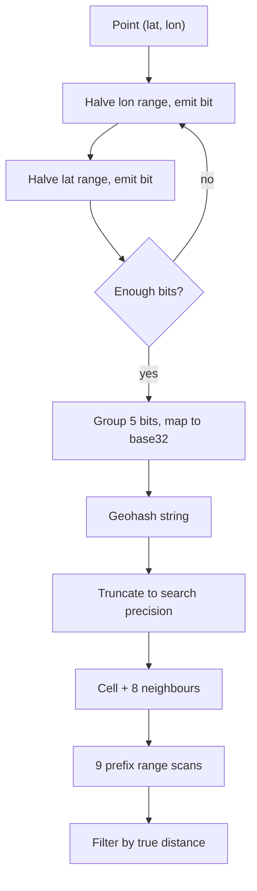

## In one minute
- A geohash turns a latitude/longitude pair into a short string by repeatedly halving the world and recording which half the point falls in, alternating between longitude and latitude.
- Each extra character narrows the cell by 5 bits. Strings that share a prefix are in the same enclosing cell, so "nearby" becomes "same prefix" and can be served by any ordered index: a B-tree, a sorted set, or a key-value store with range scans.
- The catch is the edges. Two points a metre apart can sit in cells with no common prefix, so a radius query must always check the target cell plus its 8 neighbours.
- Geohash is the cheapest spatial index to adopt because it needs no special database support. It is a coarse filter; you still compute real distances on the candidates.

## How it works

### Bit interleaving
Start with longitude in [-180, 180] and latitude in [-90, 90]. Split the longitude range at its midpoint and write 1 if the point is in the upper half, 0 otherwise. Do the same for latitude, and keep alternating, shrinking the range you just used.

Group the bits five at a time and map each group to a character of a 32-symbol alphabet (`0-9` and the lowercase letters minus `a`, `i`, `l`, `o`). Thirty bits become six characters. Gustavo Niemeyer published the string format in 2008 and put it in the public domain; the underlying bit interleaving goes back to G. M. Morton's 1966 IBM report, which is why it is also called a Morton code ([Wikipedia](https://en.wikipedia.org/wiki/Geohash)). Decoding runs the same process backwards and yields a bounding box, not a point: the centre of that box is the best estimate of the original coordinate.

### Precision
Odd lengths give square-ish cells; even lengths give cells twice as wide as tall. At the equator: 4 characters is about 39 km by 20 km, 5 is about 4.9 km square, 6 is 1.2 km by 0.6 km, 7 is about 150 m square, 8 is 38 m by 19 m, and 9 is under 5 m ([Elasticsearch geohash grid docs](https://www.elastic.co/guide/en/elasticsearch/reference/current/search-aggregations-bucket-geohashgrid-aggregation.html)). Cells narrow toward the poles as meridians converge: a cell's east-west width shrinks with the cosine of latitude, so at 60 degrees north it is half its equatorial width.

### Why prefixes work, and where they fail
The interleaving traces a Z-order (Morton) curve through the plane. Points close along the curve are close in space, so a prefix scan returns a compact region. The reverse is not true. No curve can fix this completely: a query region always breaks into several runs of the curve, and their number grows with the region's perimeter rather than its area. The Hilbert curve, which S2 uses, needs fewer runs than the Z curve for the same query ([Moon et al.](https://www.cs.cmu.edu/~christos/PUBLICATIONS/ieee-tkde-hilbert.pdf)). The curve jumps at every cell boundary, and the largest jumps happen on the major dividing lines. A point just east of the prime meridian at the equator starts with `s`; a point just west starts with `e`. They share nothing.

The fix is neighbour expansion: pick a precision whose cell is at least as large as the radius, scan the target cell and its 8 neighbours, then filter by true distance. To find a neighbour, decode to a box, step one cell over, and re-encode.

### Storage patterns
In SQL, index a `geohash` column and query a range such as `>= 'u4pru' AND < 'u4prv'`. Redis `GEOADD` stores a 52-bit interleaved hash as a sorted-set score, so `GEOSEARCH` is score-range scans plus a distance filter. `GEOSEARCH` arrived in Redis 6.2, and `GEORADIUS` and `GEORADIUSBYMEMBER` have been deprecated since then, so older tutorials use the old names ([Redis docs](https://redis.io/docs/latest/commands/geosearch/)). MongoDB's legacy `2d` index is also a geohash, 26 bits per axis by default, about 60 cm ([MongoDB docs](https://www.mongodb.com/docs/manual/core/indexes/index-types/geospatial/2d/create/define-location-precision/)). In DynamoDB or Cassandra, a short prefix is the partition key and the full hash the sort key.

## Down the stack

### Layer 1: The contract
Encoding is deterministic and total: every coordinate maps to exactly one cell at each precision, and a hash of length n is a prefix of the hash of length n+1 for the same point. So "shares a prefix" implies "inside the same cell". The converse is not promised. Nearby points may share no prefix, so a correct radius query is the union of the target cell and its neighbours, filtered by real distance. Decoding returns a box with a known error: plus or minus half the cell in each axis.

### Layer 2: The mechanism
Redis is a good reference. `GEOADD` interleaves 26 latitude bits and 26 longitude bits into a 52-bit integer and stores it as the score of a sorted-set member. Latitudes beyond plus or minus 85.05112878 degrees, the Web Mercator limits, are rejected with an error, and distances use haversine on a sphere, which Redis warns can be off by up to 0.5 percent ([Redis GEOADD](https://redis.io/docs/latest/commands/geoadd/)). `GEOSEARCH` picks a step (bits per axis) so the cell is at least as large as the radius, computes the centre cell and its 8 neighbours, and turns each into a score range by shifting the cell's hash left to 52 bits: `[hash << shift, (hash + 1) << shift)`. Each range is a skip-list range scan, and every returned member is checked with the haversine formula. Base32 strings are only a presentation format; the index works on integers.

The step choice has three corrections that a naive implementation misses ([geohash_helper.c](https://github.com/redis/redis/blob/unstable/src/geohash_helper.c)). Above 66 degrees latitude it uses one step coarser, and above 80 degrees two, because cells are narrower there. It then checks that the four edge neighbours actually reach the query's bounding box and, if not, drops another step. Finally it skips neighbour cells that cannot intersect the box, so many searches scan fewer than nine ranges.

In SQL the same idea is a B-tree on a geohash column, and each cell becomes a key range rather than a `LIKE` pattern.

### Layer 3: The machine
Interleaving is a handful of shift-and-mask operations (the classic "spread bits" trick with magic constants such as `0x5555555555555555`), a few nanoseconds per point. A 52-bit integer fits exactly in a double's 53-bit mantissa, which is why Redis can store it as a sorted-set score without precision loss ([Redis GEOADD](https://redis.io/docs/latest/commands/geoadd/)) and compare scores with one floating-point instruction.

On disk, consecutive geohashes sit next to each other in B-tree leaf pages. A cell scan is one descent (3 to 4 page reads, usually cached) followed by sequential reads within 8 KB pages, so the 9-cell query costs roughly 9 random page accesses plus sequential reads. Storing the hash as an 8-byte integer instead of a 12-character string fits more keys per page and avoids collation-aware string comparison.

### Why it's built this way
1. Storage engines are built around one-dimensional ordered keys, so two-dimensional locations are folded onto a line.
2. Bit interleaving is the cheapest fold, but any fold must break locality somewhere, so queries add neighbour cells.
3. Integer comparisons are cheaper and smaller than string comparisons, so production systems store the bits, not the base32 text.
4. A double holds 53 bits exactly, so Redis caps the hash at 52 bits, which still gives sub-metre cells.

## Diagram


## Worked example
A food-delivery app stores 2 million restaurants and serves "restaurants within 2 km" at 8,000 QPS peak.

At precision 5 a cell is about 4.9 km square, which comfortably covers a 2 km radius when combined with neighbours. The 9-cell window spans roughly 14.7 km by 14.7 km. In a dense city that window might hold 6,000 restaurants; across the whole fleet the average is closer to 400. Precision 6 would give a 3.6 km by 1.8 km window. Its cells are 1.2 km by 0.6 km, both smaller than the 2 km radius, so a user near a cell edge has part of the circle outside the window and misses results.

Each request is 9 range scans on a covering index `(geohash, id, lat, lon)`, roughly 0.5 ms each on a warm cache. At 8,000 QPS that is 72,000 range scans per second, which a pair of read replicas absorbs.

Dense cities are the problem: filtering 6,000 candidates per request in central London costs CPU and network. Use adaptive precision: keep a small table of counts per precision-5 cell and drop to precision 6 for small radii in dense cells.

## In the wild
- **Redis, 2022: geo search misses a member inside the radius.** A user showed two points at about 85 degrees north, 4,891.94 m apart by `GEODIST`, where `GEORADIUSBYMEMBER ... 4891.94 m` returned only the first. The estimated step gave cells whose neighbours did not reach the edge of the query's bounding box. The fix checks the neighbours against the box and drops one more step when they fall short; it shipped in Redis 6.2.7 and 7.0 ([Redis PR #10018](https://github.com/redis/redis/pull/10018)).
- **Check Point Research, 2024: a 12-character geohash that only looks precise.** Studying two dating apps with over 10 million downloads each, researchers found one sending locations as 12-character geohashes, a cell of about 37 by 18 cm, but rounding coordinates to three decimal places first, which limits real precision to about 110 m. The other app, Hornet, sent raw coordinates and randomised displayed distances; trilateration still found users to within 10 m until Hornet's changes pushed it to about 50 m. Precision is set by what you encode, not by the string's length ([Check Point Research](https://research.checkpoint.com/2024/the-illusion-of-privacy-geolocation-risks-in-modern-dating-apps/)).

## Trade-offs
| Option | Strengths | Weaknesses | Choose when |
|---|---|---|---|
| Geohash in a B-tree or sorted set | Works in any ordered store, easy to shard, human-readable | Edge discontinuities, fixed cell sizes, distortion near poles | You need proximity search without a spatial database |
| Quadtree | Adapts cell size to density | In-memory structure to build and keep updated | Density varies wildly and you control the serving tier |
| PostGIS / R-tree | Exact geometry, polygons, KNN operators | Ties you to a spatial-capable database | You need polygons, routes, or precise containment |
| S2 or H3 cells | Less distortion, better coverings, uniform neighbours (H3) | Library dependency, harder to debug by eye | Global scale, analytics, or polygon coverage |

## Pitfalls in production
- **Querying only the target cell.** Users near a cell edge see missing results that "come back" when they move 10 metres. Always include the 8 neighbours and filter by distance.
- **Precision that is too fine for the radius.** If the cell is smaller than the radius, the 9-cell window does not cover the circle. Choose precision from the radius, and test it near the poles where cells narrow.
- **Hot partitions.** Using a 3-character prefix as a partition key puts all of Manhattan on one shard. Partition by a longer prefix or by hash of the prefix, and accept scatter for large windows.
- **Treating the decoded centre as the true location.** At precision 6 the error can be 600 m. Store the raw coordinates next to the hash and compute distance from those.

## Leadership lens
- Ask what the radius distribution looks like. A single fixed precision is fine for "within 2 km"; a product that zooms from street to country needs multiple precisions or a different index.
- Geohash is a good first version because anyone can debug a string. Plan a path to S2 or H3 if polygons or analytics are coming.
- Insist on test fixtures at the equator, the prime meridian, the antimeridian, and high latitudes, and measure candidates-per-query by city, not the global average.

## Check yourself
1. Two shops 20 metres apart have geohashes `ezzzzz` and `spbpbp`. Is the encoder broken?
   **Answer:** No. They straddle a major cell boundary, so the Z-order curve puts them far apart in string order even though they are physically close. Neighbour expansion handles this.
2. Why does an odd-length geohash give a roughly square cell while an even-length one does not?
   **Answer:** Longitude is split first, so after an odd number of characters (5 bits each) longitude has one more bit than latitude, and since longitude spans twice the degrees, the extra halving makes width and height roughly equal.
3. Why is a geohash range scan a filter and not the final answer?
   **Answer:** The 9-cell window is a rectangle bigger than the search circle, so it returns points outside the radius that must be removed with a true distance check.

## Practice
**Task:** Implement `encode(lat, lon, precision)` returning a geohash of the given length, using the alphabet `0123456789bcdefghjkmnpqrstuvwxyz`, alternating bits starting with longitude, and treating a value equal to the midpoint as the upper half. Also implement `decode_box(h)` returning `(min_lat, max_lat, min_lon, max_lon)` for the cell. TypeScript uses `encode`/`decodeBox` and Go uses `Encode`/`DecodeBox` with the same behaviour.

```python starter
BASE32 = "0123456789bcdefghjkmnpqrstuvwxyz"

def encode(lat, lon, precision):
    # TODO
    raise NotImplementedError

def decode_box(h):
    # TODO
    raise NotImplementedError
```

```python tests
def test_classic_example():
    assert encode(57.64911, 10.40744, 11) == "u4pruydqqvj"

def test_length_matches_precision():
    assert len(encode(51.5074, -0.1278, 6)) == 6

def test_prefix_property():
    assert encode(40.7128, -74.006, 5) == encode(40.7128, -74.006, 9)[:5]

def test_prime_meridian_discontinuity():
    assert encode(0.0001, 0.0001, 5)[0] != encode(0.0001, -0.0001, 5)[0]

def test_box_contains_point():
    a, b, c, d = decode_box(encode(-33.8688, 151.2093, 7))
    assert a <= -33.8688 <= b and c <= 151.2093 <= d

def test_single_char_cell():
    assert decode_box("s") == (0, 45, 0, 45)
```

```python solution
BASE32 = "0123456789bcdefghjkmnpqrstuvwxyz"

def encode(lat, lon, precision):
    lat_r, lon_r = [-90.0, 90.0], [-180.0, 180.0]
    out, bits, n, even = "", 0, 0, True
    while len(out) < precision:
        r, v = (lon_r, lon) if even else (lat_r, lat)
        mid = (r[0] + r[1]) / 2
        if v >= mid:
            bits, r[0] = bits * 2 + 1, mid
        else:
            bits, r[1] = bits * 2, mid
        even, n = not even, n + 1
        if n == 5:
            out, bits, n = out + BASE32[bits], 0, 0
    return out

def decode_box(h):
    lat_r, lon_r, even = [-90.0, 90.0], [-180.0, 180.0], True
    for ch in h:
        v = BASE32.index(ch)
        for i in range(4, -1, -1):
            r = lon_r if even else lat_r
            mid = (r[0] + r[1]) / 2
            if (v >> i) & 1:
                r[0] = mid
            else:
                r[1] = mid
            even = not even
    return (lat_r[0], lat_r[1], lon_r[0], lon_r[1])
```

```typescript starter
export const BASE32 = "0123456789bcdefghjkmnpqrstuvwxyz";
export function encode(lat: number, lon: number, precision: number): string {
  throw new Error("TODO");
}
export function decodeBox(h: string): [number, number, number, number] {
  throw new Error("TODO");
}
```

```typescript tests
test("classic example", () => {
  assertEqual(encode(57.64911, 10.40744, 11), "u4pruydqqvj");
});
test("length matches precision", () => {
  assertEqual(encode(51.5074, -0.1278, 6).length, 6);
});
test("prefix property", () => {
  assertEqual(encode(40.7128, -74.006, 5), encode(40.7128, -74.006, 9).slice(0, 5));
});
test("prime meridian discontinuity", () => {
  assert(encode(0.0001, 0.0001, 5)[0] !== encode(0.0001, -0.0001, 5)[0], "first char differs");
});
test("box contains point", () => {
  const [a, b, c, d] = decodeBox(encode(-33.8688, 151.2093, 7));
  assert(a <= -33.8688 && -33.8688 <= b && c <= 151.2093 && 151.2093 <= d, "inside");
});
test("single char cell", () => {
  assertEqual(decodeBox("s"), [0, 45, 0, 45]);
});
```

```typescript solution
export const BASE32 = "0123456789bcdefghjkmnpqrstuvwxyz";
export function encode(lat: number, lon: number, precision: number): string {
  const latR = [-90, 90], lonR = [-180, 180];
  let out = "", bits = 0, n = 0, even = true;
  while (out.length < precision) {
    const r = even ? lonR : latR, v = even ? lon : lat, mid = (r[0] + r[1]) / 2;
    if (v >= mid) { bits = bits * 2 + 1; r[0] = mid; } else { bits = bits * 2; r[1] = mid; }
    even = !even;
    if (++n === 5) { out += BASE32[bits]; bits = 0; n = 0; }
  }
  return out;
}
export function decodeBox(h: string): [number, number, number, number] {
  const latR = [-90, 90], lonR = [-180, 180];
  let even = true;
  for (const ch of h) {
    const v = BASE32.indexOf(ch);
    for (let i = 4; i >= 0; i--) {
      const r = even ? lonR : latR, mid = (r[0] + r[1]) / 2;
      if ((v >> i) & 1) r[0] = mid; else r[1] = mid;
      even = !even;
    }
  }
  return [latR[0], latR[1], lonR[0], lonR[1]];
}
```

```go starter
package practice

const Base32 = "0123456789bcdefghjkmnpqrstuvwxyz"

// Encode returns the geohash of (lat, lon) with the given number of characters.
func Encode(lat, lon float64, precision int) string {
	panic("TODO")
}

// DecodeBox returns minLat, maxLat, minLon, maxLon of the cell.
func DecodeBox(h string) (float64, float64, float64, float64) {
	panic("TODO")
}
```

```go tests
package practice

import "testing"

func TestClassicExample(t *testing.T) {
	if got := Encode(57.64911, 10.40744, 11); got != "u4pruydqqvj" {
		t.Fatalf("got %q", got)
	}
}

func TestLength(t *testing.T) {
	if got := len(Encode(51.5074, -0.1278, 6)); got != 6 {
		t.Fatalf("got %d", got)
	}
}

func TestPrefixProperty(t *testing.T) {
	if Encode(40.7128, -74.006, 5) != Encode(40.7128, -74.006, 9)[:5] {
		t.Fatal("prefix mismatch")
	}
}

func TestPrimeMeridian(t *testing.T) {
	if Encode(0.0001, 0.0001, 5)[0] == Encode(0.0001, -0.0001, 5)[0] {
		t.Fatal("expected different first char")
	}
}

func TestBoxContainsPoint(t *testing.T) {
	a, b, c, d := DecodeBox(Encode(-33.8688, 151.2093, 7))
	if !(a <= -33.8688 && -33.8688 <= b && c <= 151.2093 && 151.2093 <= d) {
		t.Fatal("point outside box")
	}
}

func TestSingleChar(t *testing.T) {
	a, b, c, d := DecodeBox("s")
	if a != 0 || b != 45 || c != 0 || d != 45 {
		t.Fatalf("got %v %v %v %v", a, b, c, d)
	}
}
```

```go solution
package practice

import "strings"

const Base32 = "0123456789bcdefghjkmnpqrstuvwxyz"

// Encode returns the geohash of (lat, lon) with the given number of characters.
func Encode(lat, lon float64, precision int) string {
	latR, lonR := []float64{-90, 90}, []float64{-180, 180}
	var sb strings.Builder
	bits, n, even := 0, 0, true
	for sb.Len() < precision {
		r, v := latR, lat
		if even {
			r, v = lonR, lon
		}
		mid := (r[0] + r[1]) / 2
		if v >= mid {
			bits, r[0] = bits*2+1, mid
		} else {
			bits, r[1] = bits*2, mid
		}
		even = !even
		if n++; n == 5 {
			sb.WriteByte(Base32[bits])
			bits, n = 0, 0
		}
	}
	return sb.String()
}

// DecodeBox returns minLat, maxLat, minLon, maxLon of the cell.
func DecodeBox(h string) (float64, float64, float64, float64) {
	latR, lonR := []float64{-90, 90}, []float64{-180, 180}
	even := true
	for _, ch := range h {
		v := strings.IndexRune(Base32, ch)
		for i := 4; i >= 0; i-- {
			r := latR
			if even {
				r = lonR
			}
			mid := (r[0] + r[1]) / 2
			if (v>>i)&1 == 1 {
				r[0] = mid
			} else {
				r[1] = mid
			}
			even = !even
		}
	}
	return latR[0], latR[1], lonR[0], lonR[1]
}
```

## Mock interview
**Prompt:** Design the "nearby drivers" lookup for a ride-hailing app with 500,000 active drivers sending a location every 4 seconds and 20,000 rider searches per second. Use geohash as the primary index and explain how a search for drivers within 3 km is answered.

- Follow-up: How do you pick the precision, and what changes for a 500 m search?
- Follow-up: A rider standing on a cell boundary sees no drivers while one is 50 m away. What went wrong?
- Follow-up: Would you switch to a quadtree or H3, and what would push you there?

**A strong answer covers:**
- Write rate of 125,000 updates per second, absorbed by writing the cell only when a driver crosses a boundary and keeping positions in memory (for example Redis sorted sets per region).
- Precision chosen so one cell is at least the radius, with the 8-neighbour expansion and a true distance filter.
- Edge cases at the antimeridian and high latitudes, plus density skew in city centres.
- Sharding by geohash prefix and the hot-shard risk in dense cities.
- A clear trigger for moving to H3 or S2: polygon geofences, analytics by area, or uniform neighbour distances.

## Sources and further study
**Primary**
- [Moon, Jagadish, Faloutsos and Saltz, Analysis of the Clustering Properties of the Hilbert Space-Filling Curve (IEEE TKDE, 2001)](https://www.cs.cmu.edu/~christos/PUBLICATIONS/ieee-tkde-hilbert.pdf): why a range query on any space-filling curve splits into runs, and why Z-order needs more of them than Hilbert.
- [Redis geohash_helper.c](https://github.com/redis/redis/blob/unstable/src/geohash_helper.c): under 300 lines covering step estimation, neighbour pruning and the haversine filter.

**Systems docs**
- [Redis: GEOSEARCH](https://redis.io/docs/latest/commands/geosearch/): the current query command, its BYRADIUS and BYBOX shapes, and the `COUNT ... ANY` shortcut.
- [MongoDB: 2d index location precision](https://www.mongodb.com/docs/manual/core/indexes/index-types/geospatial/2d/create/define-location-precision/): a geohash-backed index with tunable bits.
- [Elasticsearch: geohash grid aggregation](https://www.elastic.co/guide/en/elasticsearch/reference/current/search-aggregations-bucket-geohashgrid-aggregation.html): geohash cells used for bucketing, with a cell-size table for every precision.

**Books**
- *System Design Interview, Volume 2*, Alex Xu and Sahn Lam, chapter 1 "Proximity Service": geohash next to quadtrees and S2 for a Yelp-style search, including the boundary problem.
- *System Design Interview, Volume 2*, chapter 2 "Nearby Friends": moving users and location updates at high write rates.
- *Designing Data-Intensive Applications* (2nd ed.), Kleppmann and Riccomini, chapter 4 "Storage and Retrieval": the section on multidimensional indexes, where geospatial range queries are the motivating case.

**Other curricula**
- [donnemartin/system-design-primer](https://github.com/donnemartin/system-design-primer): mentions geography only as a sharding key and has no section on geospatial indexes, so pair it with the proximity-service chapter above.

## Watch
- [Geohash: Deep Intuitive Understanding in under 7 Minutes (Jim O'Flaherty)](https://www.youtube.com/watch?v=UaMzra18TD8): a visual walk through the bit interleaving and prefix property.
- [Proximity Search & Geospatial Indexes Explained (Hello Interview)](https://www.youtube.com/watch?v=dQXdSxn7d1g): geohash compared with quadtrees and R-trees in a system design setting.

## Free resources
- [Wikipedia: Geohash](https://en.wikipedia.org/wiki/Geohash): the algorithm, the alphabet, and a precision table.
- [Movable Type: Geohashes](https://www.movable-type.co.uk/scripts/geohash.html): interactive encoder with neighbour computation and readable source.
- [Redis: GEOADD](https://redis.io/docs/latest/commands/geoadd/): how Redis stores 52-bit geohashes as sorted set scores and the limits that implies.
- [Wikipedia: Z-order curve](https://en.wikipedia.org/wiki/Z-order_curve): the space-filling curve underneath geohash and why it has jumps.
- [Elasticsearch: geo_point](https://www.elastic.co/guide/en/elasticsearch/reference/current/geo-point.html): how a search engine accepts geohashes alongside coordinates.
