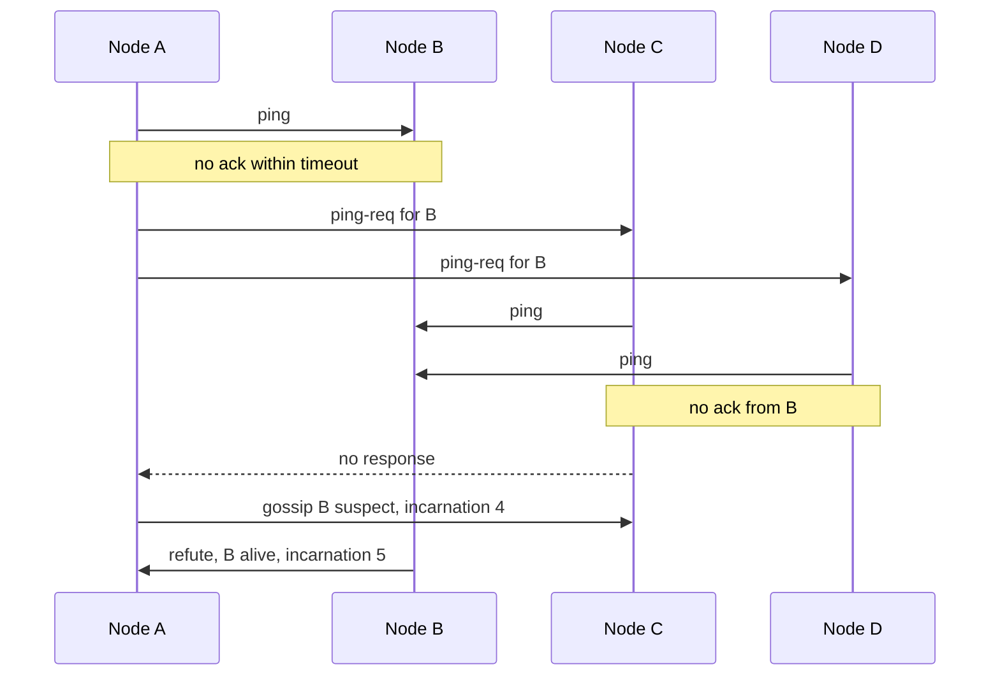

## In one minute
- In a gossip protocol each node periodically picks a few random peers and exchanges state with them. Information spreads like an epidemic, reaching all N nodes in about log N rounds.
- It needs no coordinator, tolerates churn and lost messages, and gives every node a roughly constant load per round regardless of cluster size.
- The price is **eventual** consistency: no node knows exactly when everyone has heard an update, and convergence time is probabilistic.
- Typical uses are cluster membership and failure detection (Cassandra, Consul, Serf), spreading metadata such as token ownership or load, and anti-entropy repair of replicas.

## How it works

### The basic round
Every `T` seconds (often 1 s), a node picks `k` random peers (the *fanout*, often 1 to 3) and sends them a message. There are three styles. **Push** sends what I know. **Pull** asks what you know. **Push-pull** does both in one exchange and converges fastest, because push is fast while few nodes know and pull is fast while few do not.

With fanout 1 and push-pull, an update reaches 1,000 nodes in roughly 10 to 15 rounds. Doubling the cluster adds about one round. That logarithmic behaviour is why gossip scales to thousands of nodes.

### Rumour-mongering versus anti-entropy
*Rumour-mongering* spreads new updates only: a node gossips a fresh item for a limited number of rounds, then stops. It is cheap but can leave a few nodes uninformed. *Anti-entropy* periodically compares full state between pairs and repairs differences, often using digests or Merkle trees so only the differing parts are sent. Production systems run both: rumours for speed, anti-entropy as the backstop. Van Renesse and colleagues' Scuttlebutt scheme exchanges per-node version digests first, so each side sends only entries newer than the other has seen ([van Renesse et al.](https://www.cs.cornell.edu/home/rvr/papers/flowgossip.pdf)).

### Membership with heartbeats
Each node keeps a table of `(node, heartbeat counter, local time last increased)`. It increments its own counter each round and gossips the table. On receipt, a node keeps the higher counter per entry and records when it last saw it increase. If a peer's counter has not increased for `T_fail` (say 10 s), the peer is suspected, and after a further `T_cleanup` its entry is removed. Comparing counters, never remote timestamps, keeps this free of clock-sync assumptions.

Amazon's Dynamo found it useful to split membership in two. Joining or permanently removing a node is an explicit admin action written to persistent storage, and gossip only spreads that history, one random peer per second; temporary failures are detected locally by whoever fails to reach a node while forwarding requests. Early designs kept a gossiped global view of failures, but the explicit join and leave made it unnecessary, and seed nodes known to everyone stop the ring from splitting into groups that never hear of each other ([Dynamo paper](https://www.allthingsdistributed.com/files/amazon-dynamo-sosp2007.pdf)).

### SWIM: separating detection from dissemination
Full-table heartbeat gossip sends O(N) data per message, which grows heavy at thousands of nodes. SWIM fixes this ([SWIM paper](https://www.cs.cornell.edu/projects/Quicksilver/public_pdfs/SWIM.pdf)). Each round a node *pings* one random member. If no ack arrives in time, it asks `k` other members to ping the target on its behalf (*indirect probe*), which filters out a single bad link. If those fail, the target is marked **suspect**, not dead, and the suspicion is gossiped. The suspect can refute it by gossiping a higher *incarnation number*. Membership changes ride piggybacked on the ping and ack messages, so dissemination costs no extra packets. HashiCorp's memberlist adds *Lifeguard*, which lengthens timeouts when the local node itself seems slow; in HashiCorp's experiments the full set of changes cut false positives by 50 to 100 times ([Lifeguard paper](https://arxiv.org/abs/1707.00788)).

## Down the stack

### Layer 1: The contract
Gossip promises eventual, probabilistic delivery: with high probability every live node learns an update within O(log N) rounds, and per-node load stays roughly constant as the cluster grows. It promises nothing about ordering between updates, nothing about when a particular node hears, and nothing about agreement: two nodes can briefly disagree about who is alive. Failure detection is a trade between detection time and false-positive rate, never a guarantee. Anything built on top must tolerate stale and conflicting views, which is why gossiped state is usually versioned so that "highest version wins" merges are safe in any order.

### Layer 2: The mechanism
HashiCorp's memberlist, used by Consul and Serf, implements SWIM with Lifeguard. Its default LAN profile probes one member every second with a 500 ms probe timeout, asks 3 other members for an indirect probe on failure, and gossips queued broadcasts to 3 random members every 200 ms ([memberlist config](https://github.com/hashicorp/memberlist/blob/master/config.go)). Each broadcast is retransmitted 4 times the ceiling of log10(N+1), 16 times in a 2,000-node cluster, so it reaches everyone with high probability and then drops out of the queue. Message types include `ping`, `indirect-ping`, `ack`, `suspect`, `alive` and `dead`, encoded with msgpack and packed several to a datagram as a compound message. Every 30 s a node also does a full-state push-pull with a random peer over TCP as anti-entropy. Lifeguard keeps a local health score, raised when this node misses its own acks, and stretches its probe timeouts by that score (up to 8 times by default). The suspicion timeout has a floor of 4 × log10(N) probe intervals and starts at six times that floor, then shrinks toward the floor as independent members confirm the suspicion; two confirmations are expected ([memberlist state.go](https://github.com/hashicorp/memberlist/blob/master/state.go)).

Cassandra uses a different design. Each second a node gossips with a random live peer and sometimes with an unreachable node or a seed, using a three-message exchange (`GossipDigestSyn`, `GossipDigestAck`, `GossipDigestAck2`). Each endpoint's state carries a *generation* (the node's start time, so a restart outranks its old self) and a *version* that increments with every local change. Liveness uses the phi accrual detector: instead of a fixed timeout it estimates how unlikely the current silence is given recent heartbeat inter-arrival times, and convicts above a threshold of 8 by default ([cassandra.yaml](https://cassandra.apache.org/doc/latest/cassandra/managing/configuration/cass_yaml_file.html)).

### Layer 3: The machine
memberlist keeps UDP payloads to about 1,400 bytes so a datagram fits in a 1,500-byte Ethernet MTU without IP fragmentation, since losing one fragment loses the whole datagram. A node therefore sends only a handful of small packets per second regardless of cluster size, a few kilobytes per second, while push-pull state is O(N) and goes over TCP. UDP has no retransmission, so the protocol's redundancy, not the kernel's, provides reliability: a dropped ping is covered by indirect probes through different network paths.

Most false positives come from the observer, not the network. A node starved of CPU by a noisy neighbour, a long GC pause, or a full socket receive buffer processes acks late and accuses healthy peers. Lifeguard's measurements showed large reductions in false positives by detecting that local slowness. Firewalls that allow TCP but drop UDP produce a classic failure: push-pull succeeds, probes fail, and nodes flap.

### Why it's built this way
1. Any all-to-all scheme costs O(N²) messages, so each node talks to a constant number of random peers and epidemic spread gives O(log N) delivery.
2. Random peers and lossy links mean any single message can vanish, so updates are retransmitted several times and periodic anti-entropy repairs whatever slipped through.
3. A missed ping cannot distinguish a dead node from a bad link or a slow observer, so SWIM adds indirect probes, suspicion with refutation, and Lifeguard's self-awareness.
4. Fragmented UDP is fragile and TCP connections to every peer are costly, so frequent small messages fit one datagram and the rare full sync uses TCP.

## Diagram


## Worked example
A 2,000-node Consul LAN pool with gossip interval 200 ms, fanout 3, and messages of about 1 KB with piggybacked updates.

- Network load per node: 3 messages × 5 per second × 1 KB is about 15 KB/s each way. Across the cluster that is 30 MB/s of gossip, spread evenly, with no hotspot.
- Spread time: log base 4 of 2,000 is about 5.5. With losses and overlap, expect an update to reach every node in about 8 to 10 rounds, roughly 2 s.
- Failure detection: with every node probing one member per second, a crashed node is usually probed within a second or so, and after the 500 ms probe timeout and failed indirect probes it becomes suspect. The suspicion floor is 4 × log10(2,000) × 1 s, about 13 s, and the timer starts near 79 s, but a real crash is quickly confirmed by other probers, so the node is declared dead cluster-wide in roughly 15 s. That deliberate slowness is what gives a merely paused node time to refute.

Compare full-table heartbeat gossip: each message carries 2,000 entries of about 30 bytes, or 60 KB, and at 3 per second per node that is 180 KB/s per node and 360 MB/s cluster-wide. That difference is why large clusters use SWIM-style designs with piggybacked deltas.

Cassandra uses gossip every second with up to 3 peers for endpoint state such as load, schema version, and token ownership, plus a phi-accrual failure detector that outputs a suspicion level rather than a yes or no.

## In the wild
- **Amazon S3, 2008: one flipped bit spread by gossip.** On 20 July, error rates climbed in every S3 data centre at 8:40am PDT. S3 servers gossiped system state before handling each request, and a handful of messages had a single corrupted bit that left them readable but wrong. Servers ended up spending almost all their time gossiping or failing mid-gossip; the team had to stop all server-to-server traffic, clear state and restart, and US requests were back to normal only at 4:58pm. Afterwards S3 reduced gossip about failed servers, added gossip-rate alarms and began adding checksums on state messages ([AWS post-mortem, archived](https://web.archive.org/web/20081225062644/http://status.aws.amazon.com/s3-20080720.html)).
- **HashiCorp, 2017: false positives from slow observers.** HashiCorp found that its memberlist-based tools declared healthy members failed when a node was short of CPU or the network delayed or lost packets, which moved traffic away from healthy nodes and triggered needless rebalancing. Lifeguard's self-awareness, "dogpile" suspicion timeouts and direct notification of suspects cut false positives by more than 50 times without slowing real detection, and memberlist's defaults were retuned to detect failures 20% faster with 20 times fewer false positives ([HashiCorp](https://www.hashicorp.com/en/blog/making-gossip-more-robust-with-lifeguard)).
- **Amazon Dynamo, 2007: keeping permanent membership out of gossip's hands.** Dynamo's authors note that outages are usually transient and that human error can start nodes by accident, so ring joins and removals are explicit admin commands, persisted and then spread by gossip each second. Seed nodes prevent logical partitions of the ring, and an early gossiped global failure view was dropped as unnecessary ([Dynamo paper](https://www.allthingsdistributed.com/files/amazon-dynamo-sosp2007.pdf)).

## Trade-offs
| Option | Strengths | Weaknesses | Choose when |
|---|---|---|---|
| Push-pull gossip | Fast convergence, simple | Probabilistic delivery time | General metadata spread |
| Heartbeat table gossip | Easy to implement | O(N) message size | Clusters under a few hundred nodes |
| SWIM with suspicion | Constant message size, fewer false positives | More states and timers | Large or churny membership |
| Central registry (etcd, ZooKeeper) | Strong consistency, exact membership | Coordinator load and availability | Membership must be exact, such as locks |
| Anti-entropy with Merkle trees | Repairs any divergence, bandwidth-efficient | CPU cost to build trees | Replica repair in Dynamo-style stores |

## Pitfalls in production
- Asymmetric network faults make one bad node accuse healthy ones. Use indirect probes, suspicion with refutation, and Lifeguard-style local health awareness.
- Overloaded nodes miss acks under CPU starvation and flap between alive and dead. Run gossip on a dedicated thread and alert on flap rate.
- Mixed protocol versions during rolling upgrades can poison state. Version messages and ignore unknown fields.
- Gossip pools that span WAN links suffer from high RTT and timeouts tuned for LAN. Use separate LAN and WAN pools, as Consul does ([Consul docs](https://developer.hashicorp.com/consul/docs/architecture/gossip)).
- Dead nodes that come back with old state can resurrect deleted entries. Use tombstones with expiry and incarnation numbers.

## Leadership lens
- Choose gossip when you need scalable, coordinator-free awareness and can tolerate seconds of staleness. Choose a consensus store when decisions must be exact.
- Ask for numbers in review: cluster size, interval, fanout, message size, expected detection time, and false-positive rate.
- Debugging is hard because state is everywhere. Insist on tooling that shows each node's view and on metrics for convergence time.
- Prefer a proven library such as memberlist over a custom implementation; the edge cases live in timers and refutation.

## Check yourself
1. Why does push-pull converge faster than push alone?
   **Answer:** Late in the spread most nodes already know the update, so pushes are wasted, while uninformed nodes pulling from informed ones still hit quickly.
2. Why does SWIM mark a node suspect instead of dead immediately?
   **Answer:** A missed ping can come from a slow link or a busy prober. Suspicion gives the node time to refute with a higher incarnation, cutting false removals.
3. Why compare heartbeat counters rather than remote timestamps?
   **Answer:** Counters need no clock synchronisation; each node measures staleness with its own local clock when a counter last increased.
4. What happens to gossip load per node as the cluster grows tenfold with SWIM?
   **Answer:** Message count and size per node stay roughly constant; only convergence and detection time grow, logarithmically.

## Practice
**Task:** Implement heartbeat-based gossip membership. `Member(node_id)` keeps `{node: [counter, last_change_time]}` with itself at counter 0. `tick(now)` increments its own counter. `digest()` returns `{node: counter}`. `merge(digest, now)` adopts any higher counter and records `now` as that entry's last change; unknown nodes are added. `alive(now, t_fail)` returns a sorted list of nodes whose last change is less than `t_fail` ago. Time is passed in, never read.

```python starter
class Member:
    def __init__(self, node_id):
        self.node_id = node_id

    def tick(self, now):
        pass  # TODO

    def digest(self):
        return {}  # TODO

    def merge(self, digest, now):
        pass  # TODO

    def alive(self, now, t_fail):
        return []  # TODO
```

```python tests
def test_tick_increments_own_counter():
    a = Member("a")
    a.tick(1)
    a.tick(2)
    assert a.digest() == {"a": 2}

def test_merge_learns_new_nodes():
    a, b = Member("a"), Member("b")
    b.tick(1)
    a.merge(b.digest(), 1)
    assert a.digest() == {"a": 0, "b": 1}

def test_merge_ignores_lower_counters():
    a = Member("a")
    a.merge({"b": 5}, 1)
    a.merge({"b": 3}, 2)
    assert a.digest()["b"] == 5

def test_transitive_spread():
    a, b, c = Member("a"), Member("b"), Member("c")
    c.tick(0)
    b.merge(c.digest(), 1)
    a.merge(b.digest(), 2)
    assert "c" in a.digest()

def test_stale_node_not_alive():
    a = Member("a")
    a.merge({"b": 1, "c": 1}, 0)
    a.merge({"c": 2}, 8)
    a.tick(9)
    assert a.alive(12, 10) == ["a", "c"]
```

```python solution
class Member:
    def __init__(self, node_id):
        self.node_id = node_id
        self.table = {node_id: [0, 0]}

    def tick(self, now):
        entry = self.table[self.node_id]
        entry[0] += 1
        entry[1] = now

    def digest(self):
        return {n: e[0] for n, e in self.table.items()}

    def merge(self, digest, now):
        for node, counter in digest.items():
            entry = self.table.get(node)
            if entry is None:
                self.table[node] = [counter, now]
            elif counter > entry[0]:
                entry[0] = counter
                entry[1] = now

    def alive(self, now, t_fail):
        return sorted(n for n, e in self.table.items() if now - e[1] < t_fail)
```

```typescript starter
export class Member {
  constructor(public nodeId: string) {}

  tick(now: number): void {
    throw new Error("TODO");
  }

  digest(): Record<string, number> {
    throw new Error("TODO");
  }

  merge(digest: Record<string, number>, now: number): void {
    throw new Error("TODO");
  }

  alive(now: number, tFail: number): string[] {
    throw new Error("TODO");
  }
}
```

```typescript tests
test("tick increments own counter", () => {
  const a = new Member("a");
  a.tick(1);
  a.tick(2);
  assertEqual(a.digest(), { a: 2 });
});

test("merge learns new nodes", () => {
  const a = new Member("a");
  const b = new Member("b");
  b.tick(1);
  a.merge(b.digest(), 1);
  assertEqual(a.digest(), { a: 0, b: 1 });
});

test("merge ignores lower counters", () => {
  const a = new Member("a");
  a.merge({ b: 5 }, 1);
  a.merge({ b: 3 }, 2);
  assertEqual(a.digest()["b"], 5);
});

test("transitive spread", () => {
  const a = new Member("a");
  const b = new Member("b");
  const c = new Member("c");
  c.tick(0);
  b.merge(c.digest(), 1);
  a.merge(b.digest(), 2);
  assert("c" in a.digest(), "a learned about c through b");
});

test("stale node not alive", () => {
  const a = new Member("a");
  a.merge({ b: 1, c: 1 }, 0);
  a.merge({ c: 2 }, 8);
  a.tick(9);
  assertEqual(a.alive(12, 10), ["a", "c"]);
});
```

```typescript solution
export class Member {
  private table = new Map<string, [number, number]>();

  constructor(public nodeId: string) {
    this.table.set(nodeId, [0, 0]);
  }

  tick(now: number): void {
    const e = this.table.get(this.nodeId)!;
    e[0] += 1;
    e[1] = now;
  }

  digest(): Record<string, number> {
    const out: Record<string, number> = {};
    for (const [n, e] of this.table) out[n] = e[0];
    return out;
  }

  merge(digest: Record<string, number>, now: number): void {
    for (const node of Object.keys(digest)) {
      const counter = digest[node];
      const e = this.table.get(node);
      if (e === undefined) this.table.set(node, [counter, now]);
      else if (counter > e[0]) {
        e[0] = counter;
        e[1] = now;
      }
    }
  }

  alive(now: number, tFail: number): string[] {
    const out: string[] = [];
    for (const [n, e] of this.table) if (now - e[1] < tFail) out.push(n);
    return out.sort();
  }
}
```

```go starter
package practice

type Member struct {
	NodeID string
}

func NewMember(nodeID string) *Member {
	return &Member{NodeID: nodeID}
}

func (m *Member) Tick(now int) {
	panic("TODO")
}

func (m *Member) Digest() map[string]int {
	panic("TODO")
}

func (m *Member) Merge(digest map[string]int, now int) {
	panic("TODO")
}

// Alive returns the sorted ids whose last change is less than tFail ago.
func (m *Member) Alive(now, tFail int) []string {
	panic("TODO")
}
```

```go tests
package practice

import (
	"reflect"
	"testing"
)

func TestTickIncrementsOwnCounter(t *testing.T) {
	a := NewMember("a")
	a.Tick(1)
	a.Tick(2)
	if got := a.Digest(); !reflect.DeepEqual(got, map[string]int{"a": 2}) {
		t.Fatalf("got %v", got)
	}
}

func TestMergeLearnsNewNodes(t *testing.T) {
	a, b := NewMember("a"), NewMember("b")
	b.Tick(1)
	a.Merge(b.Digest(), 1)
	if got := a.Digest(); !reflect.DeepEqual(got, map[string]int{"a": 0, "b": 1}) {
		t.Fatalf("got %v", got)
	}
}

func TestMergeIgnoresLowerCounters(t *testing.T) {
	a := NewMember("a")
	a.Merge(map[string]int{"b": 5}, 1)
	a.Merge(map[string]int{"b": 3}, 2)
	if got := a.Digest()["b"]; got != 5 {
		t.Fatalf("got %d", got)
	}
}

func TestTransitiveSpread(t *testing.T) {
	a, b, c := NewMember("a"), NewMember("b"), NewMember("c")
	c.Tick(0)
	b.Merge(c.Digest(), 1)
	a.Merge(b.Digest(), 2)
	if _, ok := a.Digest()["c"]; !ok {
		t.Fatal("a should know about c")
	}
}

func TestStaleNodeNotAlive(t *testing.T) {
	a := NewMember("a")
	a.Merge(map[string]int{"b": 1, "c": 1}, 0)
	a.Merge(map[string]int{"c": 2}, 8)
	a.Tick(9)
	if got := a.Alive(12, 10); !reflect.DeepEqual(got, []string{"a", "c"}) {
		t.Fatalf("got %v", got)
	}
}
```

```go solution
package practice

import "sort"

type entry struct {
	counter    int
	lastChange int
}

type Member struct {
	NodeID string
	table  map[string]*entry
}

func NewMember(nodeID string) *Member {
	return &Member{NodeID: nodeID, table: map[string]*entry{nodeID: {}}}
}

func (m *Member) Tick(now int) {
	e := m.table[m.NodeID]
	e.counter++
	e.lastChange = now
}

func (m *Member) Digest() map[string]int {
	out := make(map[string]int, len(m.table))
	for n, e := range m.table {
		out[n] = e.counter
	}
	return out
}

func (m *Member) Merge(digest map[string]int, now int) {
	for node, counter := range digest {
		e, ok := m.table[node]
		if !ok {
			m.table[node] = &entry{counter, now}
		} else if counter > e.counter {
			e.counter, e.lastChange = counter, now
		}
	}
}

func (m *Member) Alive(now, tFail int) []string {
	out := []string{}
	for n, e := range m.table {
		if now-e.lastChange < tFail {
			out = append(out, n)
		}
	}
	sort.Strings(out)
	return out
}
```

## Mock interview
**Prompt:** You operate a 5,000-node cache fleet, and every client library needs to know which nodes are alive to route requests on a consistent-hash ring. Nodes fail about 20 times a day and deploys roll 5% of the fleet every 10 minutes. Design membership and failure detection.

- Follow-up: how quickly will a crash be detected, and how many messages per second does that cost?
- Follow-up: a top-of-rack switch drops 30% of packets for 40 nodes; what do they see and do?
- Follow-up: why not keep membership in etcd and have clients watch it?

**A strong answer covers:**
- SWIM-style probing with indirect pings and suspicion, plus piggybacked dissemination.
- Concrete interval, fanout, and timeout numbers giving detection in seconds with constant per-node load.
- Incarnation numbers and refutation to handle false suspicion, and Lifeguard-style local health checks.
- Graceful leave messages during deploys so planned exits are not treated as failures.
- A hybrid: gossip for liveness, a consistent store for authoritative ring configuration.
- Metrics for flap rate and convergence, and tooling to see each node's view.

## Sources and further study
**Primary**
- [DeCandia et al., Dynamo (SOSP 2007)](https://www.allthingsdistributed.com/files/amazon-dynamo-sosp2007.pdf): gossip-based membership, seeds and anti-entropy in a production store.
- [Hayashibara et al., The phi accrual failure detector](https://dspace.jaist.ac.jp/dspace/bitstream/10119/4784/1/IS-RR-2004-010.pdf): the detector Cassandra layers on top of gossip.

**Systems docs**
- [hashicorp/memberlist config.go](https://github.com/hashicorp/memberlist/blob/master/config.go): every LAN default with a comment explaining it.
- [Cassandra: cassandra.yaml reference](https://cassandra.apache.org/doc/latest/cassandra/managing/configuration/cass_yaml_file.html): seeds, `phi_convict_threshold` and other gossip-related settings.
- [HashiCorp: Making gossip more robust with Lifeguard](https://www.hashicorp.com/en/blog/making-gossip-more-robust-with-lifeguard): the production motivation and measured gains.

**Books**
- *Database Internals*, Alex Petrov, chapter 9 "Failure Detection" (gossip and failure detection) and chapter 12 "Anti-Entropy and Dissemination" (read repair, hinted handoff, Merkle trees).
- *Designing Data-Intensive Applications* (1st edition), Martin Kleppmann, chapter 5 "Replication": leaderless replication, read repair and anti-entropy.

**Other curricula**
- [MIT 6.5840 Distributed Systems](https://pdos.csail.mit.edu/6.824/schedule.html): teaches membership and fault tolerance through Raft and ZooKeeper, the exact-membership alternative to gossip.
- [donnemartin/system-design-primer](https://github.com/donnemartin/system-design-primer): does not cover gossip; membership appears only as heartbeats between an active and a passive server.

## Watch
- [Making Gossip More Robust with Lifeguard (HashiCorp)](https://www.youtube.com/watch?v=u-a7rVJ6jZY): how SWIM false positives were reduced in memberlist.
- [Distributed Systems 4.3: Broadcast algorithms (Martin Kleppmann)](https://www.youtube.com/watch?v=77qpCahU3fo): gossip as a reliable broadcast technique, with its guarantees.

## Free resources
- [SWIM paper](https://www.cs.cornell.edu/projects/Quicksilver/public_pdfs/SWIM.pdf): the original scalable membership protocol with suspicion and piggybacking.
- [Lifeguard (arXiv)](https://arxiv.org/abs/1707.00788): HashiCorp's measured improvements to SWIM's false-positive rate.
- [Efficient Reconciliation and Flow Control for Anti-Entropy Protocols](https://www.cs.cornell.edu/home/rvr/papers/flowgossip.pdf): van Renesse et al. on anti-entropy and the Scuttlebutt digest scheme.
- [Consul gossip protocol](https://developer.hashicorp.com/consul/docs/architecture/gossip): LAN and WAN pools in a production system.
- [Gossip Dissemination (martinfowler.com)](https://martinfowler.com/articles/patterns-of-distributed-systems/gossip-dissemination.html): the pattern with code and convergence reasoning.
