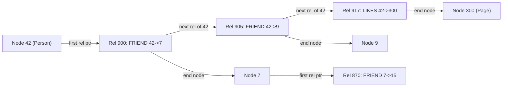

## In one minute
- A graph database stores nodes and relationships as first-class data, so queries that follow chains of relationships ("friends of friends who bought X") cost proportional to the part of the graph touched, not the total data size.
- Native engines such as Neo4j use *index-free adjacency*: each node record points directly to its relationship records, so a hop is a pointer chase rather than an index lookup.
- Query languages (Cypher, GQL, Gremlin, SPARQL) describe patterns of nodes and edges; the engine picks start points via indexes, then expands.
- The hard parts are supernodes, partitioning a graph across machines, and deep traversals whose fan-out grows exponentially.
- Many "graph" workloads at scale skip general graph databases: Facebook's TAO is an adjacency-list model on sharded MySQL with caching, and LinkedIn built its own in-memory graph engine, LIquid.

## How it works

### The property graph model
A node has labels (`Person`, `Account`) and properties. A relationship has a type (`FOLLOWS`, `TRANSFERRED_TO`), a direction, a start and end node, and properties of its own, such as a timestamp or amount. RDF stores use a simpler triple model (subject, predicate, object) aimed at linked data and ontologies; property graphs dominate application use. Property graphs now have a standard query language: GQL was published as ISO/IEC 39075 in April 2024, the first new ISO database language since SQL ([Wikipedia: GQL](https://en.wikipedia.org/wiki/Graph_Query_Language)). Cypher is converging on it, so vendor-specific syntax is slowly giving way to portable patterns.

### Storage: index-free adjacency
In a relational schema, finding a person's friends is a join: look up rows in an `edges` table via a B-tree index on `src_id`, then fetch the friend rows. Each hop costs O(log n) index work. In a native graph store, node and relationship records are fixed size, so a record id maps directly to a file offset. A node record holds a pointer to its first relationship; each relationship record holds pointers to the next relationship for both its start and end node, forming a doubly linked chain per node. Traversing one hop is following a few pointers, O(1) per edge, independent of graph size.

Non-native engines store adjacency lists in an underlying key-value store: key `(node, edge type, direction)` maps to a sorted list of neighbor ids. That is also efficient per hop and is far easier to shard.

### Query execution
A Cypher query such as:

```sql
MATCH (me:Person {id: 42})-[:FRIEND]->(f)-[:FRIEND]->(fof)
WHERE NOT (me)-[:FRIEND]->(fof) AND fof <> me
RETURN fof.id, count(*) AS mutual ORDER BY mutual DESC LIMIT 10
```

starts with an index lookup for `id: 42`, expands `FRIEND` edges to get friends, expands again, filters, and aggregates. Cost is the number of edges expanded: with 300 friends each having 300 friends, that is about 90,000 expansions, fine in memory. A third hop is 27 million, which is why depth limits matter.

### Scaling out
Graphs resist partitioning because most real graphs have no clean cuts: any split leaves many edges crossing machines, and each cross-machine hop is a network round trip. Options include replicating the whole graph to every server (a Neo4j cluster keeps full copies on its primaries and read-scaling secondaries), sharding by node id and accepting remote hops (TAO, many distributed graph stores), or partitioning by a natural boundary such as tenant. Sharding plus caching is how the largest graph runs: TAO serves over ten billion reads and tens of millions of writes per second ([Cheng et al., VLDB 2021](https://www.vldb.org/pvldb/vol14/p3014-cheng.pdf)). LinkedIn went the other way and built LIquid, a graph database with a Datalog-style query language, which holds 270 billion edges and serves 2 million queries per second ([LinkedIn Engineering](https://www.linkedin.com/blog/engineering/graph-systems/how-liquid-connects-everything-so-our-members-can-do-anything)).

### Supernodes
A celebrity with 50 million followers, or a "country: US" node linked to every user, turns any traversal through it into a scan. Mitigations include indexing relationships by type and property, splitting the node into buckets, or modelling such attributes as properties instead of nodes.

## Down the stack

### Layer 1: The contract
A native graph database such as Neo4j promises ACID transactions over nodes, relationships, and properties, and traversal cost proportional to the number of relationships visited rather than to the size of the graph. A relationship always has a valid start and end node: a plain `DELETE` of a node that still has relationships fails, and `DETACH DELETE` removes the node and its relationships together ([Cypher Manual](https://neo4j.com/docs/cypher-manual/current/clauses/delete/)). Reads within a transaction see a consistent state. In a Neo4j 5 cluster, one primary is elected writer and pushes each commit synchronously to the other primaries through Raft, so 2F + 1 primaries tolerate F failures. Secondaries (the role older versions called read replicas) receive the transaction log asynchronously and may lag, unless the client passes a bookmark so its next transaction only runs on a server that has applied its previous writes ([Neo4j clustering](https://neo4j.com/docs/operations-manual/current/clustering/introduction/)).

### Layer 2: The mechanism
Neo4j's classic record formats (`standard` and `aligned`) store each entity type in its own file of fixed-size records, so the record for id N lives at byte offset N times the record size. The figures widely cited for the `standard` format are 15 bytes per node record, 34 bytes per relationship record, and 41 bytes per property record. A node record holds an in-use flag, the id of its first relationship, the id of its first property, and inline label bits. A relationship record holds the start and end node ids, the relationship type, and four chain pointers: previous and next relationship for the start node, and previous and next for the end node. Each relationship therefore sits in two doubly linked lists, one per endpoint, so the engine can walk a node's relationships and unlink one in constant time.

Properties form a separate linked chain of property records, with long strings and arrays spilling into dynamic stores. For nodes with many relationships (above `db.relationship_grouping_threshold`, 50 by default), the record formats insert *relationship group* records that split the chain by type and direction, so expanding `:LIKES` on a busy node does not walk past its `:FOLLOWS` edges ([Neo4j settings](https://neo4j.com/docs/operations-manual/current/configuration/configuration-settings/)). This layout is no longer the default. Since 5.22, new Enterprise databases use the *block* format, which stores each node in a 128-byte block with small properties (under about 31 bytes) inlined, and spills larger data into separate dynamic stores (node dynamic records are capped at 8 KiB), aimed at the locality problem below. The `standard` and `high_limit` formats were deprecated in 5.23, and `aligned` remains the Community Edition default ([Neo4j store formats](https://neo4j.com/docs/operations-manual/current/database-internals/store-formats/)). Commits are written to a transaction log first, and the store files are updated afterwards through Neo4j's own page cache.

### Layer 3: The machine
Index-free adjacency turns every hop into pointer chasing, and every pointer is a dependent load: the CPU cannot fetch record N+1 until it has read record N's pointer. If the record is in CPU cache, that is a few nanoseconds; in DRAM, about 100 nanoseconds; on SSD, roughly 100 microseconds per miss. A 34-byte relationship record fits in one 64-byte cache line, but consecutive records in a node's chain were created at different times and are scattered across the file, so the prefetcher rarely helps. This is why Neo4j's sizing advice centres on the page cache, configured separately from the JVM heap: size it to the data plus native indexes plus about 20% for growth (Lucene and vector indexes are budgeted separately) ([Neo4j memory configuration](https://neo4j.com/docs/operations-manual/current/performance/memory-configuration/)).

Analytic graph engines take the opposite trade. They load the graph into compressed sparse row (CSR) arrays, where all neighbours of a node are contiguous integers, so expanding a node is a sequential scan the prefetcher and SIMD handle well. CSR is far faster to traverse but expensive to update, which is why it suits batch analytics rather than transactional writes.

### Why it's built this way
1. Graph queries are dominated by "follow this edge," so the store makes one hop a direct offset computation instead of an index search.
2. Direct offsets need fixed-size records, so variable-length data (properties, strings) moves to separate chains.
3. Edges must be walkable from both ends and deletable cheaply, so each relationship sits in two doubly linked lists.
4. Pointer chasing is latency bound and suffers on disk, so performance depends on fitting the store in memory.
5. Supernodes make chains long, so dense nodes get relationship groups split by type and direction.

## Diagram


## Worked example
A bank runs fraud detection on transfers: 80 million accounts, 2 billion transfer relationships over the last 12 months. The question at payment time is: "is the receiving account within 3 hops of any account flagged as fraudulent in the last 90 days?" with a 50 ms budget.

In a relational store, three self-joins on a 2-billion-row table with average out-degree 25 means up to 25 × 25 × 25 = 15,625 lookups, each a B-tree probe, often 100 ms to seconds. In a graph store with the hot subgraph in memory, each expansion is a pointer chase of roughly a microsecond, so 15,625 expansions take around 20 ms. Supernodes break this: a payment processor account with 4 million incoming edges would blow up the search, so the team marks known merchant hubs and stops expansion at them.

The storage cost is real. At roughly 34 bytes per relationship record and 15 bytes per node in Neo4j's older `standard` record format, before properties, 2 billion relationships need about 70 GB plus properties and indexes, so the team keeps 12 months of edges in the graph and archives older data to the warehouse.

## In the wild
- **Jepsen, 2018: Dgraph 1.0.2 loses acknowledged writes.** Testing Dgraph 1.0.2 through 1.0.6 on a five-node cluster with replication factor three found 23 issues: lost inserts (127 of 2,373 elements in one partition test, nearly all of about 497 during a predicate move), read skew in bank tests even on a single healthy node, and duplicate upserts. Dgraph fixed 19 before publication, mostly in 1.0.5 and 1.0.6. Distributed graph stores add shard moves to every failure mode a normal database has ([Jepsen](https://jepsen.io/analyses/dgraph-1-0-2)).
- **Meta, 2021: fractured reads in TAO.** TAO had no read transactions, and a measurement study found that 1 in 1,500 batched reads saw part of a multi-edge write, with anomalies lasting up to 30 seconds when a write's two-phase commit needed recovery. Meta added RAMP-TAO, which gives atomic visibility in one round trip for over 99.93% of reads at a 0.42% memory cost ([Cheng et al., VLDB 2021](https://www.vldb.org/pvldb/vol14/p3014-cheng.pdf)).
- **LinkedIn, 2023: People You May Know moves to a live graph.** PYMK had been computed offline on an older graph system and refreshed only periodically. Rebuilt on LIquid, it went from 120 to 18,000 queries per second, average latency dropped from over a second to under 50 ms, and CPU use fell by more than 3x at the same hardware cost ([LinkedIn Engineering](https://www.linkedin.com/blog/engineering/graph-systems/how-liquid-connects-everything-so-our-members-can-do-anything)).

## Trade-offs
| Option | Strengths | Weaknesses | Choose when |
|---|---|---|---|
| Native graph database (Neo4j, Memgraph) | Fast multi-hop traversal, expressive pattern queries | Harder to shard writes, specialized operations | Deep, variable-length traversals on a graph that fits a cluster |
| Adjacency lists on a sharded KV store (TAO-style) | Massive scale, simple, cache-friendly | Only one or two hops per request efficiently | Social graph reads at very high QPS |
| Relational with recursive CTEs | No new system, transactions, SQL tooling | Slow beyond 2 to 3 hops on large tables | Hierarchies, shallow relationships |
| Graph analytics engine (Spark GraphX, Pregel-style) | Whole-graph algorithms like PageRank | Batch latency, not for online queries | Offline scoring, community detection |
| RDF triple store | Standards, inference, linked data | Verbose model, less common in apps | Knowledge graphs with ontologies |

## Pitfalls in production
- **Unbounded variable-length paths.** `[:KNOWS*]` without a limit can explore the whole graph. Always cap depth and add a timeout. Newer Cypher writes bounded paths as quantified patterns such as `(()-[:KNOWS]->()){1,3}`; the old star syntax still runs but is not GQL conformant ([Cypher Manual](https://neo4j.com/docs/cypher-manual/current/patterns/variable-length-patterns/)).
- **Supernodes.** A few nodes with millions of edges dominate latency. Detect high-degree nodes, and model or index around them.
- **Using a graph database for everything.** Tabular aggregations and full scans are slower than in a columnar store. Keep the graph for relationship-heavy queries.
- **Write hotspots on popular nodes.** Many concurrent writers updating edges of one node contend on locks. Batch writes or bucket the node.
- **Memory-sized assumptions.** Traversal speed depends on the graph being in the page cache. Monitor cache hit ratio and plan memory with growth.

## Leadership lens
- Ask what the deepest traversal is and how many edges it touches at p99. That number decides whether you need a graph database.
- Prefer a derived graph fed from the system of record, so the graph can be rebuilt and is not a second source of truth.
- Weigh team skills: Cypher and graph modelling are new to most teams, and operational knowledge is scarcer than for SQL stores.
- Plan supernode handling and depth limits as part of the API contract, not as later fixes.

## Check yourself
1. Why does a hop in a native graph store not get slower as the graph grows?
   **Answer:** Each relationship record stores direct pointers to the next record, so a hop is a constant-time pointer chase instead of an index lookup whose cost grows with size.
2. Why is sharding a graph harder than sharding key-value data?
   **Answer:** Most graphs have no clean partition, so traversals frequently cross shards and each crossing costs a network round trip.
3. A 2-hop query is fast but the 3-hop version times out. What is the likely reason?
   **Answer:** Fan-out multiplies per hop, so the third hop can touch orders of magnitude more edges, especially if it passes through a supernode.
4. When is an adjacency list in a key-value store better than a graph database?
   **Answer:** When queries are mostly one or two hops at very high QPS and the data must be sharded across many machines.

## Practice
**Task:** Build a small directed property-graph store. `add_edge(src, label, dst)` stores a typed edge. `neighbors(node, label)` returns destinations in insertion order. `k_hop(start, label, k)` returns the sorted list of nodes reachable in 1 to `k` hops following only that label, excluding `start`. `shortest_path(a, b, label)` returns the node list of a shortest path from `a` to `b` using BFS, `[a]` if `a == b`, or `None` if unreachable. Cycles must not cause infinite loops.

```python starter
class Graph:
    def add_edge(self, src, label, dst):
        raise NotImplementedError

    def neighbors(self, node, label):
        raise NotImplementedError

    def k_hop(self, start, label, k):
        raise NotImplementedError

    def shortest_path(self, a, b, label):
        raise NotImplementedError
```

```python tests
def build():
    g = Graph()
    for a, b in [(1, 2), (1, 3), (2, 4), (3, 4), (4, 5), (5, 1)]:
        g.add_edge(a, "FOLLOWS", b)
    g.add_edge(1, "BLOCKS", 9)
    return g

def test_neighbors_by_label():
    g = build()
    assert g.neighbors(1, "FOLLOWS") == [2, 3]
    assert g.neighbors(1, "BLOCKS") == [9]
    assert g.neighbors(42, "FOLLOWS") == []

def test_k_hop():
    g = build()
    assert g.k_hop(1, "FOLLOWS", 1) == [2, 3]
    assert g.k_hop(1, "FOLLOWS", 2) == [2, 3, 4]
    assert g.k_hop(1, "FOLLOWS", 10) == [2, 3, 4, 5]

def test_k_hop_respects_label():
    g = build()
    assert g.k_hop(1, "BLOCKS", 3) == [9]

def test_shortest_path():
    g = build()
    assert g.shortest_path(2, 1, "FOLLOWS") == [2, 4, 5, 1]
    assert g.shortest_path(3, 3, "FOLLOWS") == [3]

def test_unreachable():
    g = build()
    assert g.shortest_path(9, 1, "FOLLOWS") is None
    assert g.shortest_path(1, 9, "FOLLOWS") is None
```

```python solution
from collections import deque

class Graph:
    def __init__(self):
        self.adj = {}

    def add_edge(self, src, label, dst):
        self.adj.setdefault((src, label), []).append(dst)

    def neighbors(self, node, label):
        return list(self.adj.get((node, label), []))

    def k_hop(self, start, label, k):
        seen, frontier = {start}, [start]
        for _ in range(k):
            nxt = []
            for n in frontier:
                for m in self.neighbors(n, label):
                    if m not in seen:
                        seen.add(m)
                        nxt.append(m)
            frontier = nxt
        seen.discard(start)
        return sorted(seen)

    def shortest_path(self, a, b, label):
        parent, q = {a: None}, deque([a])
        while q:
            n = q.popleft()
            if n == b:
                path = []
                while n is not None:
                    path.append(n)
                    n = parent[n]
                return path[::-1]
            for m in self.neighbors(n, label):
                if m not in parent:
                    parent[m] = n
                    q.append(m)
        return None
```

```typescript starter
export class Graph {
  addEdge(src: number, label: string, dst: number): void { throw new Error("TODO"); }
  neighbors(node: number, label: string): number[] { throw new Error("TODO"); }
  kHop(start: number, label: string, k: number): number[] { throw new Error("TODO"); }
  shortestPath(a: number, b: number, label: string): number[] | null { throw new Error("TODO"); }
}
```

```typescript tests
function build(): Graph {
  const g = new Graph();
  for (const [a, b] of [[1, 2], [1, 3], [2, 4], [3, 4], [4, 5], [5, 1]]) g.addEdge(a, "FOLLOWS", b);
  g.addEdge(1, "BLOCKS", 9);
  return g;
}
test("neighbors by label", () => {
  const g = build();
  assertEqual(g.neighbors(1, "FOLLOWS"), [2, 3]);
  assertEqual(g.neighbors(1, "BLOCKS"), [9]);
  assertEqual(g.neighbors(42, "FOLLOWS"), []);
});
test("k hop", () => {
  const g = build();
  assertEqual(g.kHop(1, "FOLLOWS", 1), [2, 3]);
  assertEqual(g.kHop(1, "FOLLOWS", 2), [2, 3, 4]);
  assertEqual(g.kHop(1, "FOLLOWS", 10), [2, 3, 4, 5]);
});
test("k hop respects label", () => {
  assertEqual(build().kHop(1, "BLOCKS", 3), [9]);
});
test("shortest path", () => {
  const g = build();
  assertEqual(g.shortestPath(2, 1, "FOLLOWS"), [2, 4, 5, 1]);
  assertEqual(g.shortestPath(3, 3, "FOLLOWS"), [3]);
});
test("unreachable", () => {
  const g = build();
  assertEqual(g.shortestPath(9, 1, "FOLLOWS"), null);
  assertEqual(g.shortestPath(1, 9, "FOLLOWS"), null);
});
```

```typescript solution
export class Graph {
  private adj = new Map<string, number[]>();

  addEdge(src: number, label: string, dst: number): void {
    const key = src + "|" + label;
    if (!this.adj.has(key)) this.adj.set(key, []);
    this.adj.get(key)!.push(dst);
  }

  neighbors(node: number, label: string): number[] {
    return [...(this.adj.get(node + "|" + label) ?? [])];
  }

  kHop(start: number, label: string, k: number): number[] {
    const seen = new Set<number>([start]);
    let frontier = [start];
    for (let i = 0; i < k; i++) {
      const next: number[] = [];
      for (const n of frontier) {
        for (const m of this.neighbors(n, label)) {
          if (!seen.has(m)) { seen.add(m); next.push(m); }
        }
      }
      frontier = next;
    }
    seen.delete(start);
    return [...seen].sort((a, b) => a - b);
  }

  shortestPath(a: number, b: number, label: string): number[] | null {
    const parent = new Map<number, number | null>([[a, null]]);
    const queue = [a];
    for (let head = 0; head < queue.length; head++) {
      let n: number | null = queue[head];
      if (n === b) {
        const path: number[] = [];
        while (n !== null) { path.push(n); n = parent.get(n)!; }
        return path.reverse();
      }
      for (const m of this.neighbors(n, label)) {
        if (!parent.has(m)) { parent.set(m, n); queue.push(m); }
      }
    }
    return null;
  }
}
```

```go starter
package practice

type Graph struct{}

func NewGraph() *Graph { return &Graph{} }

func (g *Graph) AddEdge(src int, label string, dst int)       { panic("TODO") }
func (g *Graph) Neighbors(node int, label string) []int        { panic("TODO") }
func (g *Graph) KHop(start int, label string, k int) []int     { panic("TODO") }
func (g *Graph) ShortestPath(a, b int, label string) []int     { panic("TODO") }
```

```go tests
package practice

import (
	"reflect"
	"testing"
)

func build() *Graph {
	g := NewGraph()
	for _, e := range [][2]int{{1, 2}, {1, 3}, {2, 4}, {3, 4}, {4, 5}, {5, 1}} {
		g.AddEdge(e[0], "FOLLOWS", e[1])
	}
	g.AddEdge(1, "BLOCKS", 9)
	return g
}

func eq(t *testing.T, got, want []int) {
	t.Helper()
	if len(got) == 0 && len(want) == 0 {
		return
	}
	if !reflect.DeepEqual(got, want) {
		t.Fatalf("got %v, want %v", got, want)
	}
}

func TestNeighborsByLabel(t *testing.T) {
	g := build()
	eq(t, g.Neighbors(1, "FOLLOWS"), []int{2, 3})
	eq(t, g.Neighbors(1, "BLOCKS"), []int{9})
	eq(t, g.Neighbors(42, "FOLLOWS"), nil)
}

func TestKHop(t *testing.T) {
	g := build()
	eq(t, g.KHop(1, "FOLLOWS", 1), []int{2, 3})
	eq(t, g.KHop(1, "FOLLOWS", 2), []int{2, 3, 4})
	eq(t, g.KHop(1, "FOLLOWS", 10), []int{2, 3, 4, 5})
}

func TestKHopRespectsLabel(t *testing.T) {
	eq(t, build().KHop(1, "BLOCKS", 3), []int{9})
}

func TestShortestPath(t *testing.T) {
	g := build()
	eq(t, g.ShortestPath(2, 1, "FOLLOWS"), []int{2, 4, 5, 1})
	eq(t, g.ShortestPath(3, 3, "FOLLOWS"), []int{3})
}

func TestUnreachable(t *testing.T) {
	g := build()
	if g.ShortestPath(9, 1, "FOLLOWS") != nil || g.ShortestPath(1, 9, "FOLLOWS") != nil {
		t.Fatal("expected nil path")
	}
}
```

```go solution
package practice

import "sort"

type edgeKey struct {
	node  int
	label string
}

type Graph struct {
	adj map[edgeKey][]int
}

func NewGraph() *Graph { return &Graph{adj: map[edgeKey][]int{}} }

func (g *Graph) AddEdge(src int, label string, dst int) {
	k := edgeKey{src, label}
	g.adj[k] = append(g.adj[k], dst)
}

func (g *Graph) Neighbors(node int, label string) []int {
	return append([]int{}, g.adj[edgeKey{node, label}]...)
}

func (g *Graph) KHop(start int, label string, k int) []int {
	seen := map[int]bool{start: true}
	frontier := []int{start}
	var out []int
	for i := 0; i < k; i++ {
		var next []int
		for _, n := range frontier {
			for _, m := range g.adj[edgeKey{n, label}] {
				if !seen[m] {
					seen[m] = true
					next = append(next, m)
					out = append(out, m)
				}
			}
		}
		frontier = next
	}
	sort.Ints(out)
	return out
}

func (g *Graph) ShortestPath(a, b int, label string) []int {
	parent := map[int]int{a: a}
	queue := []int{a}
	for len(queue) > 0 {
		n := queue[0]
		queue = queue[1:]
		if n == b {
			path := []int{n}
			for n != a {
				n = parent[n]
				path = append([]int{n}, path...)
			}
			return path
		}
		for _, m := range g.adj[edgeKey{n, label}] {
			if _, ok := parent[m]; !ok {
				parent[m] = n
				queue = append(queue, m)
			}
		}
	}
	return nil
}
```

## Mock interview
**Prompt:** Design a "people you may know" feature for a professional network with 900 million members and an average of 400 connections each. Suggestions must refresh within a day and load in under 100 ms.

- Follow-up: Would you compute friends-of-friends online or offline, and why?
- Follow-up: How do you handle members with 30,000 connections?
- Follow-up: How would you shard the connection graph?

**A strong answer covers:**
- Fan-out math: 400 × 400 = 160,000 second-degree candidates per member, too many to rank online every time.
- Offline batch candidate generation with online re-ranking and filtering.
- Adjacency lists sharded by member id, with caching for one-hop reads.
- Supernode caps and sampling for high-degree members.
- Freshness: incremental updates when new connections form.

## Sources and further study
**Primary**
- [ISO/IEC 39075:2024, GQL](https://webstore.iec.ch/publication/94107): the first ISO query language for property graphs, published April 2024.
- [Cheng et al., RAMP-TAO (VLDB 2021)](https://www.vldb.org/pvldb/vol14/p3014-cheng.pdf): adding read atomicity to TAO, with measured anomaly rates from production.
- [Jepsen: Dgraph 1.0.2](https://jepsen.io/analyses/dgraph-1-0-2): what goes wrong when a sharded graph store moves data during faults.

**Systems docs**
- [Neo4j: Store formats](https://neo4j.com/docs/operations-manual/current/database-internals/store-formats/): block versus aligned formats, entity limits and the deprecation timeline.
- [Neo4j: Clustering introduction](https://neo4j.com/docs/operations-manual/current/clustering/introduction/): primaries, secondaries, and causal consistency with bookmarks.
- [LIquid: The soul of a new graph database, Part 1 (LinkedIn)](https://engineering.linkedin.com/blog/2020/liquid-the-soul-of-a-new-graph-database-part-1): why LinkedIn chose a relational model with Datalog for its graph.

**Books**
- *Designing Data-Intensive Applications* (1st ed.), Martin Kleppmann, chapter 2 "Data Models and Query Languages": the "Graph-Like Data Models" section compares property graphs, triple stores, Cypher, SPARQL and Datalog.
- *Designing Data-Intensive Applications* (2nd ed.), Martin Kleppmann and Chris Riccomini, chapter 3 "Data Models and Query Languages": the updated graph section.

**Other curricula**
- [donnemartin/system-design-primer](https://github.com/donnemartin/system-design-primer): gives graph databases one short NoSQL entry that calls them new and rarely used and points to FlockDB; that view is dated now that GQL is an ISO standard.
- [Azure Architecture Center: Understand data models](https://learn.microsoft.com/en-us/azure/architecture/data-guide/technology-choices/understand-data-store-models): frames graph stores by workload (fraud rings, knowledge graphs) and warns about overhead when relationships are shallow.

## Watch
- [USENIX ATC '13: TAO, Facebook's Distributed Data Store for the Social Graph](https://www.youtube.com/watch?v=sNIvHttFjdI): the authors present TAO's model, caching, and consistency.
- [Graph Database Internals: Neo4j with Michael Hunger (The Geek Narrator)](https://www.youtube.com/watch?v=iihJXKAQZkA): record formats, index-free adjacency, and query execution.

## Free resources
- [TAO (USENIX ATC 2013)](https://www.usenix.org/system/files/conference/atc13/atc13-bronson.pdf): how Facebook serves the social graph from sharded MySQL plus caches.
- [TAO: The power of the graph (Meta Engineering)](https://engineering.fb.com/2013/06/25/core-infra/tao-the-power-of-the-graph/): a shorter overview of the same system.
- [Neo4j Cypher Manual: Introduction](https://neo4j.com/docs/cypher-manual/current/introduction/): pattern matching as a query language.
- [Neo4j: What is a graph database?](https://neo4j.com/docs/getting-started/graph-database/): the property graph model and where it fits.
- [Wikipedia: Graph database](https://en.wikipedia.org/wiki/Graph_database): background on models, storage approaches, and history.
